# 15 —— 竞争格局

> [!NOTE]
> 本页为英文原文的简体中文参考译文，仅供参考；如有出入，以[英文原文](../../../cross-cutting/15-competitive-landscape/index.md "English original")为准。

跨层专题 15 · 谁在与英伟达竞争、在哪些层级竞争、竞争强度如何 · 约 22 分钟阅读 · 最后核实：2026-11-05

## ⚡ 要点速览

- **市场规模翻了两番，份额几乎未变。** 2025 年英伟达（NVIDIA）占 AI 数据中心芯片收入的约 87%，2023 年约为 90%；同期市场规模从约 $53B 增至约 $224B（估计，本资料库测算）[[S416]](../../../sources/bibliography.md#s416)[[S1]](../../../sources/bibliography.md#s1)[[S660]](../../../sources/bibliography.md#s660)[[S661]](../../../sources/bibliography.md#s661)[[S663]](../../../sources/bibliography.md#s663)。定制 [ASIC](../../glossary.md#asic) 约占收入的 10%，但 TrendForce 估计基于 ASIC 的服务器将占 2026 年 AI 服务器出货量的约 27.8% [[S2517]](../../../sources/bibliography.md#s2517)。
- **没有任何对手能匹敌其全栈布局。** 最接近的谷歌（Google）[TPU](../../glossary.md#tpu) 在英伟达 12 个层级中的 5 个持平或领先；在本资料库的评分矩阵中，所有“对手×层级”单元格中有 60% 被评为“落后” [[S15014]](../../../sources/bibliography.md#s15014)。
- **AMD 已弥合芯片差距。** MI455X 标称 432 GB [HBM4](../../glossary.md#hbm4)、23.3 TB/s 带宽和 20 [PFLOPS](../../glossary.md#flops) FP8，而 Rubin 为 288 GB、19.2 TB/s 和 17.5 PFLOPS [[S144]](../../../sources/bibliography.md#s144)[[S90093]](../../../sources/bibliography.md#s90093)[[S33005]](../../../sources/bibliography.md#s33005)[[S90006]](../../../sources/bibliography.md#s90006)。在 MLPerf Llama 2 70B 测试中，MI355X 单卡性能与 B200 持平（12,935 vs 12,994 tokens/s）[[S602]](../../../sources/bibliography.md#s602)。
- **[超大规模云厂商](../../glossary.md#hyperscaler)的自研芯片单芯片性能落后，但成本占优。** 自有 Ironwood 的每芯片小时成本约为 $1.21，而 GB300 约为 $2.31（估计，SemiAnalysis）[[S622]](../../../sources/bibliography.md#s622)。但 Rubin 的 HBM4 重新拉开了硬件差距：2026 年超大规模云厂商芯片的内存带宽仅为 Rubin 的 32–45%（本资料库测算）[[S15014]](../../../sources/bibliography.md#s15014)。
- **最大的买家如今采用组合采购。** OpenAI：6 GW 的 AMD、10 GW 由博通（Broadcom）打造的加速器，以及自 2027 年起约 2 GW 的 Trainium [[S24000]](../../../sources/bibliography.md#s24000)[[S174]](../../../sources/bibliography.md#s174)[[S15000]](../../../sources/bibliography.md#s15000)。Anthropic：最多 1M 颗 TPU 和最多 5 GW 的 Trainium [[S653]](../../../sources/bibliography.md#s653)[[S15000]](../../../sources/bibliography.md#s15000)。Meta：6 GW 的 AMD，外加租用的 TPU [[S24004]](../../../sources/bibliography.md#s24004)[[S90025]](../../../sources/bibliography.md#s90025)。
- **收入数据仍显示英伟达一家独大。** 其 FY2026 约 $194B 的数据中心收入约为 AMD 数据中心分部的 12×、博通 AI 收入的约 10× [[S1]](../../../sources/bibliography.md#s1)[[S450]](../../../sources/bibliography.md#s450)[[S451]](../../../sources/bibliography.md#s451)。博通是攀升最快的对手：其 Q3 FY2026 的 AI 收入为 $16.7B，同比增长 221% [[S2516]](../../../sources/bibliography.md#s2516)。
- 🔴 **本资料库判断：** 英伟达的领先如今是平台与迭代节奏的领先，而非芯片本身的领先。竞争对手在动摇其出货量之前，早已先压制其在最大买家处的定价权。

## 市场份额：商用 GPU 与定制 ASIC

两类卖方在相互竞争。[商用芯片](../../glossary.md#merchant-silicon)厂商（英伟达、AMD、英特尔（Intel）及初创公司）向所有客户销售芯片和系统。定制 ASIC 为单一买家设计，通常与博通或美满电子（Marvell）等 [ASIC 设计合作伙伴](../../glossary.md#asic-design-partner)合作开发，从不在公开市场销售。份额很难衡量：定制芯片的“价格”是设计合作伙伴的收入，而非买家原本需要付给英伟达的金额。

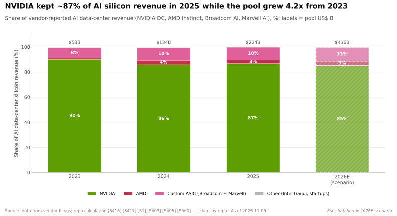

| 年份 | 市场规模（US$ B，估计） | 英伟达 | AMD | 定制 ASIC（博通 + 美满电子） | 其他 |
|---|---|---|---|---|---|
| 2023 | ~53 | 90.2% | 0.9% | 8.3% | 0.6% |
| 2024 | ~134 | 85.7% | 3.7% | 10.2% | 0.4% |
| 2025 | ~224 | 86.6% | 3.0% | 10.2% | 0.2% |
| 2026E | ~448 | 82.8% | 3.3% | 13.6% | 0.2% |

本资料库基于公司财报在 `data/market_share.csv` 中测算 [[S416]](../../../sources/bibliography.md#s416)[[S417]](../../../sources/bibliography.md#s417)[[S1]](../../../sources/bibliography.md#s1)[[S660]](../../../sources/bibliography.md#s660)[[S661]](../../../sources/bibliography.md#s661)[[S662]](../../../sources/bibliography.md#s662)[[S663]](../../../sources/bibliography.md#s663)；不含中国本土市场（华为昇腾）；2026E 为 🔴 推测。

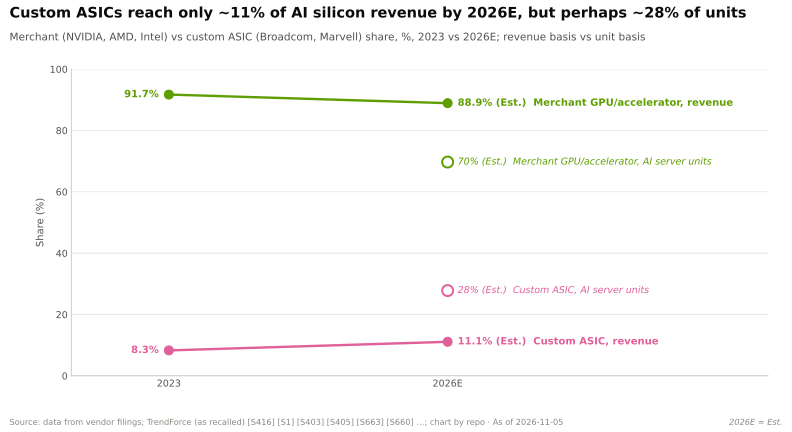

> [!TIP]
> **算例 —— 为何 ASIC 按金额约占 14%，按出货量却约占 28%。** TrendForce 估计基于 ASIC 的服务器占 2026 年 AI 服务器出货量的约 27.8%，基于 GPU 的服务器约占 69.7% [[S2517]](../../../sources/bibliography.md#s2517)[[S666]](../../../sources/bibliography.md#s666)。收入占比约为 14% 对 86%（估计，已将博通 FY2026 更新为约 $57B）[[S15014]](../../../sources/bibliography.md#s15014)。因此，ASIC 相对于 GPU 的单位收入为 (14 ÷ 27.8) ÷ (86 ÷ 69.7) ≈ 0.50 ÷ 1.23 ≈ **0.41**。一台定制 ASIC 服务器为其供应商带来的收入，约为一台 GPU 服务器为英伟达及其合作伙伴带来收入的 40 %。**结论：** 出货量份额夸大了对英伟达收入的威胁，但它衡量的是对其*出货量*和定价权的威胁。（口径不同：服务器与芯片；🔴 本资料库测算。）

定制 ASIC 的收入体现在设计合作伙伴身上。博通的 AI 收入（既包括 AI 以太网，也包括定制 [XPU](../../glossary.md#xpu)）从 2023 年的约 $3.8B 增至 2025 财年的约 $20.2B [[S660]](../../../sources/bibliography.md#s660)[[S661]](../../../sources/bibliography.md#s661)，随后单季度（Q3 FY2026）即达 $16.7B，并指引 Q4 为 $21.7B [[S2516]](../../../sources/bibliography.md#s2516)。图表现采用约 $57B 作为博通的 FY2026 数据——即已报告季度与指引季度之和 [[S2516]](../../../sources/bibliography.md#s2516)。

**超大规模云厂商的钱包。** 厂商市场份额掩盖了买家的整体支出规模。四大超大规模云厂商对 2026 年资本开支的指引约为 $728B（取中值）[[S12518]](../../../sources/bibliography.md#s12518)[[S12519]](../../../sources/bibliography.md#s12519)。英伟达来自超大规模客户的数据中心收入年化约 $173B，约占其四分之一 [[S403]](../../../sources/bibliography.md#s403)[[S406]](../../../sources/bibliography.md#s406)。大部分资本开支流向建筑、电力、网络和内存。

🔧 技术细节：份额数据包含什么、遗漏什么

- **英伟达**按数据中心收入衡量，其中包括网络（FY2026 约 $31B）、CPU 和系统，因此高估了“GPU”份额 [[S402]](../../../sources/bibliography.md#s402)。
- **定制 ASIC** 按博通和美满电子的 AI 收入计算，其中包括 AI 以太网以及 OpenAI 等非超大规模客户，但不含超大规模云厂商自身的设计成本。
- **AMD** 为 Instinct 估计值（AMD 未披露）；其数据中心分部还包含 EPYC CPU [[S663]](../../../sources/bibliography.md#s663)[[S450]](../../../sources/bibliography.md#s450)。
- **中国**未计入：华为昇腾收入未公开，而英伟达在出口管制后对华数据中心销售接近于零 [[S90011]](../../../sources/bibliography.md#s90011)。
- 没有公开来源提供“买家的加速器成本”这一更合适的分母，因此所有份额数据都应视为存在 ±3 个百分点的误差。

## 各对手的竞争领域：层级、广度与深度

顶部的热力图对 12 家对手在英伟达 12 个技术栈层级（从第 02 层芯片到第 13 层生态与资本）上逐一评分。每个单元格都有 🟩🟨🟥🟦 判定及附出处的理由，见 `data/competitor_matrix.csv`。[技术栈广度](../../glossary.md#stack-breadth)统计对手得分至少 3 分（满分 5 分）的层级数；深度为其得分最高的三个层级的平均分。

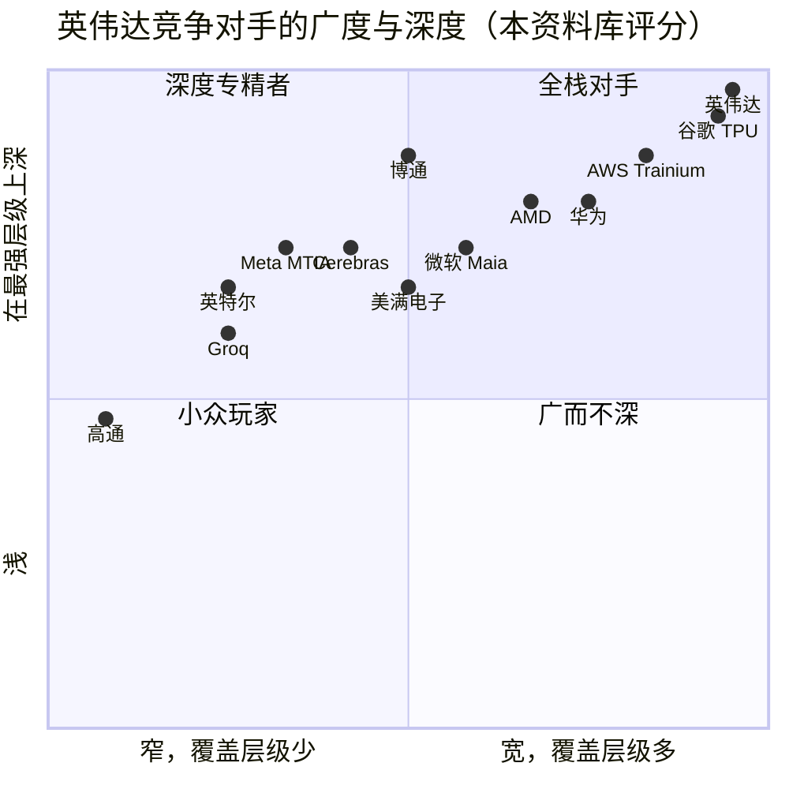

x = 得分 ≥ 3（满分 5）的层级数除以 12；y = 得分最高的三个层级的平均分除以 5。英伟达和谷歌 TPU 均覆盖 12 个层级且得分为 5.0，为便于辨认已将二者错开。本资料库分析师判断（🔴）[[S15014]](../../../sources/bibliography.md#s15014)。

有三个规律十分突出。

1. **只有垂直整合的超大规模云厂商覆盖面广。** 谷歌和 AWS 在 10–12 个层级上得分，因为它们拥有云、网络、CPU 和芯片，但这种广度只存在于其自有数据中心内部。
2. **AMD 是唯一覆盖面广的商用厂商。** 它覆盖 8 个层级，并在其中一个层级（EPYC 主机 CPU）领先，但在软件、机架和[纵向扩展（scale-up）](../../glossary.md#scale-up)上落后。
3. **大多数对手只是单点方案。** 12 家中有 7 家覆盖六个或更少的层级。博通深度最高：它在以太网交换上领先，同时*向*超大规模云厂商销售芯片。

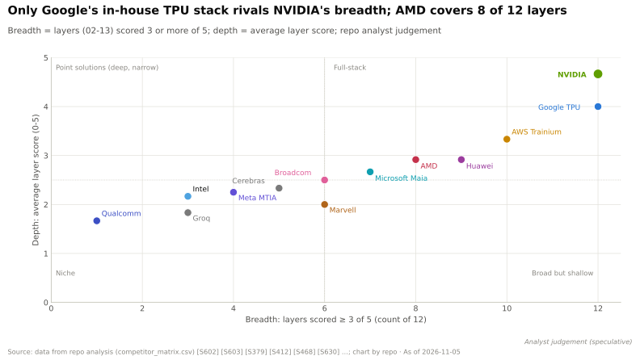

> [!TIP]
> **算例 —— 解读谷歌的“12 中占 5”。** 谷歌的 TPU 技术栈在推理成本和云分发上为 🟩，在芯片、CPU 和机架上为 🟨，在纵向扩展、[横向扩展（scale-out）](../../glossary.md#scale-out)和卸载（offload）上为 🟦（自研设计，不对外销售），在内存供应、系统软件、软件库和生态上为 🟥 [[S15014]](../../../sources/bibliography.md#s15014)。因此 12 个单元格中有 5 个为 🟩 或 🟨。若各层级等权，谷歌的平均分为 4.0，英伟达为 4.7。这 0.7 分的差距几乎全部来自软件以及对外销售能力。**结论：** 谷歌若开放其技术栈，可以弥合大部分差距；2025–26 年的举措（向 Anthropic、Meta 和甲骨文（Oracle）提供 TPU）正是朝这一方向迈出的一步。

雷达图在九个能力维度上讲述了同样的故事：每个对手都在软件上落后，多数在机架级系统上落后，而领先之处则零散分布（AMD 在内存，谷歌在纵向扩展域规模和成本，博通在以太网交换）。

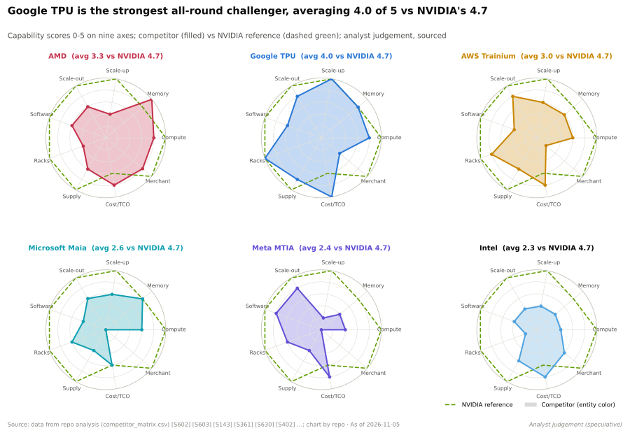

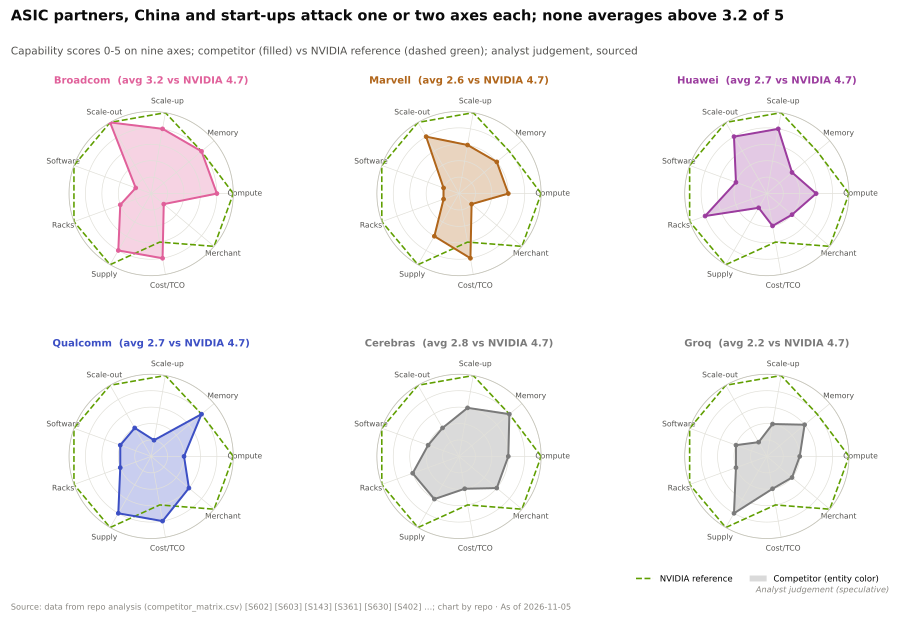

## 战略原型

竞争对手以五种方式挑战英伟达，每种方式都有其自身的经济引擎和失败模式。

| 原型 | 代表厂商 | 经济引擎 | 对英伟达构成的最佳情形 | 典型失败模式 |
|---|---|---|---|---|
| [全栈商用厂商](../../glossary.md#full-stack-merchant) | 英伟达；AMD（建设中）；英特尔（重新进入） | 向所有客户销售芯片、机架和软件 | 规格相同、价格更低的第二供应商（[AMD](amd.md)） | 软件和机架成熟度滞后；数据中心收入少约 13×，难以支撑迭代节奏 [[S405]](../../../sources/bibliography.md#s405)[[S450]](../../../sources/bibliography.md#s450) |
| 超大规模云厂商自研（[自用芯片](../../glossary.md#captive-silicon)） | 谷歌 TPU、AWS Trainium、微软 Maia、Meta MTIA | 在自有工作负载上消除商用厂商的利润 | 在一个 TPU 工作负载上每 token 成本低约 18% [[S625]](../../../sources/bibliography.md#s625) | 每代需要约 130,000 颗芯片才能回本（🔴）[[S23010]](../../../sources/bibliography.md#s23010)；仅限内部使用 |
| 设计服务公司 | 博通、美满电子、联发科（MediaTek）、世芯（Alchip）、创意电子（GUC） | 就设计、SerDes、封装和供应收费 | 把每个大买家都变成潜在的 XPU 客户（[定制 ASIC 设计公司](custom-asic-houses.md)） | 客户集中于少数几家；依赖台积电（TSMC）和 HBM 配额 |
| 推理专精厂商 | Cerebras、SambaNova、Etched、d-Matrix、Tenstorrent；高通（Qualcomm）AI200/AI250 | 重构内存架构，以提升 token 速度或降低成本 | 随推理需求增长赢得延迟或成本细分市场（[推理初创公司](inference-startups.md)、[高通](qualcomm.md)） | 软件覆盖面窄；Groq 的技术已被英伟达以约 $20B 获得授权（🟡）[[S90018]](../../../sources/bibliography.md#s90018) |
| [国家冠军企业](../../glossary.md#national-champion) | 华为昇腾、寒武纪（Cambricon） | 出口管制保护下的本土市场 | 在英伟达被排除在外的情况下主导中国市场（[中国](china.md)） | 制程节点和 HBM 受限；SuperPoD 出货未经证实（🔴）[[S90042]](../../../sources/bibliography.md#s90042) |

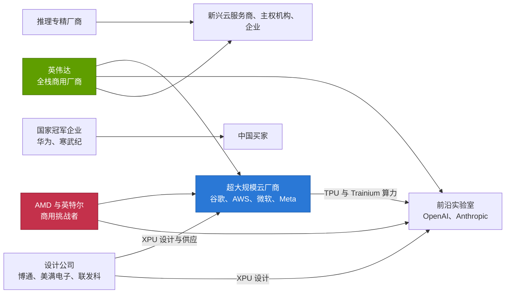

2025–26 年的转变：超大规模云厂商成为前沿实验室的*供应商*。谷歌向 Anthropic 和 Meta 出租并出售 TPU [[S653]](../../../sources/bibliography.md#s653)[[S90025]](../../../sources/bibliography.md#s90025)；AWS 向 Anthropic 和 OpenAI 供应 Trainium [[S15000]](../../../sources/bibliography.md#s15000)。而这些公司仍是英伟达最大的客户。

> [!TIP]
> **算例 —— 自研芯片的盈亏平衡点。** 一个前沿制程芯片项目的设计成本约为 $0.6–0.7B；若将软件和系统成本计入、翻倍至约 $1.4B（🔴）[[S2500]](../../../sources/bibliography.md#s2500)[[S2501]](../../../sources/bibliography.md#s2501)。如果自研芯片能节省 B200 每小时约 $1.73 自有成本的约 18%，则每芯片年可节省约 $2,700 [[S625]](../../../sources/bibliography.md#s625)[[S622]](../../../sources/bibliography.md#s622)。盈亏平衡点约为 520,000 芯片年，即在四年内每代约 130,000 颗芯片（🔴 本资料库测算，来自 [CS3](../../case-studies/CS3-google-tpu-the-credible-alternative.md)）[[S23010]](../../../sources/bibliography.md#s23010)。**结论：** 只有四大超大规模云厂商和两三家前沿实验室能跨过这一门槛。其他所有买家要么购买商用芯片，要么租用他人的 ASIC。

## 差距缩小了多少？

下图比较每个挑战者的最新芯片与同年出货的英伟达旗舰（[同年旗舰](../../glossary.md#same-year-flagship)）在内存带宽和稠密 [FP8](../../glossary.md#fp8) 算力上的相对水平。带宽对推理最为关键，因为每生成一个 token 都要从[高带宽内存（HBM）](../../glossary.md#hbm)中重新读取一遍模型权重。

| 挑战者 | 2023–24 年位置（占英伟达带宽的 %） | 2025 | 2026 | 方向 |
|---|---|---|---|---|
| AMD Instinct | 158%（MI300X vs H100） | 100%（MI355X vs GB300） | 121%（MI455X vs Rubin） | 🟩 重新领先 |
| 谷歌 TPU | 83%（v5p vs H100） | 92%（Ironwood vs GB300） | 约 45%（TPU 8i vs Rubin） | 🟥 被 HBM4 重新拉开 |
| AWS Trainium | 60%（Trn2 vs H200） | 61%（Trn3 vs GB300） | —（Trn4 尚未定档） | 🟥 落后，保持稳定 |
| 微软 Maia | 38%（Maia 100 vs H200） | — | 36%（Maia 200 vs Rubin） | 🟥 落后，保持稳定 |
| Meta MTIA | 4%（v2 vs H200） | — | 32%（MTIA 300 vs Rubin） | 🟥 从低位快速追赶 |

本资料库根据厂商峰值规格测算 [[S141]](../../../sources/bibliography.md#s141)[[S143]](../../../sources/bibliography.md#s143)[[S144]](../../../sources/bibliography.md#s144)[[S90093]](../../../sources/bibliography.md#s90093)[[S151]](../../../sources/bibliography.md#s151)[[S154]](../../../sources/bibliography.md#s154)[[S155]](../../../sources/bibliography.md#s155)[[S157]](../../../sources/bibliography.md#s157)[[S158]](../../../sources/bibliography.md#s158)[[S15010]](../../../sources/bibliography.md#s15010)[[S15002]](../../../sources/bibliography.md#s15002)[[S33005]](../../../sources/bibliography.md#s33005)[[S90006]](../../../sources/bibliography.md#s90006)[[S15014]](../../../sources/bibliography.md#s15014)。

> [!TIP]
> **算例 —— “Rubin 带宽的 45%”在[解码（decode）](../../glossary.md#decode)阶段意味着什么。** 对一个 70B 参数的 FP8 模型，每个解码步骤需重新读取约 70 GB 的权重。以 19.2 TB/s 计，一颗 Rubin GPU 每秒可完成约 274 次；以 8.6 TB/s 计，一颗 TPU 8i 约 123 次 [[S90006]](../../../sources/bibliography.md#s90006)[[S15010]](../../../sources/bibliography.md#s15010)。这意味着在批处理之前，单流速度上限约为 274 对 123 tokens/s。要达到 Rubin 的每秒 token 数，TPU 集群需要约 2.2× 的芯片，因此每 TPU 芯片小时的成本须低于 Rubin 芯片小时的约 45%。SemiAnalysis 估计自有 Ironwood 的芯片小时成本（$1.21）约为 Vera Rubin（$3.61）的 34%（估计）[[S622]](../../../sources/bibliography.md#s622)；如果 TPU 8i 的成本与 Ironwood 相当，即可跨过这一门槛。**结论：** 成本优势可以在带宽差距下勉强保住；它依靠的是价格，而非芯片本身。

下方散点图加入了所有公开数据加速器的算力与内存容量。Rubin 和 MI455X 独占右上角；已出货的定制 ASIC 大致聚集在 GB300 的水平。

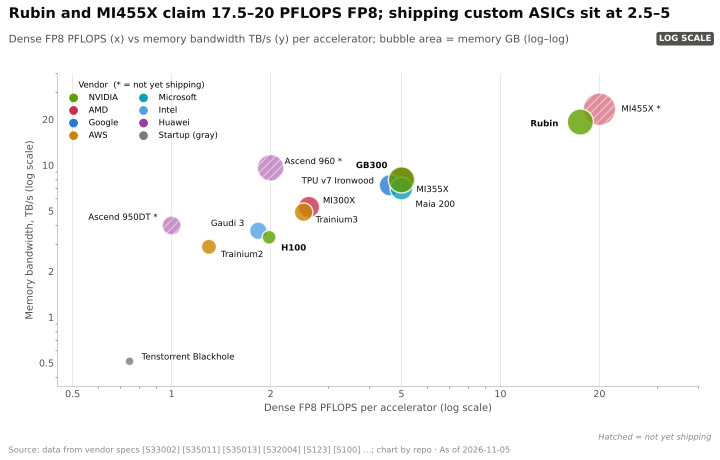

## MLPerf 证据：独立基准测试显示了什么

[MLPerf](../../glossary.md#mlperf) 是唯一经过审计的跨厂商基准测试。它有两大局限：厂商自行决定是否提交，而超大规模云厂商的 ASIC 大多不提交。谷歌仅在 Inference v5.0 以及 Training v5.0 及之前的轮次中提交过 TPU 结果；Trainium、Maia 和 MTIA 没有封闭组（closed division）结果 [[S601]](../../../sources/bibliography.md#s601)[[S602]](../../../sources/bibliography.md#s602)[[S603]](../../../sources/bibliography.md#s603)[[S613]](../../../sources/bibliography.md#s613)。

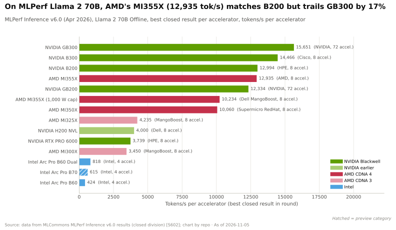

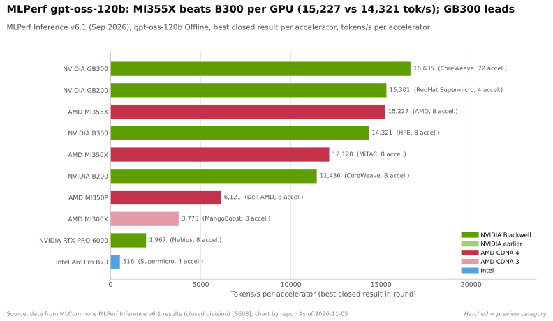

在单节点推理上，AMD 已缩小差距：MI355X 在 Llama 2 70B 上与 B200 持平，并在 gpt-oss-120b 上击败 B300——后者是一个奖励内存带宽的混合专家模型（MoE）[[S602]](../../../sources/bibliography.md#s602)[[S603]](../../../sources/bibliography.md#s603)。英伟达的领先在机架规模上重新显现。GB300 [NVL72](../../glossary.md#nvl72) 在两张图中均居首位；在每用户 50 tokens/s 的交互速度下，SemiAnalysis 的 InferenceX 测得 GB300 NVL72 每 GPU 约 6,261 tokens/s，而 MI355X 约为 738 [[S621]](../../../sources/bibliography.md#s621)[[S622]](../../../sources/bibliography.md#s622)。

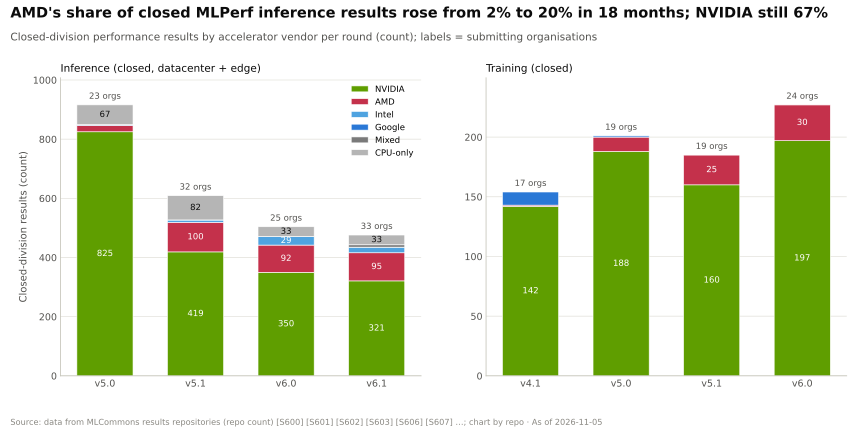

> [!TIP]
> **算例 —— 基于 MLPerf 结果的每美元 token 数。** 在 Llama 2 70B Offline 上，MI355X 为 12,935 tokens/s，GB300 为 15,651 [[S602]](../../../sources/bibliography.md#s602)。按 SemiAnalysis 估计的每 [GPU 小时](../../glossary.md#gpu-hour)自有成本约 $1.50 和约 $2.31 计算 [[S622]](../../../sources/bibliography.md#s622)，即每美元小时约 8,600 对约 6,800 tokens/s：在该测试中 **AMD 领先约 27%**（估计）。在 DeepSeek-R1 上以每用户 50 tokens/s 测算时排名逆转：6,261 ÷ 2.31 ≈ 2,710 对 738 ÷ 1.50 ≈ 490，**GB300 NVL72 领先约 5.5×** [[S621]](../../../sources/bibliography.md#s621)[[S622]](../../../sources/bibliography.md#s622)。**结论：** 哪家厂商“胜出”取决于工作负载的交互速度目标。批处理和离线任务青睐便宜且内存充裕的 GPU；交互式推理则青睐英伟达的机架级 [NVLink](../../glossary.md#nvlink) 域。

训练方面的对比更为悬殊。在 8-GPU 微调上，MI355X（8.3 分钟）介于 B200（7.9）和 GB200（9.6）之间 [[S609]](../../../sources/bibliography.md#s609)。但没有任何非英伟达加速器提交过 Llama 3.1 405B 预训练基准测试，而英伟达系统在该测试上已扩展至 8,192 颗 GPU [[S607]](../../../sources/bibliography.md#s607)[[S609]](../../../sources/bibliography.md#s609)。

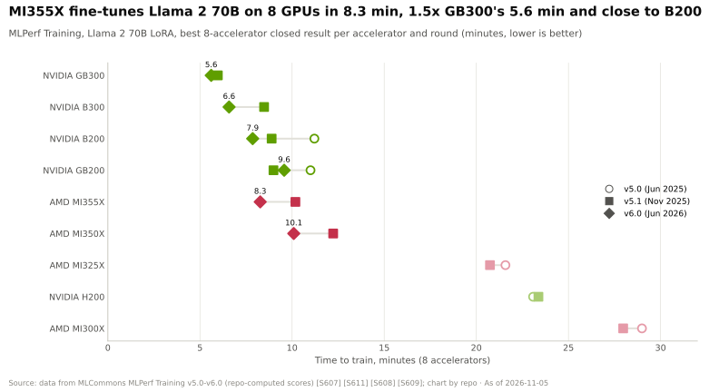

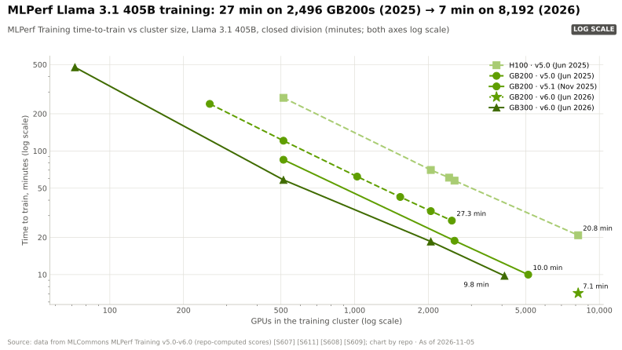

🔧 技术细节：如何解读 MLPerf 而不被误导

- **封闭组与开放组。** 封闭组要求使用参考模型并达到精度目标；开放组允许改动（量化、剪枝）。只应比较封闭组结果。
- **Offline 与 Server 场景。** Offline 在所有查询一次性就绪时衡量原始吞吐量；Server 为每个查询增加了延迟约束。交互式产品关心的是后者，而英伟达的机架级优势在此更为突出。
- **按单加速器归一化**掩盖了系统成本：一个 NVL72 机架包含 36 颗 Grace CPU 和 NVLink 交换托盘，而 8-GPU 的 AMD 节点没有这些。
- **缺席本身就是信息。** 自 TPU 在 v5.0 之后退出 MLPerf，买家只能依赖谷歌和分析师提供的数据 [[S613]](../../../sources/bibliography.md#s613)。

## 十个竞争对手页面

| 页面 | 原型 | 其最有力的论据 | 对英伟达的威胁（🔴 本资料库观点） |
|---|---|---|---|
| [AMD](amd.md) | 全栈商用厂商（挑战者） | 规格持平或高于 Rubin、开放机架、14 GW 承诺 [[S144]](../../../sources/bibliography.md#s144)[[S24000]](../../../sources/bibliography.md#s24000)[[S24004]](../../../sources/bibliography.md#s24004) | 🟥 在前沿实验室处高；其他领域中等 |
| [谷歌 TPU](google-tpu.md) | 超大规模云厂商自研，现已对外销售 | 实测每 token 成本最低；9,216 芯片 pod [[S625]](../../../sources/bibliography.md#s625)[[S151]](../../../sources/bibliography.md#s151) | 🟥 价格层面高；商用出货量层面低 |
| [AWS Trainium](aws-trainium.md) | 超大规模云厂商自研 | 超过 $225B 的 Trainium 承诺；以 Anthropic 和 OpenAI 为锚定客户 [[S15000]](../../../sources/bibliography.md#s15000) | 🟨 中等；受软件制约 |
| [微软 Maia](microsoft-maia.md) | 超大规模云厂商自研 | Copilot 推理每美元性能提升约 30%（厂商说法）[[S15007]](../../../sources/bibliography.md#s15007) | 🟨 2027 年起为中等 |
| [Meta MTIA](meta-mtia.md) | 超大规模云厂商自研 | 两年推出四代；掌控 PyTorch [[S15003]](../../../sources/bibliography.md#s15003)[[S9028]](../../../sources/bibliography.md#s9028) | 🟨 低到中等；Meta 同时也是英伟达的头部买家 |
| [定制 ASIC 设计公司](custom-asic-houses.md) | 设计服务 | 博通单季度 AI 收入 $16.7B [[S2516]](../../../sources/bibliography.md#s2516) | 🟥 高：它们为每一家超大规模云厂商提供武器 |
| [英特尔](intel.md) | 商用厂商（重新进入） | x86 在位优势；英伟达自身的 $5B 入股及 NVLink x86 CPU [[S4009]](../../../sources/bibliography.md#s4009) | 🟩 作为加速器对手威胁低 |
| [高通](qualcomm.md) | 推理专精厂商 | 每卡 768 GB LPDDR，用于低成本推理（公开信息）[[S90028]](../../../sources/bibliography.md#s90028) | 🟩 目前低；尚无已确认的 2026 年出货（🔴） |
| [推理初创公司](inference-startups.md) | 推理专精厂商 | 以 SRAM 和晶圆级设计追求速度；OpenAI–Cerebras 最多 750 MW [[S11523]](../../../sources/bibliography.md#s11523) | 🟨 小众；英伟达已吸收 Groq 的技术 [[S90018]](../../../sources/bibliography.md#s90018) |
| [中国](china.md) | 国家冠军企业 | 受保护的市场；计划推出 8,192 芯片的 Atlas 950 SuperPoD [[S90042]](../../../sources/bibliography.md#s90042) | 🟥 在中国高，其他地区低 |

## 总体判断

2026 年 11 月的英伟达**覆盖面广，但在任何单一层级上都已不再无人挑战**。AMD 在纸面上持平或领先（在 HBM 容量和带宽上领先）[[S144]](../../../sources/bibliography.md#s144)[[S90093]](../../../sources/bibliography.md#s90093)，在单节点基准测试中也很接近；谷歌 TPU 在已测工作负载上的每 token 成本更低；基于博通的以太网赢得了后端网络之争 [[S90053]](../../../sources/bibliography.md#s90053)。但没有任何对手拥有这样的组合：一款商用产品，在各处销售，每年更新，并为每个新模型提供首日（day-zero）软件支持。正是这一组合使其份额保持在 85–90% 附近，同时价格维持了约 75% 的毛利率 [[S405]](../../../sources/bibliography.md#s405)。

因此，竞争首先冲击的是**价格**，其次是**在最大买家处的份额**，最后才是出货量。[CS3](../../case-studies/CS3-google-tpu-the-credible-alternative.md) 的测算表明，英伟达可以把每 token 成本降至与 TPU 相当，同时仍保有约 62% 的毛利率（🔴）[[S23010]](../../../sources/bibliography.md#s23010)。与此同时，由[新兴云服务商（neocloud）](../../glossary.md#neocloud)、主权机构和企业组成的长尾客户——在 Q2 FY2027 占数据中心收入的约 45% [[S406]](../../../sources/bibliography.md#s406)——几乎没有现实的替代方案。

> [!TIP]
> **算例 —— 份额与利润率。** 在约 $436B 的 2026E 市场中，每一个百分点约值 $4.4B [[S15014]](../../../sources/bibliography.md#s15014)。若在约 $371B 的数据中心年度（FY2027E）上同时失去五个百分点的份额*和*五个百分点的毛利率 [[S403]](../../../sources/bibliography.md#s403)[[S405]](../../../sources/bibliography.md#s405)，英伟达将损失约 $22B 的收入，以及剩余收入上约 $17B 的毛利（🔴 本资料库测算）。**结论：** 英伟达所保留的 80% 以上份额所承受的利润率压力，与份额流失同样重要。

> [!NOTE]
> **🐂 看多观点。** 三年来对手一直在*规格*上与英伟达看齐，但在市场规模翻两番的同时，其份额仅下降约 3 个百分点 [[S15014]](../../../sources/bibliography.md#s15014)。每个挑战者都在软件和机架上落后——这恰恰是最难复制的两项——而英伟达每年都推出新平台（2026 年 Rubin、2027 年 Rubin Ultra、2028 年 Feynman）[[S90003]](../../../sources/bibliography.md#s90003)[[S90004]](../../../sources/bibliography.md#s90004)。超大规模云厂商仍在持续采购：即便在自研 MTIA 的同时，Meta 仍承诺采购“数百万颗” Blackwell 和 Rubin GPU [[S4006]](../../../sources/bibliography.md#s4006)。

> [!WARNING]
> **🐻 看空观点。** 四家最大的买家都有自研芯片，其中两家如今还将这些芯片卖给英伟达的其他大客户。据 TrendForce 预测，定制 ASIC 的出货量份额将在 2026 年达到约 28%，到 2030 年约 40% [[S2517]](../../../sources/bibliography.md#s2517)。一旦某个模型系列能在 TPU 或 Trainium 上良好运行，下一个模型的迁移成本就会下降。一家商用对手（AMD）已在内存规格上超越 Rubin，其“股权换产能”交易将 14 GW 的前沿需求放到了非英伟达的路线图上 [[S24000]](../../../sources/bibliography.md#s24000)[[S24004]](../../../sources/bibliography.md#s24004)[[S9538]](../../../sources/bibliography.md#s9538)。

| 值得关注的信号（2027 年） | 利好英伟达的情形 | 利空的情形 |
|---|---|---|
| OpenAI 的首个 AMD 吉瓦（MI450） | 爬坡延迟，或主要用于承接溢出的推理需求 | 前沿模型训练在 Helios 上大规模运行 |
| 谷歌云之外的 TPU 销售 | 仍局限于 Anthropic 和 Meta | 甲骨文等厂商广泛转售 TPU [[S552]](../../../sources/bibliography.md#s552) |
| 超大规模云厂商参与 MLPerf | ASIC 持续缺席 | Trainium 或 Maia 发布经审计的胜出结果 |
| 博通 AI 收入 | 增速放缓至低于英伟达 | 超过英伟达数据中心收入的约 25% |
| 英伟达毛利率 | 维持在约 75% | 在超大规模客户处滑向 60% 出头 |

## 🎯 企业发展视角

1. **份额究竟在向哪里转移？** 收入份额显示英伟达约占 87%；出货量份额显示 ASIC 接近约 28%。挑战者的商业论证应采用哪个指标？对新的商用进入者而言，哪些买家（前沿实验室、超大规模云厂商、主权机构）真正可以争取？
2. **设计服务价值池。** 博通 AI 收入的增速快于英伟达 [[S2516]](../../../sources/bibliography.md#s2516)。哪些能力使设计公司不可或缺（[SerDes](../../glossary.md#serdes)、封装、HBM 供应、机架集成）？新进入者可以通过自建、收购或合作获得其中哪些能力？
3. **软件是共同短板。** 每张雷达图的软件轴都处于落后。高通公开收购 Modular（约 $3.9B，Mojo/MAX），瞄准硬件可移植的 AI 软件 [[S90057]](../../../sources/bibliography.md#s90057)。什么证据（首日模型支持、MLPerf 提交）能表明此类软件栈正在为任一挑战者缩小差距？
4. **推理是各类原型的交汇点。** TPU、Trainium、Maia 和 MTIA 如今都以推理为优先，初创公司以及高通公开的 AI200/AI250 计划亦然 [[S90028]](../../../sources/bibliography.md#s90028)。一旦超大规模云厂商将自研 ASIC 出租给外部客户，商用推理专精厂商还有生存空间吗？
5. **与英伟达合作还是竞争。** AWS 在 Trainium4 上采用了 [NVLink Fusion](../../glossary.md#nvlink-fusion)；英特尔在打造 NVLink [x86](../../glossary.md#x86) CPU [[S90034]](../../../sources/bibliography.md#s90034)[[S4009]](../../../sources/bibliography.md#s4009)。何时接入英伟达的互连架构比与之对抗更划算？

## 📚 来源（Sources）

<!-- Auto-generated from the [S…] citations on this page by `make build`. Edit sources/registry/*.csv, not this list. -->

- [**S1**](../../../sources/bibliography.md#s1) NVIDIA Corporation via SEC EDGAR, *NVIDIA Announces Financial Results for Fourth Quarter and Fiscal 2026 (Form 8-K exhibit 99.1)*, 2026-02-25. [Link](https://www.sec.gov/Archives/edgar/data/1045810/000104581026000019/q4fy26pr.htm)
- [**S141**](../../../sources/bibliography.md#s141) AMD, *AMD Instinct MI300X Accelerator*, 2023-12-06. [Link](https://www.amd.com/en/products/accelerators/instinct/mi300/mi300x.html)
- [**S143**](../../../sources/bibliography.md#s143) AMD, *AMD Instinct MI350 Series (MI350X, MI355X)*, 2025-06-12. [Link](https://www.amd.com/en/products/accelerators/instinct/mi350.html)
- [**S144**](../../../sources/bibliography.md#s144) AMD Newsroom, *AMD Unveils Vision for an Open AI Ecosystem, Detailing New Silicon, Software and Systems at Advancing AI 2025*, 2025-06-12. [Link](https://www.amd.com/en/newsroom/press-releases/2025-6-12-amd-unveils-vision-for-an-open-ai-ecosystem-detai.html)
- [**S151**](../../../sources/bibliography.md#s151) Google Blog (Amin Vahdat), *Ironwood: The first Google TPU for the age of inference*, 2025-04-09. [Link](https://blog.google/products/google-cloud/ironwood-tpu-age-of-inference/)
- [**S154**](../../../sources/bibliography.md#s154) AWS Neuron SDK docs, *AWS Neuron documentation: Trainium2 architecture*, 2024-12. [Link](https://awsdocs-neuron.readthedocs-hosted.com/en/latest/general/arch/neuron-hardware/trainium2.html)
- [**S155**](../../../sources/bibliography.md#s155) Amazon Web Services, *AWS Trainium (product page: Trn2, Trn3)*, 2025-12. [Link](https://aws.amazon.com/ai/machine-learning/trainium/)
- [**S157**](../../../sources/bibliography.md#s157) Microsoft Tech Community, *Inside Maia 100: Revolutionizing AI Workloads with Microsoft's Custom AI Accelerator*, 2024-08-27. [Link](https://techcommunity.microsoft.com/blog/azureinfrastructureblog/inside-maia-100-revolutionizing-ai-workloads-with-microsofts-custom-ai-accelerator/4229118)
- [**S158**](../../../sources/bibliography.md#s158) Microsoft, *Maia 200: Microsoft's AI accelerator built for inference*, 2026-01. [Link](https://blogs.microsoft.com/blog/2026/01/26/maia-200-the-ai-accelerator-built-for-inference/)
- [**S174**](../../../sources/bibliography.md#s174) OpenAI, *OpenAI and Broadcom announce strategic collaboration to deploy 10 gigawatts of OpenAI-designed AI accelerators*, 2025-10-13. [Link](https://openai.com/index/openai-and-broadcom-announce-strategic-collaboration/)
- [**S402**](../../../sources/bibliography.md#s402) NVIDIA Corporation via SEC EDGAR (Colette Kress), *CFO Commentary on Fourth Quarter and Fiscal 2026 Results (Form 8-K exhibit 99.2)*, 2026-02-25. [Link](https://www.sec.gov/Archives/edgar/data/1045810/000104581026000019/q4fy26cfocommentary.htm)
- [**S403**](../../../sources/bibliography.md#s403) NVIDIA Corporation via SEC EDGAR, *NVIDIA Announces Financial Results for First Quarter Fiscal 2027 (Form 8-K exhibit 99.1)*, 2026-05-20. [Link](https://www.sec.gov/Archives/edgar/data/0001045810/000104581026000051/q1fy27pr.htm)
- [**S405**](../../../sources/bibliography.md#s405) NVIDIA Corporation via SEC EDGAR, *NVIDIA Announces Financial Results for Second Quarter Fiscal 2027 (Form 8-K exhibit 99.1)*, 2026-08-26. [Link](https://www.sec.gov/Archives/edgar/data/0001045810/000104581026000073/q2fy27pr.htm)
- [**S406**](../../../sources/bibliography.md#s406) NVIDIA Corporation (Colette Kress), *CFO Commentary on Second Quarter Fiscal 2027 Results*, 2026-08-26. [Link](https://s201.q4cdn.com/141608511/files/doc_financials/2027/Q227/Q2FY27-CFO-Commentary.pdf)
- [**S416**](../../../sources/bibliography.md#s416) NVIDIA Corporation via SEC EDGAR, *NVIDIA Corporation Form 10-K for fiscal year ended January 26, 2025*, 2025-02-26. [Link](https://www.sec.gov/Archives/edgar/data/1045810/000104581025000023/nvda-20250126.htm)
- [**S417**](../../../sources/bibliography.md#s417) NVIDIA Corporation via SEC EDGAR, *NVIDIA Corporation Form 10-K for fiscal year ended January 28, 2024*, 2024-02-21. [Link](https://www.sec.gov/Archives/edgar/data/1045810/000104581024000029/nvda-20240128.htm)
- [**S450**](../../../sources/bibliography.md#s450) U.S. Securities and Exchange Commission (EDGAR), *Advanced Micro Devices Form 10-K / 10-Q filings (EDGAR index)*, 2025-02-05. [Link](https://www.sec.gov/cgi-bin/browse-edgar?action=getcompany&CIK=0000002488&type=10-&dateb=&owner=include&count=40)
- [**S451**](../../../sources/bibliography.md#s451) U.S. Securities and Exchange Commission (EDGAR), *Broadcom Inc. Form 10-K / 8-K earnings filings (EDGAR index)*, 2025-12-11. [Link](https://www.sec.gov/cgi-bin/browse-edgar?action=getcompany&CIK=0001730168&type=8-K&dateb=&owner=include&count=40)
- [**S552**](../../../sources/bibliography.md#s552) Google Cloud Blog (Karan Batta), *Bringing Google TPUs to Oracle Cloud Infrastructure*, 2026-10-27. [Link](https://cloud.google.com/blog/products/infrastructure/bringing-google-tpus-to-oracle-cloud-infrastructure)
- [**S601**](../../../sources/bibliography.md#s601) MLCommons, *MLPerf Inference v5.1 results (summary_results.json and per-submitter logs)*, 2025-09-09. [Link](https://github.com/mlcommons/inference_results_v5.1)
- [**S602**](../../../sources/bibliography.md#s602) MLCommons, *MLPerf Inference v6.0 results (summary_results.json and per-submitter logs)*, 2026-04-01. [Link](https://github.com/mlcommons/inference_results_v6.0)
- [**S603**](../../../sources/bibliography.md#s603) MLCommons, *MLPerf Inference v6.1 results (summary.csv and per-submitter logs)*, 2026-09. [Link](https://github.com/mlcommons/inference_results_v6.1)
- [**S607**](../../../sources/bibliography.md#s607) MLCommons, *MLPerf Training v5.0 results (per-submitter logs and system descriptions)*, 2025-06-04. [Link](https://github.com/mlcommons/training_results_v5.0)
- [**S609**](../../../sources/bibliography.md#s609) MLCommons, *MLPerf Training v6.0 results (per-submitter logs and system descriptions)*, 2026-06. [Link](https://github.com/mlcommons/training_results_v6.0)
- [**S613**](../../../sources/bibliography.md#s613) NAND Research, *MLPerf Inference 6.0: Software Gains, Broadening Competition Shake Things Up*, 2026-04. [Link](https://nand-research.com/mlperf-inference-6-0-software-gains-broadening-competition-shake-things-up/)
- [**S621**](../../../sources/bibliography.md#s621) SemiAnalysis (InferenceX-app repository), *InferenceX public API snapshot (benchmarks.json and benchmarks-history.json fixtures)*, 2026-10-17. [Link](https://github.com/SemiAnalysisAI/InferenceX-app/tree/main/packages/app/cypress/fixtures/api)
- [**S622**](../../../sources/bibliography.md#s622) SemiAnalysis (InferenceX-app repository), *InferenceX hardware registry: TCO per GPU-hour by SKU (SemiAnalysis July 2026 pricing surveys and AI Cloud TCO Model)*, 2026-07. [Link](https://github.com/SemiAnalysisAI/InferenceX-app/blob/main/packages/constants/src/gpu-keys.ts)
- [**S625**](../../../sources/bibliography.md#s625) SemiAnalysis, *TPU Inference Externalization Full Steam Ahead*, 2026-09-07. [Link](https://github.com/SemiAnalysisAI/InferenceX-app/blob/main/packages/app/content/blog/tpu-inferencex-full-steam.mdx)
- [**S653**](../../../sources/bibliography.md#s653) Anthropic, *Expanding our use of Google Cloud TPUs and Services*, 2025-10-23. [Link](https://www.anthropic.com/news/expanding-our-use-of-google-cloud-tpus-and-services)
- [**S660**](../../../sources/bibliography.md#s660) Broadcom Inc., *Broadcom Inc. Announces Fourth Quarter and Fiscal Year 2024 Financial Results*, 2024-12-12. [Link](https://investors.broadcom.com/financial-information/quarterly-results)
- [**S661**](../../../sources/bibliography.md#s661) Broadcom Inc., *Broadcom Inc. Announces Fourth Quarter and Fiscal Year 2025 Financial Results*, 2025-12-11. [Link](https://investors.broadcom.com/financial-information/quarterly-results)
- [**S662**](../../../sources/bibliography.md#s662) Marvell Technology, *Marvell Technology fourth quarter and fiscal 2025 results and AI revenue commentary*, 2025-03-04. [Link](https://investor.marvell.com/news-events/press-releases)
- [**S663**](../../../sources/bibliography.md#s663) AMD, *AMD Reports Fourth Quarter and Full Year 2024 Financial Results*, 2025-02-04. [Link](https://ir.amd.com/news-events/press-releases)
- [**S666**](../../../sources/bibliography.md#s666) TrendForce, *TrendForce AI server shipment forecasts (GPU-based vs ASIC-based share)*, 2025-10. [Link](https://www.trendforce.com/presscenter/news)
- [**S2500**](../../../sources/bibliography.md#s2500) Tom's Hardware, *Firm Estimates a 2nm Chip Now Costs $725 Million to Design*, 2023. [Link](https://www.tomshardware.com/news/firm-estimates-a-2nm-chip-now-costs-dollar725-million-to-design)
- [**S2501**](../../../sources/bibliography.md#s2501) Silicon Analysts, *Chip Design & NRE Cost by Node — Historical Time Series Data*, 2026. [Link](https://siliconanalysts.com/market-data/nre-design-cost)
- [**S2516**](../../../sources/bibliography.md#s2516) Broadcom Inc. via SEC EDGAR, *Broadcom Inc. Announces Third Quarter Fiscal Year 2026 Financial Results (Form 8-K exhibit 99.1)*, 2026-09. [Link](https://www.sec.gov/Archives/edgar/data/0001730168/000173016826000076/avgo-08022026x8kxex99.htm)
- [**S2517**](../../../sources/bibliography.md#s2517) TrendForce, *CSPs accelerate ASIC push in 2H26, challenging NVIDIA as MediaTek, GUC, Alchip benefit*, 2026-03-20. [Link](https://www.trendforce.com/news/2026/03/20/news-csps-accelerate-asic-push-in-2h26-challenging-nvidia-as-mediatek-guc-alchip-benefit/)
- [**S4006**](../../../sources/bibliography.md#s4006) SiliconANGLE, *Meta agrees to buy millions of AI chips from Nvidia, raising doubts about its in-house hardware*, 2026-02-17. [Link](https://siliconangle.com/2026/02/17/meta-agrees-buy-millions-ai-chips-nvidia-raising-doubts-house-hardware/)
- [**S4009**](../../../sources/bibliography.md#s4009) SDxCentral, *Intel gets hands on Nvidia's $5B investment*, 2025-12. [Link](https://www.sdxcentral.com/news/intel-gets-hands-on-nvidias-5b-investment/)
- [**S9028**](../../../sources/bibliography.md#s9028) StorageReview, *Meta's MTIA roadmap: four chip generations in two years put GenAI inference first*, 2026-03. [Link](https://www.storagereview.com/news/metas-mtia-roadmap-four-chip-generations-in-two-years-put-genai-inference-first)
- [**S9538**](../../../sources/bibliography.md#s9538) The Next Web, *AMD is investing $5 billion in Anthropic and deploying 2 gigawatts of Helios GPUs to run Claude*, 2026. [Link](https://thenextweb.com/news/amd-anthropic-5-billion-investment-2gw-helios-mi450)
- [**S11523**](../../../sources/bibliography.md#s11523) DatacenterDynamics, *OpenAI signs $10 billion deal with Cerebras with 750MW of big chip compute*, 2026-01-14. [Link](https://www.datacenterdynamics.com/en/news/openai-signs-10-billion-deal-with-cerebras-with-750mw-of-big-chip-compute/)
- [**S12518**](../../../sources/bibliography.md#s12518) Datacentres.com, *Hyperscaler capex trends: over $700 billion for 2026*, 2026-08. [Link](https://www.datacentres.com/guides/hyperscaler-capex-trends)
- [**S12519**](../../../sources/bibliography.md#s12519) Hargreaves Lansdown, *AI hyperscalers are expected to finish the year spending a whopping $828 billion on capex*, 2026-10. [Link](https://www.hl.co.uk/news/ai-hyperscalers-are-expected-to-finish-the-year-spending-a-whopping-828-billion-on-capex)
- [**S15000**](../../../sources/bibliography.md#s15000) About Amazon (Andy Jassy), *Amazon CEO Andy Jassy on Amazon's chips business (Q1 2026 earnings)*, 2026-04-29. [Link](https://www.aboutamazon.com/news/company-news/amazon-ceo-andy-jassy-amazon-chips-business-q1-2026-earnings)
- [**S15002**](../../../sources/bibliography.md#s15002) Tom's Hardware, *Meta's MTIA chip lineup joins hyperscaler push to replace Nvidia at inference*, 2026-03. [Link](https://www.tomshardware.com/tech-industry/semiconductors/metas-mtia-chip-lineup-joins-hyperscaler-push-to-replace-nvidia-at-inference)
- [**S15003**](../../../sources/bibliography.md#s15003) Meta AI Blog, *Meta MTIA: scaling AI chips for billions of users*, 2026-03-11. [Link](https://ai.meta.com/blog/meta-mtia-scale-ai-chips-for-billions/)
- [**S15007**](../../../sources/bibliography.md#s15007) Network World, *Microsoft launches its second-generation AI inference chip Maia 200*, 2026-01-26. [Link](https://www.networkworld.com/article/4122439/microsoft-launches-its-second-generation-ai-inference-chip-maia-200.html)
- [**S15010**](../../../sources/bibliography.md#s15010) StorageReview, *Google announces TPU 8t (Sunfish) and TPU 8i (Zebrafish)*, 2026-04. [Link](https://www.storagereview.com/news/google-announces-tpu-8t-sunfish-and-tpu-8i-zebrafish)
- [**S15014**](../../../sources/bibliography.md#s15014) nvidia_deep_dive_claude repository, *Repo analysis: Chapter 15A competitive-landscape calculations (gap-to-flagship ratios, implied AMD commitment value, hyperscaler wallet shares, breadth vs depth)*, 2026-11-05. [Link](https://github.com/FrankHuang94/nvidia_deep_dive_claude/blob/main/cross-cutting/15-competitive-landscape/index.md)
- [**S23010**](../../../sources/bibliography.md#s23010) nvidia_deep_dive_claude repository, *Repo analysis: CS3 TPU economics (break-even fleet for an in-house ASIC, per-token gap vs B200, implied GPU price cut)*, 2026-11-05. [Link](https://github.com/FrankHuang94/nvidia_deep_dive_claude/blob/main/case-studies/CS3-google-tpu-the-credible-alternative.md)
- [**S24000**](../../../sources/bibliography.md#s24000) AMD (press release PDF), *AMD and OpenAI Announce Strategic Partnership to Deploy 6 Gigawatts of AMD GPUs*, 2025-10-06. [Link](https://d1io3yog0oux5.cloudfront.net/_be34f20d01abfe28aeec9c2c12afe601/amd/news/2025-10-06_AMD_and_OpenAI_Announce_Strategic_Partnership_to_1260.pdf)
- [**S24004**](../../../sources/bibliography.md#s24004) The Register, *AMD copy-pastes 6 GW chips-for-stock deal in new Meta agreement*, 2026-02-24. [Link](https://www.theregister.com/2026/02/24/amd_copypastes_openai_6gw_chipsforstock/)
- [**S33005**](../../../sources/bibliography.md#s33005) NVIDIA, *NVIDIA Vera Rubin NVL72 (product page and specifications)*, 2026. [Link](https://www.nvidia.com/en-us/data-center/vera-rubin-nvl72/)
- [**S90003**](../../../sources/bibliography.md#s90003) eWeek, *Everything Nvidia Just Announced at GTC 2026: 7 Chips, 5 Racks, 1 Giant Bet on Agentic AI*, 2026-03-17. [Link](https://www.eweek.com/news/nvidia-gtc-2026-ai-inference-vera-rubin-neuron/)
- [**S90004**](../../../sources/bibliography.md#s90004) TrendForce, *Key GTC takeaways: how Samsung, Micron, Intel and more power NVIDIA's Vera Rubin and Feynman*, 2026-03-17. [Link](https://www.trendforce.com/news/2026/03/17/news-key-gtc-takeaways-how-samsung-micron-intel-more-power-nvidias-vera-rubin-and-feynman/)
- [**S90006**](../../../sources/bibliography.md#s90006) TweakTown, *Nvidia cuts Vera Rubin's memory bandwidth by up to 26% and AMD's Helios now leads in memory bandwidth*, 2026-10. [Link](https://www.tweaktown.com/news/114304/nvidia-cuts-vera-rubins-memory-bandwidth-by-up-to-26-percent-and-amds-helios-now-leads-in-memory-bandwidth/index.html)
- [**S90011**](../../../sources/bibliography.md#s90011) Nasdaq (Zacks), *NVIDIA Q2 earnings beat on Blackwell Ultra and Data Center strength*, 2026-08-27. [Link](https://www.nasdaq.com/articles/nvidia-q2-earnings-beat-blackwell-ultra-data-center-strength)
- [**S90018**](../../../sources/bibliography.md#s90018) Constellation Research, *Nvidia's Groq deal: acquisition, acquihire or creative licensing deal?*, 2025-12. [Link](https://www.constellationr.com/insights/news/nvidias-groq-deal-acquisition-acquihire-or-creative-licensing-deal)
- [**S90025**](../../../sources/bibliography.md#s90025) SiliconANGLE, *Google and Meta reportedly strike new multibillion-dollar AI chip deal*, 2026-02-26. [Link](https://siliconangle.com/2026/02/26/google-meta-reportedly-strike-new-multibillion-dollar-ai-chip-deal/)
- [**S90028**](../../../sources/bibliography.md#s90028) TechRepublic, *Qualcomm unveils AI chips to rival Nvidia, AMD*, 2025-10-27. [Link](https://techrepublic.com/article/news-qualcomm-unveils-ai-chips-to-rival-nvidia-amd)
- [**S90034**](../../../sources/bibliography.md#s90034) NAND Research, *AWS releases Trainium3, teases Trainium4*, 2025-12. [Link](https://nand-research.com/research-note-aws-releases-trainium3-teases-trainium4/4/)
- [**S90042**](../../../sources/bibliography.md#s90042) TrendForce, *Huawei unveils Ascend 950 with in-house HBM in 2026, touts SuperPoD to rival NVIDIA*, 2025-09-18. [Link](https://www.trendforce.com/news/2025/09/18/news-huawei-unveils-ascend-950-with-in-house-hbm-in-2026-touts-superpod-to-rival-nvidia/)
- [**S90053**](../../../sources/bibliography.md#s90053) Dell'Oro Group, *Ethernet more than doubles size of InfiniBand as the leading fabric for AI scale-out networks in 2025*, 2026. [Link](https://www.delloro.com/news/ethernet-more-than-doubles-size-of-infiniband-as-the-leading-fabric-for-ai-scale-out-networks-in-2025/)
- [**S90057**](../../../sources/bibliography.md#s90057) StorageReview, *Qualcomm unveils Dragonfly data center roadmap: C1000 CPU, AI300 accelerator and Modular acquisition*, 2026-06-24. [Link](https://www.storagereview.com/es/news/qualcomm-unveils-dragonfly-data-center-roadmap-c1000-cpu-ai300-accelerator-and-modular-acquisition)
- [**S90093**](../../../sources/bibliography.md#s90093) Tom's Hardware, *AMD takes the wraps off its Instinct MI455X AI accelerator: CDNA 5 and Helios rack-scale architecture*, 2026. [Link](https://www.tomshardware.com/pc-components/gpus/amd-takes-the-wraps-off-its-instinct-mi455x-ai-accelerator-cdna-5-and-helios-rack-scale-architecture-combine-to-take-the-fight-to-nvidia-in-the-data-center)
