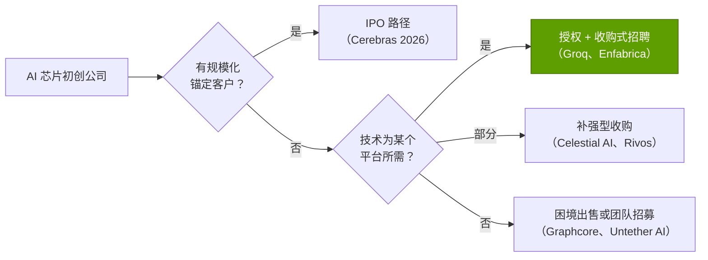
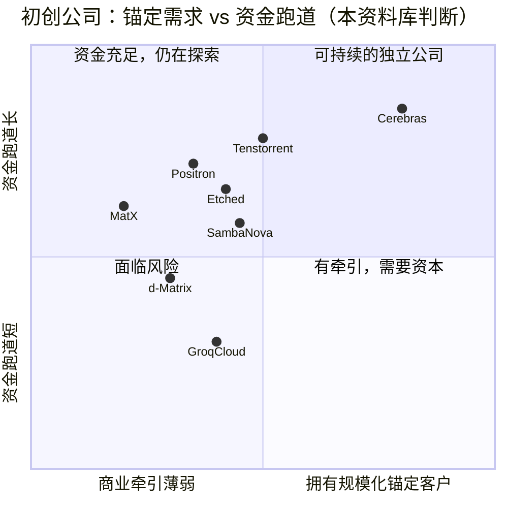

# 推理芯片初创公司：Cerebras、Groq、SambaNova、Tenstorrent、d-Matrix、Etched 及其他

> [!NOTE]
> 本页为英文原文的简体中文参考译文，仅供参考；如有出入，以[英文原文](../../../cross-cutting/15-competitive-landscape/inference-startups.md "English original")为准。

跨层专题 15 · 竞争格局 · 阅读约 15 分钟 · 最后核实：2026-11-05

## ⚡ 要点速览

- **资本回归，估值走高。** Cerebras 于 2026 年 5 月在纳斯达克上市，以 ~$40B 估值（完全摊薄口径最高达 ~$56B）募资 $5.55B
  [[S2504]](../../../sources/bibliography.md#s2504)[[S2505]](../../../sources/bibliography.md#s2505)；Tenstorrent 以 $6.2B 估值募资 $1.5B（2026 年 10 月），Etched 估值达 $10.3B，Positron 达
  $5B [[S15516]](../../../sources/bibliography.md#s15516)[[S2507]](../../../sources/bibliography.md#s2507)[[S11521]](../../../sources/bibliography.md#s11521)。
- **规模最大的退出是一笔授权交易，而非收购。** 据报道，英伟达（NVIDIA）支付 ~$20B，获得 Groq 技术的非独家授权，
  并吸纳其创始人和团队；Groq 继续运营 GroqCloud [[S90018]](../../../sources/bibliography.md#s90018)[[S90019]](../../../sources/bibliography.md#s90019)。该设计如今已纳入
  英伟达路线图，以 Groq 3 LPX 机架（256 颗 [LPU](../../../glossary.md#lpu)）的形式出货 🟢 [[S90003]](../../../sources/bibliography.md#s90003)[[S114]](../../../sources/bibliography.md#s114)。
- **估值远远领先于收入。** Cerebras 2026 年第二季度 GAAP 收入为 $180.1M（+74%），全年指引
  ~$880–890M；上市时 ~$40B 的估值约为该指引的 ~45 倍 [[S15514]](../../../sources/bibliography.md#s15514)[[S2505]](../../../sources/bibliography.md#s2505)。
- **速度是突破口。** 解码受限于内存带宽，因此将权重存放在 [SRAM](../../../glossary.md#sram) 或整片
  晶圆上的芯片，可以为每个用户提供更高的每秒 token 数；OpenAI 同意在 2028 年前采购最多 750 MW 的 Cerebras 算力
  （据报道 >$10B）[[S11523]](../../../sources/bibliography.md#s11523)[[S634]](../../../sources/bibliography.md#s634)。
- **结局已两极分化。** Graphcore 以 ~$0.6B 出售给软银，而其 2020 年估值为 $2.77B [[S15519]](../../../sources/bibliography.md#s15519)；
  SambaNova 曾与英特尔（Intel）以含债务 ~$1.6B 的价格洽谈，随后据报道以 ~$11B 估值融资（报道相互矛盾）🟡
  [[S2512]](../../../sources/bibliography.md#s2512)[[S15518]](../../../sources/bibliography.md#s15518)。
- **生存几率偏向拥有锚定客户或身处英伟达未覆盖细分市场的公司。** 英伟达与 Groq 的交易表明，它会买下
  对其构成威胁的细分市场，这限制了下一家 SRAM 新进入者的上行空间（🔴 本资料库分析）。

![AI 芯片初创公司估值节点的对数坐标时间线。Cerebras：$8.1B（2025 年 9 月）、 ~$23B（2026 年 2 月），2026 年 5 月上市时 ~$40B；Groq：$6.9B（2025 年 9 月），随后与英伟达达成 ~$20B 的授权加团队交易（2025 年 12 月）；Etched：>$5B（2026 年 1 月），随后 $10.3B（2026 年 7 月）；Tenstorrent：~$2.7B（2024 年 12 月），随后 $6.2B（2026 年 10 月）；Positron：~$1B（2026 年 2 月），随后 $5B（2026 年 9 月）；SambaNova：$5B（2021 年），英特尔含债务 ~$1.6B 的报价（2025 年 12 月，已搁置），以及据报道 ~$11B 的 F 轮（2026 年 7 月，报道相互矛盾）；d-Matrix：$2B（2025 年 11 月）；Lightmatter：$4.4B（2024 年 10 月）；Graphcore：$2.77B（2020 年），以 ~$0.6B 出售给软银（2024 年）；Celestial AI：被美满电子以 $3.25B 预付对价收购（2026 年 2 月）。](../../../assets/charts/15-startup-valuation-marks.svg)

## 技术押注详解

生成一个 token（[解码（decode）](../../../glossary.md#decode)）需要把每个模型权重重新读取一遍。单个用户的速度大致等于
内存带宽除以权重字节数。GPU 将权重存放在[高带宽内存（HBM）](../../../glossary.md#hbm)中：容量大（Rubin 为 288 GB），但带宽
“只有” 19.2 TB/s [[S90006]](../../../sources/bibliography.md#s90006)。初创公司从不同方向挑战这一比率。

| 公司 | 押注方向 | 每芯片 / 每系统内存 | 带宽 | 状态（2026 年） | 最新估值 | 来源 |
|---|---|---|---|---|---|---|
| Cerebras | [晶圆级](../../../glossary.md#wafer-scale)引擎 | 44 GB 片上 SRAM | ~21 PB/s | 已上市（CBRS）；云服务 + 系统 | ~$40B IPO | [[S166]](../../../sources/bibliography.md#s166)[[S2505]](../../../sources/bibliography.md#s2505) |
| Groq | SRAM [LPU](../../../glossary.md#lpu)，编译器静态调度 | 230 MB（v1）；500 MB（Groq 3，英伟达） | 80 / 150 TB/s | 已授权给英伟达；GroqCloud 继续运营 | ~$20B 交易 | [[S167]](../../../sources/bibliography.md#s167)[[S114]](../../../sources/bibliography.md#s114)[[S90019]](../../../sources/bibliography.md#s90019) |
| SambaNova | [数据流](../../../glossary.md#dataflow-architecture) RDU，三级内存 | 520 MB SRAM + 64 GB HBM + 最多 1.5 TB DDR | 未披露 | 获 Vista 和英特尔投资（2026 年 2 月） | 据报道 ~$11B 🟡 | [[S168]](../../../sources/bibliography.md#s168)[[S15517]](../../../sources/bibliography.md#s15517)[[S15518]](../../../sources/bibliography.md#s15518) |
| Tenstorrent | RISC-V + Tensix 核心，以太网横向扩展，开放软件 | 32 GB GDDR6 | 0.512 TB/s | E 轮 | $6.2B | [[S169]](../../../sources/bibliography.md#s169)[[S15516]](../../../sources/bibliography.md#s15516) |
| d-Matrix | 数字[存内计算](../../../glossary.md#compute-in-memory) | 2 GB SRAM + 256 GB LPDDR5 | 150 TB/s（SRAM） | Corsair 已出货 | $2.0B | [[S170]](../../../sources/bibliography.md#s170)[[S2511]](../../../sources/bibliography.md#s2511) |
| Etched | [模型专用 ASIC](../../../glossary.md#model-specific-asic)（仅支持 Transformer） | 144 GB HBM3E | 未披露 | 据报道预订单 ~$1B | $10.3B | [[S171]](../../../sources/bibliography.md#s171)[[S2507]](../../../sources/bibliography.md#s2507) |
| MatX | LLM 专用加速器 | 未披露 | 未披露 | 计划 2027 年出货 | 未披露（融资 $500M） | [[S2508]](../../../sources/bibliography.md#s2508) |
| Positron | 内存优先的推理芯片 | 未披露 | 未披露 | C 轮 | $5B | [[S11521]](../../../sources/bibliography.md#s11521) |
| Lightmatter | 光子互连 | — | — | 据报道接入 NVLink Fusion 🟡 | $4.4B（2024 年） | [[S2510]](../../../sources/bibliography.md#s2510)[[S5022]](../../../sources/bibliography.md#s5022) |

> [!TIP]
> **算例 —— 为何 SRAM 既快又贵。** 一个 [FP8](../../../glossary.md#fp8) 精度的 70B 参数模型 ~70 GB。一颗 Rubin GPU 就能容纳它，
> 且每秒可完整读取 ~274 次（19.2 TB/s ÷ 70 GB）[[S90006]](../../../sources/bibliography.md#s90006)。一颗 Groq 3 LPU 仅容纳 0.5 GB，因此光是权重
> 就需要 ~140 颗芯片，超过一个 256-LPU LPX 机架的一半；每颗芯片每秒可重新读取其分片 ~300,000 次（150 TB/s ÷
> 0.5 GB）[[S114]](../../../sources/bibliography.md#s114)。Cerebras 的 44 GB 晶圆需要两片才能装下 FP8 权重 [[S166]](../../../sources/bibliography.md#s166)。每用户速度优势是真实的；而
> 每个模型所需的芯片数量就是代价。这正是本资料库将 SRAM 芯片评为交互速度领先、成本落后的原因
> （[推理竞争](../../../layers/11-inference-and-ai-software/competition.md)）。

🔧 技术细节：每种押注各自牺牲了什么

- **晶圆级（Cerebras）：** 一整块 46,225 mm²、拥有 900,000 个核心的硅片，完全避免了芯片间互连
  [[S166]](../../../sources/bibliography.md#s166)，但需要定制封装、每套系统 ~23 kW 的功耗，以及容忍缺陷的冗余设计。超出片上
  SRAM 容量的模型需从外部 MemoryX 流式读取权重。
- **编译器调度的 SRAM（Groq）：** 每个操作都在编译时排定执行时刻，因此延迟是确定性的，但
  任何模型变更都意味着要在数百颗芯片上重新编译 [[S167]](../../../sources/bibliography.md#s167)。
- **分级数据流（SambaNova）：** SRAM 存放热张量，HBM 存放权重，DDR 提供容量 [[S168]](../../../sources/bibliography.md#s168)；灵活性的代价是
  编译器复杂度。
- **存内计算（d-Matrix）：** 运算单元紧邻 SRAM 阵列以减少数据搬运；4-bit 块格式提升了
  峰值吞吐量，但需要对模型进行量化 [[S170]](../../../sources/bibliography.md#s170)。
- **模型专用（Etched）：** 将 Transformer 硬化到电路中，消除了通用计算的开销；但模型
  架构一旦转变（状态空间模型或混合模型），芯片就可能被闲置 [[S171]](../../../sources/bibliography.md#s171)。

## 逐家分析

**Cerebras** 是唯一一家登陆公开市场的独立公司。除 IPO 外，其锚定客户是 OpenAI：以云服务形式提供最多 750 MW
推理算力，分批交付至 2028 年 [[S11523]](../../../sources/bibliography.md#s11523)[[S11524]](../../../sources/bibliography.md#s11524)。2026 年第二季度核心云业务收入增长 287%
至 $127.7M，公司报告已签约 ~600 MW 数据中心容量 [[S15514]](../../../sources/bibliography.md#s15514)[[S15515]](../../../sources/bibliography.md#s15515)。客户集中度和
利润率是需要关注的指标：公司第二季度核心毛利率为 ~41% 🟡 [[S15514]](../../../sources/bibliography.md#s15514)。

**Groq** 展示了英伟达如何化解一个细分市场的威胁。2025 年 12 月的交易以非独家方式授权了 LPU，并将创始人
Jonathan Ross、总裁 Sunny Madra 及团队转入英伟达；Groq 在 CEO Simon Edwards 领导下继续运营 [[S90018]](../../../sources/bibliography.md#s90018)[[S474]](../../../sources/bibliography.md#s474)。英伟达
GTC 2026 路线图将 256-LPU 的 Groq 3 LPX 机架与 Vera Rubin 并列，另据报道 Feynman（2028 年）将搭配 LP40 LPU 🟡
[[S90003]](../../../sources/bibliography.md#s90003)[[S90004]](../../../sources/bibliography.md#s90004)。Groq 前员工已就该交易起诉董事会 [[S118]](../../../sources/bibliography.md#s118)。

**SambaNova** 说明了估值有多么波动：2021 年 $5B，在已搁置的英特尔谈判中含债务 ~$1.6B（2025 年 12 月），
随后是 Vista 领投、英特尔参投的 ~$350M 融资（2026 年 2 月），以及据报道估值 ~$11B 的 ~$1B F 轮（2026 年 7 月）——
但另一家媒体给出的数字要低得多 🟡 [[S2512]](../../../sources/bibliography.md#s2512)[[S15517]](../../../sources/bibliography.md#s15517)[[S15518]](../../../sources/bibliography.md#s15518)。英特尔 CEO 担任其董事长 [[S2512]](../../../sources/bibliography.md#s2512)。

**Tenstorrent** 主打开放：RISC-V CPU 和 Tensix AI 核心、芯片间以太网互连，以及 Apache-2.0 软件栈
（tt-metal）[[S169]](../../../sources/bibliography.md#s169)[[S9535]](../../../sources/bibliography.md#s9535)。其 2026 年 10 月的 E 轮融资（$1.5B，估值 $6.2B）用于资助量产和 Galaxy 系统
[[S15516]](../../../sources/bibliography.md#s15516)。IP 授权为其带来了纯芯片初创公司所没有的收入。

**d-Matrix、Etched、MatX 和 Positron** 尚未形成规模。d-Matrix 已出货 Corsair 加速卡（2 GB SRAM，带宽 150 TB/s，外加 256 GB
LPDDR5）[[S170]](../../../sources/bibliography.md#s170)。Etched 报告 Sohu 预订单 ~$1B，但尚无经核实的出货 [[S2507]](../../../sources/bibliography.md#s2507)[[S171]](../../../sources/bibliography.md#s171)。MatX 募资 $500M，
计划 2027 年出货 [[S2508]](../../../sources/bibliography.md#s2508)。Positron 的估值在 2026 年内从 ~$1B 升至 $5B [[S11520]](../../../sources/bibliography.md#s11520)[[S11521]](../../../sources/bibliography.md#s11521)。

**光子**领域已一分为二：Lightmatter（$4.4B，2024 年）销售光互连，据报道正加入 [NVLink](../../../glossary.md#nvlink)
Fusion 🟡 [[S2510]](../../../sources/bibliography.md#s2510)[[S5022]](../../../sources/bibliography.md#s5022)；Celestial AI 的光子内存互连架构则以 $3.25B 预付对价归入美满电子（Marvell）[[S2513]](../../../sources/bibliography.md#s2513)。

> [!TIP]
> **算例 —— Cerebras 与 OpenAI 的合同相对 Cerebras 自身有多大？** OpenAI 可能在 2028 年前采购最多 750 MW
> 算力，据报道金额超过 $10B [[S11523]](../../../sources/bibliography.md#s11523)。按约三年摊分，每年 ~$3.3B，
> 约为 Cerebras 2026 年 ~$885M 收入指引的 3.8 倍 [[S15514]](../../../sources/bibliography.md#s15514)。按每套 CS-3 系统 ~23 kW 计算 [[S166]](../../../sources/bibliography.md#s166)，750 MW 的 IT 负载
> 对应 ~32,600 套系统，每套都是一整片晶圆（🔴 上限估计；设施电力并非全部是 IT 负载）。因此，单一客户
> 就可能在未来数年内决定 Cerebras 的收入、其对台积电（TSMC）晶圆的需求以及其客户集中度风险。

## 融资与收入对比

> [!TIP]
> **算例 —— 市场为 Cerebras 每一美元收入支付多少。** IPO 估值 ~$40B ÷ 2026 年收入指引
> ~$885M（中值）≈ 45 倍市销率 [[S2505]](../../../sources/bibliography.md#s2505)[[S15514]](../../../sources/bibliography.md#s15514)。英伟达 FY2026 收入为 $215.9B [[S1]](../../../sources/bibliography.md#s1)；以 ~$5.76T 市值
> （2026-10-05）计，为 ~27 倍历史市销率 [[S18005]](../../../sources/bibliography.md#s18005)。投资者对 Cerebras 的定价，相当于假设其收入将增长
> 数倍，而这取决于 OpenAI 的 750 MW 分批交付能否按时到位 [[S11523]](../../../sources/bibliography.md#s11523)。Groq ~$20B 的交易价约为其三个月前 $6.9B
> 融资估值的 ~2.9 倍 [[S90019]](../../../sources/bibliography.md#s90019)：决定最高价格的是战略买家，而非风险投资市场。

上图还说明了第二点：推理*云*（Fireworks、Together、Baseten）的估值如今已与芯片初创公司相当，
因为它们无需承担芯片风险即可获取 token 收入 [[S11514]](../../../sources/bibliography.md#s11514)[[S11516]](../../../sources/bibliography.md#s11516)。芯片初创公司除了卖芯片之外的另一条路，
就是自营云服务，Cerebras 和 Groq 都是这样做的。

## 迄今的退出案例

| 年份 | 公司 | 退出方式 | 价值 | 买方获得了什么 | 来源 |
|---|---|---|---|---|---|
| 2019 | Habana Labs | 被英特尔收购 | ~$2B | Gaudi 产品线（后来未达目标） | [[S2514]](../../../sources/bibliography.md#s2514)[[S668]](../../../sources/bibliography.md#s668) |
| 2024 | Graphcore | 被软银收购 | 据报道 ~$0.6B | IPU 团队；低于 ~$700M 的累计融资 | [[S15519]](../../../sources/bibliography.md#s15519)[[S15520]](../../../sources/bibliography.md#s15520) |
| 2025 | Enfabrica | 英伟达收购式招聘 + 授权 | >$0.9B | CEO、团队、内存互连技术 | [[S475]](../../../sources/bibliography.md#s475) |
| 2025 | Untether AI | 团队被 AMD 招募 | 未披露 | 工程师，而非公司本身 | [[S9507]](../../../sources/bibliography.md#s9507) |
| 2025 | Rivos | 被 Meta 收购 | 未披露 | RISC-V CPU/加速器团队 | [[S4518]](../../../sources/bibliography.md#s4518) |
| 2025 | Groq | 英伟达授权 + 团队 | 据报道 ~$20B | LPU 技术与创始人 | [[S90018]](../../../sources/bibliography.md#s90018)[[S90019]](../../../sources/bibliography.md#s90019) |
| 2026 | Celestial AI | 被美满电子收购 | $3.25B 预付 + 对赌付款（earn-out） | 光子内存互连架构 | [[S2513]](../../../sources/bibliography.md#s2513) |
| 2026 | Cerebras | 纳斯达克 IPO | 募资 $5.55B | 公开市场股票（收购货币） | [[S2504]](../../../sources/bibliography.md#s2504)[[S2505]](../../../sources/bibliography.md#s2505) |

> [!WARNING]
> **误区与事实：“英伟达会收购每一个威胁。”** 英伟达在这一领域的两笔最大动作，一是非独家授权（Groq），
> 二是附带授权的收购式招聘（Enfabrica）[[S90018]](../../../sources/bibliography.md#s90018)[[S475]](../../../sources/bibliography.md#s475)；两者都无需对整家公司进行并购审查。
> 大多数退出的买方是其他公司（英特尔、软银、美满电子、Meta、AMD）。真正新颖的是交易结构，而非交易频率，
> 而且这种结构正在法庭上受到挑战 [[S118]](../../../sources/bibliography.md#s118)。

> [!TIP]
> **算例 —— 退出案例的资本回报。** Graphcore 累计融资 ~$700M，出售价 ~$600M，约为投入资本的 ~0.86 倍，
> 仅为其 2020 年 $2.77B 估值的 ~22% [[S15519]](../../../sources/bibliography.md#s15519)。Celestial AI 从美满电子获得的 $3.25B 预付对价不含对赌付款 [[S2513]](../../../sources/bibliography.md#s2513)。
> 据报道 Groq ~$20B 的交易价约为其三个月前融资估值的 ~2.9 倍 [[S90019]](../../../sources/bibliography.md#s90019)。最好与最差结局之间的价值差距
> 超过 30 倍，其驱动因素与其说是芯片规格，不如说是某个平台方是否急需这支团队。

## 生存几率

上图定位属于 🔴 本资料库判断，依据是上文所列的公开融资和客户披露信息。最有可能长期存续的独立公司，
要么有实验室或[超大规模云厂商](../../../glossary.md#hyperscaler)以吉瓦级规模采购（Cerebras–OpenAI），要么其业务不依赖于在每美元 token 数上击败
英伟达（Tenstorrent 的 IP 授权）。创始人离开后，GroqCloud 的资金跑道最不明朗。

## 分层评判：初创公司（作为整体）vs 英伟达

| 层 | 评判 | 理由 |
|---|---|---|
| 02 加速器芯片 | 🟦 路线不同 | SRAM、晶圆级、数据流和模型专用设计 [[S166]](../../../sources/bibliography.md#s166)[[S168]](../../../sources/bibliography.md#s168)[[S171]](../../../sources/bibliography.md#s171) |
| 03 内存与供应 | 🟦 路线不同 | 多数避开 HBM/CoWoS；代价是每芯片容量 [[S167]](../../../sources/bibliography.md#s167)[[S170]](../../../sources/bibliography.md#s170) |
| 05–06 纵向扩展 / 横向扩展 | 🟥 落后 | 专有或以太网链路；没有 NVLink 级别的互连域（Groq 的 LPX 如今归英伟达所有）[[S114]](../../../sources/bibliography.md#s114) |
| 08 系统与机架 | 🟥 落后 | CS-3 系统和小型集群；机架级部署很少 [[S166]](../../../sources/bibliography.md#s166) |
| 09–10 软件与库 | 🟥 落后 | 厂商自有编译器；精选的模型清单 [[S634]](../../../sources/bibliography.md#s634) |
| 11 推理服务 | 🟩 领先（速度） | 每用户每秒 token 数超越 GPU 节点（Cerebras、Groq）[[S634]](../../../sources/bibliography.md#s634) |
| 12 云 | 🟦 路线不同 | 以 API 云（Cerebras、GroqCloud）为主，而非硬件销售 [[S11523]](../../../sources/bibliography.md#s11523) |
| 13 生态与资本 | 🟥 落后 | 客户集中；~$40B 已是独立公司中的最高估值 [[S2505]](../../../sources/bibliography.md#s2505) |

## 它们最有力的论据，以及差距缩小了多少

**最有力的论据：** 推理正在成为更大的工作负载，而用户愿意为智能体和编程工具中的速度付费；在
这一维度上，SRAM 和晶圆级设计如今胜过 GPU 节点 [[S634]](../../../sources/bibliography.md#s634)。OpenAI 与 Cerebras 的 750 MW 交易证明，
前沿实验室愿意为此买单 [[S11523]](../../../sources/bibliography.md#s11523)。

**差距缩小了多少：** 在交互速度上，已完全追平；在单 token 成本和软件广度上，收窄有限；在规模上，
Cerebras 已签约的 ~600 MW 颇具意义，但只是英伟达出货量的一小部分 [[S15515]](../../../sources/bibliography.md#s15515)。本资料库的评估矩阵给
Cerebras 打 2.8 分、Groq 打 2.2 分（满分 5），英伟达为 4.7（[索引](../../../cross-cutting/15-competitive-landscape/index.md)）。

> [!NOTE]
> **🐂 看多观点（对英伟达而言）。** 英伟达买下了最好的 SRAM 设计，并在一年内以 LPX 形式出货；Rubin [NVL72](../../../glossary.md#nvl72) 加
> LPX 覆盖了批处理和超低延迟两个层级，留给初创公司的细分市场正在收缩 [[S90003]](../../../sources/bibliography.md#s90003)[[S114]](../../../sources/bibliography.md#s114)。

> [!WARNING]
> **🐻 看空观点（对英伟达而言）。** 初创公司的资金比 2021 年以来任何时候都更充裕，已上市的 Cerebras 可随时
> 进行股权融资，而开源推理服务引擎（[vLLM](../../../glossary.md#vllm)、[SGLang](../../../glossary.md#sglang)）可运行于七个硬件家族，因此
> 推理的切换成本持续下降 [[S2504]](../../../sources/bibliography.md#s2504)[[S15516]](../../../sources/bibliography.md#s15516)[[S580]](../../../sources/bibliography.md#s580)。

## 🎯 企业发展视角

1. Groq 以授权加团队的形式，按其最近一轮估值 ~2.9 倍的价格出售 [[S90019]](../../../sources/bibliography.md#s90019)；Graphcore 的售价则低于累计融资额 [[S15519]](../../../sources/bibliography.md#s15519)。两者
   的分野在于什么：一个有付费用户的成熟云服务、一项平台所需的技术，还是时机？
2. 2026 年估值上涨 2–5 倍，而收入依然很小（Cerebras 约为 2026 年销售额的 ~45 倍）。战略收购方应如何权衡
   收购一家初创公司的设计，与像英伟达那样获取授权或招募其团队这两种选择？
3. 哪些押注仍独立于英伟达的路线图之外？晶圆级和存内计算不在其中；SRAM 解码如今已在其中
   （LPX）[[S90003]](../../../sources/bibliography.md#s90003)。
4. Tenstorrent 在销售芯片的同时授权 RISC-V 和 AI IP [[S169]](../../../sources/bibliography.md#s169)[[S15516]](../../../sources/bibliography.md#s15516)。对推理初创公司而言，IP 授权是否是比芯片
   更具防御性的业务？天然的被授权方是谁？
5. 授权加收购式招聘的交易避开了全面的并购审查，却招致员工诉讼 [[S118]](../../../sources/bibliography.md#s118)。监管机构和
   法院会如何对待下一笔此类交易？这是否会改变交易结构的选择？

## 📚 来源（Sources）

<!-- Auto-generated from the [S…] citations on this page by `make build`. Edit sources/registry/*.csv, not this list. -->

- [**S1**](../../../sources/bibliography.md#s1) NVIDIA Corporation via SEC EDGAR, *NVIDIA Announces Financial Results for Fourth Quarter and Fiscal 2026 (Form 8-K exhibit 99.1)*, 2026-02-25. [Link](https://www.sec.gov/Archives/edgar/data/1045810/000104581026000019/q4fy26pr.htm)
- [**S114**](../../../sources/bibliography.md#s114) StorageReview, *NVIDIA Groq 3 LPX: Everything we know*, 2026-03. [Link](https://www.storagereview.com/news/nvidia-groq-3-lpx-everything-we-know)
- [**S118**](../../../sources/bibliography.md#s118) Tom's Hardware, *Former Groq engineers sue board over $20 billion Nvidia deal*, 2026. [Link](https://www.tomshardware.com/tech-industry/semiconductors/former-groq-engineers-sue-board-over-usd20-billion-nvidia-deal-saying-it-handed-nvidia-the-lpu-and-the-team-that-built-it-plaintiffs-allege-the-board-kept-billions-from-other-shareholders)
- [**S166**](../../../sources/bibliography.md#s166) Cerebras, *Cerebras Systems Unveils World's Fastest AI Chip with 4 Trillion Transistors (WSE-3)*, 2024-03-13. [Link](https://www.cerebras.ai/press-release/cerebras-announces-third-generation-wafer-scale-engine)
- [**S167**](../../../sources/bibliography.md#s167) ISCA 2022 (ACM) (Dennis Abts et al.), *A Software-defined Tensor Streaming Multiprocessor for Large-scale Machine Learning (Groq)*, 2022-06. [Link](https://dl.acm.org/doi/10.1145/3470496.3527405)
- [**S168**](../../../sources/bibliography.md#s168) arXiv 2405.07518 (Raghu Prabhakar et al.), *SambaNova SN40L: Scaling the AI Memory Wall with Dataflow and Composition of Experts*, 2024-05-13. [Link](https://arxiv.org/abs/2405.07518)
- [**S169**](../../../sources/bibliography.md#s169) Tenstorrent, *Tenstorrent Blackhole*, 2025. [Link](https://tenstorrent.com/hardware/blackhole)
- [**S170**](../../../sources/bibliography.md#s170) d-Matrix, *d-Matrix Corsair inference platform*, 2024-11-19. [Link](https://www.d-matrix.ai/product/)
- [**S171**](../../../sources/bibliography.md#s171) Etched, *Etched is Making the Biggest Bet in AI (Sohu announcement)*, 2024-06-25. [Link](https://www.etched.com/announcing-etched)
- [**S474**](../../../sources/bibliography.md#s474) Groq Newsroom, *Groq and NVIDIA enter non-exclusive inference technology licensing agreement*, 2025-12-24. [Link](https://groq.com/newsroom)
- [**S475**](../../../sources/bibliography.md#s475) CNBC, *Nvidia spends over $900 million on Enfabrica CEO, AI startup technology*, 2025-09-18. [Link](https://www.cnbc.com/technology/)
- [**S580**](../../../sources/bibliography.md#s580) vLLM project (GitHub), *vLLM README and installation docs — supported hardware*, 2026-11. [Link](https://github.com/vllm-project/vllm/blob/main/docs/getting_started/installation/README.md)
- [**S634**](../../../sources/bibliography.md#s634) SemiAnalysis, *Ultra-High Interactivity on NVIDIA GPUs? TileRT on InferenceX*, 2026-08-10. [Link](https://github.com/SemiAnalysisAI/InferenceX-app/blob/main/packages/app/content/blog/ultra-high-interactivity-on-nvidia.mdx)
- [**S668**](../../../sources/bibliography.md#s668) Reuters (as reported), *Intel says it will not hit $500 million Gaudi 3 revenue target for 2024*, 2024-10-31. [Link](https://www.reuters.com/technology/)
- [**S2504**](../../../sources/bibliography.md#s2504) TechCrunch, *Cerebras raises $5.5B kicking off 2026's IPO season with a bang*, 2026-05-14. [Link](https://techcrunch.com/2026/05/14/cerebras-raises-5-5b-kicking-off-2026s-ipo-season-with-a-bang)
- [**S2505**](../../../sources/bibliography.md#s2505) Dealroom, *Cerebras raises $5.55B in biggest US IPO of 2026*, 2026-05. [Link](https://dealroom.co/news/128936-cerebras-raises-5-55b-in-biggest-us-ipo-of-2026/)
- [**S2507**](../../../sources/bibliography.md#s2507) AI Weekly, *Etched closes $300M Series C at $10.3B led by Sequoia, books ~$1B in pre-orders for Sohu*, 2026-07. [Link](https://aiweekly.co/alerts/etched-closes-300m-series-c-at-103b-led-by-sequoia-books-1b-in-pre-orders-for)
- [**S2508**](../../../sources/bibliography.md#s2508) AI2.Work, *MatX raises $500M to build AI chips*, 2026-02-24. [Link](https://ai2.work/blog/matx-raises-500m-to-build-ai-chips-that-beat-nvidia-by-10x)
- [**S2510**](../../../sources/bibliography.md#s2510) Bloomberg, *Photonic Computing Startup Lightmatter Reaches $4.4 Billion Valuation*, 2024-10-16. [Link](https://www.bloomberg.com/news/articles/2024-10-16/photonic-computing-startup-lightmatter-reaches-4-4-billion-valuation)
- [**S2511**](../../../sources/bibliography.md#s2511) Converge Digest, *d-Matrix raises $275 million to accelerate the age of AI inference*, 2025-11-12. [Link](https://convergedigest.com/d-matrix-raises-275-million-to-accelerate-the-age-of-ai-inference/)
- [**S2512**](../../../sources/bibliography.md#s2512) Verdict, *Intel pursues SambaNova acquisition amid AI expansion plans*, 2025-12. [Link](https://www.verdict.co.uk/intel-sambanova-acquisition/)
- [**S2513**](../../../sources/bibliography.md#s2513) Business Wire (Marvell), *Marvell Completes Acquisition of Celestial AI*, 2026-02-02. [Link](https://www.businesswire.com/news/home/20260201331090/en/marvell-completes-acquisition-of-celestial-ai)
- [**S2514**](../../../sources/bibliography.md#s2514) bit-tech, *Intel acquires AI chipmaker, Habana Labs*, 2019-12-16. [Link](https://www.bit-tech.net/news/tech/cpus/intel-acquires-ai-chipmaker-habana-labs/1/)
- [**S4518**](../../../sources/bibliography.md#s4518) DatacenterDynamics, *Meta acquires RISC-V chip startup Rivos (report)*, 2025-10. [Link](https://www.datacenterdynamics.com/en/news/meta-acquires-risc-v-chip-startup-rivos-report/)
- [**S5022**](../../../sources/bibliography.md#s5022) Independent tracker (vercel.app), *Co-packaged optics joins NVLink Fusion: Ayar Labs and Lightmatter (June 2026)*, 2026-06-08. [Link](https://site-one-liart-13.vercel.app/en/infra-ip/co-packaged-optics-nvlink-fusion-ayar-labs-lightmatter-june-2026)
- [**S9507**](../../../sources/bibliography.md#s9507) DatacenterDynamics, *AMD extends acquisition run: brings software optimization firm Brium and staff from recently shuttered Untether AI into the fold*, 2025-06. [Link](https://www.datacenterdynamics.com/en/news/amd-extends-acquisition-run-brings-software-optimization-firm-brium-and-staff-from-recently-shuttered-untether-ai-into-the-fold/)
- [**S9535**](../../../sources/bibliography.md#s9535) Tenstorrent (GitHub), *tt-metal README and Apache-2.0 licence (TT-NN / TT-Metalium)*, 2026-11. [Link](https://github.com/tenstorrent/tt-metal)
- [**S11514**](../../../sources/bibliography.md#s11514) Bloomberg Government (Bloomberg), *Fireworks AI in talks for funding at $15 billion valuation*, 2026-05. [Link](https://news.bgov.com/private-equity/fireworks-ai-in-talks-for-funding-at-15-billion-valuation)
- [**S11516**](../../../sources/bibliography.md#s11516) DatacenterDynamics, *Together AI raises $800m in Series C funding round*, 2026-07. [Link](https://www.datacenterdynamics.com/en/news/together-ai-raises-800m-in-series-c-funding-round/)
- [**S11520**](../../../sources/bibliography.md#s11520) eWeek, *Positron secures $230M AI funding for $1B valuation*, 2026-02-04. [Link](https://www.eweek.com/news/positron-230m-ai-funding/)
- [**S11521**](../../../sources/bibliography.md#s11521) Latham & Watkins, *Latham & Watkins advises Positron AI on Series C*, 2026-09. [Link](https://www.lw.com/en/news/2026/09/latham-watkins-advises-positron-ai-on-series-c)
- [**S11523**](../../../sources/bibliography.md#s11523) DatacenterDynamics, *OpenAI signs $10 billion deal with Cerebras with 750MW of big chip compute*, 2026-01-14. [Link](https://www.datacenterdynamics.com/en/news/openai-signs-10-billion-deal-with-cerebras-with-750mw-of-big-chip-compute/)
- [**S11524**](../../../sources/bibliography.md#s11524) TechCrunch, *OpenAI signs deal reportedly worth $10 billion for compute from Cerebras*, 2026-01-14. [Link](https://techcrunch.com/2026/01/14/openai-signs-deal-reportedly-worth-10-billion-for-compute-from-cerebras/)
- [**S15514**](../../../sources/bibliography.md#s15514) Cerebras Systems via SEC EDGAR, *Cerebras Systems announces second quarter 2026 financial results (Form 8-K)*, 2026-08-12. [Link](https://www.sec.gov/Archives/edgar/data/0002021728/000162828026056186/cbrsannouncesfinancialresu.htm)
- [**S15515**](../../../sources/bibliography.md#s15515) The Energy Mag, *Cerebras Systems reports $180 million Q2 2026 revenue, 600 MW of contracted data center capacity*, 2026-08. [Link](https://theenergymag.com/news/market-news/cerebras-systems-reports-180-million-q2-2026-revenue-following-ipo)
- [**S15516**](../../../sources/bibliography.md#s15516) DatacenterDynamics, *AI chip start-up Tenstorrent raises $1.5bn at $6.2bn valuation*, 2026-10-19. [Link](https://datacenterdynamics.com/en/news/ai-chip-startup-tenstorrent-raises-15bn-at-62bn-valuation)
- [**S15517**](../../../sources/bibliography.md#s15517) The Star (Reuters), *Vista Equity Partners and Intel to lead investment in AI chip startup SambaNova, sources say (Reuters)*, 2026-02-07. [Link](https://www.thestar.com.my/tech/tech-news/2026/02/07/vista-equity-partners-and-intel-to-lead-investment-in-ai-chip-startup-sambanova)
- [**S15518**](../../../sources/bibliography.md#s15518) Cadena 3, *SambaNova capta 1.000 millones y alcanza una valoracion de 11.000 millones*, 2026-07. [Link](https://www.cadena3.com/noticia/tecnologia/sambanova-capta-1000-millones-y-alcanza-una-valoracion-de-11000-millones_570907)
- [**S15519**](../../../sources/bibliography.md#s15519) insideHPC, *SoftBank acquires AI chip company Graphcore*, 2024-07-12. [Link](https://insidehpc.com/2024/07/softbank-acquires-ai-chip-company-graphcore)
- [**S15520**](../../../sources/bibliography.md#s15520) AI News, *SoftBank acquires British AI chipmaker Graphcore*, 2024-07. [Link](https://www.artificialintelligence-news.com/news/softbank-acquires-british-ai-chipmaker-graphcore/)
- [**S18005**](../../../sources/bibliography.md#s18005) Crowdfund Insider, *Nvidia ($NVDA) nears $6T market cap as company stock hits ATH*, 2026-10. [Link](https://www.crowdfundinsider.com/?p=316268)
- [**S90003**](../../../sources/bibliography.md#s90003) eWeek, *Everything Nvidia Just Announced at GTC 2026: 7 Chips, 5 Racks, 1 Giant Bet on Agentic AI*, 2026-03-17. [Link](https://www.eweek.com/news/nvidia-gtc-2026-ai-inference-vera-rubin-neuron/)
- [**S90004**](../../../sources/bibliography.md#s90004) TrendForce, *Key GTC takeaways: how Samsung, Micron, Intel and more power NVIDIA's Vera Rubin and Feynman*, 2026-03-17. [Link](https://www.trendforce.com/news/2026/03/17/news-key-gtc-takeaways-how-samsung-micron-intel-more-power-nvidias-vera-rubin-and-feynman/)
- [**S90006**](../../../sources/bibliography.md#s90006) TweakTown, *Nvidia cuts Vera Rubin's memory bandwidth by up to 26% and AMD's Helios now leads in memory bandwidth*, 2026-10. [Link](https://www.tweaktown.com/news/114304/nvidia-cuts-vera-rubins-memory-bandwidth-by-up-to-26-percent-and-amds-helios-now-leads-in-memory-bandwidth/index.html)
- [**S90018**](../../../sources/bibliography.md#s90018) Constellation Research, *Nvidia's Groq deal: acquisition, acquihire or creative licensing deal?*, 2025-12. [Link](https://www.constellationr.com/insights/news/nvidias-groq-deal-acquisition-acquihire-or-creative-licensing-deal)
- [**S90019**](../../../sources/bibliography.md#s90019) TechSpot, *Nvidia's $20 billion Groq deal looks a lot like an acquisition*, 2025-12. [Link](https://www.techspot.com/news/110723-nvidia-20-billion-groq-deal-looks-lot-like.html)
