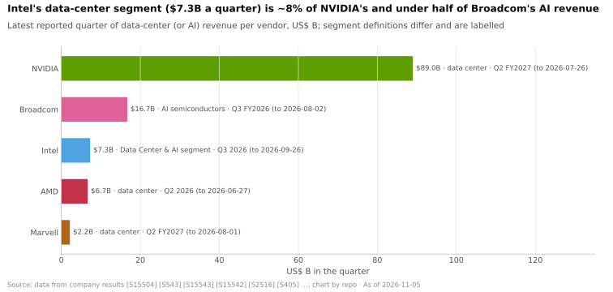
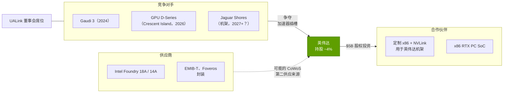
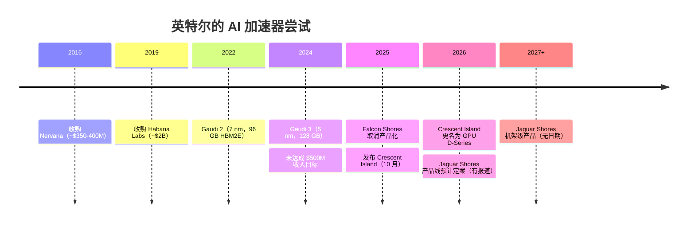
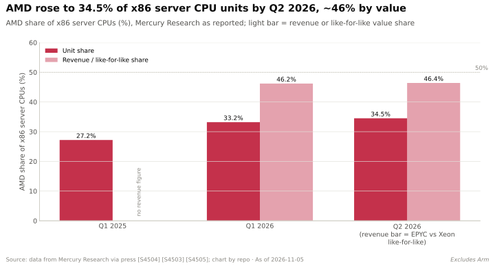

# 英特尔：既是竞争对手，也是供应商和合作伙伴

> [!NOTE]
> 本页为英文原文的简体中文参考译文，仅供参考；如有出入，以[英文原文](../../../cross-cutting/15-competitive-landscape/intel.md "English original")为准。

跨层专题 15 · 竞争格局 · 阅读约 13 分钟 · 最后核实：2026-11-05

## ⚡ 要点速览

- **作为加速器竞争对手，英特尔（Intel）至今未能形成实质威胁。** 它先后收购了 Nervana（2016 年）和 Habana（~$2B，2019 年）[[S2514]](../../../sources/bibliography.md#s2514)，
  未能实现 2024 年 $500M 的 Gaudi 收入目标 [[S668]](../../../sources/bibliography.md#s668)，并于 2025 年 1 月取消了 Falcon Shores 的产品化
  [[S15546]](../../../sources/bibliography.md#s15546)[[S564]](../../../sources/bibliography.md#s564)。
- **重启路线是先做推理 GPU，后做机架。** Crescent Island（Xe3P，160 GB [LPDDR5X](../../../glossary.md#lpddr5x)，
  风冷）将于 2026 年下半年送样，并在 OCP 2026 上更名为 GPU D-Series；机架级产品 Jaguar Shores（SK 海力士 [HBM4](../../../glossary.md#hbm4)、
  硅光子）尚无确定日期，2027 年前推出的可能性不大 🟡 [[S162]](../../../sources/bibliography.md#s162)[[S15543]](../../../sources/bibliography.md#s15543)[[S15544]](../../../sources/bibliography.md#s15544)[[S15545]](../../../sources/bibliography.md#s15545)。
- **其数据中心业务本质上是 CPU 业务，且已恢复增长。** 数据中心与 AI 事业部 2026 年第三季度收入 ~$7.3B
  （同比 +78%），约为英伟达（NVIDIA）最近一个季度数据中心收入的 8% [[S15543]](../../../sources/bibliography.md#s15543)[[S405]](../../../sources/bibliography.md#s405)。按出货量计，英特尔仍占服务器
  CPU 的 54.9%，但按收入计，AMD 已占 [x86](../../../glossary.md#x86) 服务器市场的 ~46% [[S4503]](../../../sources/bibliography.md#s4503)[[S4505]](../../../sources/bibliography.md#s4505)。
- **英伟达持有其 ~4% 股份。** 英伟达 $5B 的入股（以 $23.28 认购 ~214.7M 股）已于 2025-12-26 完成交割，用于资助通过 [NVLink](../../../glossary.md#nvlink) 连接的定制 x86
  CPU，以及 x86 RTX PC 芯片；数据中心产品尚无公开日期 🔴 [[S4009]](../../../sources/bibliography.md#s4009)[[S15547]](../../../sources/bibliography.md#s15547)[[S130]](../../../sources/bibliography.md#s130)。
- **供应商角色在于封装。** 英特尔的 [EMIB](../../../glossary.md#emib)-T 是大型 AI 封装绕开台积电（TSMC）的主要路径；
  据报道谷歌（Google）和亚马逊正在洽谈 🟡；估计显示，2027 年 EMIB-T 产能约为每月 ~15–20k 片 CoWoS 等效晶圆，
  而台积电 2026 年底的 CoWoS 产能为 ~130k（估计）[[S3532]](../../../sources/bibliography.md#s3532)[[S3002]](../../../sources/bibliography.md#s3002)。
- **在[纵向扩展（scale-up）](../../../glossary.md#scale-up)之争中，英特尔两边下注：** 它既是 [UALink](../../../glossary.md#ualink) 董事会成员，又是通过 NVLink 连接的 x86
  合作伙伴 [[S573]](../../../sources/bibliography.md#s573)[[S130]](../../../sources/bibliography.md#s130)。美国政府（9.9%）、软银（$2B）和英伟达如今都是其股东 [[S15550]](../../../sources/bibliography.md#s15550)[[S15547]](../../../sources/bibliography.md#s15547)。
- **本资料库判断 🔴：** 作为加速器供应商威胁较低；但作为英伟达的 x86 合作伙伴，以及西方唯一的
  先进封装第二供应来源，其重要性正在上升。

## 一家公司，三种角色

英特尔同时以三种方式触及英伟达的技术栈，而每种角色的方向各不相同。

本页其余部分依次讨论这三种角色。CPU 细节见
[CPU 竞争](../../../layers/04-cpu-grace-vera/competition.md)；封装细节见
[CoWoS 与先进封装](../../layers/03-memory-packaging-supply-chain/cowos-and-advanced-packaging.md)。

## 作为竞争对手的英特尔：Gaudi 的结局与 GPU 重启

纸面上，Gaudi 3 与其发布时对标的 GPU 相比颇具竞争力。它在 900 W 模组中提供 1,835 TFLOPS 稠密 [BF16](../../../glossary.md#bf16)/FP8 算力和 128 GB
HBM2e（带宽 3.7 TB/s）[[S161]](../../../sources/bibliography.md#s161)，而 H100 为 80 GB、3.35 TB/s [[S33002]](../../../sources/bibliography.md#s33002)。但它卖不动。原因
正是本资料库反复发现的那些：软件（大多数模型首先适配 CUDA）、纵向扩展（Gaudi 使用 24 个 200 GbE 端口，
其中 21 个用于 8 芯片全交换（all-to-all），因此不存在机架级互连域）[[S296]](../../../sources/bibliography.md#s296)，以及路线图可信度（先是 Gaudi，然后是
Falcon Shores，再到 Jaguar Shores）[[S2515]](../../../sources/bibliography.md#s2515)。

| 加速器 | 年份 | 内存 | 带宽 | 稠密 FP8 | 纵向扩展 | 状态 | 来源 |
|---|---|---|---|---|---|---|---|
| Intel Gaudi 2 | 2022 | 96 GB HBM2E | 2.45 TB/s | 865 TFLOPS | 24 × 100 GbE，8 芯片 | 已出货 | [[S161]](../../../sources/bibliography.md#s161) |
| Intel Gaudi 3 | 2024 | 128 GB HBM2e | 3.7 TB/s | 1,835 TFLOPS | 24 × 200 GbE，8 芯片 | 已出货 | [[S161]](../../../sources/bibliography.md#s161)[[S296]](../../../sources/bibliography.md#s296) |
| Intel GPU D-Series（Crescent Island） | 2026 | 160 GB LPDDR5X | 未披露 | 未披露 | 未披露 | 2026 年下半年送样 | [[S162]](../../../sources/bibliography.md#s162)[[S15543]](../../../sources/bibliography.md#s15543) |
| Intel Jaguar Shores | 2027+ | HBM4（SK 海力士） | 未披露 | 未披露 | 机架级，光子互连 | 🟡 无日期 | [[S15544]](../../../sources/bibliography.md#s15544)[[S564]](../../../sources/bibliography.md#s564) |
| NVIDIA H100 | 2022 | 80 GB HBM3 | 3.35 TB/s | 1,979 TFLOPS | NVLink 4，8 GPU | 已出货 | [[S33002]](../../../sources/bibliography.md#s33002) |
| NVIDIA Rubin | 2026 | 288 GB HBM4 | 19.2 TB/s | 17,500 TFLOPS | NVLink 6，72 个封装 | 爬坡中 | [[S90006]](../../../sources/bibliography.md#s90006)[[S90009]](../../../sources/bibliography.md#s90009) |

> [!TIP]
> **算例 —— 为何出色的规格没有转化为收入。** Gaudi 3 在稠密 [FP8](../../../glossary.md#fp8) 上与 H100 相当，在内存上更胜一筹
> （128 GB 对 80 GB）[[S161]](../../../sources/bibliography.md#s161)[[S33002]](../../../sources/bibliography.md#s33002)，但 2024 年 Gaudi 收入仍低于 $500M [[S668]](../../../sources/bibliography.md#s668)，而英伟达 FY2025 数据中心
> 收入为 $115.2B [[S416]](../../../sources/bibliography.md#s416)。以一台 8 芯片的 Gaudi 3 节点为例：其纵向扩展域为 8 颗芯片，而一台 GB200 [NVL72](../../../glossary.md#nvl72) 可将 72
> 颗 GPU 连入同一个 NVLink 域。对于把专家分布在数十颗芯片上的混合专家模型（MoE）而言，决定吞吐量的是节点边界，
> 而不是单颗芯片（[为何互连域规模至关重要](../../layers/05-scale-up-nvlink-nvswitch/why-domain-size-matters.md)）。
> 规格让英特尔进入了评估环节；系统与软件上的差距则把它挡在了部署之外。

2026 年的计划收窄了目标。Crescent Island 是一款风冷推理卡，配备 160 GB LPDDR5X [[S162]](../../../sources/bibliography.md#s162)：这与
高通（Qualcomm）每张 AI200 卡配备 768 GB [LPDDR](../../../glossary.md#lpddr) 的“以容量换带宽”取舍如出一辙（[高通](qualcomm.md)）。
它瞄准的是液冷和[高带宽内存（HBM）](../../../glossary.md#hbm)成本构成门槛的企业推理服务器，而非前沿训练。

🔧 技术细节：“机架级 + 硅光子”对 Jaguar Shores 意味着什么

英特尔将 Jaguar Shores 描述为一款采用光互连和 SK 海力士 HBM4 的机架级设计；堆叠层数
和制程尚未确认（TrendForce 的图片显示为 18A）[[S15544]](../../../sources/bibliography.md#s15544)[[S564]](../../../sources/bibliography.md#s564)。机架级意味着英特尔必须交付
英伟达 NVL72 和 AMD Helios 已在出货的那一整套：交换式纵向扩展互连、液冷托盘、电源架，以及能够
把 72 颗以上芯片当作一个整体来调度的软件栈。光链路以激光器功耗和成本为代价，突破了铜缆的距离限制（约一个机架）。
英特尔的 UALink 成员身份 [[S573]](../../../sources/bibliography.md#s573) 暗示了其纵向扩展协议的选择，但 UALink 产品预计要到 2027 年才会推出
[[S90051]](../../../sources/bibliography.md#s90051)。若 Jaguar Shores 于 2027 年推出，其对手将是 Rubin Ultra（2027 年下半年）[[S90003]](../../../sources/bibliography.md#s90003)。

## 作为合作伙伴的英特尔：Xeon 主机与 NVLink x86 协议

每一颗英伟达 GPU 都需要一颗主机 CPU。在英伟达自家的 GB 系列机架中，主机是 Grace 或 Vera；而在规模大得多的
x86 服务器世界里，主机是 Xeon 或 EPYC。2025 年 9 月的协议使英特尔成为定制 x86 CPU 的供应商，由英伟达
通过 NVLink 将其集成到自家平台中，同时还包括集成 RTX 小芯片的 x86 PC SoC [[S130]](../../../sources/bibliography.md#s130)[[S468]](../../../sources/bibliography.md#s468)。英特尔也被列为
[NVLink Fusion](../../../glossary.md#nvlink-fusion) 的 CPU 合作伙伴之一 [[S90031]](../../../sources/bibliography.md#s90031)。

> [!TIP]
> **算例 —— NVLink 对 x86 主机为何重要。** 一条 [PCIe](../../../glossary.md#pcie) Gen6 x16 主机链路带宽 ~256 GB/s；Vera 的
> [NVLink-C2C](../../../glossary.md#nvlink-c2c) 为 1.8 TB/s，约高出 7 倍 [[S100]](../../../sources/bibliography.md#s100)[[S144]](../../../sources/bibliography.md#s144)。对于将
> [KV 缓存](../../../glossary.md#kv-cache)溢出到 CPU 内存的推理而言，主机链路决定了上下文重新加载的速度。通过 NVLink 连接的 Xeon
> 可让只用 x86 的企业在不转向 Arm 的情况下获得英伟达的一致性 CPU–GPU 通路，这也是为什么这项协议保护的是
> 英伟达的机架，而非英特尔的加速器。

合作伙伴角色对英特尔自身的 CPU 业务也有代价。2026 年第二季度，AMD 在 x86 服务器中的出货份额达到 34.5%，按收入计为 ~46%
[[S4505]](../../../sources/bibliography.md#s4505)[[S4503]](../../../sources/bibliography.md#s4503)；而在英伟达设计的机架中，CPU 插槽归属 Grace 或 Vera。

## 作为供应商的英特尔：18A 以及作为 CoWoS 替代方案的 EMIB

台积电的 [CoWoS](../../../glossary.md#cowos) 将所有裸片放在一块大型硅中介层上，好比把整个庭院都铺平，让每条
路径都平整顺畅。英特尔的 [EMIB](../../../glossary.md#emib) 则只在两颗裸片相接之处，于有机基板中嵌入小块硅桥，
好比只在道路交叉处架设人行天桥。用硅更少，意味着可以以更低成本做出更大的封装；EMIB-T 增加了
[硅通孔](../../../glossary.md#through-silicon-via)（TSV），使 HBM 堆栈可以经由硅桥获得供电和信号 [[S15548]](../../../sources/bibliography.md#s15548)。
[Foveros](../../../glossary.md#foveros) 则将裸片垂直堆叠。英特尔将 EMIB-T 定位为一种只需极少重新设计即可让方案脱离 CoWoS 的途径，
这样计算裸片仍可由台积电制造 [[S15548]](../../../sources/bibliography.md#s15548)。

> [!TIP]
> **算例 —— EMIB-T 作为第二供应来源有多大体量？** 机构估计，EMIB-T 在 2027 年约为每月 ~15–20k 片
> CoWoS 等效晶圆，2028 年 ~40–45k；相比之下，台积电 CoWoS 在 2026 年底 ~130k，到 2028 年底将达 ~260k
> （估计）[[S3002]](../../../sources/bibliography.md#s3002)。按 2027 年区间中值计，17.5k ÷ 130k ≈ 台积电 2026 年底基数的 13%。这足以拯救
> 一个排在英伟达 ~60% CoWoS 配额之后的 [ASIC](../../../glossary.md#asic) 项目 [[S379]](../../../sources/bibliography.md#s379)，但不足以改变英伟达自身的供应地位。

客户是悬而未决的问题。据报道谷歌和亚马逊正在洽谈封装合作；英特尔 CEO 表示，客户
愿意协助预付基板供应商的款项 🟡 [[S3532]](../../../sources/bibliography.md#s3532)。DIGITIMES 将英伟达列为有报道的订单来源之一（未确认
🔴），并预计 EMIB 将从 2026 年下半年起产生客户收入 [[S15549]](../../../sources/bibliography.md#s15549)。晶圆方面，Intel 18A 已投产（Clearwater Forest
Xeon，288 个 E 核）[[S4525]](../../../sources/bibliography.md#s4525)；对于 14A，英特尔称有两家潜在客户，预计在 2026 年下半年至 2027 年初作出决定
[[S13531]](../../../sources/bibliography.md#s13531)。Intel Foundry 2026 年第三季度收入 ~$6.7B，主要来自英特尔自身 [[S15543]](../../../sources/bibliography.md#s15543)。

## 分层评判：英特尔 vs 英伟达

| 层 | 评判 | 理由 |
|---|---|---|
| 02 加速器芯片 | 🟥 落后 | Gaudi 3（1.8 PFLOPS FP8）未达目标；D-Series 仅面向推理 [[S161]](../../../sources/bibliography.md#s161)[[S668]](../../../sources/bibliography.md#s668) |
| 03 内存、封装与供应 | 🟦 路线不同 | 自有晶圆厂和 EMIB/Foveros：可能成为 CoWoS 第二供应来源 [[S3002]](../../../sources/bibliography.md#s3002) |
| 04 CPU | 🟨 持平 | Xeon 仍是主流 AI 主机；NVLink x86 协议 [[S468]](../../../sources/bibliography.md#s468)[[S4503]](../../../sources/bibliography.md#s4503) |
| 05 纵向扩展互连 | 🟥 落后 | 目前为 8 芯片以太网节点；UALink 产品 2027 年推出 [[S296]](../../../sources/bibliography.md#s296)[[S90051]](../../../sources/bibliography.md#s90051) |
| 06–07 网络、DPU | 🟥 落后 | 有网卡和 IPU；没有 AI 交换机业务 [[S452]](../../../sources/bibliography.md#s452) |
| 08 系统与机架 | 🟥 落后 | 尚无机架级 AI 系统出货 [[S162]](../../../sources/bibliography.md#s162) |
| 09–11 软件 | 🟥 落后 | 有 oneAPI、OpenVINO 和 vLLM-Gaudi，但采用率很低 [[S10540]](../../../sources/bibliography.md#s10540)[[S581]](../../../sources/bibliography.md#s581) |
| 13 生态与资本 | 🟥 落后 | 处于转型重整期；政府、软银和英伟达入股 [[S15550]](../../../sources/bibliography.md#s15550)[[S15547]](../../../sources/bibliography.md#s15547) |

本页与各层页面的差异：评判结论上没有差异。第 04 层页面将作为主机的 Xeon 评为持平；本页
同意这一结论，并补充指出，NVLink 协议使英特尔的主机角色部分依赖于英伟达。

## 它们最有力的论据，以及差距缩小了多少

**英特尔最有力的论据：** 它是唯一一家同时拥有尖端逻辑晶圆厂、先进封装和 x86
装机基础的西方公司。如果 CoWoS 持续是瓶颈、且各国政府希望采购美国制造的 AI 芯片，英特尔就是默认的第二
供应来源，而英伟达已经花了 $5B 把它留在身边 [[S15547]](../../../sources/bibliography.md#s15547)[[S15550]](../../../sources/bibliography.md#s15550)。

**差距缩小了多少：** 作为加速器供应商，丝毫没有缩小；英特尔在 2026 年 MLPerf 中的身影是 Arc Pro
工作站显卡 [[S602]](../../../sources/bibliography.md#s602)。作为 CPU 供应商，其数据中心业务已重回增长（同比 +78%）[[S15543]](../../../sources/bibliography.md#s15543)。作为封装
供应商，它尚处于产生收入之前的阶段，客户虽被点名但未经确认 [[S15549]](../../../sources/bibliography.md#s15549)。

> [!NOTE]
> **🐂 看多观点（对英伟达而言）。** 英特尔如今更像合作伙伴而非对手：英伟达持有其 ~4% 股份，x86 主机将通过
> NVLink 连接，而 EMIB-T 可以增加英伟达无需自掏腰包的封装供应 [[S15547]](../../../sources/bibliography.md#s15547)[[S130]](../../../sources/bibliography.md#s130)[[S3002]](../../../sources/bibliography.md#s3002)。

> [!WARNING]
> **🐻 看空观点（对英伟达而言）。** 一个健康的 Intel Foundry 加上 EMIB-T，将缓解 CoWoS 瓶颈——正是这一瓶颈让定制
> ASIC 在台积电的排队中位于英伟达之后 [[S379]](../../../sources/bibliography.md#s379)[[S3002]](../../../sources/bibliography.md#s3002)；而且英特尔是 UALink 董事会成员 [[S573]](../../../sources/bibliography.md#s573)，因此 2027 年的 Jaguar Shores
> 加上 UALink，将在 NVLink 体系之外新增一款商用机架。

## 🎯 企业发展视角

1. 英伟达的 $5B 买到的是一个合作伙伴，而非控制权（没有特殊治理权利）[[S15547]](../../../sources/bibliography.md#s15547)。少数股权能换来多大的
   路线图影响力？其他方能否获得 CPU 或封装供应商的可比股权？
2. EMIB-T 的价值取决于客户将设计迁离 CoWoS。哪些加速器项目（定制 ASIC、推理
   卡、主权项目）能从非台积电封装中获益最多？认证周期需要多长？
3. Crescent Island 与高通的 AI200 押注的是同一个 LPDDR 容量逻辑。企业推理市场能否容纳
   两家或更多基于 LPDDR 的商用芯片供应商？每家需要怎样的软件覆盖面？
4. 英特尔（通过其 CEO）担任 SambaNova 的董事长并对其投资，还差点将其收购 [[S2512]](../../../sources/bibliography.md#s2512)[[S15517]](../../../sources/bibliography.md#s15517)。英特尔是更可能
   收购 AI 能力而非自建？哪些标的契合其“封装 + x86”的定位？
5. 在美国政府持股 9.9% 的情况下 [[S15550]](../../../sources/bibliography.md#s15550)，监管机构会如何看待外国或战略买家收购英特尔任何
   涉及 AI 或先进封装的业务单元？

## 📚 来源（Sources）

<!-- Auto-generated from the [S…] citations on this page by `make build`. Edit sources/registry/*.csv, not this list. -->

- [**S100**](../../../sources/bibliography.md#s100) NVIDIA Technical Blog, *Inside the NVIDIA Vera Rubin Platform: Six New Chips, One AI Supercomputer*, 2026-01-05. [Link](https://developer.nvidia.com/blog/inside-the-nvidia-rubin-platform-six-new-chips-one-ai-supercomputer/)
- [**S130**](../../../sources/bibliography.md#s130) NVIDIA Newsroom, *NVIDIA and Intel to Develop AI Infrastructure and Personal Computing Products*, 2025-09-18. [Link](https://nvidianews.nvidia.com/news/nvidia-and-intel-to-develop-ai-infrastructure-and-personal-computing-products)
- [**S144**](../../../sources/bibliography.md#s144) AMD Newsroom, *AMD Unveils Vision for an Open AI Ecosystem, Detailing New Silicon, Software and Systems at Advancing AI 2025*, 2025-06-12. [Link](https://www.amd.com/en/newsroom/press-releases/2025-6-12-amd-unveils-vision-for-an-open-ai-ecosystem-detai.html)
- [**S161**](../../../sources/bibliography.md#s161) Intel, *Intel Gaudi AI accelerators (Gaudi 2, Gaudi 3)*, 2024-04-09. [Link](https://www.intel.com/content/www/us/en/products/details/processors/ai-accelerators/gaudi.html)
- [**S162**](../../../sources/bibliography.md#s162) Intel Newsroom, *Intel to Expand AI Accelerator Portfolio with New GPU (Crescent Island)*, 2025-10-14. [Link](https://newsroom.intel.com/artificial-intelligence/intel-to-expand-ai-accelerator-portfolio-with-new-gpu)
- [**S296**](../../../sources/bibliography.md#s296) Intel, *Intel Gaudi 3 AI Accelerator white paper*, 2024-04. [Link](https://www.intel.com/content/www/us/en/content-details/817486/intel-gaudi-3-ai-accelerator-white-paper.html)
- [**S379**](../../../sources/bibliography.md#s379) TrendForce News, *TSMC CoWoS capacity and customer allocation estimates (TrendForce / Morgan Stanley, as reported)*, 2025. [Link](https://www.trendforce.com/news/)
- [**S405**](../../../sources/bibliography.md#s405) NVIDIA Corporation via SEC EDGAR, *NVIDIA Announces Financial Results for Second Quarter Fiscal 2027 (Form 8-K exhibit 99.1)*, 2026-08-26. [Link](https://www.sec.gov/Archives/edgar/data/0001045810/000104581026000073/q2fy27pr.htm)
- [**S416**](../../../sources/bibliography.md#s416) NVIDIA Corporation via SEC EDGAR, *NVIDIA Corporation Form 10-K for fiscal year ended January 26, 2025*, 2025-02-26. [Link](https://www.sec.gov/Archives/edgar/data/1045810/000104581025000023/nvda-20250126.htm)
- [**S452**](../../../sources/bibliography.md#s452) U.S. Securities and Exchange Commission (EDGAR), *Intel Corporation Form 10-K filings (EDGAR index)*, 2025-01-31. [Link](https://www.sec.gov/cgi-bin/browse-edgar?action=getcompany&CIK=0000050863&type=10-K&dateb=&owner=include&count=40)
- [**S468**](../../../sources/bibliography.md#s468) NVIDIA Newsroom, *NVIDIA and Intel to Develop AI Infrastructure and Personal Computing Products*, 2025-09-18. [Link](https://nvidianews.nvidia.com/news/nvidia-and-intel-to-develop-ai-infrastructure-and-personal-computing-products)
- [**S564**](../../../sources/bibliography.md#s564) Tom's Hardware, *Intel's roadmaps examined — 14A, Nova Lake, Diamond Rapids & AI accelerator push*, 2026. [Link](https://www.tomshardware.com/tech-industry/semiconductors/intel-chip-roadmap-2026-2028)
- [**S573**](../../../sources/bibliography.md#s573) Business Wire, *UALink Consortium Releases the Ultra Accelerator Link 200G 1.0 Specification*, 2025-04-08. [Link](https://www.businesswire.com/news/home/20250408050548/en/UALink-Consortium-Releases-the-Ultra-Accelerator-Link-200G-1.0-Specification)
- [**S581**](../../../sources/bibliography.md#s581) vLLM project (GitHub), *vLLM hardware plugin repositories (tpu-inference/vLLM JAX, vllm-gaudi, vllm-ascend, vllm-neuron)*, 2026-11. [Link](https://github.com/vllm-project)
- [**S602**](../../../sources/bibliography.md#s602) MLCommons, *MLPerf Inference v6.0 results (summary_results.json and per-submitter logs)*, 2026-04-01. [Link](https://github.com/mlcommons/inference_results_v6.0)
- [**S668**](../../../sources/bibliography.md#s668) Reuters (as reported), *Intel says it will not hit $500 million Gaudi 3 revenue target for 2024*, 2024-10-31. [Link](https://www.reuters.com/technology/)
- [**S2512**](../../../sources/bibliography.md#s2512) Verdict, *Intel pursues SambaNova acquisition amid AI expansion plans*, 2025-12. [Link](https://www.verdict.co.uk/intel-sambanova-acquisition/)
- [**S2514**](../../../sources/bibliography.md#s2514) bit-tech, *Intel acquires AI chipmaker, Habana Labs*, 2019-12-16. [Link](https://www.bit-tech.net/news/tech/cpus/intel-acquires-ai-chipmaker-habana-labs/1/)
- [**S2515**](../../../sources/bibliography.md#s2515) Ynetnews, *How Intel wrecked a $2B purchase of Israeli startup and fell behind in the AI race*, 2025. [Link](https://www.ynetnews.com/business/article/sjgqydwf1l)
- [**S3002**](../../../sources/bibliography.md#s3002) TrendForce, *TSMC reportedly targets 22% 2nm, 16% 3nm capacity boost by mid-2027; CoWoS to double by 2028*, 2026-09-14. [Link](https://www.trendforce.com/news/2026/09/14/news-tsmc-reportedly-targets-22-2nm-16-3nm-capacity-boost-by-mid-2027-cowos-to-double-by-2028/)
- [**S3532**](../../../sources/bibliography.md#s3532) Tom's Hardware, *Intel reportedly in talks with Google and Amazon over advanced packaging*, 2026. [Link](https://www.tomshardware.com/tech-industry/semiconductors/intel-reportedly-in-talks-with-google-and-amazon-over-advanced-packaging)
- [**S4009**](../../../sources/bibliography.md#s4009) SDxCentral, *Intel gets hands on Nvidia's $5B investment*, 2025-12. [Link](https://www.sdxcentral.com/news/intel-gets-hands-on-nvidias-5b-investment/)
- [**S4503**](../../../sources/bibliography.md#s4503) Analytics Insight, *AMD server CPU revenue share hits record 46.2% as Intel faces pressure*, 2026-05. [Link](https://www.analyticsinsight.net/news/amd-server-cpu-revenue-share-hits-record-462-as-intel-faces-pressure)
- [**S4505**](../../../sources/bibliography.md#s4505) CloudNews.tech, *AMD pushes Intel to its lowest x86 share in 31 years and closes in on servers*, 2026-08. [Link](https://cloudnews.tech/amd-leads-intel-to-its-lowest-x86-market-share-in-31-years-and-closes-in-on-servers/)
- [**S4525**](../../../sources/bibliography.md#s4525) TechSpot, *Intel launches Xeon 6+ Clearwater Forest with 288 E-cores on 18A, teases Diamond Rapids for 2027*, 2026-06. [Link](https://www.techspot.com/community/topics/intel-launches-xeon-6-clearwater-forest-with-288-e-cores-on-18a-node-teases-diamond-rapids-for-2027.297679/)
- [**S10540**](../../../sources/bibliography.md#s10540) Intel, *Intel oneAPI Toolkit Release Notes (2026)*, 2026. [Link](https://www.intel.com/content/www/us/en/developer/articles/release-notes/oneapi-toolkit/2026.html)
- [**S13531**](../../../sources/bibliography.md#s13531) Tom's Hardware, *Intel says it has two prospective customers for 14A and expects commitments in the second half of 2026*, 2026. [Link](https://www.tomshardware.com/tech-industry/semiconductors/intel-says-it-has-two-prospective-customers-for-14a-expects-to-hear-about-commitments-in-second-half-of-2026)
- [**S15517**](../../../sources/bibliography.md#s15517) The Star (Reuters), *Vista Equity Partners and Intel to lead investment in AI chip startup SambaNova, sources say (Reuters)*, 2026-02-07. [Link](https://www.thestar.com.my/tech/tech-news/2026/02/07/vista-equity-partners-and-intel-to-lead-investment-in-ai-chip-startup-sambanova)
- [**S15543**](../../../sources/bibliography.md#s15543) CloudNews.tech, *Intel posts 21% revenue growth on data center demand, seeks more capacity for Xeon*, 2026-10. [Link](https://cloudnews.tech/intel-posts-21-revenue-growth-on-data-center-demand-seeks-more-capacity-for-xeon/)
- [**S15544**](../../../sources/bibliography.md#s15544) Tom's Hardware, *Intel jumps to HBM4 with Jaguar Shores, 2nd-gen MRDIMMs with Diamond Rapids*, 2025-07. [Link](https://www.tomshardware.com/tech-industry/artificial-intelligence/intel-jumps-to-hbm4-with-jaguar-shores-2nd-gen-mrdimms-with-diamond-rapids-sk-hynix)
- [**S15545**](../../../sources/bibliography.md#s15545) Wccftech, *Intel's Jaguar Shores rack-scale AI lineup expected to be finalized in H1 2026*, 2025-10. [Link](https://wccftech.com/intels-jaguar-shores-rack-scale-ai-lineup-expected-to-be-finalized-in-h1-2026/)
- [**S15546**](../../../sources/bibliography.md#s15546) TweakTown, *Intel kills off Falcon Shores AI chip, moves to rack-scale solution with Jaguar Shores*, 2025-01-31. [Link](https://www.tweaktown.com/news/102912/intel-kills-off-falcon-shores-ai-chip-moves-to-rack-scale-solution-with-jaguar/index.html)
- [**S15547**](../../../sources/bibliography.md#s15547) eeNews Europe, *Nvidia-Intel stake finalised with $5 billion share purchase*, 2025-12-30. [Link](https://www.eenewseurope.com/en/nvidia-intel-stake-finalised-with-5-billion-share-purchase)
- [**S15548**](../../../sources/bibliography.md#s15548) Tom's Hardware, *Intel's EMIB-T heads for fab rollout this year*, 2026. [Link](https://www.tomshardware.com/tech-industry/semiconductors/intels-emib-t-heads-for-fab-rollout-this-year)
- [**S15549**](../../../sources/bibliography.md#s15549) DIGITIMES Asia, *Intel EMIB packaging customers and revenue timing*, 2026-05-05. [Link](https://apps.digitimes.com/news/a20260505PD217.html)
- [**S15550**](../../../sources/bibliography.md#s15550) Converge Digest, *U.S. takes 9.9% stake in Intel with $8.9B equity investment*, 2025-08. [Link](https://convergedigest.com/u-s-takes-9-9-stake-in-intel-with-8-9b-equity-investment/)
- [**S33002**](../../../sources/bibliography.md#s33002) NVIDIA, *NVIDIA H100 Tensor Core GPU (product page and datasheet)*, 2022-03-22. [Link](https://www.nvidia.com/en-us/data-center/h100/)
- [**S90003**](../../../sources/bibliography.md#s90003) eWeek, *Everything Nvidia Just Announced at GTC 2026: 7 Chips, 5 Racks, 1 Giant Bet on Agentic AI*, 2026-03-17. [Link](https://www.eweek.com/news/nvidia-gtc-2026-ai-inference-vera-rubin-neuron/)
- [**S90006**](../../../sources/bibliography.md#s90006) TweakTown, *Nvidia cuts Vera Rubin's memory bandwidth by up to 26% and AMD's Helios now leads in memory bandwidth*, 2026-10. [Link](https://www.tweaktown.com/news/114304/nvidia-cuts-vera-rubins-memory-bandwidth-by-up-to-26-percent-and-amds-helios-now-leads-in-memory-bandwidth/index.html)
- [**S90009**](../../../sources/bibliography.md#s90009) GamesBeat, *Nvidia Vera Rubin ramps into full production for fall launch*, 2026. [Link](https://gamesbeat.com/nvidia-vera-rubin-ramps-into-full-production-for-fall-launch-again/)
- [**S90031**](../../../sources/bibliography.md#s90031) ServeTheHome, *NVIDIA announces NVLink Fusion bringing NVLink to third-party CPUs and accelerators*, 2025-05-19. [Link](https://www.servethehome.com/nvidia-announces-nvlink-fusion-bringing-nvlink-to-third-party-cpus-and-accelerators/nvlink-fusion-partners/)
- [**S90051**](../../../sources/bibliography.md#s90051) SDxCentral, *UALink Consortium takes another swing at Nvidia's NVLink supremacy with specification 2.0*, 2026-04. [Link](https://www.sdxcentral.com/news/ualink-consortium-takes-another-swing-at-nvidias-nvlink-supremacy-with-specification-20/)
