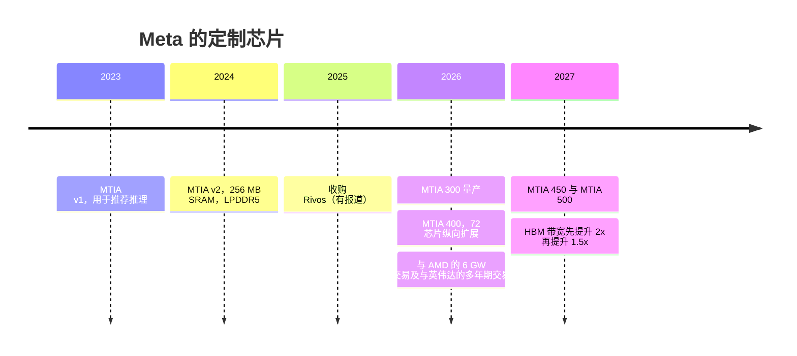
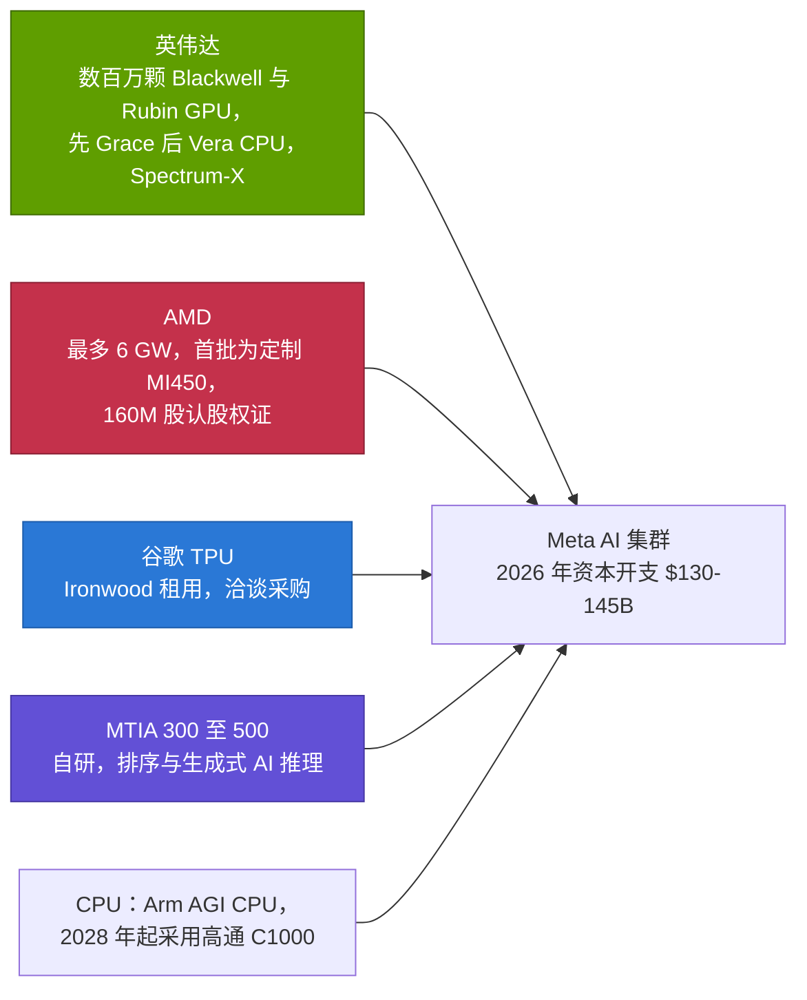
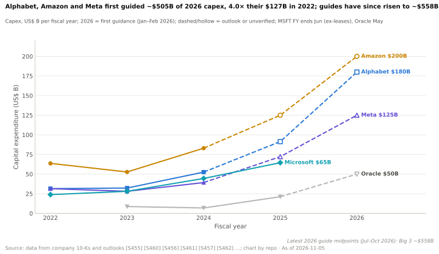
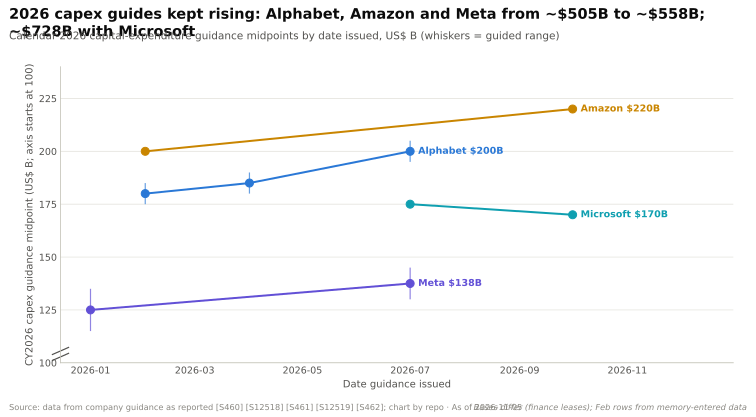
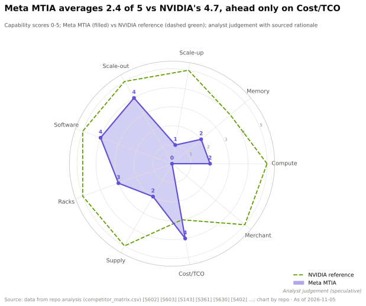

# Meta MTIA —— 英伟达最大自建型客户的自研对冲

> [!NOTE]
> 本页为英文原文的简体中文参考译文，仅供参考；如有出入，以[英文原文](../../../cross-cutting/15-competitive-landscape/meta-mtia.md "English original")为准。

跨层专题 15 · 竞争格局 · 从 MTIA v1 到 MTIA 500、Rivos、Meta 与 AMD、TPU 和英伟达的交易 · 约 13 分钟阅读 · 最后核实：2026-11-05

## ⚡ 要点速览

- **MTIA 起步于推荐芯片。** [MTIA](../../glossary.md#mtia) v1（2023）和 v2（2024）是采用 LPDDR5 内存的小型低功耗芯片，用于广告和信息流排序：v2 在 90 W 功耗下提供 177 TFLOPS [BF16](../../glossary.md#bf16) 算力，内存 128 GB、带宽约 0.2 TB/s [[S159]](../../../sources/bibliography.md#s159)[[S160]](../../../sources/bibliography.md#s160)。
- **2026 年它转型为 HBM 级推理产品线。** Meta 宣布以约六个月的节奏推出四代产品：MTIA 300（已量产）、400、450 和 500（2027）。MTIA 500 标称最高 27.6 TB/s 的 [HBM](../../glossary.md#hbm) 带宽和 10 [PFLOPS](../../glossary.md#flops) [FP8](../../glossary.md#fp8) 算力（🟢 已发布；🟡 媒体规格表）[[S15003]](../../../sources/bibliography.md#s15003)[[S15002]](../../../sources/bibliography.md#s15002)[[S561]](../../../sources/bibliography.md#s561)。
- **Meta 在收购芯片人才。** 它收购了 RISC-V 初创公司 Rivos（2025 年 10 月，条款未披露，据报道估值约 $2B），以加速 MTIA 开发（🟡）[[S15004]](../../../sources/bibliography.md#s15004)[[S4518]](../../../sources/bibliography.md#s4518)。
- **Meta 同时也是其他所有厂商的头部买家。** 2026 年，它承诺采购“数百万颗”英伟达（NVIDIA）Blackwell 和 Rubin GPU 以及 Grace CPU [[S4006]](../../../sources/bibliography.md#s4006)，最多 6 GW 的 AMD Instinct（附 160M 股认股权证）[[S24004]](../../../sources/bibliography.md#s24004)，以及数十亿美元的谷歌（Google）TPU 租用（🟡）[[S90025]](../../../sources/bibliography.md#s90025)。其 2026 年资本开支指引为 $130–145B [[S12518]](../../../sources/bibliography.md#s12518)。
- **它掌控着其他对手所缺乏的软件层。** Meta 创建了 [PyTorch](../../glossary.md#pytorch)；MTIA 的编译器基于 TorchInductor、[Triton](../../glossary.md#triton) 和 MLIR 构建，Meta 还与谷歌联合开发了 TorchTPU [[S9028]](../../../sources/bibliography.md#s9028)[[S553]](../../../sources/bibliography.md#s553)。
- **弱点：** MTIA 仅限内部使用，相比 Meta 的 GPU 集群规模仍然较小；MTIA 300 的内存带宽约为 Rubin 的 32%，稠密 FP8 约为其 7%（本资料库测算）[[S15014]](../../../sources/bibliography.md#s15014)。

## MTIA 历代产品：从排序到生成式 AI

| 代际 | 年份 | 内存 | 带宽 | 稠密 8 位算力 | 功耗 | 状态 | 来源 |
|---|---|---|---|---|---|---|---|
| MTIA v1 | 2023 | 128 GB LPDDR5 | 0.18 TB/s | 102 TOPS INT8 | 25 W | 🟢 已出货 | [[S159]](../../../sources/bibliography.md#s159) |
| MTIA v2 | 2024 | 128 GB LPDDR5 + 256 MB SRAM | 0.20 TB/s | 354 TOPS INT8 | 90 W | 🟢 已出货 | [[S160]](../../../sources/bibliography.md#s160) |
| MTIA 300 | 2026 | 216 GB HBM | 6.1 TB/s | 约 1.2 PFLOPS FP8 | 800 W | 🟢 已量产 | [[S15002]](../../../sources/bibliography.md#s15002)[[S561]](../../../sources/bibliography.md#s561) |
| MTIA 400 | 2026 | 288 GB HBM | 9.2 TB/s | 6 PFLOPS FP8（12 MX4） | 1,200 W | 🟡 发布时处于实验室测试阶段 | [[S15002]](../../../sources/bibliography.md#s15002)[[S562]](../../../sources/bibliography.md#s562) |
| MTIA 450 | 2027 | 288 GB HBM | 18.4 TB/s | 7 PFLOPS FP8（21 MX4） | 1,400 W | 🟡 路线图 | [[S15002]](../../../sources/bibliography.md#s15002)[[S15003]](../../../sources/bibliography.md#s15003) |
| MTIA 500 | 2027 | 384–512 GB HBM | 27.6 TB/s | 10 PFLOPS FP8（30 MX4） | 1,700 W | 🟡 路线图 | [[S15002]](../../../sources/bibliography.md#s15002)[[S15003]](../../../sources/bibliography.md#s15003) |

来源：[[S159]](../../../sources/bibliography.md#s159)[[S160]](../../../sources/bibliography.md#s160)[[S4518]](../../../sources/bibliography.md#s4518)[[S561]](../../../sources/bibliography.md#s561)[[S562]](../../../sources/bibliography.md#s562)[[S24004]](../../../sources/bibliography.md#s24004)[[S4006]](../../../sources/bibliography.md#s4006)[[S15003]](../../../sources/bibliography.md#s15003)。

为何转型？[推荐模型](../../glossary.md#recommendation-model)每次查询只需在庞大的嵌入表中查找少数几行，因此需要的是*容量*，便宜的 [LPDDR](../../glossary.md#lpddr) 即可满足。大语言模型每生成一个 token 都要重新读取全部权重，因此需要的是*带宽*，而只有 HBM 能够提供。

> [!TIP]
> **算例 —— 为何 MTIA v2 无法服务[大语言模型（LLM）](../../glossary.md#llm)。** 一个 70B 参数的 FP8 模型约有 70 GB 权重，每个[解码（decode）](../../glossary.md#decode)步骤都要重新读取一遍。以 MTIA v2 的 0.2 TB/s 计算，单芯片单流速度上限约为 3 tokens/s；以 MTIA 400 的 9.2 TB/s 计约为 131 tokens/s；以 MTIA 500 的 27.6 TB/s 计约为 394 [[S160]](../../../sources/bibliography.md#s160)[[S15002]](../../../sources/bibliography.md#s15002)。**结论：** 正是向 HBM 的跃升，让 MTIA 从排序加速器转变为生成式 AI 推理芯片。纸面上 MTIA 500 的带宽（27.6 TB/s）超过 Rubin 的 19.2 TB/s，尽管它要晚一年推出 [[S90006]](../../../sources/bibliography.md#s90006)。

🔧 技术细节：六个月的迭代节奏与共享机架

Meta 表示 MTIA 400、450 和 500 共用同一套机箱和机架设计，因此每款新芯片都能直接装入现有基础设施 [[S561]](../../../sources/bibliography.md#s561)。这正是 Meta 能够大约每六个月推出一款芯片的原因——是英伟达一年一代节奏的两倍：机架、供电和散热保持不变，只更换芯片。MTIA 400 引入了 72 个加速器的[纵向扩展（scale-up）](../../glossary.md#scale-up)域，与 [NVL72](../../glossary.md#nvl72) 规模相同 [[S562]](../../../sources/bibliography.md#s562)。根据 Meta 的数据，MTIA 500 的每瓦带宽约为 16 GB/s（1,700 W 下 27.6 TB/s），而 Rubin 约为每瓦 8 GB/s（据报道 2.3 kW 下 19.2 TB/s）[[S15002]](../../../sources/bibliography.md#s15002)[[S106]](../../../sources/bibliography.md#s106)。软件栈为 PyTorch 原生，通过 torch.compile 和 torch.export 支持 eager 模式和图模式，编译器基于 TorchInductor、Triton、MLIR 和 LLVM 构建 [[S9028]](../../../sources/bibliography.md#s9028)。

## Meta 的芯片战略：部分自研，大部分外购

Meta 运营着公有云之外最大的 AI 集群。其 2026 年资本开支指引为 $130–145B（含融资租赁）[[S12518]](../../../sources/bibliography.md#s12518)。它正在建设 Prometheus（俄亥俄州，2026 年超过 1 GW，目标约 1M 颗 GPU）和 Hyperion（路易斯安那州，将扩展至 5 GW）[[S27007]](../../../sources/bibliography.md#s27007)[[S27009]](../../../sources/bibliography.md#s27009)。MTIA 是这一扩建中的对冲手段，而非替代方案。

来源：[[S4006]](../../../sources/bibliography.md#s4006)[[S6009]](../../../sources/bibliography.md#s6009)[[S24004]](../../../sources/bibliography.md#s24004)[[S90025]](../../../sources/bibliography.md#s90025)[[S15003]](../../../sources/bibliography.md#s15003)[[S4510]](../../../sources/bibliography.md#s4510)[[S90058]](../../../sources/bibliography.md#s90058)[[S12518]](../../../sources/bibliography.md#s12518)。

| 供应商 | Meta 的承诺内容 | 状态 | 来源 |
|---|---|---|---|
| 英伟达 | 多年期：数百万颗 Blackwell 和 Rubin GPU；大规模采用独立 Grace CPU，随后为 Vera；Spectrum-X 以太网 | 🟢 | [[S4006]](../../../sources/bibliography.md#s4006)[[S4519]](../../../sources/bibliography.md#s4519)[[S6009]](../../../sources/bibliography.md#s6009) |
| AMD | 最多 6 GW 的 Instinct，首批为基于 MI450 的定制部件；最多 160M 股的认股权证 | 🟢 | [[S24004]](../../../sources/bibliography.md#s24004) |
| 谷歌 | 数十亿美元的 Ironwood 租用；洽谈为自有站点采购 TPU | 🟡 | [[S90025]](../../../sources/bibliography.md#s90025) |
| CoreWeave | 截至 2031 年 $14.2B 的算力 | 🟢 | [[S12527]](../../../sources/bibliography.md#s12527) |
| Arm | Arm 自研 AGI CPU 的首个客户 | 🟢 | [[S4510]](../../../sources/bibliography.md#s4510) |
| 高通（Qualcomm）（公开信息） | Dragonfly C1000 服务器 CPU 的首个具名客户，2028 年下半年起量产 | 🟢 | [[S90058]](../../../sources/bibliography.md#s90058) |

> [!TIP]
> **算例 —— Meta 对英伟达承诺的规模。** 摩根士丹利估计一个 Vera Rubin NVL72 机架约 $7.8M，即每颗 GPU 约 $108K（估计）[[S330]](../../../sources/bibliography.md#s330)。一百万颗 Rubin 级 GPU——“数百万颗”的下限 [[S4006]](../../../sources/bibliography.md#s4006)——对应约 $108B 的系统，约为 Meta 2026 年资本开支中值（$137.5B）的 80% [[S12518]](../../../sources/bibliography.md#s12518)。AMD 的 6 GW 按每 GW $10–15B 计算，未来数年将再增加约 $60–90B（估计）[[S24004]](../../../sources/bibliography.md#s24004)。**结论：** 与这些商用采购承诺相比，MTIA 的产出很小。其主要任务是降低 Meta 自身排序和推理流量的成本，并在与英伟达和 AMD 谈判时为 Meta 提供可信的备选方案。

## 分层级判定

| 层级 | 相对英伟达的判定 | 理由 |
|---|---|---|
| 02 加速器芯片 | 🟦 路线不同（本页：生成式 AI 方面为 🟥） | 矩阵将 MTIA v2 作为排序芯片评分；MTIA 300 的稠密 FP8 约为 Rubin 的 7% [[S160]](../../../sources/bibliography.md#s160)[[S15014]](../../../sources/bibliography.md#s15014) |
| 03 内存、封装与供应 | 🟥 落后 | 出货量小；自 MTIA 300 起才采用 HBM [[S561]](../../../sources/bibliography.md#s561) |
| 04 CPU | 🟥 落后 | 没有 CPU 项目；采购 Grace、Arm AGI 及（2028 年起）高通 CPU [[S4006]](../../../sources/bibliography.md#s4006)[[S4510]](../../../sources/bibliography.md#s4510)[[S90058]](../../../sources/bibliography.md#s90058) |
| 05 纵向扩展 | 🟥 落后 | 自 MTIA 400 起才有 72 芯片域 [[S562]](../../../sources/bibliography.md#s562) |
| 06 横向扩展 | 🟦 路线不同 | 超大规模的自建 RoCE 以太网集群 [[S34022]](../../../sources/bibliography.md#s34022) |
| 07 DPU 与网卡 | 🟥 落后 | 与美满电子（Marvell）合作的定制 FBNIC 前端网卡；后端网卡外购 [[S7525]](../../../sources/bibliography.md#s7525) |
| 08 系统与机架 | 🟦 路线不同 | OCP 机架设计；同时也部署 GB200/GB300 机架 [[S4006]](../../../sources/bibliography.md#s4006) |
| 09 系统软件 | 🟦 路线不同 | 掌控 PyTorch；MTIA 为 PyTorch 原生 [[S9028]](../../../sources/bibliography.md#s9028) |
| 10 软件库 | 🟥 落后 | MTIA 专用软件库很少 [[S9028]](../../../sources/bibliography.md#s9028) |
| 11 推理软件 | 🟦 路线不同 | 服务 Meta 的排序推理；大语言模型主要运行在 GPU 上 [[S15003]](../../../sources/bibliography.md#s15003) |
| 12 编排与云 | 🟦 路线不同 | 仅限内部 |
| 13 生态与资本 | 🟥 落后 | Meta 的影响力在于作为买家，而非卖家 [[S24004]](../../../sources/bibliography.md#s24004)[[S90025]](../../../sources/bibliography.md#s90025) |

本资料库分析师判断，依据 `data/competitor_matrix.csv`（🔴）[[S15014]](../../../sources/bibliography.md#s15014)。**存在分歧：** 矩阵按 MTIA v2 对芯片和纵向扩展评分；鉴于 MTIA 400–500 已发布，本页在生成式 AI 方面将芯片视为 🟥 落后，并记录 MTIA 400 的 72 芯片域，同时保留矩阵对纵向扩展的 🟥 评分。

> [!TIP]
> **算例 —— 快速迭代 vs 移动靶。** 到 2027 年底，Meta 计划推出四代 MTIA；英伟达届时将推出两代（Rubin，然后是 Rubin Ultra）[[S561]](../../../sources/bibliography.md#s561)[[S90003]](../../../sources/bibliography.md#s90003)。MTIA 500 的 10 PFLOPS FP8 和 27.6 TB/s，对比 Rubin Ultra 估计的每封装约 34.7 PFLOPS 和约 32 TB/s（估计）[[S15002]](../../../sources/bibliography.md#s15002)[[S35018]](../../../sources/bibliography.md#s35018)：算力约为其 29%，带宽约为其 86%。**结论：** 快速迭代缩小内存差距的速度快于缩小算力差距，这更适合推理而非训练。

**其最有力的论据。** “我们掌控框架，也掌控工作负载。”Meta 掌控 PyTorch 及其自有的排序和生成式 AI 服务，因此 MTIA 不需要外部开发者；六个月的迭代节奏使其每年可以两次把新芯片装入同一机架 [[S9028]](../../../sources/bibliography.md#s9028)[[S561]](../../../sources/bibliography.md#s561)。

**差距缩小了多少。**

| 指标 | 过去 | 现在（2026 年 11 月） | 来源 |
|---|---|---|---|
| 内存带宽对比英伟达旗舰 | 4%（MTIA v2 vs H200，2024） | 32%（MTIA 300 vs Rubin）；MTIA 500 宣称 2027 年达到 27.6 TB/s | [[S15014]](../../../sources/bibliography.md#s15014)[[S15002]](../../../sources/bibliography.md#s15002) |
| 稠密 8 位算力对比英伟达旗舰 | 约 18%（v2 INT8 vs H200 FP8） | 约 7%（MTIA 300）；纸面上 MTIA 500 为 Rubin 的 57% | [[S15014]](../../../sources/bibliography.md#s15014) |
| 内存类型 | LPDDR5 | HBM | [[S160]](../../../sources/bibliography.md#s160)[[S561]](../../../sources/bibliography.md#s561) |
| 纵向扩展域 | 无 | 72 颗芯片（MTIA 400） | [[S562]](../../../sources/bibliography.md#s562) |
| 迭代节奏 | 约每年 1 款芯片 | 约每年 2 款芯片 | [[S561]](../../../sources/bibliography.md#s561) |

> [!NOTE]
> **🐂 看多观点（对 Meta 而言）。** 在 MTIA v2 之后两年内，MTIA 500 的纸面规格在带宽和容量上已接近 Rubin。PyTorch 原生软件栈、固定的机架以及 Rivos 团队，有望让 Meta 在推理——其最大的 AI 工作负载——上实现自给自足 [[S15002]](../../../sources/bibliography.md#s15002)[[S9028]](../../../sources/bibliography.md#s9028)[[S15004]](../../../sources/bibliography.md#s15004)。

> [!WARNING]
> **🐻 看空观点（对 Meta 而言）。** Meta 不断与英伟达和 AMD 签下创纪录的交易并租用 TPU：这是 MTIA 尚无法承担前沿工作的最明显信号 [[S4006]](../../../sources/bibliography.md#s4006)[[S24004]](../../../sources/bibliography.md#s24004)[[S90025]](../../../sources/bibliography.md#s90025)。其最新芯片仍停留在纸面规格，Rivos 的整合尚未得到证实，而六个月的迭代节奏会成倍放大执行风险。

## 🎯 企业发展视角

1. **买家即造王者。** Meta 是 AMD 定制 MI450、Arm AGI CPU 以及高通公开的 C1000 路线图的首个客户 [[S24004]](../../../sources/bibliography.md#s24004)[[S4510]](../../../sources/bibliography.md#s4510)[[S90058]](../../../sources/bibliography.md#s90058)。供应商应如何权衡赢得 Meta 这一标杆客户的价值，与 Meta 已表现出的多源采购和自研意愿？
2. **收购式招聘（acquihire）芯片团队。** 收购 Rivos（据报道约 $2B）为 Meta 带来了一支全栈芯片团队 [[S15004]](../../../sources/bibliography.md#s15004)。还有哪些独立设计团队可供收购？Meta 此举对它们的估值意味着什么？
3. **固定机架，快速芯片。** Meta 为 MTIA 400–500 共用机箱 [[S561]](../../../sources/bibliography.md#s561)，使芯片迭代节奏与数据中心设计脱钩。机架级标准化（OCP、MGX、Open Rack Wide）是否才是定制芯片的真正赋能因素？由谁来提供？
4. **推荐推理 vs 生成式推理。** MTIA 起源于排序。鉴于[超大规模云厂商](../../glossary.md#hyperscaler)自行满足自身需求，推荐和排序模型是否是商用厂商尚未充分服务的加速器市场？

## 📚 来源（Sources）

<!-- Auto-generated from the [S…] citations on this page by `make build`. Edit sources/registry/*.csv, not this list. -->

- [**S106**](../../../sources/bibliography.md#s106) SemiAnalysis, *Vera Rubin - Extreme Co-Design: An Evolution*, 2026. [Link](https://newsletter.semianalysis.com/p/vera-rubin-extreme-co-design-an-evolution)
- [**S159**](../../../sources/bibliography.md#s159) Meta AI Blog, *MTIA v1: Meta's first-generation AI inference accelerator*, 2023-05-18. [Link](https://ai.meta.com/blog/meta-training-inference-accelerator-AI-MTIA/)
- [**S160**](../../../sources/bibliography.md#s160) Meta AI Blog, *Our next-generation Meta Training and Inference Accelerator*, 2024-04-10. [Link](https://ai.meta.com/blog/next-generation-meta-training-inference-accelerator-AI-MTIA/)
- [**S330**](../../../sources/bibliography.md#s330) PC Gamer, *A single Nvidia Vera Rubin rack is estimated to cost $7,803,148 with over $2 million of that figure spent on memory alone*, 2026-05. [Link](https://pcgamer.com/hardware/a-single-nvidia-vera-rubin-rack-is-estimated-to-cost-usd7-803-148-with-over-usd2-million-of-that-figure-spent-on-memory-alone)
- [**S553**](../../../sources/bibliography.md#s553) Google Cloud Blog (Alex Barrett), *What's new in AI infrastructure and orchestration in October*, 2026-11. [Link](https://cloud.google.com/blog/topics/ai-infrastructure/whats-new-in-ai-infrastructure-this-month)
- [**S561**](../../../sources/bibliography.md#s561) DatacenterDynamics, *Meta unveils next four generations of its MTIA chip*, 2026-03-11. [Link](https://www.datacenterdynamics.com/en/news/meta-unveils-next-four-generations-of-its-mtia-chip/)
- [**S562**](../../../sources/bibliography.md#s562) ServeTheHome, *Meta MTIA 400 at Hot Chips 2026*, 2026-08. [Link](https://www.servethehome.com/?p=104026)
- [**S4006**](../../../sources/bibliography.md#s4006) SiliconANGLE, *Meta agrees to buy millions of AI chips from Nvidia, raising doubts about its in-house hardware*, 2026-02-17. [Link](https://siliconangle.com/2026/02/17/meta-agrees-buy-millions-ai-chips-nvidia-raising-doubts-house-hardware/)
- [**S4510**](../../../sources/bibliography.md#s4510) TechCrunch, *Arm is releasing its first in-house chip in its 35-year history*, 2026-03-24. [Link](https://techcrunch.com/2026/03/24/arm-is-releasing-its-first-in-house-chip-in-its-35-year-history/)
- [**S4518**](../../../sources/bibliography.md#s4518) DatacenterDynamics, *Meta acquires RISC-V chip startup Rivos (report)*, 2025-10. [Link](https://www.datacenterdynamics.com/en/news/meta-acquires-risc-v-chip-startup-rivos-report/)
- [**S4519**](../../../sources/bibliography.md#s4519) The Register, *GPU who? Meta to deploy Nvidia CPUs at large scale*, 2026-02-17. [Link](https://www.theregister.com/2026/02/17/meta_nvidia_cpu/)
- [**S6009**](../../../sources/bibliography.md#s6009) NVIDIA Investor Relations, *NVIDIA Spectrum-X Ethernet Switches Speed Up Networks for Meta and Oracle*, 2025-10-13. [Link](https://investor.nvidia.com/news/press-release-details/2025/NVIDIA-Spectrum-X-Ethernet-Switches-Speed-Up-Networks-for-Meta-and-Oracle/default.aspx)
- [**S7525**](../../../sources/bibliography.md#s7525) Marvell, *Marvell delivers custom Ethernet network interface controller solution at OCP*, 2024-10. [Link](https://www.marvell.com/company/newsroom/marvell-delivers-custom-ethernet-network-interface-controller-solution-at-ocp.html)
- [**S9028**](../../../sources/bibliography.md#s9028) StorageReview, *Meta's MTIA roadmap: four chip generations in two years put GenAI inference first*, 2026-03. [Link](https://www.storagereview.com/news/metas-mtia-roadmap-four-chip-generations-in-two-years-put-genai-inference-first)
- [**S12518**](../../../sources/bibliography.md#s12518) Datacentres.com, *Hyperscaler capex trends: over $700 billion for 2026*, 2026-08. [Link](https://www.datacentres.com/guides/hyperscaler-capex-trends)
- [**S12527**](../../../sources/bibliography.md#s12527) TechRepublic, *Meta inks $14.2B AI infrastructure deal with CoreWeave*, 2025-09-30. [Link](https://www.techrepublic.com/article/news-coreweave-meta-deal/)
- [**S15002**](../../../sources/bibliography.md#s15002) Tom's Hardware, *Meta's MTIA chip lineup joins hyperscaler push to replace Nvidia at inference*, 2026-03. [Link](https://www.tomshardware.com/tech-industry/semiconductors/metas-mtia-chip-lineup-joins-hyperscaler-push-to-replace-nvidia-at-inference)
- [**S15003**](../../../sources/bibliography.md#s15003) Meta AI Blog, *Meta MTIA: scaling AI chips for billions of users*, 2026-03-11. [Link](https://ai.meta.com/blog/meta-mtia-scale-ai-chips-for-billions/)
- [**S15004**](../../../sources/bibliography.md#s15004) TechCentral.ie, *Meta acquires chip developer Rivos to strengthen its position in AI*, 2025-10. [Link](https://www.techcentral.ie/meta-acquires-chip-developer-rivos-to-strengthen-its-position-in-ai/)
- [**S15014**](../../../sources/bibliography.md#s15014) nvidia_deep_dive_claude repository, *Repo analysis: Chapter 15A competitive-landscape calculations (gap-to-flagship ratios, implied AMD commitment value, hyperscaler wallet shares, breadth vs depth)*, 2026-11-05. [Link](https://github.com/FrankHuang94/nvidia_deep_dive_claude/blob/main/cross-cutting/15-competitive-landscape/index.md)
- [**S24004**](../../../sources/bibliography.md#s24004) The Register, *AMD copy-pastes 6 GW chips-for-stock deal in new Meta agreement*, 2026-02-24. [Link](https://www.theregister.com/2026/02/24/amd_copypastes_openai_6gw_chipsforstock/)
- [**S27007**](../../../sources/bibliography.md#s27007) The Register, *Meta reveals plan for several multi-gigawatt datacenter clusters*, 2025-07-15. [Link](https://www.theregister.com/2025/07/15/meta_datacenter_build_plan/)
- [**S27009**](../../../sources/bibliography.md#s27009) The Next Web, *Meta details Prometheus, the Ohio supercluster heading for 1 million GPUs*, 2026-10. [Link](https://thenextweb.com/news/meta-prometheus-supercluster-1-million-gpus-muse)
- [**S34022**](../../../sources/bibliography.md#s34022) ACM SIGCOMM 2024 (Adithya Gangidi, Rui Miao, Shengbao Zheng et al. (Meta)), *RDMA over Ethernet for Distributed AI Training at Meta Scale*, 2024-08. [Link](https://doi.org/10.1145/3651890.3672233)
- [**S35018**](../../../sources/bibliography.md#s35018) Tom's Hardware, *Nvidia announces Rubin GPUs in 2026, Rubin Ultra in 2027, Feynman also added to roadmap*, 2025-03-18. [Link](https://www.tomshardware.com/pc-components/gpus/nvidia-announces-rubin-gpus-in-2026-rubin-ultra-in-2027-feynam-after)
- [**S90003**](../../../sources/bibliography.md#s90003) eWeek, *Everything Nvidia Just Announced at GTC 2026: 7 Chips, 5 Racks, 1 Giant Bet on Agentic AI*, 2026-03-17. [Link](https://www.eweek.com/news/nvidia-gtc-2026-ai-inference-vera-rubin-neuron/)
- [**S90006**](../../../sources/bibliography.md#s90006) TweakTown, *Nvidia cuts Vera Rubin's memory bandwidth by up to 26% and AMD's Helios now leads in memory bandwidth*, 2026-10. [Link](https://www.tweaktown.com/news/114304/nvidia-cuts-vera-rubins-memory-bandwidth-by-up-to-26-percent-and-amds-helios-now-leads-in-memory-bandwidth/index.html)
- [**S90025**](../../../sources/bibliography.md#s90025) SiliconANGLE, *Google and Meta reportedly strike new multibillion-dollar AI chip deal*, 2026-02-26. [Link](https://siliconangle.com/2026/02/26/google-meta-reportedly-strike-new-multibillion-dollar-ai-chip-deal/)
- [**S90058**](../../../sources/bibliography.md#s90058) Constellation Research, *Qualcomm outlines new CPU, AI accelerator roadmap, inks deal with Meta*, 2026-06-24. [Link](https://www.constellationr.com/insights/news/qualcomm-outlines-new-cpu-ai-accelerator-roadmap-inks-deal-meta)
