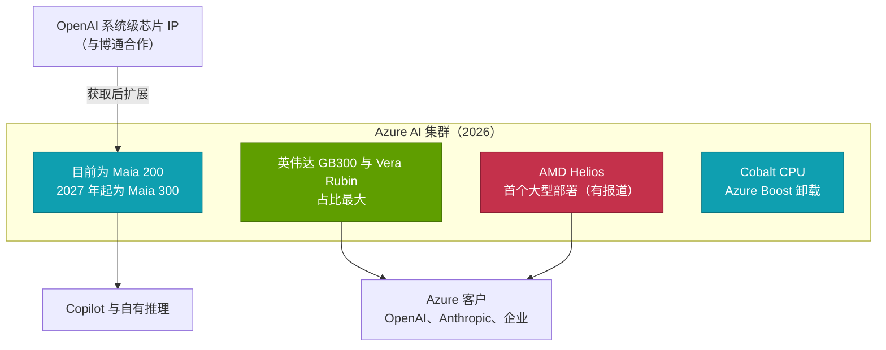
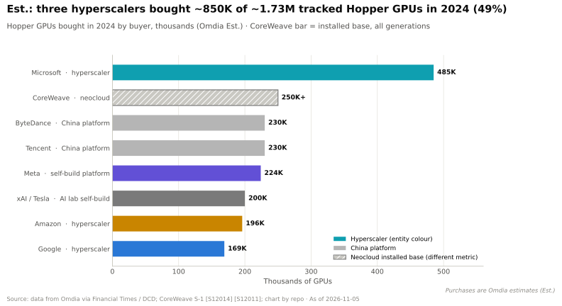
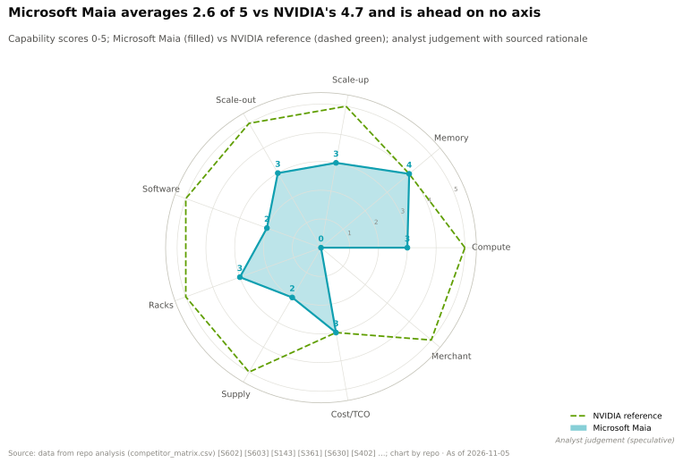

# 微软 Maia —— 为 Copilot 打造的推理引擎

> [!NOTE]
> 本页为英文原文的简体中文参考译文，仅供参考；如有出入，以[英文原文](../../../cross-cutting/15-competitive-landscape/microsoft-maia.md "English original")为准。

跨层专题 15 · 竞争格局 · Maia 100/200/300、Cobalt CPU、与 OpenAI 的关系 · 约 13 分钟阅读 · 最后核实：2026-11-05

## ⚡ 要点速览

- **起步晚，跟进快。** [Maia](../../glossary.md#maia) 100（2023 年发布，2024 年公布细节）仅在内部有限使用 [[S157]](../../../sources/bibliography.md#s157)。Maia 200 于 2026 年 1 月发布，已部署在美国、欧洲和澳大利亚，并运行 Microsoft 365 Copilot [[S158]](../../../sources/bibliography.md#s158)[[S90044]](../../../sources/bibliography.md#s90044)。
- **纯推理设计。** Maia 200 将超过 10 [PFLOPS](../../glossary.md#flops) 的 [FP4](../../glossary.md#fp4) 和超过 5 PFLOPS 的 [FP8](../../glossary.md#fp8) 算力，与 216 GB、约 7 TB/s 的 [HBM3E](../../glossary.md#hbm3e) 以及 272 MB 片上 [SRAM](../../glossary.md#sram) 相结合，功耗为 750 W [[S158]](../../../sources/bibliography.md#s158)。微软（Microsoft）宣称其[每美元性能](../../glossary.md#perf-per-dollar)比其集群中的最新硬件高约 30% [[S15007]](../../../sources/bibliography.md#s15007)。
- **Maia 300 瞄准 Rubin 级内存。** 该芯片于 2026-10-12 发布，标称 288 GB [HBM4](../../glossary.md#hbm4)、18 TB/s 带宽和最高 13.8 PFLOPS FP4，功耗 950 W，采用 96 芯片机架，计划 2027 年量产（🟢 已发布，厂商数据）[[S15005]](../../../sources/bibliography.md#s15005)[[S15006]](../../../sources/bibliography.md#s15006)[[S90046]](../../../sources/bibliography.md#s90046)。
- **数吉瓦级的雄心。** 微软计划自 2027 年起进行数吉瓦级的 Maia 部署，据报道正就超过 300,000 颗 Maia 300 与台积电（TSMC）洽谈产能（🟡）[[S90045]](../../../sources/bibliography.md#s90045)[[S559]](../../../sources/bibliography.md#s559)。
- **OpenAI 的芯片工作反哺 Maia。** 微软可获取 OpenAI 与博通（Broadcom）联合开发的系统级芯片 IP，并表示将在此基础上开发 Maia [[S15008]](../../../sources/bibliography.md#s15008)。
- **弱点：** 微软是 2024 年英伟达（NVIDIA）Hopper 的最大买家（约 485,000 颗，估计），目前仍以英伟达为主 [[S12014]](../../../sources/bibliography.md#s12014)。Maia 200 的内存带宽约为 Rubin 的 36%，没有公开基准测试，软件也仅为自有模型打造 [[S15014]](../../../sources/bibliography.md#s15014)。

## Maia 100 → 200 → 300

| 代际 | 发布时间 | 工艺 | 内存 | 峰值算力 | 功耗 | 部署 | 来源 |
|---|---|---|---|---|---|---|---|
| Maia 100 | 2023 年 11 月 | 台积电 N5，约 820 mm² | 64 GB HBM2E，1.8 TB/s | 约 0.8 PFLOPS BF16 | 配置功耗 500 W | 有限，内部使用 | [[S157]](../../../sources/bibliography.md#s157) |
| Maia 200 | 2026 年 1 月 | 台积电 N3，超过 140B 个晶体管 | 216 GB HBM3E，约 7 TB/s；272 MB SRAM | >10 PFLOPS FP4，>5 FP8 | 750 W | 🟢 美国、欧洲、澳大利亚；运行 Copilot | [[S158]](../../../sources/bibliography.md#s158)[[S90044]](../../../sources/bibliography.md#s90044) |
| Maia 300 | 2026 年 10 月 | 台积电 N2P 计算裸片 + 2 个 I/O 裸片 | 288 GB HBM4，18 TB/s | 最高 13.8 PFLOPS FP4 | 950 W | 🟢 已发布；2027 年量产 | [[S15005]](../../../sources/bibliography.md#s15005)[[S15006]](../../../sources/bibliography.md#s15006) |

Maia 300 是微软首款小芯片（chiplet）设计：一个 N2P 计算裸片、两个 I/O 裸片和八个 HBM4 堆栈 [[S15005]](../../../sources/bibliography.md#s15005)。一个机架在 167 kW 的功率包络内容纳 96 个加速器。微软宣称其每兆瓦 token 数比“领先的基于 GPU 的系统”高约 40%，单机架吞吐量是 Maia 200 的 7×。两者均为未经验证的设计目标 [[S15005]](../../../sources/bibliography.md#s15005)。

> [!TIP]
> **算例 —— “数吉瓦”换算成芯片是多少。** 一个 Maia 300 机架为 96 颗芯片耗电 167 kW：含机架开销，**每颗芯片约 1.74 kW** [[S15005]](../../../sources/bibliography.md#s15005)。据报道的 300,000 颗芯片将消耗 300,000 × 1.74 kW ≈ 520 MW 的 IT 负载，按 1.15 的 [PUE](../../glossary.md#pue) 计约为 600 MW（🔴 本资料库测算）[[S559]](../../../sources/bibliography.md#s559)。**结论：** 首批 Maia 300 订单大约相当于半个吉瓦。“自 2027 年起数吉瓦” [[S90045]](../../../sources/bibliography.md#s90045) 意味着跨代累计远超一百万颗 Maia 芯片——其集群规模可与微软 2024 年采购的约 485,000 颗 Hopper GPU 相比，但单颗功耗为其数倍 [[S12014]](../../../sources/bibliography.md#s12014)。

🔧 技术细节：为什么推理芯片可以更简单

推理时每个 token 只需一次前向传播；训练还需要反向传播、优化器状态和高精度累加。放弃训练能力后，芯片可以缩减或去除 FP64/FP32 单元，缩小[纵向扩展（scale-up）](../../glossary.md#scale-up)互连（Maia 200 每芯片提供 2.8 TB/s 双向带宽 [[S158]](../../../sources/bibliography.md#s158)），并把芯片面积用于 SRAM 和低精度运算。Maia 200 的 272 MB SRAM 将热点权重和 [KV 缓存](../../glossary.md#kv-cache)块保存在靠近计算单元的位置。微软还与其他 OCP 成员共同定义了[微缩放（microscaling）](../../glossary.md#microscaling)（MX）格式，通过每 32 个元素块共享一个缩放因子，使 4 位和 6 位数值保持精度 [[S2007]](../../../sources/bibliography.md#s2007)。

## 能效：ASIC 的取舍

与大多数[超大规模云厂商](../../glossary.md#hyperscaler)不同，微软会公布芯片功耗。纸面上，Maia 以峰值算力换取能效。

> [!TIP]
> **算例 —— 每兆瓦芯片功耗的 FP4 算力。** 1 MW 可供约 1,333 颗 750 W 的 Maia 200（≥ 13.3 EF FP4），或约 435 颗据报道功耗 2.3 kW 的 Rubin GPU（约 15.2 EF 稠密 FP4）[[S158]](../../../sources/bibliography.md#s158)[[S106]](../../../sources/bibliography.md#s106)[[S33005]](../../../sources/bibliography.md#s33005)。950 W 的 Maia 300 可达每瓦约 14.5 TFLOPS，纸面上约为 Rubin 的 95% [[S15005]](../../../sources/bibliography.md#s15005)。**结论：** 纯推理 [ASIC](../../glossary.md#asic) 通过放弃通用性，使每瓦算力接近英伟达。悬而未决的是实际利用率和软件，而这些在规格表上看不出来。

## Cobalt 与微软的其他芯片

Maia 是微软三款自研芯片之一。[Azure Cobalt](../../glossary.md#azure-cobalt) 100（128 个 Arm Neoverse N2 核心）于 2024 年 10 月正式商用 [[S183]](../../../sources/bibliography.md#s183)；Cobalt 200（基于台积电 3 nm 的 132 个 Neoverse V3 核心）于 2025 年 11 月推出，同时发布了新的 Azure Boost 卸载卡 [[S184]](../../../sources/bibliography.md#s184)[[S4024]](../../../sources/bibliography.md#s4024)。三者合力，使微软能够打造一个 CPU、卸载卡和加速器均为自研的机架。不过它仍从英伟达采购大部分 AI 算力，且据报道是 AMD Helios 的首个大型部署方（🟡）[[S90024]](../../../sources/bibliography.md#s90024)。

来源：[[S12014]](../../../sources/bibliography.md#s12014)[[S90024]](../../../sources/bibliography.md#s90024)[[S15005]](../../../sources/bibliography.md#s15005)[[S183]](../../../sources/bibliography.md#s183)[[S184]](../../../sources/bibliography.md#s184)[[S15008]](../../../sources/bibliography.md#s15008)[[S90044]](../../../sources/bibliography.md#s90044)[[S90075]](../../../sources/bibliography.md#s90075)。

> [!TIP]
> **算例 —— 如果 CPU 只占机架成本约 2%，为何还要自研？** 摩根士丹利估计，一个约 $7.8M 的 Vera Rubin 机架中 36 颗 Vera CPU 价值约 $180k，约占其成本的 2.3% [[S331]](../../../sources/bibliography.md#s331)。用 Cobalt 替换它们节省不了多少硬件开支。**结论：** Cobalt 的价值在于掌控力：微软可以决定 Maia 机架的主机软件、卸载方案（Azure Boost）和配比，并把这一层排除在英伟达的物料清单之外。

## 与 OpenAI 的关系

微软的芯片战略与 OpenAI 紧密交织。在 2025 年 10 月的重组中，OpenAI 承诺额外采购 $250B 的 Azure 服务，微软放弃了作为 OpenAI 算力供应商的优先购买权，并保留了该公司约 27% 的股份 [[S15009]](../../../sources/bibliography.md#s15009)。一个月后，微软 CEO 表示，微软可获取 OpenAI 与博通联合开发的系统级芯片成果，并将先加以实现、再进一步扩展 [[S15008]](../../../sources/bibliography.md#s15008)。微软还承诺向 Anthropic 投资最多 $5B，而 Anthropic 则承诺采购 $30B 基于英伟达系统的 Azure 算力 [[S90075]](../../../sources/bibliography.md#s90075)。

> [!TIP]
> **算例 —— OpenAI 的芯片能为 Maia 带来什么。** SemiAnalysis 报道称，OpenAI 由博通打造的推理 ASIC 在单个 N3P 裸片上提供 13.4 PFLOPS 的 MXFP4 算力，配备 15.4 TB/s 的 HBM4（🟡）[[S628]](../../../sources/bibliography.md#s628)。Maia 300 标称最高 13.8 PFLOPS FP4 和 18 TB/s [[S15005]](../../../sources/bibliography.md#s15005)。**结论：** 两款设计处于同一级别，因此这项 IP 权利的意义与其说是获得一款更好的芯片，不如说是在无需额外研发成本的情况下获得第二支设计团队，以及博通的封装和供应链。无论内部哪款设计胜出，这都降低了微软留在定制芯片竞赛中的成本。

## 分层级判定

| 层级 | 相对英伟达的判定 | 理由 |
|---|---|---|
| 02 加速器芯片 | 🟥 落后 | Maia 200 >5 PFLOPS FP8 vs Rubin 17.5；Maia 300 要到 2027 年 [[S158]](../../../sources/bibliography.md#s158)[[S33005]](../../../sources/bibliography.md#s33005) |
| 03 内存、封装与供应 | 🟥 落后 | 仍在为 Maia 300 洽谈台积电产能 [[S559]](../../../sources/bibliography.md#s559) |
| 04 CPU | 🟥 落后 | Cobalt 处于早期部署阶段；没有一致性 CPU-加速器链路 [[S184]](../../../sources/bibliography.md#s184) |
| 05 纵向扩展 | 🟥 落后 | 基于以太网每芯片 2.8 TB/s，集群最多 6,144 颗芯片 [[S158]](../../../sources/bibliography.md#s158) |
| 06 横向扩展 | 🟦 路线不同 | Azure 以太网架构，不对外销售 [[S6005]](../../../sources/bibliography.md#s6005) |
| 07 DPU 与卸载 | 🟦 路线不同 | Azure Boost，内部使用 [[S4024]](../../../sources/bibliography.md#s4024) |
| 08 系统与机架 | 🟥 落后 | 相比 Azure 的英伟达资产，集群规模较小；96 芯片 Maia 300 机架于 2027 年推出 [[S15005]](../../../sources/bibliography.md#s15005) |
| 09 系统软件 | 🟥 落后 | Maia SDK（基于 Triton）仅用于自有模型 [[S158]](../../../sources/bibliography.md#s158) |
| 10 软件库 | 🟥 落后 | 软件库生态极为有限 [[S158]](../../../sources/bibliography.md#s158) |
| 11 推理软件 | 🟥 落后 | 运行 Copilot；无公开基准测试 [[S90044]](../../../sources/bibliography.md#s90044) |
| 12 编排与云 | 🟩 领先 | Azure 位列前两大云平台；OpenAI 承诺 $250B [[S15009]](../../../sources/bibliography.md#s15009) |
| 13 生态与资本 | 🟥 落后 | 内部项目；微软仍是英伟达的头部客户 [[S12014]](../../../sources/bibliography.md#s12014) |

本资料库分析师判断，依据 `data/competitor_matrix.csv`（🔴）[[S15014]](../../../sources/bibliography.md#s15014)。

> [!TIP]
> **算例 —— “每美元性能提升 30%”值多少钱。** 每美元多完成 30% 的工作，意味着完成同样工作的成本为 1 ÷ 1.3 ≈ **77%**，即节省 23% [[S15007]](../../../sources/bibliography.md#s15007)。若微软自有推理每年使用约 $5B 的加速器算力（🔴 示意），在全面采用的情况下 Maia 每年可节省约 $1.2B。**结论：** 对于一家公司自身的流量而言，这笔收益很可观，但它随 Maia 在微软集群中的占比而扩大，而目前这一占比仍然很小。

**其最有力的论据。** “我们自己的 token，按我们自己的成本。”Copilot 和 Azure 的自有服务产生了巨大且可预测的推理需求。一款只针对这一需求调优、每美元性能提升约 30% 的芯片 [[S15007]](../../../sources/bibliography.md#s15007)，可以在微软为自己提供的每一个 token 上省钱，而无需赢得外部开发者。

**差距缩小了多少。**

| 指标 | 过去 | 现在（2026 年 11 月） | 来源 |
|---|---|---|---|
| 内存带宽对比英伟达旗舰 | 38%（Maia 100 vs H200，2024） | 36%（Maia 200 vs Rubin）；Maia 300 宣称 2027 年达到当前 Rubin 的 94% | [[S15014]](../../../sources/bibliography.md#s15014)[[S15005]](../../../sources/bibliography.md#s15005) |
| HBM 容量 | 64 GB | 216 GB（Maia 200），288 GB（Maia 300） | [[S157]](../../../sources/bibliography.md#s157)[[S158]](../../../sources/bibliography.md#s158)[[S15005]](../../../sources/bibliography.md#s15005) |
| 部署 | 内部有限使用 | 在三个地区量产部署；计划自 2027 年起达到数吉瓦 | [[S90044]](../../../sources/bibliography.md#s90044)[[S90045]](../../../sources/bibliography.md#s90045) |
| 公开基准测试 | 无 | 无 | [[S613]](../../../sources/bibliography.md#s613) |

> [!NOTE]
> **🐂 看多观点（对微软而言）。** Maia 300 的 18 TB/s 和 288 GB 在内存上与当前的 Rubin 相当，其宣称的每兆瓦 token 数 40% 优势瞄准的正是功率受限数据中心最看重的指标，而 OpenAI 的 IP 权利为微软带来了第二支设计团队 [[S15005]](../../../sources/bibliography.md#s15005)[[S15008]](../../../sources/bibliography.md#s15008)。

> [!WARNING]
> **🐻 看空观点（对微软而言）。** Maia 每次都晚到一代：Maia 300 于 2027 年出货时，英伟达已转向 Rubin Ultra [[S90003]](../../../sources/bibliography.md#s90003)。所有性能说法都是厂商数据。微软仍是英伟达最大的客户之一，Azure 也必须继续提供英伟达产品才能赢得外部工作负载 [[S12014]](../../../sources/bibliography.md#s12014)。

## 🎯 企业发展视角

1. **自用推理需求。** Maia 的立论基础是自有工作负载（Copilot、Foundry）[[S15007]](../../../sources/bibliography.md#s15007)。还有哪些公司拥有足够的自有推理需求来支撑一款推理 ASIC？商用推理厂商能否以低于定制项目的成本为它们提供服务？
2. **IP 共享作为一种新的交易形式。** 微软获取 OpenAI 芯片 IP 的权利 [[S15008]](../../../sources/bibliography.md#s15008) 是一种合作结构，而非收购。类似的“授权 + 联合开发”交易，能否让其他公司无需组建完整的设计团队就进入定制芯片领域？
3. **每兆瓦 token 数成为主战场。** Maia 300 的核心宣传点是每 MW token 数比 GPU 高 40% [[S15005]](../../../sources/bibliography.md#s15005)。如果买家采用这一指标，什么样的验证能让挑战者的说法令人信服：MLPerf Power、InferenceX 还是客户披露？
4. **第二供应商带来的议价筹码。** 微软采购英伟达、部署 AMD Helios（🟡）并自研 Maia [[S90024]](../../../sources/bibliography.md#s90024)。Maia 的价值有多少来自芯片本身，又有多少来自它为 Azure 在与英伟达谈判时提供的价格筹码？

## 📚 来源（Sources）

<!-- Auto-generated from the [S…] citations on this page by `make build`. Edit sources/registry/*.csv, not this list. -->

- [**S106**](../../../sources/bibliography.md#s106) SemiAnalysis, *Vera Rubin - Extreme Co-Design: An Evolution*, 2026. [Link](https://newsletter.semianalysis.com/p/vera-rubin-extreme-co-design-an-evolution)
- [**S157**](../../../sources/bibliography.md#s157) Microsoft Tech Community, *Inside Maia 100: Revolutionizing AI Workloads with Microsoft's Custom AI Accelerator*, 2024-08-27. [Link](https://techcommunity.microsoft.com/blog/azureinfrastructureblog/inside-maia-100-revolutionizing-ai-workloads-with-microsofts-custom-ai-accelerator/4229118)
- [**S158**](../../../sources/bibliography.md#s158) Microsoft, *Maia 200: Microsoft's AI accelerator built for inference*, 2026-01. [Link](https://blogs.microsoft.com/blog/2026/01/26/maia-200-the-ai-accelerator-built-for-inference/)
- [**S183**](../../../sources/bibliography.md#s183) Microsoft Azure Blog, *Azure Cobalt 100-based virtual machines are now generally available*, 2024-10. [Link](https://azure.microsoft.com/en-us/blog/azure-cobalt-100-based-virtual-machines-are-now-generally-available/)
- [**S184**](../../../sources/bibliography.md#s184) Microsoft Tech Community, *Announcing Cobalt 200: Azure's next cloud-native CPU*, 2025-11-18. [Link](https://techcommunity.microsoft.com/blog/azurecompute/announcing-cobalt-200-azures-next-cloud-native-cpu/4469807)
- [**S331**](../../../sources/bibliography.md#s331) Wccftech, *NVIDIA's Vera Rubin rack hit with 435% memory price surge, pushing HBM4 & LPDDR5X bill to $2M of $7.8M total*, 2026-05. [Link](https://wccftech.com/nvidia-vera-rubin-rack-hit-with-memory-price-surge-pushing-hbm4-lpddr5x-bill-to-2m-of-7-8m-total/)
- [**S559**](../../../sources/bibliography.md#s559) Techzine, *Microsoft aims to produce hundreds of thousands of Maia 300 AI chips*, 2026-08. [Link](https://www.techzine.eu/news/infrastructure/143518/microsoft-aims-to-produce-hundreds-of-thousands-of-maia-300-ai-chips/)
- [**S613**](../../../sources/bibliography.md#s613) NAND Research, *MLPerf Inference 6.0: Software Gains, Broadening Competition Shake Things Up*, 2026-04. [Link](https://nand-research.com/mlperf-inference-6-0-software-gains-broadening-competition-shake-things-up/)
- [**S628**](../../../sources/bibliography.md#s628) SemiAnalysis, *OpenAI Jalapeño: Better Than Nvidia Blackwell*, 2026-08-25. [Link](https://github.com/SemiAnalysisAI/InferenceX-app/blob/main/packages/app/content/blog/openai-jalapeno-better-than-nvidia.mdx)
- [**S2007**](../../../sources/bibliography.md#s2007) Open Compute Project (AMD, Arm, Intel, Meta, Microsoft, NVIDIA, Qualcomm), *OCP Microscaling Formats (MX) Specification v1.0*, 2023-09. [Link](https://www.opencompute.org/documents/ocp-microscaling-formats-mx-v1-0-spec-final-pdf)
- [**S4024**](../../../sources/bibliography.md#s4024) DatacenterDynamics, *Microsoft reveals next-generation Cobalt CPU and Azure Boost*, 2025-11-18. [Link](https://www.datacenterdynamics.com/en/news/microsoft-reveals-next-generation-cobalt-cpu-and-azure-boost/)
- [**S6005**](../../../sources/bibliography.md#s6005) Microsoft Official Blog, *Infinite scale: the architecture behind the Azure AI superfactory*, 2025-11-12. [Link](https://blogs.microsoft.com/blog/2025/11/12/infinite-scale-the-architecture-behind-the-azure-ai-superfactory/)
- [**S12014**](../../../sources/bibliography.md#s12014) DatacenterDynamics, *Microsoft bought twice as many Nvidia Hopper GPUs as other big tech companies - report*, 2024-12. [Link](https://www.datacenterdynamics.com/en/news/microsoft-bought-twice-as-many-nvidia-hopper-gpus-as-other-big-tech-companies-report)
- [**S15005**](../../../sources/bibliography.md#s15005) StorageReview, *Microsoft Maia 300: HBM4, N2P chiplet design and a 96-accelerator rack*, 2026-10. [Link](https://www.storagereview.com/news/microsoft-maia-300-hbm4-n2p-chiplet-96-accelerator-rack)
- [**S15006**](../../../sources/bibliography.md#s15006) Notebookcheck, *Microsoft Maia 300 AI chip arrives with 288 GB HBM4 memory and 18 TB/s bandwidth*, 2026-10. [Link](https://notebookcheck.net/Microsoft-Maia-300-AI-chip-arrives-with-monstrous-288-GB-HBM4-memory-and-18-TB-s-bandwidth.1422220.0.html)
- [**S15007**](../../../sources/bibliography.md#s15007) Network World, *Microsoft launches its second-generation AI inference chip Maia 200*, 2026-01-26. [Link](https://www.networkworld.com/article/4122439/microsoft-launches-its-second-generation-ai-inference-chip-maia-200.html)
- [**S15008**](../../../sources/bibliography.md#s15008) DatacenterDynamics, *Microsoft says it has access to the IP of OpenAI's custom AI chips*, 2025-11. [Link](https://www.datacenterdynamics.com/en/news/microsoft-says-it-has-access-to-the-ip-of-openais-custom-ai-chips/)
- [**S15009**](../../../sources/bibliography.md#s15009) Axios, *What to know about OpenAI's new deal with Microsoft*, 2025-10-29. [Link](https://www.axios.com/2025/10/29/microsoft-openai-azure-deal-agi)
- [**S15014**](../../../sources/bibliography.md#s15014) nvidia_deep_dive_claude repository, *Repo analysis: Chapter 15A competitive-landscape calculations (gap-to-flagship ratios, implied AMD commitment value, hyperscaler wallet shares, breadth vs depth)*, 2026-11-05. [Link](https://github.com/FrankHuang94/nvidia_deep_dive_claude/blob/main/cross-cutting/15-competitive-landscape/index.md)
- [**S33005**](../../../sources/bibliography.md#s33005) NVIDIA, *NVIDIA Vera Rubin NVL72 (product page and specifications)*, 2026. [Link](https://www.nvidia.com/en-us/data-center/vera-rubin-nvl72/)
- [**S90003**](../../../sources/bibliography.md#s90003) eWeek, *Everything Nvidia Just Announced at GTC 2026: 7 Chips, 5 Racks, 1 Giant Bet on Agentic AI*, 2026-03-17. [Link](https://www.eweek.com/news/nvidia-gtc-2026-ai-inference-vera-rubin-neuron/)
- [**S90024**](../../../sources/bibliography.md#s90024) Crypto Briefing, *AMD's Helios platform ships H2 2026 with Microsoft Azure as first major deployment*, 2026. [Link](https://cryptobriefing.com/amd-helios-platform-ships-h2-2026/)
- [**S90044**](../../../sources/bibliography.md#s90044) eWeek, *Microsoft introduces Maia 200, its most powerful AI chip yet*, 2026-01-27. [Link](https://www.eweek.com/news/microsoft-maia-200-ai-chip/)
- [**S90045**](../../../sources/bibliography.md#s90045) Pulse 2.0, *Microsoft to expand Azure Maia AI infrastructure to multi-gigawatt deployments starting in 2027*, 2026-10. [Link](https://pulse2.com/microsoft-to-expand-azure-maia-ai-infrastructure/)
- [**S90046**](../../../sources/bibliography.md#s90046) IT Brief UK, *Microsoft unveils Maia 300 for 2027 AI deployments*, 2026-10. [Link](https://itbrief.co.uk/story/microsoft-unveils-maia-300-for-2027-ai-deployments)
- [**S90075**](../../../sources/bibliography.md#s90075) Windows Central, *NVIDIA joins Microsoft's push on Claude — piling billions into Anthropic's future*, 2025-11-18. [Link](https://www.windowscentral.com/microsoft/nvidia-joins-microsofts-push-on-claude-piling-billions-into-anthropics-future)
