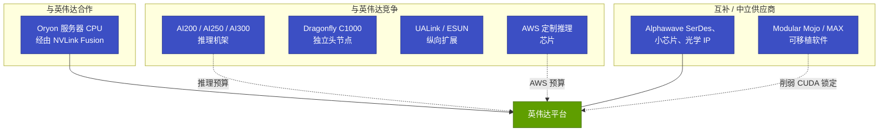
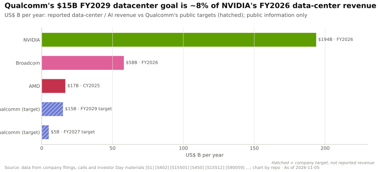

# 高通：第二次进军数据中心，对照英伟达的全景图

> [!NOTE]
> 本页为英文原文的简体中文参考译文，仅供参考；如有出入，以[英文原文](../../../cross-cutting/15-competitive-landscape/qualcomm.md "English original")为准。

跨层专题 15 · 竞争格局 · 阅读约 16 分钟 · 最后核实：2026-11-05

> [!IMPORTANT]
> **仅基于公开信息。** 本页所有内容均来自高通（Qualcomm）的公开公告、监管文件和媒体
> 报道，并已逐条标注出处。本页陈述事实与待解问题；不提供任何建议，也未使用任何内部
> 信息。

## ⚡ 要点速览

- **这是高通第二次进军数据中心。** 48 核的 Centriq 2400 于 2017 年 11 月发布；约一年之内，
  该部门人员即从 ~1,000 人削减至 ~50 人 [[S4542]](../../../sources/bibliography.md#s4542)[[S4543]](../../../sources/bibliography.md#s4543)[[S4544]](../../../sources/bibliography.md#s4544)。
- **此次重建主要依靠收购。** 收购 NUVIA（$1.4B，2021 年）获取 CPU 核心；收购 Alphawave（~$2.4B，2025-12-18 完成交割）获取
  [SerDes](../../glossary.md#serdes) 与互连能力；收购 Ventana（RISC-V，2025 年 12 月，金额未披露）；收购 Modular（$3.9B，
  2026-07-29 完成交割）获取可跨硬件移植的 AI 软件 [[S4538]](../../../sources/bibliography.md#s4538)[[S4513]](../../../sources/bibliography.md#s4513)[[S4514]](../../../sources/bibliography.md#s4514)[[S4512]](../../../sources/bibliography.md#s4512)[[S9511]](../../../sources/bibliography.md#s9511)。
- **加速器押注内存容量，而非 HBM。** AI200（2026 年）每张卡配备 768 GB [LPDDR](../../glossary.md#lpddr)，部署于
  160 kW 液冷机架；AI250（2027 年）加入[近存计算](../../glossary.md#near-memory-compute)；Dragonfly AI300
  （2028 年）宣称内存带宽为 AI200 的 54 倍，并采用 [UALink](../../glossary.md#ualink) 和 [ESUN](../../glossary.md#esun) [纵向扩展（scale-up）](../../glossary.md#scale-up) [[S173]](../../../sources/bibliography.md#s173)[[S90060]](../../../sources/bibliography.md#s90060)。截至 2026-11-05，尚无 AI200 批量出货的
  公开信息 🔴 [[S90028]](../../../sources/bibliography.md#s90028)。
- **CPU 既是与英伟达（NVIDIA）的合作棋，也是独立棋。** 高通于 2025 年 5 月以服务器 CPU 身份加入 [NVLink](../../glossary.md#nvlink) Fusion
  [[S90031]](../../../sources/bibliography.md#s90031)；Dragonfly C1000（>250 个 Oryon 核心）的首个客户是 Meta，自 2028 年下半年起部署 [[S90056]](../../../sources/bibliography.md#s90056)[[S90058]](../../../sources/bibliography.md#s90058)。
- **客户如今已落在纸面上。** HUMAIN 规划了 200 MW [[S90030]](../../../sources/bibliography.md#s90030)。AWS 签署了一项多代合作协议，涵盖定制推理
  芯片和 1.6T 光学器件，并附带一份最多可认购 25M 股高通股票的认股权证，随着 AWS 在 ~10 年内最多采购 $60B 而逐步归属
  🟢 [[S15510]](../../../sources/bibliography.md#s15510)[[S15509]](../../../sources/bibliography.md#s15509)。两份[超大规模云厂商](../../glossary.md#hyperscaler)定制芯片合同的金额各超过 $1B [[S15511]](../../../sources/bibliography.md#s15511)。
- **目标是 FY2027 实现 $5B 数据中心收入，FY2029 达到 $15B** [[S15512]](../../../sources/bibliography.md#s15512)[[S90059]](../../../sources/bibliography.md#s90059)。FY2029 目标约为
  英伟达 FY2026 数据中心收入的 ~8% [[S1]](../../../sources/bibliography.md#s1)。
- **相对英伟达的定位图谱：** 在 CPU 上是合作伙伴（NVLink Fusion），在推理加速器和纵向扩展标准上是竞争对手
  （UALink/ESUN），在互连 IP 和可移植软件上是互补者。

![高通公开数据中心动作的时间线，分为四条泳道。2025 年之前：Centriq 2400 服务器 CPU（2017 年 11 月），该部门收缩（2018 年），以 $1.4B 收购 NUVIA（2021 年），以及 Cloud AI 100 Ultra 加速卡（2023 年）。2025 年 5 月以来：NVLink Fusion CPU 合作与 HUMAIN 谅解备忘录（2025 年 5 月）；发布 AI200 和 AI250，同时公布 HUMAIN 200 MW 规划（2025 年 10 月）；收购 Ventana（RISC-V）和 Alphawave（~$2.4B）（2025 年 12 月）；投资者日发布面向 Meta 的 Dragonfly C1000 CPU、AI300 加速器以及 Modular 交易（2026 年 6 月）；Modular 以 $3.9B 完成交割（2026 年 7 月）；与 AWS 达成多代定制推理芯片及 1.6T 光学器件协议，并以 $4B 认股权证作为支撑（2026 年 9 月）。路线图：AI200 于 2026 年推出（截至 2026 年 11 月未确认批量出货），AI250 于 2027 年推出，AI300 和 C1000 于 2028 年部署。](../../../assets/charts/15-qualcomm-dc-roadmap-timeline.svg)

## 第一次尝试的启示（Centriq，2017–2018）

Centriq 2400 是一款可信的芯片：采用三星 10 nm 工艺、48 个定制 Arm 核心，发布价 $1,995 [[S4542]](../../../sources/bibliography.md#s4542)。它进入
市场时恰逢高通削减 ~$1B 成本，而据报道退出决定是在发布约七个月后作出的 [[S4543]](../../../sources/bibliography.md#s4543)。该
部门从 ~1,000 人缩减至 ~50 人，相关 IP 则在一家中国合资企业中得以延续 [[S4544]](../../../sources/bibliography.md#s4544)。

> [!TIP]
> **算例 —— 历史记录对尽职调查的启示。** 从发布（2017-11-08）到有报道的退出决定
> （2018 年 5 月）~6–7 个月 [[S4542]](../../../sources/bibliography.md#s4542)[[S4543]](../../../sources/bibliography.md#s4543)；员工从 ~1,000 人削减至 ~50 人，降幅 95% [[S4544]](../../../sources/bibliography.md#s4544)。服务器 CPU 需要在云客户处经历多年
> 认证，因此一个以季度计的项目很难走到量产。此次公开可见的不同之处在于：量产之前即有锚定客户（HUMAIN、Meta、AWS），以收购获得 IP 而非仅靠内部自研，以及明确公布的
> 多年期目标 [[S90030]](../../../sources/bibliography.md#s90030)[[S90058]](../../../sources/bibliography.md#s90058)[[S15510]](../../../sources/bibliography.md#s15510)[[S15512]](../../../sources/bibliography.md#s15512)。这些差异能否经受住下行周期的考验，是历史记录提出的问题，
> 而非它能回答的问题。

## 加速器产品线：从 AI 100 到 AI300

高通的推理加速器以牺牲内存带宽为代价换取内存容量和能效，与英伟达的
[HBM](../../glossary.md#hbm) GPU 处于相反的象限（[内存墙](../../layers/03-memory-packaging-supply-chain/the-memory-wall.md)）。

| 产品 | 年份 | 内存 | 带宽 | 功耗 / 散热 | 纵向扩展 | 状态 | 来源 |
|---|---|---|---|---|---|---|---|
| Cloud AI 100 Ultra | 2023 | 128 GB LPDDR4x | 0.548 TB/s | 150 W 加速卡 | PCIe | 已出货 | [[S172]](../../../sources/bibliography.md#s172) |
| AI200 | 2026 | 每卡 768 GB LPDDR | 未披露 | 160 kW 机架，直接液冷 | PCIe；以太网横向扩展 | 🔴 未见批量出货 | [[S173]](../../../sources/bibliography.md#s173)[[S90029]](../../../sources/bibliography.md#s90029) |
| AI250 | 2027 | LPDDR + 近存计算 | 有效带宽较 AI200 提升“>10×”（宣称） | 机架级 | PCIe；以太网 | 路线图 | [[S173]](../../../sources/bibliography.md#s173) |
| Dragonfly AI300 | 2028 | High Bandwidth Compute 第二代 | AI200 的“54×”（宣称） | 机架级 | UALink、ESUN | 路线图 | [[S90060]](../../../sources/bibliography.md#s90060) |
| NVIDIA Rubin（参照） | 2026 | 288 GB HBM4 | 19.2 TB/s | 液冷 NVL72 机架 | NVLink 6，72 个封装 | 爬坡中 | [[S90006]](../../../sources/bibliography.md#s90006)[[S90009]](../../../sources/bibliography.md#s90009) |

> [!TIP]
> **算例 —— 以一个模型看容量与带宽。** 一个 [FP8](../../glossary.md#fp8) 精度的 70B 参数模型需要 ~70 GB 权重。
> [解码（decode）](../../glossary.md#decode)时每生成一个 token 都要重新读取全部权重，因此单用户速度上限为带宽 ÷ 权重：Cloud AI 100 Ultra 上为 0.548 TB/s ÷ 70 GB ≈ 8
> tokens/s，而 Rubin GPU 上为 19.2 TB/s ÷ 70 GB ≈ 274 [[S172]](../../../sources/bibliography.md#s172)[[S90006]](../../../sources/bibliography.md#s90006)。批处理多个用户可以分摊
> 每次权重读取，因此单卡总吞吐量在低功耗下仍可相当可观；LPDDR 买不到的是每用户的高速度。
> 每张 AI200 卡的 768 GB 可容纳一个 ~600B 参数的 FP8 模型，并为 [KV 缓存](../../glossary.md#kv-cache)留出 ~170 GB，
> 这是任何单颗 HBM GPU 都做不到的（Rubin 为 288 GB）。悬而未决的问题是 AI200 的带宽——高通尚未披露，因此 AI300 宣称的 54 倍
> 目前还无法换算成 TB/s。

🔧 技术细节：为何选择 LPDDR，以及“近存计算”和 HBC 改变了什么

LPDDR 是手机和笔记本电脑使用的内存：每 GB 成本低、功耗低，由多家厂商大规模生产，而且不需要
[CoWoS](../../glossary.md#cowos) 中介层。它通过较窄的通道连接处理器，因此每 GB 带宽较低。HBM 则将 DRAM 裸片堆叠起来，
以数千个硅通孔连接并紧邻 GPU 放置：Rubin 的 19.2 TB/s 约为 AI 100 Ultra 0.548 TB/s 的 ~35 倍
[[S90006]](../../../sources/bibliography.md#s90006)[[S172]](../../../sources/bibliography.md#s172)，但 HBM 供应紧张且价格昂贵（[HBM 详解](../../layers/03-memory-packaging-supply-chain/hbm-explained.md)）。高通的 AI250 将部分
计算移到内存旁边，从而减少经由窄通道传输的数据量，这也是它报出的是*有效*带宽提升的原因
[[S173]](../../../sources/bibliography.md#s173)。AI300 中的[高带宽计算（High Bandwidth Compute）](../../glossary.md#high-bandwidth-compute)是高通沿这条路径迈出的下一步
[[S90060]](../../../sources/bibliography.md#s90060)。正因如此，本资料库在内存与供应维度上将高通评为“路线不同”：它绕开了 HBM 和
CoWoS 的配额之争，而英伟达在 2026 年 CoWoS 晶圆中占 ~60%（估计）[[S379]](../../../sources/bibliography.md#s379)。

## CPU 产品线：从 Centriq 到 Dragonfly C1000

两条 CPU 路线并行推进。第一条是合作路线：基于 Oryon 的服务器 CPU 通过
[NVLink Fusion](../../glossary.md#nvlink-fusion) 连接英伟达 GPU，于 Computex 2025 宣布 [[S90031]](../../../sources/bibliography.md#s90031)[[S4516]](../../../sources/bibliography.md#s4516)。第二条是独立路线：
Dragonfly C1000，一款拥有 250 个以上核心的小芯片（chiplet）CPU，目标主频 >5 GHz，支持 [PCIe](../../glossary.md#pcie) Gen 7 和 CXL，定位为面向智能体（agentic）工作负载的
[AI 头节点](../../glossary.md#ai-head-node)；Meta 是首个公开点名的客户，自
2028 年下半年起部署 [[S90056]](../../../sources/bibliography.md#s90056)[[S90058]](../../../sources/bibliography.md#s90058)。此前一则未经证实的报道描述了一款支持 NVLink Fusion 的 80 核产品 [[S4515]](../../../sources/bibliography.md#s4515)。作为参照，
英伟达的 Vera 有 88 个核心，AMD 的 EPYC Venice 最多 256 个 [[S100]](../../../sources/bibliography.md#s100)[[S144]](../../../sources/bibliography.md#s144)；来自 Ventana 的 RISC-V 工作与 Oryon 并行推进
[[S4512]](../../../sources/bibliography.md#s4512)（[CPU 竞争](../../layers/04-cpu-grace-vera/competition.md)）。

> [!TIP]
> **算例 —— 核心数与时间表。** 250 个以上核心约为 Vera 88 核的 ~2.8 倍，与 EPYC Venice 的 256 核持平
> [[S100]](../../../sources/bibliography.md#s100)[[S144]](../../../sources/bibliography.md#s144)。Venice 约从 2026 年第三季度起随 AMD 的 Helios 机架出货，Vera 则从 2026 年第三季度起随 Vera Rubin [NVL72](../../glossary.md#nvl72) 出货
> [[S90020]](../../../sources/bibliography.md#s90020)[[S90009]](../../../sources/bibliography.md#s90009)；C1000 自 2028 年下半年起部署 [[S90058]](../../../sources/bibliography.md#s90058)，因此它将面对这些厂商的下一代产品。核心数能让一颗
> CPU 进入评估；而决定头节点胜负的是每核内存带宽、GPU 链路和软件生态
> （[AI 为何需要 CPU](../../layers/04-cpu-grace-vera/why-ai-needs-a-cpu.md)）。

## 互连、软件与定制芯片：Alphawave、Modular、AWS

**Alphawave** 带来了 SerDes、小芯片和光互连 IP，这正是定制 ASIC 设计服务商视为
护城河的能力（[定制 ASIC 设计服务商](custom-asic-houses.md)）[[S4514]](../../../sources/bibliography.md#s4514)。**Modular**
带来了 Mojo 和 MAX 推理引擎，这是一套可跨硬件移植的软件栈；Mojo 已于 2026 年 8 月以 Apache 2.0
协议开源 [[S9511]](../../../sources/bibliography.md#s9511)[[S9512]](../../../sources/bibliography.md#s9512)。本资料库第 09 层的分析将可移植软件视为侵蚀 [CUDA](../../glossary.md#cuda) 的主要途径之一
（[CUDA 竞争](../../layers/09-cuda-and-system-software/competition.md)）。

**AWS** 是最重要的公开客户信号。高通与 AWS 同意跨代共同开发定制 AI 推理芯片，
以及最高 1.6T 的光互连，预计从高通 2027 财年第一季度起产生收入 [[S15509]](../../../sources/bibliography.md#s15509)[[S15510]](../../../sources/bibliography.md#s15510)。

> [!TIP]
> **算例 —— 解读按采购额归属的认股权证。** 该认股权证涵盖最多 25M 股，行权价 $161.26，对应行权总值 ~$4.0B，
> 随亚马逊在 2036 年前最多采购 $60B 产品而逐步归属；其中 3.75M 股已因初始承诺而归属
> [[S15510]](../../../sources/bibliography.md#s15510)。即 $60B ÷ 25M = 每归属一股对应 $2,400 采购额。若股价高于行权价 $40，
> 则每股对亚马逊价值 $40，约为对应采购额的 ~1.7%（🔴 示意性股价）。若归属是线性的
> （未披露），3.75M 股对应的初始承诺为 ~$9B（🔴 本资料库测算）。从结构上看，这是一种以股权支付的
> 批量返利，类似 AMD 给 OpenAI 的认股权证，但行权价为正值 [[S13506]](../../../sources/bibliography.md#s13506)
> （[按采购额归属的认股权证](../../glossary.md#purchase-vested-warrant)）。

## 逐层图谱：合作、竞争、互补

| 英伟达技术栈层 | 高通的公开布局 | 与英伟达的关系 | 相对英伟达的评判 | 来源 |
|---|---|---|---|---|
| 02 加速器芯片 | Cloud AI 100 Ultra；AI200/AI250/AI300 | 竞争（推理） | 🟦 路线不同：LPDDR 推理 NPU | [[S172]](../../../sources/bibliography.md#s172)[[S173]](../../../sources/bibliography.md#s173)[[S90060]](../../../sources/bibliography.md#s90060) |
| 03 内存与供应 | 以 LPDDR 替代 HBM/CoWoS | 竞争（供应独立） | 🟦 路线不同：每卡 768 GB，带宽低 | [[S173]](../../../sources/bibliography.md#s173) |
| 04 CPU | 通过 NVLink Fusion 的 Oryon CPU；Dragonfly C1000 | 合作兼竞争 | 🟥 落后：2028 年前不出货 | [[S90031]](../../../sources/bibliography.md#s90031)[[S90056]](../../../sources/bibliography.md#s90056) |
| 05 纵向扩展 | AI300 采用 UALink 和 ESUN | 竞争（对立标准） | 🟥 落后：目前为 PCIe | [[S90060]](../../../sources/bibliography.md#s90060)[[S173]](../../../sources/bibliography.md#s173) |
| 06 横向扩展与光学 | Alphawave IP；AWS 1.6T 光学器件 | 互补（向多方销售） | 🟥 交换领域落后；🔴 IP 供应商角色 | [[S4514]](../../../sources/bibliography.md#s4514)[[S15509]](../../../sources/bibliography.md#s15509) |
| 08 系统与机架 | 160 kW AI200 机架 | 竞争 | 🟥 落后：首批机架为 2026 年目标 | [[S173]](../../../sources/bibliography.md#s173) |
| 09–11 软件 | 集成 vLLM 的 Cloud AI SDK；Modular（Mojo/MAX） | 互补（可移植性） | 🟦 路线不同：可移植软件栈 | [[S596]](../../../sources/bibliography.md#s596)[[S9511]](../../../sources/bibliography.md#s9511) |
| 12 云 | 无云服务 | — | 🟥 落后 | [[S173]](../../../sources/bibliography.md#s173) |
| 13 生态与资本 | HUMAIN、Meta、AWS；$5B / $15B 目标 | 争夺超大规模云厂商预算 | 🟥 落后：早期客户 | [[S90030]](../../../sources/bibliography.md#s90030)[[S90058]](../../../sources/bibliography.md#s90058)[[S15512]](../../../sources/bibliography.md#s15512) |

## 放在大背景下看目标

> [!TIP]
> **算例 —— 衡量 $15B 目标的体量。** 高通 FY2026 收入为 $43.1B [[S15513]](../../../sources/bibliography.md#s15513)。若到 FY2029 数据中心业务线达到 $15B，
> 将相当于该基数的 ~35%、英伟达 FY2026 数据中心收入（$193.7B）的 ~7.7%，并大致相当于 AMD 2025 年
> 数据中心收入（~$16.7B）[[S1]](../../../sources/bibliography.md#s1)[[S450]](../../../sources/bibliography.md#s450)。FY2027 阶段目标（$5B）中至少有 $1B 来自两家超大规模云厂商
> 定制芯片客户 [[S15511]](../../../sources/bibliography.md#s15511)，因此近期目标中商用加速器的占比低于
> 标题数字所显示的水平。

## 它们最有力的论据，以及差距缩小了多少

**最有力的公开论据**在于：推理对成本和功耗的重视程度高于峰值速度，而高通的 LPDDR 设计、
150 W 级的产品积淀以及不依赖 HBM 和 CoWoS 的供应独立性，正是瞄准了这一点 [[S172]](../../../sources/bibliography.md#s172)[[S173]](../../../sources/bibliography.md#s173)。与 AWS 和 Meta 的
协议表明超大规模买家已经参与进来 [[S15510]](../../../sources/bibliography.md#s15510)[[S90058]](../../../sources/bibliography.md#s90058)。

**差距缩小了多少：** 就已出货的数据中心加速器而言，迄今收窄有限；截至 2026-11-05，尚无 AI200 批量出货、MLPerf
数据中心成绩或 InferenceX 成绩的公开信息 🔴 [[S90028]](../../../sources/bibliography.md#s90028)[[S602]](../../../sources/bibliography.md#s602)[[S620]](../../../sources/bibliography.md#s620)。就客户与 IP 而言，则比
2018 年以来任何时候都更进一步（见上方时间线）。本资料库的评估矩阵给高通的评分为 2.7（满分 5），英伟达为 4.7（🔴 分析师判断；见上方能力图）。

> [!NOTE]
> **🐂 看多观点（对英伟达而言）。** 高通的 CPU 接入 NVLink Fusion，因此其部分努力扩展的是英伟达的机架，
> 而非取而代之 [[S90031]](../../../sources/bibliography.md#s90031)；英伟达自身的推理产品线如今已涵盖 HBM GPU 和基于 SRAM 的 Groq 3 LPX
> 机架，覆盖了成本和延迟两个层级 [[S114]](../../../sources/bibliography.md#s114)[[S90003]](../../../sources/bibliography.md#s90003)。

> [!WARNING]
> **🐻 看空观点（对英伟达而言）。** 一家 FY2026 收入达 $43.1B 的公司 [[S15513]](../../../sources/bibliography.md#s15513) 如今已拥有超大规模云厂商定制芯片协议（AWS）、
> CPU 协议（Meta）、可移植软件（Modular）以及 UALink/ESUN 纵向扩展，全部瞄准推理预算——而这正是
> 英伟达软件优势最不重要的领域 [[S15510]](../../../sources/bibliography.md#s15510)[[S90058]](../../../sources/bibliography.md#s90058)[[S9511]](../../../sources/bibliography.md#s9511)[[S90060]](../../../sources/bibliography.md#s90060)。

## 企业发展团队会问的问题

| 问题 | 为何重要 | 迄今的公开证据 |
|---|---|---|
| AI200 何时批量出货？除 HUMAIN 外还会出货给谁？ | 关系到 FY2027 $5B 目标的收入确认时点 | 2026 年目标；尚无出货确认 [[S173]](../../../sources/bibliography.md#s173)[[S90028]](../../../sources/bibliography.md#s90028) |
| AI200 的内存带宽和实测 tokens/s 是多少？ | 决定其能服务哪些模型和延迟层级 | 未披露；无 MLPerf/InferenceX 成绩 [[S602]](../../../sources/bibliography.md#s602)[[S620]](../../../sources/bibliography.md#s620) |
| AWS 的 $60B 上限中有多少会转化为确定订单？ | 认股权证只随采购而归属 | 25M 股中已有 3.75M 股因初始承诺而归属 [[S15510]](../../../sources/bibliography.md#s15510) |
| NVLink Fusion CPU 会先于 C1000 出货吗？ | 合作路线与独立路线的优先级 | 尚无公开出货日期 [[S90031]](../../../sources/bibliography.md#s90031)[[S90056]](../../../sources/bibliography.md#s90056) |
| Modular 的工具如何覆盖高通芯片以及竞争对手的芯片？ | 可移植性惠及所有人，包括竞争对手 | Mojo 于 2026 年 8 月开源 [[S9512]](../../../sources/bibliography.md#s9512) |
| UALink/ESUN 的时间表与 2028 年的 AI300 如何衔接？ | 纵向扩展标准的成熟度 | UALink 产品预计 2027 年推出 [[S90051]](../../../sources/bibliography.md#s90051) |

## 🎯 企业发展视角

1. 高通同时是合作伙伴（NVLink Fusion CPU）、竞争对手（AI200–AI300、C1000、AWS 芯片）和中立供应商
   （Alphawave IP、Mojo）。哪些公开证据能表明到 FY2029 哪种角色贡献的收入最多？
2. 定制芯片合同（两家超大规模云厂商，各超过 $1B）和 AWS 协议与博通的模式相似。按公开数据，NRE、
   单颗利润率和认股权证摊薄与商用 AI200 产品线相比如何？
3. LPDDR 容量路线如今与英特尔的 Crescent Island 以及初创公司的 [SRAM](../../glossary.md#sram)/HBM 混合方案形成交集。在这一细分市场中，
   靠什么建立持久地位：内存、软件、功耗还是客户渠道？
4. Modular 的收购价为 $3.9B，约为其 $1.6B C 轮估值的 ~2.4 倍 [[S9511]](../../../sources/bibliography.md#s9511)[[S9510]](../../../sources/bibliography.md#s9510)。哪些里程碑（框架采用率、第三方
   硬件支持、开发者数量）能够表明该软件正在推动工作负载迁移？
5. Centriq 在发布后 ~6 个月即告退出 [[S4543]](../../../sources/bibliography.md#s4543)。哪些公开披露（出货量、客户数量、分部
   报告）将表明此次尝试是否越过了上一次止步的阶段？

## 📚 来源（Sources）

<!-- Auto-generated from the [S…] citations on this page by `make build`. Edit sources/registry/*.csv, not this list. -->

- [**S1**](../../../sources/bibliography.md#s1) NVIDIA Corporation via SEC EDGAR, *NVIDIA Announces Financial Results for Fourth Quarter and Fiscal 2026 (Form 8-K exhibit 99.1)*, 2026-02-25. [Link](https://www.sec.gov/Archives/edgar/data/1045810/000104581026000019/q4fy26pr.htm)
- [**S100**](../../../sources/bibliography.md#s100) NVIDIA Technical Blog, *Inside the NVIDIA Vera Rubin Platform: Six New Chips, One AI Supercomputer*, 2026-01-05. [Link](https://developer.nvidia.com/blog/inside-the-nvidia-rubin-platform-six-new-chips-one-ai-supercomputer/)
- [**S114**](../../../sources/bibliography.md#s114) StorageReview, *NVIDIA Groq 3 LPX: Everything we know*, 2026-03. [Link](https://www.storagereview.com/news/nvidia-groq-3-lpx-everything-we-know)
- [**S144**](../../../sources/bibliography.md#s144) AMD Newsroom, *AMD Unveils Vision for an Open AI Ecosystem, Detailing New Silicon, Software and Systems at Advancing AI 2025*, 2025-06-12. [Link](https://www.amd.com/en/newsroom/press-releases/2025-6-12-amd-unveils-vision-for-an-open-ai-ecosystem-detai.html)
- [**S172**](../../../sources/bibliography.md#s172) Qualcomm, *Qualcomm Cloud AI 100 (incl. Cloud AI 100 Ultra)*, 2023-11. [Link](https://www.qualcomm.com/products/technology/processors/cloud-artificial-intelligence/cloud-ai-100)
- [**S173**](../../../sources/bibliography.md#s173) Qualcomm, *Qualcomm Unveils AI200 and AI250 - Redefining Rack-Scale Data Center Inference*, 2025-10-27. [Link](https://www.qualcomm.com/news/releases/2025/10/qualcomm-unveils-ai200-and-ai250-redefining-rack-scale-data-cent)
- [**S379**](../../../sources/bibliography.md#s379) TrendForce News, *TSMC CoWoS capacity and customer allocation estimates (TrendForce / Morgan Stanley, as reported)*, 2025. [Link](https://www.trendforce.com/news/)
- [**S450**](../../../sources/bibliography.md#s450) U.S. Securities and Exchange Commission (EDGAR), *Advanced Micro Devices Form 10-K / 10-Q filings (EDGAR index)*, 2025-02-05. [Link](https://www.sec.gov/cgi-bin/browse-edgar?action=getcompany&CIK=0000002488&type=10-&dateb=&owner=include&count=40)
- [**S596**](../../../sources/bibliography.md#s596) Qualcomm (GitHub: quic), *Qualcomm Cloud AI SDK and Efficient Transformers repositories*, 2026-11. [Link](https://github.com/quic/cloud-ai-sdk)
- [**S602**](../../../sources/bibliography.md#s602) MLCommons, *MLPerf Inference v6.0 results (summary_results.json and per-submitter logs)*, 2026-04-01. [Link](https://github.com/mlcommons/inference_results_v6.0)
- [**S620**](../../../sources/bibliography.md#s620) SemiAnalysis, *SemiAnalysis InferenceX (formerly InferenceMAX) open-source benchmark repository*, 2026-11. [Link](https://github.com/SemiAnalysisAI/InferenceX)
- [**S4512**](../../../sources/bibliography.md#s4512) DatacenterDynamics, *Qualcomm buys RISC-V server chip maker Ventana Micro Systems*, 2025-12-10. [Link](https://www.datacenterdynamics.com/en/news/qualcomm-buys-risc-v-server-chip-maker-ventana-microsystems/)
- [**S4513**](../../../sources/bibliography.md#s4513) I-Connect007, *Qualcomm completes acquisition of Alphawave Semi*, 2025-12-18. [Link](https://iconnect007.com/article/148161/qualcomm-completes-acquisition-of-alphawave-semi/148158/ein)
- [**S4514**](../../../sources/bibliography.md#s4514) CRN Asia, *Qualcomm: US$2.4 billion Alphawave Semi buy to boost data center push*, 2025-06. [Link](https://www.crnasia.com/news-network/2025/qualcomm-us-2)
- [**S4515**](../../../sources/bibliography.md#s4515) 3DNews, *Qualcomm server processor to get 80 Oryon cores, NVLink Fusion, PCIe 5.0 and HBM support (DigiTimes report)*, 2025. [Link](https://3dnews.ru/1123267/serverniy-protsessor-qualcomm-poluchit-80-yader-oryon-poddergku-nvlink-fusionpcie-50-i-pamyatihbm/amp)
- [**S4516**](../../../sources/bibliography.md#s4516) DatacenterDynamics, *Qualcomm to return to data center market with AI CPUs*, 2025-05. [Link](https://www.datacenterdynamics.com/en/news/qualcomm-to-return-to-data-center-market-with-ai-cpus/)
- [**S4538**](../../../sources/bibliography.md#s4538) Qualcomm Investor Relations, *Qualcomm completes acquisition of NUVIA*, 2021-03-16. [Link](https://investor.qualcomm.com/news-events/press-releases/news-details/2021/Qualcomm-Completes-Acquisition-of-NUVIA-03-16-2021/default.aspx)
- [**S4542**](../../../sources/bibliography.md#s4542) AnandTech, *Qualcomm launches 48-core Centriq for $1,995: Arm servers for cloud native applications*, 2017-11-08. [Link](https://www.anandtech.com/show/12025)
- [**S4543**](../../../sources/bibliography.md#s4543) The Next Platform, *What Qualcomm's exit from Arm server chips means*, 2018-05-10. [Link](https://www.nextplatform.com/2018/05/10/what-qualcomms-exit-from-arm-server-chips-means)
- [**S4544**](../../../sources/bibliography.md#s4544) Network World, *Qualcomm makes it official: no more data center chip*, 2018-12. [Link](https://www.networkworld.com/article/3327214/qualcomm-makes-it-official-no-more-data-center-chip.html)
- [**S9510**](../../../sources/bibliography.md#s9510) SDxCentral, *Modular raises $250M for AI's unified compute layer at $1.6B valuation*, 2025-09-24. [Link](https://www.sdxcentral.com/news/modular-raises-250m-for-ais-unified-compute-layer-at-16b-valuation/)
- [**S9511**](../../../sources/bibliography.md#s9511) Nasdaq (Qualcomm press release), *Qualcomm Completes Acquisition of Modular*, 2026-07-29. [Link](https://www.nasdaq.com/press-release/qualcomm-completes-acquisition-modular-2026-07-29)
- [**S9512**](../../../sources/bibliography.md#s9512) Phoronix (Michael Larabel), *Modular's Mojo Language Now Open-Source Following Qualcomm Acquisition*, 2026-08-18. [Link](https://www.phoronix.com/news/Modular-Mojo-Open-Source)
- [**S13506**](../../../sources/bibliography.md#s13506) Tom's Hardware, *OpenAI signs 6 GW AMD GPU deal*, 2025-10-06. [Link](https://www.tomshardware.com/pc-components/gpus/openai-signs-6gw-amd-gpu-deal)
- [**S15509**](../../../sources/bibliography.md#s15509) Mobile World Live, *Qualcomm lands custom AI chip deal with Amazon*, 2026-09. [Link](https://www.mobileworldlive.com/ai-cloud/qualcomm-lands-custom-ai-chip-deal-with-amazon/)
- [**S15510**](../../../sources/bibliography.md#s15510) Manufacturing Dive, *Qualcomm makes custom chips for Amazon in $4B partnership*, 2026-09. [Link](https://www.manufacturingdive.com/news/qualcomm-custom-chips-amazon-4b-partnership/829914/)
- [**S15511**](../../../sources/bibliography.md#s15511) Futurum Group, *Qualcomm lands $60 billion custom silicon and 1.6T optics deal with AWS, backed by a $4 billion warrant*, 2026-09. [Link](https://futurumgroup.com/insights/qualcomm-lands-60-billion-custom-silicon-and-16t-optics-deal-with-aws-backed-by-a-4-billion-warrant/)
- [**S15512**](../../../sources/bibliography.md#s15512) Nasdaq, *Qualcomm Q3 earnings call highlights*, 2026-07-29. [Link](https://www.nasdaq.com/articles/qualcomm-q3-earnings-call-highlights)
- [**S15513**](../../../sources/bibliography.md#s15513) Qualcomm via SEC EDGAR, *Qualcomm announces fourth quarter and fiscal 2026 results (Form 8-K exhibit 99.1)*, 2026-11-04. [Link](https://www.sec.gov/Archives/edgar/data/0000804328/000080432826000127/qcom092726erex991.htm)
- [**S90003**](../../../sources/bibliography.md#s90003) eWeek, *Everything Nvidia Just Announced at GTC 2026: 7 Chips, 5 Racks, 1 Giant Bet on Agentic AI*, 2026-03-17. [Link](https://www.eweek.com/news/nvidia-gtc-2026-ai-inference-vera-rubin-neuron/)
- [**S90006**](../../../sources/bibliography.md#s90006) TweakTown, *Nvidia cuts Vera Rubin's memory bandwidth by up to 26% and AMD's Helios now leads in memory bandwidth*, 2026-10. [Link](https://www.tweaktown.com/news/114304/nvidia-cuts-vera-rubins-memory-bandwidth-by-up-to-26-percent-and-amds-helios-now-leads-in-memory-bandwidth/index.html)
- [**S90009**](../../../sources/bibliography.md#s90009) GamesBeat, *Nvidia Vera Rubin ramps into full production for fall launch*, 2026. [Link](https://gamesbeat.com/nvidia-vera-rubin-ramps-into-full-production-for-fall-launch-again/)
- [**S90020**](../../../sources/bibliography.md#s90020) Shacknews, *AMD Helios AI rack system on track for initial shipments in Q3 2026*, 2026. [Link](https://www.shacknews.com/article/150249/amd-helios-ai-system-shipping-q3-2026)
- [**S90028**](../../../sources/bibliography.md#s90028) TechRepublic, *Qualcomm unveils AI chips to rival Nvidia, AMD*, 2025-10-27. [Link](https://techrepublic.com/article/news-qualcomm-unveils-ai-chips-to-rival-nvidia-amd)
- [**S90029**](../../../sources/bibliography.md#s90029) Verdict, *Qualcomm AI200 and AI250 racks for AI inference*, 2025-10. [Link](https://www.verdict.co.uk/qualcomm-ai200-ai250-racks-ai-inference/)
- [**S90030**](../../../sources/bibliography.md#s90030) Morningstar, *Qualcomm: Humain deal provides some AI upside*, 2025-10. [Link](https://www.morningstar.com/stocks/qualcomm-humain-deal-provides-some-ai-upside)
- [**S90031**](../../../sources/bibliography.md#s90031) ServeTheHome, *NVIDIA announces NVLink Fusion bringing NVLink to third-party CPUs and accelerators*, 2025-05-19. [Link](https://www.servethehome.com/nvidia-announces-nvlink-fusion-bringing-nvlink-to-third-party-cpus-and-accelerators/nvlink-fusion-partners/)
- [**S90051**](../../../sources/bibliography.md#s90051) SDxCentral, *UALink Consortium takes another swing at Nvidia's NVLink supremacy with specification 2.0*, 2026-04. [Link](https://www.sdxcentral.com/news/ualink-consortium-takes-another-swing-at-nvidias-nvlink-supremacy-with-specification-20/)
- [**S90056**](../../../sources/bibliography.md#s90056) HPCwire (Qualcomm press release), *Qualcomm unveils data center roadmap for the agentic AI era with new Dragonfly portfolio*, 2026-06-24. [Link](https://www.hpcwire.com/off-the-wire/qualcomm-unveils-data-center-roadmap-for-the-agentic-ai-era-with-new-dragonfly-portfolio/)
- [**S90058**](../../../sources/bibliography.md#s90058) Constellation Research, *Qualcomm outlines new CPU, AI accelerator roadmap, inks deal with Meta*, 2026-06-24. [Link](https://www.constellationr.com/insights/news/qualcomm-outlines-new-cpu-ai-accelerator-roadmap-inks-deal-meta)
- [**S90059**](../../../sources/bibliography.md#s90059) Counterpoint Research, *Qualcomm unveils data center roadmap at Investor Day 2026*, 2026-06. [Link](https://counterpointresearch.com/cn/reports/qualcomm-unveils-data-center-roadmap-at-investor-day-2026)
- [**S90060**](../../../sources/bibliography.md#s90060) Qualcomm, *Qualcomm Dragonfly AI300 (product page)*, 2026-06. [Link](https://www.qualcomm.com/data-center/products/qualcomm-dragonfly-ai300)
