# 16 —— 英伟达如何建成今日格局（时间线）

> [!NOTE]
> 本页为英文原文的简体中文参考译文，仅供参考；如有出入，以[英文原文](../../cross-cutting/16-how-nvidia-built-it-timeline.md "English original")为准。

跨层专题 16 · 从 1993 年的一张餐馆卡座到市值 ~$5T 的公司 · 约 28 分钟阅读 · 最后核实：2026-11-05

## ⚡ 要点速览

- **起步几近失败。** 英伟达（NVIDIA）于 1993 年 4 月在加利福尼亚州注册成立 [[S401]](../../sources/bibliography.md#s401)，创始人为黄仁勋（Jensen Huang，时任职于 LSI Logic），以及来自 Sun Microsystems 的 Chris Malachowsky 和 Curtis Priem，三人在圣何塞的一家 Denny's 餐厅里谋划了公司的创立 [[S16002]](../../sources/bibliography.md#s16002)。其第一款芯片 NV1（1995）押注于一种业界最终未采用的 3D 技术路线；兼容 [Direct3D](../glossary.md#direct3d) 的 RIVA 128（1997）挽救了公司 [[S16000]](../../sources/bibliography.md#s16000)[[S16001]](../../sources/bibliography.md#s16001)。
- **四个阶段，一条复利曲线。** 营收从 IPO 当年 FY1999 的 $158M 增长至 2026 财年（FY2026）的 $215.9B，增长 ~1,365 倍 [[S16015]](../../sources/bibliography.md#s16015)[[S1]](../../sources/bibliography.md#s1)。其中 88% 的美元增量仅来自 FY2024–FY2026 这三年（本资料库测算）[[S16016]](../../sources/bibliography.md#s16016)。
- **决定性的押注既耐心又昂贵。** 自 2006–07 年起，[CUDA](../glossary.md#cuda) 随每一块 GPU 出货 [[S9528]](../../sources/bibliography.md#s9528)[[S525]](../../sources/bibliography.md#s525)，而毛利率则从 45.6%（FY2008）降至 34.3%（FY2009）[[S22000]](../../sources/bibliography.md#s22000)。回报来自外部：2012 年，[AlexNet](../glossary.md#alexnet) 在两块游戏 GPU 上完成训练 [[S9530]](../../sources/bibliography.md#s9530)。直到 FY2018，数据中心收入才首次超过公司研发总支出 [[S400]](../../sources/bibliography.md#s400)。
- **自建来不及的，英伟达就买。** 它以 $70M 外加股票收购了 3dfx 的资产（2000–01）[[S16005]](../../sources/bibliography.md#s16005)，以 $6.9B 收购了 Mellanox（2019–20）[[S464]](../../sources/bibliography.md#s464)；网络业务在 FY2026 达到 ~$31.4B [[S402]](../../sources/bibliography.md#s402)。其失败案例同样是交易：Icera 调制解调器（$367M，2015 年关停）[[S16009]](../../sources/bibliography.md#s16009)，以及 $40B 的 Arm 收购要约（2022 年终止，计提 ~$1.36B 费用）[[S465]](../../sources/bibliography.md#s465)[[S466]](../../sources/bibliography.md#s466)。
- **十二次押注中的规律：** 成功者需要 2–11 年才见回报；失败者在 1.4–4 年内即被砍掉（🔴 本资料库分析）[[S16016]](../../sources/bibliography.md#s16016)。
- **产品形态不断扩大：** 从一颗芯片，到售价 $129K 的 DGX-1 服务器（2016）[[S310]](../../sources/bibliography.md#s310)，到 72-GPU 的 GB200 NVL72 机架（2024）[[S396]](../../sources/bibliography.md#s396)，再到自 2026 年 8 月起出货的 Vera Rubin [[S500]](../../sources/bibliography.md#s500)。产品迭代如今约每年一代，此前为 ~29 个月 [[S33020]](../../sources/bibliography.md#s33020)[[S17003]](../../sources/bibliography.md#s17003)。
- **市值随之而来：** 英伟达于 2025-10-29 成为首家市值达 $5T 的公司 [[S25010]](../../sources/bibliography.md#s25010)，并在 2026 年 10 月初接近 ~$5.8T 🟡 [[S16012]](../../sources/bibliography.md#s16012)[[S18005]](../../sources/bibliography.md#s18005)。
- **持平而论：** 决定性的需求转变（深度学习）来自英伟达的计划之外，而大多数偏离核心业务的举措（游戏主机、手机、Arm）都令人失望。2025–26 年的押注——~$20B 的 Groq 授权交易和 $12.9B 的 Hugging Face 收购——规模庞大且尚未得到验证 🟡 [[S90019]](../../sources/bibliography.md#s90019)[[S11500]](../../sources/bibliography.md#s11500)。

## 四个阶段一览

英伟达的历史最好按四个阶段来理解。每个阶段的产品、客户和利润结构各不相同，且每个阶段都以一次为下一阶段奠定基础的押注收尾。下表是本页其余部分的导览图；具体机制在所链接的各层页面中阐述。

| 阶段 | 年份 | 英伟达销售的产品 | 阶段末营收 | 决定性押注 | 濒危时刻或挫折 |
|---|---|---|---|---|---|
| 1 · 求生存，造出 GPU | 1993–2005 | PC 图形芯片、Xbox GPU、芯片组 | $2.4B（FY2006）[[S16007]](../../sources/bibliography.md#s16007) | 跟随 Direct3D；定义 [GPU](../glossary.md#gpu) | NV1 失败（1995–96）[[S16000]](../../sources/bibliography.md#s16000) |
| 2 · CUDA 与移动业务弯路 | 2006–2015 | GeForce、Quadro、Tesla 板卡、Tegra | $5.0B（FY2016）[[S400]](../../sources/bibliography.md#s400) | 每块 GPU 都搭载 CUDA | FY2009–FY2010 毛利率低谷 [[S22000]](../../sources/bibliography.md#s22000)；退出 Icera [[S16009]](../../sources/bibliography.md#s16009) |
| 3 · 深度学习与数据中心 | 2016–2022 | V100/A100、DGX、InfiniBand | $27.0B（FY2023）[[S2]](../../sources/bibliography.md#s2) | 张量核心；Mellanox | Arm 交易受阻 [[S466]](../../sources/bibliography.md#s466)；FY2023 库存危机 [[S418]](../../sources/bibliography.md#s418) |
| 4 · AI 工厂 | 2023–2026 | Hopper、Blackwell 和 Rubin 机架、网络、资本 | $215.9B（FY2026）[[S1]](../../sources/bibliography.md#s1) | 年度迭代节奏；以机架为产品 | GB200 量产爬坡问题 [[S5500]](../../sources/bibliography.md#s5500)；H20 禁令 [[S90081]](../../sources/bibliography.md#s90081) |

**阶段之间如何交接。** 每一次过渡都遵循相同的顺序。一台现金引擎（先是 PC 图形，然后是游戏，再到数据中心 GPU）为一项当时看来并不经济的平台押注提供资金。随后，一个外部事件为该平台创造了需求：Direct3D 游戏、深度学习、ChatGPT。最后，英伟达收购或自建任何成为下一个瓶颈的环节：着色器、软件库、网络、机架。毛利率底线每次都在抬升，原因在于下一代产品承载了更多英伟达自身的设计与软件，而非芯片的制造成本降低了。

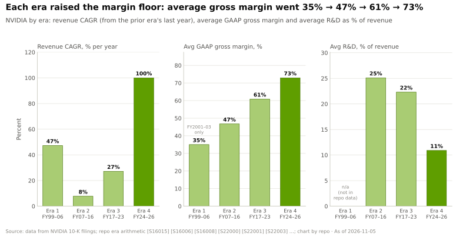

> [!TIP]
> **算例 —— 漫长的中期付出了什么代价。** 英伟达从创立到首个营收达 $1B 的财年（FY2002）用了 ~9 年，此后又用了 17 年才突破 $10B（FY2019）[[S16006]](../../sources/bibliography.md#s16006)[[S400]](../../sources/bibliography.md#s400)。从 FY2006（$2.4B）到 FY2016（$5.0B），营收年均增速仅 ~8% [[S16007]](../../sources/bibliography.md#s16007)[[S400]](../../sources/bibliography.md#s400)，而研发支出平均占营收的 ~25%（见上图）。一家年增速 8%、研发占比 25% 的同业公司，会被市场按成熟硬件公司估值。**结论：** 带来后来 ~100% 年增速的平台，恰恰是在一个投资者很容易将其解读为停滞的十年里建成的。

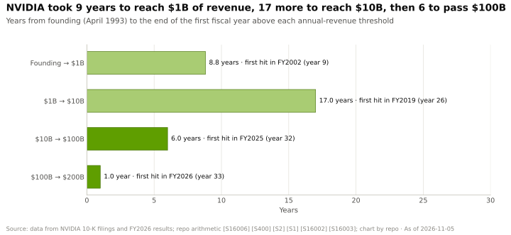

## 第一阶段 —— 求生存，造出 GPU（1993–2005）

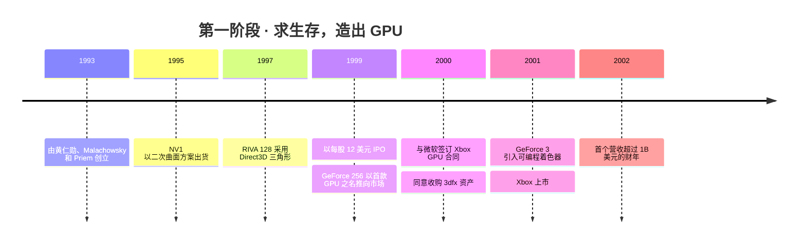

**创业押注**是：PC 将需要专用的 3D 图形芯片，由一家[无晶圆厂（fabless）](../glossary.md#fabless)公司打造——即自行设计芯片、交由代工厂制造。**第一款产品几乎要了公司的命。** NV1（1995）用弯曲的[二次曲面](../glossary.md#quadratic-surfaces)绘制 3D 场景，并捆绑了音频功能。随后微软（Microsoft）的 Direct3D 以三角形为标准，使 NV1 与开发者正在编写的软件不兼容 [[S16000]](../../sources/bibliography.md#s16000)。原计划为世嘉（Sega）开发的一款游戏机芯片也被放弃 🟡 [[S16000]](../../sources/bibliography.md#s16000)。

**转型用了大约两年。** 在客户寥寥、人员缩编的情况下，英伟达围绕三角形和 Direct3D 重建产品，并于 1997 年上半年推出 RIVA 128 [[S16001]](../../sources/bibliography.md#s16001)。据一位分析师估计，到 1997 年底英伟达在高性能图形市场的份额为 ~24% 🟡 [[S16003]](../../sources/bibliography.md#s16003)。公司于 1999 年 1 月以每股 $12 上市，发行 3.5M 股外加超额配售，净募资 ~$43.3M [[S16004]](../../sources/bibliography.md#s16004)。

**随后它为这一品类命名。** 英伟达将 GeForce 256（1999）作为首款“GPU”推向市场，因为它把[变换与光照](../glossary.md#transform-and-lighting)从 CPU 上卸载了下来 [[S2502]](../../sources/bibliography.md#s2502)。紧接着是两笔交易。2000 年 3 月，微软选择英伟达为 Xbox 提供 GPU，并支付了 $200M 的采购预付款 [[S16005]](../../sources/bibliography.md#s16005)。2000 年 12 月，英伟达同意以 $70M 现金和 1M 股收购已经陨落的前市场领导者 3dfx 的专利、品牌和库存，交易于 2001 年 4 月完成 [[S16005]](../../sources/bibliography.md#s16005)[[S484]](../../sources/bibliography.md#s484)。GeForce 3（2001）加入了[可编程着色器](../glossary.md#programmable-shader) [[S16011]](../../sources/bibliography.md#s16011)，正是这一特性后来使通用 GPU 计算成为可能。

> [!TIP]
> **算例 —— Xbox 的取舍。** Xbox 处理器占营收的比例从 FY2002 的 9% 升至 FY2003 的 23%，毛利率则从 38% 降至 30% [[S16008]](../../sources/bibliography.md#s16008)。以 FY2003 营收 $1.91B [[S16006]](../../sources/bibliography.md#s16006) 计算，八个百分点的毛利率约合 ~$150M 毛利，不过 ~$21M 的库存减记也有一定影响 [[S16008]](../../sources/bibliography.md#s16008)。**结论：** 游戏主机让英伟达变得更大，却没有变得更赚钱。后来的手机押注也印证了同样的教训：按客户的定价走量，建不起护城河。

🔧 技术细节：从固定功能到可编程图形

早期的 3D 芯片采用[固定功能流水线](../glossary.md#fixed-function-pipeline)：每个阶段（变换、光照、纹理、混合）都是只有少量可调设置的硬连线电路。GeForce 256 将变换与光照从 CPU 移入此类硬件 [[S2502]](../../sources/bibliography.md#s2502)。GeForce 3 则用小程序替换了流水线的部分环节，这些小程序针对每个顶点或每个像素各运行一次 [[S16011]](../../sources/bibliography.md#s16011)。一颗能并行运行成千上万个小程序的芯片就是一台并行处理器，这正是研究人员开始把数学运算伪装成像素着色的原因（斯坦福大学的 [Brook](../glossary.md#brook)，2004）[[S9532]](../../sources/bibliography.md#s9532)。G80（2006）随后使每个着色器核心完全相同，即[统一着色器架构](../glossary.md#unified-shader-architecture)，并通过 CUDA 将其开放 [[S2503]](../../sources/bibliography.md#s2503)。

## 第二阶段 —— CUDA 与移动业务弯路（2006–2015）

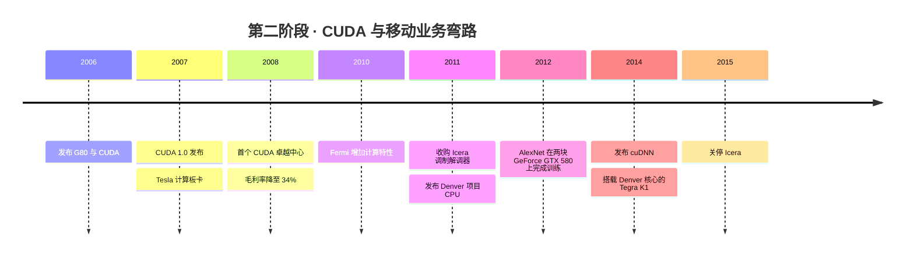

**CUDA 是对一个尚不存在的市场的押注。** 英伟达于 2006-11-08 随 G80 发布 CUDA，并于 2007 年 6 月推出 CUDA 1.0 [[S9528]](../../sources/bibliography.md#s9528)[[S525]](../../sources/bibliography.md#s525)。它把这项能力放进每一块 GeForce 显卡，因此任何拥有游戏 PC 的学生都拥有了一台并行计算机（见 [CS2](../case-studies/CS2-cuda-the-15-year-bet.md)）。随后它出资让大学教授 CUDA：首个 CUDA 卓越中心（伊利诺伊大学，2008）获得了 $500,000 资金外加一套集群 [[S9529]](../../sources/bibliography.md#s9529)。黄仁勋曾回忆，在英伟达毛利率为 ~35% 的时候，CUDA 使产品成本增加了 ~50% 🟡 [[S22005]](../../sources/bibliography.md#s22005)[[S22006]](../../sources/bibliography.md#s22006)。

**代价体现在利润表上。** 毛利率从 FY2008 的 45.6% 降至 FY2009 的 34.3%（其中包括一笔因裸片与封装材料组合存在缺陷而计提的 $196M 费用），FY2010 为 35.4% [[S22000]](../../sources/bibliography.md#s22000)。研发支出占营收的比例从 17% 升至 FY2009–FY2015 的 24–32% [[S22001]](../../sources/bibliography.md#s22001)[[S22003]](../../sources/bibliography.md#s22003)，而营收始终徘徊在 $3.3B 至 $4.7B 之间 [[S22000]](../../sources/bibliography.md#s22000)[[S22004]](../../sources/bibliography.md#s22004)。

**与此同时，英伟达在追逐手机市场。** Tegra [系统级芯片（SoC）](../glossary.md#system-on-chip)需要调制解调器才能与高通（Qualcomm）竞争，因此英伟达于 2011 年以 ~$367M 收购了 Icera。Icera 的软件[基带调制解调器](../glossary.md#baseband-modem)只打入了少数手机，2015 年 5 月英伟达宣布将关停该业务，若找不到买家将计提 $100–125M 费用 [[S16009]](../../sources/bibliography.md#s16009)[[S16010]](../../sources/bibliography.md#s16010)。其定制 Arm CPU 项目 Denver（2011 年发布）自 2014 年起仅用于 Tegra 产品 [[S4536]](../../sources/bibliography.md#s4536)。

**回报来自外部。** 2012 年，Krizhevsky、Sutskever 和 Hinton 在两块 GeForce GTX 580 游戏 GPU 上训练了 AlexNet [[S9530]](../../sources/bibliography.md#s9530)。英伟达随即于 2014 年将深度学习内核打包为 [cuDNN](../glossary.md#cudnn) [[S9531]](../../sources/bibliography.md#s9531)。在 CUDA 1.0 发布十年后的 FY2018，数据中心收入才首次超过英伟达的研发总支出 [[S400]](../../sources/bibliography.md#s400)。

> [!TIP]
> **算例 —— 同一个十年里的两次押注。** 案例研究 [CS2](../case-studies/CS2-cuda-the-15-year-bet.md) 估计 CUDA 的“期权费”（FY2009–FY2015 期间高于 FY2008 研发强度的那部分研发支出）为 ~$2.8B（🔴 本资料库估计）[[S22009]](../../sources/bibliography.md#s22009)。移动调制解调器押注的成本为收购 Icera 的 ~$367M 加上 $100–125M 的退出费用 [[S16009]](../../sources/bibliography.md#s16009)[[S16010]](../../sources/bibliography.md#s16010)：约 $0.5B。两者都是对新市场的押注。一个滋养了英伟达所售每一块 GPU 构成的装机基础；另一个则闯入了高通和联发科（MediaTek）早已在销售集成调制解调器的市场。**结论：** 成本较低的押注之所以失败，是因为它挑战的是在位者的平台；成本较高的押注之所以成功，是因为它延伸的是英伟达自己的平台。

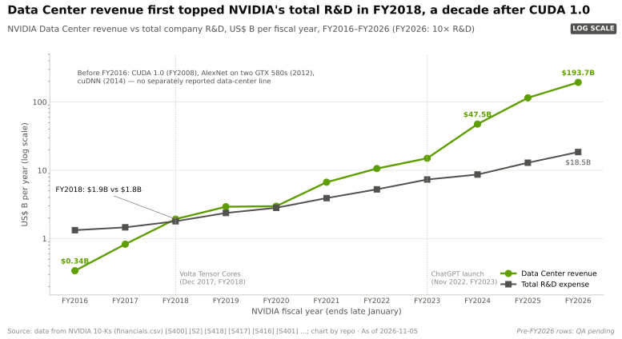

🔧 技术细节：为何“每块 GeForce 都搭载 CUDA”比编译器更重要

开发者平台需要让大量开发者手中都有廉价硬件。通过在消费级显卡中搭载支持 CUDA 的芯片，英伟达让研究人员可以在游戏 PC 上做原型，再用同一套代码部署到数据中心板卡上。[PTX](../glossary.md#ptx) 虚拟指令集使旧程序能在新 GPU 上继续运行，因此十年的研究代码都积累在同一个目标平台上（见[第 09 层历史](../layers/09-cuda-and-system-software/history-and-how-built.md)）。Fermi（2010）及其后续架构又加入了超级计算机所需的特性，例如纠错内存和更快的双精度运算 [[S2503]](../../sources/bibliography.md#s2503)。

## 第三阶段 —— 深度学习与数据中心（2016–2022）

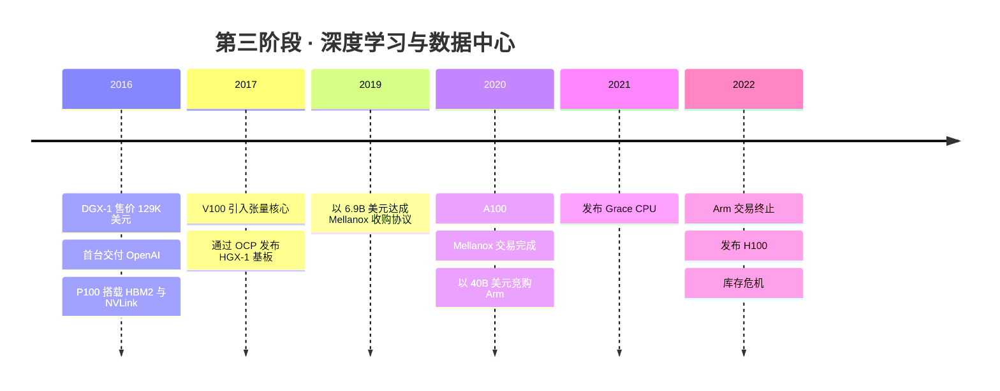

**英伟达开始销售计算机，而不仅仅是芯片。** DGX-1（2016 年 4 月）将八块 P100 GPU 装进一台售价 $129,000、功耗 3.2 kW 的机箱 [[S310]](../../sources/bibliography.md#s310)；同年 8 月，黄仁勋亲手将第一台交付给 OpenAI [[S8522]](../../sources/bibliography.md#s8522)。P100 也是英伟达首款采用 [HBM](../glossary.md#hbm) 和 [NVLink](../glossary.md#nvlink) 的 GPU [[S125]](../../sources/bibliography.md#s125)。2017 年，与微软一起通过 OCP 发布的 [HGX](../glossary.md#hgx)-1 基板，让每一家服务器厂商都能采用同一设计 [[S8525]](../../sources/bibliography.md#s8525)。

**硬件转向矩阵运算。** V100（2017）加入了[张量核心](../glossary.md#tensor-core)：FP16 矩阵运算达 125 TFLOPS，而通用 FP32 运算为 15.7 TFLOPS [[S126]](../../sources/bibliography.md#s126)[[S33010]](../../sources/bibliography.md#s33010)。A100（2020）随后推出 [[S127]](../../sources/bibliography.md#s127)。

**随后英伟达买下了网络，并试图买下 CPU。** 它于 2019-03-11 同意以 $6.9B 现金收购 Mellanox，击败了据报道出价 ~$6B 的英特尔（Intel），并在获得中国批准后于 2020-04-27 完成交易 [[S464]](../../sources/bibliography.md#s464)[[S6509]](../../sources/bibliography.md#s6509)[[S21005]](../../sources/bibliography.md#s21005)。2020 年 9 月，它以 $40B 竞购 Arm；由于监管机构反对，该交易于 2022-02-08 告吹，英伟达计提了 ~$1.36B 费用 [[S465]](../../sources/bibliography.md#s465)[[S466]](../../sources/bibliography.md#s466)。英伟达转而自建 CPU：2021 年 4 月发布采用授权 Arm 核心的 Grace [[S537]](../../sources/bibliography.md#s537)（见[第 04 层历史](../layers/04-cpu-grace-vera/history-and-how-built.md)）。

**它还围绕硬件构建了生态。** [NCCL](../glossary.md#nccl) 通信库于 2016 年 4 月出现在 GitHub 上，RAPIDS 则于 2018 年 10 月将 GPU 引入数据科学 [[S10506]](../../sources/bibliography.md#s10506)[[S10517]](../../sources/bibliography.md#s10517)。GTC 首届（2009 年）吸引了 ~1,500 名参会者 [[S13024]](../../sources/bibliography.md#s13024)，后来成为每年发布路线图的舞台。注册 CUDA 开发者达到 1M 用了 13 年；第二个 1M 只用了约两年 [[S529]](../../sources/bibliography.md#s529)。这些就是[第 10 层](../layers/10-libraries-cuda-x/history-and-how-built.md)和[第 13 层](../layers/13-ecosystem-gtm-and-capital/history-and-how-built.md)所描述的护城河资产。

**这一阶段以一场危机收尾。** FY2023 营收持平于 $27.0B [[S2]](../../sources/bibliography.md#s2)，毛利率降至 56.9% [[S418]](../../sources/bibliography.md#s418)，英伟达计提了 ~$2.17B 的存货准备 [[S418]](../../sources/bibliography.md#s418)。而 2022 年 3 月发布的 H100 [[S35012]](../../sources/bibliography.md#s35012)，已为随后到来的需求做好了准备。

> [!TIP]
> **算例 —— 同一管理层，两笔交易，结局相反。** Mellanox 花费 $6.9B [[S464]](../../sources/bibliography.md#s464)；按案例研究中的严苛假设（将一半网络业务归功于 Mellanox，毛利率按 65% 计），它在 FY2025 前已收回成本（🔴 本资料库模型）[[S21014]](../../sources/bibliography.md#s21014)。Arm 本需花费 $40B，最终以 ~$1.36B 的减记告终 [[S465]](../../sources/bibliography.md#s465)[[S466]](../../sources/bibliography.md#s466)。Mellanox 只向部分竞争对手供货；而 Arm 几乎向所有竞争对手授权，包括高通和[超大规模云厂商](../glossary.md#hyperscaler)自己的 CPU 团队 [[S4517]](../../sources/bibliography.md#s4517)[[S4022]](../../sources/bibliography.md#s4022)[[S4024]](../../sources/bibliography.md#s4024)[[S4026]](../../sources/bibliography.md#s4026)（见 [CS1](../case-studies/CS1-mellanox-the-best-deal.md)）。**结论：** 收购一家向竞争对手供货的供应商，与监管机构尚可谈判；收购所有人都依赖的中立标准，则没有谈判余地。

🔧 技术细节：张量核心改变了什么

通用 GPU 核心每条指令执行一次乘加运算。张量核心则在一步内将两个小矩阵相乘并加上第三个矩阵，因此一条指令可完成数十次乘加。神经网络的主体是矩阵乘法，因此 V100 的张量核心在此类运算上提供了其 FP32 速率的 8 倍 [[S126]](../../sources/bibliography.md#s126)。此后每一代都在同一思路上加入了更低精度的格式（2022 年的 [FP8](../glossary.md#fp8)、2025 年的 [NVFP4](../glossary.md#nvfp4)）[[S35011]](../../sources/bibliography.md#s35011)[[S32017]](../../sources/bibliography.md#s32017)；见 [GPU 芯片历史](../layers/02-gpu-silicon/history-and-how-built.md)。

## 第四阶段 —— AI 工厂（2023–2026）

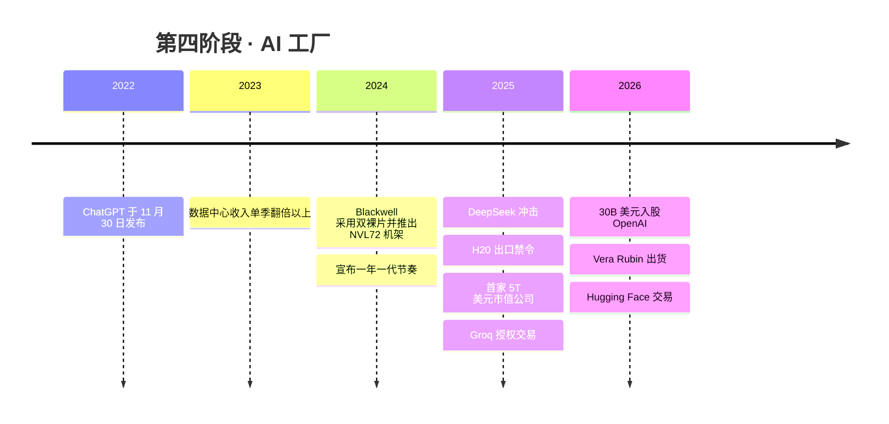

**需求骤然而至。** OpenAI 于 2022-11-30 发布 ChatGPT [[S16014]](../../sources/bibliography.md#s16014)。两个季度后，英伟达数据中心收入从 $4.3B 跃升至 $10.3B（Q2 FY2024）[[S436]](../../sources/bibliography.md#s436)[[S437]](../../sources/bibliography.md#s437)。营收从 FY2024 的 $60.9B 增至 FY2025 的 $130.5B 和 FY2026 的 $215.9B [[S2]](../../sources/bibliography.md#s2)[[S1]](../../sources/bibliography.md#s1)。

**英伟达用现金来提速。** 在 Computex 2024 上，它宣布数据中心产品转向“一年一代的节奏” [[S17003]](../../sources/bibliography.md#s17003)。Blackwell（2024）将两颗光罩尺寸极限大小的裸片（die）合为一个 GPU [[S35014]](../../sources/bibliography.md#s35014)，开发成本 ~$10B [[S35028]](../../sources/bibliography.md#s35028)。[NVL72](../glossary.md#nvl72) 机架使 72 块 GPU 构成一个 NVLink 域 [[S396]](../../sources/bibliography.md#s396)（见[第 08 层历史](../layers/08-systems-racks-ai-factories/history-and-how-built.md)）。Vera Rubin 于 2026 年 8 月初开始量产出货 [[S500]](../../sources/bibliography.md#s500)。

**冲击确实存在，但并未打断增长曲线。** 据报道，早期 GB200 机架出现过热，部分客户削减了订单 🟡 [[S5500]](../../sources/bibliography.md#s5500)。DeepSeek 的发布在一天之内（2025-01-27）抹去了 $589B 市值 [[S25001]](../../sources/bibliography.md#s25001)。2025 年 4 月的 H20 许可要求带来了 ~$4.5B 的费用 [[S90081]](../../sources/bibliography.md#s90081)。Rubin 的内存与 NVLink 带宽在发布后被下调 [[S90006]](../../sources/bibliography.md#s90006)。英伟达仍于 2025-10-29 成为首家市值 $5T 的公司 [[S25010]](../../sources/bibliography.md#s25010)。到 Q2 FY2027，季度营收为 $96.2B，GAAP 毛利率 75.0%，Q3 指引为 $108B ±2% [[S405]](../../sources/bibliography.md#s405)[[S3]](../../sources/bibliography.md#s3)。

**它还成为了一个资本配置者。** 英伟达以据报道的 ~$20B 获得了 Groq 的技术授权并招揽其团队（2025 年 12 月）[[S90018]](../../sources/bibliography.md#s90018)[[S90019]](../../sources/bibliography.md#s90019)，搁置了对 OpenAI 的 $100B 意向书，转而入股 ~$30B（2026 年 2 月）🟡 [[S90015]](../../sources/bibliography.md#s90015)[[S90016]](../../sources/bibliography.md#s90016)，并同意以 $12.9B 收购 Hugging Face（2026 年 9 月）[[S11500]](../../sources/bibliography.md#s11500)。其股权投资总额 ~$99B（🟡 对 2026 年 7 月 10-Q 的二手解读）[[S90073]](../../sources/bibliography.md#s90073)（见[资本部署](../layers/13-ecosystem-gtm-and-capital/capital-deployment.md)）。

**商业模式随规模而改变。** 截至 Q2 FY2027，供应与产能承诺达 $279B [[S407]](../../sources/bibliography.md#s407)，单一直接客户占季度营收的 16% [[S90069]](../../sources/bibliography.md#s90069)，FY2027 上半年 $23.7B 的股权投资净收益（主要为按市值计价的收益）计入了盈利 [[S90072]](../../sources/bibliography.md#s90072)。这一阶段始于一家芯片公司，终于一家预购供应商产能、为客户提供融资并持有大量股权投资组合的公司：其风险特征比 2016 年的 GPU 供应商复杂得多（见[第 18 章](18-vulnerabilities-and-bear-case.md)）。

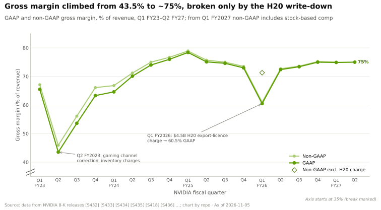

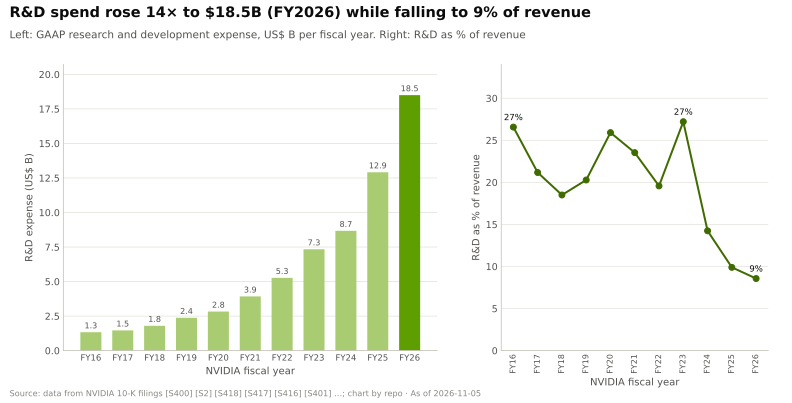

> [!TIP]
> **算例 —— 为何研发强度下降并非弱点。** 英伟达 FY2026 研发支出 $18.5B，仅占营收的 ~8.6%，但约为 FY2016 $1.33B 的 ~14 倍 [[S401]](../../sources/bibliography.md#s401)[[S400]](../../sources/bibliography.md#s400)。AMD 2024 年所有产品的研发总支出为 ~$6.5B [[S450]](../../sources/bibliography.md#s450)。仅 Blackwell 一款产品就在数年间耗费了 ~$10B 开发成本 [[S35028]](../../sources/bibliography.md#s35028)：相当于英伟达 FY2026 研发预算的 ~54%，却是 AMD 2024 年全部研发预算的 ~1.5 倍。**结论：** 在大得多的基数上，较低的百分比所买到的绝对工程投入超过任何竞争对手，而这正是维持年度迭代节奏的基础。

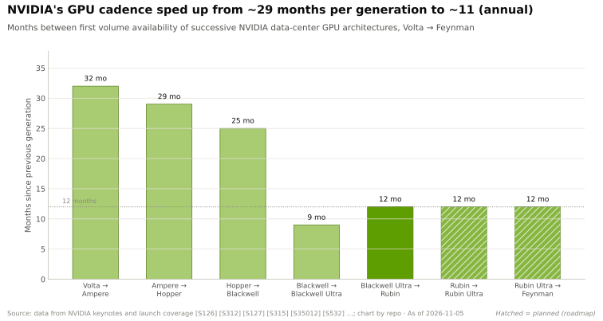

🔧 技术细节：为何产品越做越大

每一步都把一个瓶颈移入英伟达自己的设计之中：DGX 将八块 GPU 放在一块板上，[NVSwitch](../glossary.md#nvswitch)（2018）连接了十六块，NVL72（2024）则通过一个机架内的铜缆背板连接了七十二块 [[S310]](../../sources/bibliography.md#s310)[[S396]](../../sources/bibliography.md#s396)。当大部分数据都留在一个 NVLink 域内时，谁设计这个域，谁就决定[物料清单（BOM）](../glossary.md#bill-of-materials)并攫取利润。同样的逻辑也解释了 Mellanox（机架之间的网络）、Grace 与 Vera（主机 CPU）以及 [BlueField](../glossary.md#bluefield)（数据通路）；见[飞轮一章](../01-the-nvidia-flywheel.md)。

## 濒危时刻与英伟达的应对

英伟达自身的文化倾向于认为公司始终处于失败边缘。而历史记录支持的是一个更窄的结论：它至少经历过八次严重挫折，且在其中大多数情况下都保住了研发投入并持续出货。下表列出了这些挫折及每次冲击的规模。

| 时间 | 事件 | 冲击规模 | 应对 | 来源 |
|---|---|---|---|---|
| 1996–97 | NV1 建立在错误的 3D 标准之上 | 客户寥寥，人员缩编 | ~2 年内推出 RIVA 128 | [[S16000]](../../sources/bibliography.md#s16000)[[S16001]](../../sources/bibliography.md#s16001) |
| FY2003 | Xbox 带来的产品结构变化与库存减记 | 毛利率 38% → 30% | 保持 PC GPU 产品线增长；营收达到 $1.91B | [[S16008]](../../sources/bibliography.md#s16008)[[S16006]](../../sources/bibliography.md#s16006) |
| FY2009–FY2010 | 封装缺陷与 2008 年经济衰退 | 毛利率 45.6% → 34.3%；$196M 费用 | 研发占营收比例从 17% 升至 27% | [[S22000]](../../sources/bibliography.md#s22000)[[S22001]](../../sources/bibliography.md#s22001) |
| 2015 | Icera 调制解调器失败 | 预计 $100–125M 费用 | 退出手机基带；重新聚焦 GPU、汽车和数据中心 | [[S16009]](../../sources/bibliography.md#s16009)[[S16010]](../../sources/bibliography.md#s16010) |
| FY2023 | 游戏与渠道库存危机 | 季度营收在两个季度内 −28%；Q2 毛利率 43.5% | 研发 +39%；H100 放量 | [[S432]](../../sources/bibliography.md#s432)[[S434]](../../sources/bibliography.md#s434)[[S2]](../../sources/bibliography.md#s2) |
| 2025 年 1 月 | DeepSeek 效率冲击 | 单日市值蒸发 −$589B | FY2026 营收仍增至 $215.9B | [[S25001]](../../sources/bibliography.md#s25001)[[S1]](../../sources/bibliography.md#s1) |
| 2025 | H20 出口许可要求 | ~$4.5B 费用 | 从业绩指引中剔除中国数据中心计算业务 | [[S90081]](../../sources/bibliography.md#s90081)[[S3]](../../sources/bibliography.md#s3) |
| 2026 | Rubin 规格在发布后修订 | 每 GPU HBM 带宽 22 → 19.2 TB/s | 规格重新表述为量产值 | [[S90006]](../../sources/bibliography.md#s90006)[[S104]](../../sources/bibliography.md#s104) |

> [!TIP]
> **算例 —— 在 FY2023 危机中坚持投入。** 季度营收从 $8.29B（Q1 FY2023）降至 $5.93B（Q3 FY2023），两个季度内 −28% [[S432]](../../sources/bibliography.md#s432)[[S434]](../../sources/bibliography.md#s434)，全年营收持平于 $27.0B [[S2]](../../sources/bibliography.md#s2)。英伟达仍将研发支出从 FY2022 的 $5.27B 提升至 FY2023 的 $7.34B，+39% [[S2]](../../sources/bibliography.md#s2)，同时推出了 2022 年 3 月发布的 H100 [[S35012]](../../sources/bibliography.md#s35012)。当需求随 ChatGPT 到来时，产品已经就绪：数据中心收入在单个季度内增长 ~2.4 倍 [[S436]](../../sources/bibliography.md#s436)[[S437]](../../sources/bibliography.md#s437)。**结论：** 若在那次下行周期中削减研发，可节省 ~$2B，却会错失整个 Hopper 周期。

## 关键押注的决策树

每张图展示一个决策、英伟达选择的分支（绿色）、未选择的分支（虚线）以及随后的结果。反事实结果为本资料库的分析（🔴）。

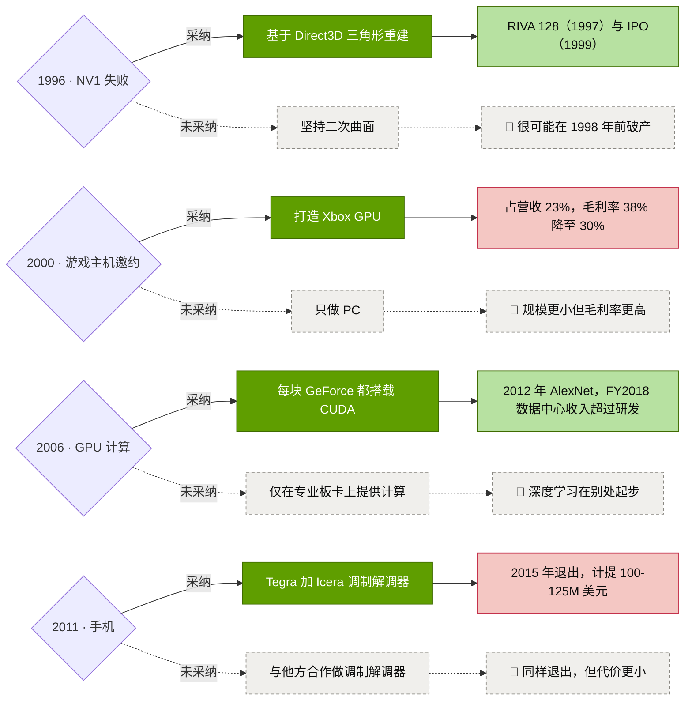

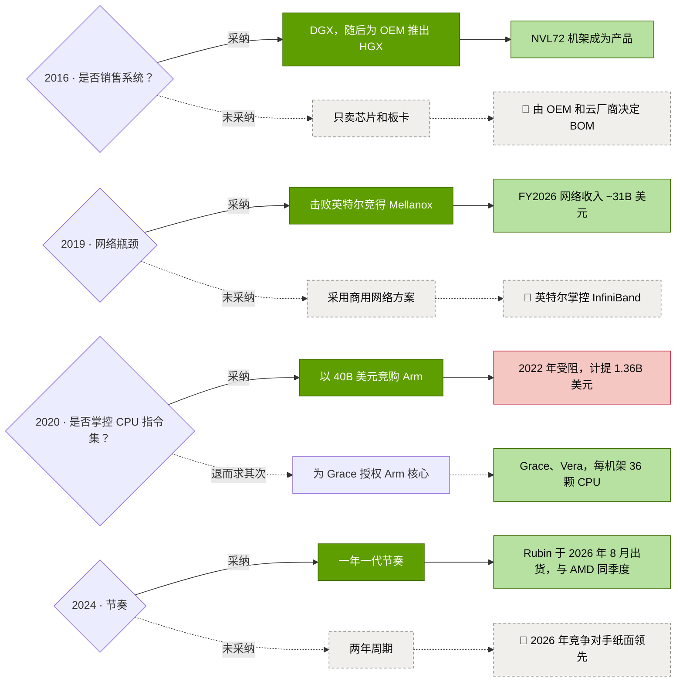

| 日期 | 决策 | 未采纳的选项 | 重要性 | 来源 |
|---|---|---|---|---|
| 1996–97 | 围绕 Direct3D 三角形重建 | 坚持 NV1 的二次曲面 | 得以存活；RIVA 128 恢复了销售 | [[S16000]](../../sources/bibliography.md#s16000)[[S16001]](../../sources/bibliography.md#s16001) |
| 1999 | 将 GeForce 256 作为“GPU”推向市场 | 继续做加速卡供应商 | 命名了英伟达至今仍在销售的品类 | [[S2502]](../../sources/bibliography.md#s2502) |
| 2000 | 接下 Xbox 合同；收购 3dfx 资产 | 只做 PC；任由 3dfx 资产落入他人之手 | 获得规模与 $200M 预付款，但毛利率更低 | [[S16005]](../../sources/bibliography.md#s16005)[[S16008]](../../sources/bibliography.md#s16008) |
| 2006–07 | 每块 GPU 都搭载 CUDA | 仅在高端板卡上提供计算 | 到 2026 年开发者达 ~6M | [[S9528]](../../sources/bibliography.md#s9528)[[S528]](../../sources/bibliography.md#s528) |
| 2011–15 | 推出搭载 Icera 调制解调器的 Tegra 手机方案，随后退出 | 不进入手机市场 | 挑战在位平台的 ~$0.5B 教训 | [[S16009]](../../sources/bibliography.md#s16009)[[S16010]](../../sources/bibliography.md#s16010) |
| 2016–17 | 销售 DGX 系统和 HGX 基板 | 只卖芯片，由 OEM 设计 | 促成机架成为销售单位 | [[S310]](../../sources/bibliography.md#s310)[[S8525]](../../sources/bibliography.md#s8525) |
| 2017 | V100 引入张量核心 | 仅用通用核心 | 矩阵运算达 FP32 的 8 倍 | [[S126]](../../sources/bibliography.md#s126) |
| 2019–20 | 以 $6.9B 收购 Mellanox | 采用商用网络方案 | FY2026 网络收入 ~$31.4B | [[S464]](../../sources/bibliography.md#s464)[[S402]](../../sources/bibliography.md#s402) |
| 2020–22 | 以 $40B 竞购 Arm；退而采用授权 | 从一开始就用授权核心自建 CPU | Grace 与 Vera 照样推出 | [[S465]](../../sources/bibliography.md#s465)[[S466]](../../sources/bibliography.md#s466)[[S537]](../../sources/bibliography.md#s537) |
| 2024 | 一年一代节奏 | 两年周期 | 竞争对手不得不跟进 | [[S17003]](../../sources/bibliography.md#s17003)[[S17007]](../../sources/bibliography.md#s17007) |
| 2025–26 | Groq 授权（~$20B）；Hugging Face（$12.9B） | 自建 SRAM 解码芯片；不涉足模型托管 | 尚待验证；考验英伟达作为大规模收购方的能力 | [[S90019]](../../sources/bibliography.md#s90019)[[S11500]](../../sources/bibliography.md#s11500) |

> [!TIP]
> **算例 —— 把押注账本当作投资组合来看。** 六次押注获得回报，用时 2.4 至 11.2 年（中位数 ~6 年）[[S16016]](../../sources/bibliography.md#s16016)。三次失败，英伟达在 1.4 至 4.0 年后将其砍掉。按披露的价格衡量，失败案例（Icera ~$0.37B、Arm ~$1.36B 费用）合计成本 ~$1.7B [[S16009]](../../sources/bibliography.md#s16009)[[S466]](../../sources/bibliography.md#s466)。而仅一次成功——Mellanox——就在一年内带来 ~$31.4B 的网络收入 [[S402]](../../sources/bibliography.md#s402)。**结论：** 这一组合之所以奏效，是因为亏损被迅速止住，而赢家被持有长达十年——这是上市公司内部的经典风险投资模式。

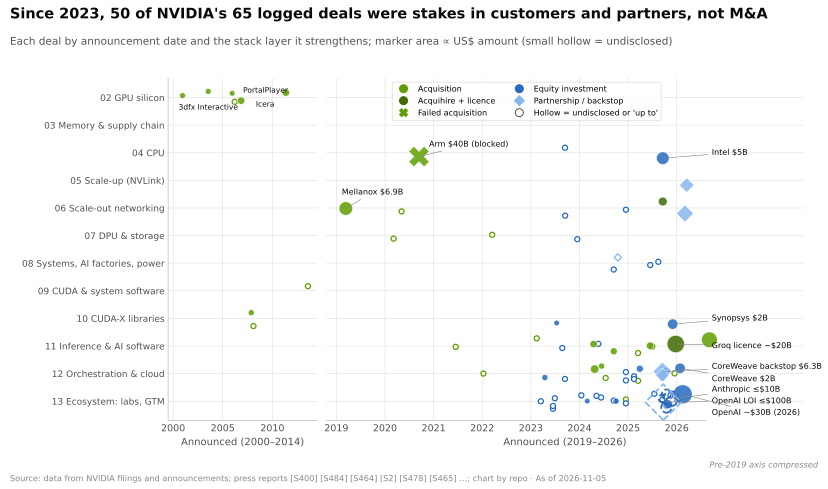

## 反事实分析

全部六个反事实均为本资料库的分析（🔴 推测）。每一个都阐明了推理过程，以及它对英伟达及其竞争对手意味着什么。各层的反事实分析见 [GPU 芯片](../layers/02-gpu-silicon/history-and-how-built.md)、[网络](../layers/06-scale-out-scale-across-networking/history-and-how-built.md)和 [CUDA](../layers/09-cuda-and-system-software/history-and-how-built.md) 的历史页面。

| # | 假如英伟达当初…… | 🔴 最可能的结果 | 意味着什么 |
|---|---|---|---|
| 1 | ……在 Direct3D 选择三角形之后仍坚持 NV1 的二次曲面 | 到 ~1998 年耗尽现金 | PC 图形市场向 3dfx 和 ATI 集中；没有 GeForce，也没有 CUDA |
| 2 | ……只在高端计算板卡上提供 CUDA | AlexNet 运行在 CPU 或其他厂商的硬件上 | 深度学习的默认技术栈在别处形成，可能围绕谷歌的 TPU |
| 3 | ……让英特尔抢走 Mellanox | 英特尔掌控 InfiniBand 和 ConnectX | 英伟达没有网络业务线（FY2026 ~$31.4B）；从 NVL72 到集群的叙事更弱 |
| 4 | ……完成 $40B 的 Arm 交易 | 行为性救济措施；被授权方转向 RISC-V 和 x86 对冲 | 英伟达拥有一家其客户并不信任的“中立”授权方 |
| 5 | ……维持两年周期 | Rubin 在 ~2027 年才推出 | AMD MI455X 和 TPU 8t 在整个 2026 年规格领先英伟达 |
| 6 | ……将 DGX Cloud 推进为完整的公有云 | 与其最大客户公开发生渠道冲突 | 超大规模云厂商加速推进 TPU、Trainium 和 Maia；新兴云服务商失去其供应商兼合作伙伴 |

**1. 若没有 RIVA 128 转型。** NV1 在技术上颇有新意，但与游戏开发者采用的基于三角形的 Direct3D 不兼容 [[S16000]](../../sources/bibliography.md#s16000)。在推出 RIVA 128 之前，公司客户寥寥，人员缩编 [[S16001]](../../sources/bibliography.md#s16001)。若在错误的标准上再坚持一年，很可能已将公司耗尽。*意味着什么：* PC 3D 图形市场将向 3dfx 和 ATI 集中。而实际情况是，英伟达在 2000–01 年以 $70M 外加股票收购了 3dfx 的资产 [[S16005]](../../sources/bibliography.md#s16005)。

**2. CUDA 仅用于高端板卡。** 这是最微妙的一个。AlexNet 是在两块消费级 GTX 580 上训练的 [[S9530]](../../sources/bibliography.md#s9530)，而该平台的覆盖面正来自在游戏显卡上搭载 CUDA [[S22006]](../../sources/bibliography.md#s22006)。若计算能力仅限于昂贵的 Tesla 板卡，学术研究将停留在 CPU 上，或转向当时最便宜的任何硬件。谷歌到 2015 年已在其数据中心运行 TPU [[S23000]](../../sources/bibliography.md#s23000)。*意味着什么：* 框架生态（在本资料库的矩阵中，如今 36/36 原生支持 CUDA [[S580]](../../sources/bibliography.md#s580)）可能会围绕某家超大规模云厂商的编译器形成，正如后来 [XLA](../glossary.md#xla) 之于 TPU。

**3. 英特尔赢得 Mellanox。** 据报道英特尔出价 ~$6B，共有七家竞购方参与 [[S6509]](../../sources/bibliography.md#s6509)[[S6508]](../../sources/bibliography.md#s6508)。*意味着什么：* 英特尔将掌控连接大多数 AI 集群的 [InfiniBand](../glossary.md#infiniband) 交换机和 [ConnectX](../glossary.md#connectx) 网卡（NIC），从而获得英伟达如今所拥有的话语权。[Spectrum-X](../glossary.md#spectrum-x) 在 Q2 FY2027 同比增长 2.6 倍 [[S408]](../../sources/bibliography.md#s408)，若无 Mellanox 团队便无从打造。英伟达的网络业务线（FY2026 ~$31.4B [[S402]](../../sources/bibliography.md#s402)）和 Spectrum-X 都不会以现有形态存在。英伟达很可能会基于博通（Broadcom）的以太网芯片来构建。

**4. Arm 交易完成。** $40B 的价格 [[S465]](../../sources/bibliography.md#s465) 将买下高通服务器 CPU 以及 AWS、谷歌和微软自研 CPU 背后的指令集 [[S4517]](../../sources/bibliography.md#s4517)[[S4022]](../../sources/bibliography.md#s4022)[[S4026]](../../sources/bibliography.md#s4026)[[S4024]](../../sources/bibliography.md#s4024)。监管机构很可能会施加中立性条件，正如中国对 Mellanox 交易所做的那样 [[S21002]](../../sources/bibliography.md#s21002)。*意味着什么：* 客户会更早转向 RISC-V 或 [x86](../glossary.md#x86) 进行对冲；英伟达将拥有一笔无法用于战略目的的授权费收入。而 Grace 和 Vera 本来就是基于授权核心打造的 [[S537]](../../sources/bibliography.md#s537)。

**5. 没有年度迭代节奏。** 按照过去 ~29 个月的节奏 [[S33020]](../../sources/bibliography.md#s33020)，Rubin 将在 ~2027 年才推出，而 AMD 的 MI455X（432 GB [HBM4](../glossary.md#hbm4)）和谷歌的 TPU 8t 均在 2026 年推出 [[S144]](../../sources/bibliography.md#s144)[[S550]](../../sources/bibliography.md#s550)。纸面上 MI455X 已在 HBM 带宽（23.3 对 19.2 TB/s，~21%）和容量（432 对 288 GB）上领先 Rubin [[S144]](../../sources/bibliography.md#s144)[[S90093]](../../sources/bibliography.md#s90093)[[S90006]](../../sources/bibliography.md#s90006)；若对比 Blackwell Ultra 的 288 GB、8 TB/s [[S32004]](../../sources/bibliography.md#s32004)，带宽差距将达 ~2.9 倍。*意味着什么：* 竞争对手将在整整一年里在所有标志性规格上领先——[第 17 章](17-roadmap-2025-2028.md)表明，英伟达的路线图正是为了不给对手这种可乘之机而设计的。

**6. 英伟达成为一家完整的云厂商。** DGX Cloud 于 2023 年 3 月推出，每个 8-GPU 实例每月 $36,999，托管于甲骨文（Oracle）、微软和谷歌的数据中心内 [[S12007]](../../sources/bibliography.md#s12007)。据报道，到 2025 年其大部分算力已转用于英伟达自身的研究，而 DGX Cloud Lepton 则开始将开发者导向合作伙伴云 🟡 [[S90068]](../../sources/bibliography.md#s90068)。若英伟达继续推进，它将与当时最大的买家——超大规模云厂商——争夺终端客户（仅一家直接客户就占 Q2 FY2027 营收的 16% [[S90069]](../../sources/bibliography.md#s90069)）。*意味着什么：* 超大规模云厂商将作为防御性回应加快对 TPU、Trainium 和 Maia 的投入，[新兴云服务商](../glossary.md#neocloud)渠道也将被削弱。这次收缩是英伟达选择不掌控某一层的罕见案例。

> [!WARNING]
> **误区与事实：“英伟达预见了 AI 热潮。”** 历史记录显示的是一家构建了通用平台然后耐心等待的公司。英伟达并未预见深度学习：AlexNet 出自大学研究人员之手 [[S9530]](../../sources/bibliography.md#s9530)，数据中心收入直到 FY2018 都低于研发支出 [[S400]](../../sources/bibliography.md#s400)。英伟达所做的，是让试验变得廉价，然后在需求出现时迅速行动：AlexNet 之后两年内推出 cuDNN [[S9531]](../../sources/bibliography.md#s9531)，四年内推出 DGX [[S310]](../../sources/bibliography.md#s310)。

🔧 技术细节：如何评判这些反事实

每个反事实只改变一项决策，并保持外部世界的其他条件不变（竞争对手路线图、深度学习的到来、监管机构的行为）。其合理性基于有据可查的替代方案：英特尔据报道对 Mellanox 的出价 [[S6509]](../../sources/bibliography.md#s6509)、被放弃的世嘉芯片 [[S16000]](../../sources/bibliography.md#s16000)、2015 年退出 Icera [[S16009]](../../sources/bibliography.md#s16009) 以及 AMD 2026 年的规格 [[S144]](../../sources/bibliography.md#s144)。变化与结果之间的跨度越大，置信度越低；第 2 个反事实最不确定，因为它取决于研究人员当时会如何行事。

## 经验教训

下面的象限图按各押注对 GPU 平台的延伸程度及其回报进行定位；这是本资料库的判断（🔴），但规律十分鲜明：右上角的每一项押注都延伸了平台，而每一次明确的亏损都偏离了平台。

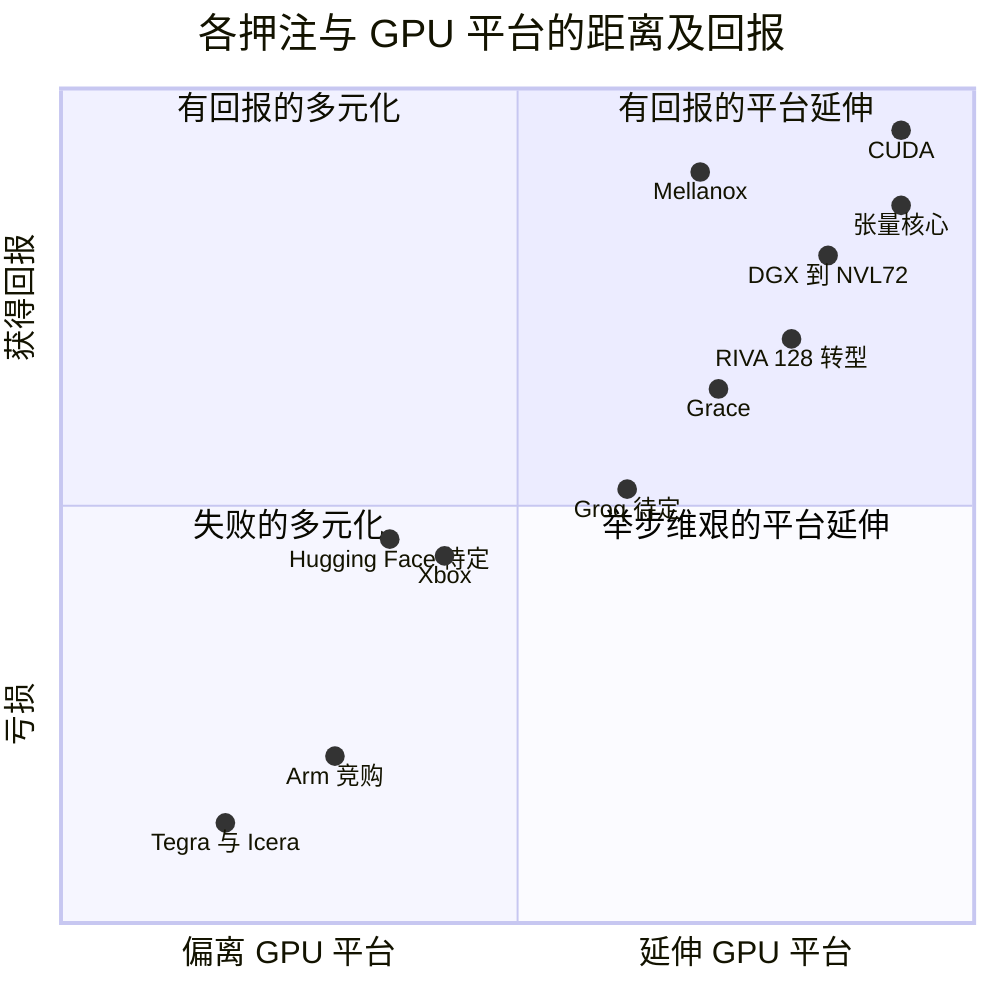

| # | 经验 | 证据 | 对挑战者的启示 |
|---|---|---|---|
| 1 | 在市场形成之前构建平台，但要用现金引擎为其提供资金 | CUDA 运行了 ~11 年，数据中心收入才覆盖研发支出 [[S9528]](../../sources/bibliography.md#s9528)[[S400]](../../sources/bibliography.md#s400)；游戏业务为其买单 | 平台押注需要一个盈利的核心业务，以及一个能容忍十年投入的董事会 |
| 2 | 当标准对你不利时，迅速采纳 | NV1 → RIVA 128 用时 ~2 年 [[S16000]](../../sources/bibliography.md#s16000)[[S16001]](../../sources/bibliography.md#s16001) | 标准之争若要输，就早输，别慢慢输 |
| 3 | 在相邻瓶颈显而易见之前将其收入囊中 | Mellanox $6.9B → FY2026 网络收入 ~$31.4B [[S464]](../../sources/bibliography.md#s464)[[S402]](../../sources/bibliography.md#s402) | 今天的对应物可能是光学、电源或内存接口 |
| 4 | 不要收购所有人都依赖的中立层 | Arm 交易受阻；~$1.36B 费用 [[S466]](../../sources/bibliography.md#s466) | 监管风险随依赖该资产的竞争对手数量而上升 |
| 5 | 偏离平台的举措往往令人失望 | Xbox 毛利率 [[S16008]](../../sources/bibliography.md#s16008)、Icera [[S16009]](../../sources/bibliography.md#s16009) | 通过延伸平台实现多元化，而非进入他人的市场 |
| 6 | 销售系统，掌控物料清单 | DGX → NVL72 [[S310]](../../sources/bibliography.md#s310)[[S396]](../../sources/bibliography.md#s396) | 谁制定机架规格，谁就保住利润 |
| 7 | 速度本身就是战略 | 每代 ~29 → ~11 个月 [[S33020]](../../sources/bibliography.md#s33020) | 跟上这一节奏如今已是入场门槛 |
| 8 | 在会与买家竞争之处主动退后 | DGX Cloud 转向内部用途；Lepton 将需求导向合作伙伴云 🟡 [[S90068]](../../sources/bibliography.md#s90068) | 平台供应商不与客户为敌，才能保住渠道 |

**这些经验没有说明什么。** 直到 2019 年，英伟达的历史都不是一个靠收购成长的故事。在 Mellanox 之前，其最大的收购是 PortalPlayer（~$357M，Tegra 的起源）和 Icera（~$367M）🟡 [[S484]](../../sources/bibliography.md#s484)[[S16009]](../../sources/bibliography.md#s16009)，而核心平台（GPU、CUDA、软件库）均为自主研发。它也不是一个关于远见的故事：深度学习和 ChatGPT 都来自外部。可借鉴的是一种经营习惯：在低谷中坚守平台押注，迅速砍掉旁支押注，并在下一个瓶颈出现时将其买下。每一种习惯的复制成本都低于它所造就的装机基础——后者用了二十年才积累而成，才是任何挑战者面临的真正壁垒（关于路线图如今如何守护这一基础，见[第 17 章](17-roadmap-2025-2028.md)）。

> [!NOTE]
> **🐂 看多观点：** 历史表明，这是一个能够从濒危中幸存、坚持十年期押注并迅速砍掉失败项目的组织。这种文化，加上每年 ~$18.5B 的研发投入 [[S401]](../../sources/bibliography.md#s401)，比任何芯片都更难复制。

> [!WARNING]
> **🐻 看空观点：** 决定性的回报来自一个并非英伟达促成的外部事件 [[S9530]](../../sources/bibliography.md#s9530)，而它在 GPU 平台之外的记录乏善可陈（Xbox 毛利率、Icera、Arm）。2025–26 年的押注（Groq ~$20B、Hugging Face $12.9B、~$99B 的股权投资组合）是其历史上规模最大的，也是与其过往成功案例最不相像的 [[S90019]](../../sources/bibliography.md#s90019)[[S11500]](../../sources/bibliography.md#s11500)[[S90073]](../../sources/bibliography.md#s90073)。见[第 18 章](18-vulnerabilities-and-bear-case.md)。

## 🎯 企业发展视角

1. **期权价值需要现金引擎。** CUDA ~$2.8B 的期权费（🔴 估计）[[S22009]](../../sources/bibliography.md#s22009) 之所以负担得起，是因为有游戏业务为其提供资金。挑战者的哪项业务能够为一项长达十年的平台押注提供资金，而不引发投资者反弹？
2. **止损标准是战略的一部分。** 英伟达在 1.4–4 年内退出了三次失败的押注 [[S16016]](../../sources/bibliography.md#s16016)。全行业当今的数据中心押注——包括高通的 AI200/AI250 和 Dragonfly 项目（仅限公开信息）[[S173]](../../sources/bibliography.md#s173)[[S90056]](../../sources/bibliography.md#s90056)——附带了哪些明确的里程碑和退出触发条件？
3. **下一个 Mellanox。** 经验是在相邻瓶颈形成约束之前将其买下。在光学、800 V DC 电源、内存控制器或[纵向扩展（scale-up）](../glossary.md#scale-up)交换领域，还有哪些独立资产尚未被英伟达、AMD 或博通收入囊中？[内存](../layers/03-memory-packaging-supply-chain/value-chain-and-corp-dev.md)、[纵向扩展](../layers/05-scale-up-nvlink-nvswitch/value-chain-and-corp-dev.md)、[网络](../layers/06-scale-out-scale-across-networking/value-chain-and-corp-dev.md)和[系统](../layers/08-systems-racks-ai-factories/value-chain-and-corp-dev.md)的价值链页面列出了各领域的非上市公司。
4. **为替代架构定价。** 英伟达为 Groq 的授权和团队支付了 ~$20B，约为其上一轮 $6.9B 私募估值的 ~2.9 倍 [[S90019]](../../sources/bibliography.md#s90019)。这对于经过验证的 [SRAM](../glossary.md#sram)、近存计算或容量优先型推理设计对在位者的价值意味着什么？
5. **由外而内的需求转变决定时代。** 开启第三阶段的是 AlexNet，而非英伟达；开启第四阶段的是 ChatGPT [[S9530]](../../sources/bibliography.md#s9530)[[S16014]](../../sources/bibliography.md#s16014)。哪一种外部转变（[智能体](../glossary.md#agentic-ai)带来的 CPU 需求、电力受限的推理、端到云模型）可能为一位已备好合适平台的挑战者开启下一个时代？

## 📚 来源（Sources）

<!-- Auto-generated from the [S…] citations on this page by `make build`. Edit sources/registry/*.csv, not this list. -->

- [**S1**](../../sources/bibliography.md#s1) NVIDIA Corporation via SEC EDGAR, *NVIDIA Announces Financial Results for Fourth Quarter and Fiscal 2026 (Form 8-K exhibit 99.1)*, 2026-02-25. [Link](https://www.sec.gov/Archives/edgar/data/1045810/000104581026000019/q4fy26pr.htm)
- [**S2**](../../sources/bibliography.md#s2) U.S. Securities and Exchange Commission (EDGAR), *NVIDIA Corporation Form 10-K annual reports FY2020–FY2025 (filing index)*, 2025-02-26. [Link](https://www.sec.gov/cgi-bin/browse-edgar?action=getcompany&CIK=0001045810&type=10-K&dateb=&owner=include&count=40)
- [**S3**](../../sources/bibliography.md#s3) StorageNewsletter, *NVIDIA Q2 Fiscal 2027 results coverage: revenue $96.2B*, 2026-08-27. [Link](https://www.storagenewsletter.com/2026/08/27/nvidia-fiscal-2q27-financial-results/)
- [**S104**](../../sources/bibliography.md#s104) Wccftech, *NVIDIA's Official Statement on Vera Rubin Spec Change*, 2026-10-29. [Link](https://wccftech.com/nvidia-official-statement-on-vera-rubin-spec-change/)
- [**S125**](../../sources/bibliography.md#s125) NVIDIA, *NVIDIA Tesla P100 (Pascal GP100) Architecture Whitepaper*, 2016-04. [Link](https://images.nvidia.com/content/pdf/tesla/whitepaper/pascal-architecture-whitepaper.pdf)
- [**S126**](../../sources/bibliography.md#s126) NVIDIA, *NVIDIA Tesla V100 GPU Architecture Whitepaper*, 2017-08. [Link](https://images.nvidia.com/content/volta-architecture/pdf/volta-architecture-whitepaper.pdf)
- [**S127**](../../sources/bibliography.md#s127) NVIDIA Technical Blog, *NVIDIA Ampere Architecture In-Depth*, 2020-05-14. [Link](https://developer.nvidia.com/blog/nvidia-ampere-architecture-in-depth/)
- [**S144**](../../sources/bibliography.md#s144) AMD Newsroom, *AMD Unveils Vision for an Open AI Ecosystem, Detailing New Silicon, Software and Systems at Advancing AI 2025*, 2025-06-12. [Link](https://www.amd.com/en/newsroom/press-releases/2025-6-12-amd-unveils-vision-for-an-open-ai-ecosystem-detai.html)
- [**S173**](../../sources/bibliography.md#s173) Qualcomm, *Qualcomm Unveils AI200 and AI250 - Redefining Rack-Scale Data Center Inference*, 2025-10-27. [Link](https://www.qualcomm.com/news/releases/2025/10/qualcomm-unveils-ai200-and-ai250-redefining-rack-scale-data-cent)
- [**S310**](../../sources/bibliography.md#s310) AnandTech (Ryan Smith), *NVIDIA unveils the DGX-1 HPC server: 8 Teslas, 3U, Q2 2016*, 2016-04-05. [Link](https://www.anandtech.com/show/10229)
- [**S396**](../../sources/bibliography.md#s396) NVIDIA Newsroom, *NVIDIA Blackwell platform arrives to power a new era of computing*, 2024-03-18. [Link](https://nvidianews.nvidia.com/news/nvidia-blackwell-platform-arrives-to-power-a-new-era-of-computing)
- [**S400**](../../sources/bibliography.md#s400) U.S. Securities and Exchange Commission (EDGAR), *NVIDIA Corporation Form 10-K annual reports FY2001–FY2019 (EDGAR filing index)*, 2019-02-21. [Link](https://www.sec.gov/cgi-bin/browse-edgar?action=getcompany&CIK=0001045810&type=10-K&dateb=&owner=include&count=40)
- [**S401**](../../sources/bibliography.md#s401) NVIDIA Corporation via SEC EDGAR, *NVIDIA Corporation Form 10-K for fiscal year ended January 25, 2026*, 2026-02-25. [Link](https://www.sec.gov/Archives/edgar/data/1045810/000104581026000021/nvda-20260125.htm)
- [**S402**](../../sources/bibliography.md#s402) NVIDIA Corporation via SEC EDGAR (Colette Kress), *CFO Commentary on Fourth Quarter and Fiscal 2026 Results (Form 8-K exhibit 99.2)*, 2026-02-25. [Link](https://www.sec.gov/Archives/edgar/data/1045810/000104581026000019/q4fy26cfocommentary.htm)
- [**S405**](../../sources/bibliography.md#s405) NVIDIA Corporation via SEC EDGAR, *NVIDIA Announces Financial Results for Second Quarter Fiscal 2027 (Form 8-K exhibit 99.1)*, 2026-08-26. [Link](https://www.sec.gov/Archives/edgar/data/0001045810/000104581026000073/q2fy27pr.htm)
- [**S407**](../../sources/bibliography.md#s407) NVIDIA Corporation via SEC EDGAR, *NVIDIA Corporation Form 10-Q for quarter ended July 26, 2026*, 2026-08-28. [Link](https://www.sec.gov/Archives/edgar/data/1045810/000104581026000075/nvda-20260726.htm)
- [**S408**](../../sources/bibliography.md#s408) NVIDIA Corporation, *NVIDIA Corp. (NVDA) Q2 Fiscal 2027 earnings call transcript (26 August 2026)*, 2026-08-26. [Link](https://s201.q4cdn.com/141608511/files/content_files/TRANSCRIPT_-NVIDIA-Corp-NVDA-US-Q2-2027-Earnings-Call-26-August-2026-5_00-PM-ET.pdf)
- [**S418**](../../sources/bibliography.md#s418) NVIDIA Corporation via SEC EDGAR, *NVIDIA Corporation Form 10-K for fiscal year ended January 29, 2023*, 2023-02-24. [Link](https://www.sec.gov/Archives/edgar/data/1045810/000104581023000017/nvda-20230129.htm)
- [**S432**](../../sources/bibliography.md#s432) NVIDIA Corporation, *NVIDIA Announces Financial Results for First Quarter Fiscal 2023 (press release with CFO commentary)*, 2022-05-25. [Link](https://nvidianews.nvidia.com/news/nvidia-announces-financial-results-for-first-quarter-fiscal-2023)
- [**S434**](../../sources/bibliography.md#s434) NVIDIA Corporation, *NVIDIA Announces Financial Results for Third Quarter Fiscal 2023 (press release with CFO commentary)*, 2022-11-16. [Link](https://nvidianews.nvidia.com/news/nvidia-announces-financial-results-for-third-quarter-fiscal-2023)
- [**S436**](../../sources/bibliography.md#s436) NVIDIA Corporation, *NVIDIA Announces Financial Results for First Quarter Fiscal 2024 (press release with CFO commentary)*, 2023-05-24. [Link](https://nvidianews.nvidia.com/news/nvidia-announces-financial-results-for-first-quarter-fiscal-2024)
- [**S437**](../../sources/bibliography.md#s437) NVIDIA Corporation, *NVIDIA Announces Financial Results for Second Quarter Fiscal 2024 (press release with CFO commentary)*, 2023-08-23. [Link](https://nvidianews.nvidia.com/news/nvidia-announces-financial-results-for-second-quarter-fiscal-2024)
- [**S450**](../../sources/bibliography.md#s450) U.S. Securities and Exchange Commission (EDGAR), *Advanced Micro Devices Form 10-K / 10-Q filings (EDGAR index)*, 2025-02-05. [Link](https://www.sec.gov/cgi-bin/browse-edgar?action=getcompany&CIK=0000002488&type=10-&dateb=&owner=include&count=40)
- [**S464**](../../sources/bibliography.md#s464) NVIDIA Newsroom, *NVIDIA to Acquire Mellanox for $6.9 Billion*, 2019-03-11. [Link](https://nvidianews.nvidia.com/news/nvidia-to-acquire-mellanox-for-6-9-billion)
- [**S465**](../../sources/bibliography.md#s465) NVIDIA Newsroom, *NVIDIA to Acquire Arm for $40 Billion, Creating World's Premier Computing Company for the Age of AI*, 2020-09-13. [Link](https://nvidianews.nvidia.com/news/nvidia-to-acquire-arm-for-40-billion-creating-worlds-premier-computing-company-for-the-age-of-ai)
- [**S466**](../../sources/bibliography.md#s466) NVIDIA Newsroom, *NVIDIA and SoftBank Group Announce Termination of NVIDIA's Acquisition of Arm Limited*, 2022-02-08. [Link](https://nvidianews.nvidia.com/news/nvidia-and-softbank-group-announce-termination-of-nvidias-acquisition-of-arm-limited)
- [**S484**](../../sources/bibliography.md#s484) NVIDIA press releases as summarised in NVIDIA 10-K filings and contemporaneous press, *History of NVIDIA acquisitions 2000–2013 (3dfx assets, MediaQ, ULi, Hybrid Graphics, PortalPlayer, mental images, Ageia, Icera, The Portland Group)*, 2013-07. [Link](https://en.wikipedia.org/wiki/Nvidia)
- [**S500**](../../sources/bibliography.md#s500) NVIDIA Corporation, *NVIDIA Q2 Fiscal 2027 Quarterly Presentation (CFO commentary deck)*, 2026-08-26. [Link](https://s201.q4cdn.com/141608511/files/doc_financials/2027/Q227/NVDA-F2Q27-Quarterly-Presentation-final-1.pdf)
- [**S525**](../../sources/bibliography.md#s525) NVIDIA Developer, *CUDA Toolkit Archive*, 2026. [Link](https://developer.nvidia.com/cuda-toolkit-archive)
- [**S528**](../../sources/bibliography.md#s528) NVIDIA Developer Forums, *20 Years of CUDA: Honoring the Architects of the Accelerated Age*, 2026-03. [Link](https://forums.developer.nvidia.com/t/20-years-of-cuda-honoring-the-architects-of-the-accelerated-age/364654)
- [**S529**](../../sources/bibliography.md#s529) NVIDIA Blog (Will Ramey), *2 Million Registered Developers, Countless Breakthroughs*, 2020. [Link](https://blogs.nvidia.com/blog/2-million-registered-developers-breakthroughs/)
- [**S537**](../../sources/bibliography.md#s537) NVIDIA press release via Yahoo Finance, *NVIDIA Announces CPU for Giant AI and High Performance Computing Workloads*, 2021-04-12. [Link](https://sg.finance.yahoo.com/news/nvidia-announces-cpu-giant-ai-161900753.html)
- [**S550**](../../sources/bibliography.md#s550) SiliconANGLE, *Google Cloud unveils eighth-generation TPUs (TPU 8t and TPU 8i)*, 2026-04-22. [Link](https://siliconangle.com/?p=740999)
- [**S580**](../../sources/bibliography.md#s580) vLLM project (GitHub), *vLLM README and installation docs — supported hardware*, 2026-11. [Link](https://github.com/vllm-project/vllm/blob/main/docs/getting_started/installation/README.md)
- [**S2502**](../../sources/bibliography.md#s2502) Tom's Hardware, *Nvidia GeForce 256 celebrates its 25th birthday — company talks about a quarter century of GPU progression*, 2024-10. [Link](https://www.tomshardware.com/pc-components/gpus/nvidia-geforce-256-celebrates-its-25th-birthday-company-talks-about-a-quarter-century-of-gpu-progression)
- [**S2503**](../../sources/bibliography.md#s2503) TechSpot, *TechSpot's History of the GPU, Part 4: the coming of general-purpose GPUs*, 2013. [Link](https://www.techspot.com/article/659-history-of-the-gpu-part-4/)
- [**S4022**](../../sources/bibliography.md#s4022) Amazon Science, *Graviton5's improved design increases speed and energy efficiency beyond Moore's law*, 2025-12. [Link](https://www.amazon.science/blog/graviton5s-improved-design-increases-speed-and-energy-efficiency-beyond-moores-law)
- [**S4024**](../../sources/bibliography.md#s4024) DatacenterDynamics, *Microsoft reveals next-generation Cobalt CPU and Azure Boost*, 2025-11-18. [Link](https://www.datacenterdynamics.com/en/news/microsoft-reveals-next-generation-cobalt-cpu-and-azure-boost/)
- [**S4026**](../../sources/bibliography.md#s4026) Phoronix, *Google Axion CPU performance with the new Google Cloud N4A instances*, 2026-01. [Link](https://www.phoronix.com/review/google-cloud-n4a-axion)
- [**S4517**](../../sources/bibliography.md#s4517) Futurum Group, *Qualcomm's Arm-based data center CPUs to smoothly integrate with NVIDIA*, 2025-05. [Link](https://futurumgroup.com/insights/qualcomms-arm-based-data-center-cpus-to-smoothly-integrate-with-nvidia)
- [**S4536**](../../sources/bibliography.md#s4536) Wikipedia, *Project Denver*, 2026. [Link](https://en.wikipedia.org/wiki/Project_Denver)
- [**S5500**](../../sources/bibliography.md#s5500) TrendForce, *NVIDIA GB200 racks reportedly overheat, major clients cut orders*, 2025-01-14. [Link](https://www.trendforce.com/news/2025/01/14/news-nvidia-gb200-racks-reportedly-overheat-major-clients-cut-orders/)
- [**S6508**](../../sources/bibliography.md#s6508) Globes, *Seven companies took part in bidding war for Mellanox*, 2019-03. [Link](https://en.globes.co.il/en/article-seven-companies-took-part-in-bidding-war-for-mellanox-1001283325)
- [**S6509**](../../sources/bibliography.md#s6509) Tom's Hardware, *Nvidia outbids Intel for Mellanox (Reuters via Calcalist)*, 2019-03. [Link](https://www.tomshardware.com/news/nvidia-intel-mellanox-acquisition-outbid,38778.html)
- [**S8522**](../../sources/bibliography.md#s8522) TOP500, *NVIDIA delivers DGX-1 'supercomputer in a box' to OpenAI*, 2016-08-15. [Link](https://top500.org/news/nvidia-delivers-dgx-1-supercomputer-in-a-box-to-openai/)
- [**S8525**](../../sources/bibliography.md#s8525) DatacenterDynamics, *OCP Summit: Nvidia, Microsoft announce HGX-1 hyperscale GPU accelerator*, 2017-03. [Link](https://www.datacenterdynamics.com/en/news/ocp-summit-nvidia-microsoft-announce-hgx-1-hyperscale-gpu-accelerator/)
- [**S9528**](../../sources/bibliography.md#s9528) Digital Engineering 24/7 (NVIDIA press release), *NVIDIA Unveils CUDA - The GPU Computing Revolution Begins*, 2006-11-08. [Link](https://www.digitalengineering247.com/article/nvidia-unveils-cuda)
- [**S9529**](../../sources/bibliography.md#s9529) TechPowerUp, *NVIDIA appoints first CUDA Center of Excellence*, 2008-07-01. [Link](https://techpowerup.com/64493/nvidia-appoints-first-cuda-center-of-excellence)
- [**S9530**](../../sources/bibliography.md#s9530) NeurIPS 2012 (Advances in Neural Information Processing Systems 25) (Alex Krizhevsky, Ilya Sutskever, Geoffrey E. Hinton), *ImageNet Classification with Deep Convolutional Neural Networks*, 2012-12. [Link](https://papers.nips.cc/paper/4824-imagenet-classification-with-deep-convolutional-neural-networks)
- [**S9531**](../../sources/bibliography.md#s9531) arXiv:1410.0759 (Sharan Chetlur, Cliff Woolley, Philippe Vandermersch, Jonathan Cohen, John Tran, Bryan Catanzaro, Evan Shelhamer), *cuDNN: Efficient Primitives for Deep Learning*, 2014-10-03. [Link](https://arxiv.org/abs/1410.0759)
- [**S9532**](../../sources/bibliography.md#s9532) Stanford Graphics Lab (SIGGRAPH 2004) (Ian Buck, Tim Foley, Daniel Horn, Jeremy Sugerman, Kayvon Fatahalian, Mike Houston, Pat Hanrahan), *Brook for GPUs: Stream Computing on Graphics Hardware*, 2004-08. [Link](https://graphics.stanford.edu/papers/brookgpu/)
- [**S10506**](../../sources/bibliography.md#s10506) GitHub (NVIDIA), *NVIDIA/nccl tags*, 2026-09-17. [Link](https://github.com/NVIDIA/nccl/tags)
- [**S10517**](../../sources/bibliography.md#s10517) Phoronix, *NVIDIA Announces "RAPIDS" Open-Source Data Analytics / Machine Learning Platform*, 2018-10-10. [Link](https://www.phoronix.com/news/NVIDIA-Open-Source-RAPIDS)
- [**S11500**](../../sources/bibliography.md#s11500) TechRadar Pro, *'The planets aligned': Nvidia confirms $12.9bn Hugging Face deal in potentially huge AI shake-up*, 2026-09-03. [Link](https://techradar.com/pro/the-planets-aligned-nvidia-confirms-usd12-9bn-hugging-face-deal-in-potentially-huge-ai-shake-up)
- [**S12007**](../../sources/bibliography.md#s12007) NVIDIA Newsroom, *NVIDIA Launches DGX Cloud, Giving Every Enterprise Instant Access to AI Supercomputer From a Browser*, 2023-03-21. [Link](https://nvidianews.nvidia.com/news/nvidia-launches-dgx-cloud-giving-every-enterprise-instant-access-to-ai-supercomputer-from-a-browser)
- [**S13024**](../../sources/bibliography.md#s13024) Wikipedia, *Nvidia GTC*, 2026. [Link](https://en.wikipedia.org/wiki/Nvidia_GTC)
- [**S16000**](../../sources/bibliography.md#s16000) Electronic Design (Jon Peddie Research) (Jon Peddie), *Nvidia's Quadratic Processor: The NV1 (Famous Graphics Chips series)*, 2021. [Link](https://www.electronicdesign.com/technologies/embedded-revolution/article/21167684/jon-peddie-research-nvidias-quadratic-processor-the-nv1)
- [**S16001**](../../sources/bibliography.md#s16001) Electronic Design (Jon Peddie Research) (Jon Peddie), *Nvidia's RIVA 128 (Famous Graphics Chips series)*, 2021. [Link](https://www.electronicdesign.com/technologies/embedded-revolution/article/21131077/nvidias-riva-128)
- [**S16002**](../../sources/bibliography.md#s16002) NBC Miami (CNBC Make It), *Jensen Huang started his $2 trillion company Nvidia at a Denny's breakfast booth*, 2024-03. [Link](https://www.nbcmiami.com/news/business/money-report/jensen-huang-started-his-2-trillion-company-nvidia-at-a-dennys-breakfast-booth/3302554/)
- [**S16003**](../../sources/bibliography.md#s16003) FundingUniverse (International Directory of Company Histories), *NVIDIA Corporation History*, 2004. [Link](https://www.fundinguniverse.com/company-histories/nvidia-corporation-history/)
- [**S16004**](../../sources/bibliography.md#s16004) NVIDIA Corporation via SEC EDGAR, *NVIDIA Corp Form 10-Q (1999) - initial public offering disclosure*, 1999. [Link](https://www.sec.gov/Archives/edgar/data/0001045810/000101287099001954/0001012870-99-001954.txt)
- [**S16005**](../../sources/bibliography.md#s16005) NVIDIA Corporation via SEC EDGAR, *NVIDIA Corporation Form 10-K for fiscal year 2002*, 2002-04. [Link](https://www.sec.gov/Archives/edgar/data/0001045810/000101287002002262/d10k.htm)
- [**S16006**](../../sources/bibliography.md#s16006) NVIDIA Corporation via SEC EDGAR, *NVIDIA Corporation Form 10-K for fiscal year 2005*, 2005-03. [Link](https://www.sec.gov/Archives/edgar/data/0001045810/000104581005000008/annualreport.htm)
- [**S16007**](../../sources/bibliography.md#s16007) NVIDIA Corporation via SEC EDGAR, *NVIDIA Corporation Form 10-K for fiscal year 2006*, 2006-03. [Link](https://www.sec.gov/Archives/edgar/data/0001045810/000104581006000014/fy2006annualreportonform10-k.htm)
- [**S16008**](../../sources/bibliography.md#s16008) NVIDIA Corporation via SEC EDGAR, *NVIDIA Corporation Form 10-K for fiscal year 2003*, 2003-04. [Link](https://www.sec.gov/Archives/edgar/data/0001045810/000104596903001196/d10k.htm)
- [**S16009**](../../sources/bibliography.md#s16009) PCWorld (IDG News Service), *Nvidia's shift away from mobile devices cuts modem unit*, 2015-05. [Link](https://www.pcworld.com/article/427329/nvidias-shift-away-from-mobile-devices-cuts-modem-unit.html)
- [**S16010**](../../sources/bibliography.md#s16010) Mobile World Live, *Nvidia facing $125M charge on modem business exit*, 2015-05. [Link](https://www.mobileworldlive.com/network-tech/nvidia-facing-125m-charge-modem-business-exit/)
- [**S16011**](../../sources/bibliography.md#s16011) Tom's Hardware, *The Nvidia GeForce3 launched 25 years ago - underappreciated at launch, its impact shaped the industry*, 2026-02. [Link](https://www.tomshardware.com/pc-components/gpus/the-geforce3-launched-25-years-ago-underappreciated-at-launch-its-impact-shaped-the-industry)
- [**S16012**](../../sources/bibliography.md#s16012) Proactive Investors, *Nvidia closes in on $6 trillion as prediction markets back year-end break*, 2026-10. [Link](https://www.proactiveinvestors.co.uk/a/789bce91/nvidia-closes-in-on-6-trillion-as-prediction-markets-back-year-end-break)
- [**S16014**](../../sources/bibliography.md#s16014) OpenAI, *Introducing ChatGPT*, 2022-11-30. [Link](https://openai.com/index/chatgpt/)
- [**S16015**](../../sources/bibliography.md#s16015) NVIDIA Corporation via SEC EDGAR, *NVIDIA Corp Form 10-K405 for fiscal year 2001*, 2001-04. [Link](https://www.sec.gov/Archives/edgar/data/0001045810/000101287001500492/d10k405.txt)
- [**S16016**](../../sources/bibliography.md#s16016) nvidia_deep_dive_claude repository, *Repo analysis: chapter 16 era scorecard, revenue milestones and bet-to-payoff ledger*, 2026-11-05. [Link](https://github.com/FrankHuang94/nvidia_deep_dive_claude/blob/main/cross-cutting/16-how-nvidia-built-it-timeline.md)
- [**S17003**](../../sources/bibliography.md#s17003) Constellation Research, *Nvidia outlines roadmap including Rubin GPU platform, new Arm-based CPU Vera*, 2024-06-02. [Link](https://www.constellationr.com/insights/news/nvidia-outlines-roadmap-including-rubin-gpu-platform-new-arm-based-cpu-vera)
- [**S17007**](../../sources/bibliography.md#s17007) AMD (press release), *AMD Accelerates Pace of Data Center AI Innovation and Leadership with Expanded AMD Instinct GPU Roadmap*, 2024-06-02. [Link](https://d1io3yog0oux5.cloudfront.net/_e6d2954671111d7f15d49cdaedef84dd/amd/news/2024-06-02_AMD_Accelerates_Pace_of_Data_Center_AI_Innovation__1201.pdf)
- [**S18005**](../../sources/bibliography.md#s18005) Crowdfund Insider, *Nvidia ($NVDA) nears $6T market cap as company stock hits ATH*, 2026-10. [Link](https://www.crowdfundinsider.com/?p=316268)
- [**S21002**](../../sources/bibliography.md#s21002) NVIDIA Corporation via SEC EDGAR, *NVIDIA Form 8-K: Mellanox acquisition receives SAMR antitrust approval*, 2020-04-16. [Link](https://www.sec.gov/Archives/edgar/data/1045810/000104581020000048/mellanoxantitrustappro.htm)
- [**S21005**](../../sources/bibliography.md#s21005) Techzine, *Nvidia closes acquisition of Mellanox for 6.9 billion dollars*, 2020-04-27. [Link](https://www.techzine.eu/news/infrastructure/46408/nvidia-closes-acquisition-of-mellanox-for-6-9-billion-dollars/)
- [**S21014**](../../sources/bibliography.md#s21014) nvidia_deep_dive_claude repository, *Repo analysis: CS1 Mellanox deal economics (multiples, cumulative networking gross profit, payback scenarios)*, 2026-11-05. [Link](https://github.com/FrankHuang94/nvidia_deep_dive_claude/blob/main/case-studies/CS1-mellanox-the-best-deal.md)
- [**S22000**](../../sources/bibliography.md#s22000) NVIDIA Corporation via SEC EDGAR, *NVIDIA Corporation Form 10-K for fiscal year 2010*, 2010-03. [Link](https://www.sec.gov/Archives/edgar/data/0001045810/000104581010000006/fy2010form10k.htm)
- [**S22001**](../../sources/bibliography.md#s22001) NVIDIA Corporation via SEC EDGAR, *NVIDIA Corporation Form 10-K for fiscal year 2009*, 2009-03. [Link](https://www.sec.gov/Archives/edgar/data/0001045810/000104581009000013/fy2009form10k.htm)
- [**S22003**](../../sources/bibliography.md#s22003) NVIDIA Corporation via SEC EDGAR, *NVIDIA Corporation Form 10-K for fiscal year 2013*, 2013-03. [Link](https://www.sec.gov/Archives/edgar/data/0001045810/000104581013000008/nvda-2013x10k.htm)
- [**S22004**](../../sources/bibliography.md#s22004) NVIDIA Corporation via SEC EDGAR, *NVIDIA Corporation Form 10-K for fiscal year 2015*, 2015-03. [Link](https://www.sec.gov/Archives/edgar/data/0001045810/000104581015000036/nvda-2015x10k.htm)
- [**S22005**](../../sources/bibliography.md#s22005) Shortform (summary of Lex Fridman Podcast), *Lex Fridman Podcast #494 - Jensen Huang: NVIDIA, the $4 trillion company and the AI revolution (episode summary)*, 2026-03-23. [Link](https://www.shortform.com/podcast/episode/lex-fridman-podcast-2026-03-23-episode-summary-494-jensen-huang-nvidia-the-4-trillion-company-the-ai-revolution)
- [**S22006**](../../sources/bibliography.md#s22006) Wccftech, *Nvidia CEO reveals how the company survived an existential threat after forcing CUDA on gaming GPUs*, 2026-03. [Link](https://wccftech.com/nvidia-ceo-reveals-how-the-company-survived-an-existential-threat-after-forcing-cuda-on-gaming-gpus/)
- [**S22009**](../../sources/bibliography.md#s22009) nvidia_deep_dive_claude repository, *Repo analysis: CS2 CUDA payback (gross-margin trough, R&D intensity, Data Center revenue per registered CUDA developer)*, 2026-11-05. [Link](https://github.com/FrankHuang94/nvidia_deep_dive_claude/blob/main/case-studies/CS2-cuda-the-15-year-bet.md)
- [**S23000**](../../sources/bibliography.md#s23000) Google Cloud Blog (Norm Jouppi), *Google supercharges machine learning tasks with TPU custom chip*, 2016-05-18. [Link](https://cloud.google.com/blog/products/gcp/google-supercharges-machine-learning-tasks-with-custom-chip)
- [**S25001**](../../sources/bibliography.md#s25001) Tom's Hardware, *Nvidia loses $589 billion in market cap - broad stock plunge triggered by DeepSeek AI release*, 2025-01-27. [Link](https://www.tomshardware.com/tech-industry/artificial-intelligence/nvidia-loses-usd589-billion-in-market-cap-broad-stock-plunge-triggered-by-deepseek-ai-release)
- [**S25010**](../../sources/bibliography.md#s25010) Fox Business, *Nvidia becomes first company to hit $5 trillion market valuation as AI boom drives historic growth*, 2025-10-29. [Link](https://www.foxbusiness.com/markets/nvidia-becomes-first-company-hit-5-trillion-market-valuation-ai-boom-drives-historic-growth)
- [**S32004**](../../sources/bibliography.md#s32004) NVIDIA, *NVIDIA GB300 NVL72 / Blackwell Ultra (product page)*, 2025-03. [Link](https://www.nvidia.com/en-us/data-center/gb300-nvl72/)
- [**S32017**](../../sources/bibliography.md#s32017) NVIDIA Technical Blog, *Introducing NVFP4 for Efficient and Accurate Low-Precision Inference*, 2025-06. [Link](https://developer.nvidia.com/blog/introducing-nvfp4-for-efficient-and-accurate-low-precision-inference/)
- [**S33010**](../../sources/bibliography.md#s33010) NVIDIA, *NVIDIA V100 Tensor Core GPU datasheet*, 2018. [Link](https://images.nvidia.com/content/technologies/volta/pdf/volta-v100-datasheet-update-us-1165301-r5.pdf)
- [**S33020**](../../sources/bibliography.md#s33020) NVIDIA (Jensen Huang), *NVIDIA GTC 2025 keynote (Jensen Huang)*, 2025-03-18. [Link](https://www.nvidia.com/gtc/keynote/)
- [**S35011**](../../sources/bibliography.md#s35011) NVIDIA, *NVIDIA Hopper Architecture*, 2022-03. [Link](https://www.nvidia.com/en-in/data-center/technologies/hopper-architecture/)
- [**S35012**](../../sources/bibliography.md#s35012) Tom's Hardware, *Nvidia Reveals Hopper H100 GPU With 80 Billion Transistors*, 2022-03-22. [Link](https://www.tomshardware.com/uk/news/nvidia-hopper-h100-gpu-revealed-gtc-2022)
- [**S35014**](../../sources/bibliography.md#s35014) NVIDIA, *NVIDIA Blackwell Architecture*, 2024-03. [Link](https://www.nvidia.com/en-us/data-center/technologies/blackwell-architecture/)
- [**S35028**](../../sources/bibliography.md#s35028) TweakTown, *NVIDIA spent $10 billion on developing its next-generation Blackwell GPU*, 2024-03. [Link](https://www.tweaktown.com/news/96987/nvidia-spent-10-billion-on-developing-its-next-generation-blackwell-gpu/index.html)
- [**S90006**](../../sources/bibliography.md#s90006) TweakTown, *Nvidia cuts Vera Rubin's memory bandwidth by up to 26% and AMD's Helios now leads in memory bandwidth*, 2026-10. [Link](https://www.tweaktown.com/news/114304/nvidia-cuts-vera-rubins-memory-bandwidth-by-up-to-26-percent-and-amds-helios-now-leads-in-memory-bandwidth/index.html)
- [**S90015**](../../sources/bibliography.md#s90015) DatacenterDynamics, *Nvidia plans $30bn investment in upcoming OpenAI funding round*, 2026-02. [Link](https://www.datacenterdynamics.com/en/news/nvidia-plans-30bn-investment-in-upcoming-openai-funding-round/)
- [**S90016**](../../sources/bibliography.md#s90016) Storyboard18 (Financial Times), *Nvidia set for $30bn OpenAI deal as $100bn partnership shelved, report says (FT)*, 2026-02-20. [Link](https://www.storyboard18.com/digital/nvidia-set-for-30bn-openai-deal-as-100bn-partnership-shelved-report-says-90188.htm)
- [**S90018**](../../sources/bibliography.md#s90018) Constellation Research, *Nvidia's Groq deal: acquisition, acquihire or creative licensing deal?*, 2025-12. [Link](https://www.constellationr.com/insights/news/nvidias-groq-deal-acquisition-acquihire-or-creative-licensing-deal)
- [**S90019**](../../sources/bibliography.md#s90019) TechSpot, *Nvidia's $20 billion Groq deal looks a lot like an acquisition*, 2025-12. [Link](https://www.techspot.com/news/110723-nvidia-20-billion-groq-deal-looks-lot-like.html)
- [**S90056**](../../sources/bibliography.md#s90056) HPCwire (Qualcomm press release), *Qualcomm unveils data center roadmap for the agentic AI era with new Dragonfly portfolio*, 2026-06-24. [Link](https://www.hpcwire.com/off-the-wire/qualcomm-unveils-data-center-roadmap-for-the-agentic-ai-era-with-new-dragonfly-portfolio/)
- [**S90068**](../../sources/bibliography.md#s90068) Tom's Hardware, *Nvidia steps back from DGX Cloud — stops trying to compete with AWS and Azure*, 2025-09. [Link](https://www.tomshardware.com/tech-industry/nvidia-steps-back-from-dgx-cloud)
- [**S90069**](../../sources/bibliography.md#s90069) NVIDIA Corporation via SEC EDGAR, *NVIDIA Form 10-Q for the quarter ended July 26, 2026 (Q2 FY2027)*, 2026-08. [Link](https://www.sec.gov/Archives/edgar/data/0001045810/000104581026000075/nvda-20260726.htm)
- [**S90072**](../../sources/bibliography.md#s90072) Unite.AI, *Nvidia's AI sector equity stakes grow, SEC filing shows*, 2026-08. [Link](https://unite.ai/nvidias-ai-sector-equity-stakes-grow-sec-filing-shows)
- [**S90073**](../../sources/bibliography.md#s90073) FourWeekMBA, *NVIDIA's $99 billion investment portfolio and the circular financing loop at the center of AI*, 2026-08. [Link](https://fourweekmba.com/ai-nvidia-99-billion-investment-portfolio-circular-financing-ai/)
- [**S90081**](../../sources/bibliography.md#s90081) NVIDIA Corporation via SEC EDGAR, *NVIDIA Form 10-K for fiscal year 2026 (ended January 25, 2026)*, 2026-02. [Link](https://www.sec.gov/Archives/edgar/data/1045810/000104581026000021/nvda-20260125.htm)
- [**S90093**](../../sources/bibliography.md#s90093) Tom's Hardware, *AMD takes the wraps off its Instinct MI455X AI accelerator: CDNA 5 and Helios rack-scale architecture*, 2026. [Link](https://www.tomshardware.com/pc-components/gpus/amd-takes-the-wraps-off-its-instinct-mi455x-ai-accelerator-cdna-5-and-helios-rack-scale-architecture-combine-to-take-the-fight-to-nvidia-in-the-data-center)
