# 17 —— 路线图 2025–2028

> [!NOTE]
> 本页为英文原文的简体中文参考译文，仅供参考；如有出入，以[英文原文](../../cross-cutting/17-roadmap-2025-2028.md "English original")为准。

跨层专题 17 · 覆盖每一层、英伟达及其竞争对手，2025–2028 · 约 28 分钟阅读 · 最后核实：2026-11-05

## ⚡ 要点速览

- **计划进展到哪一步。** Vera Rubin [NVL72](../glossary.md#nvl72) 已于 2026 年 8 月初开始量产出货，并于 2026 年第四季度放量 [[S500]](../../sources/bibliography.md#s500)[[S90009]](../../sources/bibliography.md#s90009)。🟢 [Rubin Ultra](../glossary.md#rubin-ultra) 定于 2027 年下半年推出，🟢 [Feynman](../glossary.md#feynman) 定于 2028 年推出，并搭配 Rosa CPU、LP40 解码芯片、BlueField-5 和 ConnectX-10 🟡 [[S35018]](../../sources/bibliography.md#s35018)[[S109]](../../sources/bibliography.md#s109)[[S90004]](../../sources/bibliography.md#s90004)。
- **每一层约每年更新一次。** 英伟达（NVIDIA）在全部六个硬件层都有定于 2027 年或之后的产品，而竞争对手定于 2027 年或之后的项目中有 68% 是芯片或机架（本资料库对 `data/roadmap.csv` 的统计）[[S17006]](../../sources/bibliography.md#s17006)[[S502]](../../sources/bibliography.md#s502)[[S538]](../../sources/bibliography.md#s538)。
- **2026 年，计划在四处走样。** 🟢 Rubin 标称的高带宽内存（[HBM4](../glossary.md#hbm4)）带宽从 22 降至 19.2 TB/s，每 GPU 的 [NVLink](../glossary.md#nvlink) 6 带宽从 3.6 降至 3.0 TB/s [[S90006]](../../sources/bibliography.md#s90006)[[S103]](../../sources/bibliography.md#s103)。🟡 [Rubin CPX](../glossary.md#rubin-cpx) 一度从路线图上消失，据报道将于 1Q27 回归 [[S115]](../../sources/bibliography.md#s115)[[S117]](../../sources/bibliography.md#s117)。🟡 据报道 [Kyber](../glossary.md#kyber) 机架将推迟至 2028 年，英伟达对此予以否认 [[S507]](../../sources/bibliography.md#s507)[[S508]](../../sources/bibliography.md#s508)。机架命名如今按封装数而非裸片（die）数计算 [[S90009]](../../sources/bibliography.md#s90009)[[S108]](../../sources/bibliography.md#s108)。
- **第二条推理产品线登场。** Groq 3 LPX 机架（256 颗 [LPU](../glossary.md#lpu)）于 2026 年 8 月全面投产，LP35（2027）和 LP40（2028）将随后推出 [[S506]](../../sources/bibliography.md#s506)[[S108]](../../sources/bibliography.md#s108)[[S109]](../../sources/bibliography.md#s109)。
- **路线图是一种销售工具。** 英伟达在 Rubin、Rubin Ultra 和 Feynman 上市前 26–40 个月就公布了时间表；谷歌（Google）只提前 ~7 个月公布 TPU 时间表（🔴 本资料库分析）[[S17006]](../../sources/bibliography.md#s17006)[[S17003]](../../sources/bibliography.md#s17003)[[S35018]](../../sources/bibliography.md#s35018)。在六次路线图发布期间，数据中心收入仍连续 14 个季度增长：迄今尚未出现[奥斯本效应](../glossary.md#osborne-effect) [[S405]](../../sources/bibliography.md#s405)[[S17006]](../../sources/bibliography.md#s17006)。
- **竞争对手如今已跟上节奏。** AMD 在 Computex 2024 上转向年度节奏（2027 年 MI500，2028 年 MI600）[[S17007]](../../sources/bibliography.md#s17007)[[S538]](../../sources/bibliography.md#s538)。即将推出的还有：TPU 8t/8i（2026 年末）、Trainium4 和 Maia 300（2027，🟡）、Ascend 960（提前至 2027 年第一季度）以及高通（Qualcomm）AI250/AI300（2027/2028）[[S550]](../../sources/bibliography.md#s550)[[S156]](../../sources/bibliography.md#s156)[[S90046]](../../sources/bibliography.md#s90046)[[S567]](../../sources/bibliography.md#s567)[[S173]](../../sources/bibliography.md#s173)[[S90060]](../../sources/bibliography.md#s90060)。
- **弱点：** 纸面上，AMD 的 MI455X 如今在 HBM 容量（432 对 288 GB）和带宽（23.3 对 19.2 TB/s，高 ~21%）上领先 Rubin [[S144]](../../sources/bibliography.md#s144)[[S90093]](../../sources/bibliography.md#s90093)[[S90006]](../../sources/bibliography.md#s90006)。未来 18 个月考验的更多是执行力（Kyber、[HBM4E](../glossary.md#hbm4e)、[共封装光学（CPO）](../glossary.md#co-packaged-optics)），而非愿景。
- **下一批观察节点：** 2026-11-17 发布 Q3 FY2027 业绩 [[S17005]](../../sources/bibliography.md#s17005)，2026-12-01 的 GTC DC 主题演讲 [[S90047]](../../sources/bibliography.md#s90047)，以及 2027 年 3 月 14–18 日在圣何塞举行的 GTC 2027 [[S17000]](../../sources/bibliography.md#s17000)。

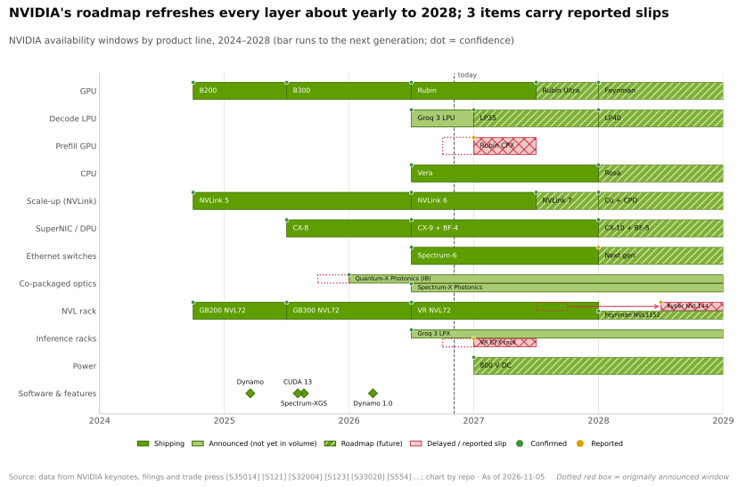
[交互版本](../../assets/interactive/17-roadmap-gantt-nvidia.html)

## 覆盖所有层的综合路线图

英伟达销售的是平台，因此其路线图是一组同步推进的产品线：GPU、解码加速器、内存、CPU、[纵向扩展（scale-up）](../glossary.md#scale-up)交换机、[网卡（NIC）](../glossary.md#nic)与[数据处理器（DPU）](../glossary.md#dpu)、机架、电源和软件。每条产品线的每一代都设计为与其他产品线的对应一代同步出货，且每代 GPU 如今都会在约一年后迎来一次[中期升级](../glossary.md#mid-cycle-refresh)（“Ultra”）。下方甘特图将十二个层级的路线图整合为一张视图。标签：🟢 英伟达已确认，🟡 有报道，🔴 推测。各层自己的路线图页面提供详细信息，例如 [GPU 芯片](../layers/02-gpu-silicon/roadmap.md)、[纵向扩展](../layers/05-scale-up-nvlink-nvswitch/roadmap.md)和[系统](../layers/08-systems-racks-ai-factories/roadmap.md)。

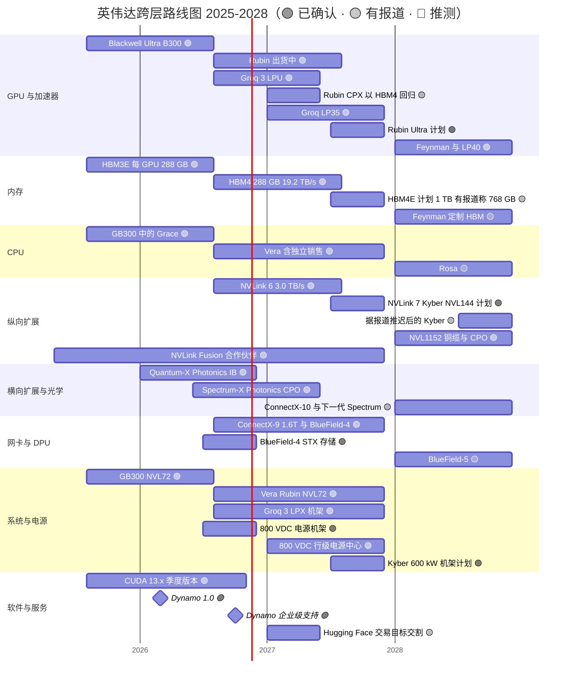

各行来源见下方综合表；未列入该表的条形：GB300 中的 Grace [[S32004]](../../sources/bibliography.md#s32004)；有关 Kyber 推迟的报道 [[S507]](../../sources/bibliography.md#s507) 以及英伟达的否认 [[S508]](../../sources/bibliography.md#s508)。

竞争对手的日程逐年与之对应。AMD 为截至 2028 年的每一年都命名了一款机架；云服务商提前一到两年公布时间表；华为公布的时间跨度仅次于英伟达。

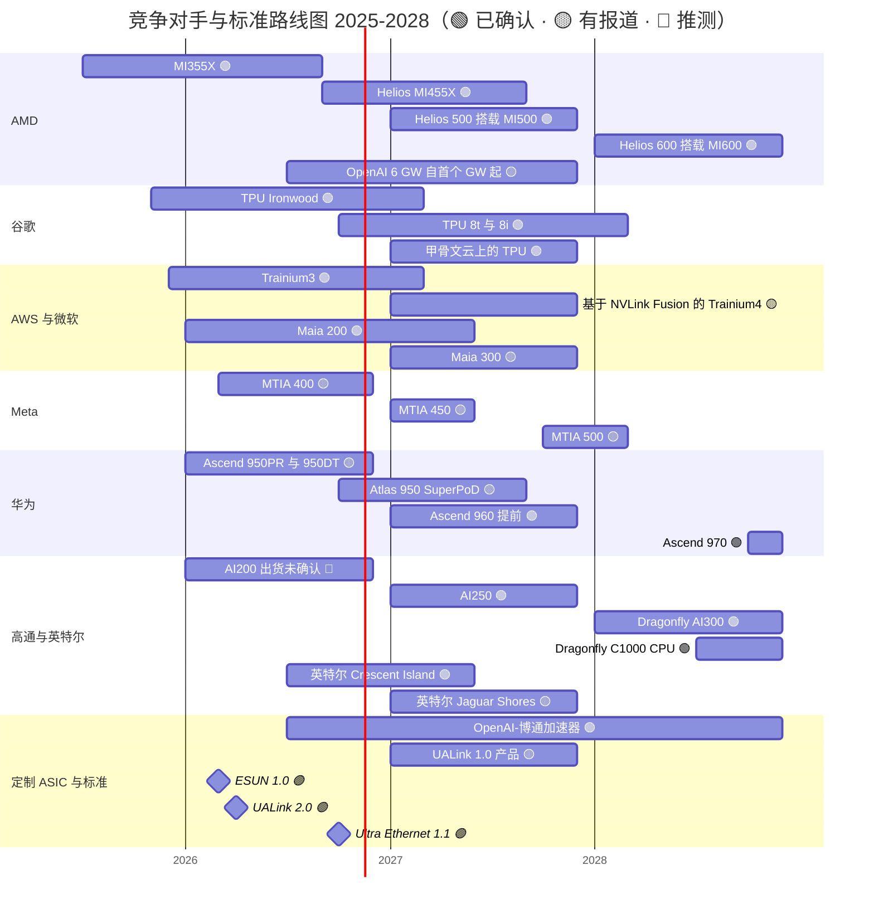

各行来源见下方综合表；未列入该表的条形：OpenAI–博通加速器，自 2026 年下半年起共 10 GW [[S174]](../../sources/bibliography.md#s174)。

### 综合路线图表

数据来自 `data/roadmap.csv` 及各层路线图页面。时间窗口以日历季度或年份表示；“状态”截至 2026-11-05。

| 层 | 项目 | 时间窗口 | 状态 | 置信度 | 来源 |
|---|---|---|---|---|---|
| 02 | Rubin GPU（336B 晶体管，288 GB HBM4） | 2026 年第三季度出货，2026 年第四季度放量 | 出货中 | 🟢 | [[S100]](../../sources/bibliography.md#s100)[[S500]](../../sources/bibliography.md#s500)[[S90009]](../../sources/bibliography.md#s90009) |
| 02 | Rubin CPX（预填充 GPU） | 原定 2026 年末；据报道改为 1Q27 并采用 HBM4 | 推迟 | 🟡 | [[S33023]](../../sources/bibliography.md#s33023)[[S115]](../../sources/bibliography.md#s115)[[S117]](../../sources/bibliography.md#s117) |
| 02 | Groq 3 LPU（~500 MB SRAM） | 2026 年第三季度 | 全面投产 | 🟢 | [[S113]](../../sources/bibliography.md#s113)[[S506]](../../sources/bibliography.md#s506) |
| 02 | Groq LP35（新增 NVFP4） | 2027 | 路线图 | 🟢 | [[S108]](../../sources/bibliography.md#s108) |
| 02 | Rubin Ultra（4 颗裸片，发布时宣称 ~100 PFLOPS FP4） | 2027 年下半年；有报道称为双裸片版本 | 路线图 | 🟢 / 🟡 | [[S35018]](../../sources/bibliography.md#s35018)[[S509]](../../sources/bibliography.md#s509) |
| 02 | Feynman GPU 搭配 LP40 | 2028 | 路线图 | 🟢 | [[S109]](../../sources/bibliography.md#s109)[[S502]](../../sources/bibliography.md#s502) |
| 03 | HBM4，每 GPU 288 GB、19.2 TB/s | 2026 | 出货中（已修订） | 🟢 | [[S102]](../../sources/bibliography.md#s102)[[S103]](../../sources/bibliography.md#s103)[[S104]](../../sources/bibliography.md#s104) |
| 03 | HBM4E，每颗 Rubin Ultra 1 TB（有报道称 768 GB） | 2027 年下半年 | 路线图 | 🟢 / 🟡 | [[S110]](../../sources/bibliography.md#s110)[[S111]](../../sources/bibliography.md#s111) |
| 03 | CoWoS 产能：2026 年末 ~105–130k 片晶圆/月，2028 年前 ~260k | 2026–2028 | 估计 | 🟡 | [[S90039]](../../sources/bibliography.md#s90039)[[S3002]](../../sources/bibliography.md#s3002) |
| 04 | Vera CPU（88 核），亦单独销售 | 2026 | 出货中 | 🟢 | [[S100]](../../sources/bibliography.md#s100)[[S90003]](../../sources/bibliography.md#s90003) |
| 04 | Rosa CPU | 2028 | 路线图 | 🟡 | [[S109]](../../sources/bibliography.md#s109)[[S90004]](../../sources/bibliography.md#s90004) |
| 05 | NVLink 6，每 GPU 3.0 TB/s（原为 3.6） | 2026 | 出货中（已修订） | 🟢 | [[S100]](../../sources/bibliography.md#s100)[[S103]](../../sources/bibliography.md#s103) |
| 05 | Kyber NVL144 中的 NVLink 7 | 官方为 2027 年下半年；有报道称 2028 | 存在争议 | 🟡 | [[S108]](../../sources/bibliography.md#s108)[[S507]](../../sources/bibliography.md#s507)[[S508]](../../sources/bibliography.md#s508) |
| 05 | Feynman Kyber NVL1152，铜缆加 CPO | 2028 | 路线图 | 🟢 | [[S108]](../../sources/bibliography.md#s108)[[S112]](../../sources/bibliography.md#s112) |
| 05 | NVLink Fusion（采用者包括 Trainium4） | 2025–2027 | 出货中 / 路线图 | 🟢 / 🟡 | [[S131]](../../sources/bibliography.md#s131)[[S518]](../../sources/bibliography.md#s518) |
| 06 | Quantum-X Photonics InfiniBand | 2026 年初（由 2025 年推迟） | 部署中 | 🟡 | [[S515]](../../sources/bibliography.md#s515)[[S6022]](../../sources/bibliography.md#s6022) |
| 06 | Spectrum-X Photonics 以太网（CPO） | 2026 年下半年 | 据报道已全面投产 | 🟡 | [[S514]](../../sources/bibliography.md#s514)[[S6020]](../../sources/bibliography.md#s6020) |
| 06 | ConnectX-10 与下一代 Spectrum | 2028 | 路线图 | 🟡 | [[S109]](../../sources/bibliography.md#s109)[[S502]](../../sources/bibliography.md#s502) |
| 07 | ConnectX-9（1.6 Tb/s）与 BlueField-4 | 2026 | 出货中 | 🟢 | [[S33004]](../../sources/bibliography.md#s33004)[[S512]](../../sources/bibliography.md#s512) |
| 07 | BlueField-4 STX 上下文存储设计 | 2026 年下半年 | 已发布 | 🟢 | [[S7511]](../../sources/bibliography.md#s7511) |
| 07 | BlueField-5 | 2028 | 路线图 | 🟡 | [[S109]](../../sources/bibliography.md#s109)[[S90004]](../../sources/bibliography.md#s90004) |
| 08 | Vera Rubin NVL72（~190–230 kW） | 2026 年第三季度 | 出货中 | 🟢 / 🟡 功耗 | [[S102]](../../sources/bibliography.md#s102)[[S500]](../../sources/bibliography.md#s500)[[S303]](../../sources/bibliography.md#s303) |
| 08 | 800 V DC 电源机架；行级电源中心 | 2026 年下半年；2027 | 路线图 | 🟢 | [[S90063]](../../sources/bibliography.md#s90063) |
| 08 | 用于 Rubin Ultra 的 Kyber 机架（~600 kW） | 官方为 2027 年下半年；有报道称 2028 | 存在争议 | 🟡 | [[S305]](../../sources/bibliography.md#s305)[[S507]](../../sources/bibliography.md#s507) |
| 09 | CUDA 13.x，大约每季度一版（13.5 于 2026-11-04 发布） | 持续 | 出货中 | 🟢 | [[S523]](../../sources/bibliography.md#s523) |
| 11 | Dynamo 1.0 → 1.5.1，提供企业级支持 | 2026 年 3 月 → 10 月 | 出货中 | 🟢 | [[S520]](../../sources/bibliography.md#s520)[[S521]](../../sources/bibliography.md#s521) |
| 11 | Hugging Face 收购交割 | 2027 年上半年 | 待审批 | 🟡 | [[S11500]](../../sources/bibliography.md#s11500)[[S11027]](../../sources/bibliography.md#s11027) |
| 竞争对手 | AMD Helios（72 × MI455X） | 首批出货约在 2026 年第三季度末 | 出货中 | 🟢 | [[S538]](../../sources/bibliography.md#s538)[[S90020]](../../sources/bibliography.md#s90020) |
| 竞争对手 | AMD MI500 / MI600 | 2027 / 2028 | 路线图 | 🟢 | [[S538]](../../sources/bibliography.md#s538) |
| 竞争对手 | 谷歌 TPU 8t / 8i | 2026 年末 | 已发布 | 🟢 | [[S550]](../../sources/bibliography.md#s550) |
| 竞争对手 | AWS Trainium4 | 2027（估计） | 路线图 | 🟡 | [[S156]](../../sources/bibliography.md#s156)[[S518]](../../sources/bibliography.md#s518) |
| 竞争对手 | 微软 Maia 300 | 2027 | 已发布 | 🟡 | [[S90046]](../../sources/bibliography.md#s90046) |
| 竞争对手 | 华为 Ascend 960 / 970 | 2027 年第一季度 / 2028 年第四季度 | 路线图 | 🟢 | [[S163]](../../sources/bibliography.md#s163)[[S567]](../../sources/bibliography.md#s567) |
| 竞争对手 | 高通 AI250 / Dragonfly AI300 | 2027 / 2028 | 路线图 | 🟢 | [[S173]](../../sources/bibliography.md#s173)[[S90060]](../../sources/bibliography.md#s90060) |
| 标准 | UALink 1.0 产品 | 2027 | 预期 | 🟡 | [[S90051]](../../sources/bibliography.md#s90051) |

> [!TIP]
> **算例 —— 买方需要跟踪多少次英伟达产品发布。** 仅统计上表中的硬件行，英伟达在 2026 年有 7 个项目出货，2027 年约有 6 个，2028 年有 8 个，覆盖 GPU、解码芯片、内存、CPU、NVLink、网卡/DPU、交换机和机架。[超大规模云厂商](../glossary.md#hyperscaler)对每一项进行认证，都需要完成散热、电源、网络和软件验证。**结论：** 平台的迭代节奏同时也是一种认证负担。它有利于拥有大型工程团队的买方（超大规模云厂商）以及按原设计整机架采购的买方（[新兴云服务商](../glossary.md#neocloud)、主权买家），而夹在两者之间的买方则受到挤压。

## 规格演进：每一步换来了什么

规格图表让路线图更加具体。从 H100 到 Rubin，每 GPU 的低精度算力提升了 ~18 倍，而 HBM 带宽仅提升 ~5.7 倍，功耗提升 ~3.3 倍。这一差距即[内存墙](../glossary.md#memory-wall)，也正是 2027–28 年路线图的大部分内容聚焦于内存与互连、而非 FLOPS 的原因。

纵向扩展域的增长甚至快于芯片本身。如今 NVLink 在一台 Vera Rubin 机架中连接 72 个 GPU 封装，在 Kyber 中连接 144 个（2027 年计划），在 Feynman 的 Kyber NVL1152 中连接 1,152 个（2028），最后一种采用共封装光学，因为铜缆无法覆盖如此远的距离 [[S100]](../../sources/bibliography.md#s100)[[S108]](../../sources/bibliography.md#s108)。单机架功耗随之上升：GB300 NVL72 为 ~132 kW，Vera Rubin 为 ~190–230 kW，Kyber 为 ~600 kW [[S337]](../../sources/bibliography.md#s337)[[S303]](../../sources/bibliography.md#s303)[[S305]](../../sources/bibliography.md#s305)。

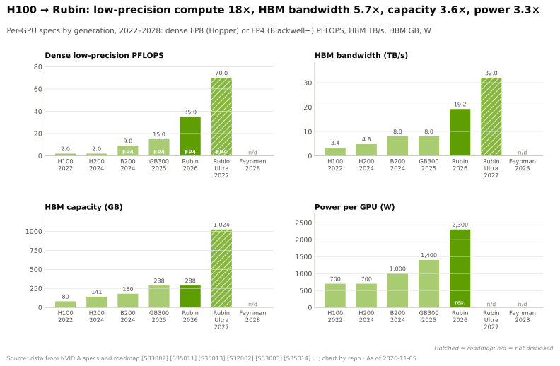

> [!TIP]
> **算例 —— Kyber 每千瓦能换来什么。** 一台 Vera Rubin NVL72 在 ~190–230 kW 下提供 ~1,260 [PFLOPS](../glossary.md#flops) 稠密 [FP8](../glossary.md#fp8) 算力 🟡 [[S102]](../../sources/bibliography.md#s102)[[S303]](../../sources/bibliography.md#s303)：每 kW ~5.5–6.6 PFLOPS。按发布口径，Kyber 的目标是在 ~600 kW 下提供 ~5,000 PFLOPS 稠密 FP8 [[S35018]](../../sources/bibliography.md#s35018)[[S305]](../../sources/bibliography.md#s305)：每 kW ~8.3 PFLOPS，提升 26–51%。按发布口径，机架 HBM 从 20.7 TB 增至 ~144 TB [[S102]](../../sources/bibliography.md#s102)[[S110]](../../sources/bibliography.md#s110)，增长 ~7 倍，而功耗仅增长 ~3 倍。**结论：** 2027 年的这一步主要是内存容量的跃升。若有关每 GPU 削减至 768 GB 的报道属实 🟡 [[S111]](../../sources/bibliography.md#s111)，机架 HBM 将降至 ~108 TB（本资料库测算：144 × 768/1,024），仍为当前机架的 ~5 倍。

🔧 技术细节：为何内存与封装决定了路线图的节奏

算力随晶体管数量和数值格式扩展；内存带宽则取决于 GPU 周围 [HBM](../glossary.md#hbm) 堆栈的数量及每个堆栈的[引脚速率](../glossary.md#pin-speed)。Rubin 使用 8 个 HBM4 堆栈；Rubin Ultra 计划采用 16 个 HBM4E 堆栈 [[S110]](../../sources/bibliography.md#s110)，这需要更大的 [CoWoS](../glossary.md#cowos) 中介层，每片晶圆可切出的封装也更少（见[第 03 层路线图](../layers/03-memory-packaging-supply-chain/roadmap.md)）。一位分析师将 2026 年 Rubin 的规格下调归因于 HBM4 引脚速率仅为 ~9.4 Gb/s 而非 ~10.7 Gb/s（🔴 原因未经证实）[[S90006]](../../sources/bibliography.md#s90006)。因此，此后的每一步都取决于内存厂商的良率：SK 海力士和三星已于 2026 年年中送样 HBM4E [[S3528]](../../sources/bibliography.md#s3528)，TrendForce 预计 HBM4E 将占 2027 年 HBM 市场的 ~40% [[S3531]](../../sources/bibliography.md#s3531)。

### 推理路线图如今有三款芯片

直到 2025 年，英伟达对每一种工作负载的回答都是下一代 GPU。2026 年的路线图则将推理拆分为不同阶段。[预填充（prefill）](../glossary.md#prefill)即读取提示词，需要算力；[解码（decode）](../glossary.md#decode)即逐个生成 token（词元），需要内存带宽。搭载 HBM4 的 Rubin GPU 仍是通用引擎。Rubin CPX 于 2025 年 9 月发布，是一款基于 GDDR7 的预填充 GPU，具备 30 PFLOPS [NVFP4](../glossary.md#nvfp4) 算力和 128 GB 内存 [[S33023]](../../sources/bibliography.md#s33023)；它从 GTC 2026 路线图上消失，据报道将于 1Q27 以 HBM4 版本回归 🟡 [[S115]](../../sources/bibliography.md#s115)[[S117]](../../sources/bibliography.md#s117)。源自 Groq 的 LPU 占据了解码的位置：每颗 LP30 芯片拥有 ~500 MB 片上 [SRAM](../glossary.md#sram)，一台 256 芯片的 LPX 机架部署在 Vera Rubin 旁边 [[S114]](../../sources/bibliography.md#s114)[[S506]](../../sources/bibliography.md#s506)。LP35（2027）新增 NVFP4，LP40 将于 2028 年与 Feynman 搭配 [[S108]](../../sources/bibliography.md#s108)[[S109]](../../sources/bibliography.md#s109)。

> [!TIP]
> **算例 —— 为何解码转向了 SRAM。** 一台 LPX 机架搭载 256 × ~0.5 GB ≈ 128 GB 的 SRAM，聚合带宽 ~40 PB/s [[S114]](../../sources/bibliography.md#s114)。一台 Vera Rubin NVL72 搭载 20.7 TB 的 HBM4，带宽 ~1,400 TB/s [[S102]](../../sources/bibliography.md#s102)[[S90006]](../../sources/bibliography.md#s90006)：容量约为前者的 ~160 倍，带宽却只有其 ~1/29。一个 FP8 精度的 70B 参数模型（~70 GB）可装入一台 LPX 机架的 SRAM，因此每个 token 都能以 SRAM 速度生成；而 1T 参数的模型装不下，仍需要 HBM。**结论：** 三芯片路线图押注的是：中等规模模型的延迟关键型解码市场足够大，足以支撑专用芯片——这与 Groq、Cerebras 和 d-Matrix 曾下的赌注相同，如今被纳入英伟达的机架之中。

## 逐层看：2026 至 2028 年有何变化

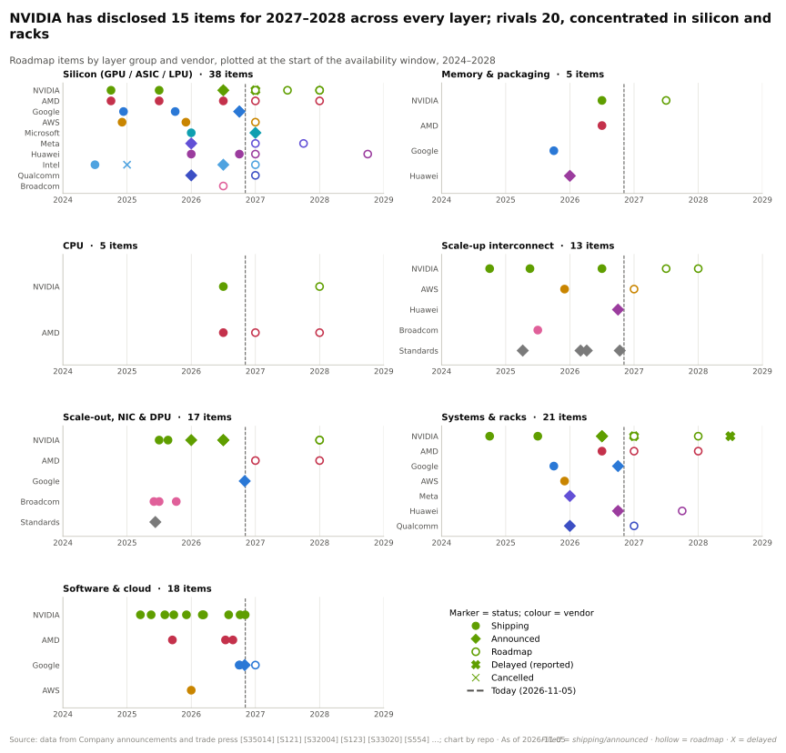

| 层 | 2026（当前） | 2027 | 2028 | 可能改变格局的因素 | 层级路线图 |
|---|---|---|---|---|---|
| 02 GPU 芯片 | Rubin；Groq 3 LPU | Rubin Ultra；LP35；CPX？ | Feynman；LP40 | 双裸片 Rubin Ultra；MI500 纸面领先 | [02](../layers/02-gpu-silicon/roadmap.md) |
| 03 内存 | HBM4，19.2 TB/s | HBM4E，1 TB 计划 | 定制 HBM | HBM4E 引脚速率、三星的份额、内存价格 | [03](../layers/03-memory-packaging-supply-chain/roadmap.md) |
| 04 CPU | Vera、独立销售的 Vera | — | Rosa | 智能体带来的 CPU 需求；Fusion CPU 出货 | [04](../layers/04-cpu-grace-vera/roadmap.md) |
| 05 纵向扩展 | NVLink 6，72 GPU | NVLink 7，144 个封装 | 采用 CPO 的 NVL1152 | Kyber 时间；UALink 芯片 | [05](../layers/05-scale-up-nvlink-nvswitch/roadmap.md) |
| 06 横向扩展 | CX-9 1.6T；CPO 交换机 | — | CX-10；下一代 Spectrum | Ultra Ethernet 网卡规模化 | [06](../layers/06-scale-out-scale-across-networking/roadmap.md) |
| 07 DPU / 存储 | BlueField-4；STX | — | BlueField-5 | KV 缓存存储成为标准配置 | [07](../layers/07-dpu-supernic-storage-security/roadmap.md) |
| 08 系统 | VR NVL72；LPX；800 VDC 机架 | Kyber（~600 kW）；行级供电 | Kyber NVL1152 | 中板良率；电网电力 | [08](../layers/08-systems-racks-ai-factories/roadmap.md) |
| 09–11 软件 | CUDA 13.x；Dynamo 1.x | HF 交割 | — | 开源推理服务在竞争对手机架上达到同等水平 | [09](../layers/09-cuda-and-system-software/roadmap.md)、[11](../layers/11-inference-and-ai-software/roadmap.md) |
| 12–13 云与资本 | Lepton；融资平台 | 合同分批交付 | — | 资本开支暂停；新兴云信用 | [12](../layers/12-orchestration-and-cloud-services/roadmap.md)、[13](../layers/13-ecosystem-gtm-and-capital/roadmap.md) |

本章在日期和标签上与各层页面保持一致。在侧重点上有一处不同：[系统路线图](../layers/08-systems-racks-ai-factories/roadmap.md)将 Kyber 的时间视为一个存在争议的项目，而本章将其视为 2027 年最重要的路线图事实，因为 NVLink 7、HBM4E 和 800 V DC 三条产品线都汇聚于这一机架。

## 2026 年的变化：修订、推迟与更名

| 项目 | 首次发布时 | 截至 2026-11-05 | 标签 | 来源 |
|---|---|---|---|---|
| 每 GPU Rubin HBM4 带宽 | 22 TB/s | 19.2 TB/s | 🟢 | [[S100]](../../sources/bibliography.md#s100)[[S90006]](../../sources/bibliography.md#s90006) |
| 每 GPU NVLink 6 | 3.6 TB/s | 3.0 TB/s | 🟢 | [[S33004]](../../sources/bibliography.md#s33004)[[S103]](../../sources/bibliography.md#s103) |
| Vera Rubin NVL72 机架 HBM 带宽 | 1,580 TB/s | 1,400 TB/s | 🟢 | [[S102]](../../sources/bibliography.md#s102)[[S90006]](../../sources/bibliography.md#s90006) |
| Rubin CPX | 2026 年末，GDDR7，30 PFLOPS NVFP4 | 从 GTC 2026 路线图上撤下；据报道改用 HBM4 重新设计，定于 1Q27 | 🟡 | [[S33023]](../../sources/bibliography.md#s33023)[[S115]](../../sources/bibliography.md#s115)[[S117]](../../sources/bibliography.md#s117) |
| Kyber NVL144 机架 | 2027 年下半年 | 据报道推迟超过 12 个月；英伟达称“路线图保持不变” | 🟡 | [[S305]](../../sources/bibliography.md#s305)[[S507]](../../sources/bibliography.md#s507)[[S508]](../../sources/bibliography.md#s508) |
| Rubin Ultra 封装 | 4 颗光罩尺寸裸片，1 TB HBM4E | 有报道称为双裸片版本、768 GB | 🟡 | [[S35018]](../../sources/bibliography.md#s35018)[[S509]](../../sources/bibliography.md#s509)[[S111]](../../sources/bibliography.md#s111) |
| 机架命名 | “Vera Rubin NVL144”、“Rubin Ultra NVL576” | Vera Rubin NVL72、Kyber NVL144（按封装而非裸片计数） | 🟢 | [[S90009]](../../sources/bibliography.md#s90009)[[S108]](../../sources/bibliography.md#s108) |

**Rubin 的修订影响最大。** 英伟达在 2026 年 9–10 月修改了其产品页面，并表示新数据反映的是系统在高质量批量生产中可持续达到的水平 [[S104]](../../sources/bibliography.md#s104)。容量（288 GB）和算力未变 [[S90006]](../../sources/bibliography.md#s90006)。其效果是扩大了 AMD MI455X 在带宽上的纸面领先优势（23.3 对 19.2 TB/s，此前为 23.3 对 22），并使其在容量上继续领先（432 对 288 GB）[[S144]](../../sources/bibliography.md#s144)[[S90093]](../../sources/bibliography.md#s90093)。AMD 也曾修订规格：MI325X 在 Computex 2024 上发布时宣称最高 288 GB [HBM3E](../glossary.md#hbm3e)，上市时为 256 GB [[S17007]](../../sources/bibliography.md#s17007)[[S142]](../../sources/bibliography.md#s142)；而 MI455X 标称的 HBM4 带宽则朝相反方向变化，从 2025 年 6 月的 19.6 TB/s 升至 23.3 TB/s [[S144]](../../sources/bibliography.md#s144)[[S90093]](../../sources/bibliography.md#s90093)。

**英伟达的解释对未来所有规格都有影响。** 英伟达称发布时的数据是目标值，新数据反映的是量产水平 [[S104]](../../sources/bibliography.md#s104)，这实际上等于告诉买方：应将其路线图上所有量产前的数字——包括 Rubin Ultra 的 1 TB 以及 Feynman 即将公布的规格——视为上限。为 2027–28 年部署做规划的买方，在量产产品页面公布之前，应对已宣布的带宽打折扣。

**更名并非表面文章。** “NVL144”计的是 GPU 裸片数；“NVL72”计的是封装数。同一台 Rubin 机架同时拥有这两个名字 [[S90009]](../../sources/bibliography.md#s90009)。跨厂商比较机架的读者应始终按封装计数（[NVL 命名](../glossary.md#nvl-naming)）。

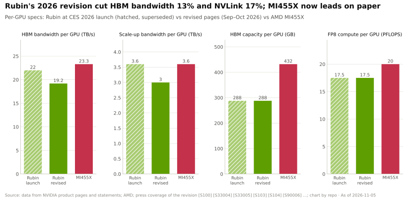

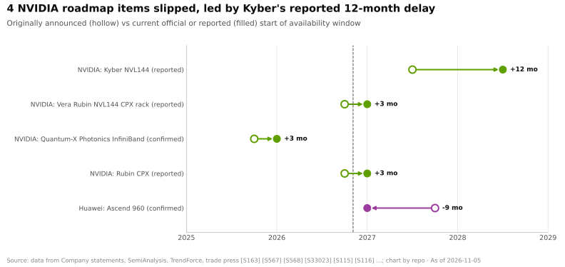

> [!TIP]
> **算例 —— Rubin 的下调让买方损失了什么。** 解码，即推理中逐个生成 token 的阶段，受限于内存带宽（见 [P2](../primers/P2-how-ai-inference-works.md)）。一台机架的 HBM 带宽从 1,580 降至 1,400 TB/s，−11% [[S102]](../../sources/bibliography.md#s102)[[S90006]](../../sources/bibliography.md#s90006)。对于固定批大小下受带宽约束的模型，峰值解码每秒 token 数大致按比例下降（🔴 本资料库近似）。以一台 ~$7.8M 的机架计（估计，摩根士丹利）[[S331]](../../sources/bibliography.md#s331)，在每 token 价格不变的情况下，峰值解码吞吐量下降 11% 相当于 ~$0.9M 的机架价值。**结论：** 此次修订没有改变任何算力数据，但缩小了支撑英伟达在内存受限型推理上溢价的差距。

如今，一个路线图项目的生命周期已不止“已发布”和“出货中”两种状态。Rubin CPX 在十二个月内就经历了其中四种。

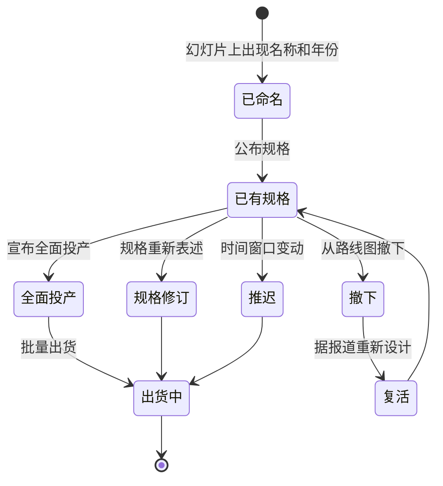

## 路线图有承诺作为支撑

只有在背后的供应已被锁定时，路线图才可信。截至 Q2 FY2027 末，英伟达的供应与产能承诺达 $279B，较上一季度的 $119B 大幅上升，主要是为 Rubin 一代锁定的内存与制造产能 [[S407]](../../sources/bibliography.md#s407)[[S404]](../../sources/bibliography.md#s404)。在需求端，黄仁勋在 GTC 2026 上将截至 2027 年的 Blackwell 与 Vera Rubin 需求规模定为 $1 trillion；各媒体对他指的是订单还是收入机会说法不一 🟡 [[S90001]](../../sources/bibliography.md#s90001)[[S90002]](../../sources/bibliography.md#s90002)。最大的买家已宣布了数吉瓦级的计划，但会将其分散到多家供应商。

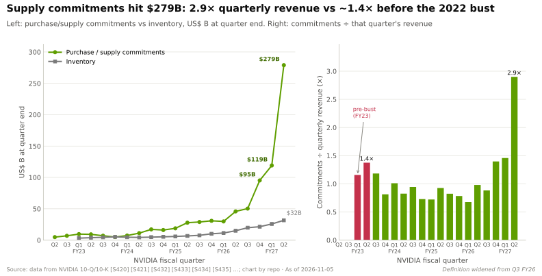

> [!TIP]
> **算例 —— $279B 的承诺对路线图意味着什么。** $279B 约为英伟达 Q2 FY2027 营收 $96.2B 的 ~2.9 倍 [[S407]](../../sources/bibliography.md#s407)[[S405]](../../sources/bibliography.md#s405)，而在 FY2023 减记之前为 ~1.4 倍（见上图）。如果 Rubin Ultra 推迟一年，为其锁定的内存与产能就必须由 Rubin 的需求消化，或作为存货持有。FY2023 的先例是 $2.17B 的存货准备以及一笔针对超出需求之承诺的 $348M 费用 [[S418]](../../sources/bibliography.md#s418)[[S421]](../../sources/bibliography.md#s421)。**结论：** 路线图如今已是一项资产负债表承诺。推迟对英伟达代价高昂，这也是它迅速否认推迟报道的原因之一 [[S508]](../../sources/bibliography.md#s508)。

## 作为竞争策略的路线图

产品路线图通常是一份内部计划。而英伟达的路线图是一件公开工具，承担三项任务：将买方的决策冻结在有利于英伟达的方向，设定竞争对手必须跟上的节奏，并在不拖累当前销售的情况下完成这两点。每项任务都有其机制和风险。

### 冻结客户决策

**机制在于规划提前期。** 一座 AI 工厂需要在芯片到货之前很久就确定电力、冷却、楼板承重和网络设计。美国发电项目要在并网排队中等待数年 [[S8009]](../../sources/bibliography.md#s8009)，而一个吉瓦级站点要围绕某一机架的功率密度来设计：GB300 NVL72 为 ~132 kW，Kyber 为 ~600 kW [[S337]](../../sources/bibliography.md#s337)[[S305]](../../sources/bibliography.md#s305)。一个在 2026 年选定 2028 年设计方案的买方，只能围绕已公布 2028 年机架的供应商进行设计。以[预先公布期](../glossary.md#pre-announcement-horizon)衡量，英伟达提前 26–40 个月公布其 GPU 的时间表；谷歌只提前 ~7 个月公布 TPU，AMD 则提前 ~13–25 个月（🔴 本资料库分析）[[S17006]](../../sources/bibliography.md#s17006)。

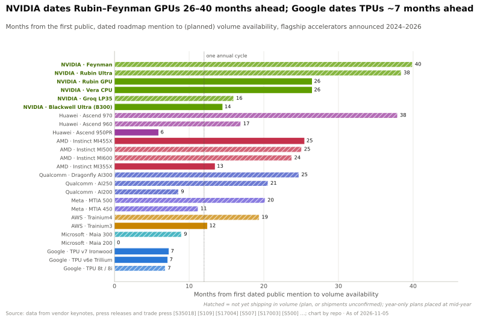

**冻结一直延伸到建筑本身。** 英伟达的 800 V DC 电源架构是面向设施而非芯片的路线图项目：在 GTC DC 2025 上，约 20 家电源与电气合作伙伴展示了 800 V DC 部件，包括 CoreWeave、Lambda、Nebius、OCI 和 Together AI 在内的新兴云服务商表示正在为此进行设计 [[S90061]](../../sources/bibliography.md#s90061)。一款兼容 MGX 的 800 V DC 电源机架定于 2026 年下半年推出，行级电源中心定于 2027 年推出 [[S90063]](../../sources/bibliography.md#s90063)。一个按 800 V DC 和 ~600 kW 机架布线的数据机房，是围绕英伟达机架规划建造的长寿命资产——即便 Dell'Oro 称该设计为参考架构而非标准 [[S90062]](../../sources/bibliography.md#s90062)。

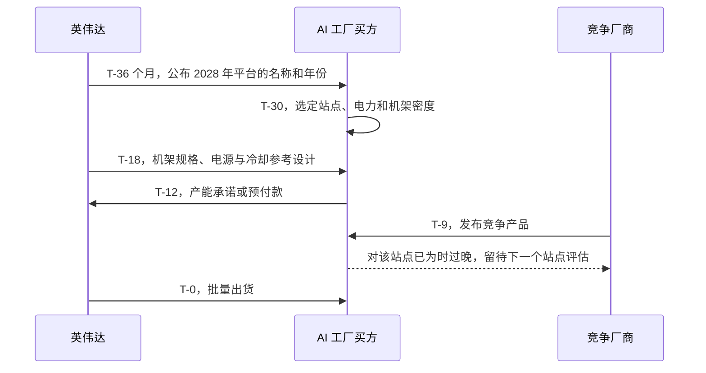

> [!TIP]
> **算例 —— 用日期来看规划窗口。** 一个在 2028 年年中通电的 1 GW 站点，需要在 ~2026 年之前确定电气设计（🔴 基于多年电力交付周期的假设 [[S8009]](../../sources/bibliography.md#s8009)）。届时，英伟达已将 Feynman 定于 2028 年并公布了 2028 年的机架类别（Kyber NVL1152）[[S109]](../../sources/bibliography.md#s109)[[S108]](../../sources/bibliography.md#s108)，AMD 则为 2028 年命名了 Helios 600 但未公布规格 [[S538]](../../sources/bibliography.md#s538)。谷歌 2028 年的 TPU 尚未发布：其 8t/8i 产品于 2026 年 4 月发布，定于 2026 年晚些时候全面上市 [[S550]](../../sources/bibliography.md#s550)。**结论：** 对于 2028 年通电的站点，只有英伟达提供了有明确时间表的机架架构。AMD 只给出了一个名称，云厂商的 ASIC 则没有任何公开信息，因此规划的默认选项从结构上就归于英伟达。

### 设定竞争对手必须跟上的节奏

英伟达在 Computex 2024 上将数据中心产品转向“一年一代的节奏” [[S17003]](../../sources/bibliography.md#s17003)；AMD 在同一周宣布了 Instinct 的年度节奏 [[S17007]](../../sources/bibliography.md#s17007)[[S17008]](../../sources/bibliography.md#s17008)。此后，英伟达和 AMD 已连续三年在同一季度推出旗舰产品。跟上这一节奏代价不菲：仅 Blackwell 的开发成本就达 ~$10B [[S35028]](../../sources/bibliography.md#s35028)，英伟达 FY2026 的研发支出为 $18.5B [[S401]](../../sources/bibliography.md#s401)。

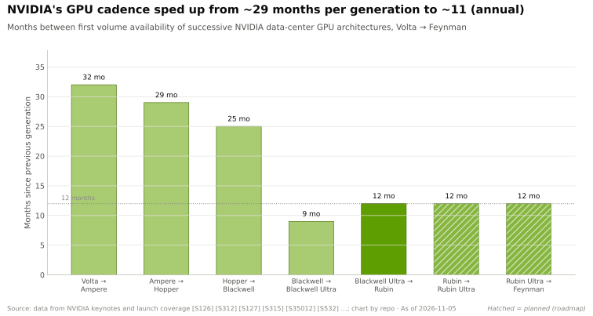

> [!TIP]
> **算例 —— 跟上节奏的代价。** 如果英伟达每一代的开发成本为 ~$10B [[S35028]](../../sources/bibliography.md#s35028)，且每 ~12 个月推出一代，那么仅平台开发每年就需 ~$10B，这包含在英伟达 FY2026 的 $18.5B 研发支出之内 [[S401]](../../sources/bibliography.md#s401)。AMD 2024 年所有产品的研发支出为 ~$6.5B [[S450]](../../sources/bibliography.md#s450)。超大规模云厂商与设计合作伙伴共同打造的 [ASIC](../glossary.md#asic) 每代成本为 ~$0.5–1.5B（估计）[[S2501]](../../sources/bibliography.md#s2501)，因为它只覆盖服务于单一客户工作负载的一款芯片，而非整个平台。**结论：** 在全平台规模上，只有英伟达负担得起年度节奏。竞争对手要么缩小范围（定制 ASIC），要么共享英伟达自己的平台（[NVLink Fusion](../glossary.md#nvlink-fusion)）来跟上节奏。

### 奥斯本效应风险，以及它为何尚未显现

奥斯本效应得名于 20 世纪 80 年代的一家电脑制造商，据称该公司过早宣布更好的新型号，导致现有型号的销售陷入停滞。英伟达每年都在冒这个险。在 GTC 2025 上，黄仁勋自称“首席收入破坏者”，同时告诉客户 Hopper 只在少数场景下还算够用 [[S17001]](../../sources/bibliography.md#s17001)。一份报道称，2024 年 Hopper 对四大云厂商的销量为 1.3M 块 GPU，而 2025 年 Blackwell 为 3.6M 块 🟡 [[S17002]](../../sources/bibliography.md#s17002)。

数据并未显示出冻结。从 Q1 FY2024 到 Q2 FY2027，历经六次路线图发布，数据中心收入连续 14 个季度环比增长 [[S405]](../../sources/bibliography.md#s405)[[S17006]](../../sources/bibliography.md#s17006)。最弱的季度（+5%，Q2 FY2026）恰逢 H20 出口禁令，而非买方观望 [[S90081]](../../sources/bibliography.md#s90081)。

> [!TIP]
> **算例 —— 为何手握电力的买方不会等待。** 一家拥有 10 MW IT 电力的新兴云服务商，现在就可以用 ~132 kW 的 GB300 NVL72 机架填满它 [[S337]](../../sources/bibliography.md#s337)，~75 台机架（~5,400 块 GPU）。若采用 ~190–230 kW 的 Vera Rubin 机架 🟡 [[S303]](../../sources/bibliography.md#s303)，可容纳 ~43–52 台，但在中等速度下每兆瓦的 DeepSeek-R1 token 产出约为 GB300 的 2 倍 🟡 [[S626]](../../sources/bibliography.md#s626)。等待一个季度意味着放弃整个站点一年产出的 ~25%；而在 Rubin 量产后切换，则可在其余生命周期内使每兆瓦产出提高 ~100%。**结论：** 理性的买方会在新一代可供货时立即切换，但不会在此之前停止购买。在供应持续紧张的情况下，换代表现为产品结构的变化，而非收入缺口；CFO 称 FY2028 的前景“受供应约束” [[S90012]](../../sources/bibliography.md#s90012)。

> [!WARNING]
> **奥斯本效应何时会显现。** 三种情况会让路线图变成负担：供应追上需求（据估计，到 2028 年 CoWoS 产能将达 ~260k 片晶圆/月 [[S3002]](../../sources/bibliography.md#s3002)）；出现明显的推迟，使买方等待某个承诺中的升级（Kyber 🟡 [[S507]](../../sources/bibliography.md#s507)）；或者新一代每兆瓦的提升幅度大到足以在旧一代折旧期结束前使其沦为搁浅资产。超大规模云厂商按五到六年对服务器计提折旧 [[S383]](../../sources/bibliography.md#s383)[[S385]](../../sources/bibliography.md#s385)，因此在每代 ~2 倍提升的情况下，一台机架在账面上仍有价值时，就可能已落后于前沿两到三代。FY2023 的危机——季度营收在两个季度内下降 28%——表明产能过剩的冲击可以来得多快 [[S432]](../../sources/bibliography.md#s432)[[S434]](../../sources/bibliography.md#s434)。

### 过往记录：承诺与兑现

公开路线图的价值取决于其兑现记录。下表比较了各厂商在 2026 年末前到期项目上的承诺与实际出货情况。它只涵盖日期和标志性规格；实际交付的性能是另一个问题（见[竞争格局](../layers/02-gpu-silicon/competition.md)）。

| 厂商 | 项目 | 承诺 | 兑现情况（截至 2026-11-05） | 评估（标签 = 对兑现事实的置信度） | 来源 |
|---|---|---|---|---|---|
| 英伟达 | Blackwell Ultra（GB300） | 2025 | 自 2025 年下半年起出货 | 🟢 按时 | [[S17003]](../../sources/bibliography.md#s17003)[[S32004]](../../sources/bibliography.md#s32004) |
| 英伟达 | Rubin / Vera Rubin NVL72 | 2026（2024 年公布） | 2026 年 8 月量产出货；带宽规格下调 | 🟢 按时，规格已修订 | [[S17003]](../../sources/bibliography.md#s17003)[[S500]](../../sources/bibliography.md#s500)[[S90006]](../../sources/bibliography.md#s90006) |
| 英伟达 | Quantum-X Photonics | 2025 年晚些时候 | 2026 年初部署 | 🟡 推迟 ~3 个月 | [[S514]](../../sources/bibliography.md#s514)[[S515]](../../sources/bibliography.md#s515) |
| 英伟达 | Spectrum-X Photonics | 2026，后改为 2026 年下半年 | 据报道已全面投产 | 🟡 按时 | [[S514]](../../sources/bibliography.md#s514)[[S6020]](../../sources/bibliography.md#s6020) |
| 英伟达 | Rubin CPX | 2026 年末 | 从路线图撤下；据报道将于 1Q27 回归 | 🟡 未兑现 | [[S33023]](../../sources/bibliography.md#s33023)[[S115]](../../sources/bibliography.md#s115)[[S117]](../../sources/bibliography.md#s117) |
| AMD | MI325X | 2024 年第四季度，最高 288 GB | 2024 年第四季度，256 GB | 🟢 按时，容量下调 | [[S17007]](../../sources/bibliography.md#s17007)[[S142]](../../sources/bibliography.md#s142) |
| AMD | MI355X | 2025 | 自 2025 年第三季度起出货 | 🟢 按时 | [[S17007]](../../sources/bibliography.md#s17007)[[S143]](../../sources/bibliography.md#s143) |
| AMD | MI455X / Helios | 2026 | 首批出货约在 2026 年第三季度末 | 🟡 按时 | [[S17007]](../../sources/bibliography.md#s17007)[[S90020]](../../sources/bibliography.md#s90020) |
| 谷歌 | TPU Ironwood | 2025 年末 | 2025-11-06 宣布全面上市 | 🟢 按时 | [[S151]](../../sources/bibliography.md#s151)[[S547]](../../sources/bibliography.md#s547) |
| 华为 | Ascend 960 | 2027 年第四季度 | 提前至 2027 年第一季度 | 🟢 提前（待兑现） | [[S163]](../../sources/bibliography.md#s163)[[S567]](../../sources/bibliography.md#s567) |
| 高通 | AI200 | 2026 | 未找到出货确认 | 🔴 未确认 | [[S173]](../../sources/bibliography.md#s173) |

规律是一致的：日期大体守住，而标志性规格和次要产品则会变动。英伟达的失误集中在其最新的产品类别（CPX、共封装光学、Kyber 中板），而非核心 GPU 节奏。

### 竞争对手如何应对

| 竞争对手 | 对英伟达路线图的应对 | 证据 | 效果 |
|---|---|---|---|
| AMD | 跟上节奏并在同一季度推出；用认股权证锁定锚定客户 | 自 Computex 2024 起年度更新；与 OpenAI 和 Meta 的 6 GW 认股权证交易 [[S17007]](../../sources/bibliography.md#s17007)[[S13506]](../../sources/bibliography.md#s13506)[[S24004]](../../sources/bibliography.md#s24004) | 🟨 纸面规格持平；🟥 2027 年之后有明确时间表的机架架构落后 |
| 谷歌 | 公开时间跨度短；向谷歌以外销售 TPU | TPU 8t/8i 在全面上市前 ~6 个月发布；Anthropic 最多 1M 颗 TPU；2027 年 TPU 上架 OCI [[S550]](../../sources/bibliography.md#s550)[[S90026]](../../sources/bibliography.md#s90026)[[S552]](../../sources/bibliography.md#s552) | 🟦 对已承诺的买方以成本取胜，而非以规划可见性取胜 |
| AWS | 借用英伟达的互连 | Trainium4 将支持 NVLink Fusion [[S518]](../../sources/bibliography.md#s518)[[S156]](../../sources/bibliography.md#s156) | 🟦 搭乘英伟达的机架路线图，而非与之竞争 |
| 微软 | 自研推理芯片，逐年迭代 | Maia 200（2026）、Maia 300，以及 2027 年起的数吉瓦级部署 [[S158]](../../sources/bibliography.md#s158)[[S90046]](../../sources/bibliography.md#s90046)[[S90045]](../../sources/bibliography.md#s90045) | 🟦 自有需求；对商用芯片买方影响甚微 |
| Meta | 定制 ASIC 中节奏最快 | 至 2027 年推出 MTIA 400、450、500，约每 ~6 个月一步 [[S561]](../../sources/bibliography.md#s561) | 🟦 工作负载范围窄（排序、推理） |
| 华为 | 公布的时间跨度长，并提前推出 | Ascend 960 提前三个季度；970 定于 2028 年第四季度 [[S567]](../../sources/bibliography.md#s567)[[S163]](../../sources/bibliography.md#s163) | 🟦 在出口管制下设定中国市场的规划默认选项 |
| 高通 | 年度节奏与开放互连架构（仅限公开信息） | AI200（2026）、AI250（2027）、支持 UALink 和 ESUN 的 AI300（2028）[[S173]](../../sources/bibliography.md#s173)[[S90060]](../../sources/bibliography.md#s90060) | 🔴 可信度取决于首批出货，目前尚未确认 |
| 标准组织 | NVLink 和 InfiniBand 的开放替代方案 | UALink 2.0（2026 年 4 月）、ESUN 1.0、UEC 1.1；UALink 产品 2027 年推出 [[S574]](../../sources/bibliography.md#s574)[[S576]](../../sources/bibliography.md#s576)[[S575]](../../sources/bibliography.md#s575)[[S90051]](../../sources/bibliography.md#s90051) | 🟥 落后 NVLink 两年，但正处于趋同路径 |

**AMD 的回应是跟上节奏，并用资本换时间。** 其年度节奏让旗舰产品与英伟达在同一季度推出，其认股权证交易使 OpenAI 和 Meta 在部署 6 GW 的条件下各自最多可获得 160M 股 AMD 股票 [[S13506]](../../sources/bibliography.md#s13506)[[S24004]](../../sources/bibliography.md#s24004)。仍存在的路线图差距在于深度：AMD 已命名 Helios 500 和 Helios 600，但其公布的 2027–28 年各层级规格远少于英伟达 [[S538]](../../sources/bibliography.md#s538)。

**谷歌的回应是不参与这场游戏。** 它在每款 TPU 上市前几个月才发布，销售的是算力而非路线图幻灯片，如今还将 TPU 部署到其他云以及客户自己的数据中心 [[S550]](../../sources/bibliography.md#s550)[[S552]](../../sources/bibliography.md#s552)[[S90027]](../../sources/bibliography.md#s90027)。它的买方承诺的是一种关系，而非一份规格表；Anthropic 最多 1M 颗 TPU 的交易就是范本 [[S90026]](../../sources/bibliography.md#s90026)。

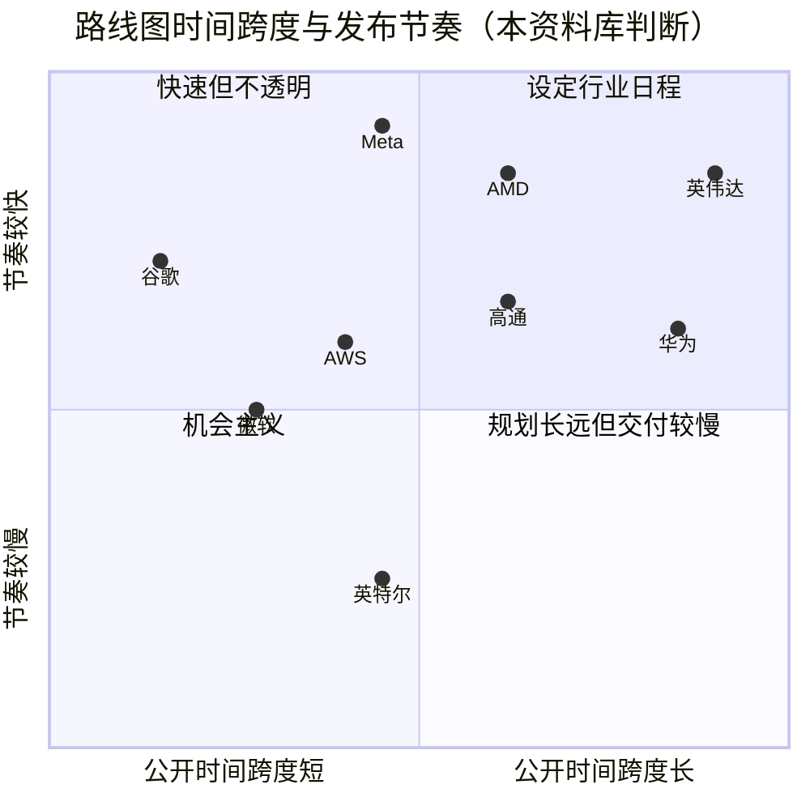

> [!NOTE]
> **🐂 看多观点：** 一份有明确时间表的多层路线图本身就是一道护城河。买方围绕它规划吉瓦级站点，竞争对手为跟上节奏而投入重金，而在六次发布期间连续 14 个季度的增长表明，只要供应紧张，奥斯本风险就是可控的 [[S17006]](../../sources/bibliography.md#s17006)。迄今为止的修订只是在边际上改变了规格，而非节奏。

> [!WARNING]
> **🐻 看空观点：** 路线图如今承诺的内容已超出供应链按时交付的能力。一年之内，英伟达下调了 Rubin 的带宽，撤下 CPX 后又据报道使其复活，并面临有关 Kyber 推迟 12 个月的报道 [[S90006]](../../sources/bibliography.md#s90006)[[S115]](../../sources/bibliography.md#s115)[[S117]](../../sources/bibliography.md#s117)[[S507]](../../sources/bibliography.md#s507)。由于计划是公开的，每一次失误都清晰可见，而时间跨度较短的竞争对手不可能错过它们从未承诺过的事情。如果 2027–28 年供应趋于宽松，同一份路线图反而会促使买方等待。

🔧 技术细节：时间跨度与提前期数据如何构建

`data/x17_preannouncement_horizon.csv` 记录了 25 款加速器首次附带目标年份的公开提及时间，以及（计划的）批量上市开始时间。仅有年份的计划按年中计，因此“2028”的项目按 2028 年 7 月计算。英伟达的 Rubin、Rubin Ultra 和 Vera 首次在 Computex 2024 上公布时间表 [[S17003]](../../sources/bibliography.md#s17003)[[S17004]](../../sources/bibliography.md#s17004)，Feynman 则在 GTC 2025 上 [[S35018]](../../sources/bibliography.md#s35018)。对于竞争对手，首次提及通常是 `data/roadmap.csv` 中的发布活动，可能遗漏更早的非正式暗示；例如 AMD 的 MI400 系列在 Computex 2024 上就被定于 2026 年 [[S17007]](../../sources/bibliography.md#s17007)。季度检验使用 `data/financials.csv` 中的数据中心收入；它无法区分隐藏的奥斯本效应与强劲需求，但一次大到足以产生影响的冻结会表现为一个下滑的季度。

🔧 技术细节：2024–2026 年英伟达路线图披露方式的变化

- **Computex 2024：** “一年一代节奏”幻灯片公布了 Blackwell Ultra（2025）、Rubin（2026）和 Rubin Ultra（2027），外加 Vera CPU，给出了 HBM 堆叠高度，但其他规格很少 [[S17003]](../../sources/bibliography.md#s17003)[[S17004]](../../sources/bibliography.md#s17004)。
- **GTC 2025：** Rubin 和 Rubin Ultra 给出了每 GPU 和每机架的数据（Rubin Ultra：四颗裸片、~100 PFLOPS [FP4](../glossary.md#fp4)、1 TB HBM4E、600 kW 的 Kyber 机架），并新增了定于 2028 年的 Feynman [[S35018]](../../sources/bibliography.md#s35018)[[S305]](../../sources/bibliography.md#s305)。
- **2025 年 9 月：** 发布 Rubin CPX，定于 2026 年末 [[S33023]](../../sources/bibliography.md#s33023)。
- **CES 2026：** 宣布 Rubin 全面投产；机架命名从按裸片计改为按封装计（NVL144 → NVL72）[[S33004]](../../sources/bibliography.md#s33004)[[S90009]](../../sources/bibliography.md#s90009)。
- **GTC 2026：** 公布 Kyber NVL144、采用铜缆加共封装光学的 Feynman NVL1152、Rosa CPU 以及 Groq LPU 产品线（LP30、LP35、LP40）；CPX 被撤下 [[S108]](../../sources/bibliography.md#s108)[[S109]](../../sources/bibliography.md#s109)[[S115]](../../sources/bibliography.md#s115)。
- **2026 年 9–10 月：** 产品页面悄然修订了 Rubin 的内存与 NVLink 带宽 [[S103]](../../sources/bibliography.md#s103)[[S105]](../../sources/bibliography.md#s105)。

每一步都披露了更多内容、覆盖更远的时间、涉及更多层级。代价是，每一次修订如今都清晰可见且有据可查。

## 观察要点：Q3 FY2027、GTC DC 与 GTC 2027

| 事件 | 日期 | 观察要点 | 可能改变格局的因素 |
|---|---|---|---|
| Q3 FY2027 业绩 | 2026-11-17 [[S17005]](../../sources/bibliography.md#s17005) | Rubin 放量；数据中心收入对照 $108B 的总营收指引及 ~74% 的毛利率指引 [[S3]](../../sources/bibliography.md#s3)[[S90085]](../../sources/bibliography.md#s90085)；有关 FY2028 供应的表态 | 若“受供应约束”的表述减弱，奥斯本风险将上升 |
| GTC DC 主题演讲 | 2026-12-01 [[S90047]](../../sources/bibliography.md#s90047) | Kyber 时间；800 V DC 合作伙伴；美国 AI 基础设施与政策公告 | 若确认 Kyber 推迟，Rubin Ultra 的机架将被推入 2028 年 |
| GTC DC 主题演讲 | 2026-12-01 [[S90047]](../../sources/bibliography.md#s90047) | Rubin CPX 状态；LP35 规格 | 若 CPX 复活，将确认三芯片推理产品线（GPU、CPX、LPU） |
| GTC 2027 | 2027 年 3 月 14–18 日 [[S17000]](../../sources/bibliography.md#s17000) | Rubin Ultra 最终内存配置（1 TB 对 768 GB）及裸片数量 | 若为双裸片、性能约减半，MI500 将追平差距 |
| GTC 2027 | 2027 年 3 月 14–18 日 [[S17000]](../../sources/bibliography.md#s17000) | Feynman 制程、HBM 与 NVL1152 规格；Rosa CPU | 首批 Feynman 数据将设定 2028 年的规划默认选项 |
| NVLink Fusion 放量 | 2027 年全年 | NVLink Fusion 芯片（Trainium4、高通与富士通 CPU、英特尔 x86）[[S518]](../../sources/bibliography.md#s518)[[S90031]](../../sources/bibliography.md#s90031) | Fusion 部件出货将把英伟达机架延伸至竞争对手的芯片 |
| 开放互连与竞争对手放量 | 2027 年全年 | UALink 1.0 产品；Helios 放量；TPU 8t 全面上市 [[S90051]](../../sources/bibliography.md#s90051)[[S538]](../../sources/bibliography.md#s538)[[S550]](../../sources/bibliography.md#s550) | 开放互连若实现批量，将削弱 NVLink 的锁定效应 |
| Hugging Face 交割 | 2027 年上半年（目标） | Hugging Face 交割及欧盟或美国司法部可能附加的条件 [[S11500]](../../sources/bibliography.md#s11500)[[S11027]](../../sources/bibliography.md#s11027) | 附加条件将考验英伟达作为模型平台的中立性 |

**如何解读接下来的主题演讲。** 有三个信号比新产品名称更重要。第一，英伟达是否重新表述已在路线图上的项目（Kyber、Rubin Ultra、CPX）的日期：一个重新表述的日期比一个新代号更有信息量。第二，规格是以区间还是目标值给出——这已成为英伟达自己对 Rubin 修订的解释 [[S104]](../../sources/bibliography.md#s104)。第三，哪些合作伙伴为 NVLink Fusion 和 800 V DC 站台：合作伙伴芯片出货将表明该平台正延伸至竞争对手的芯片和电力链 [[S90031]](../../sources/bibliography.md#s90031)[[S90063]](../../sources/bibliography.md#s90063)。

## 🎯 企业发展视角

1. **可见性本身就是产品特性。** 买方提前两到三年规划吉瓦级站点；英伟达提前 26–40 个月公布时间表（🔴 本资料库分析）[[S17006]](../../sources/bibliography.md#s17006)。对于任何挑战者，包括高通的 AI250（2027）和 Dragonfly AI300（2028）[[S173]](../../sources/bibliography.md#s173)[[S90060]](../../sources/bibliography.md#s90060)，一份带有机架级规格的公开路线图，是否值得为其带来的可信度风险买单？
2. **可信度就是货币。** 英伟达 2026 年的修订以及 AMD MI325X 的容量下调 [[S90006]](../../sources/bibliography.md#s90006)[[S17007]](../../sources/bibliography.md#s17007)[[S142]](../../sources/bibliography.md#s142) 表明，两家领先者都会过度承诺。尽职调查应将承诺与兑现的规格和日期作为一项硬指标来跟踪。
3. **跟上节奏每代需要 ~$10B** [[S35028]](../../sources/bibliography.md#s35028)。谁能转而搭乘这一节奏？NVLink Fusion 和设计合作伙伴让其他厂商得以纳入英伟达的机架日程出货（Trainium4 [[S518]](../../sources/bibliography.md#s518)）；借力是否比竞争更便宜？
4. **在产能过剩时，奥斯本风险会反转。** 关注“受供应约束”的措辞 [[S90012]](../../sources/bibliography.md#s90012) 和 CoWoS 产能估计 [[S3002]](../../sources/bibliography.md#s3002)。2027–28 年若出现供应过剩，英伟达的长期时间表将成为买方等待的理由，从而为更便宜的当代替代方案打开机会。
5. **2027 年的窗口。** Kyber、HBM4E 和 [UALink](../glossary.md#ualink) 产品都集中在 2027 年 [[S507]](../../sources/bibliography.md#s507)[[S3531]](../../sources/bibliography.md#s3531)[[S90051]](../../sources/bibliography.md#s90051)。Kyber 若推迟到 2028 年，将使 Helios 500 等开放互连机架获得一年时间与 Vera Rubin 竞争。哪些合作关系能让挑战者把握这一窗口？[纵向扩展](../layers/05-scale-up-nvlink-nvswitch/value-chain-and-corp-dev.md)和[系统](../layers/08-systems-racks-ai-factories/value-chain-and-corp-dev.md)的价值链页面梳理了处于这场竞争双方的供应商。

## 📚 来源（Sources）

<!-- Auto-generated from the [S…] citations on this page by `make build`. Edit sources/registry/*.csv, not this list. -->

- [**S3**](../../sources/bibliography.md#s3) StorageNewsletter, *NVIDIA Q2 Fiscal 2027 results coverage: revenue $96.2B*, 2026-08-27. [Link](https://www.storagenewsletter.com/2026/08/27/nvidia-fiscal-2q27-financial-results/)
- [**S100**](../../sources/bibliography.md#s100) NVIDIA Technical Blog, *Inside the NVIDIA Vera Rubin Platform: Six New Chips, One AI Supercomputer*, 2026-01-05. [Link](https://developer.nvidia.com/blog/inside-the-nvidia-rubin-platform-six-new-chips-one-ai-supercomputer/)
- [**S102**](../../sources/bibliography.md#s102) NVIDIA, *NVIDIA DGX Vera Rubin NVL72*, 2026. [Link](https://www.nvidia.com/en-us/data-center/dgx-vera-rubin-nvl72/)
- [**S103**](../../sources/bibliography.md#s103) VideoCardz, *NVIDIA quietly cuts Vera Rubin specs, HBM4 bandwidth and NVLink 6 speeds now lower*, 2026-10. [Link](https://videocardz.com/newz/nvidia-quietly-cuts-vera-rubin-specs-hbm4-bandwidth-and-nvlink-6-speeds-now-lower)
- [**S104**](../../sources/bibliography.md#s104) Wccftech, *NVIDIA's Official Statement on Vera Rubin Spec Change*, 2026-10-29. [Link](https://wccftech.com/nvidia-official-statement-on-vera-rubin-spec-change/)
- [**S105**](../../sources/bibliography.md#s105) Hardware Busters, *Nvidia Quietly Lowers Vera Rubin HBM4 Bandwidth, and the HGX NVL8 Loses a Quarter of It*, 2026-10. [Link](https://hwbusters.com/news/nvidia-quietly-lowers-vera-rubin-hbm4-bandwidth-and-the-hgx-nvl8-loses-a-quarter-of-it/)
- [**S108**](../../sources/bibliography.md#s108) HPCwire / AIwire, *Huang Shares Nvidia Roadmap Showing More Chips, NVL1152, Scale-Up CPO*, 2026-03-18. [Link](https://www.hpcwire.com/aiwire/2026/03/18/huang-shares-nvidia-roadmap-showing-more-chips-nvl1152-scale-up-cpo/)
- [**S109**](../../sources/bibliography.md#s109) NVIDIA Blog, *NVIDIA GTC 2026: Live Updates on What's Next in AI*, 2026-03-16. [Link](https://blogs.nvidia.com/blog/gtc-2026-news/)
- [**S110**](../../sources/bibliography.md#s110) Tom's Hardware, *Nvidia demonstrates Rubin Ultra tray, the world's first AI GPU with 1TB of HBM4E memory*, 2026-03. [Link](https://www.tomshardware.com/pc-components/gpus/nvidia-demonstrates-rubin-ultra-tray-worlds-1st-ai-gpu-with-1tb-of-hbm4e)
- [**S111**](../../sources/bibliography.md#s111) Crypto Briefing, *Nvidia's Rubin Ultra targets 768GB of HBM4E as Kyber platform stays on schedule*, 2026. [Link](https://cryptobriefing.com/nvidia-rubin-ultra-hbm4e-kyber-2027/)
- [**S112**](../../sources/bibliography.md#s112) Glenn K. Lockwood (blog) (Glenn K. Lockwood), *GTC 2026 recap*, 2026-03. [Link](https://blog.glennklockwood.com/2026/03/gtc-2026-recap.html)
- [**S113**](../../sources/bibliography.md#s113) Tom's Hardware, *How Nvidia's $20 billion Groq 3 LPU deal reshapes the Nvidia Vera Rubin Platform*, 2026-03. [Link](https://www.tomshardware.com/tech-industry/semiconductors/nvidias-20-billion-groq-deal-produces-its-first-chip)
- [**S114**](../../sources/bibliography.md#s114) StorageReview, *NVIDIA Groq 3 LPX: Everything we know*, 2026-03. [Link](https://www.storagereview.com/news/nvidia-groq-3-lpx-everything-we-know)
- [**S115**](../../sources/bibliography.md#s115) Tom's Hardware, *Nvidia removes Rubin CPX accelerators from its roadmap - Groq 3 LPUs take center stage*, 2026-03. [Link](https://www.tomshardware.com/pc-components/gpus/nvidia-removes-rubin-cpx-accelerators-from-its-roadmap-groq-3-lpus-take-center-stage-as-cpx-is-removed)
- [**S117**](../../sources/bibliography.md#s117) TechNews (Taiwan), *Nvidia Rubin CPX re-enters roadmap with HBM4 for AI prefill*, 2026-09-02. [Link](https://technews.tw/2026/09/02/nvidia-rubin-cpx-reenters-roadmap-hbm4-ai-prefill/)
- [**S131**](../../sources/bibliography.md#s131) NVIDIA Newsroom, *NVIDIA NVLink Fusion: semi-custom AI infrastructure partner ecosystem (Computex 2025)*, 2025-05-19. [Link](https://nvidianews.nvidia.com/news/nvidia-nvlink-fusion-semi-custom-ai-infrastructure-partner-ecosystem)
- [**S142**](../../sources/bibliography.md#s142) AMD, *AMD Instinct MI325X Accelerator*, 2024-10-10. [Link](https://www.amd.com/en/products/accelerators/instinct/mi300/mi325x.html)
- [**S143**](../../sources/bibliography.md#s143) AMD, *AMD Instinct MI350 Series (MI350X, MI355X)*, 2025-06-12. [Link](https://www.amd.com/en/products/accelerators/instinct/mi350.html)
- [**S144**](../../sources/bibliography.md#s144) AMD Newsroom, *AMD Unveils Vision for an Open AI Ecosystem, Detailing New Silicon, Software and Systems at Advancing AI 2025*, 2025-06-12. [Link](https://www.amd.com/en/newsroom/press-releases/2025-6-12-amd-unveils-vision-for-an-open-ai-ecosystem-detai.html)
- [**S151**](../../sources/bibliography.md#s151) Google Blog (Amin Vahdat), *Ironwood: The first Google TPU for the age of inference*, 2025-04-09. [Link](https://blog.google/products/google-cloud/ironwood-tpu-age-of-inference/)
- [**S156**](../../sources/bibliography.md#s156) About Amazon, *AWS re:Invent 2025: top announcements (Trainium3 GA, Trainium4 preview, Graviton5)*, 2025-12-02. [Link](https://www.aboutamazon.com/news/aws/aws-re-invent-2025-ai-news-updates)
- [**S158**](../../sources/bibliography.md#s158) Microsoft, *Maia 200: Microsoft's AI accelerator built for inference*, 2026-01. [Link](https://blogs.microsoft.com/blog/2026/01/26/maia-200-the-ai-accelerator-built-for-inference/)
- [**S163**](../../sources/bibliography.md#s163) Huawei (Eric Xu), *Huawei Connect 2025 keynote: Ascend roadmap and SuperPoD interconnect (Eric Xu)*, 2025-09-18. [Link](https://www.huawei.com/en/news/2025/9/hc-xu-keynote-speech)
- [**S173**](../../sources/bibliography.md#s173) Qualcomm, *Qualcomm Unveils AI200 and AI250 - Redefining Rack-Scale Data Center Inference*, 2025-10-27. [Link](https://www.qualcomm.com/news/releases/2025/10/qualcomm-unveils-ai200-and-ai250-redefining-rack-scale-data-cent)
- [**S174**](../../sources/bibliography.md#s174) OpenAI, *OpenAI and Broadcom announce strategic collaboration to deploy 10 gigawatts of OpenAI-designed AI accelerators*, 2025-10-13. [Link](https://openai.com/index/openai-and-broadcom-announce-strategic-collaboration/)
- [**S303**](../../sources/bibliography.md#s303) Commercial Times (ctee.com.tw), *Vera Rubin NVL72 Max-Q / Max-P rack power (Commercial Times report)*, 2026-01-07. [Link](https://www.ctee.com.tw/news/20260107701081-430704)
- [**S305**](../../sources/bibliography.md#s305) DatacenterDynamics, *Nvidia's Rubin Ultra NVL576 rack expected to be 600kW, coming second half of 2027*, 2025-03-19. [Link](https://datacenterdynamics.com/en/news/nvidias-rubin-ultra-nvl576-rack-expected-to-be-600kw-coming-second-half-of-2027)
- [**S331**](../../sources/bibliography.md#s331) Wccftech, *NVIDIA's Vera Rubin rack hit with 435% memory price surge, pushing HBM4 & LPDDR5X bill to $2M of $7.8M total*, 2026-05. [Link](https://wccftech.com/nvidia-vera-rubin-rack-hit-with-memory-price-surge-pushing-hbm4-lpddr5x-bill-to-2m-of-7-8m-total/)
- [**S337**](../../sources/bibliography.md#s337) Spheron, *NVIDIA GB300 (rental and specifications)*, 2026. [Link](https://spheron.network/gpu-rental/gb300/)
- [**S383**](../../sources/bibliography.md#s383) Alphabet via SEC EDGAR, *Alphabet Inc. Form 10-K filings (FY2020, FY2022) - useful lives of servers and network equipment*, 2023-02-03. [Link](https://www.sec.gov/cgi-bin/browse-edgar?action=getcompany&CIK=0001652044&type=10-K&dateb=&owner=include&count=40)
- [**S385**](../../sources/bibliography.md#s385) Amazon via SEC EDGAR, *Amazon.com Form 10-K filings (FY2019-FY2024) - useful lives of servers*, 2025-02-07. [Link](https://www.sec.gov/cgi-bin/browse-edgar?action=getcompany&CIK=0001018724&type=10-K&dateb=&owner=include&count=40)
- [**S401**](../../sources/bibliography.md#s401) NVIDIA Corporation via SEC EDGAR, *NVIDIA Corporation Form 10-K for fiscal year ended January 25, 2026*, 2026-02-25. [Link](https://www.sec.gov/Archives/edgar/data/1045810/000104581026000021/nvda-20260125.htm)
- [**S404**](../../sources/bibliography.md#s404) NVIDIA Corporation via SEC EDGAR, *NVIDIA Corporation Form 10-Q for quarter ended April 26, 2026*, 2026-05-27. [Link](https://www.sec.gov/Archives/edgar/data/1045810/000104581026000052/nvda-20260426.htm)
- [**S405**](../../sources/bibliography.md#s405) NVIDIA Corporation via SEC EDGAR, *NVIDIA Announces Financial Results for Second Quarter Fiscal 2027 (Form 8-K exhibit 99.1)*, 2026-08-26. [Link](https://www.sec.gov/Archives/edgar/data/0001045810/000104581026000073/q2fy27pr.htm)
- [**S407**](../../sources/bibliography.md#s407) NVIDIA Corporation via SEC EDGAR, *NVIDIA Corporation Form 10-Q for quarter ended July 26, 2026*, 2026-08-28. [Link](https://www.sec.gov/Archives/edgar/data/1045810/000104581026000075/nvda-20260726.htm)
- [**S418**](../../sources/bibliography.md#s418) NVIDIA Corporation via SEC EDGAR, *NVIDIA Corporation Form 10-K for fiscal year ended January 29, 2023*, 2023-02-24. [Link](https://www.sec.gov/Archives/edgar/data/1045810/000104581023000017/nvda-20230129.htm)
- [**S421**](../../sources/bibliography.md#s421) NVIDIA Corporation (via CapEdge mirror of Form 8-K) (Colette Kress), *CFO Commentary on Third Quarter Fiscal 2023 Results*, 2022-11-16. [Link](https://capedge.com/filing/1045810/0001045810-22-000163/NVDA-8K/file/3)
- [**S432**](../../sources/bibliography.md#s432) NVIDIA Corporation, *NVIDIA Announces Financial Results for First Quarter Fiscal 2023 (press release with CFO commentary)*, 2022-05-25. [Link](https://nvidianews.nvidia.com/news/nvidia-announces-financial-results-for-first-quarter-fiscal-2023)
- [**S434**](../../sources/bibliography.md#s434) NVIDIA Corporation, *NVIDIA Announces Financial Results for Third Quarter Fiscal 2023 (press release with CFO commentary)*, 2022-11-16. [Link](https://nvidianews.nvidia.com/news/nvidia-announces-financial-results-for-third-quarter-fiscal-2023)
- [**S450**](../../sources/bibliography.md#s450) U.S. Securities and Exchange Commission (EDGAR), *Advanced Micro Devices Form 10-K / 10-Q filings (EDGAR index)*, 2025-02-05. [Link](https://www.sec.gov/cgi-bin/browse-edgar?action=getcompany&CIK=0000002488&type=10-&dateb=&owner=include&count=40)
- [**S500**](../../sources/bibliography.md#s500) NVIDIA Corporation, *NVIDIA Q2 Fiscal 2027 Quarterly Presentation (CFO commentary deck)*, 2026-08-26. [Link](https://s201.q4cdn.com/141608511/files/doc_financials/2027/Q227/NVDA-F2Q27-Quarterly-Presentation-final-1.pdf)
- [**S502**](../../sources/bibliography.md#s502) Tom's Hardware, *Nvidia updates data center roadmap with Rosa CPU and stacked Feynman GPUs; optical NVLink; Groq LPUs with NVFP4 and NVLink also on deck*, 2026-03-17. [Link](https://www.tomshardware.com/pc-components/gpus/nvidia-updates-data-center-roadmap-with-rosa-cpu-and-stacked-feynman-gpus-optical-nvlink-groq-lpus-with-nvfp4-and-nvlink-also-on-deck)
- [**S506**](../../sources/bibliography.md#s506) SamMobile, *Samsung Foundry begins mass production of NVIDIA Groq 3 LPX chip*, 2026-08-25. [Link](https://www.sammobile.com/news/samsung-foundry-mass-production-nvidia-groq-3-lpx-chip/)
- [**S507**](../../sources/bibliography.md#s507) Tom's Hardware, *Nvidia's Kyber rack for Rubin Ultra slips to 2028*, 2026-07-06. [Link](https://www.tomshardware.com/pc-components/gpus/nvidias-kyber-rack-for-rubin-ultra-slips-to-2028)
- [**S508**](../../sources/bibliography.md#s508) Wccftech, *NVIDIA Quashes Rubin & Kyber Rack Delay Rumors, Says 'Chip Roadmap Is Intact'*, 2026-07. [Link](https://wccftech.com/nvidia-quashes-rubin-kyber-rack-delay-rumors-says-chip-roadmap-is-intact/)
- [**S509**](../../sources/bibliography.md#s509) TrendForce, *NVIDIA Rubin Ultra four-die single-package design not adopted amid advanced-packaging constraints*, 2026-04-01. [Link](https://www.trendforce.com/news/?p=55442)
- [**S512**](../../sources/bibliography.md#s512) NVIDIA Blog, *NVIDIA Launches BlueField-4: The Processor Powering the Operating System of AI Factories*, 2025-10-28. [Link](https://blogs.nvidia.com/blog/bluefield-4-ai-factory/)
- [**S514**](../../sources/bibliography.md#s514) NVIDIA Investor Relations, *NVIDIA Announces Spectrum-X Photonics, Co-Packaged Optics Networking Switches to Scale AI Factories to Millions of GPUs*, 2025-03-18. [Link](https://investor.nvidia.com/news/press-release-details/2025/NVIDIA-Announces-Spectrum-X-Photonics-Co-Packaged-Optics-Networking-Switches-to-Scale-AI-Factories-to-Millions-of-GPUs/default.aspx)
- [**S515**](../../sources/bibliography.md#s515) Converge Digest, *NVIDIA debuts Spectrum-X and Quantum-X Photonics switches*, 2025-08. [Link](https://convergedigest.com/nvidia-debuts-spectrum-x-and-quantum-x-photonics-switches/)
- [**S518**](../../sources/bibliography.md#s518) ServeTheHome, *NVIDIA NVLink Fusion tapped for future AWS Trainium4 deployments*, 2025-12-02. [Link](https://www.servethehome.com/nvidia-nvlink-fusion-tapped-for-future-aws-trainium4-deployments/)
- [**S520**](../../sources/bibliography.md#s520) NVIDIA via ResearchPool, *NVIDIA Enters Production With Dynamo, the Broadly Adopted Inference Operating System for AI Factories (press release mirror)*, 2026-03-16. [Link](https://app.researchpool.com/company/nvda-us67066g1040-nvidia-corp-e9VqYYGjs8/press/nvidia-corporation-nvda-nvidia-enters-production-with-dynamo-the-broadly-adopted-inference-ope-DxMC1Gq48d)
- [**S521**](../../sources/bibliography.md#s521) NVIDIA Docs, *NVIDIA Dynamo release notes*, 2026-10. [Link](https://docs.nvidia.com/dynamo/zh-CN/latest/reference/releases)
- [**S523**](../../sources/bibliography.md#s523) Python Package Index (NVIDIA), *nvidia-cuda-runtime (CUDA 13.x runtime wheels) release history*, 2026-11-04. [Link](https://pypi.org/project/nvidia-cuda-runtime/#history)
- [**S538**](../../sources/bibliography.md#s538) AMD Investor Relations, *AAI 2026: AMD Delivers Full-Stack Compute for the Agentic AI Era*, 2026-07-23. [Link](https://ir.amd.com/news-events/press-releases/detail/1294/aai-2026-amd-delivers-full-stack-compute-for-the-agentic-ai-era)
- [**S547**](../../sources/bibliography.md#s547) Google Cloud Blog, *Ironwood TPUs and new Axion-based VMs for your AI workloads*, 2025-11-06. [Link](https://cloud.google.com/blog/products/compute/ironwood-tpus-and-new-axion-based-vms-for-your-ai-workloads)
- [**S550**](../../sources/bibliography.md#s550) SiliconANGLE, *Google Cloud unveils eighth-generation TPUs (TPU 8t and TPU 8i)*, 2026-04-22. [Link](https://siliconangle.com/?p=740999)
- [**S552**](../../sources/bibliography.md#s552) Google Cloud Blog (Karan Batta), *Bringing Google TPUs to Oracle Cloud Infrastructure*, 2026-10-27. [Link](https://cloud.google.com/blog/products/infrastructure/bringing-google-tpus-to-oracle-cloud-infrastructure)
- [**S561**](../../sources/bibliography.md#s561) DatacenterDynamics, *Meta unveils next four generations of its MTIA chip*, 2026-03-11. [Link](https://www.datacenterdynamics.com/en/news/meta-unveils-next-four-generations-of-its-mtia-chip/)
- [**S567**](../../sources/bibliography.md#s567) Huawei, *Huawei Connect 2026: Ascend 960 SuperNode*, 2026-09. [Link](https://www.huawei.com/br/news/2026/9/hc-ascend960-supernode)
- [**S574**](../../sources/bibliography.md#s574) HPCwire, *UALink Consortium Publishes 4 Specifications Defining In-Network Compute, Chiplets, Manageability and 200G Performance*, 2026-04-07. [Link](https://www.hpcwire.com/off-the-wire/ualink-consortium-publishes-4-specifications-defining-in-network-compute-chiplets-manageability-and-200g-performance/)
- [**S575**](../../sources/bibliography.md#s575) Network World, *Ultra Ethernet 1.1 extends the specification to scale-up networks and adds programmable congestion control*, 2026-10. [Link](https://www.networkworld.com/article/4235340/ultra-ethernet-1-1-extends-the-specification-to-scale-up-networks-and-adds-programmable-congestion-control.html)
- [**S576**](../../sources/bibliography.md#s576) Converge Digest, *OCP releases ESUN 1.0 spec for Ethernet-based scale-up AI fabrics*, 2026-03. [Link](https://convergedigest.com/ocp-releases-esun-1-0-spec-for-ethernet-based-scale-up-ai-fabrics/)
- [**S626**](../../sources/bibliography.md#s626) SemiAnalysis, *Vera Rubin NVL72 vs GB200 NVL72? Inference TCO & Architecture Analysis*, 2026-07-23. [Link](https://github.com/SemiAnalysisAI/InferenceX-app/blob/main/packages/app/content/blog/vera-rubin-nvl72-vs-gb200-nvl72-inference.mdx)
- [**S2501**](../../sources/bibliography.md#s2501) Silicon Analysts, *Chip Design & NRE Cost by Node — Historical Time Series Data*, 2026. [Link](https://siliconanalysts.com/market-data/nre-design-cost)
- [**S3002**](../../sources/bibliography.md#s3002) TrendForce, *TSMC reportedly targets 22% 2nm, 16% 3nm capacity boost by mid-2027; CoWoS to double by 2028*, 2026-09-14. [Link](https://www.trendforce.com/news/2026/09/14/news-tsmc-reportedly-targets-22-2nm-16-3nm-capacity-boost-by-mid-2027-cowos-to-double-by-2028/)
- [**S3528**](../../sources/bibliography.md#s3528) TrendForce, *SK hynix reportedly pulls forward HBM4E sample timeline, eyeing June-July shipments to key customers*, 2026-06-15. [Link](https://www.trendforce.com/news/2026/06/15/news-sk-hynix-reportedly-pulls-forward-hbm4e-sample-timeline-eyeing-june-july-shipments-to-key-customers/)
- [**S3531**](../../sources/bibliography.md#s3531) TrendForce, *HBM4E seen hitting 40% of 2027 market; Samsung, SK hynix reportedly aim for 1H26 completion*, 2025-11-13. [Link](https://www.trendforce.com/news/2025/11/13/news-hbm4e-seen-hitting-40-of-2027-market-samsung-sk-hynix-reportedly-aim-for-1h26-completion/)
- [**S6020**](../../sources/bibliography.md#s6020) StorageReview, *NVIDIA Spectrum-X Ethernet Photonics enters full production with 4x fewer lasers and a five-vendor CPO supply chain*, 2026-08. [Link](https://storagereview.com/news/nvidia-spectrum-x-ethernet-photonics-enters-full-production-with-4x-fewer-lasers-and-a-five-vendor-cpo-supply-chain)
- [**S6022**](../../sources/bibliography.md#s6022) Fintool, *NVIDIA CPO webinar: co-packaged silicon photonics switches for gigawatt AI factories*, 2026-02. [Link](https://fintool.com/news/nvidia-cpo-webinar-ai-factories)
- [**S7511**](../../sources/bibliography.md#s7511) NVIDIA Newsroom, *NVIDIA Launches BlueField-4 STX Storage Architecture With Broad Industry Adoption*, 2026-03-16. [Link](https://nvidianews.nvidia.com/news/nvidia-launches-bluefield-4-stx-storage-architecture-with-broad-industry-adoption)
- [**S8009**](../../sources/bibliography.md#s8009) Lawrence Berkeley National Laboratory, *Queued Up: 2025 Edition, Characteristics of Power Plants Seeking Transmission Interconnection As of the End of 2024*, 2025-12-15. [Link](https://emp.lbl.gov/sites/default/files/2025-12/Queued%20Up%202025%20Edition%20-%2012.15.2025.pdf)
- [**S11027**](../../sources/bibliography.md#s11027) MLex, *Nvidia may seek EU review of Hugging Face deal amid filing uncertainty*, 2026-09-23. [Link](https://www.mlex.com/mlex/articles/2528556/nvidia-may-seek-eu-review-of-hugging-face-deal-amid-european-filing-uncertainty)
- [**S11500**](../../sources/bibliography.md#s11500) TechRadar Pro, *'The planets aligned': Nvidia confirms $12.9bn Hugging Face deal in potentially huge AI shake-up*, 2026-09-03. [Link](https://techradar.com/pro/the-planets-aligned-nvidia-confirms-usd12-9bn-hugging-face-deal-in-potentially-huge-ai-shake-up)
- [**S13506**](../../sources/bibliography.md#s13506) Tom's Hardware, *OpenAI signs 6 GW AMD GPU deal*, 2025-10-06. [Link](https://www.tomshardware.com/pc-components/gpus/openai-signs-6gw-amd-gpu-deal)
- [**S17000**](../../sources/bibliography.md#s17000) NVIDIA, *GTC 2027 Conference FAQs*, 2026. [Link](https://www.nvidia.com/en-zz/gtc/faq/)
- [**S17001**](../../sources/bibliography.md#s17001) TechCrunch, *'Chief revenue destroyer' (Jensen Huang at GTC 2025)*, 2025-03-18. [Link](https://techcrunch.com/?p=2982699)
- [**S17002**](../../sources/bibliography.md#s17002) Barchart, *Nvidia GTC: 7 big takeaways from Jensen*, 2025-03. [Link](https://www.barchart.com/story/news/31480527/nvidia-gtc-7-big-takeaways-from-jensen)
- [**S17003**](../../sources/bibliography.md#s17003) Constellation Research, *Nvidia outlines roadmap including Rubin GPU platform, new Arm-based CPU Vera*, 2024-06-02. [Link](https://www.constellationr.com/insights/news/nvidia-outlines-roadmap-including-rubin-gpu-platform-new-arm-based-cpu-vera)
- [**S17004**](../../sources/bibliography.md#s17004) Maginative, *NVIDIA unveils Rubin GPU architecture and roadmap at Computex 2024*, 2024-06-02. [Link](https://www.maginative.com/article/nvidia-unveils-rubin-gpu-architecture-and-roadmap-at-computex-2024/)
- [**S17005**](../../sources/bibliography.md#s17005) NVIDIA Newsroom, *NVIDIA Sets Conference Call for Third-Quarter Financial Results*, 2026-10-28. [Link](https://nvidianews.nvidia.com/news/nvidia-sets-conference-call-for-third-quarter-financial-results-6928873)
- [**S17006**](../../sources/bibliography.md#s17006) nvidia_deep_dive_claude repository, *Repo analysis: chapter 17 pre-announcement horizon and Osborne-effect test*, 2026-11-05. [Link](https://github.com/FrankHuang94/nvidia_deep_dive_claude/blob/main/cross-cutting/17-roadmap-2025-2028.md)
- [**S17007**](../../sources/bibliography.md#s17007) AMD (press release), *AMD Accelerates Pace of Data Center AI Innovation and Leadership with Expanded AMD Instinct GPU Roadmap*, 2024-06-02. [Link](https://d1io3yog0oux5.cloudfront.net/_e6d2954671111d7f15d49cdaedef84dd/amd/news/2024-06-02_AMD_Accelerates_Pace_of_Data_Center_AI_Innovation__1201.pdf)
- [**S17008**](../../sources/bibliography.md#s17008) DatacenterDynamics, *AMD unveils new Instinct accelerator, plans to release new data center GPU every year*, 2024-06. [Link](https://www.datacenterdynamics.com/en/news/amd-unveils-new-instinct-accelerator-plans-to-release-new-data-center-gpu-every-year/)
- [**S24004**](../../sources/bibliography.md#s24004) The Register, *AMD copy-pastes 6 GW chips-for-stock deal in new Meta agreement*, 2026-02-24. [Link](https://www.theregister.com/2026/02/24/amd_copypastes_openai_6gw_chipsforstock/)
- [**S32004**](../../sources/bibliography.md#s32004) NVIDIA, *NVIDIA GB300 NVL72 / Blackwell Ultra (product page)*, 2025-03. [Link](https://www.nvidia.com/en-us/data-center/gb300-nvl72/)
- [**S33004**](../../sources/bibliography.md#s33004) NVIDIA Newsroom, *NVIDIA Kicks Off the Next Generation of AI With Rubin — Six New Chips; One Incredible AI Supercomputer*, 2026-01-05. [Link](https://nvidianews.nvidia.com/news/rubin-platform-ai-supercomputer)
- [**S33023**](../../sources/bibliography.md#s33023) NVIDIA Newsroom, *NVIDIA Unveils Rubin CPX: A New Class of GPU Designed for Massive-Context Inference*, 2025-09-09. [Link](https://nvidianews.nvidia.com/news/nvidia-unveils-rubin-cpx-a-new-class-of-gpu-designed-for-massive-context-inference)
- [**S35018**](../../sources/bibliography.md#s35018) Tom's Hardware, *Nvidia announces Rubin GPUs in 2026, Rubin Ultra in 2027, Feynman also added to roadmap*, 2025-03-18. [Link](https://www.tomshardware.com/pc-components/gpus/nvidia-announces-rubin-gpus-in-2026-rubin-ultra-in-2027-feynam-after)
- [**S35028**](../../sources/bibliography.md#s35028) TweakTown, *NVIDIA spent $10 billion on developing its next-generation Blackwell GPU*, 2024-03. [Link](https://www.tweaktown.com/news/96987/nvidia-spent-10-billion-on-developing-its-next-generation-blackwell-gpu/index.html)
- [**S90001**](../../sources/bibliography.md#s90001) The Star (Reuters), *Nvidia bets on AI inference as chip revenue opportunity hits $1 trillion (Reuters)*, 2026-03-17. [Link](https://www.thestar.com.my/tech/tech-news/2026/03/17/nvidia-bets-on-ai-inference-as-chip-revenue-opportunity-hits-1-trillion)
- [**S90002**](../../sources/bibliography.md#s90002) MarketScreener, *Nvidia forecasts $1 trillion in orders for its AI systems by 2027*, 2026-03-16. [Link](https://www.marketscreener.com/news/nvidia-forecasts-1-trillion-in-orders-for-its-ai-systems-by-2027-ce7e5edad08eff27)
- [**S90003**](../../sources/bibliography.md#s90003) eWeek, *Everything Nvidia Just Announced at GTC 2026: 7 Chips, 5 Racks, 1 Giant Bet on Agentic AI*, 2026-03-17. [Link](https://www.eweek.com/news/nvidia-gtc-2026-ai-inference-vera-rubin-neuron/)
- [**S90004**](../../sources/bibliography.md#s90004) TrendForce, *Key GTC takeaways: how Samsung, Micron, Intel and more power NVIDIA's Vera Rubin and Feynman*, 2026-03-17. [Link](https://www.trendforce.com/news/2026/03/17/news-key-gtc-takeaways-how-samsung-micron-intel-more-power-nvidias-vera-rubin-and-feynman/)
- [**S90006**](../../sources/bibliography.md#s90006) TweakTown, *Nvidia cuts Vera Rubin's memory bandwidth by up to 26% and AMD's Helios now leads in memory bandwidth*, 2026-10. [Link](https://www.tweaktown.com/news/114304/nvidia-cuts-vera-rubins-memory-bandwidth-by-up-to-26-percent-and-amds-helios-now-leads-in-memory-bandwidth/index.html)
- [**S90009**](../../sources/bibliography.md#s90009) GamesBeat, *Nvidia Vera Rubin ramps into full production for fall launch*, 2026. [Link](https://gamesbeat.com/nvidia-vera-rubin-ramps-into-full-production-for-fall-launch-again/)
- [**S90012**](../../sources/bibliography.md#s90012) Tomasz Tunguz (Tomasz Tunguz), *Nvidia Q2 FY27 earnings*, 2026-08. [Link](https://www.tomtunguz.com/nvidia-q2-fy27-earnings/index.md)
- [**S90020**](../../sources/bibliography.md#s90020) Shacknews, *AMD Helios AI rack system on track for initial shipments in Q3 2026*, 2026. [Link](https://www.shacknews.com/article/150249/amd-helios-ai-system-shipping-q3-2026)
- [**S90026**](../../sources/bibliography.md#s90026) Maginative, *Anthropic secures 1M Google TPUs while keeping Amazon as primary training partner*, 2025-10. [Link](https://www.maginative.com/anthropic-secures-1m-google-tpus-while-keeping-amazon-as-primary-training-partner)
- [**S90027**](../../sources/bibliography.md#s90027) The Next Web, *Google is building a four-partner chip supply chain to challenge Nvidia in AI inference*, 2026. [Link](https://thenextweb.com/news/google-inference-chips-nvidia-challenge-supply-chain)
- [**S90031**](../../sources/bibliography.md#s90031) ServeTheHome, *NVIDIA announces NVLink Fusion bringing NVLink to third-party CPUs and accelerators*, 2025-05-19. [Link](https://www.servethehome.com/nvidia-announces-nvlink-fusion-bringing-nvlink-to-third-party-cpus-and-accelerators/nvlink-fusion-partners/)
- [**S90039**](../../sources/bibliography.md#s90039) TrendForce, *Samsung, SK hynix reportedly tapped as NVIDIA Rubin HBM4 suppliers; shipments could start in March*, 2026-03-09. [Link](https://www.trendforce.com/news/2026/03/09/news-samsung-sk%E2%80%AFhynix-reportedly-tapped-as-nvidia-rubin-hbm4-suppliers-shipments-could-start-in-march/)
- [**S90045**](../../sources/bibliography.md#s90045) Pulse 2.0, *Microsoft to expand Azure Maia AI infrastructure to multi-gigawatt deployments starting in 2027*, 2026-10. [Link](https://pulse2.com/microsoft-to-expand-azure-maia-ai-infrastructure/)
- [**S90046**](../../sources/bibliography.md#s90046) IT Brief UK, *Microsoft unveils Maia 300 for 2027 AI deployments*, 2026-10. [Link](https://itbrief.co.uk/story/microsoft-unveils-maia-300-for-2027-ai-deployments)
- [**S90047**](../../sources/bibliography.md#s90047) NVIDIA, *NVIDIA GTC DC 2026 (November 30 – December 3, 2026)*, 2026. [Link](https://www.nvidia.com/en-us/gtc-dc/topics/ai-policy/)
- [**S90051**](../../sources/bibliography.md#s90051) SDxCentral, *UALink Consortium takes another swing at Nvidia's NVLink supremacy with specification 2.0*, 2026-04. [Link](https://www.sdxcentral.com/news/ualink-consortium-takes-another-swing-at-nvidias-nvlink-supremacy-with-specification-20/)
- [**S90060**](../../sources/bibliography.md#s90060) Qualcomm, *Qualcomm Dragonfly AI300 (product page)*, 2026-06. [Link](https://www.qualcomm.com/data-center/products/qualcomm-dragonfly-ai300)
- [**S90061**](../../sources/bibliography.md#s90061) DatacenterDynamics, *NVIDIA prepares data center industry for 1MW racks and 800 volt DC power architectures*, 2025-10. [Link](https://www.datacenterdynamics.com/en/news/nvidia-prepares-data-center-industry-for-1mw-racks-and-800-volt-dc-power-architectures/)
- [**S90062**](../../sources/bibliography.md#s90062) Dell'Oro Group, *GTC 2026: moving from chip launches to infrastructure architecture*, 2026-03. [Link](https://www.delloro.com/gtc-2026-moving-from-chip-launches-to-infrastructure-architecture/)
- [**S90063**](../../sources/bibliography.md#s90063) Converge Digest, *The megawatt shift: NVIDIA's 800 VDC strategy*, 2026. [Link](https://convergedigest.com/the-megawatt-shift-nvidias-800-vdc-strategy/)
- [**S90081**](../../sources/bibliography.md#s90081) NVIDIA Corporation via SEC EDGAR, *NVIDIA Form 10-K for fiscal year 2026 (ended January 25, 2026)*, 2026-02. [Link](https://www.sec.gov/Archives/edgar/data/1045810/000104581026000021/nvda-20260125.htm)
- [**S90085**](../../sources/bibliography.md#s90085) Shacknews, *NVIDIA (NVDA) expects gross margin decrease over next two quarters*, 2026-08-26. [Link](https://www.shacknews.com/article/150499/nvidia-nvda-gross-margin-decrease-fy27)
- [**S90093**](../../sources/bibliography.md#s90093) Tom's Hardware, *AMD takes the wraps off its Instinct MI455X AI accelerator: CDNA 5 and Helios rack-scale architecture*, 2026. [Link](https://www.tomshardware.com/pc-components/gpus/amd-takes-the-wraps-off-its-instinct-mi455x-ai-accelerator-cdna-5-and-helios-rack-scale-architecture-combine-to-take-the-fight-to-nvidia-in-the-data-center)
