# 18 —— 弱点与看空情景

> [!NOTE]
> 本页为英文原文的简体中文参考译文，仅供参考；如有出入，以[英文原文](../../cross-cutting/18-vulnerabilities-and-bear-case.md "English original")为准。

跨层专题 18 · 十大风险：最强论证、逐项打分与持续跟踪 · 阅读约 38 分钟 · 最后核实：2026-11-05

## ⚡ 要点速览

- **看空逻辑并非“需求疲软”。** Q2 FY2027 营收为 $96.2B（同比 +106 %），GAAP 毛利率 75.0 %；Q3 指引为 $108B；管理层将 FY2028 约 70 % 的增长定性为供应所能支撑的水平 [[S405]](../../sources/bibliography.md#s405)[[S90012]](../../sources/bibliography.md#s90012)[[S18000]](../../sources/bibliography.md#s18000)。最有力的看空逻辑是：当前需求高度集中、部分由英伟达（NVIDIA）自己出资、且可被替代，而这三点都会先体现在价格上，之后才体现在出货量上。
- **本资料库的风险热力图上有两项风险居首。** 🔴 超大规模云厂商自研芯片得分 16（满分 25；可能性 4 × 影响 4）：博通（Broadcom）单季 AI 营收已相当于英伟达数据中心营收的约 19 %，Anthropic 可使用多达 1M 颗 TPU [[S2516]](../../sources/bibliography.md#s2516)[[S653]](../../sources/bibliography.md#s653)。🔴 资本开支周期得分 15（3 × 5）：供应承诺已达 $279B，为季度营收的 2.9×，而 FY2023 库存危机之前约为 1.4× [[S407]](../../sources/bibliography.md#s407)。
- **循环融资比率现已与朗讯（Lucent）相当。** 英伟达在 H1 FY2027 买入 $42.4B 股权，约占半年营收的 24 %，与朗讯 1999–2000 年以供应商融资形式提供的比例相同 [[S90072]](../../sources/bibliography.md#s90072)[[S18007]](../../sources/bibliography.md#s18007)。区别在于谁来买单：英伟达仅 Q1 FY2027 一个季度就产生 $50.3B 经营现金流，其最大买家是现金充裕的超大规模云厂商，而非初创电信运营商 [[S403]](../../sources/bibliography.md#s403)。
- **集中度是放大器。** 一家直接客户占 Q2 FY2027 营收的 16 %，三家合计占 H1 营收的 44 %，超大规模云厂商约占数据中心营收的 55 % [[S90069]](../../sources/bibliography.md#s90069)[[S90011]](../../sources/bibliography.md#s90011)[[S406]](../../sources/bibliography.md#s406)。正是这些买家在打造 TPU、Trainium、Maia 和 MTIA，因此风险 1、2、7 实际上是同一个相互关联的押注。
- **政策风险发生概率高，但影响有限。** 中国占营收比例从约 26 %（FY2022）降至 FY2027 各季度的 5.6–8.2 %，且已不计入业绩指引 [[S2]](../../sources/bibliography.md#s2)[[S90070]](../../sources/bibliography.md#s90070)[[S90069]](../../sources/bibliography.md#s90069)；若中国国家市场监督管理总局（SAMR）按上一年度在华销售额的 1–10 % 处以罚款，金额约为 $0.2–2.5B（本资料库计算）[[S9505]](../../sources/bibliography.md#s9505)[[S401]](../../sources/bibliography.md#s401)。
- **技术风险缓慢侵蚀定价权。** UALink 产品预计 2027 年面世，AMD 在新前沿模型上相对英伟达的滞后已缩短至 26 天 [[S90051]](../../sources/bibliography.md#s90051)[[S631]](../../sources/bibliography.md#s631)；🔴 本资料库对前沿实验室的 CUDA 锁定程度仅打 2.75/5 分。台湾（1 × 5）属于尾部风险：全部 CoWoS 封装产能都位于台湾岛内 [[S18012]](../../sources/bibliography.md#s18012)。
- **市场已经在为峰值定价。** 按约 $5.3–5.8T 市值（2026 年 8–10 月）计算，英伟达股价约为 FY2028 指引盈利的 14×，隐含此后年增长率仅约 2 %（🔴 本资料库测算）[[S18004]](../../sources/bibliography.md#s18004)[[S18005]](../../sources/bibliography.md#s18005)[[S18027]](../../sources/bibliography.md#s18027)。看空者需要论证的是 FY2028 之后盈利会*下降*。🔴 最可能的看空结果是毛利率从 75 % 向 65 % 上下回落；2001 年式的断崖式下跌只是尾部情形。

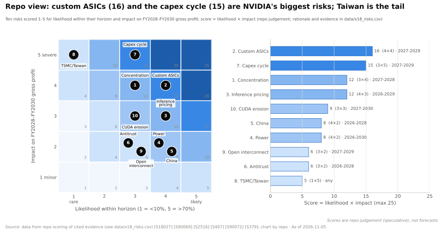

## 如何阅读本章

本资料库的其他各页都在解释英伟达为何胜出，本页则刻意反其道而行之。针对十项风险中的每一项，本页构建一个[最强论证（steelman）](../glossary.md#steelman)：即以数据为支撑、最有力且诚实的看空论点；随后给出英伟达最有力的反驳，最后给出研判。研判对**可能性**（风险是否会在其时间窗口内兑现？）和**影响**（若兑现，FY2028–FY2030 有多少毛利润受到冲击？）打分，并列出需要关注的[领先指标](../glossary.md#leading-indicator)。分数为本资料库的判断（🔴），每一行的理由与证据见 `data/x18_risks.csv` [[S18027]](../../sources/bibliography.md#s18027)。请将其视为结构化论证，而非预测。

| 分值 | 可能性（在所述时间窗口内） | 影响（对 FY2028–FY2030 毛利润） |
|---|---|---|
| 1 | < 10 % | < 2 % |
| 2 | 10–30 % | 2–5 % |
| 3 | 30–50 % | 5–15 % |
| 4 | 50–70 % | 15–30 % |
| 5 | > 70 % | > 30 %，或营收连续多年下滑 |

风险通过四条渠道传导至英伟达的价值：出货量减少、价格下降（毛利率）、与承诺和持股相关的一次性费用，以及估值倍数下降。下图显示每项风险经由哪条渠道传导。多数风险都经由**价格**传导，这正是毛利率成为最佳单一预警指标的原因。

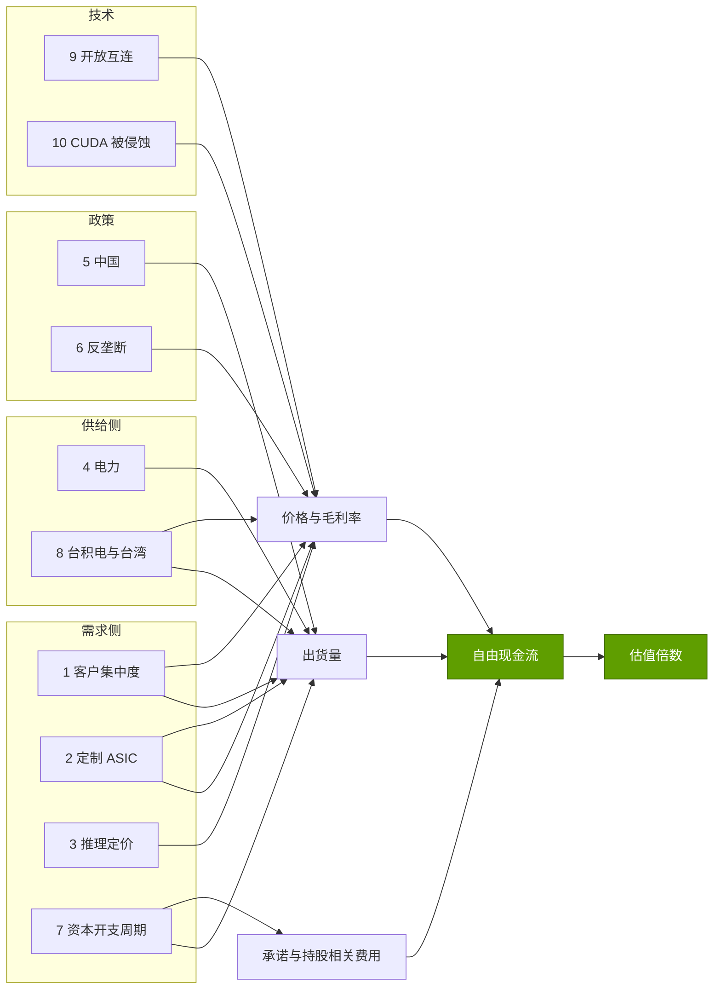

页首的[风险热力图](../glossary.md#risk-heatmap)与下方的象限图以两种方式呈现同一组分数。右上象限是分析应重点投入精力的区域。

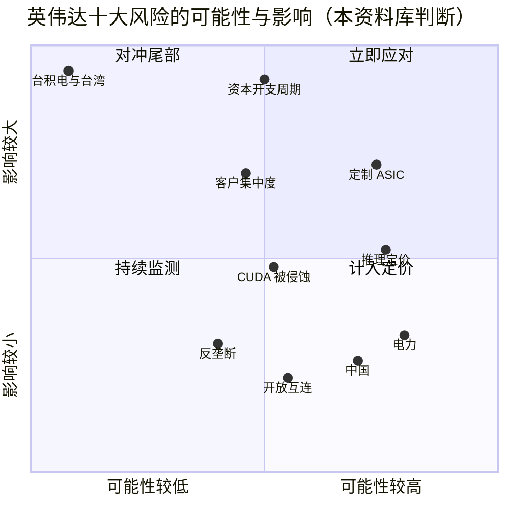

> [!TIP]
> **算例 —— 影响分值折合多少美元。** 按 FY2028 指引路径，营收约 $697B、毛利率约 72.5 %，毛利润约 $505B（🔴 本资料库根据 [[S18000]](../../sources/bibliography.md#s18000) 测算）。影响 4 意味着 15–30 % 的冲击：**每年 $76–152B**。若可能性为 4（50–70 %），概率加权敞口约为每年 $38–106B。影响 2 意味着 2–5 %，即 $10–25B。**结论：**即便是该量表上的“低”分，其金额也相当于大多数半导体公司的全部业务；该量表是相对于英伟达的体量而言的。

🔧 技术细节：风险为何相互关联，以及这为何重要

十项风险并非相互独立的随机事件。风险 1（客户集中度）、2（自研芯片）和 7（资本开支周期）共享同样五六家交易对手：Alphabet、亚马逊（Amazon）、Meta、微软（Microsoft）、OpenAI 和 Anthropic。其中任何一家的单一决策——例如放缓 2028 年资本开支，并以自研芯片填补其余需求——都会同时触发这三项风险。风险 3（推理定价）与风险 10（CUDA 被侵蚀）同样相互关联：开源推理服务引擎既是推理负载可迁移的原因，也是 CUDA 重要性下降的原因。反过来，风险 2 在一定程度上对冲了风险 6：TPU 和 Trainium 越可信，指控英伟达控制市场的反垄断理由就越站不住脚。因此，组合视角不会把十项分数简单相加，而会把相互关联的风险簇（1 + 2 + 7）作为一个情景进行压力测试。[估值部分](#valuation-what-the-market-already-implies)正是这样做的。

## 风险 1 —— 客户集中度

### 🐻 最强看空论证

英伟达的[客户集中度](../glossary.md#customer-concentration)很高，而其最大的客户恰恰是其最有实力的竞争对手。在 Q2 FY2027 的 10-Q 中，一家直接客户占季度营收的 16 %；三家直接客户分别占上半年营收的 16 %、15 % 和 13 %，合计 44 % [[S90069]](../../sources/bibliography.md#s90069)。这些“直接”客户大多是组装机架的 OEM 和 ODM，其背后的资金来自少数几家[超大规模云厂商](../glossary.md#hyperscaler)和 AI 实验室。英伟达表示，有数家[间接客户](../glossary.md#indirect-customer)各自占营收比例超过 10 % [[S90069]](../../sources/bibliography.md#s90069)。Q2 FY2027 来自超大规模云厂商的营收约为 $48.7B，约占数据中心营收的 55 % [[S90011]](../../sources/bibliography.md#s90011)[[S406]](../../sources/bibliography.md#s406)。

有三个特点使这种情况比一般客户集中的供应商更糟。第一，客户基础变得*更加*美国化：总部不在美国的客户占 Q1 FY2027 营收的 22 %，一年前为 42 % [[S90070]](../../sources/bibliography.md#s90070)。第二，有一家 AI 研究实验室通过云服务商为营收作出了重大贡献 [[S90070]](../../sources/bibliography.md#s90070)，因此单个模型公司的一轮融资就可能左右英伟达的季度业绩。第三，英伟达还从同一批客户处“回购”：它持有 $29B 的多年期云服务协议和 $36B 的 AI 云算力协议 [[S407]](../../sources/bibliography.md#s407)。一个同时身为供应商和竞争对手的买家，拥有非同寻常的议价能力。

### 🛡️ 英伟达的反驳

最新披露的数据朝着有利于英伟达的方向变化。Q2 FY2027 的 10-Q 中，当季占比超过 10 % 的直接客户只有一家（16 %），而 Q3 FY2026 有四家、合计 61 % [[S90069]](../../sources/bibliography.md#s90069)[[S412]](../../sources/bibliography.md#s412)。非超大规模客户的业务规模很大：AI 云、工业与企业客户（[ACIE](../glossary.md#acie)）贡献约 $40.3B，占 Q2 FY2027 数据中心营收的 45 % [[S406]](../../sources/bibliography.md#s406)；主权 AI 在 FY2026 超过约 $30B（+80 %）；区域性[新兴云服务商（neocloud）](../glossary.md#neocloud)在 Q2 环比增长 35 % [[S90071]](../../sources/bibliography.md#s90071)。最重要的是，英伟达处于[供应受限](../glossary.md#supply-constrained)状态。管理层表示，需求“远大于”其 FY2028 所能供应的约 70 % 增长 [[S18000]](../../sources/bibliography.md#s18000)。在这种格局下，被取消的订单会被重新分配，而不是流失。

> [!TIP]
> **算例 —— 一家超大规模云厂商暂停采购的代价。** Q2 FY2027 来自超大规模云厂商的营收为 $48.7B [[S90011]](../../sources/bibliography.md#s90011)。假设（🔴）四家买家中最大的一家约占其中 30 %，即每季度约 $15B，并将三分之一的支出转向自研芯片：每季度营收减少 $5B，约占英伟达总营收的 5 %，按 75 % 毛利率计约合 $3.8B 毛利润。如果其余超大规模云厂商随后再谈下 5 个百分点的毛利率，则每季度还要再损失 $48.7B × 5 % ≈ **$2.4B**。**结论：**在供应受限的市场中，出货量可以转售给他人，因此客户集中度造成的持久损害在于价格让步；在本例中约为每年 $10B 毛利润。

🔧 技术细节：如何解读英伟达的客户披露

英伟达会披露占营收 10 % 以上的任何*直接*客户，以 A、B、C 标注，且每期重新分配字母，因此两份文件中的“客户 A”可能是不同公司。直接客户大多是 ODM（富士康、广达、纬创等）和 OEM，这也是当超大规模云厂商在不同组装商之间调配订单时，直接客户数据会大幅波动的原因。英伟达还会根据渠道数据*估计*间接客户（ODM 背后的最终买家）；这些数字未经审计。本资料库较早的季度数据（Q1–Q3 FY2026）系凭记忆录入，已标记待重新核实；FY2027 数据来自 Q2 FY2027 的 10-Q [[S90069]](../../sources/bibliography.md#s90069)。实操原则：跟踪超大规模云厂商占数据中心营收的比例（目前约 55 %），而不是直接客户的字母代号。

> [!IMPORTANT]
> **研判 —— 客户集中度。** 可能性 **3** · 影响 **4** · 得分 **12** · 时间窗口 **2027–2028**。集中度真实存在，且与风险 2 和风险 7 相关，但供应稀缺把其中大部分转化为定价风险。**关注：**超大规模云厂商占数据中心营收的比例（约 55 %；> 60 % 为警示信号）、每份 10-Q 中占比 ≥ 10 % 的客户数量，以及英伟达的云算力协议是否继续增长。

## 风险 2 —— 超大规模云厂商自研芯片（TPU、Trainium、Maia、MTIA）

### 🐻 最强看空论证

如今每家大买家都拥有可信的 [ASIC](../glossary.md#asic)。谷歌（Google）的 [TPU](../glossary.md#tpu) 就是明证：Ironwood 单芯片提供 4,614 TFLOPS 稠密 [FP8](../glossary.md#fp8) 算力，组成 9,216 颗芯片的 pod [[S151]](../../sources/bibliography.md#s151)[[S650]](../../sources/bibliography.md#s650)；TPU 8t 的 [FP4](../glossary.md#fp4) 算力达 12.6 [PFLOPS](../glossary.md#flops) [[S552]](../../sources/bibliography.md#s552)；而且这些芯片现在已对谷歌以外销售。Anthropic 可使用多达 1M 颗 TPU，2026 年超过 1 GW [[S653]](../../sources/bibliography.md#s653)；Meta 租用 Ironwood 算力，并曾商讨为自有园区采购 TPU 🟡 [[S90025]](../../sources/bibliography.md#s90025)；甲骨文（Oracle）将托管 TPU [[S552]](../../sources/bibliography.md#s552)。OpenAI 正与博通联合设计 10 GW 的加速器 [[S174]](../../sources/bibliography.md#s174)，据报道其首款推理芯片单裸片 MXFP4 算力达 13.4 PFLOPS，而 Rubin 每颗裸片的 [NVFP4](../glossary.md#nvfp4) 算力为 17.5 PFLOPS 🟡 [[S628]](../../sources/bibliography.md#s628)。AWS 已全面推出基于 3 nm 的 Trainium3，并承诺 Trainium4 的 FP4 吞吐量将是其 6× [[S90034]](../../sources/bibliography.md#s90034)[[S90035]](../../sources/bibliography.md#s90035)。微软在 Maia 200 上运行 Copilot，计划 2027 年推出 Maia 300，并自 2027 年起进行数吉瓦级 Maia 部署 [[S90044]](../../sources/bibliography.md#s90044)[[S90045]](../../sources/bibliography.md#s90045)[[S90046]](../../sources/bibliography.md#s90046)。Meta 的 MTIA 300 已投产，到 2027 年还有三代产品 [[S561]](../../sources/bibliography.md#s561)。

资金已经在转移。博通在截至 2026-08-02 的季度确认 $16.7B AI 半导体营收，约为英伟达 $89.0B 数据中心营收的 19 %，并对下一季度给出 $21.7B 指引 [[S2516]](../../sources/bibliography.md#s2516)。两年前这一比例约为 11–14 % [[S660]](../../sources/bibliography.md#s660)[[S661]](../../sources/bibliography.md#s661)。按台数计算，TrendForce 类机构估计基于 ASIC 的服务器约占 2026 年 AI 服务器出货量的 28 %（凭记忆引述，未经核实）[[S666]](../../sources/bibliography.md#s666)。

经济账解释了原因。SemiAnalysis 估计，自有 Ironwood 每芯片小时成本约 $1.21，而 B200 约 $1.73、GB300 约 $2.31（估计）[[S622]](../../sources/bibliography.md#s622)；在某一 FP8 工作负载上，每 token 成本比 B200 低约 18 % [[S625]](../../sources/bibliography.md#s625)。超大规模云厂商对英伟达的“放弃价”就是其自研芯片的成本。这恰恰在占英伟达数据中心营收一半的那批客户身上，给英伟达的价格设定了上限。

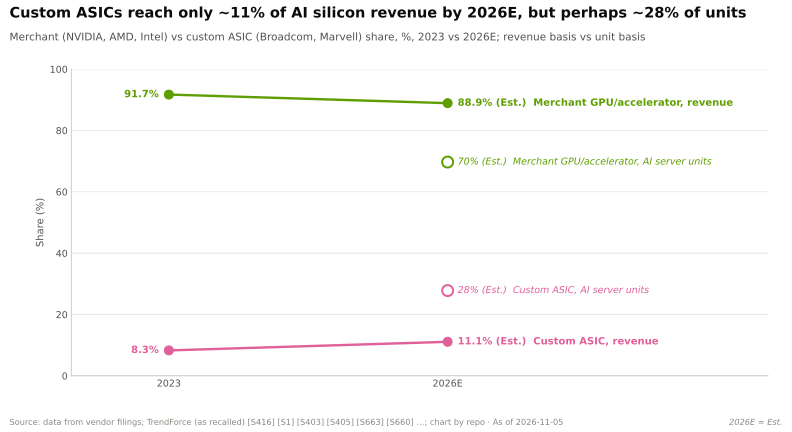

### 🛡️ 英伟达的反驳

在价值池急剧膨胀的同时，份额几乎没有变化。2025 年英伟达保持了约 87 % 的 AI 芯片营收份额，而价值池较 2023 年扩大约 4.2×；定制 ASIC 份额维持在 10 % 左右（估计）[[S416]](../../sources/bibliography.md#s416)[[S1]](../../sources/bibliography.md#s1)[[S660]](../../sources/bibliography.md#s660)[[S661]](../../sources/bibliography.md#s661)[[S662]](../../sources/bibliography.md#s662)。自研项目每代大约需要 130,000 颗芯片才能比购买 GPU 更划算（🔴，见 [CS3](../case-studies/CS3-google-tpu-the-credible-alternative.md)）[[S23010]](../../sources/bibliography.md#s23010)，只有少数几家买家能跨过这一门槛。超大规模云厂商还要把英伟达 GPU 出租给指定使用 [CUDA](../glossary.md#cuda) 的云客户，因此 ASIC 首先服务于内部工作负载。英伟达正在将威胁收编为己用：Trainium4 的设计可接入 [NVLink Fusion](../glossary.md#nvlink-fusion) 和英伟达的 MGX 机架 [[S518]](../../sources/bibliography.md#s518)[[S90034]](../../sources/bibliography.md#s90034)。最后，英伟达可以针对 ASIC 定价：本资料库估计，英伟达即使将每 token 成本压到与 TPU 持平，仍能保留约 62 % 的毛利率（🔴）[[S23010]](../../sources/bibliography.md#s23010)。

> [!TIP]
> **算例 —— ASIC 设定的价格上限。** 采用本资料库 CS3 的估计：若要在每 token 成本上与 TPU 持平，英伟达该部分业务的毛利率将降至约 62 %（🔴）[[S23010]](../../sources/bibliography.md#s23010)。仅将其应用于超大规模云厂商（约占数据中心营收的 55 % [[S90011]](../../sources/bibliography.md#s90011)），其他业务仍按 75 % 计：混合毛利率为 0.55 × 62 % + 0.45 × 75 % ≈ **68 %**。以 FY2028 指引营收约 $697B 计，比指引的约 72.5 % 低 4.5 个百分点，相当于每年约 $31B 毛利润，约占总额的 6 %。**结论：**自研芯片远在成为出货量风险之前，就已是毛利率风险；它也是最有可能率先在毛利率这一行显现的风险。

> [!IMPORTANT]
> **研判 —— 超大规模云厂商 ASIC。** 可能性 **4** · 影响 **4** · 得分 **16**（最高）· 时间窗口 **2027–2029**。已经体现在*增量*份额和对外 TPU 交易中，但尚未体现在英伟达的绝对营收上。与 [CS3](../case-studies/CS3-google-tpu-the-credible-alternative.md) 的结论一致：它限制的是定价权，而非出货量。**关注：**博通 AI 营收 ÷ 英伟达数据中心营收（约 19 %；> 25 % 为警示信号）、Meta 是否*采购* TPU、Maia 300 和 Trainium4 的出货量，以及英伟达的毛利率。

## 风险 3 —— 推理商品化

### 🐻 最强看空论证

[推理](../glossary.md#inference)是英伟达护城河最薄、增长最快的领域。管理层最近一次给出的数据是：截至 Q2 FY2025 的一年中，推理占数据中心营收的 40 % 以上 [[S11011]](../../sources/bibliography.md#s11011)。与前沿训练不同，推理可拆分为小型、独立的任务，易于进行基准测试，也易于迁移。

价格下降的速度快于任何硬件成本曲线。[Token 价格通缩](../glossary.md#token-price-deflation)使 GPT-3.5 水平最便宜模型的价格在两年内从每百万 token $20 降至 $0.07，降幅约 286× [[S11526]](../../sources/bibliography.md#s11526)。H100 租金从 2023 年的每 [GPU 小时](../glossary.md#gpu-hour)约 $8 降至 2024 年底交易平台上的约 $2 以下 [[S393]](../../sources/bibliography.md#s393)。推理服务层是中立的：[vLLM](../glossary.md#vllm) 在主代码树中原生支持英伟达、AMD 和英特尔（Intel），并通过插件支持 TPU、Gaudi 和华为昇腾（Ascend）[[S580]](../../sources/bibliography.md#s580)。专用推理芯片也不断涌现：OpenAI 与博通合作的芯片 [[S628]](../../sources/bibliography.md#s628)、Cerebras 为 OpenAI 提供多达 750 MW 算力 [[S11523]](../../sources/bibliography.md#s11523)、TPU 在某一工作负载上每 token 成本比 B200 低约 18 % [[S625]](../../sources/bibliography.md#s625)。英伟达自己据报道也斥资约 $20B 获得 Groq 的技术授权并聘用其团队 🟡 [[S90019]](../../sources/bibliography.md#s90019)，这一价格表明它对这一威胁有多重视。DeepSeek V4-Pro 的定价约为每百万输出 token $3.48 [[S90080]](../../sources/bibliography.md#s90080)。

### 🛡️ 英伟达的反驳

到目前为止，更便宜的 token 带来的是更多支出，即[杰文斯悖论（Jevons paradox）](../glossary.md#jevons-paradox)。谷歌每月处理的 token 量在 18 个月内增长约 134× [[S32018]](../../sources/bibliography.md#s32018)[[S32020]](../../sources/bibliography.md#s32020)。SemiAnalysis 的 H100 一年期租金指数从 2025 年 10 月 $1.70 的低点反弹至 2026 年 3 月的 $2.35，涨幅 +38 %，旧 GPU 被重新上调定价 [[S12516]](../../sources/bibliography.md#s12516)。前沿模型价格不降反升：GPT-5.5 上市时的混合价格约为 GPT-5 的 3.3× 🟡 [[S11535]](../../sources/bibliography.md#s11535)。英伟达的机架级系统在最难的推理场景中胜出：在每用户 50 tokens/s 条件下，GB300 [NVL72](../glossary.md#nvl72) 运行 DeepSeek-R1 的[每兆瓦 token 产出](../glossary.md#tokens-per-megawatt)约为 H200 的 13×（估计）[[S621]](../../sources/bibliography.md#s621)[[S622]](../../sources/bibliography.md#s622)；仅靠软件，同一套 GB300 NVL72 上的 DeepSeek-R1 吞吐量一年内就提升了 2.9× [[S601]](../../sources/bibliography.md#s601)[[S603]](../../sources/bibliography.md#s603)。英伟达还选择把推理 ASIC 的思路买下来，而不是与之对抗：Groq 3 LPX 机架现已与 Vera Rubin 并列 [[S90003]](../../sources/bibliography.md#s90003)。

> [!TIP]
> **算例 —— 看空者必须跨越的弹性分界线。** Token 支出 = 价格 × 数量。若固定质量 token 的价格下降 10×，而需求的[价格弹性](../glossary.md#price-elasticity)为 1.5，则数量增长 10^1.5 ≈ 32×，支出增长 **约 3.2×**。若弹性为 0.8，数量仅增长 10^0.8 ≈ 6.3×，支出反而*降至*约 0.63×（🔴 本资料库测算，见 [CS5](../case-studies/CS5-deepseek-moment-and-efficiency-shock.md)）。**结论：**看空逻辑并不是“token 变便宜”，而是在成熟工作负载中弹性降至 1 以下。租金反弹表明这种情况尚未发生。

> [!IMPORTANT]
> **研判 —— 推理商品化。** 可能性 **4** · 影响 **3** · 得分 **12** · 时间窗口 **2026–2029**。价格通缩是确定的；它是否造成伤害取决于弹性，而弹性目前仍高于 1。**关注：**H100 和 B200 租金指数（H100 为 $2.35；跌破 $1.70 低点为警示信号）、固定能力 token 的价格，以及英伟达是否再次披露推理营收占比。

## 风险 4 —— 电力约束

### 🐻 最强看空论证

英伟达交付芯片的速度快于全球建设变电站的速度。英伟达单套系统的功耗在十年间增长约 190×，从 3.2 kW（DGX-1）升至 2027 年 Kyber 机架的约 600 kW [[S310]](../../sources/bibliography.md#s310)[[S305]](../../sources/bibliography.md#s305)。获取电力的过程很慢：美国项目从提交[并网排队](../glossary.md#interconnection-queue)申请到投运的中位等待时间超过 48 个月 [[S8009]](../../sources/bibliography.md#s8009)；Dominion 在北弗吉尼亚供电区域内的大型数据中心可能要等待长达七年 [[S8010]](../../sources/bibliography.md#s8010)；ERCOT 跟踪的申请接入大型负荷约 410 GW，其中约 87 % 为数据中心 [[S8011]](../../sources/bibliography.md#s8011)。国际能源署（IEA）预计数据中心用电量将从约 415 TWh（2024）升至 2030 年的约 945 TWh，并指出约 20 % 的规划项目面临延期风险 [[S33015]](../../sources/bibliography.md#s33015)。

价格反映了稀缺程度。在美国最大的数据中心市场 PJM，[容量市场](../glossary.md#capacity-market)价格从每 MW-日 $28.92（2024/25）升至 $333.44（2027/28），三次拍卖上涨约 11.5×，且只是因为协商设定的价格上限才被压住；PJM 估计若无上限将达约 $530 [[S18018]](../../sources/bibliography.md#s18018)[[S18016]](../../sources/bibliography.md#s18016)[[S18017]](../../sources/bibliography.md#s18017)。该区域距离其可靠性目标还差约 6,600 MW [[S18019]](../../sources/bibliography.md#s18019)。吉瓦级的宣称也在打折扣：卫星分析发现，一个号称首个吉瓦级集群的园区只有约 350 MW 的冷却能力 [[S90077]](../../sources/bibliography.md#s90077)；Abilene 扩建项目因融资谈判失败而被放弃 [[S27001]](../../sources/bibliography.md#s27001)。

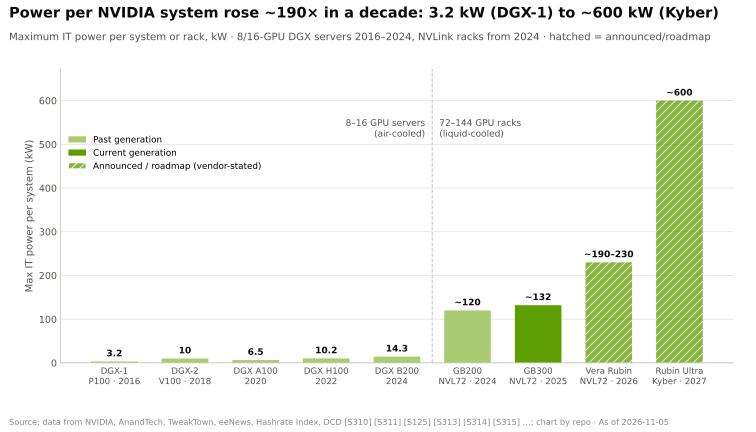

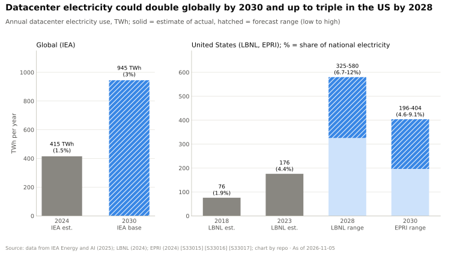

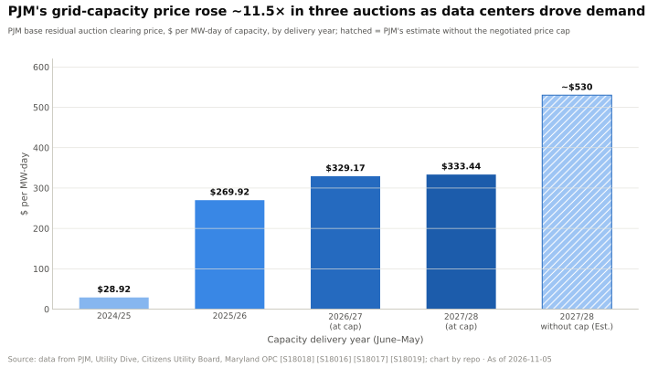

### 🛡️ 英伟达的反驳

电力上限不会削减 AI 预算，而是把预算导向每兆瓦产出最高的方案，这正是英伟达最强的指标。拥有固定 1 GW 电力的买家会追求每兆瓦 token 产出最大化，而 GB300 NVL72 在这一指标上约为 H200 的 13×（估计）[[S621]](../../sources/bibliography.md#s621)[[S622]](../../sources/bibliography.md#s622)。电费仅占 GPU 年度成本的约 12–19 % [[S389]](../../sources/bibliography.md#s389)[[S382]](../../sources/bibliography.md#s382)，因此问题在于能否获得电力，而非电价；英伟达正在解决获取问题：约 20 家合作伙伴正在打造 [800 V 直流](../glossary.md#hvdc-800v)供电设备，MGX 800 VDC 机架将于 2026 年下半年推出，另有用于园区设计的 Omniverse DSX 数字孪生蓝图 [[S90061]](../../sources/bibliography.md#s90061)[[S90063]](../../sources/bibliography.md#s90063)。建设方还在采用[表后（behind the meter）](../glossary.md#behind-the-meter)现场燃气发电，如 Colossus 2 [[S8015]](../../sources/bibliography.md#s8015)。

> [!TIP]
> **算例 —— 延后 1 GW 的价值。** 英伟达估计其在 1 GW AI 工厂中的价值含量约为 $35B [[S398]](../../sources/bibliography.md#s398)。若 2027 年有 5 GW 的建设推迟一年（🔴），约 $175B 的英伟达营收会向后推移，约为 FY2028 指引营收的四分之一。但延后并不等于损失：营收只是晚到，而在[供应受限](../glossary.md#supply-constrained)的年份，芯片会流向已经通电的园区。**结论：**电力是一项时间性风险，对近期损益影响大，对长期价值影响小——除非延期引发订单取消并传导至风险 7。

> [!IMPORTANT]
> **研判 —— 电力。** 可能性 **4** · 影响 **2** · 得分 **8** · 时间窗口 **2026–2030**。本资料库在此与[第 08 层的表述](../layers/08-systems-racks-ai-factories/index.md)（电力“往往是硬约束”）略有不同：我们同意它约束交付时间，但影响打分更低，因为递延营收并非损失的营收。**关注：**PJM 和 ERCOT 容量价格、排队时间、新兴云服务商已投运与已签约电力之比（CoreWeave 约 1.5 GW 已投运，约 3.7 GW 已签约 [[S12010]](../../sources/bibliography.md#s12010)），以及 GPU 因无电可用而闲置的报道。

## 风险 5 —— 中国与出口管制

### 🐻 最强看空论证

中国曾占英伟达业务的四分之一：按旧的开票地口径，占 FY2022 营收的 26.4 % [[S2]](../../sources/bibliography.md#s2)。按客户总部所在地口径，FY2025 达到 $25.0B 的峰值，随后在 FY2026 降至 9.1 %，FY2027 各季度为 5.6–8.2 % [[S401]](../../sources/bibliography.md#s401)[[S90070]](../../sources/bibliography.md#s90070)[[S90069]](../../sources/bibliography.md#s90069)。这一过程代价高昂：2025 年 4 月的[出口管制](../glossary.md#export-controls)迫使英伟达计提 $4.5B 的 H20 相关费用，使 GAAP 毛利率降至 60.5 % [[S90081]](../../sources/bibliography.md#s90081)[[S444]](../../sources/bibliography.md#s444)。许可证虽恢复发放，但需向美国政府上缴营收的 15 %（H20），后又提高至 25 %（H200）[[S26004]](../../sources/bibliography.md#s26004)[[S90032]](../../sources/bibliography.md#s90032)；北京方面则要求买家避免采购英伟达产品，并禁止国资数据中心使用外国 AI 芯片 [[S26006]](../../sources/bibliography.md#s26006)[[S26007]](../../sources/bibliography.md#s26007)。英伟达尚未确认任何 H200 营收，媒体报道称 Q2 FY2027 的中国 H200 销售额不到数据中心营收的 1 % 🟡 [[S90081]](../../sources/bibliography.md#s90081)[[S26009]](../../sources/bibliography.md#s26009)。

长期代价是培育出一个受保护的对手。华为昇腾 950 系列将于 2026 年出货，其由 8,192 颗芯片组成的 Atlas 950 SuperPoD 承诺于 2026 年第四季度推出 [[S90042]](../../sources/bibliography.md#s90042)[[S90043]](../../sources/bibliography.md#s90043)；DeepSeek V4 部分在昇腾上训练 [[S90079]](../../sources/bibliography.md#s90079)。外溢风险的范围更广：主权 AI 在 FY2026 为英伟达带来超过约 $30B 营收 [[S90071]](../../sources/bibliography.md#s90071)，而 HUMAIN 多达 600,000 颗 GPU 等海湾地区交易 [[S13003]](../../sources/bibliography.md#s13003) 都依赖美国许可证。完整细节见 [CS6](../case-studies/CS6-china-export-controls-h20-and-beyond.md)。

### 🛡️ 英伟达的反驳

损害已经体现在数字中。自 2026 年初以来，业绩指引已不含中国数据中心计算业务 [[S405]](../../sources/bibliography.md#s405)，因此任何 H200 出货都是上行空间。在中国份额骤降的同时，英伟达 FY2026 总营收仍增长 65 % [[S1]](../../sources/bibliography.md#s1)。而且由于英伟达供应受限，未卖给中国的晶圆会以相同毛利率卖到其他地方；CS6 的情景分析认为，在这种情况下禁令的成本接近于零，而若产能无法转售，每年毛利润损失最多约 $13B（🔴）。

> [!TIP]
> **算例 —— 上缴比例的代价。** CS6 估计中国数据中心市场规模约为每年 $17.5B（🔴）。按 75 % 毛利率计约合 $13.1B 毛利润；25 % 的营收上缴使实际毛利率降至 50 %，即约 $8.8B。**上缴每年约损失 $4.4B**，约为 FY2028 指引毛利润的 1 %。**结论：**中国现在是一项期权，而非支柱；真正重要的风险是波及海湾地区或其他主权买家的规则。

> [!IMPORTANT]
> **研判 —— 中国与出口管制。** 可能性 **4** · 影响 **2** · 得分 **8** · 时间窗口 **2026–2028**。政策会继续变动，但中国仅占营收约 6–9 %，且不在指引之内。若管制扩展至中东，影响将升至 3–4。**关注：**实际确认的 H200 营收、美国商务部工业与安全局（BIS）针对第三国的新规、华为 SuperPoD 出货，以及每份 10-Q 中的中国营收数据。

## 风险 6 —— 反垄断

### 🐻 最强看空论证

有三家监管机构正在审视英伟达的经营行为。中国 [SAMR](../glossary.md#samr) 于 2024 年 12 月立案调查，并于 2025-09-15 发布初步认定，称英伟达违反了 2020 年批准其收购 Mellanox 时附加的条件；可能处以上一年度在华销售额 1–10 % 的罚款 [[S9505]](../../sources/bibliography.md#s9505)[[S21003]](../../sources/bibliography.md#s21003)。美国司法部（DOJ）在竞争对手投诉后于 2024 年年中展开调查，随后发出传票；据报道，其关注点在于英伟达加大了客户转换供应商的难度，并惩罚不独家采用其产品的买家 [[S9504]](../../sources/bibliography.md#s9504)[[S9503]](../../sources/bibliography.md#s9503)。交易又开辟了新的战线：$12.9B 收购 Hugging Face 可能面临欧盟审查，且据报道已引起 DOJ 关注 🟡 [[S11027]](../../sources/bibliography.md#s11027)[[S11028]](../../sources/bibliography.md#s11028)；参议员 Warren 和 Blumenthal 质疑约 $20B 的 Groq“授权加招聘”交易是在规避[并购审查](../glossary.md#merger-review)，美国联邦贸易委员会（FTC）表示将审视此类交易结构 [[S13511]](../../sources/bibliography.md#s13511)。

更深层的风险敞口在于经营行为。供应短缺时，分配权就是权力：据报道 DOJ 的关注点直接对应谁能率先拿到 Rubin。英伟达还以机架形式销售，GPU、[NVLink](../glossary.md#nvlink) 交换机、网卡和软件打包交付，这是监管机构十分熟悉的[搭售（tying）](../glossary.md#tying)模式；同时英伟达现持有客户和合作伙伴约 $99B 的股权 [[S90072]](../../sources/bibliography.md#s90072)。若出台强制拆分定价或中立分配的[行为性救济措施](../glossary.md#behavioural-remedy)，将波及占数据中心营收约 20 % 的网络业务 [[S90012]](../../sources/bibliography.md#s90012)。

### 🛡️ 英伟达的反驳

市场看起来具备可竞争性：TPU、Trainium、Maia、MTIA，以及 AMD 与 OpenAI、Meta 各 6 GW 的交易都已存在，因此风险 2 恰恰是英伟达最好的反垄断抗辩 [[S653]](../../sources/bibliography.md#s653)[[S546]](../../sources/bibliography.md#s546)[[S24004]](../../sources/bibliography.md#s24004)。英伟达也在走向开放：它开源了 Run:ai 和 KAI 调度器 [[S12510]](../../sources/bibliography.md#s12510)，以 Apache 2.0 许可发布 [Dynamo](../glossary.md#dynamo) [[S90066]](../../sources/bibliography.md#s90066)，通过 NVLink Fusion 向第三方芯片开放 NVLink [[S131]](../../sources/bibliography.md#s131)，作为创始成员加入 ESUN [[S576]](../../sources/bibliography.md#s576)，并承诺 Hugging Face 不会强制要求使用英伟达芯片 [[S11026]](../../sources/bibliography.md#s11026)。Run:ai 收购在获得欧盟批准后完成交割 [[S476]](../../sources/bibliography.md#s476)。

> [!TIP]
> **算例 —— 罚款规模与救济措施规模之比。** SAMR 的罚款上限为上一年度在华销售额的 10 %：10 % × $25.0B（FY2025）= **$2.5B** [[S9505]](../../sources/bibliography.md#s9505)[[S401]](../../sources/bibliography.md#s401)，约为单季净利润 $59.7B 的 4 % [[S405]](../../sources/bibliography.md#s405)。若救济措施使网络产品的搭配率下降四分之一，将影响约 $17.5B × 25 % ≈ **每季度 $4.4B 营收**（🔴）[[S90012]](../../sources/bibliography.md#s90012)。**结论：**罚款只是噪音；针对捆绑销售或产能分配的行为性救济，才是这项风险中值得建模的版本。

> [!IMPORTANT]
> **研判 —— 反垄断。** 可能性 **3** · 影响 **2** · 得分 **6** · 时间窗口 **2026–2028**。SAMR 处罚很可能发生但金额小；美国或欧盟的行为性救济可能性较低但影响更大。**关注：**SAMR 的处罚决定、DOJ 对 Hugging Face 交易发出第二次信息请求或欧盟启动第二阶段审查、任何关于产能分配或捆绑销售的投诉，以及 FTC 对“授权加招聘”类交易采取的行动。

## 风险 7 —— 循环融资与资本开支周期

这是影响得分最高的风险，因为一旦下行，营收、承诺和持股会同时受到冲击。

### 🐻 最强看空论证

**资本开支规模史无前例。** Alphabet、亚马逊和 Meta 在 2022 年合计支出 $127B，最初对 2026 年的指引约为 $505B，此后上调至约 $558B [[S12518]](../../sources/bibliography.md#s12518)[[S12519]](../../sources/bibliography.md#s12519) [[S455]](../../sources/bibliography.md#s455)[[S456]](../../sources/bibliography.md#s456)[[S457]](../../sources/bibliography.md#s457)[[S460]](../../sources/bibliography.md#s460)[[S461]](../../sources/bibliography.md#s461)[[S462]](../../sources/bibliography.md#s462)；到 2026 年年中，其指引已逐步上调至约 $558B，若计入微软则约为 $728B [[S12518]](../../sources/bibliography.md#s12518)[[S12519]](../../sources/bibliography.md#s12519)。预测机构认为 2027 年将接近或超过 $1T [[S18023]](../../sources/bibliography.md#s18023)，仅 Alphabet 的 2027 年一致预期就达 $311.8B，而 2025 年为 $91.4B [[S18022]](../../sources/bibliography.md#s18022)。收入增长并未跟上：贝恩（Bain）估计，到 2030 年 AI 每年需要约 $2T 的收入才能支撑其算力投入，缺口约 $800B [[S18024]](../../sources/bibliography.md#s18024)。OpenAI 在 2026 年初的年化收入约为 $25B，其指引到 2030 年的算力支出约为 $600B，低于 2025 年约 $1.4T 的承诺口径 [[S18026]](../../sources/bibliography.md#s18026)[[S18025]](../../sources/bibliography.md#s18025)。

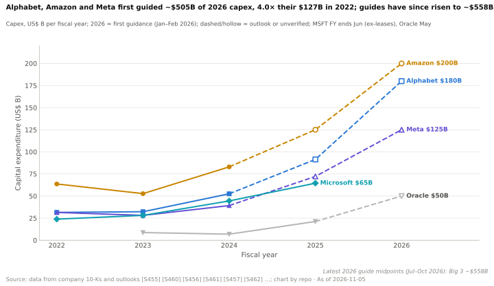

**英伟达为自身需求提供了部分资金。** 这是[循环融资](../glossary.md#circular-financing)批评的核心。截至 2026 年 7 月，英伟达的股权投资达到约 $99B（CNBC 汇总了 10-Q 中三个资产负债表科目）[[S90073]](../../sources/bibliography.md#s90073)；H1 FY2027 股权购买额为 $42.4B，上年同期为 $1.2B；H1 净股权收益 $23.7B，相当于 H1 净利润 $118B 的约 20 % [[S90072]](../../sources/bibliography.md#s90072)[[S90069]](../../sources/bibliography.md#s90069)[[S403]](../../sources/bibliography.md#s403)[[S405]](../../sources/bibliography.md#s405)。最大的持股都投向客户：对 OpenAI 约 $30B，对 Anthropic 最多 $10B [[S90015]](../../sources/bibliography.md#s90015)[[S90075]](../../sources/bibliography.md#s90075)。英伟达还为需求兜底：到 2032 年，它将购买 CoreWeave 最多 $6.3B 的未售出算力 [[S90067]](../../sources/bibliography.md#s90067)（[算力兜底](../glossary.md#capacity-backstop)），并持有 $36B 的 AI 云算力协议和 $29B 的云服务协议 [[S407]](../../sources/bibliography.md#s407)。2026 年 8 月，英伟达与 Apollo、贝莱德（BlackRock）、黑石（Blackstone）、Brookfield、高盛（Goldman Sachs）和 KKR 共同设立平台，动员超过 $500B 的第三方资本 [[S12528]](../../sources/bibliography.md#s12528)，将风险转移到以 GPU 为抵押的信贷中。

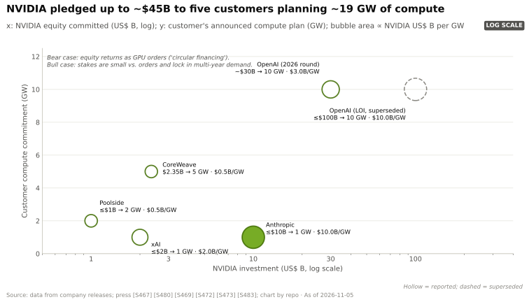

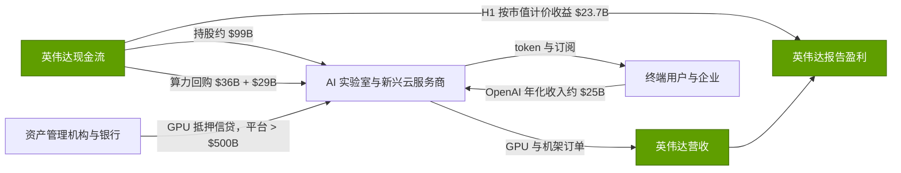

**供给侧会放大下行。** 英伟达的[采购义务](../glossary.md#purchase-obligations)（供应与产能承诺）达到 $279B，上一季度为 $119B：相当于季度营收的 2.9×，而 FY2023 库存减记之前约为 1.4× [[S407]](../../sources/bibliography.md#s407)。Michael Burry 在 2 月称 10-K 中 $95B 的采购义务“令人不安” [[S431]](../../sources/bibliography.md#s431)；10-Q 中的 $279B 是一个口径更宽的科目，因此可比口径的增长是一个季度内从 $119B 增至 $279B [[S90092]](../../sources/bibliography.md#s90092)。在下游，CoreWeave 计划 2026 年资本开支 $35–39B，而营收为 $12.4–13.2B [[S12500]](../../sources/bibliography.md#s12500)；超大规模云厂商按 5.5–6 年对服务器计提折旧，而英伟达每年都推出新架构（[使用寿命](../glossary.md#useful-life)）[[S382]](../../sources/bibliography.md#s382)[[S385]](../../sources/bibliography.md#s385)。

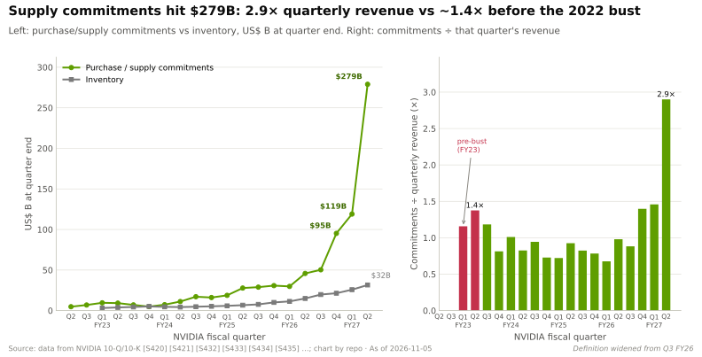

**电信业的先例近得令人不安。** 朗讯的[供应商融资](../glossary.md#vendor-financing)承诺在 1999–2000 年达到 $8.1B，约占其 $33.6B 营收的 24 % [[S18007]](../../sources/bibliography.md#s18007)。随着周期破裂，北电（Nortel）的融资协议从 2000 年的 $5.2B 降至 2001 年的 $2.1B [[S18008]](../../sources/bibliography.md#s18008)。思科（Cisco）在整个 2000 年都表示需求“持续超出我们的预期”，随后却给出营收环比下降约 30 % 的指引，并在 FY2001 第三季度计提 $2.25B 的过剩库存费用 [[S18010]](../../sources/bibliography.md#s18010)[[S18009]](../../sources/bibliography.md#s18009)。英伟达 H1 FY2027 的股权购买额占营收的比例，现已与朗讯的峰值比例相当。

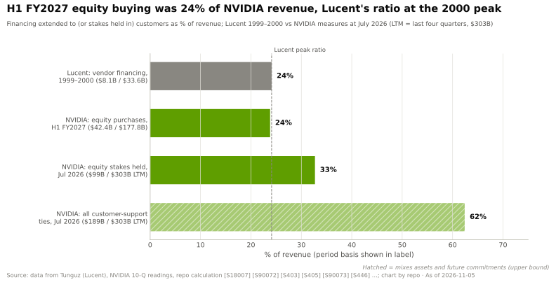

### 🛡️ 英伟达的反驳

英伟达自己的回应很简短：“与朗讯不同，英伟达并不依赖供应商融资安排来实现营收增长” [[S18007]](../../sources/bibliography.md#s18007)。数据部分支持这一说法。英伟达用经营现金流（仅 Q1 FY2027 就达 $50.3B）为其持股提供资金 [[S403]](../../sources/bibliography.md#s403)，而非借债。其最大的买家（超大规模云厂商，约占数据中心营收的 55 %）以自身经营现金流付款 [[S90011]](../../sources/bibliography.md#s90011)。与 OpenAI 的交易已从与部署挂钩、$100B 的意向书，重组为不设部署里程碑、约 $30B 的直接股权投资 🟡 [[S90015]](../../sources/bibliography.md#s90015)[[S90016]](../../sources/bibliography.md#s90016)，这削弱了“以投资换订单”的关联。2026 年 8 月设立的平台让第三方资本而非英伟达的资金支撑未来的建设 [[S12528]](../../sources/bibliography.md#s12528)。需求信号依然紧俏：H100 租金较 2025 年 10 月低点上涨 38 % [[S12516]](../../sources/bibliography.md#s12516)，CoreWeave 的未交付订单为 $104.2B [[S12500]](../../sources/bibliography.md#s12500)，英伟达估计到 2027 年 Blackwell 加 Vera Rubin 的需求规模达 $1T [[S90001]](../../sources/bibliography.md#s90001)。正是这些供应承诺，才让英伟达在 FY2028 有可能实现约 70 % 的增长 [[S18000]](../../sources/bibliography.md#s18000)。

| 特征 | 电信业 1999–2001 | 英伟达 2026 | 类比是否成立？ |
|---|---|---|---|
| 客户融资占营收比例 | 朗讯约 24 % [[S18007]](../../sources/bibliography.md#s18007) | 股权购买约占 H1 营收的 24 %；所有关联约占过去十二个月营收的 62 % [[S90072]](../../sources/bibliography.md#s90072)[[S407]](../../sources/bibliography.md#s407) | 🟥 规模上成立 |
| 谁在借钱 | 依靠高收益债的初创电信运营商 | 以现金流付款的超大规模云厂商；依靠股权与 GPU 抵押信贷的 AI 实验室和新兴云服务商 | 🟨 部分成立：新兴云服务商和 AI 实验室与当年的运营商相似，超大规模云厂商则不然 |
| 供应商的资金来源 | 债务与担保，部分在表外 | 经营现金流；第三方平台 [[S403]](../../sources/bibliography.md#s403)[[S12528]](../../sources/bibliography.md#s12528) | 🟩 不成立 |
| 过度建设后的资产寿命 | 光纤可用数十年，过剩产能多年压制价格 | GPU 在 3–6 年内折旧完毕；过剩产能消化更快 [[S382]](../../sources/bibliography.md#s382)[[S385]](../../sources/bibliography.md#s385) | 🟨 周期更短但更剧烈 |
| 当时的价格信号 | 带宽价格崩溃 | H100 租金自 2025 年 10 月以来 +38 % [[S12516]](../../sources/bibliography.md#s12516) | 🟩 尚不成立 |
| 供应商承诺 | 思科库存费用 $2.25B [[S18009]](../../sources/bibliography.md#s18009) | 承诺 $279B，为季度营收的 2.9× [[S407]](../../sources/bibliography.md#s407) | 🟥 成立；规模更大 |

> [!TIP]
> **算例 —— 2001 年式的压力测试。** 假设（🔴）季度营收从 Q3 FY2027 指引的 $108B 下降 40 %，至约 $65B。届时 $279B 的承诺将相当于约 4.3 个季度的营收。若其中 5 % 变为过剩（如 H20 的情况），相关费用约为 **$14B**；约 $99B 持股的价值下跌 30 %，将通过其他收益再带来约 **$30B** 损失 [[S407]](../../sources/bibliography.md#s407)[[S90072]](../../sources/bibliography.md#s90072)。两者合计约 $44B，约为最近一个季度净利润（$59.7B）的四分之三 [[S405]](../../sources/bibliography.md#s405)。**结论：**英伟达的资产负债表能轻松扛过这一冲击，但其盈利和估值倍数扛不住，因为营收下滑、费用计提和按市值计价损失会在同几个季度集中出现。

🔧 技术细节：融资如何美化报告业绩

有三条会计路径值得关注。(1) **持股收益。** 英伟达上市持股的价值变动，以及私募持股在新一轮融资定价时的重新计量，都计入“其他收益”，因此火热的一级市场会在没有卖出任何产品的情况下推高净利润；这也是本资料库跟踪净股权收益占净利润比例（H1 FY2027 约 20 %）的原因。(2) **支付给客户的对价。** 根据收入确认准则，供应商返还给客户的价值（返利、抵扣，以及部分算力采购）可能被视为营收的减项而非费用，除非它以公允价值换取了可明确区分的商品或服务。英伟达购买自己无法转售的算力的那些算力协议，是附注中需要细读的科目。(3) **承诺。** 供应与产能承诺在货物到达前不计入资产负债表；如果需求下降，过剩部分会变成库存或采购义务相关费用，正如 $4.5B 的 H20 费用所示 [[S90081]](../../sources/bibliography.md#s90081)。以上均不意味着存在错报，而是说明报告数字的周期性比营收这一行所显示的更强。

> [!IMPORTANT]
> **研判 —— 循环融资与资本开支周期。** 可能性 **3** · 影响 **5** · 得分 **15** · 时间窗口 **2027–2029**。这一类比在规模和供应商承诺上成立，在资金质量上不成立。资本开支周期终会转向；问题在于 2028 年是暂停还是削减。**关注：**超大规模云厂商资本开支指引的二阶导数（首次同比削减）、承诺 ÷ 季度营收（2.9×）、股权购买 ÷ 营收（约 24 %）、净股权收益 ÷ 净利润（约 20 %）、H100 租金指数，以及新兴云服务商的融资成本。

## 风险 8 —— 台积电与台湾集中度

### 🐻 最强看空论证

英伟达每一颗数据中心 GPU 裸片都由台积电（TSMC）制造，并采用 [CoWoS](../glossary.md#cowos) 封装，而全部 CoWoS 产能都在台湾 [[S18012]](../../sources/bibliography.md#s18012)。Rubin 本身采用台积电 3 nm 工艺（据报道为 N3P）[[S100]](../../sources/bibliography.md#s100)[[S35015]](../../sources/bibliography.md#s35015)。英伟达预订了 2026 年约 60 % 的 CoWoS 晶圆（估计）[[S379]](../../sources/bibliography.md#s379)，并成为台积电最大客户，约占其 2025 年营收的 19 %（约 $23.2B）[[S18015]](../../sources/bibliography.md#s18015)。多元化进展缓慢：台积电于 2025-10-17 在亚利桑那州生产出首片 Blackwell 晶圆 [[S18013]](../../sources/bibliography.md#s18013)，但这些晶圆仍需空运回台湾封装 [[S18012]](../../sources/bibliography.md#s18012)；亚利桑那州封装厂的目标是 2029 年，与 Amkor 的合作目标是 2028 年 [[S18014]](../../sources/bibliography.md#s18014)。内存带来了第二重集中：预计 SK 海力士将供应英伟达 2026 年一半以上的 [HBM](../glossary.md#hbm) [[S90039]](../../sources/bibliography.md#s90039)。

急性情景是封锁或冲突。彭博经济研究估计，为期一年的封锁将在第一年使全球 GDP 减少约 5 %，战争则减少约 10.2 %，约 $10T [[S18011]](../../sources/bibliography.md#s18011)。在英伟达的量级上，先进制程逻辑加 CoWoS 不存在第二供应来源，因此在冲击持续期间其出货将停止。慢性情景是供应商的定价权：据报道台积电将 N3P 价格上调约 20 % [[S35037]](../../sources/bibliography.md#s35037)，N2 定价约每片晶圆 $30,000 [[S35003]](../../sources/bibliography.md#s35003)；美光（Micron）的毛利率（86.8 %）现已超过英伟达（75.0 %）[[S3533]](../../sources/bibliography.md#s3533)[[S405]](../../sources/bibliography.md#s405)；英伟达以内存成本为由，将 Q4 FY2027 毛利率指引下调至 71–72 %，FY2028 为 72–73 % [[S18000]](../../sources/bibliography.md#s18000)[[S18002]](../../sources/bibliography.md#s18002)[[S18001]](../../sources/bibliography.md#s18001)。Rubin 的 [HBM4](../glossary.md#hbm4) 带宽从 22 TB/s 下调至 19.2 TB/s，表明供应商如今也在影响英伟达的产品规格 [[S90006]](../../sources/bibliography.md#s90006)。

### 🛡️ 英伟达的反驳

台湾是系统性风险，而非竞争性风险。AMD、博通的 TPU 与 OpenAI 项目、Trainium 和 Maia 都依赖同样的晶圆厂和封装线，因此一旦出现中断，份额不会转移到对手手中；买家将无处可去。作为锚定客户，英伟达优先获得产能分配；据报道，相关计划将使 CoWoS 产能到 2028 年达到约每月 260k 片晶圆，为 2023 年底的约 17× [[S3002]](../../sources/bibliography.md#s3002)。亚利桑那州晶圆（2025）和美国本土封装（2028–2029）将随时间推移减少单点故障。就慢性风险而言，英伟达的指引已假设提价，从而在 FY2028 让毛利率回升 [[S18000]](../../sources/bibliography.md#s18000)。

> [!TIP]
> **算例 —— 缓冲能维持多久。** 按 Q3 FY2027 指引（营收 $108B，毛利率 74 %），季度销售成本约为 $28B [[S18000]](../../sources/bibliography.md#s18000)。英伟达在 Q2 FY2027 末持有 $31.6B 库存 [[S407]](../../sources/bibliography.md#s407)，约为 1.1 个季度的销售成本，其中一部分是在制品。**结论：**短于约一个季度的中断可以靠库存撑过去；更长的中断则是全行业的供给冲击，届时英伟达的相对地位不变，但绝对营收会受损。

> [!IMPORTANT]
> **研判 —— 台积电与台湾。** 可能性 **1**（急性）· 影响 **5** · 得分 **5** · 时间窗口 **随时**。这是需要对冲的尾部风险，而非基准情景。来自台积电和内存厂商的慢性毛利率挤压若单独计分，约为 4 × 2。**关注：**亚利桑那州 CoWoS 与 Amkor 的时间表、台积电晶圆涨价、HBM 合约价格，以及毛利率指引。

## 风险 9 —— 开放互连标准

### 🐻 最强看空论证

[纵向扩展（scale-up）](../glossary.md#scale-up)曾是英伟达最封闭的一层，如今正被标准化。[UALink](../glossary.md#ualink) 2.0 于 2026-04-07 获批，涵盖网内计算、芯粒定义和 200G 链路；UALink 1.0 芯片于 2026 年下半年进入实验室，产品预计 2027 年推出 [[S90050]](../../sources/bibliography.md#s90050)[[S574]](../../sources/bibliography.md#s574)[[S90051]](../../sources/bibliography.md#s90051)。其联盟拥有超过 65 家成员，董事会成员包括 AMD、AWS、谷歌、Meta、微软和苹果 [[S5520]](../../sources/bibliography.md#s5520)[[S5521]](../../sources/bibliography.md#s5521)。以太网则从另一侧进攻纵向扩展：[ESUN](../glossary.md#esun) 于 2026 年 3 月发布 1.0 规范 [[S576]](../../sources/bibliography.md#s576)，[Ultra Ethernet](../glossary.md#ultra-ethernet) 继 2025 年 6 月发布 1.0 之后 [[S257]](../../sources/bibliography.md#s257)，1.1 版已扩展至纵向扩展 [[S575]](../../sources/bibliography.md#s575)。AMD 的 Helios 已通过基于以太网的 UALink 和博通交换机连接 72 颗 GPU，带宽约 260 TB/s [[S226]](../../sources/bibliography.md#s226)[[S5523]](../../sources/bibliography.md#s5523)[[S5524]](../../sources/bibliography.md#s5524)；在 Rubin 规格下调之后，Helios 每颗 GPU 的带宽为 3.6 TB/s，而 Rubin 为 3.0 TB/s [[S226]](../../sources/bibliography.md#s226)[[S201]](../../sources/bibliography.md#s201)。在横向扩展领域，转变已经发生：2026 年第一季度，以太网约占 AI 后端交换机销售额的三分之二，且一家白牌厂商位居厂商排名首位 [[S90054]](../../sources/bibliography.md#s90054)。

受影响的是英伟达的网络业务（每季度约 $17.5B，约占数据中心营收的 20 % [[S90012]](../../sources/bibliography.md#s90012)），以及让英伟达能够按系统而非按芯片定价的机架级捆绑。详见[第 05 层](../layers/05-scale-up-nvlink-nvswitch/index.md)和[第 06 层](../layers/06-scale-out-scale-across-networking/index.md)。

### 🛡️ 英伟达的反驳

英伟达在开放网络中同样胜出：[Spectrum-X](../glossary.md#spectrum-x) 以太网在 Q2 FY2027 同比增长 2.6× [[S408]](../../sources/bibliography.md#s408)。它正把纵向扩展的威胁转化为授权业务：NVLink Fusion 的合作伙伴包括高通（Qualcomm）、富士通、英特尔，以及用于 Trainium4 的 AWS，且每套系统中都有英伟达芯片 [[S131]](../../sources/bibliography.md#s131)[[S518]](../../sources/bibliography.md#s518)。NVLink 已发展到第六代，拥有经过验证的铜缆背板，而开放互连架构大约落后两年，这也是[第 05 层](../layers/05-scale-up-nvlink-nvswitch/competition.md)的结论。此外，英伟达还作为创始成员身处 ESUN 之中 [[S576]](../../sources/bibliography.md#s576)。

> [!TIP]
> **算例 —— 网络份额流失的代价。** 数据中心约占营收的 93 % [[S405]](../../sources/bibliography.md#s405)；按 FY2028 指引路径约为 $648B（🔴）。若开放互连使英伟达网络业务的占比从约 20 % 降至约 15 %，将减少约 $32B 营收，按公司平均 72.5 % 毛利率计约合 $23B 毛利润，约占总额的 5 %。**结论：**这是真实但次要的损失，因此影响打 2 分；更大的影响在于失去机架捆绑这一定价工具。

> [!IMPORTANT]
> **研判 —— 开放互连。** 可能性 **3** · 影响 **2** · 得分 **6** · 时间窗口 **2027–2029**。与第 05 层的结论一致：NVLink Fusion 的窗口期就是现在；一旦 UALink 交换芯片大规模出货，标准的冲击就会显现。**关注：**UALink 交换芯片出货、Helios 在 Azure、OpenAI 和甲骨文的部署、英伟达网络业务增速与计算业务增速之比，以及 NVLink Fusion 的设计导入。

## 风险 10 —— 软件抽象层侵蚀 CUDA

### 🐻 最强看空论证

CUDA 护城河是为程序员手写内核的世界而建的，而那个世界正在消退。[PyTorch](../glossary.md#pytorch) 在主代码树中原生支持 CUDA、[ROCm](../glossary.md#rocm) 和 Intel XPU 构建 [[S587]](../../sources/bibliography.md#s587)；[torch.compile](../glossary.md#torch-compile) 生成 [Triton](../glossary.md#triton) 代码 [[S9021]](../../sources/bibliography.md#s9021)，而 Triton 可在 AMD GPU 上运行 [[S578]](../../sources/bibliography.md#s578)；Meta 的 MTIA 编译器基于 TorchInductor 和 Triton 构建 [[S9028]](../../sources/bibliography.md#s9028)；谷歌的 [JAX](../glossary.md#jax) 可运行在英伟达 GPU、TPU 上，并可通过 AMD 支持的插件运行在 AMD GPU 上 [[S577]](../../sources/bibliography.md#s577)；vLLM 可在六类硬件上提供推理服务 [[S580]](../../sources/bibliography.md#s580)。AMD 相对 CUDA 的滞后从约 8.8 年（平台 1.0）缩短到约 8 个月（FP4），再到可用部署 DeepSeek-V4-Pro 仅滞后 26 天 [[S586]](../../sources/bibliography.md#s586)[[S631]](../../sources/bibliography.md#s631)。高通于 2026-07-29 完成对 Modular 约 $3.9B 的收购，并以 Apache 2.0 许可开源 [Mojo](../glossary.md#mojo) [[S9511]](../../sources/bibliography.md#s9511)[[S9512]](../../sources/bibliography.md#s9512)。如今 AI 已能自己写内核：字节跳动 Seed 与清华大学的一个[智能体](../glossary.md#agentic-ai)系统报告称，在 [KernelBench](../glossary.md#kernelbench) 三个难度级别的任务上，分别有 100 %、100 % 和 92 % 胜过 torch.compile [[S18020]](../../sources/bibliography.md#s18020)；AMD 和 Anthropic 表示，它们使用 Claude 在 Instinct 上优化工作负载 [[S9538]](../../sources/bibliography.md#s9538)。

本资料库对前沿实验室的 CUDA 锁定程度仅打 2.75/5 分，对中国实验室打 2.5 分，而对企业客户打 4.5 分（🔴）。资金最雄厚的买家恰恰锁定程度最低。见[第 09 层](../layers/09-cuda-and-system-software/index.md)。

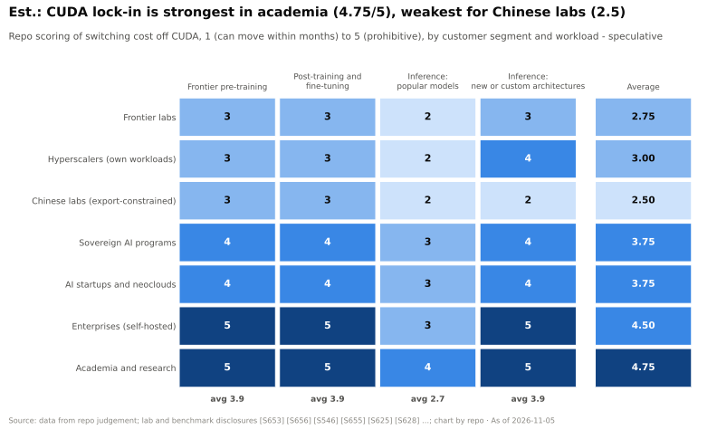

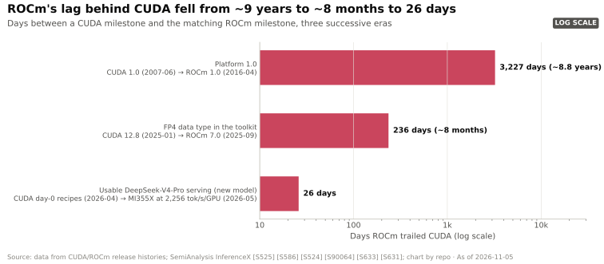

### 🛡️ 英伟达的反驳

抽象层缩小了差距，但并未消除差距。在本资料库跟踪的全部 12 个主要框架与引擎中，CUDA 均为原生支持（36/36），ROCm 为 26 [[S587]](../../sources/bibliography.md#s587)[[S580]](../../sources/bibliography.md#s580)[[S586]](../../sources/bibliography.md#s586)。DeepSeek-V4-Pro 在[首日（day 0）](../glossary.md#day-zero-support)即可在 CUDA 上运行；MI355X 花了 27 天才达到每用户 50 tokens/s，且仍比 B200 慢约 5× [[S633]](../../sources/bibliography.md#s633)[[S631]](../../sources/bibliography.md#s631)。内核生成的说法存在争议：经过校验的 KernelBench 版本发现，原版低估了 PyTorch 的速度，而且许多生成的内核在张量形状变化时就会失效 [[S18021]](../../sources/bibliography.md#s18021)。英伟达还在用 cuTile 和 CuTe DSL 在 Python 中迎合开发者 [[S9007]](../../sources/bibliography.md#s9007)[[S9030]](../../sources/bibliography.md#s9030)；而且能写内核的 AI 智能体同样能写 CUDA 内核。

> [!TIP]
> **算例 —— “时间税”到底有多大。** 假设（🔴）一个 AMD 集群每颗 GPU 的成本是英伟达的一半，一年中大部分时间提供相同的 token 产出，但在每个重大模型发布后的第一个月慢 5×（DeepSeek-V4 的模式 [[S631]](../../sources/bibliography.md#s631)）。其每 token 成本在 11 个月中为英伟达的 0.5×，在一个月中为 2.5×：(11 × 0.5 + 1 × 2.5) ÷ 12 ≈ **0.67×**。**结论：**在价格差距较大时，CUDA 时间税救不了英伟达；只有在英伟达成本溢价较小，或抢先上线的价值高于一个月廉价 token 的场景下，它才能保护英伟达。这正是护城河在企业客户中最强、在 AI 实验室中最弱的原因。

> [!IMPORTANT]
> **研判 —— CUDA 被侵蚀。** 可能性 **3** · 影响 **3** · 得分 **9** · 时间窗口 **2027–2030**。与第 09 层的结论一致：护城河是每次模型发布时缴纳的时间税，而且正在缩小。**关注：**新开源模型在 AMD 和 TPU 上的首日支持、ROCm 与 TPU 在 vLLM/SGLang 部署中的占比、高通旗下 Mojo 的采用情况，以及前沿实验室的芯片组合。

## 看空情景成立需要满足哪些条件

看空情景是一组条件，而非一种情绪。下表列出需要发生的事件、各项条件目前的状态，以及本资料库对其可能性的判断。

| # | 条件 | 当前状态（2026 年 11 月） | 看空阈值 | 至 2028 年的可能性（🔴） |
|---|---|---|---|---|
| 1 | 超大规模云厂商资本开支停止增长 | 三大厂商 2026 年指引约 $558B；2027 年预测接近 $1T [[S12518]](../../sources/bibliography.md#s12518)[[S18023]](../../sources/bibliography.md#s18023) | 首次给出资本开支同比削减的指引 | 2027 年低，2028 年中等 |
| 2 | 定制芯片拿走增量 | 博通 AI 营收 ≈ 英伟达数据中心营收的 19 % [[S2516]](../../sources/bibliography.md#s2516) | > 25 %，且与 Meta 达成商用 TPU 交易 | 中等 |
| 3 | 毛利率重置 | 目前 75.0 %；FY2028 指引 72–73 % [[S405]](../../sources/bibliography.md#s405)[[S18000]](../../sources/bibliography.md#s18000) | 剔除一次性费用后连续数个季度 < 65 % | 中等 |
| 4 | Token 需求变得缺乏弹性 | H100 租金自 2025 年 10 月以来 +38 % [[S12516]](../../sources/bibliography.md#s12516) | 租金指数跌破 $1.70 低点；token 用量持平 | 低至中等 |
| 5 | 融资收紧 | H1 股权购买 $42.4B；平台 > $500B [[S90072]](../../sources/bibliography.md#s90072)[[S12528]](../../sources/bibliography.md#s12528) | 新兴云服务商再融资失败；英伟达不得不扩大兜底 | 中等 |
| 6 | 供给追上需求，[重复下单](../glossary.md#double-ordering)逐步解除 | FY2028 “供应受限”；CoWoS 到 2028 年向约每月 260k 片晶圆迈进 [[S18000]](../../sources/bibliography.md#s18000)[[S3002]](../../sources/bibliography.md#s3002) | 交货周期骤缩；客户库存累积 | 2028 年中等 |
| 7 | 软件实现首日持平 | AMD 在 DeepSeek-V4 上滞后 26 天 [[S631]](../../sources/bibliography.md#s631) | 主流开源模型在 AMD 和 TPU 上实现首日持平 | 中等 |
| 8 | 政策范围扩大 | 中国占营收 5.6–8.2 % [[S90070]](../../sources/bibliography.md#s90070)[[S90069]](../../sources/bibliography.md#s90069) | 管制扩展至海湾地区主权买家 | 低 |

条件 1、3、5 同时成立，描述的是 2001 年式的情景；条件 2、3、7 同时成立，描述的是较缓慢的“够用芯片”情景，本资料库认为后者的可能性更大。

## 领先指标仪表盘

以下是本资料库会放在同一屏上的各项指标。多数指标随财报按季度更新；租金指数和容量价格更新更快。

| 指标 | 当前值 | 看空阈值 | 来源与更新频率 |
|---|---|---|---|
| 超大规模云厂商占英伟达数据中心营收的比例 | 约 55 %（Q2 FY2027） | > 60 % | CFO 评论，按季度 [[S406]](../../sources/bibliography.md#s406) |
| 最大直接客户占营收比例 | 16 %（Q2 FY2027） | > 20 % | 10-Q，按季度 [[S90069]](../../sources/bibliography.md#s90069) |
| 博通 AI 营收 ÷ 英伟达数据中心营收 | 约 19 % | > 25 % | 博通 8-K，按季度 [[S2516]](../../sources/bibliography.md#s2516) |
| GAAP 毛利率 | 75.0 %；Q3 指引 74.0 % | 剔除一次性费用后 < 70 % | 财报新闻稿 [[S405]](../../sources/bibliography.md#s405)[[S18000]](../../sources/bibliography.md#s18000) |
| 供应承诺 ÷ 季度营收 | 2.9×（$279B） | > 3.5× 且营收增速放缓 | 10-Q，按季度 [[S407]](../../sources/bibliography.md#s407) |
| 股权购买 ÷ 营收 | 约 24 %（H1 FY2027） | 再连续两个半年度上升 | 10-Q 现金流量表 [[S90072]](../../sources/bibliography.md#s90072) |
| 净股权收益 ÷ 净利润 | 约 20 %（H1 FY2027） | > 25 % | 10-Q [[S90069]](../../sources/bibliography.md#s90069) |
| 三大超大规模云厂商资本开支指引 | 约 $558B（2026） | 首次同比削减 | 财报电话会，按季度 [[S12518]](../../sources/bibliography.md#s12518) |
| H100 一年期租金指数 | $2.35（2026 年 3 月） | < $1.70（2025 年 10 月低点） | SemiAnalysis，按月 [[S12516]](../../sources/bibliography.md#s12516) |
| PJM 容量价格 | $333.44/MW-day，触及上限 | 上限持续生效且缺口扩大 | PJM 拍卖，按年 [[S18016]](../../sources/bibliography.md#s18016) |
| AMD 在新开源模型上的首日差距 | 26 天（DeepSeek-V4） | < 7 天 | SemiAnalysis InferenceX [[S631]](../../sources/bibliography.md#s631) |
| UALink 交换芯片 | 已进入实验室（2026 年下半年） | 大规模出货 | 联盟与厂商 [[S90051]](../../sources/bibliography.md#s90051) |
| SAMR 与 Hugging Face 审查 | 初步认定；可能面临欧盟/DOJ 审查 | 罚款 > $1B 或针对捆绑销售的救济措施 | 监管机构 [[S9505]](../../sources/bibliography.md#s9505)[[S11027]](../../sources/bibliography.md#s11027) |
| 美国本土先进封装 | 计划 2028–2029 年 | 推迟至 2029 年以后 | 台积电、Amkor [[S18014]](../../sources/bibliography.md#s18014) |

下方的催化剂日历显示其中几项指标下一次变动的时间。

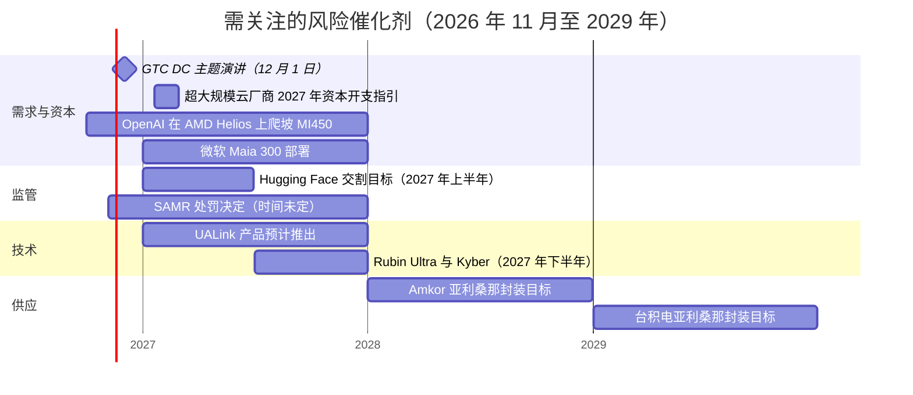

日历来源：GTC DC [[S90047]](../../sources/bibliography.md#s90047)，AMD Helios 与 OpenAI [[S90020]](../../sources/bibliography.md#s90020)[[S90021]](../../sources/bibliography.md#s90021)，Maia 300 [[S90046]](../../sources/bibliography.md#s90046)，Hugging Face [[S11026]](../../sources/bibliography.md#s11026)，SAMR [[S9505]](../../sources/bibliography.md#s9505)，UALink [[S90051]](../../sources/bibliography.md#s90051)，Rubin Ultra [[S90003]](../../sources/bibliography.md#s90003)，亚利桑那封装 [[S18014]](../../sources/bibliography.md#s18014)。

## 估值：市场已经隐含了什么

看空情景只有与股价所隐含的假设相比较才有意义。英伟达市值在 2026-08-28 约为 $5.28T——此前 Q2 FY2027 财报发布后的两个交易日分别上涨 8.7 % 和下跌 4.6 % [[S18004]](../../sources/bibliography.md#s18004)——并在 2026-10-05 以创纪录收盘价达到约 $5.76T [[S18005]](../../sources/bibliography.md#s18005)；未找到可靠的 2026 年 11 月数据。2026 年 4 月，在市值约 $4.8T 时，其远期市盈率约为 24×，而标普 500 指数约为 21× [[S18006]](../../sources/bibliography.md#s18006)。随后盈利前景大幅跃升：英伟达给出 FY2028 营收增长约 70 % 的指引，而分析师此前预期约为 45–47 % [[S18000]](../../sources/bibliography.md#s18000)[[S18003]](../../sources/bibliography.md#s18003)。

本资料库的测算（🔴）以 FY2027E 营收约 $410B 为基础（Q1 $81.6B + Q2 $96.2B + Q3 指引 $108B + 假设的 Q4 约 $124B）[[S403]](../../sources/bibliography.md#s403)[[S405]](../../sources/bibliography.md#s405)，套用四条 FY2028 路径，再用约 $5.5T 的市值除以由此得出的净利润。按指引路径计算，[远期市盈率](../glossary.md#forward-pe)约为 14×，低于标普 500 指数。

> [!TIP]
> **算例 —— 一行式反向 DCF。** 在全额派息的[反向 DCF](../glossary.md#reverse-dcf) 中，市盈率 = 1 ÷（股权成本 − 增长率）。按 FY2028 指引盈利约 14.1×、股权成本 9 % 计算，FY2028 之后的增长率 = 9 % − 1/14.1 ≈ 9 % − 7.1 % = **每年约 1.9 %**（🔴）[[S18027]](../../sources/bibliography.md#s18027)。在“增长停滞”路径下，同样的股价需要从更低的基数出发实现每年约 5.4 % 的增长；在 2001 年式重置下则需要约 7.5 %。**结论：**市场并未线性外推这轮繁荣，而是把 FY2028 视为接近平台期。因此，看空逻辑必须论证 FY2028 之后盈利会*下降*，而不仅仅是增长放缓。

🔧 技术细节：估值情景中的假设与敏感性

两条增长路径的净利率设为 56 %：FY2026 的 GAAP 净利率为 55.6 %，对应毛利率 71.1 %；Q2 FY2027 营业利润率约为 66 % [[S1]](../../sources/bibliography.md#s1)[[S405]](../../sources/bibliography.md#s405)；股权收益不计入。“增长停滞”路径假设毛利率为 65 %（ASIC 价格竞争叠加内存成本）、净利率为 48 %；重置情景假设毛利率为 55 %（可比于毛利率 60.5 % 的 H20 季度再叠加承诺相关费用）、净利率为 33 %。敏感性：股权成本为 10 % 时，指引路径隐含约 2.9 % 的增长；为 8 % 时约为 0.9 %。市值每变动 ±$0.3T，各倍数约变动 ±5 %。全部输入见 `data/x18_valuation_scenarios.csv`。这些是用于检验论点的情景，而非目标价。

## 多空观点汇总

> [!NOTE]
> **🐂 看多观点。** 英伟达直到 FY2028 都处于供应受限状态，指引增长约 70 % [[S18000]](../../sources/bibliography.md#s18000)，毛利率维持在 70% 以上区间，资产负债表以经营现金流为其生态系统提供资金 [[S403]](../../sources/bibliography.md#s403)。在价值池扩大约 4.2× 的同时，其 AI 芯片营收份额保持在约 87 % [[S416]](../../sources/bibliography.md#s416)[[S660]](../../sources/bibliography.md#s660)。本页上的每一项风险要么已体现在数字中（中国），要么有边界（反垄断），要么是时间问题（电力），要么是系统性而非竞争性的（台湾），要么正在被收编（NVLink Fusion、Groq、开源 Dynamo）。而且按约 14× 的指引盈利计，股价已经假设这轮繁荣将进入平台期。任何更好的结果都是上行空间。

> [!WARNING]
> **🐻 看空观点。** 英伟达最好的客户正在打造它的替代品，而这些客户恰恰构成了它的集中度，并为资本开支周期提供资金。定制芯片已相当于英伟达数据中心营收的约 19 % [[S2516]](../../sources/bibliography.md#s2516)；英伟达自身的股权购买比例与朗讯的供应商融资比例相当 [[S18007]](../../sources/bibliography.md#s18007)[[S90072]](../../sources/bibliography.md#s90072)；供应承诺是季度营收的 2.9× [[S407]](../../sources/bibliography.md#s407)；而且即使在 ASIC 竞争真正发力之前，毛利率指引就已下调 [[S18000]](../../sources/bibliography.md#s18000)。当 2028 年供给追上需求时，首先消退的是定价权，其次是重复订单的解除；而对峰值盈利给予 14× 的倍数并不便宜。

> [!IMPORTANT]
> **最需要记住的一点。** 十项风险可归结为一个问题：当供应不再是约束时，英伟达每单位算力的价格会怎样？毛利率是需要盯住的指标。

## 🎯 企业发展视角

1. **相互关联的风险簇同时也是客户名单。** 风险 1、2、7 都经由同样五六家买家传导。对任何挑战者而言，这些买家既是市场，*也*是最大的竞争来源。其中哪一家最有可能与商用芯片供应商合作实现多源采购，而非自研？又会在哪些工作负载上这样做？
2. **毛利率重置是机会，而不仅仅是风险。** 如果英伟达毛利率从 75 % 向 65 % 上下回落，每个商用芯片新进入者头顶的价格保护伞都会缩小。英伟达价格降到什么水平时，第二供应来源的推理方案（例如高通已公开的 AI200/AI250 和 Dragonfly AI300 路线图）仍能跨过自身的回报门槛 [[S90028]](../../sources/bibliography.md#s90028)[[S90060]](../../sources/bibliography.md#s90060)？
3. **没有现金流就不要照搬融资打法。** 英伟达能在六个月内用经营现金流为约 $42B 的持股提供资金 [[S90072]](../../sources/bibliography.md#s90072)[[S403]](../../sources/bibliography.md#s403)。对于资产负债表较小的公司，哪些结构能把利用率风险转移给第三方（主权包销、预付款、资产管理机构平台），而不是压在供应商身上？
4. **电力约束与推理商品化有利于能效专家。** 在电表而非预算成为约束的地方，每兆瓦 token 产出决定胜负。受电力上限约束的买家需要哪些独立证据（MLPerf、InferenceX），才会相信非英伟达厂商关于每兆瓦 token 产出的宣称？
5. **软件可移植性如今已是一类资产。** Modular（高通）、Hugging Face（英伟达，待交割）以及开源内核生成工具决定了 CUDA 被侵蚀的速度 [[S9511]](../../sources/bibliography.md#s9511)[[S11026]](../../sources/bibliography.md#s11026)[[S18020]](../../sources/bibliography.md#s18020)。剩余的可移植性资产（编译器、内核库、推理服务引擎）中哪些仍保持独立？本仪表盘上的哪些风险会最快改变它们的价值？
6. **用仪表盘把握时机。** 超大规模云厂商首次削减资本开支，或 H100 指数跌破 $1.70，很可能迅速导致 AI 芯片初创公司重新定价。哪些领先指标应触发对合作或收购选项的重新评估？

## 📚 来源（Sources）

<!-- Auto-generated from the [S…] citations on this page by `make build`. Edit sources/registry/*.csv, not this list. -->

- [**S1**](../../sources/bibliography.md#s1) NVIDIA Corporation via SEC EDGAR, *NVIDIA Announces Financial Results for Fourth Quarter and Fiscal 2026 (Form 8-K exhibit 99.1)*, 2026-02-25. [Link](https://www.sec.gov/Archives/edgar/data/1045810/000104581026000019/q4fy26pr.htm)
- [**S2**](../../sources/bibliography.md#s2) U.S. Securities and Exchange Commission (EDGAR), *NVIDIA Corporation Form 10-K annual reports FY2020–FY2025 (filing index)*, 2025-02-26. [Link](https://www.sec.gov/cgi-bin/browse-edgar?action=getcompany&CIK=0001045810&type=10-K&dateb=&owner=include&count=40)
- [**S100**](../../sources/bibliography.md#s100) NVIDIA Technical Blog, *Inside the NVIDIA Vera Rubin Platform: Six New Chips, One AI Supercomputer*, 2026-01-05. [Link](https://developer.nvidia.com/blog/inside-the-nvidia-rubin-platform-six-new-chips-one-ai-supercomputer/)
- [**S131**](../../sources/bibliography.md#s131) NVIDIA Newsroom, *NVIDIA NVLink Fusion: semi-custom AI infrastructure partner ecosystem (Computex 2025)*, 2025-05-19. [Link](https://nvidianews.nvidia.com/news/nvidia-nvlink-fusion-semi-custom-ai-infrastructure-partner-ecosystem)
- [**S151**](../../sources/bibliography.md#s151) Google Blog (Amin Vahdat), *Ironwood: The first Google TPU for the age of inference*, 2025-04-09. [Link](https://blog.google/products/google-cloud/ironwood-tpu-age-of-inference/)
- [**S174**](../../sources/bibliography.md#s174) OpenAI, *OpenAI and Broadcom announce strategic collaboration to deploy 10 gigawatts of OpenAI-designed AI accelerators*, 2025-10-13. [Link](https://openai.com/index/openai-and-broadcom-announce-strategic-collaboration/)
- [**S201**](../../sources/bibliography.md#s201) VideoCardz, *NVIDIA quietly cuts Vera Rubin specs, HBM4 bandwidth and NVLink 6 speeds now lower*, 2026-10. [Link](https://videocardz.com/newz/nvidia-quietly-cuts-vera-rubin-specs-hbm4-bandwidth-and-nvlink-6-speeds-now-lower)
- [**S226**](../../sources/bibliography.md#s226) AMD, *AMD Helios Rackscale Solution (product page)*, 2026. [Link](https://www.amd.com/en/products/rackscale-solutions/helios.html)
- [**S257**](../../sources/bibliography.md#s257) Ultra Ethernet Consortium, *Ultra Ethernet Consortium launches Specification 1.0*, 2025-06-11. [Link](https://ultraethernet.org/ultra-ethernet-consortium-uec-launches-specification-1-0-transforming-ethernet-for-ai-and-hpc-at-scale/)
- [**S305**](../../sources/bibliography.md#s305) DatacenterDynamics, *Nvidia's Rubin Ultra NVL576 rack expected to be 600kW, coming second half of 2027*, 2025-03-19. [Link](https://datacenterdynamics.com/en/news/nvidias-rubin-ultra-nvl576-rack-expected-to-be-600kw-coming-second-half-of-2027)
- [**S310**](../../sources/bibliography.md#s310) AnandTech (Ryan Smith), *NVIDIA unveils the DGX-1 HPC server: 8 Teslas, 3U, Q2 2016*, 2016-04-05. [Link](https://www.anandtech.com/show/10229)
- [**S379**](../../sources/bibliography.md#s379) TrendForce News, *TSMC CoWoS capacity and customer allocation estimates (TrendForce / Morgan Stanley, as reported)*, 2025. [Link](https://www.trendforce.com/news/)
- [**S382**](../../sources/bibliography.md#s382) Microsoft via SEC EDGAR, *Microsoft Corporation Form 10-K filings (FY2021, FY2023) - property and equipment useful lives*, 2023-07-27. [Link](https://www.sec.gov/cgi-bin/browse-edgar?action=getcompany&CIK=0000789019&type=10-K&dateb=&owner=include&count=40)
- [**S385**](../../sources/bibliography.md#s385) Amazon via SEC EDGAR, *Amazon.com Form 10-K filings (FY2019-FY2024) - useful lives of servers*, 2025-02-07. [Link](https://www.sec.gov/cgi-bin/browse-edgar?action=getcompany&CIK=0001018724&type=10-K&dateb=&owner=include&count=40)
- [**S389**](../../sources/bibliography.md#s389) U.S. Energy Information Administration, *EIA Electric Power Monthly, Table 5.6.A: average price of electricity to ultimate customers by end-use sector*, 2025. [Link](https://www.eia.gov/electricity/monthly/epm_table_grapher.php?t=epmt_5_6_a)
- [**S393**](../../sources/bibliography.md#s393) Latent Space (Eugene Cheah), *$2 H100s: how the GPU bubble burst*, 2024-10. [Link](https://www.latent.space/p/gpu-bubble)
- [**S398**](../../sources/bibliography.md#s398) NVIDIA Investor Relations, *NVIDIA Q2 FY2026 earnings call (2025-08-27): AI factory economics commentary*, 2025-08-27. [Link](https://investor.nvidia.com/events-and-presentations/events-and-presentations/default.aspx)
- [**S401**](../../sources/bibliography.md#s401) NVIDIA Corporation via SEC EDGAR, *NVIDIA Corporation Form 10-K for fiscal year ended January 25, 2026*, 2026-02-25. [Link](https://www.sec.gov/Archives/edgar/data/1045810/000104581026000021/nvda-20260125.htm)
- [**S403**](../../sources/bibliography.md#s403) NVIDIA Corporation via SEC EDGAR, *NVIDIA Announces Financial Results for First Quarter Fiscal 2027 (Form 8-K exhibit 99.1)*, 2026-05-20. [Link](https://www.sec.gov/Archives/edgar/data/0001045810/000104581026000051/q1fy27pr.htm)
- [**S405**](../../sources/bibliography.md#s405) NVIDIA Corporation via SEC EDGAR, *NVIDIA Announces Financial Results for Second Quarter Fiscal 2027 (Form 8-K exhibit 99.1)*, 2026-08-26. [Link](https://www.sec.gov/Archives/edgar/data/0001045810/000104581026000073/q2fy27pr.htm)
- [**S406**](../../sources/bibliography.md#s406) NVIDIA Corporation (Colette Kress), *CFO Commentary on Second Quarter Fiscal 2027 Results*, 2026-08-26. [Link](https://s201.q4cdn.com/141608511/files/doc_financials/2027/Q227/Q2FY27-CFO-Commentary.pdf)
- [**S407**](../../sources/bibliography.md#s407) NVIDIA Corporation via SEC EDGAR, *NVIDIA Corporation Form 10-Q for quarter ended July 26, 2026*, 2026-08-28. [Link](https://www.sec.gov/Archives/edgar/data/1045810/000104581026000075/nvda-20260726.htm)
- [**S408**](../../sources/bibliography.md#s408) NVIDIA Corporation, *NVIDIA Corp. (NVDA) Q2 Fiscal 2027 earnings call transcript (26 August 2026)*, 2026-08-26. [Link](https://s201.q4cdn.com/141608511/files/content_files/TRANSCRIPT_-NVIDIA-Corp-NVDA-US-Q2-2027-Earnings-Call-26-August-2026-5_00-PM-ET.pdf)
- [**S412**](../../sources/bibliography.md#s412) NVIDIA Corporation via SEC EDGAR, *NVIDIA Corporation Form 10-Q for quarter ended October 26, 2025*, 2025-11-19. [Link](https://www.sec.gov/Archives/edgar/data/1045810/000104581025000230/nvda-20251026.htm)
- [**S416**](../../sources/bibliography.md#s416) NVIDIA Corporation via SEC EDGAR, *NVIDIA Corporation Form 10-K for fiscal year ended January 26, 2025*, 2025-02-26. [Link](https://www.sec.gov/Archives/edgar/data/1045810/000104581025000023/nvda-20250126.htm)
- [**S431**](../../sources/bibliography.md#s431) Barchart, *Michael Burry called Nvidia's $95 billion in purchase obligations 'troubling' in February; six months later the filings show $279 billion*, 2026-09. [Link](https://www.barchart.com/story/news/4406785/michael-burry-called-nvidias-95-billion-in-purchase-obligations-troubling-in-february-six-months-later-the-filings-show-that-number-ballooned-to-279-billion)
- [**S444**](../../sources/bibliography.md#s444) NVIDIA Corporation, *NVIDIA Announces Financial Results for First Quarter Fiscal 2026 (press release with CFO commentary)*, 2025-05-28. [Link](https://nvidianews.nvidia.com/news/nvidia-announces-financial-results-for-first-quarter-fiscal-2026)
- [**S455**](../../sources/bibliography.md#s455) U.S. Securities and Exchange Commission (EDGAR), *Alphabet Inc. Form 10-K filings (EDGAR index)*, 2026-02-04. [Link](https://www.sec.gov/cgi-bin/browse-edgar?action=getcompany&CIK=0001652044&type=10-K&dateb=&owner=include&count=40)
- [**S456**](../../sources/bibliography.md#s456) U.S. Securities and Exchange Commission (EDGAR), *Amazon.com Inc. Form 10-K filings (EDGAR index)*, 2026-02-06. [Link](https://www.sec.gov/cgi-bin/browse-edgar?action=getcompany&CIK=0001018724&type=10-K&dateb=&owner=include&count=40)
- [**S457**](../../sources/bibliography.md#s457) U.S. Securities and Exchange Commission (EDGAR), *Meta Platforms Form 10-K filings (EDGAR index)*, 2026-01-29. [Link](https://www.sec.gov/cgi-bin/browse-edgar?action=getcompany&CIK=0001326801&type=10-K&dateb=&owner=include&count=40)
- [**S460**](../../sources/bibliography.md#s460) Alphabet Investor Relations, *Alphabet Q4 and fiscal year 2025 results and 2026 capex outlook*, 2026-02. [Link](https://abc.xyz/investor/)
- [**S461**](../../sources/bibliography.md#s461) Amazon Investor Relations, *Amazon.com Q4 2025 results and 2026 capex commentary*, 2026-02. [Link](https://ir.aboutamazon.com/)
- [**S462**](../../sources/bibliography.md#s462) Meta Investor Relations, *Meta Q4 and full year 2025 results and 2026 capex outlook*, 2026-01. [Link](https://investor.atmeta.com/)
- [**S476**](../../sources/bibliography.md#s476) NVIDIA Blog, *NVIDIA to Acquire GPU Orchestration Software Provider Run:ai*, 2024-04-24. [Link](https://blogs.nvidia.com/blog/runai/)
- [**S518**](../../sources/bibliography.md#s518) ServeTheHome, *NVIDIA NVLink Fusion tapped for future AWS Trainium4 deployments*, 2025-12-02. [Link](https://www.servethehome.com/nvidia-nvlink-fusion-tapped-for-future-aws-trainium4-deployments/)
- [**S546**](../../sources/bibliography.md#s546) TechWire Asia, *AMD Advancing AI 2026: Helios, OpenAI, Meta, Anthropic*, 2026-07. [Link](https://techwireasia.com/2026/07/amd-advancing-ai-2026-helios-openai-meta-anthropic/)
- [**S552**](../../sources/bibliography.md#s552) Google Cloud Blog (Karan Batta), *Bringing Google TPUs to Oracle Cloud Infrastructure*, 2026-10-27. [Link](https://cloud.google.com/blog/products/infrastructure/bringing-google-tpus-to-oracle-cloud-infrastructure)
- [**S561**](../../sources/bibliography.md#s561) DatacenterDynamics, *Meta unveils next four generations of its MTIA chip*, 2026-03-11. [Link](https://www.datacenterdynamics.com/en/news/meta-unveils-next-four-generations-of-its-mtia-chip/)
- [**S574**](../../sources/bibliography.md#s574) HPCwire, *UALink Consortium Publishes 4 Specifications Defining In-Network Compute, Chiplets, Manageability and 200G Performance*, 2026-04-07. [Link](https://www.hpcwire.com/off-the-wire/ualink-consortium-publishes-4-specifications-defining-in-network-compute-chiplets-manageability-and-200g-performance/)
- [**S575**](../../sources/bibliography.md#s575) Network World, *Ultra Ethernet 1.1 extends the specification to scale-up networks and adds programmable congestion control*, 2026-10. [Link](https://www.networkworld.com/article/4235340/ultra-ethernet-1-1-extends-the-specification-to-scale-up-networks-and-adds-programmable-congestion-control.html)
- [**S576**](../../sources/bibliography.md#s576) Converge Digest, *OCP releases ESUN 1.0 spec for Ethernet-based scale-up AI fabrics*, 2026-03. [Link](https://convergedigest.com/ocp-releases-esun-1-0-spec-for-ethernet-based-scale-up-ai-fabrics/)
- [**S577**](../../sources/bibliography.md#s577) JAX (GitHub: jax-ml/jax docs/installation.md), *JAX installation guide — supported platforms*, 2026-11. [Link](https://github.com/jax-ml/jax/blob/main/docs/installation.md)
- [**S578**](../../sources/bibliography.md#s578) OpenAI Triton (GitHub), *Triton (triton-lang/triton) README — supported hardware*, 2026-11. [Link](https://github.com/triton-lang/triton/blob/main/README.md)
- [**S580**](../../sources/bibliography.md#s580) vLLM project (GitHub), *vLLM README and installation docs — supported hardware*, 2026-11. [Link](https://github.com/vllm-project/vllm/blob/main/docs/getting_started/installation/README.md)
- [**S586**](../../sources/bibliography.md#s586) AMD (GitHub: ROCm/ROCm docs), *ROCm documentation sources: release history, AI-ecosystem compatibility matrix, consolidated changelog*, 2026-08-26. [Link](https://github.com/ROCm/ROCm/blob/develop/docs/release/versions.rst)
- [**S587**](../../sources/bibliography.md#s587) PyTorch (GitHub: pytorch/pytorch), *PyTorch README — building with CUDA, ROCm and Intel GPU support*, 2026-11. [Link](https://github.com/pytorch/pytorch/blob/main/README.md)
- [**S601**](../../sources/bibliography.md#s601) MLCommons, *MLPerf Inference v5.1 results (summary_results.json and per-submitter logs)*, 2025-09-09. [Link](https://github.com/mlcommons/inference_results_v5.1)
- [**S603**](../../sources/bibliography.md#s603) MLCommons, *MLPerf Inference v6.1 results (summary.csv and per-submitter logs)*, 2026-09. [Link](https://github.com/mlcommons/inference_results_v6.1)
- [**S621**](../../sources/bibliography.md#s621) SemiAnalysis (InferenceX-app repository), *InferenceX public API snapshot (benchmarks.json and benchmarks-history.json fixtures)*, 2026-10-17. [Link](https://github.com/SemiAnalysisAI/InferenceX-app/tree/main/packages/app/cypress/fixtures/api)
- [**S622**](../../sources/bibliography.md#s622) SemiAnalysis (InferenceX-app repository), *InferenceX hardware registry: TCO per GPU-hour by SKU (SemiAnalysis July 2026 pricing surveys and AI Cloud TCO Model)*, 2026-07. [Link](https://github.com/SemiAnalysisAI/InferenceX-app/blob/main/packages/constants/src/gpu-keys.ts)
- [**S625**](../../sources/bibliography.md#s625) SemiAnalysis, *TPU Inference Externalization Full Steam Ahead*, 2026-09-07. [Link](https://github.com/SemiAnalysisAI/InferenceX-app/blob/main/packages/app/content/blog/tpu-inferencex-full-steam.mdx)
- [**S628**](../../sources/bibliography.md#s628) SemiAnalysis, *OpenAI Jalapeño: Better Than Nvidia Blackwell*, 2026-08-25. [Link](https://github.com/SemiAnalysisAI/InferenceX-app/blob/main/packages/app/content/blog/openai-jalapeno-better-than-nvidia.mdx)
- [**S631**](../../sources/bibliography.md#s631) SemiAnalysis, *MI355X DeepSeek-V4-Pro on SGLang: 110.5x Throughput per GPU in 26 Days*, 2026-05-26. [Link](https://github.com/SemiAnalysisAI/InferenceX-app/blob/main/packages/app/content/blog/mi355x-deepseek-v4-pro-sglang-110x-in-26-days.mdx)
- [**S633**](../../sources/bibliography.md#s633) SemiAnalysis, *DeepSeekV4 1.6T Day 0 to Day 43 Performance Over Time — Huawei, GB300 NVL72, MI355X, B200*, 2026-06-09. [Link](https://github.com/SemiAnalysisAI/InferenceX-app/blob/main/packages/app/content/blog/deepseekv4-16t-day-0-to-day-43-performance.mdx)
- [**S650**](../../sources/bibliography.md#s650) Google Cloud Blog, *Inside the Ironwood TPU codesigned AI stack*, 2025-11-06. [Link](https://cloud.google.com/blog/products/compute/inside-the-ironwood-tpu-codesigned-ai-stack)
- [**S653**](../../sources/bibliography.md#s653) Anthropic, *Expanding our use of Google Cloud TPUs and Services*, 2025-10-23. [Link](https://www.anthropic.com/news/expanding-our-use-of-google-cloud-tpus-and-services)
- [**S660**](../../sources/bibliography.md#s660) Broadcom Inc., *Broadcom Inc. Announces Fourth Quarter and Fiscal Year 2024 Financial Results*, 2024-12-12. [Link](https://investors.broadcom.com/financial-information/quarterly-results)
- [**S661**](../../sources/bibliography.md#s661) Broadcom Inc., *Broadcom Inc. Announces Fourth Quarter and Fiscal Year 2025 Financial Results*, 2025-12-11. [Link](https://investors.broadcom.com/financial-information/quarterly-results)
- [**S662**](../../sources/bibliography.md#s662) Marvell Technology, *Marvell Technology fourth quarter and fiscal 2025 results and AI revenue commentary*, 2025-03-04. [Link](https://investor.marvell.com/news-events/press-releases)
- [**S666**](../../sources/bibliography.md#s666) TrendForce, *TrendForce AI server shipment forecasts (GPU-based vs ASIC-based share)*, 2025-10. [Link](https://www.trendforce.com/presscenter/news)
- [**S2516**](../../sources/bibliography.md#s2516) Broadcom Inc. via SEC EDGAR, *Broadcom Inc. Announces Third Quarter Fiscal Year 2026 Financial Results (Form 8-K exhibit 99.1)*, 2026-09. [Link](https://www.sec.gov/Archives/edgar/data/0001730168/000173016826000076/avgo-08022026x8kxex99.htm)
- [**S3002**](../../sources/bibliography.md#s3002) TrendForce, *TSMC reportedly targets 22% 2nm, 16% 3nm capacity boost by mid-2027; CoWoS to double by 2028*, 2026-09-14. [Link](https://www.trendforce.com/news/2026/09/14/news-tsmc-reportedly-targets-22-2nm-16-3nm-capacity-boost-by-mid-2027-cowos-to-double-by-2028/)
- [**S3533**](../../sources/bibliography.md#s3533) Micron Technology via SEC EDGAR, *Micron Technology fiscal Q4 2026 results (Form 8-K exhibit 99.1)*, 2026-09. [Link](https://www.sec.gov/Archives/edgar/data/0000723125/000072312526000018/a2026q4ex991-pressrelease.htm)
- [**S5520**](../../sources/bibliography.md#s5520) Business Wire, *Ultra Accelerator Link Consortium incorporates and opens membership*, 2024-10-29. [Link](https://www.businesswire.com/news/home/20241029998800/en)
- [**S5521**](../../sources/bibliography.md#s5521) Converge Digest, *UALink Consortium expands board with Alibaba, Apple and Synopsys*, 2025-01-14. [Link](https://convergedigest.com/ualink-consortium-expands-board-with-alibaba-apple-and-synopsys/)
- [**S5523**](../../sources/bibliography.md#s5523) The Register, *HPE backs AMD's Helios AI rack with Juniper's scale-up switch*, 2025-12-02. [Link](https://www.theregister.com/2025/12/02/hpe_amd_helios_racks/)
- [**S5524**](../../sources/bibliography.md#s5524) Fierce Network, *AMD's Helios bets AI networking on open Ethernet*, 2026. [Link](https://www.fierce-network.com/cloud/amds-helios-bets-ai-networking-open-ethernet)
- [**S8009**](../../sources/bibliography.md#s8009) Lawrence Berkeley National Laboratory, *Queued Up: 2025 Edition, Characteristics of Power Plants Seeking Transmission Interconnection As of the End of 2024*, 2025-12-15. [Link](https://emp.lbl.gov/sites/default/files/2025-12/Queued%20Up%202025%20Edition%20-%2012.15.2025.pdf)
- [**S8010**](../../sources/bibliography.md#s8010) Bloomberg, *Data Centers Face Seven-Year Wait for Dominion Power Hookups*, 2024-08-29. [Link](https://www.bloomberg.com/news/articles/2024-08-29/data-centers-face-seven-year-wait-for-power-hookups-in-virginia)
- [**S8011**](../../sources/bibliography.md#s8011) ERCOT, *ERCOT Large Load Update (April 2026 hearing)*, 2026-04-01. [Link](https://www.ercot.com/files/docs/2026/04/01/ERCOT_LargeLoad_Update_April2026_B-C_-Hearing.pdf)
- [**S8015**](../../sources/bibliography.md#s8015) Cleanview, *Behind-the-meter data centers: Colossus (xAI) report*, 2026-05. [Link](https://cleanview.co/reports/behind-the-meter-data-centers/full-report/colossus)
- [**S9007**](../../sources/bibliography.md#s9007) NVIDIA (GitHub: NVIDIA/cutile-python), *cuTile Python README*, 2026-11. [Link](https://github.com/NVIDIA/cutile-python/blob/main/README.md)
- [**S9021**](../../sources/bibliography.md#s9021) ACM ASPLOS 2024 (PDF hosted by PyTorch) (Jason Ansel et al.), *PyTorch 2: Faster Machine Learning Through Dynamic Python Bytecode Transformation and Graph Compilation*, 2024-04. [Link](https://pytorch.org/assets/pytorch2-2.pdf)
- [**S9028**](../../sources/bibliography.md#s9028) StorageReview, *Meta's MTIA roadmap: four chip generations in two years put GenAI inference first*, 2026-03. [Link](https://www.storagereview.com/news/metas-mtia-roadmap-four-chip-generations-in-two-years-put-genai-inference-first)
- [**S9030**](../../sources/bibliography.md#s9030) NVIDIA (GitHub: NVIDIA/cutlass), *CUTLASS 4.8.1 README (CuTe DSL)*, 2026-10. [Link](https://github.com/NVIDIA/cutlass/blob/main/README.md)
- [**S9503**](../../sources/bibliography.md#s9503) Business Standard (Bloomberg), *Nvidia gets subpoena from US Justice Dept as antitrust probe deepens*, 2024-09-04. [Link](https://www.business-standard.com/world-news/nvidia-gets-subpoena-from-us-justice-dept-as-antitrust-probe-deepens-124090400121_1.html)
- [**S9504**](../../sources/bibliography.md#s9504) Business Standard, *US launches antitrust investigation into Nvidia over sales practices*, 2024-08-02. [Link](https://www.business-standard.com/world-news/us-launches-antitrust-investigation-into-nvidia-over-sales-practices-124080201689_1.html)
- [**S9505**](../../sources/bibliography.md#s9505) JURIST, *China finds Nvidia violated antimonopoly law in preliminary probe*, 2025-09-15. [Link](https://www.jurist.org/news/2025/09/china-finds-nvidia-violated-antimonopoly-law-in-preliminary-probe/)
- [**S9511**](../../sources/bibliography.md#s9511) Nasdaq (Qualcomm press release), *Qualcomm Completes Acquisition of Modular*, 2026-07-29. [Link](https://www.nasdaq.com/press-release/qualcomm-completes-acquisition-modular-2026-07-29)
- [**S9512**](../../sources/bibliography.md#s9512) Phoronix (Michael Larabel), *Modular's Mojo Language Now Open-Source Following Qualcomm Acquisition*, 2026-08-18. [Link](https://www.phoronix.com/news/Modular-Mojo-Open-Source)
- [**S9538**](../../sources/bibliography.md#s9538) The Next Web, *AMD is investing $5 billion in Anthropic and deploying 2 gigawatts of Helios GPUs to run Claude*, 2026. [Link](https://thenextweb.com/news/amd-anthropic-5-billion-investment-2gw-helios-mi450)
- [**S11011**](../../sources/bibliography.md#s11011) MarketBeat, *NVIDIA Q2 Fiscal 2025 earnings call transcript (28 August 2024)*, 2024-08-28. [Link](https://www.marketbeat.com/earnings/transcripts/110080/)
- [**S11026**](../../sources/bibliography.md#s11026) Implicator.ai, *Nvidia confirms $12.9 billion Hugging Face deal, says its chips won't be required*, 2026-09. [Link](https://www.implicator.ai/nvidia-confirms-12-9-billion-hugging-face-deal-says-its-chips-wont-be-required/)
- [**S11027**](../../sources/bibliography.md#s11027) MLex, *Nvidia may seek EU review of Hugging Face deal amid filing uncertainty*, 2026-09-23. [Link](https://www.mlex.com/mlex/articles/2528556/nvidia-may-seek-eu-review-of-hugging-face-deal-amid-european-filing-uncertainty)
- [**S11028**](../../sources/bibliography.md#s11028) Stocktwits, *NVDA stock edges down on DOJ interest in $12.9 billion Hugging Face acquisition*, 2026-10-28. [Link](https://stocktwits.com/news-articles/markets/equity/nvda-stock-edges-down-on-doj-interest-in-12-9-billion-hugging-face-acquisition/cZU9MDeR9Go)
- [**S11523**](../../sources/bibliography.md#s11523) DatacenterDynamics, *OpenAI signs $10 billion deal with Cerebras with 750MW of big chip compute*, 2026-01-14. [Link](https://www.datacenterdynamics.com/en/news/openai-signs-10-billion-deal-with-cerebras-with-750mw-of-big-chip-compute/)
- [**S11526**](../../sources/bibliography.md#s11526) Stanford HAI, *The 2025 AI Index Report*, 2025-04. [Link](https://hai.stanford.edu/ai-index/2025-ai-index-report)
- [**S11535**](../../sources/bibliography.md#s11535) Doolpa, *OpenAI launches GPT-5.5 with state-of-the-art agentic coding and doubles API prices (April 2026)*, 2026-04. [Link](https://doolpa.com/news/openai-gpt-5-5-launch-agentic-coding-pricing-april-2026)
- [**S12010**](../../sources/bibliography.md#s12010) DatacenterDynamics, *Neocloud results Q2 2026: CoreWeave, Nebius, Cerebras*, 2026-08. [Link](https://www.datacenterdynamics.com/en/news/neocloud-results-q2-2026-coreweave-nebius-cerebras/)
- [**S12500**](../../sources/bibliography.md#s12500) CoreWeave (press release via Seeking Alpha), *CoreWeave Reports Strong Second Quarter 2026 Results*, 2026-08. [Link](https://seekingalpha.com/pr/20615715)
- [**S12510**](../../sources/bibliography.md#s12510) NVIDIA Technical Blog, *NVIDIA Run:ai is now open source as part of NVIDIA DSX AI Factory platform*, 2026-10. [Link](https://developer.nvidia.com/blog/nvidia-runai-is-now-open-source-as-part-of-nvidia-dsx-ai-factory-platform/)
- [**S12516**](../../sources/bibliography.md#s12516) SemiAnalysis, *The Great GPU Shortage - Rental Capacity - Launching our H100 1 Year Rental Price Index*, 2026-03. [Link](https://newsletter.semianalysis.com/p/the-great-gpu-shortage-rental-capacity)
- [**S12518**](../../sources/bibliography.md#s12518) Datacentres.com, *Hyperscaler capex trends: over $700 billion for 2026*, 2026-08. [Link](https://www.datacentres.com/guides/hyperscaler-capex-trends)
- [**S12519**](../../sources/bibliography.md#s12519) Hargreaves Lansdown, *AI hyperscalers are expected to finish the year spending a whopping $828 billion on capex*, 2026-10. [Link](https://www.hl.co.uk/news/ai-hyperscalers-are-expected-to-finish-the-year-spending-a-whopping-828-billion-on-capex)
- [**S12528**](../../sources/bibliography.md#s12528) NVIDIA Newsroom, *NVIDIA Partners With Apollo, BlackRock, Blackstone, Brookfield, Goldman Sachs and KKR to Establish AI Compute Infrastructure Financing Platforms to Mobilize Over $500 Billion of Third-Party Capital*, 2026-08-10. [Link](https://nvidianews.nvidia.com/news/nvidia-partners-with-apollo-blackrock-blackstone-brookfield-goldman-sachs-and-kkr-to-establish-ai-compute-infrastructure-financing-platforms-to-mobilize-over-500-billion-of-third-party-capital)
- [**S13003**](../../sources/bibliography.md#s13003) Middle East AI News, *HUMAIN to deploy 600,000 NVIDIA GPUs across KSA, USA*, 2025-11-19. [Link](https://www.middleeastainews.com/p/humain-to-deploy-600000-nvidia-gpus)
- [**S13511**](../../sources/bibliography.md#s13511) Kavout, *Is Nvidia's Groq deal a masterstroke or an antitrust minefield?*, 2026. [Link](https://www.kavout.com/market-lens/is-nvidia-s-groq-deal-a-masterstroke-or-an-antitrust-minefield)
- [**S18000**](../../sources/bibliography.md#s18000) Implicator.ai, *Nvidia guides ~70% fiscal 2028 growth as memory costs squeeze margins*, 2026-08-27. [Link](https://www.implicator.ai/nvidia-70-percent-growth-forecast-margin-outlook/)
- [**S18001**](../../sources/bibliography.md#s18001) Saxo Bank, *Nvidia earnings: AI boom meets margin test*, 2026-08-27. [Link](https://www.home.saxo/content/articles/equities/nvidia-earnings-ai-boom-meets-margin-test-27082026)
- [**S18002**](../../sources/bibliography.md#s18002) Zacks Investment Research (via Nasdaq), *Memory costs rise: can NVIDIA protect its 70%+ gross margin?*, 2026-09. [Link](https://www.zacks.com/stock/news/2984225/memory-costs-rise-can-nvidia-protect-its-70-gross-margin)
- [**S18003**](../../sources/bibliography.md#s18003) Barchart, *Nvidia (NVDA) earns price target upgrades after monster Q2*, 2026-08. [Link](https://www.barchart.com/story/news/4226449/nvidia-nvda-earns-price-target-upgrades-after-monster-q2)
- [**S18004**](../../sources/bibliography.md#s18004) TS2 Tech, *Nvidia shares fall 4.6%, wiping out $253 billion as margin concerns eclipse $108 billion forecast*, 2026-08-28. [Link](https://ts2.tech/?p=21256496)
- [**S18005**](../../sources/bibliography.md#s18005) Crowdfund Insider, *Nvidia ($NVDA) nears $6T market cap as company stock hits ATH*, 2026-10. [Link](https://www.crowdfundinsider.com/?p=316268)
- [**S18006**](../../sources/bibliography.md#s18006) The Motley Fool, *Will Nvidia be worth $6 trillion a year from now?*, 2026-04-19. [Link](https://fool.com/investing/2026/04/19/will-nvidia-be-worth-6-trillion-a-year-from-now-wa/)
- [**S18007**](../../sources/bibliography.md#s18007) tomtunguz.com (Tomasz Tunguz), *Circular financing: does Nvidia's $110B bet echo the telecom bubble?*, 2025-11. [Link](https://tomtunguz.com/nvidia_nortel_vendor_financing_comparison/)
- [**S18008**](../../sources/bibliography.md#s18008) IT World Canada, *Telecom equipment giants rethink the value of vendor financing model*, 2002. [Link](https://itworldcanada.com/?p=24821)
- [**S18009**](../../sources/bibliography.md#s18009) Cisco Systems via SEC EDGAR, *Cisco Systems Form 10-K for fiscal 2001 (Exhibit 13: annual report financial section)*, 2001-10. [Link](https://www.sec.gov/Archives/edgar/data/0000858877/000109581101505065/f75710ex13.txt)
- [**S18010**](../../sources/bibliography.md#s18010) Cisco Newsroom, *Cisco Systems offers business and financial update*, 2001-04-16. [Link](https://newsroom.cisco.com/c/r/newsroom/en/us/a/y2001/m04/cisco-systems-offers-business-and-financial-update.html)
- [**S18011**](../../sources/bibliography.md#s18011) Insurance Journal (Bloomberg), *A war over Taiwan would cost the world $10 trillion (Bloomberg Economics)*, 2024-01-11. [Link](https://www.insurancejournal.com/news/international/2024/01/11/755295.htm)
- [**S18012**](../../sources/bibliography.md#s18012) TechSpot, *TSMC produces first Nvidia Blackwell GPU in the US, but it still has to fly to Taiwan for packaging*, 2025-10. [Link](https://www.techspot.com/news/109958-tsmc-produces-first-nvidia-blackwell-gpu-us-but.html)
- [**S18013**](../../sources/bibliography.md#s18013) DatacenterDynamics, *First US-made Nvidia Blackwell wafer manufactured at TSMC's Arizona fab*, 2025-10-17. [Link](https://www.datacenterdynamics.com/en/news/first-us-made-nvidia-blackwell-wafer-manufactured-at-tsmcs-arizona-fab/)
- [**S18014**](../../sources/bibliography.md#s18014) Pulse (news aggregator), *TSMC starts work on Arizona packaging plant*, 2026-04. [Link](https://www.pulse.bot/hardware/news/tsmc-starts-work-on-arizona-packaging-plant-ec06e32a-3aa1-479a-8f35-32ab6d7b68b9/)
- [**S18015**](../../sources/bibliography.md#s18015) Taiwan News, *Nvidia overtakes Apple as TSMC's largest customer*, 2026. [Link](https://www.taiwannews.com.tw/news/6289054)
- [**S18016**](../../sources/bibliography.md#s18016) PJM Interconnection, *PJM auction procures 134,479 MW of generation resources (2027/2028 Base Residual Auction)*, 2025-12-17. [Link](https://www.pjm.com/-/media/DotCom/about-pjm/newsroom/2025-releases/20251217-pjm-auction-procures-134479-mw-of-generation-resources.pdf)
- [**S18017**](../../sources/bibliography.md#s18017) Utility Dive, *PJM capacity auction hits price cap as data center demand strains grid*, 2025-12. [Link](https://www.utilitydive.com/news/pjm-interconnection-capacity-auction-data-center/808264/)
- [**S18018**](../../sources/bibliography.md#s18018) Citizens Utility Board, *PJM capacity auction prices (2024/25 to 2026/27)*, 2025. [Link](https://www.citizensutilityboard.org/?p=44301)
- [**S18019**](../../sources/bibliography.md#s18019) Maryland Office of People's Counsel, *Data center power demands again drive record power auction prices*, 2025-12. [Link](https://content.govdelivery.com/accounts/MDOPC/bulletins/4006939)
- [**S18020**](../../sources/bibliography.md#s18020) arXiv (ByteDance Seed and Tsinghua University), *CUDA Agent: large-scale agentic reinforcement learning for high-performance CUDA kernel generation (arXiv 2602.24286)*, 2026-02. [Link](https://arxiv.org/abs/2602.24286)
- [**S18021**](../../sources/bibliography.md#s18021) Towards Data Science, *AI agents beat PyTorch writing faster CUDA kernels (with caveats)*, 2026-10. [Link](https://towardsdatascience.com/ai-agents-beat-pytorch-writing-faster-cuda-kernels/)
- [**S18022**](../../sources/bibliography.md#s18022) S&P Global Market Intelligence, *Microsoft and Alphabet earnings previews (Research — October 26 2026)*, 2026-10-26. [Link](https://www.spglobal.com/market-intelligence/en/news-insights/research/2026/10/microsoft-and-alphabet-earnings-previews)
- [**S18023**](../../sources/bibliography.md#s18023) DatacenterDynamics, *Moody's hyperscaler capex forecasts marked up by $85bn to close in on $1trn by 2027*, 2026. [Link](https://datacenterdynamics.com/en/news/moodys-hyperscaler-capex-forecasts-marked-up-by-85bn-to-close-in-on-1trn-by-2027/)
- [**S18024**](../../sources/bibliography.md#s18024) Bain & Company, *$2 trillion in new revenue needed to fund AI's scaling trend (Bain & Company's 6th annual Global Technology Report)*, 2025-09-23. [Link](https://www.bain.com/about/media-center/press-releases/20252/%25242-trillion-in-new-revenue-needed-to-fund-ais-scaling-trend---bain--companys-6th-annual-global-technology-report)
- [**S18025**](../../sources/bibliography.md#s18025) TechCrunch, *Sam Altman says OpenAI has $20B ARR and about $1.4 trillion in data center commitments*, 2025-11-06. [Link](https://techcrunch.com/2025/11/06/sam-altman-says-openai-has-20b-arr-and-about-1-4-trillion-in-data-center-commitments/)
- [**S18026**](../../sources/bibliography.md#s18026) Business Standard, *OpenAI expects $600 bn in compute spending through 2030 ahead of IPO (Reuters)*, 2026-02-21. [Link](https://www.business-standard.com/world-news/openai-expects-600-bn-in-compute-spending-through-2030-ahead-of-ipo-126022100286_1.html)
- [**S18027**](../../sources/bibliography.md#s18027) nvidia_deep_dive_claude repository, *Repo analysis: chapter 18 risk scores, financing ratios and valuation scenarios*, 2026-11-05. [Link](https://github.com/FrankHuang94/nvidia_deep_dive_claude/blob/main/cross-cutting/18-vulnerabilities-and-bear-case.md)
- [**S21003**](../../sources/bibliography.md#s21003) Akin Gump, *Nvidia/Mellanox: China's close scrutiny of semiconductor deals continues*, 2020-04. [Link](https://www.akingump.com/en/insights/alerts/nvidiamellanox-chinas-close-scrutiny-of-semiconductor-deals-continues)
- [**S23010**](../../sources/bibliography.md#s23010) nvidia_deep_dive_claude repository, *Repo analysis: CS3 TPU economics (break-even fleet for an in-house ASIC, per-token gap vs B200, implied GPU price cut)*, 2026-11-05. [Link](https://github.com/FrankHuang94/nvidia_deep_dive_claude/blob/main/case-studies/CS3-google-tpu-the-credible-alternative.md)
- [**S24004**](../../sources/bibliography.md#s24004) The Register, *AMD copy-pastes 6 GW chips-for-stock deal in new Meta agreement*, 2026-02-24. [Link](https://www.theregister.com/2026/02/24/amd_copypastes_openai_6gw_chipsforstock/)
- [**S26004**](../../sources/bibliography.md#s26004) NPR, *Trump says Nvidia will hand the U.S. 15% of its H20 chip sales to China*, 2025-08-11. [Link](https://www.npr.org/2025/08/11/nx-s1-5498689/trump-nvidia-h20-chip-sales-china)
- [**S26006**](../../sources/bibliography.md#s26006) DatacenterDynamics, *China's internet regulator tells Chinese tech companies to stop buying Nvidia AI chips - report*, 2025-09-17. [Link](https://www.datacenterdynamics.com/en/news/chinas-internet-regulator-tells-chinese-tech-companies-to-stop-buying-nvidia-ai-chips-report/)
- [**S26007**](../../sources/bibliography.md#s26007) Tom's Hardware, *China bans foreign AI chips from state-funded data centers*, 2025-11. [Link](https://www.tomshardware.com/tech-industry/semiconductors/china-bans-foreign-ai-chips-from-state-funded-data-centers)
- [**S26009**](../../sources/bibliography.md#s26009) South China Morning Post, *China freeze on H200 chip sales clouds Nvidia's record earnings*, 2026-08. [Link](https://www.scmp.com/tech/article/3344663/china-freeze-h200-chip-sales-clouds-nvidias-record-earnings)
- [**S27001**](../../sources/bibliography.md#s27001) Tom's Hardware, *Oracle and OpenAI scrap planned 600MW Abilene expansion*, 2026-03. [Link](https://www.tomshardware.com/tech-industry/oracle-and-openai-scrap-planned-600mw-abilene-expansion)
- [**S32018**](../../sources/bibliography.md#s32018) Google (The Keyword) (Sundar Pichai), *Google I/O 2025 keynote remarks (Sundar Pichai)*, 2025-05-20. [Link](https://blog.google/technology/ai/io-2025-keynote/)
- [**S32020**](../../sources/bibliography.md#s32020) Alphabet / Google (The Keyword) (Sundar Pichai), *Alphabet CEO remarks on token volume (October 2025)*, 2025-10. [Link](https://blog.google/inside-google/message-ceo/alphabet-earnings-q3-2025/)
- [**S33015**](../../sources/bibliography.md#s33015) International Energy Agency, *Energy and AI*, 2025-04-10. [Link](https://www.iea.org/reports/energy-and-ai)
- [**S35003**](../../sources/bibliography.md#s35003) TechNode, *TSMC sets 2nm wafer price at $30,000, far below earlier 50% increase speculation*, 2025-10-09. [Link](https://technode.com/2025/10/09/tsmc-sets-2nm-wafer-price-at-30000-far-below-earlier-50-increase-speculation/)
- [**S35015**](../../sources/bibliography.md#s35015) Introl, *NVIDIA Rubin Enters Full Production: The 336 Billion Transistor GPU Reshaping AI Infrastructure*, 2026-01. [Link](https://introl.com/blog/nvidia-rubin-full-production-ces-2026-ai-infrastructure)
- [**S35037**](../../sources/bibliography.md#s35037) TrendForce, *TSMC reportedly raising N3P prices 20% ahead of 2nm era; pressuring Qualcomm and MediaTek*, 2025-09-23. [Link](https://www.trendforce.com/news/2025/09/23/news-tsmc-reportedly-raising-n3p-prices-20-ahead-of-2nm-era-pressuring-qualcomm-and-mediatek/)
- [**S90001**](../../sources/bibliography.md#s90001) The Star (Reuters), *Nvidia bets on AI inference as chip revenue opportunity hits $1 trillion (Reuters)*, 2026-03-17. [Link](https://www.thestar.com.my/tech/tech-news/2026/03/17/nvidia-bets-on-ai-inference-as-chip-revenue-opportunity-hits-1-trillion)
- [**S90003**](../../sources/bibliography.md#s90003) eWeek, *Everything Nvidia Just Announced at GTC 2026: 7 Chips, 5 Racks, 1 Giant Bet on Agentic AI*, 2026-03-17. [Link](https://www.eweek.com/news/nvidia-gtc-2026-ai-inference-vera-rubin-neuron/)
- [**S90006**](../../sources/bibliography.md#s90006) TweakTown, *Nvidia cuts Vera Rubin's memory bandwidth by up to 26% and AMD's Helios now leads in memory bandwidth*, 2026-10. [Link](https://www.tweaktown.com/news/114304/nvidia-cuts-vera-rubins-memory-bandwidth-by-up-to-26-percent-and-amds-helios-now-leads-in-memory-bandwidth/index.html)
- [**S90011**](../../sources/bibliography.md#s90011) Nasdaq (Zacks), *NVIDIA Q2 earnings beat on Blackwell Ultra and Data Center strength*, 2026-08-27. [Link](https://www.nasdaq.com/articles/nvidia-q2-earnings-beat-blackwell-ultra-data-center-strength)
- [**S90012**](../../sources/bibliography.md#s90012) Tomasz Tunguz (Tomasz Tunguz), *Nvidia Q2 FY27 earnings*, 2026-08. [Link](https://www.tomtunguz.com/nvidia-q2-fy27-earnings/index.md)
- [**S90015**](../../sources/bibliography.md#s90015) DatacenterDynamics, *Nvidia plans $30bn investment in upcoming OpenAI funding round*, 2026-02. [Link](https://www.datacenterdynamics.com/en/news/nvidia-plans-30bn-investment-in-upcoming-openai-funding-round/)
- [**S90016**](../../sources/bibliography.md#s90016) Storyboard18 (Financial Times), *Nvidia set for $30bn OpenAI deal as $100bn partnership shelved, report says (FT)*, 2026-02-20. [Link](https://www.storyboard18.com/digital/nvidia-set-for-30bn-openai-deal-as-100bn-partnership-shelved-report-says-90188.htm)
- [**S90019**](../../sources/bibliography.md#s90019) TechSpot, *Nvidia's $20 billion Groq deal looks a lot like an acquisition*, 2025-12. [Link](https://www.techspot.com/news/110723-nvidia-20-billion-groq-deal-looks-lot-like.html)
- [**S90020**](../../sources/bibliography.md#s90020) Shacknews, *AMD Helios AI rack system on track for initial shipments in Q3 2026*, 2026. [Link](https://www.shacknews.com/article/150249/amd-helios-ai-system-shipping-q3-2026)
- [**S90021**](../../sources/bibliography.md#s90021) Igor's Lab, *AMD Helios in production: MI455X, EPYC Venice and OpenAI challenge Nvidia AI racks*, 2026. [Link](https://www.igorslab.de/en/amd-helios-in-production-mi455x-epyc-venice-openai-challenge-nvidia-ai-racks/)
- [**S90025**](../../sources/bibliography.md#s90025) SiliconANGLE, *Google and Meta reportedly strike new multibillion-dollar AI chip deal*, 2026-02-26. [Link](https://siliconangle.com/2026/02/26/google-meta-reportedly-strike-new-multibillion-dollar-ai-chip-deal/)
- [**S90028**](../../sources/bibliography.md#s90028) TechRepublic, *Qualcomm unveils AI chips to rival Nvidia, AMD*, 2025-10-27. [Link](https://techrepublic.com/article/news-qualcomm-unveils-ai-chips-to-rival-nvidia-amd)
- [**S90032**](../../sources/bibliography.md#s90032) Bloomberg Government, *Nvidia gets US license for small amount of H200 exports to China*, 2026-02. [Link](https://news.bgov.com/international-trade/nvidia-gets-us-license-for-small-amount-of-h200-exports-to-china)
- [**S90034**](../../sources/bibliography.md#s90034) NAND Research, *AWS releases Trainium3, teases Trainium4*, 2025-12. [Link](https://nand-research.com/research-note-aws-releases-trainium3-teases-trainium4/4/)
- [**S90035**](../../sources/bibliography.md#s90035) Business Today ME, *Trainium3 UltraServers now available*, 2025-12. [Link](https://businesstoday.me/tech-news/trainium3-ultraservers-now-available-enabling-customers-to-train-and-deploy-ai-models-fasterat-lower-cost/)
- [**S90039**](../../sources/bibliography.md#s90039) TrendForce, *Samsung, SK hynix reportedly tapped as NVIDIA Rubin HBM4 suppliers; shipments could start in March*, 2026-03-09. [Link](https://www.trendforce.com/news/2026/03/09/news-samsung-sk%E2%80%AFhynix-reportedly-tapped-as-nvidia-rubin-hbm4-suppliers-shipments-could-start-in-march/)
- [**S90042**](../../sources/bibliography.md#s90042) TrendForce, *Huawei unveils Ascend 950 with in-house HBM in 2026, touts SuperPoD to rival NVIDIA*, 2025-09-18. [Link](https://www.trendforce.com/news/2025/09/18/news-huawei-unveils-ascend-950-with-in-house-hbm-in-2026-touts-superpod-to-rival-nvidia/)
- [**S90043**](../../sources/bibliography.md#s90043) Tom's Hardware, *Huawei Ascend NPU roadmap examined: targets 4 zettaflops FP4 by 2028 amid manufacturing constraints*, 2025-09. [Link](https://www.tomshardware.com/tech-industry/artificial-intelligence/huawei-ascend-npu-roadmap-examined-company-targets-4-zettaflops-fp4-performance-by-2028-amid-manufacturing-constraints)
- [**S90044**](../../sources/bibliography.md#s90044) eWeek, *Microsoft introduces Maia 200, its most powerful AI chip yet*, 2026-01-27. [Link](https://www.eweek.com/news/microsoft-maia-200-ai-chip/)
- [**S90045**](../../sources/bibliography.md#s90045) Pulse 2.0, *Microsoft to expand Azure Maia AI infrastructure to multi-gigawatt deployments starting in 2027*, 2026-10. [Link](https://pulse2.com/microsoft-to-expand-azure-maia-ai-infrastructure/)
- [**S90046**](../../sources/bibliography.md#s90046) IT Brief UK, *Microsoft unveils Maia 300 for 2027 AI deployments*, 2026-10. [Link](https://itbrief.co.uk/story/microsoft-unveils-maia-300-for-2027-ai-deployments)
- [**S90047**](../../sources/bibliography.md#s90047) NVIDIA, *NVIDIA GTC DC 2026 (November 30 – December 3, 2026)*, 2026. [Link](https://www.nvidia.com/en-us/gtc-dc/topics/ai-policy/)
- [**S90050**](../../sources/bibliography.md#s90050) HPCwire, *UALink Consortium publishes 4 specifications defining in-network compute, chiplets, manageability and 200G performance*, 2026-04-07. [Link](https://www.hpcwire.com/off-the-wire/ualink-consortium-publishes-4-specifications-defining-in-network-compute-chiplets-manageability-and-200g-performance/)
- [**S90051**](../../sources/bibliography.md#s90051) SDxCentral, *UALink Consortium takes another swing at Nvidia's NVLink supremacy with specification 2.0*, 2026-04. [Link](https://www.sdxcentral.com/news/ualink-consortium-takes-another-swing-at-nvidias-nvlink-supremacy-with-specification-20/)
- [**S90054**](../../sources/bibliography.md#s90054) Dell'Oro Group, *Ethernet extends lead in AI scale-out networks despite strong InfiniBand rebound*, 2026. [Link](https://www.delloro.com/news/ethernet-extends-lead-in-ai-scale-out-networks-despite-strong-infiniband-rebound/)
- [**S90060**](../../sources/bibliography.md#s90060) Qualcomm, *Qualcomm Dragonfly AI300 (product page)*, 2026-06. [Link](https://www.qualcomm.com/data-center/products/qualcomm-dragonfly-ai300)
- [**S90061**](../../sources/bibliography.md#s90061) DatacenterDynamics, *NVIDIA prepares data center industry for 1MW racks and 800 volt DC power architectures*, 2025-10. [Link](https://www.datacenterdynamics.com/en/news/nvidia-prepares-data-center-industry-for-1mw-racks-and-800-volt-dc-power-architectures/)
- [**S90063**](../../sources/bibliography.md#s90063) Converge Digest, *The megawatt shift: NVIDIA's 800 VDC strategy*, 2026. [Link](https://convergedigest.com/the-megawatt-shift-nvidias-800-vdc-strategy/)
- [**S90066**](../../sources/bibliography.md#s90066) HPCwire (NVIDIA press release), *NVIDIA enters production with Dynamo, the broadly adopted inference operating system for AI factories*, 2026-03-17. [Link](https://www.hpcwire.com/aiwire/tag/dynamo-1-0/)
- [**S90067**](../../sources/bibliography.md#s90067) DatacenterDynamics, *Nvidia to purchase unsold compute capacity from CoreWeave for $6.3bn*, 2025-09-16. [Link](https://www.datacenterdynamics.com/en/news/nvidia-to-purchase-unsold-compute-capacity-from-coreweave-for-63bn/)
- [**S90069**](../../sources/bibliography.md#s90069) NVIDIA Corporation via SEC EDGAR, *NVIDIA Form 10-Q for the quarter ended July 26, 2026 (Q2 FY2027)*, 2026-08. [Link](https://www.sec.gov/Archives/edgar/data/0001045810/000104581026000075/nvda-20260726.htm)
- [**S90070**](../../sources/bibliography.md#s90070) NVIDIA Corporation via SEC EDGAR, *NVIDIA Form 10-Q for the quarter ended April 26, 2026 (Q1 FY2027)*, 2026-05. [Link](https://www.sec.gov/Archives/edgar/data/0001045810/000104581026000052/nvda-20260426.htm)
- [**S90071**](../../sources/bibliography.md#s90071) Crypto Briefing, *Nvidia CFO emphasizes neutral partnership with AI customers as company diversifies beyond hyperscalers*, 2026. [Link](https://cryptobriefing.com/nvidia-cfo-neutral-ai-partnership/)
- [**S90072**](../../sources/bibliography.md#s90072) Unite.AI, *Nvidia's AI sector equity stakes grow, SEC filing shows*, 2026-08. [Link](https://unite.ai/nvidias-ai-sector-equity-stakes-grow-sec-filing-shows)
- [**S90073**](../../sources/bibliography.md#s90073) FourWeekMBA, *NVIDIA's $99 billion investment portfolio and the circular financing loop at the center of AI*, 2026-08. [Link](https://fourweekmba.com/ai-nvidia-99-billion-investment-portfolio-circular-financing-ai/)
- [**S90075**](../../sources/bibliography.md#s90075) Windows Central, *NVIDIA joins Microsoft's push on Claude — piling billions into Anthropic's future*, 2025-11-18. [Link](https://www.windowscentral.com/microsoft/nvidia-joins-microsofts-push-on-claude-piling-billions-into-anthropics-future)
- [**S90077**](../../sources/bibliography.md#s90077) Tom's Hardware (via 3DTested mirror), *Elon Musk's xAI Colossus 2 is nowhere near 1 gigawatt capacity, satellite imagery suggests*, 2026-01. [Link](https://www.3dtested.com/tech-industry/artificial-intelligence/elon-musks-xai-colossus-2-is-nowhere-near-1-gigawatt-capacity-satellite-imagery-suggests-despite-claims-site-only-has-350-megawatts-of-cooling-capacity)
- [**S90079**](../../sources/bibliography.md#s90079) TechRepublic, *DeepSeek V4 AI model backed by Huawei*, 2026-04-24. [Link](https://www.techrepublic.com/article/news-apac-deepseek-v4-ai-model-huawei-ascend-chips-support/)
- [**S90080**](../../sources/bibliography.md#s90080) Asia Financial, *China's DeepSeek says new V4 AI model can run on Huawei chips*, 2026-04. [Link](https://www.asiafinancial.com/chinas-deepseek-says-new-v4-ai-model-can-run-on-huawei-chips)
- [**S90081**](../../sources/bibliography.md#s90081) NVIDIA Corporation via SEC EDGAR, *NVIDIA Form 10-K for fiscal year 2026 (ended January 25, 2026)*, 2026-02. [Link](https://www.sec.gov/Archives/edgar/data/1045810/000104581026000021/nvda-20260125.htm)
- [**S90092**](../../sources/bibliography.md#s90092) Nasdaq (Motley Fool), *Nvidia's supply commitments more than doubled to $279 billion: here's what it does to the stock*, 2026-09. [Link](https://www.nasdaq.com/articles/nvidias-supply-commitments-more-doubled-279-billion-heres-what-it-does-stock)
