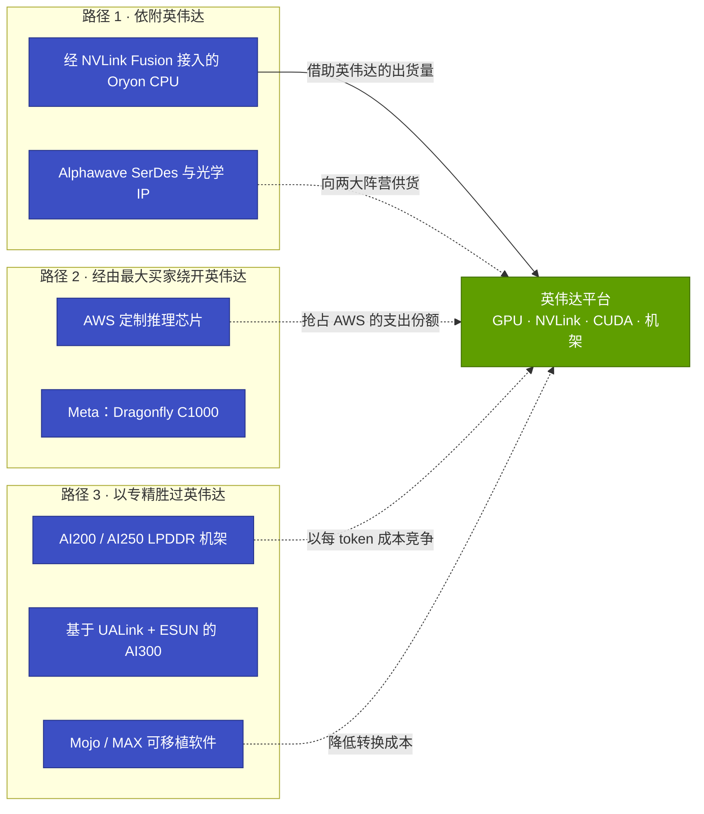
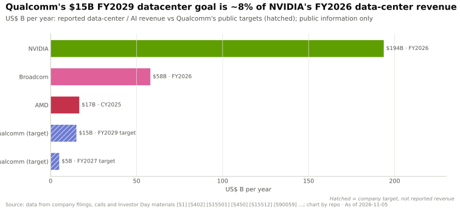
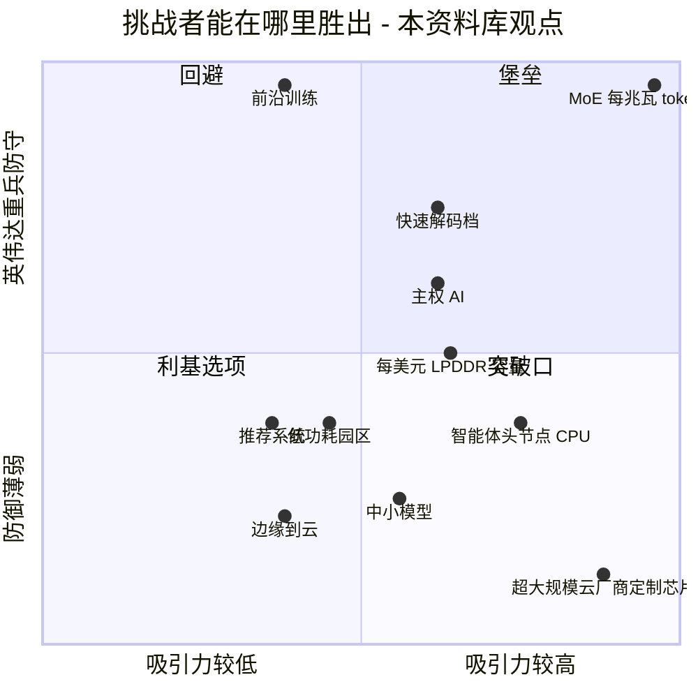
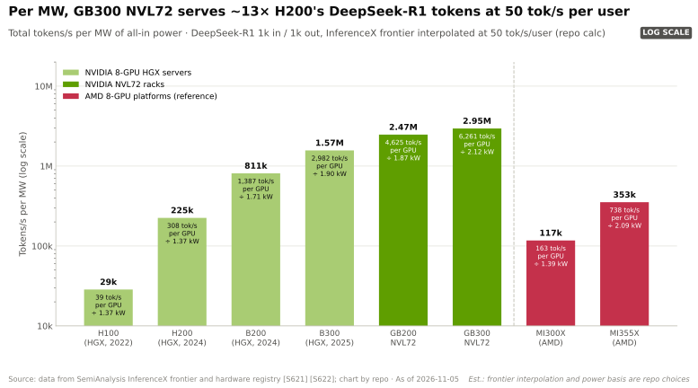
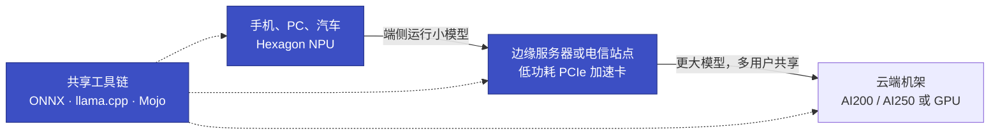
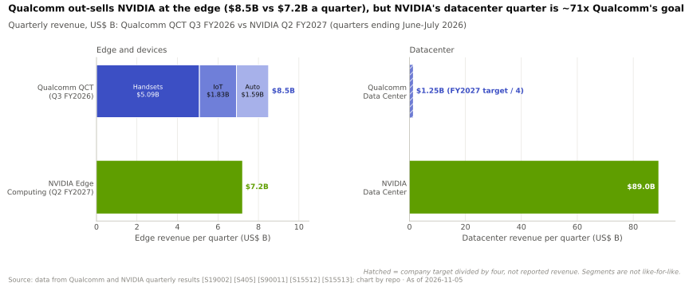
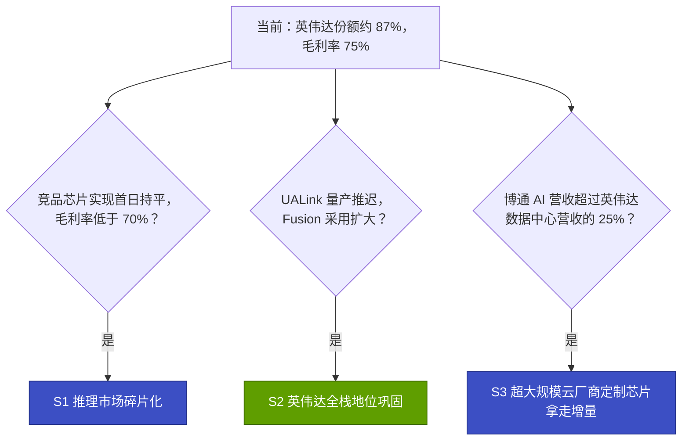
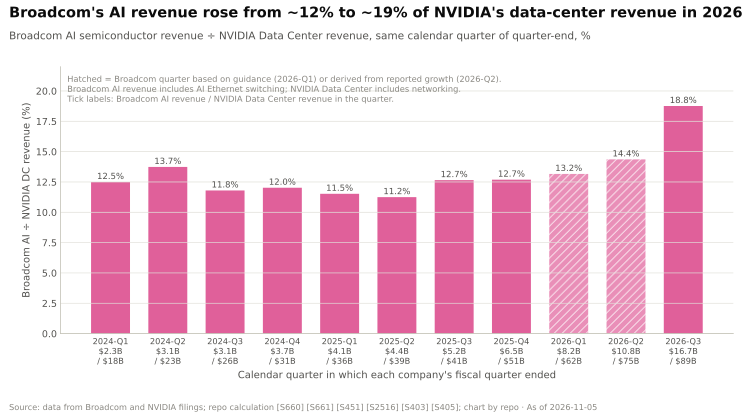
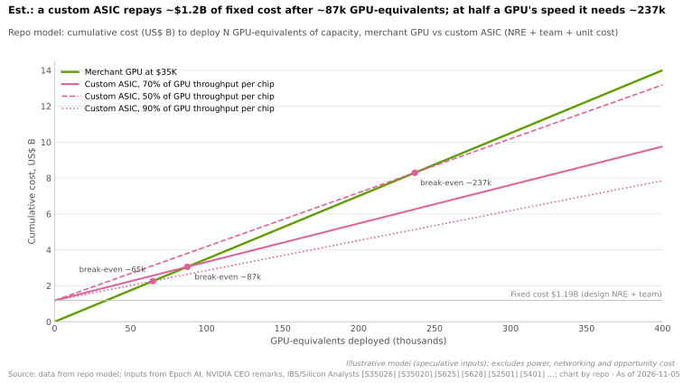
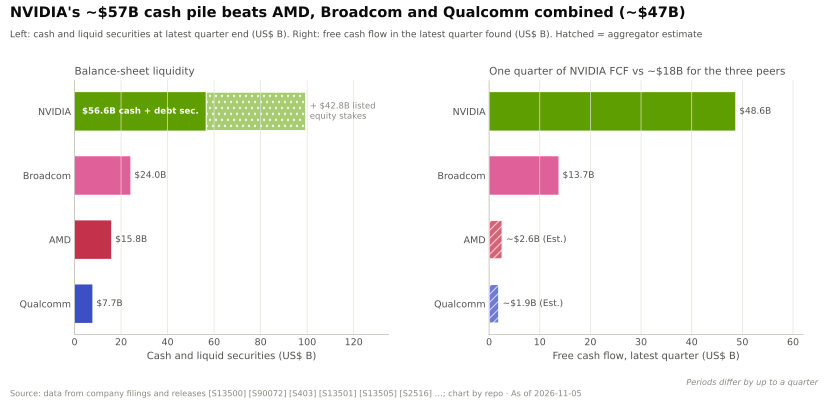

# 19 —— 对高通的启示

> [!NOTE]
> 本页为英文原文的简体中文参考译文，仅供参考；如有出入，以[英文原文](../../cross-cutting/19-implications-for-qualcomm.md "English original")为准。

跨层专题 19 · 英伟达的市场地位对一个拥有高通公开资产的挑战者意味着什么 · 阅读约 32 分钟 · 最后核实：2026-11-05

> [!IMPORTANT]
> **仅基于公开信息；提出问题与选项，而非建议。** 本页关于高通（Qualcomm）的每一项陈述均来自其公开公告、监管文件或媒体报道，并已在文中注明出处。没有任何内部信息，也没有任何杜撰内容。关于挑战者“能在哪里胜出”的判断属于本资料库的分析，并标注 🔴。本页以[高通竞争对手概况](15-competitive-landscape/qualcomm.md)为基础展开，而不重复其内容。

## ⚡ 要点速览

- **英伟达的领先在于平台与迭代节奏，因此挑战者要选择自己的战场。** 2025 年英伟达（NVIDIA）拿下约 87% 的 AI 数据中心芯片营收（估计），Q2 FY2027 毛利率为 75.0% [[S660]](../../sources/bibliography.md#s660)[[S663]](../../sources/bibliography.md#s663)[[S405]](../../sources/bibliography.md#s405)。高通到 FY2029 实现 $15B 数据中心营收的目标，约为英伟达 FY2026 数据中心营收的 8% [[S90059]](../../sources/bibliography.md#s90059)[[S1]](../../sources/bibliography.md#s1)。
- **高通与英伟达的四种关系同时存在。** 按主要角色划分，高通在英伟达 12 个层中的 6 层与其竞争，在 1 层与其合作（通过 [NVLink Fusion](../glossary.md#nvlink-fusion) 接入的 Oryon CPU），在 2 层与其互补（Alphawave 连接 IP、Mojo），在 3 层缺席（DPU 与网卡、领域软件库、云算力）。它仅在 4 层有已出货产品（🔴 本资料库图谱）[[S90031]](../../sources/bibliography.md#s90031)[[S173]](../../sources/bibliography.md#s173)[[S4513]](../../sources/bibliography.md#s4513)[[S9511]](../../sources/bibliography.md#s9511)。
- **资产买得很快；客户还停留在合同层面。** NUVIA（$1.4B）、Alphawave（约 $2.4B）和 Modular（$3.9B）合计约 $7.7B，另有收购价未披露的 Ventana [[S4538]](../../sources/bibliography.md#s4538)[[S4514]](../../sources/bibliography.md#s4514)[[S90057]](../../sources/bibliography.md#s90057)[[S4512]](../../sources/bibliography.md#s4512)。HUMAIN 计划部署 200 MW。🟢 Meta 是 Dragonfly C1000 的首个客户，自 2028 年下半年起部署。AWS 签约采购定制推理芯片，并获得一份认股权证，按截至 2036 年最多 $60B 的采购额归属 [[S90030]](../../sources/bibliography.md#s90030)[[S90058]](../../sources/bibliography.md#s90058)[[S90087]](../../sources/bibliography.md#s90087)。尚无公开的 AI200 批量出货记录或 MLPerf/InferenceX 结果 🔴 [[S90028]](../../sources/bibliography.md#s90028)[[S602]](../../sources/bibliography.md#s602)[[S620]](../../sources/bibliography.md#s620)。
- **🔴 挑战者能在哪里胜出：**本资料库认为[超大规模云厂商](../glossary.md#hyperscaler)定制芯片和智能体（agentic）头节点 CPU 是最开放的细分市场；在定制芯片领域，主要对手是博通（Broadcom）而非英伟达。以聊天速度提供[混合专家模型（MoE）](../glossary.md#mixture-of-experts)推理服务时的每兆瓦产出是英伟达的堡垒：GB300 [NVL72](../glossary.md#nvl72) 每兆瓦约可提供 2.6M tokens/s，而已出货的竞品 ≤0.7M（估计）[[S14000]](../../sources/bibliography.md#s14000)[[S2516]](../../sources/bibliography.md#s2516)[[S4522]](../../sources/bibliography.md#s4522)。
- **LPDDR 容量是另一种押注，而非护城河。** 据报道 🟡，一个 AI200 机架的加速卡上共有约 43 TB 内存，是 Vera Rubin NVL72 的 20.7 TB [HBM4](../glossary.md#hbm4) 的 2×。但英伟达机架在 Vera CPU 一侧还有 54 TB LPDDR5X，而且 LPDDR 加速卡的带宽比 Rubin 低约 35×（0.548 对 19.2 TB/s）[[S19003]](../../sources/bibliography.md#s19003)[[S362]](../../sources/bibliography.md#s362)[[S172]](../../sources/bibliography.md#s172)[[S90006]](../../sources/bibliography.md#s90006)。
- **边缘侧是挑战者体量更大的唯一领域。** 截至 2026 年 6 月的季度，高通芯片业务销售额约 $8.5B，而英伟达边缘计算平台为 $7.2B。在数据中心领域，英伟达单季 $89.0B 的营收约为高通 FY2027 目标对应季度营收水平的 71× [[S19002]](../../sources/bibliography.md#s19002)[[S405]](../../sources/bibliography.md#s405)[[S15512]](../../sources/bibliography.md#s15512)。终端设备领域的既有地位能否赢得云端订单，尚未得到验证 🔴。
- **交易条款的差异比新闻标题显示的更大。** 签约时，AMD 的“一分钱认股权证”（penny warrant）价值约为 OpenAI 预计采购额的 29%。高通给 AWS 的认股权证为平值行权价，因此除非高通股价上涨，否则其价值为零：股价上涨 25% 时约为采购额的 1.7%（🔴 本资料库测算）[[S24000]](../../sources/bibliography.md#s24000)[[S24001]](../../sources/bibliography.md#s24001)[[S15510]](../../sources/bibliography.md#s15510)。

## 1. 框架：英伟达的市场地位对挑战者意味着什么

其他章节将英伟达描述为一家[全栈商用芯片供应商（full-stack merchant）](../glossary.md#full-stack-merchant)。它向每一位买家销售芯片、机架、网络和免费软件，每年更新平台，并在新模型发布首日即提供支持（[第 15 章](15-competitive-landscape/index.md)、[第 16 章](16-how-nvidia-built-it-timeline.md)、[第 17 章](17-roadmap-2025-2028.md)）。同样这些章节也列出了它的弱点。75% 的毛利率是一把[价格保护伞（price umbrella）](../glossary.md#price-umbrella)，竞争对手可以在其下方定价。三家直接客户分别占 H1 FY2027 营收的 16%、15% 和 13% [[S90069]](../../sources/bibliography.md#s90069)，而这些买家正在自研芯片：博通的 AI 营收已相当于英伟达数据中心营收的约 19% [[S2516]](../../sources/bibliography.md#s2516)[[S405]](../../sources/bibliography.md#s405)。许多园区的约束是电力而非资金（[第 18 章](18-vulnerabilities-and-bear-case.md)）。

这给挑战者留下了三条大致路径，而高通的公开举措同时在走这三条路：

每条路径的经济引擎各不相同。依附英伟达可以借助其出货量，但每个机架赚到的金额很小：36 颗 Vera CPU 约占一个约 $7.8M 的 Vera Rubin 机架的 2%（估计）[[S331]](../../sources/bibliography.md#s331)。通过超大规模云厂商绕开英伟达，可以在大批量上赚取设计服务利润，但依赖少数几家买家。以专精取胜则需要找到英伟达优势最不重要的工作负载，并拿出产品在该负载上胜出的独立证据。

| 公开资产 | 内容 | 状态（2026 年 11 月） | 来源 |
|---|---|---|---|
| Oryon CPU 内核（NUVIA） | 定制 Arm 内核，2021 年以 $1.4B 收购 | 已用于骁龙（Snapdragon）设备；面向 NVLink Fusion 的数据中心 CPU 于 2025 年 5 月发布 | [[S4538]](../../sources/bibliography.md#s4538)[[S4516]](../../sources/bibliography.md#s4516)[[S90031]](../../sources/bibliography.md#s90031) |
| Dragonfly C1000 | >250 核芯粒 CPU，目标主频 >5 GHz，支持 PCIe Gen 7、[CXL](../glossary.md#cxl)；面向智能体头节点 | Meta 为首个客户；2028 年下半年起部署 🟢 | [[S90056]](../../sources/bibliography.md#s90056)[[S90058]](../../sources/bibliography.md#s90058) |
| Hexagon NPU 系列：Cloud AI 100 Ultra | 150 W PCIe 卡，128 GB LPDDR4x、0.548 TB/s，870 TOPS INT8 | 自 2023 年起出货 | [[S172]](../../sources/bibliography.md#s172)[[S4514]](../../sources/bibliography.md#s4514) |
| AI200 / AI250 | 每卡 768 GB [LPDDR](../glossary.md#lpddr)，置于 160 kW 液冷机架中；AI250 增加[近存计算](../glossary.md#near-memory-compute) | AI200 送样中，2026 年下半年初步部署 🟡；尚未确认批量出货 🔴 | [[S173]](../../sources/bibliography.md#s173)[[S4030]](../../sources/bibliography.md#s4030) |
| Dragonfly AI300 | 第二代[高带宽计算（High Bandwidth Compute）](../glossary.md#high-bandwidth-compute)；带宽为 AI200 的“54×”（厂商宣称）；采用 [UALink](../glossary.md#ualink) 和 [ESUN](../glossary.md#esun) 纵向扩展 | 2028 年送样 🟢 | [[S90060]](../../sources/bibliography.md#s90060)[[S4029]](../../sources/bibliography.md#s4029) |
| Ventana | RISC-V 服务器 CPU 团队 | 2025 年 12 月收购，条款未披露 | [[S4512]](../../sources/bibliography.md#s4512) |
| Alphawave Semi | [SerDes](../glossary.md#serdes)、芯粒与光互连 IP，约 $2.4B | 2025-12-18 完成交割 🟢 | [[S4513]](../../sources/bibliography.md#s4513)[[S4514]](../../sources/bibliography.md#s4514) |
| Modular | [Mojo](../glossary.md#mojo) 语言与 MAX 推理引擎，$3.9B | 2026-07-29 完成交割；Mojo 于 2026 年 8 月开源 | [[S9511]](../../sources/bibliography.md#s9511)[[S9512]](../../sources/bibliography.md#s9512) |
| 边缘侧装机基础 | 单季手机芯片（$5.09B）、物联网（$1.83B）和汽车（$1.59B） | 出货中 | [[S19002]](../../sources/bibliography.md#s19002) |
| 数据中心客户 | HUMAIN 200 MW；Meta（C1000）；AWS 定制芯片与 1.6T 光学器件 | 已签约 | [[S90030]](../../sources/bibliography.md#s90030)[[S90058]](../../sources/bibliography.md#s90058)[[S90087]](../../sources/bibliography.md#s90087) |
| 财务能力 | FY2026 营收 $43.1B；现金及有价证券 $7.7B，债务 $15.1B | 已披露 | [[S15513]](../../sources/bibliography.md#s15513)[[S13503]](../../sources/bibliography.md#s13503) |

![高通公开数据中心举措的时间线，分四条泳道。2025 年以前：Centriq 2400 服务器 CPU（2017 年 11 月）、该业务部门收缩（2018）、以 $1.4B 收购 NUVIA（2021）以及 Cloud AI 100 Ultra 加速卡（2023）。2025 年 5 月以来：NVLink Fusion CPU 合作与 HUMAIN 谅解备忘录（2025 年 5 月）；发布 AI200 和 AI250，以及 HUMAIN 的 200 MW 计划（2025 年 10 月）；收购 Ventana（RISC-V）和 Alphawave（约 $2.4B）（2025 年 12 月）；投资者日发布面向 Meta 的 Dragonfly C1000 CPU、AI300 加速器及 Modular 交易（2026 年 6 月）；以 $3.9B 完成 Modular 交割（2026 年 7 月）；与 AWS 达成多代定制推理芯片及 1.6T 光学器件交易，并以 $4B 认股权证为支撑（2026 年 9 月）。路线图：AI200 于 2026 年（截至 2026 年 11 月尚未确认批量出货）、AI250 于 2027 年、AI300 和 C1000 于 2028 年部署。](../../assets/charts/15-qualcomm-dc-roadmap-timeline.svg)

> [!TIP]
> **算例 —— 将目标与在位者的体量对比。** 截至 2026-07-26 的 13 周内，英伟达数据中心平台营收为 $89.0B [[S405]](../../sources/bibliography.md#s405)，约合每周 $6.8B。高通 FY2029 年 $15B 的目标 [[S90059]](../../sources/bibliography.md#s90059) 约相当于该营收水平下的 2.2 周，约为高通自身 FY2026 营收 $43.1B 的 35% [[S15513]](../../sources/bibliography.md#s15513)。FY2027 的阶段性目标为 $5B，已于 2026-11-04 重申，其中至少 $1B 来自两份超大规模云厂商定制芯片合同 [[S15513]](../../sources/bibliography.md#s15513)[[S15511]](../../sources/bibliography.md#s15511)。**结论：**该目标并不需要取代英伟达，只需要在英伟达占约 87% 的市场中拿下约 2–8%。问题在于拿哪一块。

🔧 技术细节：为什么芯片降价能换来的效果比看上去小

第 14 章的模型显示，英伟达约 75% 的毛利率仅占 GB300 每 token 全部成本的约 24%。其余部分是机架、网络、设施、电力和运维的资本费用。即使英伟达毛利润减半，每 token 成本也只会下降约 18%（估计）[[S14000]](../../sources/bibliography.md#s14000)。同一模型还发现，在每用户 100 tokens/s 条件下，英伟达可以把 GB300 价格下调约 20% 以追平谷歌内部 TPU 的成本，同时仍保留约 66% 的毛利率（🔴）[[S14000]](../../sources/bibliography.md#s14000)。因此对挑战者而言，单靠更低的芯片价格是一个弱杠杆。强杠杆是每兆瓦 token 产出、利用率和部署速度。只靠价格销售的挑战者，面对的是英伟达可以有选择地动用的约 10 个百分点的缓冲（[第 14 章第 6 节](14-training-vs-inference-economics.md)）。

## 2. 分层图谱：合作、竞争、互补或缺席

该图谱将高通的每一项公开举措与其涉及的英伟达技术层对应起来，回答两个问题：与英伟达是什么关系？该举措进展到哪一步？**关系**分为四类：🤝 合作（向英伟达平台供货）、⚔️ 竞争（争夺同一笔预算）、🧩 互补（中立供应商或同时服务两大阵营的可移植层）、⬜ 缺席（无公开举措）。**阶段**分为已发布、已签约（已签订合同、已完成收购或已初步部署）和已出货。最后一列沿用第 15 章的能力研判（🟩 领先 · 🟨 持平 · 🟥 落后 · 🟦 路线不同）以及 `competitor_matrix.csv` 中的 5 分制评分。数据：`data/x19_layer_map.csv`。

| 英伟达技术层 | 高通的公开举措 | 关系 | 阶段 | 第 15 章研判 | 来源 |
|---|---|---|---|---|---|
| [02 加速器芯片](../layers/02-gpu-silicon/index.md) | Cloud AI 100 Ultra；AI200、AI250、AI300；AWS 定制推理芯片 | ⚔️ 竞争 | 已出货（AI 100）；已签约（AWS） | 🟦 2/5 | [[S172]](../../sources/bibliography.md#s172)[[S173]](../../sources/bibliography.md#s173)[[S90060]](../../sources/bibliography.md#s90060)[[S90087]](../../sources/bibliography.md#s90087) |
| [03 内存与供应](../layers/03-memory-packaging-supply-chain/index.md) | 无需 [HBM](../glossary.md#hbm) 或 [CoWoS](../glossary.md#cowos) 的 LPDDR 加速卡 | ⚔️ 以绕行方式竞争 | 已出货（AI 100） | 🟦 3/5 | [[S172]](../../sources/bibliography.md#s172)[[S173]](../../sources/bibliography.md#s173) |
| [04 CPU](../layers/04-cpu-grace-vera/index.md) | 经 NVLink Fusion 接入的 Oryon CPU；Dragonfly C1000；Ventana | 🤝 合作与 ⚔️ 竞争 | 已发布；已签约（Meta） | 🟥 2/5 | [[S90031]](../../sources/bibliography.md#s90031)[[S90058]](../../sources/bibliography.md#s90058)[[S4512]](../../sources/bibliography.md#s4512) |
| [05 纵向扩展](../layers/05-scale-up-nvlink-nvswitch/index.md) | 基于 UALink 和 ESUN 的 AI300；Fusion CPU 链路；Alphawave SerDes | ⚔️ 竞争（亦有 🤝、🧩） | 已发布 | 🟥 1/5 | [[S90060]](../../sources/bibliography.md#s90060)[[S131]](../../sources/bibliography.md#s131)[[S4513]](../../sources/bibliography.md#s4513) |
| [06 横向扩展与光学](../layers/06-scale-out-scale-across-networking/index.md) | Alphawave IP；面向 AWS 的 1.6T 光学器件；无交换机或网卡 | 🧩 互补 | 已签约 | 🟥 2/5 | [[S4513]](../../sources/bibliography.md#s4513)[[S90087]](../../sources/bibliography.md#s90087) |
| [07 DPU、SuperNIC、存储](../layers/07-dpu-supernic-storage-security/index.md) | 无；AI200 列出了[机密计算](../glossary.md#confidential-computing)功能 | ⬜ 缺席 | — | 🟥 1/5 | [[S173]](../../sources/bibliography.md#s173) |
| [08 系统与机架](../layers/08-systems-racks-ai-factories/index.md) | AI200 160 kW 机架；机架软件已在 HUMAIN 部署 | ⚔️ 竞争 | 已签约（初步部署） | 🟥 2/5 | [[S173]](../../sources/bibliography.md#s173)[[S19001]](../../sources/bibliography.md#s19001) |
| [09 CUDA 对等层](../layers/09-cuda-and-system-software/index.md) | Mojo（也可在英伟达 GPU 上运行）；Cloud AI SDK | 🧩 互补（亦有 ⚔️） | 已出货 | 🟥 2/5 | [[S9512]](../../sources/bibliography.md#s9512)[[S9023]](../../sources/bibliography.md#s9023)[[S596]](../../sources/bibliography.md#s596) |
| [10 软件库](../layers/10-libraries-cuda-x/index.md) | 仅有 MAX AI 内核；无领域软件库 | ⬜ 缺席 | —（AI 内核处于早期） | 🟥 1/5 | [[S9513]](../../sources/bibliography.md#s9513) |
| [11 推理软件](../layers/11-inference-and-ai-software/index.md) | MAX 引擎；vLLM 容器；上游 [vLLM](../glossary.md#vllm) | ⚔️ 竞争（亦有 🧩） | 已出货 | 🟦 2/5 | [[S9511]](../../sources/bibliography.md#s9511)[[S596]](../../sources/bibliography.md#s596) |
| [12 编排与云服务](../layers/12-orchestration-and-cloud-services/index.md) | 机架管理套件；无自有云算力 | ⬜ 缺席 | — | 🟥 1/5 | [[S19001]](../../sources/bibliography.md#s19001) |
| [13 生态与资本](../layers/13-ecosystem-gtm-and-capital/index.md) | HUMAIN、Meta、AWS；FY2027 $5B 和 FY2029 $15B 目标 | ⚔️ 争夺同一批客户预算 | 已签约 | 🟥 1/5 | [[S90030]](../../sources/bibliography.md#s90030)[[S90058]](../../sources/bibliography.md#s90058)[[S90087]](../../sources/bibliography.md#s90087)[[S90059]](../../sources/bibliography.md#s90059) |

对该图谱的三点解读不同于或补充了[第 15 章的高通页面](15-competitive-landscape/qualcomm.md)：

- **第 07 层和第 10 层在此单独列出。** 第 15 章合并了第 09–11 层，且未纳入第 07 层。自建、收购与合作的问题恰恰集中在缺席的层（第 4 节），因此本页将其单独呈现。
- **当前的商用机架方案与英伟达最接近的商用对手合作。** MWC 2026 上的两篇低级别报道称，AI200 机架由 AMD EPYC CPU 托管 56 张加速卡，节点内通过 [PCIe](../glossary.md#pcie) 互连，跨机架通过 800G 以太网互连 🟡 [[S19003]](../../sources/bibliography.md#s19003)[[S19005]](../../sources/bibliography.md#s19005)。[NVLink](../glossary.md#nvlink) Fusion CPU 和 C1000 都是更晚的产品，因此在 2026 年，高通与英伟达在 CPU 上的“合作”角色仍停留在纸面上。
- **[纵向扩展（scale-up）](../glossary.md#scale-up)上的“竞争”关乎治理权，而非抵制。** ESUN 是英伟达自己参与创立的 OCP 工作组 [[S576]](../../sources/bibliography.md#s576)。UALink 才是英伟达缺席的地方。双轨策略（Fusion CPU、UALink/ESUN 加速器）让高通同时站在两边，英特尔（Intel）也是如此（[NVLink Fusion](../layers/05-scale-up-nvlink-nvswitch/nvlink-fusion.md)）。

> [!TIP]
> **算例 —— 清点已出货的产品。** 该图谱的数据文件在 12 个层中共收录 21 项公开举措，其中 6 项处于已出货阶段。这 6 项中有 2 项是硬件，而且两者属于同一条 2023 年的产品线：Cloud AI 100 及其 LPDDR 内存设计。其余 4 项是软件（Cloud AI SDK、Mojo、带 vLLM 容器的 MAX、上游 vLLM）[[S172]](../../sources/bibliography.md#s172)[[S596]](../../sources/bibliography.md#s596)[[S9511]](../../sources/bibliography.md#s9511)。机架、CPU、纵向扩展互连和 AWS 芯片将在 2026 至 2028 年间陆续推出。同一时期，英伟达将在 2026 年交付 Vera Rubin，2027 年下半年交付 Rubin Ultra，2028 年交付 Feynman [[S90009]](../../sources/bibliography.md#s90009)[[S90003]](../../sources/bibliography.md#s90003)[[S90004]](../../sources/bibliography.md#s90004)。**结论：**图谱的大部分内容仍是路线图。高通的每一代产品面对的，都将是英伟达当前出货产品的下一代。

🔧 技术细节：关系与阶段如何认定

每一层有一个**主要**关系（在热力图中以粗边框标示），选取标准是在高通公开计划中涉及营收最多的那一种。次要关系仍然可见。第 04 层的主要角色为“合作”，因为这是高通与英伟达唯一的合作关系，尽管 C1000 已有签约客户而 Fusion CPU 没有。**阶段**依据最有力的公开证据认定：发布公告或路线图条目（1）；已签合同、已完成收购或有报道的初步部署（2）；或已在售产品（3）。阶段不反映质量：一张 2023 年已出货的加速卡，仍可能输给一个已发布的 2028 年竞品。第 15 章的评分是分析师相对于 2026 年 11 月英伟达水平的判断（`competitor_matrix.csv`）。

## 3. 挑战者能在哪里胜出

本节在两个维度上对十一个细分市场打分（均为 🔴 本资料库判断）。**吸引力**综合考虑支出池的规模与增速，以及它与挑战者公开资产的契合度。**英伟达防御力**衡量英伟达的优势使夺取份额有多难：[每兆瓦 token 产出](../glossary.md#tokens-per-megawatt)、72 GPU 的 NVLink 域、[CUDA](../glossary.md#cuda)、年度迭代节奏和供应分配。证据来自各层页面以及第 14、15、18 章。数据：`data/x19_win_matrix.csv`。

| 细分市场 | 吸引力 | 英伟达防御力 | 🔴 理由 | 证据 |
|---|---|---|---|---|
| 以聊天速度提供 MoE 推理服务的每兆瓦产出 | 5 | 5 | 最大的推理支出池，但 NVL72 每兆瓦约可提供 2.6M tokens/s，竞品 ≤0.7M（估计） | [第 14 章](14-training-vs-inference-economics.md) [[S14000]](../../sources/bibliography.md#s14000) |
| 受容量约束的推理服务（每美元 LPDDR） | 3.5 | 3 | LPDDR 每 GB 更便宜，但英伟达有自己的 LPDDR 层级，且 1 TB HBM4E 即将推出 | [内存墙](../layers/03-memory-packaging-supply-chain/the-memory-wall.md) [[S362]](../../sources/bibliography.md#s362)[[S305]](../../sources/bibliography.md#s305) |
| 快速解码档（每用户 ≥100 tokens/s） | 3.5 | 4 | 受带宽约束；SRAM 方案领先，且英伟达现已销售 Groq 3 LPX | [第 11 层](../layers/11-inference-and-ai-software/competition.md) [[S90003]](../../sources/bibliography.md#s90003) |
| 受电力上限约束或风冷的园区 | 2.75 | 2.5 | NVL72 无法在此安装，150 W 加速卡可以；英特尔也瞄准这一市场 | [电力](../layers/08-systems-racks-ai-factories/power-and-cooling.md) [[S172]](../../sources/bibliography.md#s172)[[S162]](../../sources/bibliography.md#s162) |
| 智能体头节点 CPU | 4 | 2.5 | 在 GPU 机架之外，CPU 市场是开放的；英伟达自己估计其规模达数百亿美元 | [第 04 层](../layers/04-cpu-grace-vera/value-chain-and-corp-dev.md) [[S4522]](../../sources/bibliography.md#s4522) |
| 推荐与排序 | 2.5 | 2.5 | 受容量约束、适合 LPDDR，但最大的买家自研芯片 | [MTIA](15-competitive-landscape/meta-mtia.md) [[S160]](../../sources/bibliography.md#s160) |
| 中小型稠密模型 | 3.25 | 2 | NVL72 的增益有限；竞争对手是旧款 GPU 和以价格取胜的 AMD | [第 14 章](14-training-vs-inference-economics.md) [[S623]](../../sources/bibliography.md#s623)[[S12516]](../../sources/bibliography.md#s12516) |
| 主权多供应商项目 | 3.5 | 3.5 | 买家多源采购，但已公布的主权 GPU 大部分来自英伟达 | [主权 AI](../layers/13-ecosystem-gtm-and-capital/sovereign-ai.md) [[S13003]](../../sources/bibliography.md#s13003) |
| 边缘到云的连续性 | 2.5 | 2 | 高通的装机基础大于英伟达的边缘业务；数据中心回报尚未得到验证 | 第 3.4 节 [[S19002]](../../sources/bibliography.md#s19002) |
| 超大规模云厂商定制芯片 | 4.5 | 1.5 | 增长最快的支出池；英伟达可以收编（Fusion）但无法阻止；对手是博通 | [ASIC 设计服务商](15-competitive-landscape/custom-asic-houses.md) [[S2516]](../../sources/bibliography.md#s2516) |
| 前沿预训练（参考） | 2.5 | 5 | 只有约六家买家，需要大型纵向扩展域；高通无相关产品 | [第 14 章](14-training-vs-inference-economics.md) [[S14000]](../../sources/bibliography.md#s14000) |

### 3.1 推理效率：每瓦 token 产出与每美元 LPDDR 容量

[解码（decode）](../glossary.md#decode)是推理中逐个生成 token 的阶段，每生成一个 token 都要重新读取一遍模型权重。因此每用户速度由内存带宽决定。每瓦吞吐量则取决于每次读取由多少用户共享（批处理），以及机架能否把大型 MoE 模型高效地分布到多颗芯片上。英伟达在大型 MoE 模型的每兆瓦 token 产出上胜出，是因为其 72 GPU 的 NVLink 域允许一个模型以高带宽分布到整个机架（[为什么域的规模很重要](../layers/05-scale-up-nvlink-nvswitch/why-domain-size-matters.md)）。高通的 LPDDR 设计做出的是相反的取舍：每张卡拥有大量廉价、低功耗的容量，但每 GB 的带宽很低（[内存墙](../layers/03-memory-packaging-supply-chain/the-memory-wall.md)）。

上图的[免费芯片测试](../glossary.md#free-chip-test)是任何推理挑战者面临的最严格约束。在聊天速度（每用户 50 tokens/s）下，即使免费的 MI355X、TPU 或 Trainium，产出 token 的成本也高于付费购买的 GB300。在每用户 100 tokens/s 下，多数免费竞品的成本低于 GB300（估计）[[S14000]](../../sources/bibliography.md#s14000)。因此，挑战者选择在哪个[工作点（operating point）](../glossary.md#operating-point)上竞争，是一项战略决策，而非基准测试细节。

> [!TIP]
> **算例 —— LPDDR 与 HBM：按每 GB 和每次读取比较。** 摩根士丹利对 Vera Rubin 机架的数据隐含 54 TB LPDDR5X 约 $1.1M，约合每 GB $20（🔴 本资料库测算）[[S332]](../../sources/bibliography.md#s332)[[S362]](../../sources/bibliography.md#s362)。伯恩斯坦（Bernstein）预计 2027 年 HBM4 约为每 GB $53 [[S333]](../../sources/bibliography.md#s333)。按这些价格，768 GB 采用 LPDDR 约需 $15.6K，采用 HBM4 约需 $40.7K。带宽则恰恰相反。Cloud AI 100 Ultra 每秒约可完整读取其 128 GB 内存 4.3 次（0.548 TB/s ÷ 128 GB）。Rubin GPU 每秒约可读取其 288 GB 内存 67 次（19.2 TB/s ÷ 288 GB），频率约高 16× [[S172]](../../sources/bibliography.md#s172)[[S90006]](../../sources/bibliography.md#s90006)。**结论：**在容量受约束的场景（低批量下的超大模型、长 [KV 缓存](../glossary.md#kv-cache)、同时常驻多个模型），LPDDR 胜出；在带宽受约束的场景（大型 MoE 模型上的快速聊天），HBM 胜出。AI200 的带宽尚未披露，因此还无法确定两者的交叉点。

> [!WARNING]
> **误区与事实：“内存容量是高通的护城河。”** 容量是共有的阵地。每颗 Vera CPU 配备约 1.5 TB LPDDR5X（每机架 54 TB）[[S362]](../../sources/bibliography.md#s362)，并通过 1.8 TB/s 的 [NVLink-C2C](../glossary.md#nvlink-c2c) 与 GPU 一致性互连 [[S209]](../../sources/bibliography.md#s209)。Rubin Ultra 的目标是在 2027 年下半年实现每封装 1 TB [HBM4E](../glossary.md#hbm4e) [[S305]](../../sources/bibliography.md#s305)。英特尔的推理 GPU 配备 160 GB LPDDR5X，将于 2026 年下半年送样 [[S162]](../../sources/bibliography.md#s162)；d-Matrix 则将 [SRAM](../glossary.md#sram) 与 LPDDR 搭配使用 [[S2511]](../../sources/bibliography.md#s2511)。容量优势只有与软件、成本，以及在明确工作点上公布的每 token 成本结果结合起来，才能守得住。

### 3.2 受电力约束的部署

“受电力约束”涵盖两种不同的情形，而且它们指向相反的方向。当**电网接入**是上限时，买家会追求每兆瓦 token 产出最大化。这是英伟达最强的指标，这也是第 18 章将电力评为英伟达的时间性风险而非份额流失风险的原因 [[S18027]](../../sources/bibliography.md#s18027)。当**园区条件**是上限时，机架根本进不了场。风冷机房、较老的企业机房和电信边缘站点无法容纳全口径功耗约 238 kW 的 Vera Rubin 机架（估计）[[S622]](../../sources/bibliography.md#s622)。在这些地方，竞争发生在以每瓦性能衡量的 PCIe 加速卡之间。电网稀缺是真实存在的：PJM 的容量价格在三次拍卖中从每 MW-日 $28.92 升至 $333.44，美国新项目在[并网排队](../glossary.md#interconnection-queue)中要等待超过 48 个月 [[S18016]](../../sources/bibliography.md#s18016)[[S8009]](../../sources/bibliography.md#s8009)。

> [!TIP]
> **算例 —— 两种不同的兆瓦。** 在一个新建的 100 MW 园区，按第 14 章的模型，GB300 NVL72 在 70% 利用率下每年约可产出 5.7 千万亿（quadrillion）个 token。MI355X 集群在年度成本大致相当的情况下约为 0.7 千万亿（估计）[[S14000]](../../sources/bibliography.md#s14000)。挑战者在这里必须比拼的是每兆瓦 token 产出，而非每卡功耗。而在一个为约 15 kW 机架建造的现有机房中（🔴 示意），NVL72 级别的机架根本放不进去。一张 150 W 的 Cloud AI 100 Ultra 则可装入标准服务器 [[S172]](../../sources/bibliography.md#s172)。**结论：**对低功耗设计而言，“受电力约束”带来的机会在于普通数据中心和边缘站点的存量设施，而不是新建的吉瓦级园区。

### 3.3 特定工作负载

**智能体编排 CPU。** [智能体 AI（agentic AI）](../glossary.md#agentic-ai)工作负载需要调用工具、运行代码并协调大量模型调用，其中很多工作在 CPU 上运行。英伟达表示，本财年独立 CPU 营收的可见度接近 $20B，并提到“$200B”的 CPU 市场机会 🟡 [[S4522]](../../sources/bibliography.md#s4522)。C1000 的 >250 个内核约为 Vera 88 核的 2.8×，与 AMD 256 核的 EPYC Venice 持平 [[S90056]](../../sources/bibliography.md#s90056)[[S100]](../../sources/bibliography.md#s100)[[S144]](../../sources/bibliography.md#s144)。这一市场已相当拥挤：AMD 约占 [x86](../glossary.md#x86) 服务器 CPU 营收的 46%，Arm 现在也向 Meta 销售自己的 136 核 AGI CPU [[S4503]](../../sources/bibliography.md#s4503)[[S4510]](../../sources/bibliography.md#s4510)。Meta 同时也是 C1000 的首个客户 [[S90058]](../../sources/bibliography.md#s90058)。

> [!TIP]
> **算例 —— 两个截然不同的 CPU 支出池。** 在英伟达机架内，36 颗 Vera CPU 约值 $0.18M，约占一个约 $7.8M 的 Vera Rubin NVL72 的 2%（估计）[[S331]](../../sources/bibliography.md#s331)。经 Fusion 接入的 CPU 争夺的正是这一薄薄的份额。英伟达约 $20B 的独立 CPU 营收可见度，相当于约 110,000 个此类机架中的 Vera 价值含量（🔴 本资料库测算）[[S4522]](../../sources/bibliography.md#s4522)。**结论：**头节点 CPU 的价值主要在英伟达机架*之外*，这正是 C1000 这类独立芯片所瞄准的方向，也是 x86 和超大规模云厂商自研 Arm CPU 已在竞争的领域。

**推荐与排序。** 排序模型的主体是大型嵌入表。它们对容量的需求高于带宽，这适合 LPDDR：Meta 的 MTIA v2 以 128 GB LPDDR5、约 0.2 TB/s 带宽和 90 W 功耗运行这类模型 [[S159]](../../sources/bibliography.md#s159)[[S160]](../../sources/bibliography.md#s160)。但推荐算力最大的买家已经自研芯片，并且此后已将 MTIA 转向 HBM [[S15003]](../../sources/bibliography.md#s15003)。商用芯片的机会在于第二梯队平台和企业，这是一个更小、可见度更低的支出池（🔴）。

**中小型稠密模型。** 一个 [FP8](../glossary.md#fp8) 精度的 70B 参数模型（约 70 GB）可装入一张 Cloud AI 100 Ultra，并留出约 58 GB 用于 KV 缓存。由于 LPDDR 每 GB 带宽较低，单个用户只能获得约 8 tokens/s，而在 Rubin GPU 上约为 274 [[S172]](../../sources/bibliography.md#s172)[[S90006]](../../sources/bibliography.md#s90006)。为多个用户进行批处理可以恢复每卡吞吐量。稠密模型从 72 GPU 域中获益也很少。在 SemiAnalysis 的测试中，当每用户速度低于 225 tokens/s 时，MI355X 在 vLLM 每 token 成本上胜过 B200 [[S623]](../../sources/bibliography.md#s623)；而一台已折旧的 H100 租金约为每小时 $2.35 [[S12516]](../../sources/bibliography.md#s12516)。这是一场与旧款 GPU 比拼每 token 成本的竞争，而在这个市场上，固定能力 token 的价格两年内下降了约 286×（[token 价格通缩](../glossary.md#token-price-deflation)）[[S11526]](../../sources/bibliography.md#s11526)。

**主权项目。** 主权买家希望实现本地控制和多供应商采购。英伟达在 FY2026 统计的主权 AI 营收超过约 $30B [[S90071]](../../sources/bibliography.md#s90071)，而 HUMAIN 同时向三家商用芯片厂商采购 [[S13003]](../../sources/bibliography.md#s13003)[[S13517]](../../sources/bibliography.md#s13517)[[S90030]](../../sources/bibliography.md#s90030)。

> [!TIP]
> **算例 —— 高通在单一主权买家中的份额。** HUMAIN 的公开计划：三年内最多 600,000 颗英伟达 GPU，最多 500 MW、金额最高 $10B 的 AMD 产品，以及 200 MW 的高通 AI200/AI250 [[S13003]](../../sources/bibliography.md#s13003)[[S13517]](../../sources/bibliography.md#s13517)[[S90030]](../../sources/bibliography.md#s90030)。按 SemiAnalysis 估算的每颗 GB300 或 Vera Rubin GPU 全口径 2.1–3.3 kW 计算，600,000 颗英伟达 GPU 约需 1.3–2.0 GW [[S622]](../../sources/bibliography.md#s622)。因此，高通的 200 MW 约占 HUMAIN 已公布容量的 7–10%（🔴 本资料库测算）。**结论：**锚定客户是真实的，但需要与他人分享。英伟达是 HUMAIN 的主要供应商，因此第二供应来源靠的是价格或适配度取胜，而非独家地位。

### 3.4 边缘到云的连续性

[边缘到云的连续性](../glossary.md#edge-to-cloud-continuity)是指同一个模型系列、文件格式和工具链可以在终端设备、边缘服务器和云端机架上运行。[混合 AI（hybrid AI）](../glossary.md#hybrid-ai)则将每个工作负载拆分到这些层级上执行。高通的资产覆盖每一个层级。骁龙的 Hexagon NPU 是 llama.cpp 和 ONNX Runtime（QNN）支持的后端 [[S579]](../../sources/bibliography.md#s579)[[S585]](../../sources/bibliography.md#s585)。Mojo 宣称可以用一套代码覆盖 CPU、GPU 和 NPU [[S9023]](../../sources/bibliography.md#s9023)。Cloud AI 100 和 AI200 覆盖数据中心一端。英伟达自己的边缘计算平台（游戏、专业可视化、汽车和 OEM）在 Q2 FY2027 营收为 $7.2B [[S405]](../../sources/bibliography.md#s405)。

> [!TIP]
> **算例 —— 相对于边缘基本盘，这些目标意味着什么。** 截至 2026-06-28 的季度，高通芯片营收为 $8.50B [[S19002]](../../sources/bibliography.md#s19002)。FY2027 年 $5B 的数据中心目标平均每季度 $1.25B，约为该基本盘的 15%。FY2029 年 $15B 的目标平均每季度 $3.75B，约为 44% [[S15512]](../../sources/bibliography.md#s15512)[[S90059]](../../sources/bibliography.md#s90059)。高通还设定了到 FY2029 实现 $40B 非手机营收的目标 [[S19004]](../../sources/bibliography.md#s19004)。**结论：**相对于高通自身而言，数据中心目标规模很大，这也是连续性作为卖点很重要的原因。目前尚无公开证据表明有买家因为终端设备领域的既有地位而选择某款云端加速器（🔴）。

## 4. 逐层看自建、收购或合作

下表为每一层配对一个自建问题、一个收购问题和一个合作问题，并列出能够回答这些问题的证据。“收购”一栏只列出各层价值链页面上提及的私营公司或近期被收购的公司，并附其最近一次公开估值。这些只是说明市场上现有哪些公司的示例，而非收购目标。

| 层 | 自建问题 | 收购问题（公开示例） | 合作问题 | 能回答该问题的证据 |
|---|---|---|---|---|
| 02 加速器 | 一个团队能否同时维持年度商用迭代节奏（AI200 → AI250 → AI300）和 AWS 定制芯片项目？ | SRAM 或近存解码 IP 能否补上一个快速档？d-Matrix（$2B）、Positron（$5B）、Etched（$10.3B）[[S2511]](../../sources/bibliography.md#s2511)[[S11521]](../../sources/bibliography.md#s11521)[[S2507]](../../sources/bibliography.md#s2507) | 是否需要一家设计服务合作伙伴来获取台积电产能，就像世芯（Alchip）之于 Trainium3？[[S2517]](../../sources/bibliography.md#s2517) | AI200 批量出货；MLPerf 或 InferenceX 提交结果；自 2027 财年第一季度起的 AWS 营收 |
| 03 内存与供应 | 近存计算和 HBC 能在多大程度上缩小带宽差距？ | 容量层级是否值得拥有？Panmnesia（CXL，>$250M）[[S3523]](../../sources/bibliography.md#s3523)；Celestial AI 已以 $3.25B 归入美满电子（Marvell）[[S2513]](../../sources/bibliography.md#s2513) | 在合约价格单季上涨 93–98% 之际，是否与 DRAM 厂商签订长期协议（LTA）或预付款？[[S3518]](../../sources/bibliography.md#s3518) | LPDDR 合约价格；实测的 AI250 有效带宽 |
| 04 CPU | C1000 能否在 2028 年下半年面对下一代 Vera 和 EPYC 时如期达标？ | 大部分独立 CPU 团队已被收购：Ampere 归软银（$6.5B），Rivos 归 Meta [[S4530]](../../sources/bibliography.md#s4530)[[S4518]](../../sources/bibliography.md#s4518) | 在英伟达机架内占据 Fusion 插槽，还是只做独立头节点？ | Fusion CPU 出货日期；C1000 送样；Meta 部署量 |
| 05 纵向扩展 | 自建 UALink/ESUN 交换机，还是依靠商用厂商为 AI300 提供？ | Upscale AI（约 $2B，UALink 交换机）、Ayar Labs（约 $3.75B，光 I/O）、Lightmatter（$4.4B）[[S6518]](../../sources/bibliography.md#s6518)[[S5511]](../../sources/bibliography.md#s5511)[[S2510]](../../sources/bibliography.md#s2510) | NVLink Fusion（须使用英伟达芯片和交换机）vs UALink（产品 2027 年推出）vs ESUN [[S5018]](../../sources/bibliography.md#s5018)[[S90051]](../../sources/bibliography.md#s90051)[[S576]](../../sources/bibliography.md#s576) | 首批 UALink 交换机批量出货；Fusion 授权条款 |
| 06 横向扩展与光学 | Alphawave IP 能在面向 AWS 的 1.6T 光学器件之外走多远？ | Nexthop AI（$4.2B）、Xscape Photonics（激光器）[[S6517]](../../sources/bibliography.md#s6517)[[S6520]](../../sources/bibliography.md#s6520) | AI200 机架是否需要商用以太网和 [Ultra Ethernet](../glossary.md#ultra-ethernet) 合作伙伴？ | AWS 光学器件营收；英伟达分别向 Lumentum 和 Coherent 投资 $2B 之后的激光器供应情况 [[S6511]](../../sources/bibliography.md#s6511) |
| 07 DPU 与网卡 | 是否基于 Alphawave SerDes 自建 UEC 网卡？ | Xsight Labs（$2.8B）；Enfabrica 式的“授权加团队”交易（>$900M）[[S7517]](../../sources/bibliography.md#s7517)[[S475]](../../sources/bibliography.md#s475) | 在高通机架中采用博通、AMD 还是英伟达的网卡？ | 推理买家是否要求特定厂商的网卡；每机架网卡成本 |
| 08 机架 | 机架设计保留在内部（AI200）还是交给 OEM？ | ZT 式设计团队（AMD 净成本约 $2B）；冷却与 800 V 供电初创公司 [[S5527]](../../sources/bibliography.md#s5527)[[S8519]](../../sources/bibliography.md#s8519) | 采用 ODM/EMS（Sanmina 模式）还是 OEM 品牌？[[S5528]](../../sources/bibliography.md#s5528) | HUMAIN 机架交付；OEM 上架 AI200 系统 |
| 09 系统软件 | 扩大 Mojo 的采用，还是同时提供 Triton 和 vLLM 后端？ | 仍有小型编译器团队（Luminal，种子轮）[[S9534]](../../sources/bibliography.md#s9534) | 上游 PyTorch 和 Triton 维护者 | 高通芯片上的新模型首日支持；框架支持（目前 36 分中得 4 分） |
| 10 软件库 | 是否只对标 AI 核心（GEMM、注意力、集合通信）？ | 领域软件库很少出售；厂商中立的 Voltron Data、Anyscale [[S10561]](../../sources/bibliography.md#s10561)[[S10562]](../../sources/bibliography.md#s10562) | 采用开放数据引擎，而非克隆 CUDA-X（[第 10 层](../layers/10-libraries-cuda-x/competition.md)） | 推理买家实际需要哪些 CUDA-X 领域 |
| 11 推理软件 | 让 MAX 成为差异化所在，还是依托上游 vLLM？ | 推理引擎公司：Inferact（$800M，vLLM）、RadixArk（$400M，SGLang）[[S11511]](../../sources/bibliography.md#s11511)[[S11513]](../../sources/bibliography.md#s11513) | 以推理云（Together AI $8.3B、Baseten $5B）作为首发客户？[[S11516]](../../sources/bibliography.md#s11516)[[S11518]](../../sources/bibliography.md#s11518) | InferenceX 结果；服务商上架高通算力 |
| 12 编排与云服务 | 没有自有算力，仅靠机架软件是否足够？ | 像英伟达那样持有新兴云服务商股权 | 拥有已签约但尚未建成电力的新兴云服务商；谷歌式租约兜底 [[S12525]](../../sources/bibliography.md#s12525) | 有新兴云服务商公开提供高通算力 |
| 13 生态与资本 | 是否建立能与 CUDA 覆盖面相匹配的开发者计划？ | 以股权换产能（认股权证）以及与主权基金共同投资 | HUMAIN、Meta、AWS；资产管理机构融资平台 | 认股权证归属披露；已部署兆瓦数；单独披露的数据中心分部营收 |

> [!TIP]
> **算例 —— [网卡（NIC）](../glossary.md#nic)的三种获取方式与价格。** AMD 斥资约 $1.9B 收购 Pensando，用了约 4 年才推出 800G AI 网卡。英伟达支付 >$900M 获得 Enfabrica 的团队与技术授权 [[S7527]](../../sources/bibliography.md#s7527)[[S475]](../../sources/bibliography.md#s475)。为每颗加速器采购两张商用 800G 网卡，每个 72 加速器机架约需 $0.2–0.4M，按每年 1,000 个机架计为每年 $0.2–0.4B（估计，第 07 层）（[价值链](../layers/07-dpu-supernic-storage-security/value-chain-and-corp-dev.md)）。**结论：**在每年数百个机架的规模下，合作更便宜。只有达到一定规模，或者网卡控制权决定了哪些机架能胜出时，自有网卡才划算。

🔧 技术细节：纵向扩展互连的选择（NVLink Fusion vs UALink vs ESUN）

三种互连方案在时间、控制权和开放性之间各有取舍（[NVLink Fusion](../layers/05-scale-up-nvlink-nvswitch/nvlink-fusion.md)）：

- **时间。** Fusion IP 自 2025 年 5 月起对外提供，AWS 于同年 12 月承诺 Trainium4 采用该方案 [[S131]](../../sources/bibliography.md#s131)[[S518]](../../sources/bibliography.md#s518)。UALink 2.0 于 2026 年 4 月获批，但产品预计要到 2027 年才推出 🟡 [[S90050]](../../sources/bibliography.md#s90050)[[S90051]](../../sources/bibliography.md#s90051)。
- **控制权。** Fusion 是一项授权，而非标准。有报道称，英伟达要求链路中使用其自有芯片和交换机 [[S5018]](../../sources/bibliography.md#s5018)。UALink 允许任何厂商制造交换机；Upscale AI 的首款 UALink 交换机目标于 2026 年第四季度推出 🟡 [[S5506]](../../sources/bibliography.md#s5506)。ESUN 在 OCP 框架下基于商用以太网运行，英伟达是其创始成员之一 [[S576]](../../sources/bibliography.md#s576)[[S90052]](../../sources/bibliography.md#s90052)。
- **可选性。** Alphawave 的 SerDes IP 在两个阵营中都可使用 [[S4513]](../../sources/bibliography.md#s4513)。高通的公开计划是 CPU 采用 Fusion，2028 年的加速器采用 UALink/ESUN [[S90031]](../../sources/bibliography.md#s90031)[[S90060]](../../sources/bibliography.md#s90060)。这让两扇门都保持敞开，但代价是两套集成工作。决策路标是 2027 年 UALink 交换机的出货量，以及尚未公开的 Fusion 商业条款。

## 5. 情景推演（🔴）

2028–29 年的三种终局界定了选项的范围。[路标（signpost）](../glossary.md#signpost)来自第 18 章的[领先指标仪表盘](18-vulnerabilities-and-bear-case.md)。这些情景并不互斥。第 18 章认为，缓慢的“够用芯片”路径（第一种与第三种情景的混合）比急剧重置更有可能发生。

| 情景 🔴 | 需要满足的条件 | 对拥有高通公开资产的挑战者意味着什么 | 路标（第 18 章） | 2026 年 11 月的读数 |
|---|---|---|---|---|
| **S1 推理市场碎片化** | 开源推理服务引擎在各类芯片上实现首日持平；买家按工作负载、依据每 token 成本进行选择；英伟达毛利率向 65% 上下回落 | 商用推理利基市场和可移植软件（Mojo、MAX）的价值上升。价格下降，因此公开的基准测试结果和运营成本最为关键 | AMD 首日滞后低于 7 天（目前 26 天）[[S631]](../../sources/bibliography.md#s631)；英伟达毛利率低于 70%（目前 75.0%；FY2028 指引 72–73%）[[S405]](../../sources/bibliography.md#s405)[[S18000]](../../sources/bibliography.md#s18000)；H100 指数低于 $1.70 | 正在演进：滞后缩短，毛利率指引下调 |
| **S2 英伟达全栈地位巩固** | NVL72 和 Kyber 保持每兆瓦 token 产出的领先；Groq 3 LPX 覆盖快速档；Fusion 把定制芯片拉进英伟达机架 | 合作角色（Fusion CPU、SerDes IP、光学器件）比商用加速器更有价值。利基市场在低功耗和边缘场景中得以存续 | Trainium4 搭载 NVLink 出货 [[S518]](../../sources/bibliography.md#s518)；UALink 量产推迟到 2027 年以后 [[S90051]](../../sources/bibliography.md#s90051)；超大规模云厂商维持约 55% 的数据中心营收占比 [[S406]](../../sources/bibliography.md#s406) | 部分成立：Fusion 采用在增加；UALink 芯片尚在实验室 |
| **S3 超大规模云厂商定制芯片拿走增量** | 到 2030 年 ASIC 出货量份额向约 40% 迈进；博通实现约 $115B 的 FY2027 目标 [[S2517]](../../sources/bibliography.md#s2517)[[S15501]](../../sources/bibliography.md#s15501) | 面向超大规模云厂商的设计服务、IP 和 CPU 构成主要支出池。AWS 交易就是样板。单位利润率更低，且买家高度集中 | 博通 AI 营收 ÷ 英伟达数据中心营收超过 25%（上一季度约 19%）[[S2516]](../../sources/bibliography.md#s2516)；TPU 在谷歌以外的销售；AWS 认股权证的归属节奏 [[S15510]](../../sources/bibliography.md#s15510) | 演进最快 |
| **变体：受电力约束、偏重边缘** | 电网限制持续形成约束；更多推理转移到终端设备和小型站点 | 低功耗加速卡和终端设备基本盘的价值上升，但吉瓦级园区仍看重每兆瓦 token 产出 | PJM 价格触及上限 [[S18016]](../../sources/bibliography.md#s18016)；新兴云服务商已投运与已签约电力之比 [[S12010]](../../sources/bibliography.md#s12010)；端侧推理后端 [[S579]](../../sources/bibliography.md#s579) | 电网偏紧；边缘拉动尚未得到验证 |

> [!TIP]
> **算例 —— 定制芯片路标还有多远？** 博通对截至 2026 年 11 月初的季度给出 $21.7B 的 AI 营收指引 [[S2516]](../../sources/bibliography.md#s2516)。与英伟达最近一次公布的数据中心季度营收（$89.0B）相比，约为 24% [[S405]](../../sources/bibliography.md#s405)。如果在 $108B 的 Q3 指引中，数据中心业务维持 Q2 约 92% 的营收占比（$96.2B 中的 $89.0B）（🔴 假设），该比例约为 22% [[S90012]](../../sources/bibliography.md#s90012)。**结论：**距离第 18 章的 25% 阈值只差一两个季度的财报。S3 的路标可能先于 S1 或 S2 的路标亮起。

## 6. 来自英伟达打法与同行的经验

英伟达的发展历程（[第 16 章](16-how-nvidia-built-it-timeline.md)、[第 13 层](../layers/13-ecosystem-gtm-and-capital/value-chain-and-corp-dev.md)、[CS1](../case-studies/CS1-mellanox-the-best-deal.md)、[CS2](../case-studies/CS2-cuda-the-15-year-bet.md)）和同行的举措（[CS4](../case-studies/CS4-amd-openai-and-the-second-source.md)、[ASIC 设计服务商](15-competitive-landscape/custom-asic-houses.md)、[CS3](../case-studies/CS3-google-tpu-the-credible-alternative.md)）引出了一系列问题。下面每条经验都是来自这些页面的证据。右侧一栏将其转化为一个问题，而非建议。

| # | 经验 | 证据 | 对挑战者提出的问题 |
|---|---|---|---|
| 1 | 用一台现金引擎为平台提供资金，并坚持十年 | CUDA 运行了约 11 年，数据中心营收才覆盖研发投入；FY2009 毛利率从 45.6% 降至 34.3% [[S400]](../../sources/bibliography.md#s400)[[S22000]](../../sources/bibliography.md#s22000) | 鉴于 Centriq 在发布约 7 个月后即退出，哪项业务能在下行期为数据中心押注提供资金？[[S4543]](../../sources/bibliography.md#s4543) |
| 2 | 在相邻瓶颈形成约束之前将其买下 | Mellanox（$6.9B）在 FY2026 变成了约 $31.4B 的网络营收 [[S464]](../../sources/bibliography.md#s464)[[S402]](../../sources/bibliography.md#s402) | 推理机架的下一个瓶颈是什么：网卡、光学器件、内存接口还是电力？ |
| 3 | 不要收购人人依赖的中立层 | $40B 收购 Arm 的交易被阻止；计提约 $1.36B 费用 [[S466]](../../sources/bibliography.md#s466) | 拥有 Modular 是否会降低竞争对手采用 Mojo 的意愿？ |
| 4 | 销售系统，并编写[参考设计](../glossary.md#reference-design) | ODM 仅保留一个 Vera Rubin 机架价值的约 2%（估计）[[S332]](../../sources/bibliography.md#s332) | 对于 AI200 机架，参考设计由高通编写，还是由 OEM 编写？ |
| 5 | 速度本身就是一种交易结构 | Groq 的[授权加收购式招聘（licence plus acquihire）](../glossary.md#licence-plus-acquihire)几天内即完成；Run:ai 花了八个月 [[S474]](../../sources/bibliography.md#s474)[[S476]](../../sources/bibliography.md#s476) | 这种速度是否值得承受该结构如今招致的监管审查？[[S13511]](../../sources/bibliography.md#s13511) |
| 6 | 软件免费送，靠硬件变现 | 软件年化营收约 $1B，而数据中心营收为 $193.7B [[S9516]](../../sources/bibliography.md#s9516)[[S1]](../../sources/bibliography.md#s1) | Mojo 和 MAX 应当收费，还是作为入场成本？ |
| 7 | 用股权锁定供应 | 分别向 Lumentum 和 Coherent 投资 $2B，并与采购承诺挂钩 [[S6511]](../../sources/bibliography.md#s6511) | LPDDR 或封装供应是否稀缺到值得预付款？ |
| 8 | 在会与买家竞争的地方后退一步 | DGX Cloud 重新聚焦内部；Lepton 将需求导向合作伙伴云 🟡 [[S90068]](../../sources/bibliography.md#s90068) | AWS 定制芯片与向 AWS 竞争对手销售商用 AI200 如何共存？ |
| 9 | AMD：用股权换取产能承诺 | 向 OpenAI 和 Meta 发放 1.6 亿股“一分钱认股权证”；AMD 股价从约 $165 升至约 $612 [[S24000]](../../sources/bibliography.md#s24000)[[S24004]](../../sources/bibliography.md#s24004)[[S24005]](../../sources/bibliography.md#s24005) | [平值（at-the-money）](../glossary.md#at-the-money)认股权证能否换来足够的承诺？ |
| 10 | 博通：定制芯片即服务 | FY2026 AI 营收约 $58B；护城河在于 SerDes、封装和集成 [[S15501]](../../sources/bibliography.md#s15501) | Alphawave 加 AWS 交易是否构成“简化版博通”模式？利润率能达到多少？ |
| 11 | 谷歌：自有芯片的经济性需要规模 | 自研的盈亏平衡点约为每代 130,000 颗芯片（🔴）[[S23010]](../../sources/bibliography.md#s23010) | 商用芯片厂商能否达到自研项目所需的出货量？ |
| 12 | 英特尔–Habana：仅收购一家加速器公司是不够的 | 在约 $2B 的收购之后，Gaudi 未能实现 2024 年营收目标 [[S2514]](../../sources/bibliography.md#s2514)[[S668]](../../sources/bibliography.md#s668) | 哪些里程碑能及早表明 AI200–AI300 走的是一条不同的道路？ |

> [!TIP]
> **算例 —— 两份认股权证，同一美元采购额。** AMD 向 OpenAI 发放了行权价 $0.01 的 1.6 亿股认股权证。按交易前股价 $164.67 计，价值约 $26.3B，而 AMD 采购额估计约为 $90B（🔴 CS4 情景），相当于约 29% 的股权返利 [[S24000]](../../sources/bibliography.md#s24000)[[S24001]](../../sources/bibliography.md#s24001)[[S24010]](../../sources/bibliography.md#s24010)。高通给亚马逊的认股权证涵盖 2,500 万股，行权价 $161.26，按最多 $60B 的采购额归属 [[S15510]](../../sources/bibliography.md#s15510)。其[内在价值](../glossary.md#intrinsic-value)在行权价时为零。股价为 $201.58（+25%）时，价值为 25M × $40.32 ≈ $1.0B，约为 $60B 的 1.7%；若股价翻倍，约为 $4.0B，即约 6.7%（🔴 本资料库测算）。**结论：**按每美元采购额计算，高通结构造成的股权稀释要小得多。它主要在高通股价上涨时才回报 AWS，因此其锁定效果弱于 AMD，但成本也更低。

> [!NOTE]
> **🐂 看多观点（对挑战者而言）。** 最重要的买家已经在多源采购。Meta 采购英伟达、AMD 和 TPU，并签约了 C1000。AWS 选择高通开发定制推理芯片。HUMAIN 同时向三家商用芯片厂商采购 [[S4006]](../../sources/bibliography.md#s4006)[[S24004]](../../sources/bibliography.md#s24004)[[S90025]](../../sources/bibliography.md#s90025)[[S90058]](../../sources/bibliography.md#s90058)[[S90087]](../../sources/bibliography.md#s90087)[[S13517]](../../sources/bibliography.md#s13517)。增长最快的支出池——定制芯片——是英伟达可以收编但无法阻止的 [[S2516]](../../sources/bibliography.md#s2516)。高通已经拥有博通式模式中最难买到的几块拼图（SerDes IP、CPU 内核、可移植软件）。

> [!WARNING]
> **🐻 看空观点（对挑战者而言）。** 目前已出货的只有一款 2023 年的加速卡加上软件。机架、CPU、互连和 AWS 芯片将在 2026–2028 年间推出，届时面对的是 Rubin、Rubin Ultra 和 Feynman [[S90003]](../../sources/bibliography.md#s90003)[[S90004]](../../sources/bibliography.md#s90004)。英伟达持有约 $57B 现金，而高通为 $7.7B，且背负 $15.1B 债务 [[S13500]](../../sources/bibliography.md#s13500)[[S13503]](../../sources/bibliography.md#s13503)。它无法匹敌英伟达的客户融资能力，其认股权证换来的承诺也少于 AMD。第一次尝试在发布约 7 个月后即告终止 [[S4543]](../../sources/bibliography.md#s4543)。

## 7. 供管理层思考的问题

1. 在 FY2029 年 $15B 的目标中，各角色预计贡献多少：商用 AI200–AI300、为 AWS 及两份 >$1B 超大规模云厂商合同提供的定制芯片、CPU，以及连接 IP？哪些公开披露能揭示这一构成？[[S90059]](../../sources/bibliography.md#s90059)[[S15511]](../../sources/bibliography.md#s15511)
2. 在哪些工作点（模型规模、批量、每用户 tokens/s）上，AI200 的每 token 成本能胜过 GB300，或胜过每小时约 $2.35 的已折旧 H100？独立结果（MLPerf、InferenceX）何时能证明这一点？[[S12516]](../../sources/bibliography.md#s12516)[[S602]](../../sources/bibliography.md#s602)[[S620]](../../sources/bibliography.md#s620)
3. 双轨策略（CPU 采用 NVLink Fusion，AI300 采用 UALink 和 ESUN）是保持了选项开放，还是分散了工程资源？哪个路标（UALink 交换机出货量、Fusion 条款）能给出答案？
4. LPDDR 同样暴露于 DRAM 上行周期之中，而这一周期恰与高通手机营收下降 20% 同时出现 [[S19002]](../../sources/bibliography.md#s19002)[[S3518]](../../sources/bibliography.md#s3518)。哪些合同或预付款能为 AI200 和 AI250 锁定供应？
5. 在[新兴云服务商](../glossary.md#neocloud)和主权买家采购 AI200 机架之前，哪些缺席的层（网卡/DPU、领域软件库、云算力）需要补齐？答案是自建、收购（先例价格在 $0.2–4.9B 之间）还是合作？
6. 为 AWS 打造的定制芯片与向 AWS 竞争对手销售的商用 AI200 如何共存而不产生渠道冲突？
7. 哪些里程碑能表明此次尝试已越过 Centriq 在发布约 7 个月后止步的那个节点：出货量、客户数量，还是单独披露的数据中心分部？[[S4543]](../../sources/bibliography.md#s4543)
8. Modular 作为一个也能在英伟达和 AMD 上运行的中立、跨厂商技术栈更有价值，还是作为高通的差异化手段更有价值？哪些采用指标能说明这一点？
9. 在哪些场景中，边缘到云的连续性是真正的采购标准？对谁而言（OEM、电信运营商、汽车厂商、主权买家）？
10. AWS 的 $60B 上限中需要有多少转化为确定订单，认股权证才会实质性归属？归属节奏又会释放什么信号？[[S15510]](../../sources/bibliography.md#s15510)
11. 如果英伟达能将价格下调约 20% 并仍保留约 66% 的毛利率（🔴），那么英伟达价格降到多低时，AI200 和 AI250 仍能跨过自身的回报门槛？[[S14000]](../../sources/bibliography.md#s14000)
12. 哪些情景路标（博通超过英伟达数据中心营收的 25%、AMD 首日差距低于 7 天、UALink 出货量、英伟达毛利率低于 70%）会改变合作角色与竞争角色的相对价值？
13. 对于剩余的独立资产（光 I/O、UALink 交换机、网卡团队、推理引擎公司），通过少数股权加商业协议的方式接触，是否比取得控制权更好？
14. 在现金 $7.7B、债务 $15.1B 的情况下 [[S13503]](../../sources/bibliography.md#s13503)，哪些结构（主权包销、客户预付款、资产管理机构平台）可以在不采用英伟达式资产负债表融资的情况下培育需求？

## 🎯 企业发展视角

1. **价值池。** 对挑战者最开放的支出池是定制芯片：英伟达可以收编但无法阻止，博通单季确认了 $16.7B [[S2516]](../../sources/bibliography.md#s2516)。商用推理支出池更大，但受到每兆瓦 token 产出的防守（🔴）。高通的每个项目主要服务于哪个支出池？它们是否在争夺同一批工程师？
2. **互补角色可能是最廉价的杠杆。** Alphawave IP、光学器件和 Mojo 向两大阵营销售，在第 5 节的每一种情景下都会受益（🔴）。哪些公开指标（授权收入、光学器件出货量、第三方对 Mojo 的使用）能表明它们正在持续累积价值？
3. **并购问题集中在缺席的层。** 网卡、[DPU](../glossary.md#dpu) 和机架设计能力的成交价在 $0.2–4.9B 之间，而 Xsight Labs（$2.8B）和 Upscale AI（约 $2B）等独立公司仍然存在 [[S7517]](../../sources/bibliography.md#s7517)[[S6518]](../../sources/bibliography.md#s6518)。对于必须从第一天起就能胜出的机架而言，持股加商业协议是否足够，还是控制权至关重要？
4. **交易结构即战略。** “一分钱认股权证”（AMD）以高稀释换取深度承诺；平值认股权证（高通–AWS）以低成本换取较轻的承诺 [[S24000]](../../sources/bibliography.md#s24000)[[S15510]](../../sources/bibliography.md#s15510)。哪种结构适合未来的每一位锚定客户？
5. **时机。** 每款产品面对的都是英伟达的下一代产品，因此第 5 节中的路标是触发重新评估的信号，而非预测。其中哪两三个路标应当促使正式审视自建、收购与合作的选择？

## 📚 来源（Sources）

<!-- Auto-generated from the [S…] citations on this page by `make build`. Edit sources/registry/*.csv, not this list. -->

- [**S1**](../../sources/bibliography.md#s1) NVIDIA Corporation via SEC EDGAR, *NVIDIA Announces Financial Results for Fourth Quarter and Fiscal 2026 (Form 8-K exhibit 99.1)*, 2026-02-25. [Link](https://www.sec.gov/Archives/edgar/data/1045810/000104581026000019/q4fy26pr.htm)
- [**S100**](../../sources/bibliography.md#s100) NVIDIA Technical Blog, *Inside the NVIDIA Vera Rubin Platform: Six New Chips, One AI Supercomputer*, 2026-01-05. [Link](https://developer.nvidia.com/blog/inside-the-nvidia-rubin-platform-six-new-chips-one-ai-supercomputer/)
- [**S131**](../../sources/bibliography.md#s131) NVIDIA Newsroom, *NVIDIA NVLink Fusion: semi-custom AI infrastructure partner ecosystem (Computex 2025)*, 2025-05-19. [Link](https://nvidianews.nvidia.com/news/nvidia-nvlink-fusion-semi-custom-ai-infrastructure-partner-ecosystem)
- [**S144**](../../sources/bibliography.md#s144) AMD Newsroom, *AMD Unveils Vision for an Open AI Ecosystem, Detailing New Silicon, Software and Systems at Advancing AI 2025*, 2025-06-12. [Link](https://www.amd.com/en/newsroom/press-releases/2025-6-12-amd-unveils-vision-for-an-open-ai-ecosystem-detai.html)
- [**S159**](../../sources/bibliography.md#s159) Meta AI Blog, *MTIA v1: Meta's first-generation AI inference accelerator*, 2023-05-18. [Link](https://ai.meta.com/blog/meta-training-inference-accelerator-AI-MTIA/)
- [**S160**](../../sources/bibliography.md#s160) Meta AI Blog, *Our next-generation Meta Training and Inference Accelerator*, 2024-04-10. [Link](https://ai.meta.com/blog/next-generation-meta-training-inference-accelerator-AI-MTIA/)
- [**S162**](../../sources/bibliography.md#s162) Intel Newsroom, *Intel to Expand AI Accelerator Portfolio with New GPU (Crescent Island)*, 2025-10-14. [Link](https://newsroom.intel.com/artificial-intelligence/intel-to-expand-ai-accelerator-portfolio-with-new-gpu)
- [**S172**](../../sources/bibliography.md#s172) Qualcomm, *Qualcomm Cloud AI 100 (incl. Cloud AI 100 Ultra)*, 2023-11. [Link](https://www.qualcomm.com/products/technology/processors/cloud-artificial-intelligence/cloud-ai-100)
- [**S173**](../../sources/bibliography.md#s173) Qualcomm, *Qualcomm Unveils AI200 and AI250 - Redefining Rack-Scale Data Center Inference*, 2025-10-27. [Link](https://www.qualcomm.com/news/releases/2025/10/qualcomm-unveils-ai200-and-ai250-redefining-rack-scale-data-cent)
- [**S209**](../../sources/bibliography.md#s209) DatacenterDynamics, *Nvidia announces Vera Rubin superchip for late 2026*, 2025-10-28. [Link](https://datacenterdynamics.com/en/news/nvidia-announces-vera-rubin-superchip-for-late-2026)
- [**S305**](../../sources/bibliography.md#s305) DatacenterDynamics, *Nvidia's Rubin Ultra NVL576 rack expected to be 600kW, coming second half of 2027*, 2025-03-19. [Link](https://datacenterdynamics.com/en/news/nvidias-rubin-ultra-nvl576-rack-expected-to-be-600kw-coming-second-half-of-2027)
- [**S331**](../../sources/bibliography.md#s331) Wccftech, *NVIDIA's Vera Rubin rack hit with 435% memory price surge, pushing HBM4 & LPDDR5X bill to $2M of $7.8M total*, 2026-05. [Link](https://wccftech.com/nvidia-vera-rubin-rack-hit-with-memory-price-surge-pushing-hbm4-lpddr5x-bill-to-2m-of-7-8m-total/)
- [**S332**](../../sources/bibliography.md#s332) Tiger Brokers (iTiger), *Morgan Stanley's BOM analysis of NVIDIA's Rubin: GPU share declines; PCB, MLCC and ABF substrate values soar*, 2026-05-20. [Link](https://www.itiger.com/news/1188068712)
- [**S333**](../../sources/bibliography.md#s333) Wccftech, *Bernstein warns NVIDIA's Vera Rubin racks will hit $9.1 million as HBM4 prices triple to $53 per gigabyte*, 2026-07. [Link](https://wccftech.com/bernstein-warns-nvidias-vera-rubin-racks-will-hit-9-1-million-as-hbm4-prices-triple-to-53-per-gigabyte/)
- [**S362**](../../sources/bibliography.md#s362) Digital Citizen, *NVIDIA Vera Rubin pushes memory costs higher as NVL72 rack reaches 74.7 TB of DRAM*, 2026-05. [Link](https://www.digitalcitizen.life/nvidia-vera-rubin-pushes-memory-costs-higher-as-nvl72-rack-reaches-74-7-tb-of-dram/)
- [**S400**](../../sources/bibliography.md#s400) U.S. Securities and Exchange Commission (EDGAR), *NVIDIA Corporation Form 10-K annual reports FY2001–FY2019 (EDGAR filing index)*, 2019-02-21. [Link](https://www.sec.gov/cgi-bin/browse-edgar?action=getcompany&CIK=0001045810&type=10-K&dateb=&owner=include&count=40)
- [**S402**](../../sources/bibliography.md#s402) NVIDIA Corporation via SEC EDGAR (Colette Kress), *CFO Commentary on Fourth Quarter and Fiscal 2026 Results (Form 8-K exhibit 99.2)*, 2026-02-25. [Link](https://www.sec.gov/Archives/edgar/data/1045810/000104581026000019/q4fy26cfocommentary.htm)
- [**S405**](../../sources/bibliography.md#s405) NVIDIA Corporation via SEC EDGAR, *NVIDIA Announces Financial Results for Second Quarter Fiscal 2027 (Form 8-K exhibit 99.1)*, 2026-08-26. [Link](https://www.sec.gov/Archives/edgar/data/0001045810/000104581026000073/q2fy27pr.htm)
- [**S406**](../../sources/bibliography.md#s406) NVIDIA Corporation (Colette Kress), *CFO Commentary on Second Quarter Fiscal 2027 Results*, 2026-08-26. [Link](https://s201.q4cdn.com/141608511/files/doc_financials/2027/Q227/Q2FY27-CFO-Commentary.pdf)
- [**S464**](../../sources/bibliography.md#s464) NVIDIA Newsroom, *NVIDIA to Acquire Mellanox for $6.9 Billion*, 2019-03-11. [Link](https://nvidianews.nvidia.com/news/nvidia-to-acquire-mellanox-for-6-9-billion)
- [**S466**](../../sources/bibliography.md#s466) NVIDIA Newsroom, *NVIDIA and SoftBank Group Announce Termination of NVIDIA's Acquisition of Arm Limited*, 2022-02-08. [Link](https://nvidianews.nvidia.com/news/nvidia-and-softbank-group-announce-termination-of-nvidias-acquisition-of-arm-limited)
- [**S474**](../../sources/bibliography.md#s474) Groq Newsroom, *Groq and NVIDIA enter non-exclusive inference technology licensing agreement*, 2025-12-24. [Link](https://groq.com/newsroom)
- [**S475**](../../sources/bibliography.md#s475) CNBC, *Nvidia spends over $900 million on Enfabrica CEO, AI startup technology*, 2025-09-18. [Link](https://www.cnbc.com/technology/)
- [**S476**](../../sources/bibliography.md#s476) NVIDIA Blog, *NVIDIA to Acquire GPU Orchestration Software Provider Run:ai*, 2024-04-24. [Link](https://blogs.nvidia.com/blog/runai/)
- [**S518**](../../sources/bibliography.md#s518) ServeTheHome, *NVIDIA NVLink Fusion tapped for future AWS Trainium4 deployments*, 2025-12-02. [Link](https://www.servethehome.com/nvidia-nvlink-fusion-tapped-for-future-aws-trainium4-deployments/)
- [**S576**](../../sources/bibliography.md#s576) Converge Digest, *OCP releases ESUN 1.0 spec for Ethernet-based scale-up AI fabrics*, 2026-03. [Link](https://convergedigest.com/ocp-releases-esun-1-0-spec-for-ethernet-based-scale-up-ai-fabrics/)
- [**S579**](../../sources/bibliography.md#s579) ggml-org (GitHub), *llama.cpp README — supported backends*, 2026-11. [Link](https://github.com/ggml-org/llama.cpp/blob/master/README.md)
- [**S585**](../../sources/bibliography.md#s585) Microsoft (GitHub: microsoft/onnxruntime gh-pages docs/execution-providers/index.md), *ONNX Runtime Execution Providers (summary table)*, 2026-11. [Link](https://github.com/microsoft/onnxruntime/blob/gh-pages/docs/execution-providers/index.md)
- [**S596**](../../sources/bibliography.md#s596) Qualcomm (GitHub: quic), *Qualcomm Cloud AI SDK and Efficient Transformers repositories*, 2026-11. [Link](https://github.com/quic/cloud-ai-sdk)
- [**S602**](../../sources/bibliography.md#s602) MLCommons, *MLPerf Inference v6.0 results (summary_results.json and per-submitter logs)*, 2026-04-01. [Link](https://github.com/mlcommons/inference_results_v6.0)
- [**S620**](../../sources/bibliography.md#s620) SemiAnalysis, *SemiAnalysis InferenceX (formerly InferenceMAX) open-source benchmark repository*, 2026-11. [Link](https://github.com/SemiAnalysisAI/InferenceX)
- [**S622**](../../sources/bibliography.md#s622) SemiAnalysis (InferenceX-app repository), *InferenceX hardware registry: TCO per GPU-hour by SKU (SemiAnalysis July 2026 pricing surveys and AI Cloud TCO Model)*, 2026-07. [Link](https://github.com/SemiAnalysisAI/InferenceX-app/blob/main/packages/constants/src/gpu-keys.ts)
- [**S623**](../../sources/bibliography.md#s623) SemiAnalysis, *InferenceMAX: Open Source Inference Benchmarking*, 2025-10-09. [Link](https://github.com/SemiAnalysisAI/InferenceX-app/blob/main/packages/app/content/blog/inferencemax-open-source-inference-benchmarking.mdx)
- [**S631**](../../sources/bibliography.md#s631) SemiAnalysis, *MI355X DeepSeek-V4-Pro on SGLang: 110.5x Throughput per GPU in 26 Days*, 2026-05-26. [Link](https://github.com/SemiAnalysisAI/InferenceX-app/blob/main/packages/app/content/blog/mi355x-deepseek-v4-pro-sglang-110x-in-26-days.mdx)
- [**S660**](../../sources/bibliography.md#s660) Broadcom Inc., *Broadcom Inc. Announces Fourth Quarter and Fiscal Year 2024 Financial Results*, 2024-12-12. [Link](https://investors.broadcom.com/financial-information/quarterly-results)
- [**S663**](../../sources/bibliography.md#s663) AMD, *AMD Reports Fourth Quarter and Full Year 2024 Financial Results*, 2025-02-04. [Link](https://ir.amd.com/news-events/press-releases)
- [**S668**](../../sources/bibliography.md#s668) Reuters (as reported), *Intel says it will not hit $500 million Gaudi 3 revenue target for 2024*, 2024-10-31. [Link](https://www.reuters.com/technology/)
- [**S2507**](../../sources/bibliography.md#s2507) AI Weekly, *Etched closes $300M Series C at $10.3B led by Sequoia, books ~$1B in pre-orders for Sohu*, 2026-07. [Link](https://aiweekly.co/alerts/etched-closes-300m-series-c-at-103b-led-by-sequoia-books-1b-in-pre-orders-for)
- [**S2510**](../../sources/bibliography.md#s2510) Bloomberg, *Photonic Computing Startup Lightmatter Reaches $4.4 Billion Valuation*, 2024-10-16. [Link](https://www.bloomberg.com/news/articles/2024-10-16/photonic-computing-startup-lightmatter-reaches-4-4-billion-valuation)
- [**S2511**](../../sources/bibliography.md#s2511) Converge Digest, *d-Matrix raises $275 million to accelerate the age of AI inference*, 2025-11-12. [Link](https://convergedigest.com/d-matrix-raises-275-million-to-accelerate-the-age-of-ai-inference/)
- [**S2513**](../../sources/bibliography.md#s2513) Business Wire (Marvell), *Marvell Completes Acquisition of Celestial AI*, 2026-02-02. [Link](https://www.businesswire.com/news/home/20260201331090/en/marvell-completes-acquisition-of-celestial-ai)
- [**S2514**](../../sources/bibliography.md#s2514) bit-tech, *Intel acquires AI chipmaker, Habana Labs*, 2019-12-16. [Link](https://www.bit-tech.net/news/tech/cpus/intel-acquires-ai-chipmaker-habana-labs/1/)
- [**S2516**](../../sources/bibliography.md#s2516) Broadcom Inc. via SEC EDGAR, *Broadcom Inc. Announces Third Quarter Fiscal Year 2026 Financial Results (Form 8-K exhibit 99.1)*, 2026-09. [Link](https://www.sec.gov/Archives/edgar/data/0001730168/000173016826000076/avgo-08022026x8kxex99.htm)
- [**S2517**](../../sources/bibliography.md#s2517) TrendForce, *CSPs accelerate ASIC push in 2H26, challenging NVIDIA as MediaTek, GUC, Alchip benefit*, 2026-03-20. [Link](https://www.trendforce.com/news/2026/03/20/news-csps-accelerate-asic-push-in-2h26-challenging-nvidia-as-mediatek-guc-alchip-benefit/)
- [**S3518**](../../sources/bibliography.md#s3518) Tiger Brokers (iTiger), *DRAM industry revenue soars 81% to $97 billion in Q1 amid accelerating price hikes (TrendForce)*, 2026-06. [Link](https://www.itiger.com/hans/news/1108307708)
- [**S3523**](../../sources/bibliography.md#s3523) Blocks and Files, *Panmnesia scores $60M to push CXL switch chip designs*, 2024-11-25. [Link](https://www.blocksandfiles.com/ai-ml/2024/11/25/panmnesia-scores-60m-to-push-cxl-switch-chip-designs/1611800)
- [**S4006**](../../sources/bibliography.md#s4006) SiliconANGLE, *Meta agrees to buy millions of AI chips from Nvidia, raising doubts about its in-house hardware*, 2026-02-17. [Link](https://siliconangle.com/2026/02/17/meta-agrees-buy-millions-ai-chips-nvidia-raising-doubts-house-hardware/)
- [**S4029**](../../sources/bibliography.md#s4029) StorageReview, *Qualcomm unveils Dragonfly data center roadmap: C1000 CPU, AI300 accelerator*, 2026-06-24. [Link](https://www.storagereview.com/news/qualcomm-unveils-dragonfly-data-center-roadmap-c1000-cpu-ai300-accelerator-and-modular-acquisition)
- [**S4030**](../../sources/bibliography.md#s4030) Counterpoint Research, *Qualcomm unveils data center roadmap at Investor Day 2026*, 2026-06. [Link](https://counterpointresearch.com/cn/reports/qualcomm-unveils-data-center-roadmap-at-investor-day-2026)
- [**S4503**](../../sources/bibliography.md#s4503) Analytics Insight, *AMD server CPU revenue share hits record 46.2% as Intel faces pressure*, 2026-05. [Link](https://www.analyticsinsight.net/news/amd-server-cpu-revenue-share-hits-record-462-as-intel-faces-pressure)
- [**S4510**](../../sources/bibliography.md#s4510) TechCrunch, *Arm is releasing its first in-house chip in its 35-year history*, 2026-03-24. [Link](https://techcrunch.com/2026/03/24/arm-is-releasing-its-first-in-house-chip-in-its-35-year-history/)
- [**S4512**](../../sources/bibliography.md#s4512) DatacenterDynamics, *Qualcomm buys RISC-V server chip maker Ventana Micro Systems*, 2025-12-10. [Link](https://www.datacenterdynamics.com/en/news/qualcomm-buys-risc-v-server-chip-maker-ventana-microsystems/)
- [**S4513**](../../sources/bibliography.md#s4513) I-Connect007, *Qualcomm completes acquisition of Alphawave Semi*, 2025-12-18. [Link](https://iconnect007.com/article/148161/qualcomm-completes-acquisition-of-alphawave-semi/148158/ein)
- [**S4514**](../../sources/bibliography.md#s4514) CRN Asia, *Qualcomm: US$2.4 billion Alphawave Semi buy to boost data center push*, 2025-06. [Link](https://www.crnasia.com/news-network/2025/qualcomm-us-2)
- [**S4516**](../../sources/bibliography.md#s4516) DatacenterDynamics, *Qualcomm to return to data center market with AI CPUs*, 2025-05. [Link](https://www.datacenterdynamics.com/en/news/qualcomm-to-return-to-data-center-market-with-ai-cpus/)
- [**S4518**](../../sources/bibliography.md#s4518) DatacenterDynamics, *Meta acquires RISC-V chip startup Rivos (report)*, 2025-10. [Link](https://www.datacenterdynamics.com/en/news/meta-acquires-risc-v-chip-startup-rivos-report/)
- [**S4522**](../../sources/bibliography.md#s4522) The Stack, *Nvidia: Vera CPU opportunity sits on top of $1 trillion GPU forecast*, 2026-05. [Link](https://www.thestack.technology/nvidia-vera-cpu-gpu-1-trillion/)
- [**S4530**](../../sources/bibliography.md#s4530) SoftBank Group, *Completion of acquisition of Ampere Computing Holdings LLC*, 2025-11-26. [Link](https://group.softbank/en/news/press/20251126)
- [**S4538**](../../sources/bibliography.md#s4538) Qualcomm Investor Relations, *Qualcomm completes acquisition of NUVIA*, 2021-03-16. [Link](https://investor.qualcomm.com/news-events/press-releases/news-details/2021/Qualcomm-Completes-Acquisition-of-NUVIA-03-16-2021/default.aspx)
- [**S4543**](../../sources/bibliography.md#s4543) The Next Platform, *What Qualcomm's exit from Arm server chips means*, 2018-05-10. [Link](https://www.nextplatform.com/2018/05/10/what-qualcomms-exit-from-arm-server-chips-means)
- [**S5018**](../../sources/bibliography.md#s5018) Tom's Hardware, *Alchip responds to report that Nvidia is reportedly keeping prized NVLink tech closely guarded (updated)*, 2025. [Link](https://www.tomshardware.com/tech-industry/nvidia-keeping-prized-nvlink-tech-closely-guarded-companies-warn-restrictions-could-hamper-deployment-of-some-solutions)
- [**S5506**](../../sources/bibliography.md#s5506) The Register, *AI networking startup Upscale AI scores $200M to challenge Nvidia's NVSwitch*, 2026-01-22. [Link](https://www.theregister.com/2026/01/22/upscale_skyhammer_nvidia/)
- [**S5511**](../../sources/bibliography.md#s5511) Berkeley Wireless Research Center (Ayar Labs announcement), *Ayar Labs closes $500M Series E, accelerates volume production of co-packaged optics*, 2026-03. [Link](https://bwrc.berkeley.edu/node/535)
- [**S5527**](../../sources/bibliography.md#s5527) Evertiq, *AMD completes sale of ZT Systems manufacturing unit to Sanmina*, 2025-10-27. [Link](https://evertiq.com/design/2025-10-27-amd-completes-sale-of-zt-systems-manufacturing-unit-to-sanmina)
- [**S5528**](../../sources/bibliography.md#s5528) Sanmina, *Sanmina completes acquisition of ZT Systems data center infrastructure manufacturing business from AMD*, 2025-10-27. [Link](https://s201.q4cdn.com/209924174/files/doc_news/SANMINA-COMPLETES-ACQUISITION-OF-ZT-SYSTEMS-DATA-CENTER-INFRASTRUCTURE-MANUFACTURING-BUSINESS-FROM-AMD-2025.pdf)
- [**S6511**](../../sources/bibliography.md#s6511) SiliconANGLE, *Nvidia invests $4B in co-packaged optics suppliers Lumentum and Coherent*, 2026-03-02. [Link](https://siliconangle.com/2026/03/02/nvidia-invests-4b-co-packaged-optics-suppliers-lumentum-coherent/)
- [**S6517**](../../sources/bibliography.md#s6517) Built In, *Nexthop AI raises $500M Series B at $4.2B valuation*, 2026-03-10. [Link](https://builtin.com/articles/nexthop-ai-raises-500m-series-b-4b-valuation-20260310)
- [**S6518**](../../sources/bibliography.md#s6518) Converge Digest, *Upscale AI secures $190 million for data center networking for AI*, 2026. [Link](https://convergedigest.com/upscale-ai-secures-190-million-for-data-center-networking-for-ai/)
- [**S6520**](../../sources/bibliography.md#s6520) Let's Data Science, *Xscape Photonics raises $37 million Series A extension*, 2026-03-11. [Link](https://letsdatascience.com/news/xscape-photonics-raises-37-million-series-a-63fb75ee)
- [**S7517**](../../sources/bibliography.md#s7517) StorageNewsletter, *Xsight Labs raises more than $300 million at $2.8 billion valuation to power next-generation AI and cloud networks*, 2026-08-06. [Link](https://www.storagenewsletter.com/2026/08/06/fms-2026-xsight-labs-raises-more-than-300-million-at-2-8-billion-valuation-to-power-next-generation-ai-and-cloud-networks/)
- [**S7527**](../../sources/bibliography.md#s7527) AMD Investor Relations, *AMD expands data center solutions capabilities with acquisition of Pensando*, 2022-05-26. [Link](https://ir.amd.com/news-events/press-releases/detail/1071/amd-expands-data-center-solutions-capabilities-with)
- [**S8009**](../../sources/bibliography.md#s8009) Lawrence Berkeley National Laboratory, *Queued Up: 2025 Edition, Characteristics of Power Plants Seeking Transmission Interconnection As of the End of 2024*, 2025-12-15. [Link](https://emp.lbl.gov/sites/default/files/2025-12/Queued%20Up%202025%20Edition%20-%2012.15.2025.pdf)
- [**S8519**](../../sources/bibliography.md#s8519) TechCrunch, *Heron Power raises $140M to ramp production of grid-altering tech*, 2026-02-18. [Link](https://techcrunch.com/2026/02/18/heron-power-raises-140m-to-ramp-production-of-grid-altering-tech/)
- [**S9023**](../../sources/bibliography.md#s9023) Modular, *Modular 25.6: unifying the latest GPUs from NVIDIA, AMD and Apple*, 2025-09. [Link](https://www.modular.com/blog/modular-25-6-unifying-the-latest-gpus-from-nvidia-amd-and-apple)
- [**S9511**](../../sources/bibliography.md#s9511) Nasdaq (Qualcomm press release), *Qualcomm Completes Acquisition of Modular*, 2026-07-29. [Link](https://www.nasdaq.com/press-release/qualcomm-completes-acquisition-modular-2026-07-29)
- [**S9512**](../../sources/bibliography.md#s9512) Phoronix (Michael Larabel), *Modular's Mojo Language Now Open-Source Following Qualcomm Acquisition*, 2026-08-18. [Link](https://www.phoronix.com/news/Modular-Mojo-Open-Source)
- [**S9513**](../../sources/bibliography.md#s9513) modular/modular (GitHub), *Modular Platform repository README (MAX framework and Mojo language)*, 2026-11. [Link](https://github.com/modular/modular)
- [**S9516**](../../sources/bibliography.md#s9516) MarketBeat, *NVIDIA Q4 FY2024 earnings call transcript*, 2024-02-21. [Link](https://www.marketbeat.com/earnings/reports/2024-2-21-nvidia-co-stock)
- [**S9534**](../../sources/bibliography.md#s9534) Pulse (venture deals), *Luminal secures $5.3M seed round led by Felicis*, 2025-11-20. [Link](https://www.pulse.bot/venture-capital/deals/luminal-secures-53m-seed-round-led-by-felicis-78d26e9e-5e3c-454a-b29c-ee001f227446)
- [**S10561**](../../sources/bibliography.md#s10561) FinSMEs, *Voltron Data receives investment from Accenture Ventures*, 2025-02. [Link](https://finsmes.com/2025/02/voltron-data-receives-investment-from-accenture-ventures.html)
- [**S10562**](../../sources/bibliography.md#s10562) Fenwick, *Fenwick represents Anyscale in $100 million Series C financing*, 2021-12. [Link](https://www.fenwick.com/insights/experience/fenwick-represents-anyscale-in-100-million-series-c-financing)
- [**S11511**](../../sources/bibliography.md#s11511) TechCrunch, *Inference startup Inferact lands $150M to commercialize vLLM*, 2026-01-22. [Link](https://techcrunch.com/2026/01/22/inference-startup-inferact-lands-150m-to-commercialize-vllm/)
- [**S11513**](../../sources/bibliography.md#s11513) Doolpa, *RadixArk raises $100M seed to grow the SGLang inference engine*, 2026-05-05. [Link](https://doolpa.com/news/radixark-100m-seed-accel-spark-nvidia-amd-sglang-may-5-2026)
- [**S11516**](../../sources/bibliography.md#s11516) DatacenterDynamics, *Together AI raises $800m in Series C funding round*, 2026-07. [Link](https://www.datacenterdynamics.com/en/news/together-ai-raises-800m-in-series-c-funding-round/)
- [**S11518**](../../sources/bibliography.md#s11518) Pulse (venture deals aggregator), *Baseten Labs raises $300M in growth-stage round, valuation hits $5B*, 2026-01-23. [Link](https://www.pulse.bot/ai/deals/baseten-labs-raises-300m-in-growth-stage-round-valuation-hits-5b-7b6470b8-a313-4df3-a2a6-7cb9d288dd92/)
- [**S11521**](../../sources/bibliography.md#s11521) Latham & Watkins, *Latham & Watkins advises Positron AI on Series C*, 2026-09. [Link](https://www.lw.com/en/news/2026/09/latham-watkins-advises-positron-ai-on-series-c)
- [**S11526**](../../sources/bibliography.md#s11526) Stanford HAI, *The 2025 AI Index Report*, 2025-04. [Link](https://hai.stanford.edu/ai-index/2025-ai-index-report)
- [**S12010**](../../sources/bibliography.md#s12010) DatacenterDynamics, *Neocloud results Q2 2026: CoreWeave, Nebius, Cerebras*, 2026-08. [Link](https://www.datacenterdynamics.com/en/news/neocloud-results-q2-2026-coreweave-nebius-cerebras/)
- [**S12516**](../../sources/bibliography.md#s12516) SemiAnalysis, *The Great GPU Shortage - Rental Capacity - Launching our H100 1 Year Rental Price Index*, 2026-03. [Link](https://newsletter.semianalysis.com/p/the-great-gpu-shortage-rental-capacity)
- [**S12525**](../../sources/bibliography.md#s12525) The Energy Mag, *Fluidstack seeks $700M at $7B valuation; TeraWulf and Cipher leases backstopped by Google*, 2025-12-07. [Link](https://theenergymag.com/news/2025-12-07/fluidstack-ai-terawulf-cipher)
- [**S13003**](../../sources/bibliography.md#s13003) Middle East AI News, *HUMAIN to deploy 600,000 NVIDIA GPUs across KSA, USA*, 2025-11-19. [Link](https://www.middleeastainews.com/p/humain-to-deploy-600000-nvidia-gpus)
- [**S13500**](../../sources/bibliography.md#s13500) Securities.io, *Nvidia board adds $150 billion to share repurchase program*, 2026-08. [Link](https://www.securities.io/nvidia-board-adds-150-billion-to-share-repurchase-program/)
- [**S13503**](../../sources/bibliography.md#s13503) Qualcomm via SEC EDGAR, *Qualcomm Form 10-K for fiscal year ended September 27, 2026*, 2026-11. [Link](https://www.sec.gov/Archives/edgar/data/0000804328/000080432826000128/qcom-20260927.htm)
- [**S13511**](../../sources/bibliography.md#s13511) Kavout, *Is Nvidia's Groq deal a masterstroke or an antitrust minefield?*, 2026. [Link](https://www.kavout.com/market-lens/is-nvidia-s-groq-deal-a-masterstroke-or-an-antitrust-minefield)
- [**S13517**](../../sources/bibliography.md#s13517) Futuriom, *NVIDIA and AMD score AI hub deals in Saudi Arabia*, 2025-05. [Link](https://www.futuriom.com/articles/news/nvidia-amd-score-deals-for-the-saudi-ai-hub/2025/05)
- [**S14000**](../../sources/bibliography.md#s14000) nvidia_deep_dive_claude repository, *Repo analysis: chapter 14 TCO model (scripts/tco/tco_model.py with data/x14_tco_scenarios.csv)*, 2026-11-05. [Link](https://github.com/FrankHuang94/nvidia_deep_dive_claude/blob/main/scripts/tco/README.md)
- [**S15003**](../../sources/bibliography.md#s15003) Meta AI Blog, *Meta MTIA: scaling AI chips for billions of users*, 2026-03-11. [Link](https://ai.meta.com/blog/meta-mtia-scale-ai-chips-for-billions/)
- [**S15501**](../../sources/bibliography.md#s15501) DatacenterDynamics, *Broadcom slams AI silicon-fuelled Q3, promises double-double on the way*, 2026-09-03. [Link](https://www.datacenterdynamics.com/en/news/broadcom-slams-ai-silicon-fueled-q3-promises-double-double-on-the-way/)
- [**S15510**](../../sources/bibliography.md#s15510) Manufacturing Dive, *Qualcomm makes custom chips for Amazon in $4B partnership*, 2026-09. [Link](https://www.manufacturingdive.com/news/qualcomm-custom-chips-amazon-4b-partnership/829914/)
- [**S15511**](../../sources/bibliography.md#s15511) Futurum Group, *Qualcomm lands $60 billion custom silicon and 1.6T optics deal with AWS, backed by a $4 billion warrant*, 2026-09. [Link](https://futurumgroup.com/insights/qualcomm-lands-60-billion-custom-silicon-and-16t-optics-deal-with-aws-backed-by-a-4-billion-warrant/)
- [**S15512**](../../sources/bibliography.md#s15512) Nasdaq, *Qualcomm Q3 earnings call highlights*, 2026-07-29. [Link](https://www.nasdaq.com/articles/qualcomm-q3-earnings-call-highlights)
- [**S15513**](../../sources/bibliography.md#s15513) Qualcomm via SEC EDGAR, *Qualcomm announces fourth quarter and fiscal 2026 results (Form 8-K exhibit 99.1)*, 2026-11-04. [Link](https://www.sec.gov/Archives/edgar/data/0000804328/000080432826000127/qcom092726erex991.htm)
- [**S18000**](../../sources/bibliography.md#s18000) Implicator.ai, *Nvidia guides ~70% fiscal 2028 growth as memory costs squeeze margins*, 2026-08-27. [Link](https://www.implicator.ai/nvidia-70-percent-growth-forecast-margin-outlook/)
- [**S18016**](../../sources/bibliography.md#s18016) PJM Interconnection, *PJM auction procures 134,479 MW of generation resources (2027/2028 Base Residual Auction)*, 2025-12-17. [Link](https://www.pjm.com/-/media/DotCom/about-pjm/newsroom/2025-releases/20251217-pjm-auction-procures-134479-mw-of-generation-resources.pdf)
- [**S18027**](../../sources/bibliography.md#s18027) nvidia_deep_dive_claude repository, *Repo analysis: chapter 18 risk scores, financing ratios and valuation scenarios*, 2026-11-05. [Link](https://github.com/FrankHuang94/nvidia_deep_dive_claude/blob/main/cross-cutting/18-vulnerabilities-and-bear-case.md)
- [**S19001**](../../sources/bibliography.md#s19001) Qualcomm (OnQ blog), *AI inference that scales: Qualcomm AI200 Infrastructure Management Suite*, 2026-03. [Link](https://www.qualcomm.com/news/onq/2026/03/ai-inference-that-scales-qualcomm-ai200-infrastructure-management-suite)
- [**S19002**](../../sources/bibliography.md#s19002) Qualcomm via SEC EDGAR, *Qualcomm announces third quarter fiscal 2026 results (Form 8-K exhibit 99.1)*, 2026-07-29. [Link](https://www.sec.gov/Archives/edgar/data/804328/000080432826000085/qcom062826erex991.htm)
- [**S19003**](../../sources/bibliography.md#s19003) Serverflow (blog), *Qualcomm showed an AI rack with AI200 accelerators at MWC 2026 (Qualcomm pokazala II-stoyku s uskoritelyami AI200 na vystavke MWC 2026)*, 2026-03. [Link](https://serverflow.ru/blog/novosti/qualcomm-pokazala-ii-stoyku-s-uskoritelyami-ai200-na-vystavke-mwc-2026/)
- [**S19004**](../../sources/bibliography.md#s19004) MarketBeat, *Qualcomm Q3 earnings call highlights*, 2026-07-29. [Link](https://www.marketbeat.com/instant-alerts/qualcomm-q3-earnings-call-highlights-2026-07-29/)
- [**S19005**](../../sources/bibliography.md#s19005) abit.ee, *Qualcomm AI200 AI rack server at MWC 2026 with AMD EPYC host processors*, 2026-03. [Link](https://abit.ee/et/tehisintellekt/qualcomm-ai200-ai-rack-server-mwc-2026-amd-epyc-ai-accelerator-data-centre-ai-et)
- [**S22000**](../../sources/bibliography.md#s22000) NVIDIA Corporation via SEC EDGAR, *NVIDIA Corporation Form 10-K for fiscal year 2010*, 2010-03. [Link](https://www.sec.gov/Archives/edgar/data/0001045810/000104581010000006/fy2010form10k.htm)
- [**S23010**](../../sources/bibliography.md#s23010) nvidia_deep_dive_claude repository, *Repo analysis: CS3 TPU economics (break-even fleet for an in-house ASIC, per-token gap vs B200, implied GPU price cut)*, 2026-11-05. [Link](https://github.com/FrankHuang94/nvidia_deep_dive_claude/blob/main/case-studies/CS3-google-tpu-the-credible-alternative.md)
- [**S24000**](../../sources/bibliography.md#s24000) AMD (press release PDF), *AMD and OpenAI Announce Strategic Partnership to Deploy 6 Gigawatts of AMD GPUs*, 2025-10-06. [Link](https://d1io3yog0oux5.cloudfront.net/_be34f20d01abfe28aeec9c2c12afe601/amd/news/2025-10-06_AMD_and_OpenAI_Announce_Strategic_Partnership_to_1260.pdf)
- [**S24001**](../../sources/bibliography.md#s24001) MarketBeat, *AMD (NASDAQ:AMD) stock price history and chart*, 2025-10-03. [Link](https://www.marketbeat.com/stocks/nasdaq/amd/chart)
- [**S24004**](../../sources/bibliography.md#s24004) The Register, *AMD copy-pastes 6 GW chips-for-stock deal in new Meta agreement*, 2026-02-24. [Link](https://www.theregister.com/2026/02/24/amd_copypastes_openai_6gw_chipsforstock/)
- [**S24005**](../../sources/bibliography.md#s24005) Vested Finance, *OpenAI can buy 160 million shares of trillion-dollar AMD at just 1 cent each. How?*, 2026-09-24. [Link](https://vestedfinance.com/blog/us-stocks/openai-can-buy-160-million-shares-of-trillion-dollar-amd-at-just-1-cent-each-how/)
- [**S24010**](../../sources/bibliography.md#s24010) ITPro, *OpenAI signs another chip deal, this time with AMD*, 2025-10-06. [Link](https://www.itpro.com/technology/artificial-intelligence/openai-signs-another-chip-deal-this-time-with-amd)
- [**S90003**](../../sources/bibliography.md#s90003) eWeek, *Everything Nvidia Just Announced at GTC 2026: 7 Chips, 5 Racks, 1 Giant Bet on Agentic AI*, 2026-03-17. [Link](https://www.eweek.com/news/nvidia-gtc-2026-ai-inference-vera-rubin-neuron/)
- [**S90004**](../../sources/bibliography.md#s90004) TrendForce, *Key GTC takeaways: how Samsung, Micron, Intel and more power NVIDIA's Vera Rubin and Feynman*, 2026-03-17. [Link](https://www.trendforce.com/news/2026/03/17/news-key-gtc-takeaways-how-samsung-micron-intel-more-power-nvidias-vera-rubin-and-feynman/)
- [**S90006**](../../sources/bibliography.md#s90006) TweakTown, *Nvidia cuts Vera Rubin's memory bandwidth by up to 26% and AMD's Helios now leads in memory bandwidth*, 2026-10. [Link](https://www.tweaktown.com/news/114304/nvidia-cuts-vera-rubins-memory-bandwidth-by-up-to-26-percent-and-amds-helios-now-leads-in-memory-bandwidth/index.html)
- [**S90009**](../../sources/bibliography.md#s90009) GamesBeat, *Nvidia Vera Rubin ramps into full production for fall launch*, 2026. [Link](https://gamesbeat.com/nvidia-vera-rubin-ramps-into-full-production-for-fall-launch-again/)
- [**S90012**](../../sources/bibliography.md#s90012) Tomasz Tunguz (Tomasz Tunguz), *Nvidia Q2 FY27 earnings*, 2026-08. [Link](https://www.tomtunguz.com/nvidia-q2-fy27-earnings/index.md)
- [**S90025**](../../sources/bibliography.md#s90025) SiliconANGLE, *Google and Meta reportedly strike new multibillion-dollar AI chip deal*, 2026-02-26. [Link](https://siliconangle.com/2026/02/26/google-meta-reportedly-strike-new-multibillion-dollar-ai-chip-deal/)
- [**S90028**](../../sources/bibliography.md#s90028) TechRepublic, *Qualcomm unveils AI chips to rival Nvidia, AMD*, 2025-10-27. [Link](https://techrepublic.com/article/news-qualcomm-unveils-ai-chips-to-rival-nvidia-amd)
- [**S90030**](../../sources/bibliography.md#s90030) Morningstar, *Qualcomm: Humain deal provides some AI upside*, 2025-10. [Link](https://www.morningstar.com/stocks/qualcomm-humain-deal-provides-some-ai-upside)
- [**S90031**](../../sources/bibliography.md#s90031) ServeTheHome, *NVIDIA announces NVLink Fusion bringing NVLink to third-party CPUs and accelerators*, 2025-05-19. [Link](https://www.servethehome.com/nvidia-announces-nvlink-fusion-bringing-nvlink-to-third-party-cpus-and-accelerators/nvlink-fusion-partners/)
- [**S90050**](../../sources/bibliography.md#s90050) HPCwire, *UALink Consortium publishes 4 specifications defining in-network compute, chiplets, manageability and 200G performance*, 2026-04-07. [Link](https://www.hpcwire.com/off-the-wire/ualink-consortium-publishes-4-specifications-defining-in-network-compute-chiplets-manageability-and-200g-performance/)
- [**S90051**](../../sources/bibliography.md#s90051) SDxCentral, *UALink Consortium takes another swing at Nvidia's NVLink supremacy with specification 2.0*, 2026-04. [Link](https://www.sdxcentral.com/news/ualink-consortium-takes-another-swing-at-nvidias-nvlink-supremacy-with-specification-20/)
- [**S90052**](../../sources/bibliography.md#s90052) Synopsys, *Ethernet standards for scale-up AI: an overview of ESUN, SUE, and UALink*, 2025-11. [Link](https://www.synopsys.com/articles/ethernet-standards-scale-up-ai.html)
- [**S90056**](../../sources/bibliography.md#s90056) HPCwire (Qualcomm press release), *Qualcomm unveils data center roadmap for the agentic AI era with new Dragonfly portfolio*, 2026-06-24. [Link](https://www.hpcwire.com/off-the-wire/qualcomm-unveils-data-center-roadmap-for-the-agentic-ai-era-with-new-dragonfly-portfolio/)
- [**S90057**](../../sources/bibliography.md#s90057) StorageReview, *Qualcomm unveils Dragonfly data center roadmap: C1000 CPU, AI300 accelerator and Modular acquisition*, 2026-06-24. [Link](https://www.storagereview.com/es/news/qualcomm-unveils-dragonfly-data-center-roadmap-c1000-cpu-ai300-accelerator-and-modular-acquisition)
- [**S90058**](../../sources/bibliography.md#s90058) Constellation Research, *Qualcomm outlines new CPU, AI accelerator roadmap, inks deal with Meta*, 2026-06-24. [Link](https://www.constellationr.com/insights/news/qualcomm-outlines-new-cpu-ai-accelerator-roadmap-inks-deal-meta)
- [**S90059**](../../sources/bibliography.md#s90059) Counterpoint Research, *Qualcomm unveils data center roadmap at Investor Day 2026*, 2026-06. [Link](https://counterpointresearch.com/cn/reports/qualcomm-unveils-data-center-roadmap-at-investor-day-2026)
- [**S90060**](../../sources/bibliography.md#s90060) Qualcomm, *Qualcomm Dragonfly AI300 (product page)*, 2026-06. [Link](https://www.qualcomm.com/data-center/products/qualcomm-dragonfly-ai300)
- [**S90068**](../../sources/bibliography.md#s90068) Tom's Hardware, *Nvidia steps back from DGX Cloud — stops trying to compete with AWS and Azure*, 2025-09. [Link](https://www.tomshardware.com/tech-industry/nvidia-steps-back-from-dgx-cloud)
- [**S90069**](../../sources/bibliography.md#s90069) NVIDIA Corporation via SEC EDGAR, *NVIDIA Form 10-Q for the quarter ended July 26, 2026 (Q2 FY2027)*, 2026-08. [Link](https://www.sec.gov/Archives/edgar/data/0001045810/000104581026000075/nvda-20260726.htm)
- [**S90071**](../../sources/bibliography.md#s90071) Crypto Briefing, *Nvidia CFO emphasizes neutral partnership with AI customers as company diversifies beyond hyperscalers*, 2026. [Link](https://cryptobriefing.com/nvidia-cfo-neutral-ai-partnership/)
- [**S90087**](../../sources/bibliography.md#s90087) HotHardware, *Qualcomm strikes major Amazon AWS deal for custom AI data center chips*, 2026-09-08. [Link](https://hothardware.com/news/qualcomm-strikes-deal-amazon-custom-ai-data-center-chips)
