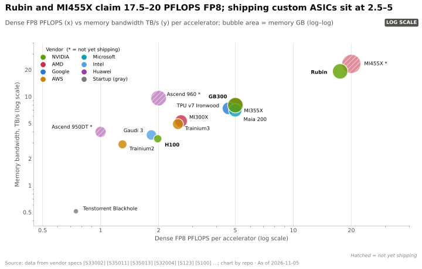
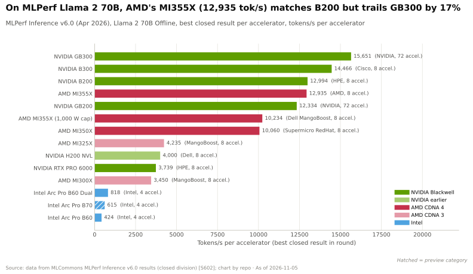
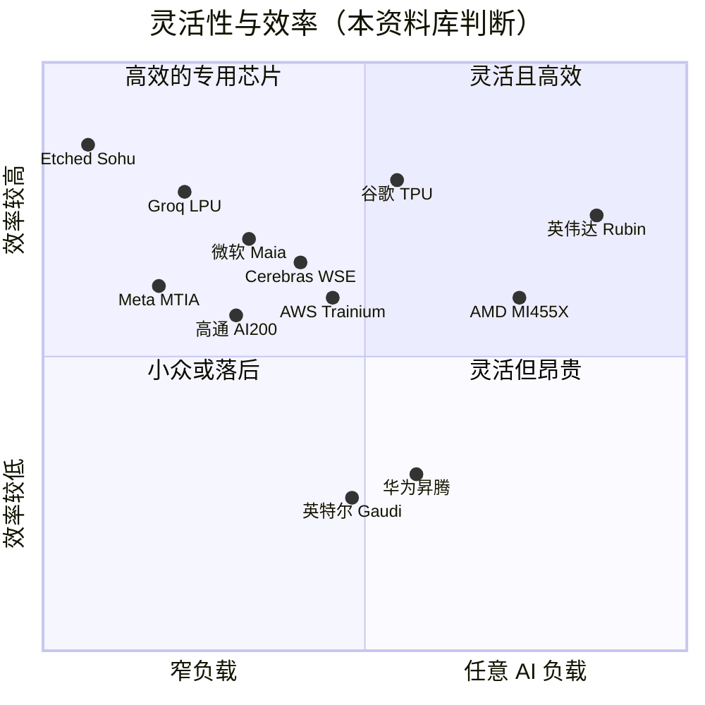
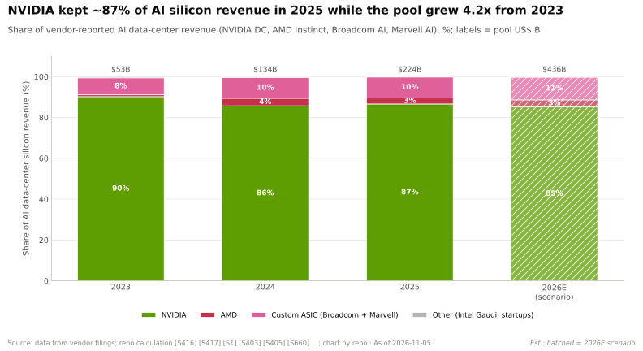

# GPU 芯片：竞争格局

> [!NOTE]
> 本页为英文原文的简体中文参考译文，仅供参考；如有出入，以[英文原文](../../../layers/02-gpu-silicon/competition.md "English original")为准。

第 02 层 · GPU 芯片 · 约 13 分钟阅读 · 最后核实：2026-11-05

## ⚡ 要点速览

- **纸面上，芯片层面的差距已经抹平。** AMD 的 MI455X 宣称 FP8 算力 20 [PFLOPS](../../glossary.md#flops)、432 GB [HBM](../../glossary.md#hbm)
  和 23.3 TB/s 带宽 [[S144]](../../../sources/bibliography.md#s144)[[S538]](../../../sources/bibliography.md#s538)[[S90093]](../../../sources/bibliography.md#s90093)；英伟达（NVIDIA）Rubin 标称稠密 FP8 17.5 PFLOPS、288 GB，经 2026 年规格调整后带宽为
  19.2 TB/s [[S33005]](../../../sources/bibliography.md#s33005)[[S90006]](../../../sources/bibliography.md#s90006)。两者都从 2026 年第三季度末开始出货 [[S90009]](../../../sources/bibliography.md#s90009)[[S90020]](../../../sources/bibliography.md#s90020)。
- **芯片层面最强的挑战者是 AMD；综合来看最强的是谷歌（Google）TPU。** SemiAnalysis
  实测 Ironwood 每百万 token 成本为 $0.181，B200 为 $0.222 [[S625]](../../../sources/bibliography.md#s625)；Anthropic 已签约采购最多 100 万颗
  TPU [[S90026]](../../../sources/bibliography.md#s90026)。
- **定制 [ASIC](../../glossary.md#asic) 单芯片性能落后，但钱包份额在上升。** Trainium3、Ironwood 和 Maia 200
  的 FP8 算力为 2.5–5 PFLOPS [[S155]](../../../sources/bibliography.md#s155)[[S151]](../../../sources/bibliography.md#s151)[[S158]](../../../sources/bibliography.md#s158)，然而 2026 年博通（Broadcom）AI 收入相当于英伟达
  数据中心收入的比例已从约 12% 升至约 19% [[S2516]](../../../sources/bibliography.md#s2516)[[S405]](../../../sources/bibliography.md#s405)。
- **在商业上真正关键的地方，英伟达仍然领先：** Rubin 的 FP8 能效约为 7.6 TFLOPS/W，MI355X 约为 3.6（功耗数据
  部分来自报道）[[S106]](../../../sources/bibliography.md#s106)[[S143]](../../../sources/bibliography.md#s143)；框架支持为 36/36，而 [ROCm](../../glossary.md#rocm) 为 26 [[S580]](../../../sources/bibliography.md#s580)[[S586]](../../../sources/bibliography.md#s586)；并且它是唯一
  规模化出货的[商用芯片](../../glossary.md#merchant-silicon)平台。
- **市场份额几乎没有变化：** 2025 年约占 AI 数据中心芯片收入的 87%，2023 年约为 90%（本资料库计算）
  [[S416]](../../../sources/bibliography.md#s416)[[S660]](../../../sources/bibliography.md#s660)[[S663]](../../../sources/bibliography.md#s663)。
- **中国是一个独立市场：** 华为昇腾（Ascend）950（FP8 算力 1 PFLOPS）单芯片性能约落后 Rubin 17 倍，但被用于
  8,192 颗芯片规模的 SuperPoD 设计 [[S163]](../../../sources/bibliography.md#s163)[[S90042]](../../../sources/bibliography.md#s90042)。

## 记分卡：五项指标，九家挑战者

评判以各家旗舰产品对比 Rubin/B300（厂商峰值数据；“稠密”= 不计[稀疏性](../../glossary.md#sparsity)
加成）。

| 挑战者（旗舰产品） | 单芯片稠密 FP8 / FP4 | 内存容量 / 带宽 | 每瓦性能 | 软件成熟度 | 可获得性 |
|---|---|---|---|---|---|
| AMD MI455X | 🟨 20 / 40 PF，未说明口径 [[S144]](../../../sources/bibliography.md#s144) | 🟩 432 GB，23.3 TB/s [[S144]](../../../sources/bibliography.md#s144)[[S90093]](../../../sources/bibliography.md#s90093) | 🟥 MI355X 约 3.6 TFLOPS/W [[S143]](../../../sources/bibliography.md#s143) | 🟥 ROCm 26/36 [[S586]](../../../sources/bibliography.md#s586) | 🟨 商用芯片；2026 年第三季度末出货 [[S90020]](../../../sources/bibliography.md#s90020) |
| 谷歌 Ironwood / TPU 8t | 🟥 4.6 PF FP8；8t 为 12.6 PF FP4 [[S151]](../../../sources/bibliography.md#s151)[[S552]](../../../sources/bibliography.md#s552) | 🟥 192 GB，7.4 TB/s [[S151]](../../../sources/bibliography.md#s151) | 🟦 未公布 TDP；每代约提升 2 倍 [[S552]](../../../sources/bibliography.md#s552) | 🟨 JAX/XLA；TorchTPU 刚推出 [[S553]](../../../sources/bibliography.md#s553) | 🟦 谷歌云、Anthropic、Meta [[S90025]](../../../sources/bibliography.md#s90025) |
| AWS Trainium3 / 4 | 🟥 2.5 PF FP8 [[S155]](../../../sources/bibliography.md#s155) | 🟥 144 GB，4.9 TB/s [[S155]](../../../sources/bibliography.md#s155) | 🟦 未披露 | 🟥 Neuron 7/36 [[S594]](../../../sources/bibliography.md#s594) | 🟦 仅限 AWS |
| 微软（Microsoft）Maia 200 | 🟥 >5 / >10 PF [[S158]](../../../sources/bibliography.md#s158) | 🟥 216 GB，约 7 TB/s [[S158]](../../../sources/bibliography.md#s158) | 🟨 750 W 下约 6.7 [[S158]](../../../sources/bibliography.md#s158) | 🟦 内部使用（Copilot）[[S90044]](../../../sources/bibliography.md#s90044) | 🟦 内部使用 |
| Meta MTIA 300–500 | 🟦 推荐排序与推理 [[S561]](../../../sources/bibliography.md#s561) | 🟦 自 MTIA 400 起采用 HBM [[S561]](../../../sources/bibliography.md#s561) | 🟦 未披露 | 🟦 PyTorch，内部使用 | 🟦 内部使用 |
| 英特尔（Intel）Gaudi 3 / Crescent Island | 🟥 1.8 PF FP8 [[S161]](../../../sources/bibliography.md#s161) | 🟥 128 GB，3.7 TB/s [[S161]](../../../sources/bibliography.md#s161) | 🟥 约 2.0 [[S161]](../../../sources/bibliography.md#s161) | 🟥 18/36 [[S580]](../../../sources/bibliography.md#s580) | 🟥 2026 年下半年送样 [[S162]](../../../sources/bibliography.md#s162) |
| 华为昇腾 950DT | 🟥 1 / 2 PF [[S163]](../../../sources/bibliography.md#s163) | 🟥 144 GB，4 TB/s [[S163]](../../../sources/bibliography.md#s163) | 🟦 未披露 | 🟥 CANN 17/36 [[S592]](../../../sources/bibliography.md#s592) | 🟦 仅限中国 |
| Cerebras、Etched、Groq 类 | 🟦 晶圆级、SRAM 或固定功能 | 🟦 44 GB SRAM，21 PB/s [[S166]](../../../sources/bibliography.md#s166) | 🟦 | 🟥 支持面窄 | 🟥 小众 |
| 高通（Qualcomm）AI200 / AI250 | 🟦 未披露 [[S173]](../../../sources/bibliography.md#s173) | 🟦 单卡 768 GB LPDDR [[S173]](../../../sources/bibliography.md#s173) | 🟦 仅有 TCO 宣称 | 🟥 4/36 [[S596]](../../../sources/bibliography.md#s596) | 🟥 尚无确认的出货 [[S90028]](../../../sources/bibliography.md#s90028) |

> [!TIP]
> **算例 —— AMD 的内存优势能换来什么。** 一个 1 万亿参数的模型在 [FP8](../../glossary.md#fp8) 下
> 权重约需 1,000 GB。四块 Rubin GPU 共有 1,152 GB，留给 [KV 缓存](../../glossary.md#kv-cache)的约为 152 GB；
> 四块 MI455X 共有 1,728 GB，可留出约 728 GB：在 GPU 数量相同的情况下，**可容纳的并发对话空间是前者的 4.8 倍**。
> 更大的[解码（decode）](../../glossary.md#decode)批次意味着每 [GPU 小时](../../glossary.md#gpu-hour)产出更多 token——这是 AMD 最有力的经济论据。

## 逐一审视挑战者

**AMD Instinct —— 内存与开放性。** 在 MLPerf Inference v6.0 中，MI355X 在 Llama 2 70B 上的单 GPU 表现与 B200 持平
（12,935 对 12,994 tokens/s），但落后于 GB300（15,651）[[S602]](../../../sources/bibliography.md#s602)。MI455X 以 72 GPU 的 Helios 机架形式出货（1.4 EF
FP8，31 TB [HBM4](../../glossary.md#hbm4)）[[S90021]](../../../sources/bibliography.md#s90021)，锚定客户包括 OpenAI（6 GW）、甲骨文（Oracle，50,000 颗 MI450）和 Anthropic（最高 2 GW）
[[S546]](../../../sources/bibliography.md#s546)[[S90022]](../../../sources/bibliography.md#s90022)[[S538]](../../../sources/bibliography.md#s538)。MI300X 曾落后 H100 约一年 [[S141]](../../../sources/bibliography.md#s141)[[S33002]](../../../sources/bibliography.md#s33002)；MI455X 则与 Rubin 在同一季度上市。
仍然欠缺的是：收入（2025 年份额约 3%）[[S663]](../../../sources/bibliography.md#s663)和软件深度。

**谷歌 TPU —— 每 token 成本。** Ironwood 提供 4,614 TFLOPS FP8 算力和 9,216 颗芯片的 pod [[S151]](../../../sources/bibliography.md#s151)；TPU 8t 宣称单芯片
[FP4](../../glossary.md#fp4) 算力达 12.6 PFLOPS [[S552]](../../../sources/bibliography.md#s552)。TPU 如今已触达外部客户：Anthropic（最多 100 万颗）、Meta 数十亿美元的
租用协议及采购谈判，以及自 2027 年起的甲骨文云（Oracle Cloud）[[S90026]](../../../sources/bibliography.md#s90026)[[S90025]](../../../sources/bibliography.md#s90025)[[S552]](../../../sources/bibliography.md#s552)。

> [!TIP]
> **算例 —— TPU 的成本优势从何而来。** 在 Qwen3.5-397B 上、每用户 20 tokens/s 的条件下，Ironwood
> 单芯片产出 9,364 tokens/s，B200 为 8,903，仅高约 5% [[S625]](../../../sources/bibliography.md#s625)。在每用户 100 tokens/s 的条件下，其成本为
> 每百万 token $0.181 对 $0.222，约低 18%。差距的大部分来自**更便宜的芯片小时**，而非更快的芯片，
> 因此它随英伟达的定价而变化，而不是随规格而变化。

**AWS、微软与 Meta —— “够用、更便宜、自己的”。** Trainium3 运行在 144 颗芯片的 UltraServer 中；AWS 宣称
Trainium4 将带来 3 倍的 FP8 算力、4 倍的内存带宽，并支持 [NVLink Fusion](../../glossary.md#nvlink-fusion)
[[S155]](../../../sources/bibliography.md#s155)[[S90034]](../../../sources/bibliography.md#s90034)。Maia 200 承载 Copilot；Maia 300 将于 2027 年部署 [[S90044]](../../../sources/bibliography.md#s90044)[[S90046]](../../../sources/bibliography.md#s90046)。Meta 计划在 2027 年前推出四代
MTIA [[S561]](../../../sources/bibliography.md#s561)。

**华为、英特尔、初创公司与高通。** 华为 SuperPoD 的出货情况尚未证实（🔴）[[S90042]](../../../sources/bibliography.md#s90042)；英特尔在 Gaudi 3 未达目标后
取消了 Falcon Shores [[S668]](../../../sources/bibliography.md#s668)[[S564]](../../../sources/bibliography.md#s564)；Groq 的技术如今已归入英伟达 [[S90018]](../../../sources/bibliography.md#s90018)；
高通的 AI200（单卡 768 GB [LPDDR](../../glossary.md#lpddr)）尚无经证实的 2026 年批量出货（🔴）[[S173]](../../../sources/bibliography.md#s173)[[S90028]](../../../sources/bibliography.md#s90028)。

## 每瓦性能与灵活性–效率权衡

[每瓦性能](../../glossary.md#perf-per-watt)决定了一个受电力上限约束的站点能卖出多少 token。只有部分厂商公布
芯片功耗，这本身就是一个信号。

> [!TIP]
> **算例 —— 每兆瓦芯片功耗的峰值 FP8 算力。** 1 MW 可供约 435 块 2.3 kW 的 Rubin GPU（≈ 7.6 EF）、
> 约 714 块 1.4 kW 的 MI355X（≈ 3.6 EF），或约 1,333 颗 750 W 的 Maia 200（≈ 6.7 EF）[[S106]](../../../sources/bibliography.md#s106)[[S143]](../../../sources/bibliography.md#s143)[[S158]](../../../sources/bibliography.md#s158)。这款
> 仅用于推理的 Maia 通过舍弃通用性，把与 Rubin 的差距缩小到约 12% 以内——这正是 ASIC 的交换条件。

🔧 技术细节：为什么规格表对比会误导人

- **稠密与稀疏。** AMD 未说明 MI455X 的 20/40 PFLOPS 是否为稠密值 [[S144]](../../../sources/bibliography.md#s144)；Rubin 50 PFLOPS 的 [NVFP4](../../glossary.md#nvfp4)
  “推理”数值依赖自适应压缩，35 PFLOPS 才是训练数值 [[S100]](../../../sources/bibliography.md#s100)。
- **功耗定义各不相同。** Rubin 约 1.8/2.3 kW 的数据来自分析师报道 [[S106]](../../../sources/bibliography.md#s106)；Maia 的 750 W 是厂商标称 TDP [[S158]](../../../sources/bibliography.md#s158)。
- **纸面与产品。** Rubin 的 HBM 和 [NVLink](../../glossary.md#nvlink) 数据在发布后被下调（见[路线图](roadmap.md)）；
  实测结果（MLPerf、InferenceX）是更好的参考 [[S602]](../../../sources/bibliography.md#s602)[[S625]](../../../sources/bibliography.md#s625)。

## 芯片之外：护城河在哪里

> [!TIP]
> **算例 —— 一个百分点的份额值多少钱。** AI 芯片市场规模 2025 年约为 $224B，估计
> 2026 年约为 $436B（本资料库计算）[[S416]](../../../sources/bibliography.md#s416)[[S660]](../../../sources/bibliography.md#s660)[[S663]](../../../sources/bibliography.md#s663)。一个百分点的份额约值 $2.2B，随后约值 $4.4B：AMD
> 若在 2026 年市场中的份额从约 3% 升至约 6%，将意味着约 $13B 的额外收入，而英伟达的领先地位不会因此受损。

**[Q5 · 最强挑战者]** 在芯片层面是 **AMD**：其最有力的论据是内存（432 GB 对 288 GB），以及
自英伟达 2026 年规格调整后，在 HBM 和[纵向扩展（scale-up）](../../glossary.md#scale-up)带宽上的纸面领先，并以开放的商用替代方案定位销售
[[S144]](../../../sources/bibliography.md#s144)[[S90006]](../../../sources/bibliography.md#s90006)。差距已从“晚一年”缩小到“同一季度、纸面规格更好”，但在收入
（约 3%）和软件上并未缩小 [[S663]](../../../sources/bibliography.md#s663)[[S586]](../../../sources/bibliography.md#s586)。在系统层面是**谷歌 TPU**：实测每 token 成本约低 18%，
且在持平或领先的技术栈层级数量上超过任何其他对手 [[S625]](../../../sources/bibliography.md#s625)。

> [!NOTE]
> **🐂 看多观点。** 对手如今在*规格*上已与英伟达比肩，但英伟达仍保持约 87% 的份额和约 75% 的毛利率
> [[S405]](../../../sources/bibliography.md#s405)。追平一款芯片，不等于每年都能追平一个平台。

> [!WARNING]
> **🐻 看空观点。** 一家商用芯片对手在规格上超越了英伟达的旗舰产品，最大的买家在自研芯片，
> TPU 也在谷歌之外销售。一旦芯片“够用”，决定胜负的就是每 token 价格，而英伟达的溢价
> 恰恰是 ASIC 所要消除的。

## 🎯 企业发展视角

1. 当芯片差距以月和 GB 来衡量时，差异化是否会转向机架、软件或供应？
2. [超大规模云厂商](../../glossary.md#hyperscaler)的 ASIC 在其自有工作负载上以每 token 成本取胜。在最大的几家云厂商之外，第三方推理加速器
   是否存在一个可持续的价值池？每 token 价格应在什么水平？
3. AMD 和高通都在内存容量上领先。一旦 [HBM4E](../../glossary.md#hbm4e) 堆栈达到 48–64 GB（见
   [第 03 层](../03-memory-packaging-supply-chain/index.md)），这一优势还有多大防御性？
4. 可信、经审计的每瓦性能披露，能否成为新进入者的商业武器？
5. 随着 TPU 成为商用芯片，哪些供应商将获得议价能力？

## 📚 来源（Sources）

<!-- Auto-generated from the [S…] citations on this page by `make build`. Edit sources/registry/*.csv, not this list. -->

- [**S100**](../../../sources/bibliography.md#s100) NVIDIA Technical Blog, *Inside the NVIDIA Vera Rubin Platform: Six New Chips, One AI Supercomputer*, 2026-01-05. [Link](https://developer.nvidia.com/blog/inside-the-nvidia-rubin-platform-six-new-chips-one-ai-supercomputer/)
- [**S106**](../../../sources/bibliography.md#s106) SemiAnalysis, *Vera Rubin - Extreme Co-Design: An Evolution*, 2026. [Link](https://newsletter.semianalysis.com/p/vera-rubin-extreme-co-design-an-evolution)
- [**S141**](../../../sources/bibliography.md#s141) AMD, *AMD Instinct MI300X Accelerator*, 2023-12-06. [Link](https://www.amd.com/en/products/accelerators/instinct/mi300/mi300x.html)
- [**S143**](../../../sources/bibliography.md#s143) AMD, *AMD Instinct MI350 Series (MI350X, MI355X)*, 2025-06-12. [Link](https://www.amd.com/en/products/accelerators/instinct/mi350.html)
- [**S144**](../../../sources/bibliography.md#s144) AMD Newsroom, *AMD Unveils Vision for an Open AI Ecosystem, Detailing New Silicon, Software and Systems at Advancing AI 2025*, 2025-06-12. [Link](https://www.amd.com/en/newsroom/press-releases/2025-6-12-amd-unveils-vision-for-an-open-ai-ecosystem-detai.html)
- [**S151**](../../../sources/bibliography.md#s151) Google Blog (Amin Vahdat), *Ironwood: The first Google TPU for the age of inference*, 2025-04-09. [Link](https://blog.google/products/google-cloud/ironwood-tpu-age-of-inference/)
- [**S155**](../../../sources/bibliography.md#s155) Amazon Web Services, *AWS Trainium (product page: Trn2, Trn3)*, 2025-12. [Link](https://aws.amazon.com/ai/machine-learning/trainium/)
- [**S158**](../../../sources/bibliography.md#s158) Microsoft, *Maia 200: Microsoft's AI accelerator built for inference*, 2026-01. [Link](https://blogs.microsoft.com/blog/2026/01/26/maia-200-the-ai-accelerator-built-for-inference/)
- [**S161**](../../../sources/bibliography.md#s161) Intel, *Intel Gaudi AI accelerators (Gaudi 2, Gaudi 3)*, 2024-04-09. [Link](https://www.intel.com/content/www/us/en/products/details/processors/ai-accelerators/gaudi.html)
- [**S162**](../../../sources/bibliography.md#s162) Intel Newsroom, *Intel to Expand AI Accelerator Portfolio with New GPU (Crescent Island)*, 2025-10-14. [Link](https://newsroom.intel.com/artificial-intelligence/intel-to-expand-ai-accelerator-portfolio-with-new-gpu)
- [**S163**](../../../sources/bibliography.md#s163) Huawei (Eric Xu), *Huawei Connect 2025 keynote: Ascend roadmap and SuperPoD interconnect (Eric Xu)*, 2025-09-18. [Link](https://www.huawei.com/en/news/2025/9/hc-xu-keynote-speech)
- [**S166**](../../../sources/bibliography.md#s166) Cerebras, *Cerebras Systems Unveils World's Fastest AI Chip with 4 Trillion Transistors (WSE-3)*, 2024-03-13. [Link](https://www.cerebras.ai/press-release/cerebras-announces-third-generation-wafer-scale-engine)
- [**S173**](../../../sources/bibliography.md#s173) Qualcomm, *Qualcomm Unveils AI200 and AI250 - Redefining Rack-Scale Data Center Inference*, 2025-10-27. [Link](https://www.qualcomm.com/news/releases/2025/10/qualcomm-unveils-ai200-and-ai250-redefining-rack-scale-data-cent)
- [**S405**](../../../sources/bibliography.md#s405) NVIDIA Corporation via SEC EDGAR, *NVIDIA Announces Financial Results for Second Quarter Fiscal 2027 (Form 8-K exhibit 99.1)*, 2026-08-26. [Link](https://www.sec.gov/Archives/edgar/data/0001045810/000104581026000073/q2fy27pr.htm)
- [**S416**](../../../sources/bibliography.md#s416) NVIDIA Corporation via SEC EDGAR, *NVIDIA Corporation Form 10-K for fiscal year ended January 26, 2025*, 2025-02-26. [Link](https://www.sec.gov/Archives/edgar/data/1045810/000104581025000023/nvda-20250126.htm)
- [**S538**](../../../sources/bibliography.md#s538) AMD Investor Relations, *AAI 2026: AMD Delivers Full-Stack Compute for the Agentic AI Era*, 2026-07-23. [Link](https://ir.amd.com/news-events/press-releases/detail/1294/aai-2026-amd-delivers-full-stack-compute-for-the-agentic-ai-era)
- [**S546**](../../../sources/bibliography.md#s546) TechWire Asia, *AMD Advancing AI 2026: Helios, OpenAI, Meta, Anthropic*, 2026-07. [Link](https://techwireasia.com/2026/07/amd-advancing-ai-2026-helios-openai-meta-anthropic/)
- [**S552**](../../../sources/bibliography.md#s552) Google Cloud Blog (Karan Batta), *Bringing Google TPUs to Oracle Cloud Infrastructure*, 2026-10-27. [Link](https://cloud.google.com/blog/products/infrastructure/bringing-google-tpus-to-oracle-cloud-infrastructure)
- [**S553**](../../../sources/bibliography.md#s553) Google Cloud Blog (Alex Barrett), *What's new in AI infrastructure and orchestration in October*, 2026-11. [Link](https://cloud.google.com/blog/topics/ai-infrastructure/whats-new-in-ai-infrastructure-this-month)
- [**S561**](../../../sources/bibliography.md#s561) DatacenterDynamics, *Meta unveils next four generations of its MTIA chip*, 2026-03-11. [Link](https://www.datacenterdynamics.com/en/news/meta-unveils-next-four-generations-of-its-mtia-chip/)
- [**S564**](../../../sources/bibliography.md#s564) Tom's Hardware, *Intel's roadmaps examined — 14A, Nova Lake, Diamond Rapids & AI accelerator push*, 2026. [Link](https://www.tomshardware.com/tech-industry/semiconductors/intel-chip-roadmap-2026-2028)
- [**S580**](../../../sources/bibliography.md#s580) vLLM project (GitHub), *vLLM README and installation docs — supported hardware*, 2026-11. [Link](https://github.com/vllm-project/vllm/blob/main/docs/getting_started/installation/README.md)
- [**S586**](../../../sources/bibliography.md#s586) AMD (GitHub: ROCm/ROCm docs), *ROCm documentation sources: release history, AI-ecosystem compatibility matrix, consolidated changelog*, 2026-08-26. [Link](https://github.com/ROCm/ROCm/blob/develop/docs/release/versions.rst)
- [**S592**](../../../sources/bibliography.md#s592) Huawei Ascend (GitHub: Ascend org), *Huawei Ascend open-source adapters: torch_npu, MindSpeed, triton-ascend*, 2026-11. [Link](https://github.com/Ascend/pytorch)
- [**S594**](../../../sources/bibliography.md#s594) AWS (GitHub: aws-neuron/neuronx-distributed), *NeuronX Distributed (NxD) README*, 2026-11. [Link](https://github.com/aws-neuron/neuronx-distributed)
- [**S596**](../../../sources/bibliography.md#s596) Qualcomm (GitHub: quic), *Qualcomm Cloud AI SDK and Efficient Transformers repositories*, 2026-11. [Link](https://github.com/quic/cloud-ai-sdk)
- [**S602**](../../../sources/bibliography.md#s602) MLCommons, *MLPerf Inference v6.0 results (summary_results.json and per-submitter logs)*, 2026-04-01. [Link](https://github.com/mlcommons/inference_results_v6.0)
- [**S625**](../../../sources/bibliography.md#s625) SemiAnalysis, *TPU Inference Externalization Full Steam Ahead*, 2026-09-07. [Link](https://github.com/SemiAnalysisAI/InferenceX-app/blob/main/packages/app/content/blog/tpu-inferencex-full-steam.mdx)
- [**S660**](../../../sources/bibliography.md#s660) Broadcom Inc., *Broadcom Inc. Announces Fourth Quarter and Fiscal Year 2024 Financial Results*, 2024-12-12. [Link](https://investors.broadcom.com/financial-information/quarterly-results)
- [**S663**](../../../sources/bibliography.md#s663) AMD, *AMD Reports Fourth Quarter and Full Year 2024 Financial Results*, 2025-02-04. [Link](https://ir.amd.com/news-events/press-releases)
- [**S668**](../../../sources/bibliography.md#s668) Reuters (as reported), *Intel says it will not hit $500 million Gaudi 3 revenue target for 2024*, 2024-10-31. [Link](https://www.reuters.com/technology/)
- [**S2516**](../../../sources/bibliography.md#s2516) Broadcom Inc. via SEC EDGAR, *Broadcom Inc. Announces Third Quarter Fiscal Year 2026 Financial Results (Form 8-K exhibit 99.1)*, 2026-09. [Link](https://www.sec.gov/Archives/edgar/data/0001730168/000173016826000076/avgo-08022026x8kxex99.htm)
- [**S33002**](../../../sources/bibliography.md#s33002) NVIDIA, *NVIDIA H100 Tensor Core GPU (product page and datasheet)*, 2022-03-22. [Link](https://www.nvidia.com/en-us/data-center/h100/)
- [**S33005**](../../../sources/bibliography.md#s33005) NVIDIA, *NVIDIA Vera Rubin NVL72 (product page and specifications)*, 2026. [Link](https://www.nvidia.com/en-us/data-center/vera-rubin-nvl72/)
- [**S90006**](../../../sources/bibliography.md#s90006) TweakTown, *Nvidia cuts Vera Rubin's memory bandwidth by up to 26% and AMD's Helios now leads in memory bandwidth*, 2026-10. [Link](https://www.tweaktown.com/news/114304/nvidia-cuts-vera-rubins-memory-bandwidth-by-up-to-26-percent-and-amds-helios-now-leads-in-memory-bandwidth/index.html)
- [**S90009**](../../../sources/bibliography.md#s90009) GamesBeat, *Nvidia Vera Rubin ramps into full production for fall launch*, 2026. [Link](https://gamesbeat.com/nvidia-vera-rubin-ramps-into-full-production-for-fall-launch-again/)
- [**S90018**](../../../sources/bibliography.md#s90018) Constellation Research, *Nvidia's Groq deal: acquisition, acquihire or creative licensing deal?*, 2025-12. [Link](https://www.constellationr.com/insights/news/nvidias-groq-deal-acquisition-acquihire-or-creative-licensing-deal)
- [**S90020**](../../../sources/bibliography.md#s90020) Shacknews, *AMD Helios AI rack system on track for initial shipments in Q3 2026*, 2026. [Link](https://www.shacknews.com/article/150249/amd-helios-ai-system-shipping-q3-2026)
- [**S90021**](../../../sources/bibliography.md#s90021) Igor's Lab, *AMD Helios in production: MI455X, EPYC Venice and OpenAI challenge Nvidia AI racks*, 2026. [Link](https://www.igorslab.de/en/amd-helios-in-production-mi455x-epyc-venice-openai-challenge-nvidia-ai-racks/)
- [**S90022**](../../../sources/bibliography.md#s90022) Tom's Hardware, *AMD and Oracle partner to deploy 50,000 MI450 Instinct GPUs*, 2025-10. [Link](https://www.tomshardware.com/tech-industry/artificial-intelligence/amd-and-oracle-partner-to-deploy-50-000-mi450-instinct-gpus-in-new-ai-superclusters-deployment-of-expansion-set-for-2026-powered-by-amds-helios-rack)
- [**S90025**](../../../sources/bibliography.md#s90025) SiliconANGLE, *Google and Meta reportedly strike new multibillion-dollar AI chip deal*, 2026-02-26. [Link](https://siliconangle.com/2026/02/26/google-meta-reportedly-strike-new-multibillion-dollar-ai-chip-deal/)
- [**S90026**](../../../sources/bibliography.md#s90026) Maginative, *Anthropic secures 1M Google TPUs while keeping Amazon as primary training partner*, 2025-10. [Link](https://www.maginative.com/anthropic-secures-1m-google-tpus-while-keeping-amazon-as-primary-training-partner)
- [**S90028**](../../../sources/bibliography.md#s90028) TechRepublic, *Qualcomm unveils AI chips to rival Nvidia, AMD*, 2025-10-27. [Link](https://techrepublic.com/article/news-qualcomm-unveils-ai-chips-to-rival-nvidia-amd)
- [**S90034**](../../../sources/bibliography.md#s90034) NAND Research, *AWS releases Trainium3, teases Trainium4*, 2025-12. [Link](https://nand-research.com/research-note-aws-releases-trainium3-teases-trainium4/4/)
- [**S90042**](../../../sources/bibliography.md#s90042) TrendForce, *Huawei unveils Ascend 950 with in-house HBM in 2026, touts SuperPoD to rival NVIDIA*, 2025-09-18. [Link](https://www.trendforce.com/news/2025/09/18/news-huawei-unveils-ascend-950-with-in-house-hbm-in-2026-touts-superpod-to-rival-nvidia/)
- [**S90044**](../../../sources/bibliography.md#s90044) eWeek, *Microsoft introduces Maia 200, its most powerful AI chip yet*, 2026-01-27. [Link](https://www.eweek.com/news/microsoft-maia-200-ai-chip/)
- [**S90046**](../../../sources/bibliography.md#s90046) IT Brief UK, *Microsoft unveils Maia 300 for 2027 AI deployments*, 2026-10. [Link](https://itbrief.co.uk/story/microsoft-unveils-maia-300-for-2027-ai-deployments)
- [**S90093**](../../../sources/bibliography.md#s90093) Tom's Hardware, *AMD takes the wraps off its Instinct MI455X AI accelerator: CDNA 5 and Helios rack-scale architecture*, 2026. [Link](https://www.tomshardware.com/pc-components/gpus/amd-takes-the-wraps-off-its-instinct-mi455x-ai-accelerator-cdna-5-and-helios-rack-scale-architecture-combine-to-take-the-fight-to-nvidia-in-the-data-center)
