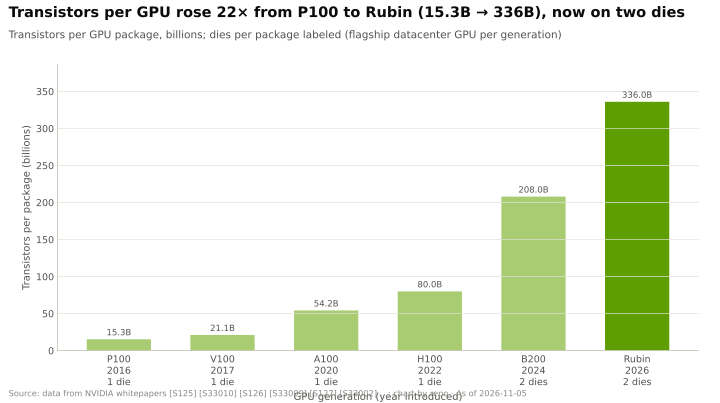
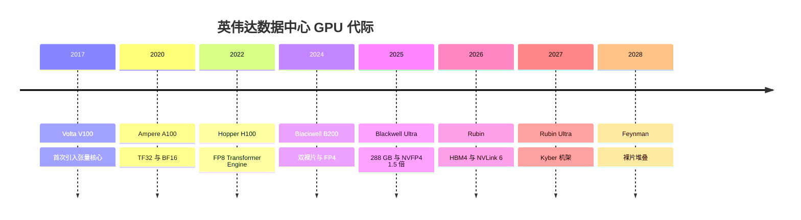
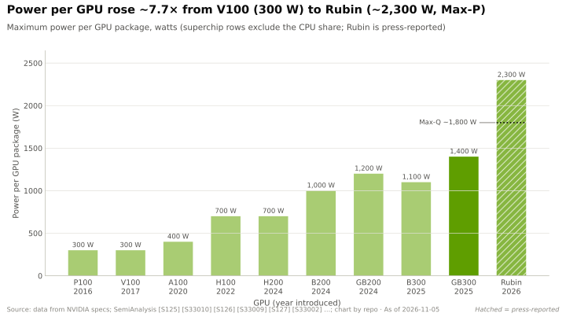
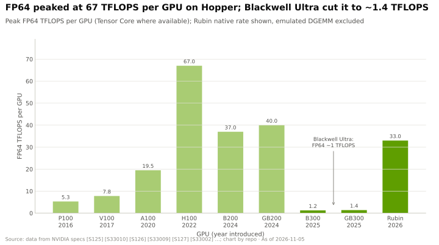
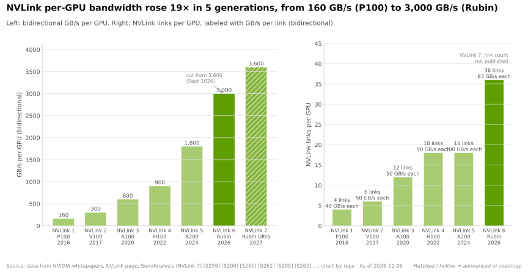

# 产品代际：从 Volta 到 Feynman

> [!NOTE]
> 本页为英文原文的简体中文参考译文，仅供参考；如有出入，以[英文原文](../../../layers/02-gpu-silicon/generations-volta-to-feynman.md "English original")为准。

第 02 层 · GPU 芯片 · 每一代新增了什么、今昔对比，以及 2026 年 Rubin 的规格调整 · 约 7 分钟阅读 · 最后核实：2026-11-05

## ⚡ 要点速览

- **迭代节奏从约 2–3 年一代变为一年一代：** Volta（2017）、Ampere（2020）、Hopper（2022）、Blackwell（2024）、Blackwell Ultra（2025）、Rubin（2026），Rubin Ultra（2027 年下半年）和 Feynman（2028）已列入官方路线图 🟢 [[S33020]](../../../sources/bibliography.md#s33020)[[S502]](../../../sources/bibliography.md#s502)。
- **每一代都同时搭配新的[张量核心](../../glossary.md#tensor-core)、新的数值格式、新一代 [HBM](../../glossary.md#hbm) 和更快的 [NVLink](../../glossary.md#nvlink)；** 其中数值格式通常带来最大的跃升（Hopper 的 [FP8](../../glossary.md#fp8)、Blackwell 的 [FP4](../../glossary.md#fp4)）[[S2023]](../../../sources/bibliography.md#s2023)[[S35014]](../../../sources/bibliography.md#s35014)。
- **从 V100 到 Rubin，单 GPU 晶体管数增长了 16 倍**（21.1B → 336B），其中最后的 4 倍来自增加第二颗裸片 [[S126]](../../../sources/bibliography.md#s126)[[S100]](../../../sources/bibliography.md#s100)。
- **功耗增长约 7.7 倍**，从 300 W（V100）增至 Rubin 据报道的 Max-P 配置下约 2,300 W [[S33010]](../../../sources/bibliography.md#s33010)[[S106]](../../../sources/bibliography.md#s106)。
- **2026 年出现了英伟达（NVIDIA）首次公开可见的规格回调：** Rubin 的单 GPU [HBM4](../../glossary.md#hbm4) 带宽从 22 TB/s 降至 19.2 TB/s，NVLink 6 从 3.6 TB/s 降至 3.0 TB/s 🟢；原因尚未证实 🔴 [[S90006]](../../../sources/bibliography.md#s90006)[[S90007]](../../../sources/bibliography.md#s90007)[[S90008]](../../../sources/bibliography.md#s90008)。
- **路线图正变得更加异构：** Rubin CPX 从 GTC 2026 路线图中消失 🟡 [[S115]](../../../sources/bibliography.md#s115)，源自 Groq 的 [LPU](../../glossary.md#lpu) 如今与 Rubin 并列 [[S114]](../../../sources/bibliography.md#s114)，另据报道 Feynman 将搭配 LP40 LPU 和 Rosa CPU 🟡 [[S90004]](../../../sources/bibliography.md#s90004)。

## 每一代新增了什么

**[Q3 · 代际进步]**

| 代际（旗舰产品） | 年份 | 新增张量格式 | 单 GPU 内存 | 单 GPU NVLink | 标志性变化 |
|---|---|---|---|---|---|
| Volta（V100） | 2017 | FP16 | 32 GB HBM2，0.9 TB/s | 300 GB/s | 首次引入张量核心 [[S126]](../../../sources/bibliography.md#s126)[[S33010]](../../../sources/bibliography.md#s33010) |
| Ampere（A100） | 2020 | TF32、BF16、2:4 稀疏 | 80 GB HBM2e，2.0 TB/s | 600 GB/s | 每个 SM 的张量运算速率翻倍 [[S127]](../../../sources/bibliography.md#s127)[[S33009]](../../../sources/bibliography.md#s33009) |
| Hopper（H100） | 2022 | FP8 | 80 GB HBM3，3.35 TB/s | 900 GB/s | Transformer Engine、TMA [[S2023]](../../../sources/bibliography.md#s2023)[[S33002]](../../../sources/bibliography.md#s33002) |
| Blackwell（B200） | 2024 | FP6、FP4、MX、NVFP4 | 192 GB HBM3E，8 TB/s | 1.8 TB/s | 双裸片、[NV-HBI](../../glossary.md#nv-hbi) [[S35014]](../../../sources/bibliography.md#s35014)[[S33003]](../../../sources/bibliography.md#s33003) |
| Blackwell Ultra（GB300） | 2025 | [NVFP4](../../glossary.md#nvfp4) 提升至 1.5 倍 | 288 GB HBM3E，8 TB/s | 1.8 TB/s | FP64 削减至约 1.3 TFLOPS [[S2003]](../../../sources/bibliography.md#s2003)[[S32004]](../../../sources/bibliography.md#s32004)[[S123]](../../../sources/bibliography.md#s123) |
| Rubin | 2026 | NVFP4 自适应压缩 | 288 GB HBM4，19.2 TB/s | 3.0 TB/s | 336B 晶体管、224 个 SM [[S100]](../../../sources/bibliography.md#s100)[[S2000]](../../../sources/bibliography.md#s2000)[[S33007]](../../../sources/bibliography.md#s33007) |
| Rubin Ultra 🟢 | 2027 年下半年 | 未披露 | 约 1 TB HBM4E，16 个堆栈 | NVLink 7 | 四颗裸片（另有报道称改为双裸片 🟡）[[S35018]](../../../sources/bibliography.md#s35018)[[S509]](../../../sources/bibliography.md#s509) |
| Feynman 🟢 | 2028 | 未披露 | 定制 HBM、裸片堆叠 🟡 | NVLink 8，铜缆 + 光学 🟡 | Rosa CPU、LP40 LPU 🟡 [[S502]](../../../sources/bibliography.md#s502)[[S90004]](../../../sources/bibliography.md#s90004) |

> [!TIP]
> **算例 —— 1 兆瓦的 GPU 能买到什么：H100 对比 Rubin。** 1 MW 的 GPU 功率可运行约 1,430
> 块 700 W 的 H100，或约 435 块约 2,300 W 的 Rubin [[S33002]](../../../sources/bibliography.md#s33002)[[S106]](../../../sources/bibliography.md#s106)。按 FP8 计，前者为 1,430 × 1.98 = **2.8 EF**，
> 后者为 435 × 17.5 = **7.6 EF**，多出 2.7 倍；按 Rubin 的 FP4 计则为 15.2 EF，多出 5.4 倍（本资料库测算）。
> 因此，受电力约束的站点升级是为了数值格式，而不是为了晶体管数量。

## 2026 年 Rubin 的规格调整

| 规格 | CES 2026 发布时 | 2026 年 10 月产品页 | 变化 |
|---|---|---|---|
| 单 GPU HBM4 带宽 | 22 TB/s [[S33006]](../../../sources/bibliography.md#s33006) | 19.2 TB/s [[S33007]](../../../sources/bibliography.md#s33007)[[S90006]](../../../sources/bibliography.md#s90006) | −13% |
| 单 GPU NVLink 6 带宽 | 3.6 TB/s [[S33004]](../../../sources/bibliography.md#s33004) | 3.0 TB/s [[S90006]](../../../sources/bibliography.md#s90006)[[S103]](../../../sources/bibliography.md#s103) | −17% |
| NVL72 机架 HBM 带宽 | 1,580 TB/s | 1,400 TB/s [[S90007]](../../../sources/bibliography.md#s90007) | −11% |
| HBM 容量；稠密 FP8 | 288 GB；17.5 PFLOPS | 未变 [[S33005]](../../../sources/bibliography.md#s33005) | 0 |

> [!TIP]
> **算例 —— 规格下调对客户意味着什么。** [解码（decode）](../../glossary.md#decode)受限于带宽，因此其上限
> 按比例下降：70B 模型在 FP8 下、按 75% 带宽效率计，单路流从约 236 tokens/s 降至约 206 tokens/s
> （22 或 19.2 TB/s × 0.75 ÷ 70 GB；本资料库测算）。受限于算力的训练则不受影响。
> 英伟达表示，新数字反映的是系统在批量生产中可持续达到的水平 [[S104]](../../../sources/bibliography.md#s104)；一位分析师将其
> 归因于 HBM4 引脚速率约为 9.4 Gb/s 而非约 10.7 Gb/s 🔴 [[S90008]](../../../sources/bibliography.md#s90008)。Vera Rubin 已于
> 2026 年 8 月初开始量产出货 [[S500]](../../../sources/bibliography.md#s500)[[S90009]](../../../sources/bibliography.md#s90009)。

🔧 技术细节：Rubin CPX、LPU 与 Feynman

- **Rubin CPX**（2025-09-09 发布）：单裸片[预填充（prefill）](../../glossary.md#prefill)加速器，NVFP4 算力 30 [PFLOPS](../../glossary.md#flops)，配备 128 GB
  GDDR7 而非 HBM [[S33023]](../../../sources/bibliography.md#s33023)。它未出现在 GTC 2026 路线图中；英伟达的 Ian Buck 表示，
  该产品被推迟，以便集中精力发展 LPU 解码 🟡 [[S115]](../../../sources/bibliography.md#s115)[[S116]](../../../sources/bibliography.md#s116)；一位分析师报道称，它将改用 HBM4 重新设计，定于 1Q27 推出
  🔴 [[S117]](../../../sources/bibliography.md#s117)。
- **Groq 3 LPU（LP30）**：单芯片约 500 MB [SRAM](../../glossary.md#sram)，带宽约 150 TB/s，FP8 算力约 1.2 PFLOPS；每个 LPX 机架 256 颗，
  与 Vera Rubin 搭配出货 [[S114]](../../../sources/bibliography.md#s114)[[S90003]](../../../sources/bibliography.md#s90003)。
- **Feynman（2028）**：裸片堆叠与定制 HBM，采用铜缆与共封装光学的 Kyber NVL1152 机架
  🟡 [[S502]](../../../sources/bibliography.md#s502)[[S108]](../../../sources/bibliography.md#s108)；据报道采用台积电（TSMC）A16 制程 🔴 [[S119]](../../../sources/bibliography.md#s119)。尚未公布任何算力或内存数据。

## 🎯 企业发展视角

1. 一年一代的节奏把每款产品的销售窗口压缩到约 12 个月；这对残值和客户的折旧年限意味着什么？
2. 供应商如今能够左右英伟达的标称规格；尽职调查是否应像重视英伟达路线图一样重视内存路线图？
3. 每个机架同时配有 CPU、GPU 和 LPU：这种异构化是通过 [NVLink Fusion](../../glossary.md#nvlink-fusion) 为第三方加速器打开了插槽，还是关上了大门？

## 📚 来源（Sources）

<!-- Auto-generated from the [S…] citations on this page by `make build`. Edit sources/registry/*.csv, not this list. -->

- [**S100**](../../../sources/bibliography.md#s100) NVIDIA Technical Blog, *Inside the NVIDIA Vera Rubin Platform: Six New Chips, One AI Supercomputer*, 2026-01-05. [Link](https://developer.nvidia.com/blog/inside-the-nvidia-rubin-platform-six-new-chips-one-ai-supercomputer/)
- [**S103**](../../../sources/bibliography.md#s103) VideoCardz, *NVIDIA quietly cuts Vera Rubin specs, HBM4 bandwidth and NVLink 6 speeds now lower*, 2026-10. [Link](https://videocardz.com/newz/nvidia-quietly-cuts-vera-rubin-specs-hbm4-bandwidth-and-nvlink-6-speeds-now-lower)
- [**S104**](../../../sources/bibliography.md#s104) Wccftech, *NVIDIA's Official Statement on Vera Rubin Spec Change*, 2026-10-29. [Link](https://wccftech.com/nvidia-official-statement-on-vera-rubin-spec-change/)
- [**S106**](../../../sources/bibliography.md#s106) SemiAnalysis, *Vera Rubin - Extreme Co-Design: An Evolution*, 2026. [Link](https://newsletter.semianalysis.com/p/vera-rubin-extreme-co-design-an-evolution)
- [**S108**](../../../sources/bibliography.md#s108) HPCwire / AIwire, *Huang Shares Nvidia Roadmap Showing More Chips, NVL1152, Scale-Up CPO*, 2026-03-18. [Link](https://www.hpcwire.com/aiwire/2026/03/18/huang-shares-nvidia-roadmap-showing-more-chips-nvl1152-scale-up-cpo/)
- [**S114**](../../../sources/bibliography.md#s114) StorageReview, *NVIDIA Groq 3 LPX: Everything we know*, 2026-03. [Link](https://www.storagereview.com/news/nvidia-groq-3-lpx-everything-we-know)
- [**S115**](../../../sources/bibliography.md#s115) Tom's Hardware, *Nvidia removes Rubin CPX accelerators from its roadmap - Groq 3 LPUs take center stage*, 2026-03. [Link](https://www.tomshardware.com/pc-components/gpus/nvidia-removes-rubin-cpx-accelerators-from-its-roadmap-groq-3-lpus-take-center-stage-as-cpx-is-removed)
- [**S116**](../../../sources/bibliography.md#s116) Wccftech, *NVIDIA's Rubin CPX Is Off the Roadmap, Replaced by Groq LPUs for Inference, But May Return With Feynman in 2028*, 2026-03. [Link](https://wccftech.com/nvidia-rubin-cpx-is-off-the-roadmap-but-may-return-with-feynman-in-2028/)
- [**S117**](../../../sources/bibliography.md#s117) TechNews (Taiwan), *Nvidia Rubin CPX re-enters roadmap with HBM4 for AI prefill*, 2026-09-02. [Link](https://technews.tw/2026/09/02/nvidia-rubin-cpx-reenters-roadmap-hbm4-ai-prefill/)
- [**S119**](../../../sources/bibliography.md#s119) XenoSpectrum, *NVIDIA's Feynman May Combine TSMC A16 and N3P, Reports Say*, 2026. [Link](https://xenospectrum.com/en/nvidia-feynman-tsmc-a16-report/)
- [**S123**](../../../sources/bibliography.md#s123) Glenn K. Lockwood (blog) (Glenn K. Lockwood), *HGX B300 specifications compilation (B300 per-GPU figures)*, 2025. [Link](https://glennklockwood.com/garden/processors/B300)
- [**S126**](../../../sources/bibliography.md#s126) NVIDIA, *NVIDIA Tesla V100 GPU Architecture Whitepaper*, 2017-08. [Link](https://images.nvidia.com/content/volta-architecture/pdf/volta-architecture-whitepaper.pdf)
- [**S127**](../../../sources/bibliography.md#s127) NVIDIA Technical Blog, *NVIDIA Ampere Architecture In-Depth*, 2020-05-14. [Link](https://developer.nvidia.com/blog/nvidia-ampere-architecture-in-depth/)
- [**S500**](../../../sources/bibliography.md#s500) NVIDIA Corporation, *NVIDIA Q2 Fiscal 2027 Quarterly Presentation (CFO commentary deck)*, 2026-08-26. [Link](https://s201.q4cdn.com/141608511/files/doc_financials/2027/Q227/NVDA-F2Q27-Quarterly-Presentation-final-1.pdf)
- [**S502**](../../../sources/bibliography.md#s502) Tom's Hardware, *Nvidia updates data center roadmap with Rosa CPU and stacked Feynman GPUs; optical NVLink; Groq LPUs with NVFP4 and NVLink also on deck*, 2026-03-17. [Link](https://www.tomshardware.com/pc-components/gpus/nvidia-updates-data-center-roadmap-with-rosa-cpu-and-stacked-feynman-gpus-optical-nvlink-groq-lpus-with-nvfp4-and-nvlink-also-on-deck)
- [**S509**](../../../sources/bibliography.md#s509) TrendForce, *NVIDIA Rubin Ultra four-die single-package design not adopted amid advanced-packaging constraints*, 2026-04-01. [Link](https://www.trendforce.com/news/?p=55442)
- [**S2000**](../../../sources/bibliography.md#s2000) NVIDIA Technical Blog, *Inside NVIDIA Rubin GPU Architecture: Powering the Era of Agentic AI*, 2026-07-21. [Link](https://developer.nvidia.com/blog/inside-nvidia-rubin-gpu-architecture-powering-the-era-of-agentic-ai/)
- [**S2003**](../../../sources/bibliography.md#s2003) NVIDIA Technical Blog, *Inside NVIDIA Blackwell Ultra: The Chip Powering the AI Factory Era*, 2025-08. [Link](https://developer.nvidia.com/blog/inside-nvidia-blackwell-ultra-the-chip-powering-the-ai-factory-era/)
- [**S2023**](../../../sources/bibliography.md#s2023) NVIDIA Technical Blog, *NVIDIA Hopper Architecture In-Depth*, 2022-03-22. [Link](https://developer.nvidia.com/blog/nvidia-hopper-architecture-in-depth/)
- [**S32004**](../../../sources/bibliography.md#s32004) NVIDIA, *NVIDIA GB300 NVL72 / Blackwell Ultra (product page)*, 2025-03. [Link](https://www.nvidia.com/en-us/data-center/gb300-nvl72/)
- [**S33002**](../../../sources/bibliography.md#s33002) NVIDIA, *NVIDIA H100 Tensor Core GPU (product page and datasheet)*, 2022-03-22. [Link](https://www.nvidia.com/en-us/data-center/h100/)
- [**S33003**](../../../sources/bibliography.md#s33003) Lenovo Press, *ThinkSystem NVIDIA B200 180GB 1000W GPU product guide*, 2025. [Link](https://lenovopress.lenovo.com/lp2226-thinksystem-nvidia-b200-180gb-1000w-gpu)
- [**S33004**](../../../sources/bibliography.md#s33004) NVIDIA Newsroom, *NVIDIA Kicks Off the Next Generation of AI With Rubin — Six New Chips; One Incredible AI Supercomputer*, 2026-01-05. [Link](https://nvidianews.nvidia.com/news/rubin-platform-ai-supercomputer)
- [**S33005**](../../../sources/bibliography.md#s33005) NVIDIA, *NVIDIA Vera Rubin NVL72 (product page and specifications)*, 2026. [Link](https://www.nvidia.com/en-us/data-center/vera-rubin-nvl72/)
- [**S33006**](../../../sources/bibliography.md#s33006) Tom's Hardware, *Nvidia launches Vera Rubin NVL72 AI supercomputer at CES*, 2026-01-05. [Link](https://www.tomshardware.com/pc-components/gpus/nvidia-launches-vera-rubin-nvl72-ai-supercomputer-at-ces-promises-up-to-5x-greater-inference-performance-and-10x-lower-cost-per-token-than-blackwell-coming-2h-2026)
- [**S33007**](../../../sources/bibliography.md#s33007) Dataconomy, *Nvidia Quietly Cuts Vera Rubin HBM4 And NVLink Bandwidth Specs*, 2026-11-02. [Link](https://dataconomy.com/2026/11/02/nvidia-quietly-cuts-vera-rubin-hbm4-and-nvlink-bandwidth/)
- [**S33009**](../../../sources/bibliography.md#s33009) NVIDIA, *NVIDIA A100 Tensor Core GPU datasheet*, 2021. [Link](https://www.nvidia.com/content/dam/en-zz/Solutions/Data-Center/a100/pdf/nvidia-a100-datasheet-us-nvidia-1758950-r4-web.pdf)
- [**S33010**](../../../sources/bibliography.md#s33010) NVIDIA, *NVIDIA V100 Tensor Core GPU datasheet*, 2018. [Link](https://images.nvidia.com/content/technologies/volta/pdf/volta-v100-datasheet-update-us-1165301-r5.pdf)
- [**S33020**](../../../sources/bibliography.md#s33020) NVIDIA (Jensen Huang), *NVIDIA GTC 2025 keynote (Jensen Huang)*, 2025-03-18. [Link](https://www.nvidia.com/gtc/keynote/)
- [**S33023**](../../../sources/bibliography.md#s33023) NVIDIA Newsroom, *NVIDIA Unveils Rubin CPX: A New Class of GPU Designed for Massive-Context Inference*, 2025-09-09. [Link](https://nvidianews.nvidia.com/news/nvidia-unveils-rubin-cpx-a-new-class-of-gpu-designed-for-massive-context-inference)
- [**S35014**](../../../sources/bibliography.md#s35014) NVIDIA, *NVIDIA Blackwell Architecture*, 2024-03. [Link](https://www.nvidia.com/en-us/data-center/technologies/blackwell-architecture/)
- [**S35018**](../../../sources/bibliography.md#s35018) Tom's Hardware, *Nvidia announces Rubin GPUs in 2026, Rubin Ultra in 2027, Feynman also added to roadmap*, 2025-03-18. [Link](https://www.tomshardware.com/pc-components/gpus/nvidia-announces-rubin-gpus-in-2026-rubin-ultra-in-2027-feynam-after)
- [**S90003**](../../../sources/bibliography.md#s90003) eWeek, *Everything Nvidia Just Announced at GTC 2026: 7 Chips, 5 Racks, 1 Giant Bet on Agentic AI*, 2026-03-17. [Link](https://www.eweek.com/news/nvidia-gtc-2026-ai-inference-vera-rubin-neuron/)
- [**S90004**](../../../sources/bibliography.md#s90004) TrendForce, *Key GTC takeaways: how Samsung, Micron, Intel and more power NVIDIA's Vera Rubin and Feynman*, 2026-03-17. [Link](https://www.trendforce.com/news/2026/03/17/news-key-gtc-takeaways-how-samsung-micron-intel-more-power-nvidias-vera-rubin-and-feynman/)
- [**S90006**](../../../sources/bibliography.md#s90006) TweakTown, *Nvidia cuts Vera Rubin's memory bandwidth by up to 26% and AMD's Helios now leads in memory bandwidth*, 2026-10. [Link](https://www.tweaktown.com/news/114304/nvidia-cuts-vera-rubins-memory-bandwidth-by-up-to-26-percent-and-amds-helios-now-leads-in-memory-bandwidth/index.html)
- [**S90007**](../../../sources/bibliography.md#s90007) TechRadar Pro, *Nvidia forced to dial back key bandwidth targets on Vera Rubin*, 2026-10. [Link](https://techradar.com/pro/nvidia-forced-to-dial-back-key-bandwidth-targets-on-vera-rubin-hardware-tweaks-will-affect-target-specifications-for-memory-and-interconnect-fabric)
- [**S90008**](../../../sources/bibliography.md#s90008) XenoSpectrum, *Nvidia Rubin bandwidth specification (HGX vs NVL72)*, 2026-10. [Link](https://xenospectrum.com/en/nvidia-rubin-bandwidth-specification-hgx-nvl72/)
- [**S90009**](../../../sources/bibliography.md#s90009) GamesBeat, *Nvidia Vera Rubin ramps into full production for fall launch*, 2026. [Link](https://gamesbeat.com/nvidia-vera-rubin-ramps-into-full-production-for-fall-launch-again/)
