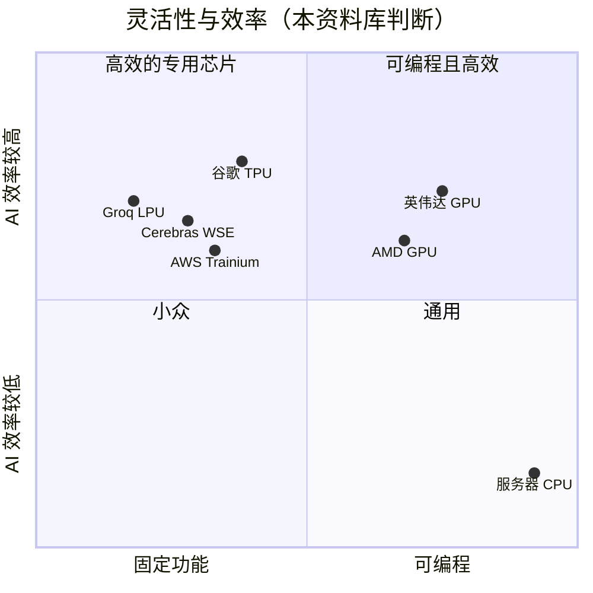

# GPU、CPU 与 ASIC 对比

> [!NOTE]
> 本页为英文原文的简体中文参考译文，仅供参考；如有出入，以[英文原文](../../../layers/02-gpu-silicon/gpu-vs-cpu-vs-asic.md "English original")为准。

第 02 层 · GPU 芯片 · 为什么并行矩阵运算偏爱 GPU，以及 ASIC 舍弃了什么 · 约 7 分钟阅读 · 最后核实：2026-11-05

## ⚡ 要点速览

- **AI 运算就是同一种操作重复数万亿次：** 即矩阵乘法（[GEMM](../../glossary.md#gemm)），由彼此独立的[融合乘加（FMA）](../../glossary.md#fma)构成；因此，谁能在每瓦功耗下同时完成最多的运算，谁就胜出。
- **每个时钟周期，H100 可完成约 541,000 次 16 位浮点运算**（132 个 SM × 4,096）[[S33024]](../../../sources/bibliography.md#s33024)，约为一个不带矩阵单元的 CPU 核心的 8,400 倍，也约为一颗带 [AMX](../../glossary.md#amx) 的 128 核 Xeon 理论峰值的 4 倍 [[S2015]](../../../sources/bibliography.md#s2015)[[S179]](../../../sources/bibliography.md#s179)。
- **CPU 把芯片面积花在让单个线程跑得快上；[GPU](../../glossary.md#gpu) 把它花在数千个线程上；[ASIC](../../glossary.md#asic) 则把它花在一种运算上。** 谷歌（Google）Ironwood 的矩阵单元是一个 256×256 的单一阵列，每个时钟周期完成 65,536 次乘累加 [[S2016]](../../../sources/bibliography.md#s2016)[[S2017]](../../../sources/bibliography.md#s2017)。
- **取舍在于以灵活性换效率。** 大型[脉动阵列](../../glossary.md#systolic-array)遇到不规整的矩阵形状就会闲置 [[S2017]](../../../sources/bibliography.md#s2017)；GPU 保留了调度器、缓存和 [CUDA 核心](../../glossary.md#cuda-core)，这些虽然占用面积，却能在第一天就运行任何新模型。
- **ASIC 的差距更多在成本而非物理：** Ironwood 单芯片提供 4.6 [PFLOPS](../../glossary.md#flops) [FP8](../../glossary.md#fp8) 算力 [[S151]](../../../sources/bibliography.md#s151)，而 Rubin 单封装为 17.5 [[S33005]](../../../sources/bibliography.md#s33005)；但[超大规模云厂商](../../glossary.md#hyperscaler)采购 ASIC 无需支付英伟达（NVIDIA）约 80% 的芯片毛利（估计）[[S35020]](../../../sources/bibliography.md#s35020)。
- **英伟达也为自己的押注做了对冲：** 据报道，它于 2025 年 12 月以约 $20B 授权引入 Groq 基于 SRAM 的 [LPU](../../glossary.md#lpu) 🟡 [[S90018]](../../../sources/bibliography.md#s90018)[[S90019]](../../../sources/bibliography.md#s90019)，并将其与 Vera Rubin 搭配出货，专门用于[解码（decode）](../../glossary.md#decode) [[S114]](../../../sources/bibliography.md#s114)。

## 为什么矩阵运算偏爱并行硬件

不妨设想批改一百万份试卷。CPU 好比 64–128 位才华横溢、什么都能做的教授。GPU 则是
一个坐满数千名助教的大厅，他们以 32 人为一组（一个 [warp](../../glossary.md#warp)）同时执行
同一步骤。ASIC 是一台专为某种答题卡版式打造的光学阅卷机：速度最快，
直到版式改变为止。

GEMM 正是最适合这个大厅的工作。每个输出数值都是一次点积，不依赖相邻的任何结果，
因此工作可以干净地分摊到 132 个[流式多处理器（SM）](../../glossary.md#streaming-multiprocessor)上，
每个 SM 配有四个[张量核心](../../glossary.md#tensor-core)，每个时钟周期完成一次小型矩阵乘法 [[S33024]](../../../sources/bibliography.md#s33024)。

> [!TIP]
> **算例 —— 一次 8,192 × 8,192 × 8,192 的矩阵乘法。** FLOPs = 2 × 8,192³ ≈ **1.1 万亿**。
> H100 每个时钟周期完成 540,672 次浮点运算（132 个 SM × 4,096）[[S33024]](../../../sources/bibliography.md#s33024)；按其
> 989 TFLOPS 标称值 [[S33002]](../../../sources/bibliography.md#s33002) 推算的约 1.83 GHz 频率，峰值下约需 1.1 ms，按 70% 的现实利用率约需 1.6 ms。528 个
> 张量核心各自执行约 200 万个时钟周期、每周期 1,024 次浮点运算。一个不带 AMX 的 CPU 核心（每时钟周期 64 FLOPs，
> 频率约 2 GHz [[S2015]](../../../sources/bibliography.md#s2015)）则需要**约 8.6 秒**，耗时约为 H100 的 7,700 倍。一颗 128 核 AMX Xeon 理论上
> 约 4 ms 即可完成，但其 845 GB/s 的内存总线 [[S179]](../../../sources/bibliography.md#s179) 仅为 H100 3.35 TB/s 的四分之一，而且 AMX
> 在负载下会降频：CPU 是可信的小模型推理引擎，但不是训练引擎。

**[Q2 · 关键指标]** 比较不同架构时，有用的数字是*在明确数值格式下*每时钟周期和每瓦的矩阵 FLOPs、
每 FLOP 对应的内存带宽，以及在真实模型上实际达到的利用率——而不仅仅是峰值 TFLOPS。

🔧 技术细节：GPU 的“灵活性税”花在了哪里

GPU 的 SM 带有 ASIC 可以省去的硬件：调度数十个 warp 以掩盖内存延迟的 warp 调度器；
每个 SM 256 KB 的[寄存器堆](../../glossary.md#register-file)和 256 KB 的 L1/共享内存
[[S33024]](../../../sources/bibliography.md#s33024)[[S2022]](../../../sources/bibliography.md#s2022)；用于非矩阵运算（softmax、归一化、专家路由）的 [CUDA](../../glossary.md#cuda) 核心；以及完整的
指令集。这些开销让 GPU 能在论文发表的当周就运行新的注意力变体；而
固定功能设计则可以把同样的面积和功耗用于更多的矩阵运算。

## 灵活性与效率的权衡

| | CPU（Xeon、EPYC、Grace） | 英伟达 GPU | ASIC（TPU、Trainium、Maia） | SRAM 数据流（Groq LPU、Cerebras） |
|---|---|---|---|---|
| 单芯片矩阵 FLOPs | 🟥 峰值约低 4 倍，实际差距更大 | 参照基准 | 🟨 Ironwood 4.6 PF FP8，Rubin 为 17.5 [[S151]](../../../sources/bibliography.md#s151)[[S33005]](../../../sources/bibliography.md#s33005) | 🟥 LP30 约 1.2 PF FP8 [[S114]](../../../sources/bibliography.md#s114) |
| 内存带宽 | 🟥 <1 TB/s [[S179]](../../../sources/bibliography.md#s179) | 参照基准：19.2 TB/s HBM4 [[S33007]](../../../sources/bibliography.md#s33007) | 🟨 Ironwood 7.4 TB/s [[S151]](../../../sources/bibliography.md#s151) | 🟩 SRAM 约 150 TB/s，但容量仅约 0.5 GB [[S114]](../../../sources/bibliography.md#s114) |
| 可运行任何新模型 | 🟩 | 参照基准 | 🟥 依赖编译器 | 🟥 模型须分布在多颗芯片的 SRAM 中才能放下 |
| 规模化后的每 token 成本 | 🟥 | 参照基准（需支付英伟达毛利） | 🟩 拥有者无需支付商用芯片毛利 | 🟦 延迟低，但所需芯片数量多 |
| 任何人都能买到 | 🟩 | 🟩 | 🟥 多为自用或仅通过云提供 | 🟨 |

> [!TIP]
> **算例 —— 为什么巨型阵列并不总是更快。** Ironwood 的矩阵单元只有在两个矩阵维度都是 256 的倍数时，
> 才能做到每个时钟周期 65,536 次乘累加 [[S2017]](../../../sources/bibliography.md#s2017)。一个宽度为
> 300 的层需要两次 256 宽的处理，用 512 个槽位承载 300 个数值：该维度上的利用率**约为 59%**。
> GPU 张量核心指令处理的分块要小得多，同一矩阵补齐后只浪费几个
> 百分点（本资料库测算）；在 GPU 上，形状问题由软件库消化。

> [!WARNING]
> **误区与事实：“ASIC 的效率是 GPU 的 10 倍。”** 按峰值规格看，差距很小甚至
> 相反：据报道，OpenAI 委托博通（Broadcom）打造的推理芯片单裸片可实现 13.4 PFLOPS MXFP4，而
> Rubin 每颗裸片的 [NVFP4](../../glossary.md#nvfp4) 算力为 17.5 PFLOPS 🟡 [[S628]](../../../sources/bibliography.md#s628)。ASIC 的优势在于能按成本价拥有芯片，这也
> 是为什么最强的挑战者是超大规模云厂商（见[竞争格局](competition.md)）。

## 🎯 企业发展视角

1. 如果峰值效率已接近持平，ASIC 就是一场攫取毛利的博弈；英伟达降价到什么程度，超大规模云厂商的自研项目就不再划算？
2. 英伟达对 Groq 的授权交易表明，行业龙头正在买入专用解码设计；哪些 [SRAM](../../glossary.md#sram) 或近存计算架构仍保持独立？
3. CPU 矩阵单元（AMX、Arm SME）让在通用服务器上进行小模型推理成为可能；这个“够用就好”的细分市场有多大？
4. 编译器人才是任何 ASIC 的隐性成本；组建编译器团队是否比组建芯片团队的入场门槛更低？

## 📚 来源（Sources）

<!-- Auto-generated from the [S…] citations on this page by `make build`. Edit sources/registry/*.csv, not this list. -->

- [**S114**](../../../sources/bibliography.md#s114) StorageReview, *NVIDIA Groq 3 LPX: Everything we know*, 2026-03. [Link](https://www.storagereview.com/news/nvidia-groq-3-lpx-everything-we-know)
- [**S151**](../../../sources/bibliography.md#s151) Google Blog (Amin Vahdat), *Ironwood: The first Google TPU for the age of inference*, 2025-04-09. [Link](https://blog.google/products/google-cloud/ironwood-tpu-age-of-inference/)
- [**S179**](../../../sources/bibliography.md#s179) Intel, *Intel Xeon 6 processors with P-cores (Granite Rapids, 6900P/6700P)*, 2024-09-24. [Link](https://www.intel.com/content/www/us/en/products/details/processors/xeon/xeon6-p-cores.html)
- [**S628**](../../../sources/bibliography.md#s628) SemiAnalysis, *OpenAI Jalapeño: Better Than Nvidia Blackwell*, 2026-08-25. [Link](https://github.com/SemiAnalysisAI/InferenceX-app/blob/main/packages/app/content/blog/openai-jalapeno-better-than-nvidia.mdx)
- [**S2015**](../../../sources/bibliography.md#s2015) Intel, *Intel Architecture Day 2021 performance index (claims)*, 2021-08-19. [Link](https://www.intel.com/ArchDay21claims)
- [**S2016**](../../../sources/bibliography.md#s2016) arXiv (2606.15870), *Google's Training Supercomputers from TPU v2 to Ironwood: Architectural Stability, Scale, Resilience, Power Efficiency, and Sustainability Across Five Generations*, 2026-06. [Link](https://arxiv.org/abs/2606.15870)
- [**S2017**](../../../sources/bibliography.md#s2017) SemiAnalysis InferenceX, *Systolic array (glossary)*, 2026. [Link](https://inferencex.semianalysis.com/glossary/systolic-array)
- [**S2022**](../../../sources/bibliography.md#s2022) NVIDIA Docs, *CUDA C++ Programming Guide (compute capabilities; shared memory)*, 2025. [Link](https://docs.nvidia.com/cuda/cuda-c-programming-guide/)
- [**S33002**](../../../sources/bibliography.md#s33002) NVIDIA, *NVIDIA H100 Tensor Core GPU (product page and datasheet)*, 2022-03-22. [Link](https://www.nvidia.com/en-us/data-center/h100/)
- [**S33005**](../../../sources/bibliography.md#s33005) NVIDIA, *NVIDIA Vera Rubin NVL72 (product page and specifications)*, 2026. [Link](https://www.nvidia.com/en-us/data-center/vera-rubin-nvl72/)
- [**S33007**](../../../sources/bibliography.md#s33007) Dataconomy, *Nvidia Quietly Cuts Vera Rubin HBM4 And NVLink Bandwidth Specs*, 2026-11-02. [Link](https://dataconomy.com/2026/11/02/nvidia-quietly-cuts-vera-rubin-hbm4-and-nvlink-bandwidth/)
- [**S33024**](../../../sources/bibliography.md#s33024) NVIDIA, *NVIDIA H100 Tensor Core GPU Architecture (whitepaper)*, 2022. [Link](https://resources.nvidia.com/en-us-tensor-core)
- [**S35020**](../../../sources/bibliography.md#s35020) Epoch AI, *NVIDIA's B200 costs around $6,400 to produce, with memory accounting for half*, 2025-12. [Link](https://epoch.ai/data-insights/b200-cost-breakdown)
- [**S90018**](../../../sources/bibliography.md#s90018) Constellation Research, *Nvidia's Groq deal: acquisition, acquihire or creative licensing deal?*, 2025-12. [Link](https://www.constellationr.com/insights/news/nvidias-groq-deal-acquisition-acquihire-or-creative-licensing-deal)
- [**S90019**](../../../sources/bibliography.md#s90019) TechSpot, *Nvidia's $20 billion Groq deal looks a lot like an acquisition*, 2025-12. [Link](https://www.techspot.com/news/110723-nvidia-20-billion-groq-deal-looks-lot-like.html)
