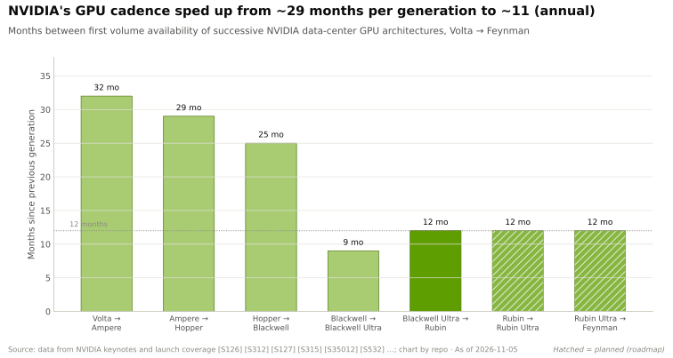
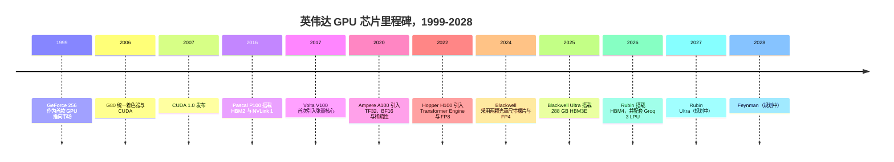
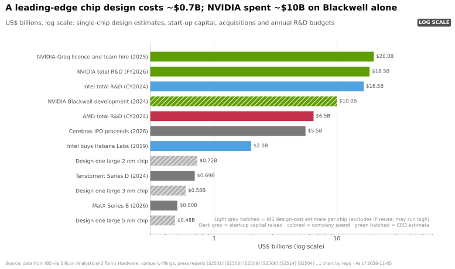

# GPU 芯片：发展历程与英伟达的构建之道

> [!NOTE]
> 本页为英文原文的简体中文参考译文，仅供参考；如有出入，以[英文原文](../../../layers/02-gpu-silicon/history-and-how-built.md "English original")为准。

第 02 层 · GPU 芯片 · 约 11 分钟阅读 · 最后核实：2026-11-05

## ⚡ 要点速览

- **二十七年，一场持续复利的押注。** 英伟达（NVIDIA）将 GeForce 256（1999）作为首款 GPU 推向市场 [[S2502]](../../../sources/bibliography.md#s2502)；
  G80（2006）借助 [CUDA](../../glossary.md#cuda) 使 GPU 可编程 [[S2503]](../../../sources/bibliography.md#s2503)；Rubin（2026）则在两颗裸片上集成了
  336B 晶体管 [[S100]](../../../sources/bibliography.md#s100)。
- **三项硬件押注定义了 AI 时代：** P100（2016）上的 HBM2 与 [NVLink](../../glossary.md#nvlink) [[S125]](../../../sources/bibliography.md#s125)；
  V100（2017）上的[张量核心](../../glossary.md#tensor-core)（矩阵运算吞吐量为其 FP32 的 8 倍）[[S126]](../../../sources/bibliography.md#s126)；以及不断降低的
  精度，从 [FP8](../../glossary.md#fp8)（2022）到 [NVFP4](../../glossary.md#nvfp4)（2025）[[S35011]](../../../sources/bibliography.md#s35011)[[S32017]](../../../sources/bibliography.md#s32017)。
- **自 2024 年起，英伟达靠增加裸片和缩短周期来扩展：** Blackwell 采用两颗光罩尺寸的裸片
  [[S35014]](../../../sources/bibliography.md#s35014)，代际间隔从约 29 个月缩短至约 11 个月 [[S33020]](../../../sources/bibliography.md#s33020)[[S100]](../../../sources/bibliography.md#s100)。
- **[Q4 · 优势来源]** 已不再是芯片本身（AMD 的 MI455X 在纸面规格上超过 Rubin [[S144]](../../../sources/bibliography.md#s144)），而是
  执行速度 × 软硬件[协同设计](../../glossary.md#co-design) × 规模：FY2026 研发投入 $18.5B，
  研发人员约 31,000 人 [[S401]](../../../sources/bibliography.md#s401)。
- **[Q6 · 复制成本]** 一款先进制程芯片的设计成本约 $0.6–0.7B [[S2501]](../../../sources/bibliography.md#s2501)；一个代际项目约 $10B
  [[S35028]](../../../sources/bibliography.md#s35028)。估计（🔴）：达到与商用芯片大致同等的水平需要 5–7 年和 $20–30B，构建完整技术栈则需十年。
- **前车之鉴：** 英特尔（Intel）于 2019 年以约 $2B 收购 Habana [[S2514]](../../../sources/bibliography.md#s2514)；Gaudi 3 在 2024 年仍未能达成 $500M 的收入
  目标 [[S668]](../../../sources/bibliography.md#s668)。

## 从图形芯片到 AI 工厂引擎

在 G80 与 P100 之间，Fermi 和 Kepler 两代产品增加了计算功能，赢得了超级计算机合同，
在深度学习出现之前就让 CUDA 得以存续 [[S2503]](../../../sources/bibliography.md#s2503)。CUDA 1.0 于 2007 年 6 月发布 [[S525]](../../../sources/bibliography.md#s525)；注册开发者达到 100 万
用了 13 年 [[S529]](../../../sources/bibliography.md#s529)。

| 时间 | 决策 | 为何重要 | 来源 |
|---|---|---|---|
| 2006 | 让 GPU 可以用 C 语言编程（G80 + CUDA） | 到 2026 年约有 600 万开发者，这是对手所缺乏的基础 | [[S2503]](../../../sources/bibliography.md#s2503)[[S528]](../../../sources/bibliography.md#s528) |
| 2016 | 率先采用 HBM2 和 NVLink（P100） | 732 GB/s 内存带宽，160 GB/s 的 GPU 间互连 | [[S125]](../../../sources/bibliography.md#s125) |
| 2017 | 加入张量核心（V100） | 张量 FP16 算力 125 TFLOPS，FP32 为 15.7 TFLOPS | [[S126]](../../../sources/bibliography.md#s126)[[S33010]](../../../sources/bibliography.md#s33010) |
| 2022 | Transformer Engine 与 FP8（H100） | 稠密 FP8 算力 1,979 TFLOPS，为 BF16 的 2 倍 | [[S35011]](../../../sources/bibliography.md#s35011)[[S33002]](../../../sources/bibliography.md#s33002) |
| 2024 | 转向多裸片（Blackwell） | 208B 晶体管，突破 858 mm² [光罩尺寸极限](../../glossary.md#reticle-limit) | [[S35014]](../../../sources/bibliography.md#s35014)[[S35010]](../../../sources/bibliography.md#s35010) |
| 2024–25 | 转向一年一代的节奏 | 每代间隔从约 29 个月缩短至约 11 个月 | [[S33020]](../../../sources/bibliography.md#s33020)[[S100]](../../../sources/bibliography.md#s100) |
| 2025 | NVFP4 块缩放 4 位格式 | 在 Rubin 上吞吐量为 FP8 的 2 倍 | [[S32017]](../../../sources/bibliography.md#s32017)[[S33005]](../../../sources/bibliography.md#s33005) |
| 2025 | Groq 授权及团队（据报道约 $20B） | 买下了一种 SRAM 解码架构 | [[S90018]](../../../sources/bibliography.md#s90018)[[S90019]](../../../sources/bibliography.md#s90019) |

> [!TIP]
> **算例 —— 更快的节奏带来了什么。** 从 V100（2017）到 H100（2022）的五年间，16 位
> 张量峰值算力提升 7.9 倍（125 → 989 TFLOPS）[[S33010]](../../../sources/bibliography.md#s33010)[[S33002]](../../../sources/bibliography.md#s33002)。从 H100 到 Rubin（2026）的四年间，稠密 FP8
> 提升 8.8 倍（1,979 → 17,500），最低精度格式提升 17.7 倍（FP8 1,979 → NVFP4 35,000）[[S33005]](../../../sources/bibliography.md#s33005)[[S100]](../../../sources/bibliography.md#s100)。每年
> 更多的代际迭代，其复利效应快于每代更大的跃升。

## [Q4] 优势在于芯片本身，还是英伟达的构建方式？

不妨以一级方程式赛车为例：对手可以复制上赛季的赛车，但冠军每个赛季都能推出更好的一辆。2026 年，
对手的赛车在纸面上更快（MI455X：432 对 288
GB，23.3 对 19.2 TB/s [[S144]](../../../sources/bibliography.md#s144)[[S90093]](../../../sources/bibliography.md#s90093)[[S90006]](../../../sources/bibliography.md#s90006)）；英伟达的领先优势在别处。

| 候选优势来源 | 证据 | 是否仍为英伟达独有？ |
|---|---|---|
| 原始芯片与架构 | MI455X 在四项标称规格上追平或超越 Rubin [[S144]](../../../sources/bibliography.md#s144)[[S90006]](../../../sources/bibliography.md#s90006) | 🟥 否 |
| 执行速度 | 约 11 个月的迭代节奏，但 AMD 如今已在同一季度发布 [[S538]](../../../sources/bibliography.md#s538) | 🟨 差距在收窄 |
| 软硬件协同设计 | 新格式与内核同步推出；CUDA 框架支持得分 36/36，ROCm 为 26 [[S580]](../../../sources/bibliography.md#s580)[[S586]](../../../sources/bibliography.md#s586) | 🟩 是 |
| 供应获取 | 约占 2026 年 [CoWoS](../../glossary.md#cowos) 预订量的 60%（估计）[[S379]](../../../sources/bibliography.md#s379) | 🟩 是，但只能换取时间 |
| 研发规模 | $18.5B（FY2026），AMD 为 $6.5B（2024，全部产品）[[S401]](../../../sources/bibliography.md#s401)[[S450]](../../../sources/bibliography.md#s450) | 🟩 是 |

> [!TIP]
> **算例 —— 为什么 NVFP4 是协同设计的胜利，而非晶体管的胜利。** 从 Blackwell 到 Rubin，晶体管数
> 增长 1.6 倍（208B → 336B）[[S35014]](../../../sources/bibliography.md#s35014)[[S100]](../../../sources/bibliography.md#s100)。在 Rubin 内部，[BF16](../../glossary.md#bf16) 稠密算力为 4 [PFLOPS](../../glossary.md#flops)，FP8 为 17.5，NVFP4 为 35
> [[S33005]](../../../sources/bibliography.md#s33005)[[S100]](../../../sources/bibliography.md#s100)：同一颗芯片上**仅靠数值格式就获得 8.75 倍的提升**。但前提是模型在 4 位下
> 仍能保持精度（NVFP4 每 16 个数值存储一个 FP8 缩放因子 [[S32017]](../../../sources/bibliography.md#s32017)），并且内核和推理服务引擎在第一天
> 就支持它。这靠的是软件——护城河如今就在这里。

**[Q4 · 优势来源]** 主要是**执行速度与协同设计，并以规模优势提供资金**；供应获取
是次要的且有时效性；单论芯片本身，如今已被追平。

## [Q6] 复制需要多少成本？

单款设计是便宜的部分：按 IBS 的模型，一颗大型 2 nm 芯片的 [NRE](../../glossary.md#nre) 约为 $0.72B，可能
偏高 [[S2501]](../../../sources/bibliography.md#s2501)[[S2500]](../../../sources/bibliography.md#s2500)。而一个*平台*还要每年叠加封装、内存、互连、系统和软件。

| 路径 | 时间 | 资金（估计 🔴） | 人才（估计 🔴） | 证据 |
|---|---|---|---|---|
| 初创公司做出首颗芯片 | 3–4 年 | $0.5–1B | 200–500 名工程师 | MatX $0.5B、Tenstorrent $0.69B 融资轮 [[S2508]](../../../sources/bibliography.md#s2508)[[S2509]](../../../sources/bibliography.md#s2509) |
| 超大规模云厂商与设计合作方共同开发 ASIC | 每代 2–3 年 | 每代 $0.5–1.5B | 500–1,500 人，外加合作方团队 | IBS 设计成本 [[S2501]](../../../sources/bibliography.md#s2501)；MTIA 与 Maia 的迭代节奏 [[S561]](../../../sources/bibliography.md#s561)[[S90046]](../../../sources/bibliography.md#s90046) |
| 训练级商用芯片挑战者 | 5–7 年达到大致同等水平 | 累计 $20–30B | 数千人，涵盖硬件和软件 | AMD MI250X（2021）→ MI455X（2026）[[S140]](../../../sources/bibliography.md#s140)[[S144]](../../../sources/bibliography.md#s144) |
| 完整的英伟达同等技术栈 | 10 年以上 | 每年约 $15–20B | 约 31,000 名研发人员 | 英伟达 FY2026 研发投入与人员规模 [[S401]](../../../sources/bibliography.md#s401) |

> [!TIP]
> **算例 —— 同一个项目，两张资产负债表。** Blackwell 的开发成本约为 $10B [[S35028]](../../../sources/bibliography.md#s35028)。按约 75% 的
> 毛利率计，英伟达只需约 $13.3B 的收入即可收回，约相当于其 $89.0B 季度数据中心
> 收入的 **4.5 周** [[S405]](../../../sources/bibliography.md#s405)。AMD 2024 年数据中心 GPU 收入“超过 50 亿美元” [[S663]](../../../sources/bibliography.md#s663)：同样的 $13.3B 相当于
> 其 **2.5 年以上**的收入。规模让入场门票对在位者而言只是个零头。

🔧 技术细节：为什么真正的约束是人才而非资金

- **团队能力会复利。** 截至 FY2026 年末，英伟达约有 42,000 名员工，其中约 31,000 人从事研发，员工流失率为 3.7% [[S401]](../../../sources/bibliography.md#s401)。
- **设计合作方出租人才。** 博通、美满电子（Marvell）、联发科和世芯（Alchip）提供物理设计、[SerDes](../../glossary.md#serdes) 和
  封装团队，使[超大规模云厂商](../../glossary.md#hyperscaler)可以跳过部分招聘爬坡过程（见[价值链](value-chain-and-corp-dev.md)）。
- **收购来的团队会流失。** Habana 与英特尔内部一条相互竞争的 GPU 路线图并行运作，始终未能撼动 CUDA [[S2515]](../../../sources/bibliography.md#s2515)。

## 反事实推演——假如英伟达当初没有……

以下全部为本资料库的分析（🔴 推测）。

| 假如英伟达当初没有…… | 可能的结果 | 证据锚点 |
|---|---|---|
| ……在 2017 年加入张量核心 | 只有约 15.7 TFLOPS 的 FP32 算力，而非 125 TFLOPS 的张量算力；谷歌（Google）TPU 很可能会主导 Transformer 训练 | [[S126]](../../../sources/bibliography.md#s126) |
| ……在 2024 年转向多裸片 | 单颗受光罩尺寸限制的裸片 ≈ B200 208B 晶体管的一半；采用芯粒的 MI300X（153B，192 GB）和 MI355X（185B，288 GB）将会领先 | [[S35014]](../../../sources/bibliography.md#s35014)[[S141]](../../../sources/bibliography.md#s141)[[S143]](../../../sources/bibliography.md#s143) |
| ……转向一年一代的节奏 | Rubin 约在 2027 年推出，而 MI455X 和 TPU 8t 在 2026 年推出：将有一整年对手在所有标称规格上都处于领先 | [[S144]](../../../sources/bibliography.md#s144)[[S550]](../../../sources/bibliography.md#s550) |

> [!TIP]
> **算例 —— 以 GPU 小时衡量张量核心的反事实。** GPT-3 的训练需要 3.14 × 10²³ 次浮点运算
> [[S31015]](../../../sources/bibliography.md#s31015)。在 V100 张量核心（125 TFLOPS）上、按 30% 利用率计约需 230 万 GPU 小时；若使用其 FP32 单元（15.7
> TFLOPS）则约需 1,850 万 GPU 小时 [[S126]](../../../sources/bibliography.md#s126)。对一个 10,000 GPU 的集群而言：**约 10 天对约 77 天**——这就是快速迭代模型
> 与苦等模型训练之间的差别。

## 🎯 企业发展视角

1. 如果护城河是迭代节奏加协同设计，哪些资产能压缩新进入者 5–7 年的追平时间：
   编译器团队、封装诀窍，还是内存合作关系？
2. 设计合作方按项目出售难以招聘的人才。鉴于英特尔收购 Habana 的经历，这是否比收购初创公司团队
   更好的路径？
3. 英伟达花约 $20B 授权 Groq，而不是自建 [SRAM](../../glossary.md#sram) [解码（decode）](../../glossary.md#decode)芯片。这个价格说明了经过验证的
   替代架构对在位者有多大价值？
4. 每一种新数值格式都把价值转移给了发布时掌控软件的一方。哪一次技术转换（[HBM4E](../../glossary.md#hbm4e)、
   近存计算）可能重置这一优势？

## 📚 来源（Sources）

<!-- Auto-generated from the [S…] citations on this page by `make build`. Edit sources/registry/*.csv, not this list. -->

- [**S100**](../../../sources/bibliography.md#s100) NVIDIA Technical Blog, *Inside the NVIDIA Vera Rubin Platform: Six New Chips, One AI Supercomputer*, 2026-01-05. [Link](https://developer.nvidia.com/blog/inside-the-nvidia-rubin-platform-six-new-chips-one-ai-supercomputer/)
- [**S125**](../../../sources/bibliography.md#s125) NVIDIA, *NVIDIA Tesla P100 (Pascal GP100) Architecture Whitepaper*, 2016-04. [Link](https://images.nvidia.com/content/pdf/tesla/whitepaper/pascal-architecture-whitepaper.pdf)
- [**S126**](../../../sources/bibliography.md#s126) NVIDIA, *NVIDIA Tesla V100 GPU Architecture Whitepaper*, 2017-08. [Link](https://images.nvidia.com/content/volta-architecture/pdf/volta-architecture-whitepaper.pdf)
- [**S140**](../../../sources/bibliography.md#s140) AMD, *AMD Instinct MI250X Accelerator*, 2021-11-08. [Link](https://www.amd.com/en/products/accelerators/instinct/mi200/mi250x.html)
- [**S141**](../../../sources/bibliography.md#s141) AMD, *AMD Instinct MI300X Accelerator*, 2023-12-06. [Link](https://www.amd.com/en/products/accelerators/instinct/mi300/mi300x.html)
- [**S143**](../../../sources/bibliography.md#s143) AMD, *AMD Instinct MI350 Series (MI350X, MI355X)*, 2025-06-12. [Link](https://www.amd.com/en/products/accelerators/instinct/mi350.html)
- [**S144**](../../../sources/bibliography.md#s144) AMD Newsroom, *AMD Unveils Vision for an Open AI Ecosystem, Detailing New Silicon, Software and Systems at Advancing AI 2025*, 2025-06-12. [Link](https://www.amd.com/en/newsroom/press-releases/2025-6-12-amd-unveils-vision-for-an-open-ai-ecosystem-detai.html)
- [**S379**](../../../sources/bibliography.md#s379) TrendForce News, *TSMC CoWoS capacity and customer allocation estimates (TrendForce / Morgan Stanley, as reported)*, 2025. [Link](https://www.trendforce.com/news/)
- [**S401**](../../../sources/bibliography.md#s401) NVIDIA Corporation via SEC EDGAR, *NVIDIA Corporation Form 10-K for fiscal year ended January 25, 2026*, 2026-02-25. [Link](https://www.sec.gov/Archives/edgar/data/1045810/000104581026000021/nvda-20260125.htm)
- [**S405**](../../../sources/bibliography.md#s405) NVIDIA Corporation via SEC EDGAR, *NVIDIA Announces Financial Results for Second Quarter Fiscal 2027 (Form 8-K exhibit 99.1)*, 2026-08-26. [Link](https://www.sec.gov/Archives/edgar/data/0001045810/000104581026000073/q2fy27pr.htm)
- [**S450**](../../../sources/bibliography.md#s450) U.S. Securities and Exchange Commission (EDGAR), *Advanced Micro Devices Form 10-K / 10-Q filings (EDGAR index)*, 2025-02-05. [Link](https://www.sec.gov/cgi-bin/browse-edgar?action=getcompany&CIK=0000002488&type=10-&dateb=&owner=include&count=40)
- [**S525**](../../../sources/bibliography.md#s525) NVIDIA Developer, *CUDA Toolkit Archive*, 2026. [Link](https://developer.nvidia.com/cuda-toolkit-archive)
- [**S528**](../../../sources/bibliography.md#s528) NVIDIA Developer Forums, *20 Years of CUDA: Honoring the Architects of the Accelerated Age*, 2026-03. [Link](https://forums.developer.nvidia.com/t/20-years-of-cuda-honoring-the-architects-of-the-accelerated-age/364654)
- [**S529**](../../../sources/bibliography.md#s529) NVIDIA Blog (Will Ramey), *2 Million Registered Developers, Countless Breakthroughs*, 2020. [Link](https://blogs.nvidia.com/blog/2-million-registered-developers-breakthroughs/)
- [**S538**](../../../sources/bibliography.md#s538) AMD Investor Relations, *AAI 2026: AMD Delivers Full-Stack Compute for the Agentic AI Era*, 2026-07-23. [Link](https://ir.amd.com/news-events/press-releases/detail/1294/aai-2026-amd-delivers-full-stack-compute-for-the-agentic-ai-era)
- [**S550**](../../../sources/bibliography.md#s550) SiliconANGLE, *Google Cloud unveils eighth-generation TPUs (TPU 8t and TPU 8i)*, 2026-04-22. [Link](https://siliconangle.com/?p=740999)
- [**S561**](../../../sources/bibliography.md#s561) DatacenterDynamics, *Meta unveils next four generations of its MTIA chip*, 2026-03-11. [Link](https://www.datacenterdynamics.com/en/news/meta-unveils-next-four-generations-of-its-mtia-chip/)
- [**S580**](../../../sources/bibliography.md#s580) vLLM project (GitHub), *vLLM README and installation docs — supported hardware*, 2026-11. [Link](https://github.com/vllm-project/vllm/blob/main/docs/getting_started/installation/README.md)
- [**S586**](../../../sources/bibliography.md#s586) AMD (GitHub: ROCm/ROCm docs), *ROCm documentation sources: release history, AI-ecosystem compatibility matrix, consolidated changelog*, 2026-08-26. [Link](https://github.com/ROCm/ROCm/blob/develop/docs/release/versions.rst)
- [**S663**](../../../sources/bibliography.md#s663) AMD, *AMD Reports Fourth Quarter and Full Year 2024 Financial Results*, 2025-02-04. [Link](https://ir.amd.com/news-events/press-releases)
- [**S668**](../../../sources/bibliography.md#s668) Reuters (as reported), *Intel says it will not hit $500 million Gaudi 3 revenue target for 2024*, 2024-10-31. [Link](https://www.reuters.com/technology/)
- [**S2500**](../../../sources/bibliography.md#s2500) Tom's Hardware, *Firm Estimates a 2nm Chip Now Costs $725 Million to Design*, 2023. [Link](https://www.tomshardware.com/news/firm-estimates-a-2nm-chip-now-costs-dollar725-million-to-design)
- [**S2501**](../../../sources/bibliography.md#s2501) Silicon Analysts, *Chip Design & NRE Cost by Node — Historical Time Series Data*, 2026. [Link](https://siliconanalysts.com/market-data/nre-design-cost)
- [**S2502**](../../../sources/bibliography.md#s2502) Tom's Hardware, *Nvidia GeForce 256 celebrates its 25th birthday — company talks about a quarter century of GPU progression*, 2024-10. [Link](https://www.tomshardware.com/pc-components/gpus/nvidia-geforce-256-celebrates-its-25th-birthday-company-talks-about-a-quarter-century-of-gpu-progression)
- [**S2503**](../../../sources/bibliography.md#s2503) TechSpot, *TechSpot's History of the GPU, Part 4: the coming of general-purpose GPUs*, 2013. [Link](https://www.techspot.com/article/659-history-of-the-gpu-part-4/)
- [**S2508**](../../../sources/bibliography.md#s2508) AI2.Work, *MatX raises $500M to build AI chips*, 2026-02-24. [Link](https://ai2.work/blog/matx-raises-500m-to-build-ai-chips-that-beat-nvidia-by-10x)
- [**S2509**](../../../sources/bibliography.md#s2509) TechPowerUp, *Tenstorrent closes $693M+ of Series D funding led by Samsung Securities and AFW Partners*, 2024-12-02. [Link](https://techpowerup.com/329396/tenstorrent-closes-usd-693m-of-series-d-funding-led-by-samsung-securities-and-afw-partners)
- [**S2514**](../../../sources/bibliography.md#s2514) bit-tech, *Intel acquires AI chipmaker, Habana Labs*, 2019-12-16. [Link](https://www.bit-tech.net/news/tech/cpus/intel-acquires-ai-chipmaker-habana-labs/1/)
- [**S2515**](../../../sources/bibliography.md#s2515) Ynetnews, *How Intel wrecked a $2B purchase of Israeli startup and fell behind in the AI race*, 2025. [Link](https://www.ynetnews.com/business/article/sjgqydwf1l)
- [**S31015**](../../../sources/bibliography.md#s31015) OpenAI (arXiv 2005.14165) (Brown et al.), *Language Models are Few-Shot Learners (GPT-3)*, 2020-05-28. [Link](https://arxiv.org/abs/2005.14165)
- [**S32017**](../../../sources/bibliography.md#s32017) NVIDIA Technical Blog, *Introducing NVFP4 for Efficient and Accurate Low-Precision Inference*, 2025-06. [Link](https://developer.nvidia.com/blog/introducing-nvfp4-for-efficient-and-accurate-low-precision-inference/)
- [**S33002**](../../../sources/bibliography.md#s33002) NVIDIA, *NVIDIA H100 Tensor Core GPU (product page and datasheet)*, 2022-03-22. [Link](https://www.nvidia.com/en-us/data-center/h100/)
- [**S33005**](../../../sources/bibliography.md#s33005) NVIDIA, *NVIDIA Vera Rubin NVL72 (product page and specifications)*, 2026. [Link](https://www.nvidia.com/en-us/data-center/vera-rubin-nvl72/)
- [**S33010**](../../../sources/bibliography.md#s33010) NVIDIA, *NVIDIA V100 Tensor Core GPU datasheet*, 2018. [Link](https://images.nvidia.com/content/technologies/volta/pdf/volta-v100-datasheet-update-us-1165301-r5.pdf)
- [**S33020**](../../../sources/bibliography.md#s33020) NVIDIA (Jensen Huang), *NVIDIA GTC 2025 keynote (Jensen Huang)*, 2025-03-18. [Link](https://www.nvidia.com/gtc/keynote/)
- [**S35010**](../../../sources/bibliography.md#s35010) Semiconductor Engineering, *Are Larger Reticle Sizes On The Horizon?*, 2024. [Link](https://semiengineering.com/are-larger-reticle-sizes-on-the-horizon)
- [**S35011**](../../../sources/bibliography.md#s35011) NVIDIA, *NVIDIA Hopper Architecture*, 2022-03. [Link](https://www.nvidia.com/en-in/data-center/technologies/hopper-architecture/)
- [**S35014**](../../../sources/bibliography.md#s35014) NVIDIA, *NVIDIA Blackwell Architecture*, 2024-03. [Link](https://www.nvidia.com/en-us/data-center/technologies/blackwell-architecture/)
- [**S35028**](../../../sources/bibliography.md#s35028) TweakTown, *NVIDIA spent $10 billion on developing its next-generation Blackwell GPU*, 2024-03. [Link](https://www.tweaktown.com/news/96987/nvidia-spent-10-billion-on-developing-its-next-generation-blackwell-gpu/index.html)
- [**S90006**](../../../sources/bibliography.md#s90006) TweakTown, *Nvidia cuts Vera Rubin's memory bandwidth by up to 26% and AMD's Helios now leads in memory bandwidth*, 2026-10. [Link](https://www.tweaktown.com/news/114304/nvidia-cuts-vera-rubins-memory-bandwidth-by-up-to-26-percent-and-amds-helios-now-leads-in-memory-bandwidth/index.html)
- [**S90018**](../../../sources/bibliography.md#s90018) Constellation Research, *Nvidia's Groq deal: acquisition, acquihire or creative licensing deal?*, 2025-12. [Link](https://www.constellationr.com/insights/news/nvidias-groq-deal-acquisition-acquihire-or-creative-licensing-deal)
- [**S90019**](../../../sources/bibliography.md#s90019) TechSpot, *Nvidia's $20 billion Groq deal looks a lot like an acquisition*, 2025-12. [Link](https://www.techspot.com/news/110723-nvidia-20-billion-groq-deal-looks-lot-like.html)
- [**S90046**](../../../sources/bibliography.md#s90046) IT Brief UK, *Microsoft unveils Maia 300 for 2027 AI deployments*, 2026-10. [Link](https://itbrief.co.uk/story/microsoft-unveils-maia-300-for-2027-ai-deployments)
- [**S90093**](../../../sources/bibliography.md#s90093) Tom's Hardware, *AMD takes the wraps off its Instinct MI455X AI accelerator: CDNA 5 and Helios rack-scale architecture*, 2026. [Link](https://www.tomshardware.com/pc-components/gpus/amd-takes-the-wraps-off-its-instinct-mi455x-ai-accelerator-cdna-5-and-helios-rack-scale-architecture-combine-to-take-the-fight-to-nvidia-in-the-data-center)
