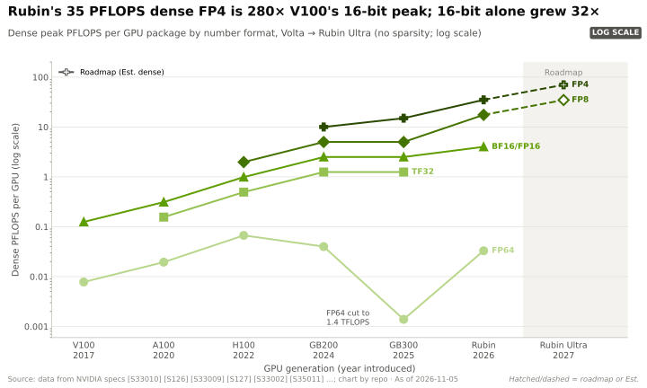
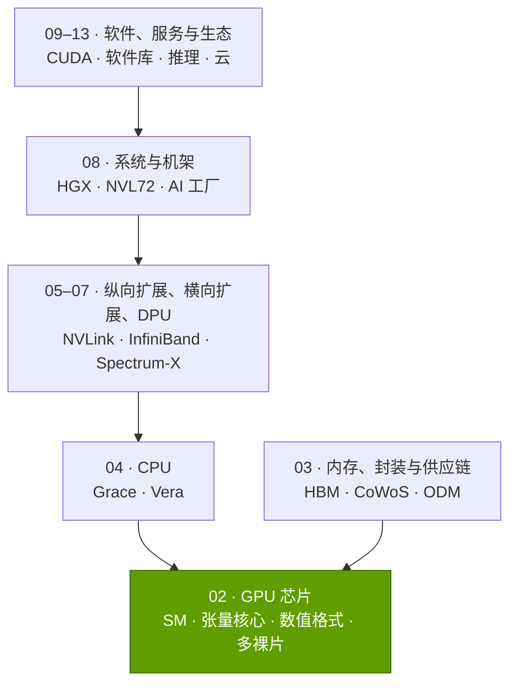
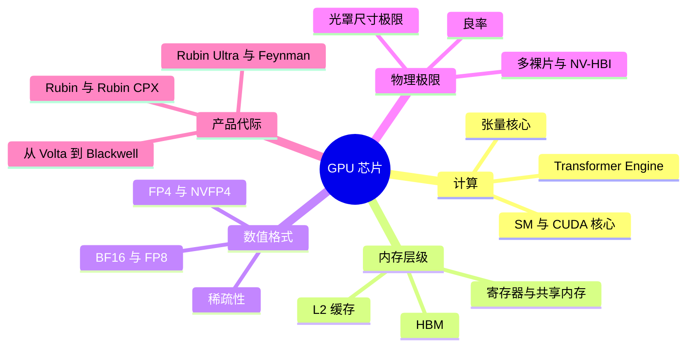
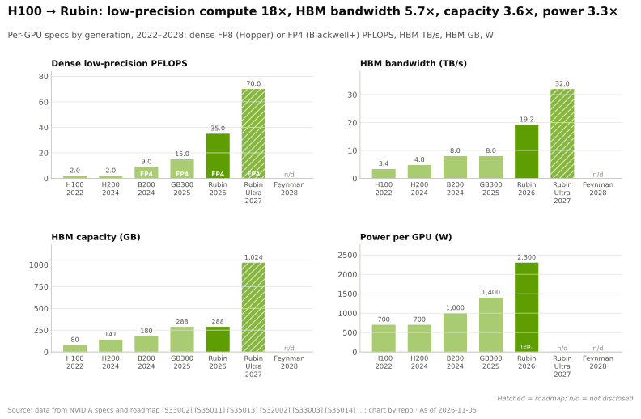

# 第 02 层 —— GPU 芯片

> [!NOTE]
> 本页为英文原文的简体中文参考译文，仅供参考；如有出入，以[英文原文](../../../layers/02-gpu-silicon/index.md "English original")为准。

第 02 层（共 12 层）· 加速器芯片本身：SM、张量核心、数值格式、多裸片封装 · 约 10 分钟阅读 · 最后核实：2026-11-05

## ⚡ 要点速览

- **GPU 是一座矩阵乘法工厂。** H100 拥有 132 个[流式多处理器（SM）](../../glossary.md#streaming-multiprocessor)、528 个[张量核心](../../glossary.md#tensor-core) [[S33024]](../../../sources/bibliography.md#s33024)，稠密 [BF16](../../glossary.md#bf16) 算力达 989 TFLOPS [[S33002]](../../../sources/bibliography.md#s33002)；2026 年的 Rubin GPU 则在两颗裸片上集成 224 个 SM 和 896 个张量核心 [[S2000]](../../../sources/bibliography.md#s2000)[[S2001]](../../../sources/bibliography.md#s2001)。
- **2017 年以来的大部分提升来自更低精度的数值，而非更大的芯片。** Rubin 的稠密 [NVFP4](../../glossary.md#nvfp4) 算力为 35 [PFLOPS](../../glossary.md#flops)，约为 V100 FP16 算力（125 TFLOPS）的 280 倍；但若按 16 位精度比较，提升仅约 32 倍 [[S33005]](../../../sources/bibliography.md#s33005)[[S33010]](../../../sources/bibliography.md#s33010)[[S100]](../../../sources/bibliography.md#s100)。
- **芯片在 2017 年撞上尺寸墙。** 自 V100 以来，每一代旗舰裸片都用掉了 858 mm² [光罩尺寸极限](../../glossary.md#reticle-limit)的约 95% [[S35010]](../../../sources/bibliography.md#s35010)[[S126]](../../../sources/bibliography.md#s126)；自 Blackwell 起，英伟达（NVIDIA）通过 10 TB/s 的 [NV-HBI](../../glossary.md#nv-hbi) 链路把两颗光罩尺寸的[裸片（die）](../../glossary.md#die)连在一起来扩展规模 [[S35014]](../../../sources/bibliography.md#s35014)[[S208]](../../../sources/bibliography.md#s208)。
- **内存决定推理的节奏。** 从 H100（3.35 TB/s）到 Rubin（19.2 TB/s），单 GPU 的 [HBM](../../glossary.md#hbm) 带宽仅提升约 5.7 倍，而低精度算力提升约 18 倍 [[S33002]](../../../sources/bibliography.md#s33002)[[S33007]](../../../sources/bibliography.md#s33007)。
- **2026 年出现了规格回调：** 9–10 月间，Rubin 的 [HBM4](../../glossary.md#hbm4) 带宽由 22 TB/s 下调至 19.2 TB/s，单 GPU 的 [NVLink](../../glossary.md#nvlink) 6 带宽由 3.6 TB/s 下调至 3.0 TB/s 🟢 [[S90006]](../../../sources/bibliography.md#s90006)[[S90007]](../../../sources/bibliography.md#s90007)[[S103]](../../../sources/bibliography.md#s103)；Vera Rubin 已于 2026 年 8 月初开始量产出货 [[S500]](../../../sources/bibliography.md#s500)[[S90009]](../../../sources/bibliography.md#s90009)。
- **弱点 / 最强挑战者：** 纸面上，AMD MI455X 宣称 [FP8](../../glossary.md#fp8) 算力达 20 PFLOPS（未说明稠密还是稀疏）、配备 432 GB HBM4，而 Rubin 为 17.5 PFLOPS 和 288 GB [[S144]](../../../sources/bibliography.md#s144)[[S33005]](../../../sources/bibliography.md#s33005)；据报道，OpenAI 委托博通（Broadcom）打造的 [ASIC](../../glossary.md#asic) 在单颗裸片上实现 13.4 PFLOPS MXFP4 🟡 [[S628]](../../../sources/bibliography.md#s628)。🔴 本资料库观点：芯片层面的领先优势如今以月计，而非以代计。
- **芯片是利润引擎。** 一颗 B200 的制造成本估计约 $6,400，售价则为 $30–40K（估计，Epoch AI）[[S35020]](../../../sources/bibliography.md#s35020)[[S35026]](../../../sources/bibliography.md#s35026)。

## 本层在技术栈中的位置

## 本层导图

## 职能、指标与进展

**[Q1 · 职能与失效后果]** 本层把电力转化为矩阵乘法——训练和推理中几乎全部的数学运算都是矩阵乘法（见 [P1](../../primers/P1-how-ai-training-works.md) 与 [P2](../../primers/P2-how-ai-inference-works.md)）。如果这一层薄弱，集群要产出同样多的 token 就需要更多机架、电力和资本。具体的失效模式包括：HBM 带宽不足会让[解码（decode）](../../glossary.md#decode)“断粮”；容量不足会迫使一个模型分散到更多 GPU 上；缺少相应数值格式会让廉价的 [FP4](../../glossary.md#fp4) 算力闲置；一次流片延误就会让路线图推迟一年。

**[Q2 · 关键指标]**

| 指标 | 为何重要 | H100（2022）→ Rubin（2026） |
|---|---|---|
| 实际运行格式下的稠密 PFLOPS | 决定训练时间和预填充（prefill）成本 | 1.98 FP8 → 17.5 FP8 / 35 FP4 [[S33002]](../../../sources/bibliography.md#s33002)[[S33005]](../../../sources/bibliography.md#s33005)[[S100]](../../../sources/bibliography.md#s100) |
| HBM 带宽（TB/s） | 限定单 GPU 的解码 tokens/s 上限 | 3.35 → 19.2 [[S33002]](../../../sources/bibliography.md#s33002)[[S33007]](../../../sources/bibliography.md#s33007) |
| HBM 容量（GB） | 决定一个模型需要多少块 GPU | 80 → 288 [[S33002]](../../../sources/bibliography.md#s33002)[[S33005]](../../../sources/bibliography.md#s33005) |
| 单 GPU 纵向扩展带宽（TB/s） | 让 72 块 GPU 像一块那样协同工作（第 05 层） | 0.9 → 3.0 [[S33002]](../../../sources/bibliography.md#s33002)[[S90006]](../../../sources/bibliography.md#s90006) |
| 每瓦稠密 TFLOPS | 决定每兆瓦产出的 token 数——这是最紧的约束 | 2.8（FP8）→ 7.6（FP8）/ 15.2（FP4）[[S33002]](../../../sources/bibliography.md#s33002)[[S106]](../../../sources/bibliography.md#s106) |

**[Q3 · 代际进步]** 从 H100 到 Rubin，低精度算力提升约 18 倍，带宽提升 5.7 倍，容量提升 3.6 倍，功耗提升约 3.3 倍；逐代图表化的完整历史见[产品代际：从 Volta 到 Feynman](generations-volta-to-feynman.md)。

> [!TIP]
> **算例 —— 为什么英伟达的利润在 GPU 而非机架。** Epoch AI 估计，一颗
> B200 的制造成本约为 $6,400：其中 HBM 约 $2,900，CoWoS-L 封装约 $1,100，逻辑芯片
> 仅约 $850–2,200（估计）[[S35020]](../../../sources/bibliography.md#s35020)[[S35022]](../../../sources/bibliography.md#s35022)[[S355]](../../../sources/bibliography.md#s355)。按英伟达 CEO 提到的 $30–40K 售价 [[S35026]](../../../sources/bibliography.md#s35026)，每块 GPU
> 可带来约 $24–34K 的毛利，毛利率接近 80%（估计）：即每个 [NVL72](../../glossary.md#nvl72) 机架约 $1.7–2.4M，尚未计入交换机、网卡或软件。

🔧 技术细节：2026 年“一块 GPU”指的是什么

自 Blackwell 起，“GPU”指的是一个封装：内含两颗计算裸片、八个 HBM 堆栈和一块中介层；
在 CES 2026 上，英伟达的机架命名从按裸片计数（“NVL144”）改为按封装计数（“NVL72”）[[S90003]](../../../sources/bibliography.md#s90003)。
本层均按单封装、稠密（非稀疏）吞吐量引用数据；厂商为何引用稀疏数据，见
[数值格式](number-formats-and-precision.md)。

## 八个问题一览

| # | 问题 | 简要回答 | 详见 |
|---|---|---|---|
| Q1 | 职能与失效后果 | 把电力转化为矩阵运算；芯片薄弱会让整个技术栈空转 | [本页](index.md) |
| Q2 | 关键指标 | 运行格式下的稠密 FLOPS、HBM 的 TB/s 与 GB、NVLink TB/s、每瓦 FLOPS | [本页](index.md)、[现代 GPU 内部结构](inside-a-modern-gpu.md) |
| Q3 | 代际进步 | H100→Rubin 低精度算力提升约 18 倍；主要来自数值格式和第二颗裸片 | [产品代际](generations-volta-to-feynman.md) |
| Q4 | 优势来源 | 执行速度与软硬件协同设计，以规模优势提供资金；单论芯片本身，如今已被追平 | [发展历程与构建之道](history-and-how-built.md) |
| Q5 | 最强挑战者 | 芯片层面是 AMD（内存、纸面规格）；系统层面是谷歌（Google）TPU | [竞争格局](competition.md) |
| Q6 | 复制成本 | 每一代项目约 $10B [[S35028]](../../../sources/bibliography.md#s35028)；估计需 5–7 年、$20–30B 才能达到商用芯片的同等水平 🔴 | [发展历程与构建之道](history-and-how-built.md) |
| Q7 | 路线图 | Rubin Ultra（2027 年下半年）、Feynman（2028）；封装和 HBM 是关键变数 | [路线图](roadmap.md) |
| Q8 | 价值池与并购 | 芯片毛利率约 80%；价值正向 HBM、封装、互连转移 | [价值链与企业发展](value-chain-and-corp-dev.md) |

## 本层页面

| 页面 | 你将了解 |
|---|---|
| [GPU、CPU 与 ASIC 对比](gpu-vs-cpu-vs-asic.md) | 为何矩阵运算偏爱 GPU；灵活性与效率的权衡 |
| [现代 GPU 内部结构](inside-a-modern-gpu.md) | SM、张量核心、内存层级、封装剖析 |
| [数值格式与精度](number-formats-and-precision.md) | 从 FP32 到 FP4、微缩放、稀疏性、每美元 token 数 |
| [光罩尺寸极限与多裸片](reticle-limits-and-multi-die.md) | 858 mm² 之墙、良率、NV-HBI、芯粒 |
| [产品代际：从 Volta 到 Feynman](generations-volta-to-feynman.md) | 每一代新增了什么；2026 年 Rubin 的规格调整 |
| [竞争格局](competition.md) | 逐一评判各路挑战者 |
| [发展历程与英伟达的构建之道](history-and-how-built.md) | 关键押注与复制成本 |
| [路线图](roadmap.md) | Rubin Ultra、Feynman、对手的反制举措 |
| [价值链与企业发展视角](value-chain-and-corp-dev.md) | 谁拿走了利润；相关私营公司 |

## 🎯 企业发展视角

1. 约 80% 的芯片级毛利率（估计）[[S35020]](../../../sources/bibliography.md#s35020) 是每个挑战者定价的参照基准；随着 HBM 在制造成本中的占比持续上升，这一毛利率还能保住多少？
2. 英伟达的领先优势如今更多来自数值格式、封装和迭代节奏，而非晶体管本身；其中哪些是合作方可以通过授权获得、而无需自建的？
3. Rubin 的规格下调表明，内存供应商如今决定着标称规格；在 HBM4/HBM4E 上，谁握有定价权？
4. 对推理市场的新进入者而言，重 SRAM 或重容量的设计（LPU 路线或单卡 768 GB 路线）是否比追赶张量核心 FLOPS 更干净利落的切入点？

## 📚 来源（Sources）

<!-- Auto-generated from the [S…] citations on this page by `make build`. Edit sources/registry/*.csv, not this list. -->

- [**S100**](../../../sources/bibliography.md#s100) NVIDIA Technical Blog, *Inside the NVIDIA Vera Rubin Platform: Six New Chips, One AI Supercomputer*, 2026-01-05. [Link](https://developer.nvidia.com/blog/inside-the-nvidia-rubin-platform-six-new-chips-one-ai-supercomputer/)
- [**S103**](../../../sources/bibliography.md#s103) VideoCardz, *NVIDIA quietly cuts Vera Rubin specs, HBM4 bandwidth and NVLink 6 speeds now lower*, 2026-10. [Link](https://videocardz.com/newz/nvidia-quietly-cuts-vera-rubin-specs-hbm4-bandwidth-and-nvlink-6-speeds-now-lower)
- [**S106**](../../../sources/bibliography.md#s106) SemiAnalysis, *Vera Rubin - Extreme Co-Design: An Evolution*, 2026. [Link](https://newsletter.semianalysis.com/p/vera-rubin-extreme-co-design-an-evolution)
- [**S126**](../../../sources/bibliography.md#s126) NVIDIA, *NVIDIA Tesla V100 GPU Architecture Whitepaper*, 2017-08. [Link](https://images.nvidia.com/content/volta-architecture/pdf/volta-architecture-whitepaper.pdf)
- [**S144**](../../../sources/bibliography.md#s144) AMD Newsroom, *AMD Unveils Vision for an Open AI Ecosystem, Detailing New Silicon, Software and Systems at Advancing AI 2025*, 2025-06-12. [Link](https://www.amd.com/en/newsroom/press-releases/2025-6-12-amd-unveils-vision-for-an-open-ai-ecosystem-detai.html)
- [**S208**](../../../sources/bibliography.md#s208) Wccftech, *NVIDIA deep dives into Blackwell infrastructure: NV-HBI used to fuse two AI GPUs together (Hot Chips 2024)*, 2024-08. [Link](https://wccftech.com/nvidia-blackwell-ai-deep-dive-nv-hbi-fuse-two-ai-gpus-together-5th-gen-tensor-cores-5th-gen-nvlink-spectrum-x/amp/)
- [**S355**](../../../sources/bibliography.md#s355) Epoch AI, *NVIDIA's B200 costs around $6,400 to produce, with memory accounting for half*, 2025-12. [Link](https://epoch.ai/data-insights/b200-cost-breakdown)
- [**S500**](../../../sources/bibliography.md#s500) NVIDIA Corporation, *NVIDIA Q2 Fiscal 2027 Quarterly Presentation (CFO commentary deck)*, 2026-08-26. [Link](https://s201.q4cdn.com/141608511/files/doc_financials/2027/Q227/NVDA-F2Q27-Quarterly-Presentation-final-1.pdf)
- [**S628**](../../../sources/bibliography.md#s628) SemiAnalysis, *OpenAI Jalapeño: Better Than Nvidia Blackwell*, 2026-08-25. [Link](https://github.com/SemiAnalysisAI/InferenceX-app/blob/main/packages/app/content/blog/openai-jalapeno-better-than-nvidia.mdx)
- [**S2000**](../../../sources/bibliography.md#s2000) NVIDIA Technical Blog, *Inside NVIDIA Rubin GPU Architecture: Powering the Era of Agentic AI*, 2026-07-21. [Link](https://developer.nvidia.com/blog/inside-nvidia-rubin-gpu-architecture-powering-the-era-of-agentic-ai/)
- [**S2001**](../../../sources/bibliography.md#s2001) Guru3D, *NVIDIA details Rubin GPU architecture with HBM4, NVLink 6 and 336 billion transistors*, 2026-07. [Link](https://www.guru3d.com/story/nvidia-details-rubin-gpu-architecture-with-hbm4-nvlink-6-and-336-billion-transistors/)
- [**S33002**](../../../sources/bibliography.md#s33002) NVIDIA, *NVIDIA H100 Tensor Core GPU (product page and datasheet)*, 2022-03-22. [Link](https://www.nvidia.com/en-us/data-center/h100/)
- [**S33005**](../../../sources/bibliography.md#s33005) NVIDIA, *NVIDIA Vera Rubin NVL72 (product page and specifications)*, 2026. [Link](https://www.nvidia.com/en-us/data-center/vera-rubin-nvl72/)
- [**S33007**](../../../sources/bibliography.md#s33007) Dataconomy, *Nvidia Quietly Cuts Vera Rubin HBM4 And NVLink Bandwidth Specs*, 2026-11-02. [Link](https://dataconomy.com/2026/11/02/nvidia-quietly-cuts-vera-rubin-hbm4-and-nvlink-bandwidth/)
- [**S33010**](../../../sources/bibliography.md#s33010) NVIDIA, *NVIDIA V100 Tensor Core GPU datasheet*, 2018. [Link](https://images.nvidia.com/content/technologies/volta/pdf/volta-v100-datasheet-update-us-1165301-r5.pdf)
- [**S33024**](../../../sources/bibliography.md#s33024) NVIDIA, *NVIDIA H100 Tensor Core GPU Architecture (whitepaper)*, 2022. [Link](https://resources.nvidia.com/en-us-tensor-core)
- [**S35010**](../../../sources/bibliography.md#s35010) Semiconductor Engineering, *Are Larger Reticle Sizes On The Horizon?*, 2024. [Link](https://semiengineering.com/are-larger-reticle-sizes-on-the-horizon)
- [**S35014**](../../../sources/bibliography.md#s35014) NVIDIA, *NVIDIA Blackwell Architecture*, 2024-03. [Link](https://www.nvidia.com/en-us/data-center/technologies/blackwell-architecture/)
- [**S35020**](../../../sources/bibliography.md#s35020) Epoch AI, *NVIDIA's B200 costs around $6,400 to produce, with memory accounting for half*, 2025-12. [Link](https://epoch.ai/data-insights/b200-cost-breakdown)
- [**S35022**](../../../sources/bibliography.md#s35022) Silicon Analysts, *NVIDIA B200 (Blackwell) cost breakdown*, 2026. [Link](https://siliconanalysts.com/analysis/nvidia-b200-blackwell-cost-breakdown)
- [**S35026**](../../../sources/bibliography.md#s35026) Tom's Hardware, *Nvidia's Jensen Huang says Blackwell GPU to cost $30,000-$40,000, later clarifies that pricing will vary as they won't sell just the chip*, 2024-03-19. [Link](https://www.tomshardware.com/pc-components/gpus/nvidias-jensen-huang-says-blackwell-gpu-to-cost-dollar30000-dollar40000-later-clarifies-that-pricing-will-vary-as-they-wont-sell-just-the-chip)
- [**S35028**](../../../sources/bibliography.md#s35028) TweakTown, *NVIDIA spent $10 billion on developing its next-generation Blackwell GPU*, 2024-03. [Link](https://www.tweaktown.com/news/96987/nvidia-spent-10-billion-on-developing-its-next-generation-blackwell-gpu/index.html)
- [**S90003**](../../../sources/bibliography.md#s90003) eWeek, *Everything Nvidia Just Announced at GTC 2026: 7 Chips, 5 Racks, 1 Giant Bet on Agentic AI*, 2026-03-17. [Link](https://www.eweek.com/news/nvidia-gtc-2026-ai-inference-vera-rubin-neuron/)
- [**S90006**](../../../sources/bibliography.md#s90006) TweakTown, *Nvidia cuts Vera Rubin's memory bandwidth by up to 26% and AMD's Helios now leads in memory bandwidth*, 2026-10. [Link](https://www.tweaktown.com/news/114304/nvidia-cuts-vera-rubins-memory-bandwidth-by-up-to-26-percent-and-amds-helios-now-leads-in-memory-bandwidth/index.html)
- [**S90007**](../../../sources/bibliography.md#s90007) TechRadar Pro, *Nvidia forced to dial back key bandwidth targets on Vera Rubin*, 2026-10. [Link](https://techradar.com/pro/nvidia-forced-to-dial-back-key-bandwidth-targets-on-vera-rubin-hardware-tweaks-will-affect-target-specifications-for-memory-and-interconnect-fabric)
- [**S90009**](../../../sources/bibliography.md#s90009) GamesBeat, *Nvidia Vera Rubin ramps into full production for fall launch*, 2026. [Link](https://gamesbeat.com/nvidia-vera-rubin-ramps-into-full-production-for-fall-launch-again/)
