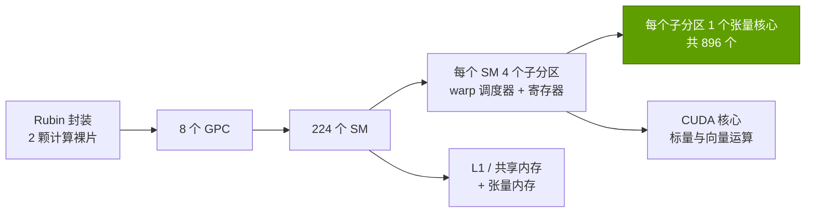
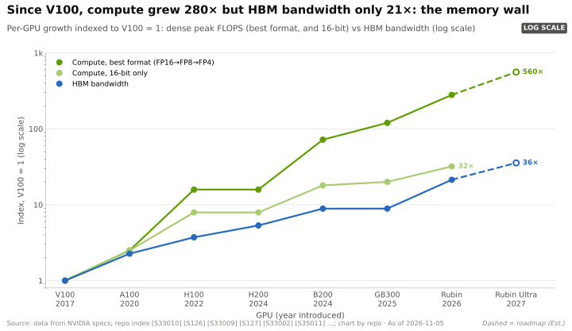

# 现代 GPU 内部结构

> [!NOTE]
> 本页为英文原文的简体中文参考译文，仅供参考；如有出入，以[英文原文](../../../layers/02-gpu-silicon/inside-a-modern-gpu.md "English original")为准。

第 02 层 · GPU 芯片 · SM、张量核心、Transformer Engine、内存层级与封装 · 约 9 分钟阅读 · 最后核实：2026-11-05

## ⚡ 要点速览

- **GPU 是由层层复制的单元构成的层级结构：** Rubin 有 8 个 [GPC](../../glossary.md#gpc)，共容纳 224 个 [SM](../../glossary.md#streaming-multiprocessor)，每个 SM 配有四个[张量核心](../../glossary.md#tensor-core)（共 896 个），分布在两颗裸片上 [[S2000]](../../../sources/bibliography.md#s2000)[[S2001]](../../../sources/bibliography.md#s2001)[[S2025]](../../../sources/bibliography.md#s2025)。
- **张量核心负责矩阵运算；[CUDA 核心](../../glossary.md#cuda-core)负责其余一切。** 从 V100 到 H100，每个 SM 的 16 位矩阵运算速率每代翻一番，从每时钟周期 1,024 FLOPs 增至 4,096 FLOPs [[S126]](../../../sources/bibliography.md#s126)[[S127]](../../../sources/bibliography.md#s127)[[S2023]](../../../sources/bibliography.md#s2023)。
- **自 H100 以来，每个 SM 的 16 位吞吐量仅提升约 2.4 倍，而 [FP8](../../glossary.md#fp8)/FP4 吞吐量提升约 10 倍：** 新增的张量核心硅片面积都投向了窄位宽格式（Rubin：每个 SM 稠密算力 17.9 对 156 TFLOPS，本资料库测算）[[S33005]](../../../sources/bibliography.md#s33005)[[S100]](../../../sources/bibliography.md#s100)[[S2000]](../../../sources/bibliography.md#s2000)。
- **[Transformer Engine](../../glossary.md#transformer-engine)** 负责选择数值格式和缩放因子，让模型在 FP8（Hopper）、[FP4](../../glossary.md#fp4)（Blackwell）以及 Rubin 的自适应压缩下仍能保持精度 [[S2024]](../../../sources/bibliography.md#s2024)[[S2000]](../../../sources/bibliography.md#s2000)。
- **内存是一架梯子：** 在 H100 上，寄存器的数据搬运速度约为 HBM 的 110 倍，但容量约为其 1/2,400（估计）[[S2021]](../../../sources/bibliography.md#s2021)；B200 的 [L2](../../glossary.md#l2-cache) 增至 126 MB，实测带宽约 21 TB/s [[S2004]](../../../sources/bibliography.md#s2004)。
- **算力已跑赢内存：** 自 V100 以来，峰值算力提升约 280 倍，而 HBM 带宽仅提升约 21 倍 [[S33010]](../../../sources/bibliography.md#s33010)[[S33007]](../../../sources/bibliography.md#s33007)，因此片上数据复用决定了实际速度。

## SM、CUDA 核心与张量核心

不妨把 GPU 想象成一座工厂园区：GPC 是一栋厂房，SM 是一条生产线，张量核心则是
每个时钟周期冲压出一次小型矩阵乘法的冲压机。[CUDA](../../glossary.md#cuda) 核心是通用工人，负责
一切非矩阵的工作。

> [!TIP]
> **算例 —— 用零部件重建数据手册上的数字。** H100 的每个 SM 每时钟周期完成 8,192 次 FP8 浮点运算
> （是其 [BF16](../../glossary.md#bf16) 下 4,096 次的两倍）[[S2023]](../../../sources/bibliography.md#s2023)。8,192 × 132 个 SM × 约 1.83 GHz = **1.98 [PFLOPS](../../glossary.md#flops)**，恰好
> 等于数据手册上的稠密 FP8 数值 [[S33002]](../../../sources/bibliography.md#s33002)。对 Rubin 反向套用同样的算法：4 PFLOPS
> BF16 [[S33005]](../../../sources/bibliography.md#s33005) ÷ 224 个 SM = 每个 SM 17.9 TFLOPS；若假设与 Blackwell 相同的每时钟周期 8,192 FLOPs，
> 则意味着频率约为 2.2 GHz（本资料库估计）。因此，Rubin 相对 Blackwell 的 16 位算力提升来自更多的 SM 和更高的频率，
> 而其 FP8 通路（17.5 PFLOPS，为 BF16 的 4.4 倍）必定是在张量核心内部加宽的（本资料库推断）。

**[Q2 · 关键指标]** SM 数量 × 单 SM 速率 × 频率 = 峰值 FLOPS；实际交付的性能
则取决于内存梯子每一级上每 FLOP 可获得的字节数。

🔧 技术细节：Transformer Engine 的逐代演进

- **Hopper（2022）：** FP8 张量核心，外加一套软件：跟踪每个张量在最近若干步中的最大值（amax），
  并为每个张量选定一个 FP32 缩放因子（“延迟缩放”）[[S2024]](../../../sources/bibliography.md#s2024)[[S2023]](../../../sources/bibliography.md#s2023)。
- **Blackwell（2024）：** 硬件支持块缩放，每个小数值块携带
  自己的缩放因子（MXFP8、MXFP6、MXFP4 和 [NVFP4](../../glossary.md#nvfp4)）[[S2024]](../../../sources/bibliography.md#s2024)[[S2007]](../../../sources/bibliography.md#s2007)；每个 SM 配有 256 KB 的[张量内存](../../glossary.md#tensor-memory)，
  在更大的张量核心旁存放累加器 [[S2006]](../../../sources/bibliography.md#s2006)。
- **Rubin（2026）：** 第三代 Transformer Engine，配备硬件“自适应压缩”；英伟达（NVIDIA）
  将推理时 50 PFLOPS 的 NVFP4 算力（训练时为 35 PFLOPS 稠密算力）归功于此 [[S2000]](../../../sources/bibliography.md#s2000)[[S100]](../../../sources/bibliography.md#s100)。它并非
  2:4 稀疏；真实模型能在多大程度上达到 50 PFLOPS 这一数字，目前尚无独立测量。
- Hopper 还新增了[张量内存加速器（TMA）](../../glossary.md#tma)，可在后台把整块数据分块从 HBM 复制到
  [共享内存](../../glossary.md#shared-memory) [[S2023]](../../../sources/bibliography.md#s2023)。

## 内存层级：寄存器 → 共享内存 → L2 → HBM

离张量核心越近，速度越快、容量越小。[寄存器堆](../../glossary.md#register-file)每个时钟周期
供给操作数，L1/共享内存暂存矩阵分块，L2 由所有 SM 共享，
[HBM](../../glossary.md#hbm) 则存放模型。

| 层级（单 GPU） | H100 SXM（2022） | B200（2024） | Rubin（2026） |
|---|---|---|---|
| 寄存器 | 33 MB（132 × 256 KB）[[S33024]](../../../sources/bibliography.md#s33024)[[S2022]](../../../sources/bibliography.md#s2022) | 37 MB（148 × 256 KB）[[S2004]](../../../sources/bibliography.md#s2004) | 未披露 |
| L1 / 共享内存 | 每个 SM 256 KB，其中共享内存 ≤228 KB [[S2022]](../../../sources/bibliography.md#s2022) | 每个 SM 256 KB + 256 KB 张量内存 [[S2004]](../../../sources/bibliography.md#s2004)[[S2006]](../../../sources/bibliography.md#s2006) | 未披露 |
| L2 缓存 | 50 MB，PCIe 卡实测 >5.5 TB/s [[S2005]](../../../sources/bibliography.md#s2005) | 126 MB，实测约 21 TB/s [[S2004]](../../../sources/bibliography.md#s2004) | 未披露 |
| HBM | 80 GB HBM3，3.35 TB/s [[S33002]](../../../sources/bibliography.md#s33002) | 180 GB HBM3E，8 TB/s [[S33003]](../../../sources/bibliography.md#s33003) | 288 GB HBM4，19.2 TB/s [[S33007]](../../../sources/bibliography.md#s33007)[[S90006]](../../../sources/bibliography.md#s90006) |

> [!TIP]
> **算例 —— 为什么数据复用比原始带宽更重要。** 要直接从 HBM 取数并让 H100 的 989 TFLOPS BF16 算力
> 保持满载，每取一个字节就必须支撑约 295 次浮点运算（989 ÷ 3.35）。Rubin 在稠密 FP4 下则需要
> 每个 HBM 字节支撑约 1,820 次浮点运算（35,000 ÷ 19.2）[[S100]](../../../sources/bibliography.md#s100)[[S33007]](../../../sources/bibliography.md#s33007)。把一个 128 × 128 的 BF16 分块一次性暂存到共享
> 内存，并在 128 个输出列上复用，即可提供这样的复用率；而批大小为 1 的[解码（decode）](../../glossary.md#decode)每生成一个 token 就要把每个权重
> 读取一遍，无法做到这一点，因此运行时不到峰值 FLOPS 的 1%（见 [P3](../../primers/P3-the-four-bottlenecks.md)）。

> [!WARNING]
> **看空观点：** Rubin 的 [HBM4](../../glossary.md#hbm4) 带宽在批量出货前被下调了 13% [[S33007]](../../../sources/bibliography.md#s33007)[[S90007]](../../../sources/bibliography.md#s90007)；而
> Groq LPU（约 500 MB，约 150 TB/s）[[S114]](../../../sources/bibliography.md#s114) 等重 SRAM 设计，正是瞄准了这架梯子在解码环节
> 留下的缺口。

## 封装剖析

客户实际购买的实物是一个封装：两颗通过 [NV-HBI](../../glossary.md#nv-hbi) 连接的计算裸片，
加上八个 HBM 堆栈，全部安装在 [CoWoS-L](../../glossary.md#cowos-l) 中介层和有机基板上
[[S35014]](../../../sources/bibliography.md#s35014)[[S358]](../../../sources/bibliography.md#s358)[[S380]](../../../sources/bibliography.md#s380)。关于 HBM 和封装供应的深入分析见[第 03 层](../03-memory-packaging-supply-chain/index.md)。

> [!TIP]
> **算例 —— 每个 HBM 堆栈需要提供多少带宽。** B200：8 TB/s ÷ 8 个堆栈 = 每个堆栈 1 TB/s
> [[S33003]](../../../sources/bibliography.md#s33003)。Rubin：19.2 TB/s ÷ 8 个堆栈 = 每个堆栈 2.4 TB/s，基于 2,048 位 HBM4 接口，
> 意味着每引脚约 9.4 Gb/s；最初 22 TB/s 的目标需要约 10.7 Gb/s，报道将此与
> 规格下调联系起来 🔴 [[S90006]](../../../sources/bibliography.md#s90006)[[S90007]](../../../sources/bibliography.md#s90007)[[S90008]](../../../sources/bibliography.md#s90008)。

## 🎯 企业发展视角

1. 单 SM 的 16 位吞吐量已趋于平缓；更便宜、更简单的架构能否在以 BF16 为主的训练市场上竞争？
2. 片上 [SRAM](../../glossary.md#sram) 是披露最少、却最具战略意义的规格；如果 Feynman 的裸片堆叠把缓存移到独立裸片上，哪些 IP 供应商（SRAM、3D 堆叠缓存）将受益？
3. HBM 引脚速率如今限制着英伟达的标称带宽；内存或基础裸片（base die）合作伙伴是否比逻辑设计方更具战略价值？
4. 张量内存和块缩放格式把内核与英伟达的每一代产品绑定在一起；这给竞争对手带来了多大的移植成本？

## 📚 来源（Sources）

<!-- Auto-generated from the [S…] citations on this page by `make build`. Edit sources/registry/*.csv, not this list. -->

- [**S100**](../../../sources/bibliography.md#s100) NVIDIA Technical Blog, *Inside the NVIDIA Vera Rubin Platform: Six New Chips, One AI Supercomputer*, 2026-01-05. [Link](https://developer.nvidia.com/blog/inside-the-nvidia-rubin-platform-six-new-chips-one-ai-supercomputer/)
- [**S114**](../../../sources/bibliography.md#s114) StorageReview, *NVIDIA Groq 3 LPX: Everything we know*, 2026-03. [Link](https://www.storagereview.com/news/nvidia-groq-3-lpx-everything-we-know)
- [**S126**](../../../sources/bibliography.md#s126) NVIDIA, *NVIDIA Tesla V100 GPU Architecture Whitepaper*, 2017-08. [Link](https://images.nvidia.com/content/volta-architecture/pdf/volta-architecture-whitepaper.pdf)
- [**S127**](../../../sources/bibliography.md#s127) NVIDIA Technical Blog, *NVIDIA Ampere Architecture In-Depth*, 2020-05-14. [Link](https://developer.nvidia.com/blog/nvidia-ampere-architecture-in-depth/)
- [**S358**](../../../sources/bibliography.md#s358) glennklockwood.com (Glenn K. Lockwood), *NVIDIA B200 processor notes*, 2025. [Link](https://glennklockwood.com/garden/processors/B200)
- [**S380**](../../../sources/bibliography.md#s380) TSMC, *TSMC 3DFabric: CoWoS-S, CoWoS-R and CoWoS-L technology overview and roadmap*, 2025. [Link](https://3dfabric.tsmc.com/english/dedicatedFoundry/technology/cowos.htm)
- [**S2000**](../../../sources/bibliography.md#s2000) NVIDIA Technical Blog, *Inside NVIDIA Rubin GPU Architecture: Powering the Era of Agentic AI*, 2026-07-21. [Link](https://developer.nvidia.com/blog/inside-nvidia-rubin-gpu-architecture-powering-the-era-of-agentic-ai/)
- [**S2001**](../../../sources/bibliography.md#s2001) Guru3D, *NVIDIA details Rubin GPU architecture with HBM4, NVLink 6 and 336 billion transistors*, 2026-07. [Link](https://www.guru3d.com/story/nvidia-details-rubin-gpu-architecture-with-hbm4-nvlink-6-and-336-billion-transistors/)
- [**S2004**](../../../sources/bibliography.md#s2004) Chips and Cheese, *Nvidia's B200: Keeping the CUDA Juggernaut Rolling*, 2026. [Link](https://chipsandcheese.com/p/nvidias-b200-keeping-the-cuda-juggernaut)
- [**S2005**](../../../sources/bibliography.md#s2005) Chips and Cheese, *Nvidia's H100: Funny L2, and Tons of Bandwidth*, 2023-07. [Link](https://chipsandcheese.com/p/nvidias-h100-funny-l2-and-tons-of-bandwidth)
- [**S2006**](../../../sources/bibliography.md#s2006) arXiv (2512.02189), *Microbenchmarking NVIDIA's Blackwell Architecture: An in-depth Architectural Analysis*, 2025-12. [Link](https://arxiv.org/abs/2512.02189)
- [**S2007**](../../../sources/bibliography.md#s2007) Open Compute Project (AMD, Arm, Intel, Meta, Microsoft, NVIDIA, Qualcomm), *OCP Microscaling Formats (MX) Specification v1.0*, 2023-09. [Link](https://www.opencompute.org/documents/ocp-microscaling-formats-mx-v1-0-spec-final-pdf)
- [**S2021**](../../../sources/bibliography.md#s2021) nvidia_deep_dive_claude repository, *Repo analysis: Layer 02 GPU silicon models (memory-hierarchy estimates; multi-die silicon cost; decode throughput by precision)*, 2026-11-05. [Link](https://github.com/FrankHuang94/nvidia_deep_dive_claude/blob/main/layers/02-gpu-silicon/index.md)
- [**S2022**](../../../sources/bibliography.md#s2022) NVIDIA Docs, *CUDA C++ Programming Guide (compute capabilities; shared memory)*, 2025. [Link](https://docs.nvidia.com/cuda/cuda-c-programming-guide/)
- [**S2023**](../../../sources/bibliography.md#s2023) NVIDIA Technical Blog, *NVIDIA Hopper Architecture In-Depth*, 2022-03-22. [Link](https://developer.nvidia.com/blog/nvidia-hopper-architecture-in-depth/)
- [**S2024**](../../../sources/bibliography.md#s2024) NVIDIA Docs, *Transformer Engine user guide (FP8 and block-scaled recipes)*, 2025. [Link](https://docs.nvidia.com/deeplearning/transformer-engine/user-guide/index.html)
- [**S2025**](../../../sources/bibliography.md#s2025) Tom's Hardware, *Nvidia details Rubin architectural optimizations for inference*, 2026-07. [Link](https://www.tomshardware.com/pc-components/gpus/nvidia-details-rubin-architectural-optimizations-for-inference-improvements-target-better-performance-and-efficiency-from-the-gpu-to-the-rack)
- [**S33002**](../../../sources/bibliography.md#s33002) NVIDIA, *NVIDIA H100 Tensor Core GPU (product page and datasheet)*, 2022-03-22. [Link](https://www.nvidia.com/en-us/data-center/h100/)
- [**S33003**](../../../sources/bibliography.md#s33003) Lenovo Press, *ThinkSystem NVIDIA B200 180GB 1000W GPU product guide*, 2025. [Link](https://lenovopress.lenovo.com/lp2226-thinksystem-nvidia-b200-180gb-1000w-gpu)
- [**S33005**](../../../sources/bibliography.md#s33005) NVIDIA, *NVIDIA Vera Rubin NVL72 (product page and specifications)*, 2026. [Link](https://www.nvidia.com/en-us/data-center/vera-rubin-nvl72/)
- [**S33007**](../../../sources/bibliography.md#s33007) Dataconomy, *Nvidia Quietly Cuts Vera Rubin HBM4 And NVLink Bandwidth Specs*, 2026-11-02. [Link](https://dataconomy.com/2026/11/02/nvidia-quietly-cuts-vera-rubin-hbm4-and-nvlink-bandwidth/)
- [**S33010**](../../../sources/bibliography.md#s33010) NVIDIA, *NVIDIA V100 Tensor Core GPU datasheet*, 2018. [Link](https://images.nvidia.com/content/technologies/volta/pdf/volta-v100-datasheet-update-us-1165301-r5.pdf)
- [**S33024**](../../../sources/bibliography.md#s33024) NVIDIA, *NVIDIA H100 Tensor Core GPU Architecture (whitepaper)*, 2022. [Link](https://resources.nvidia.com/en-us-tensor-core)
- [**S35014**](../../../sources/bibliography.md#s35014) NVIDIA, *NVIDIA Blackwell Architecture*, 2024-03. [Link](https://www.nvidia.com/en-us/data-center/technologies/blackwell-architecture/)
- [**S90006**](../../../sources/bibliography.md#s90006) TweakTown, *Nvidia cuts Vera Rubin's memory bandwidth by up to 26% and AMD's Helios now leads in memory bandwidth*, 2026-10. [Link](https://www.tweaktown.com/news/114304/nvidia-cuts-vera-rubins-memory-bandwidth-by-up-to-26-percent-and-amds-helios-now-leads-in-memory-bandwidth/index.html)
- [**S90007**](../../../sources/bibliography.md#s90007) TechRadar Pro, *Nvidia forced to dial back key bandwidth targets on Vera Rubin*, 2026-10. [Link](https://techradar.com/pro/nvidia-forced-to-dial-back-key-bandwidth-targets-on-vera-rubin-hardware-tweaks-will-affect-target-specifications-for-memory-and-interconnect-fabric)
- [**S90008**](../../../sources/bibliography.md#s90008) XenoSpectrum, *Nvidia Rubin bandwidth specification (HGX vs NVL72)*, 2026-10. [Link](https://xenospectrum.com/en/nvidia-rubin-bandwidth-specification-hgx-nvl72/)
