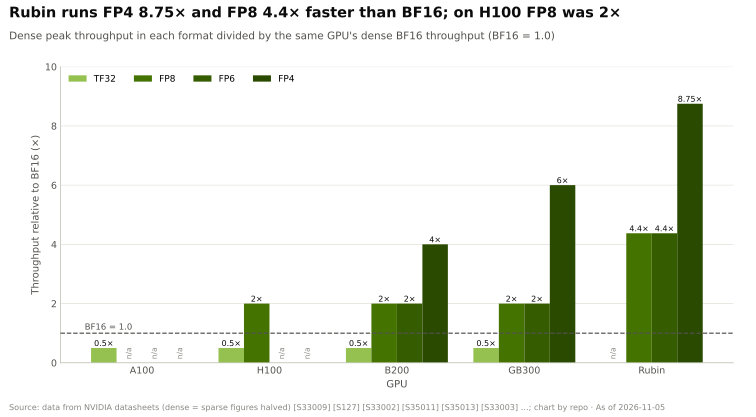
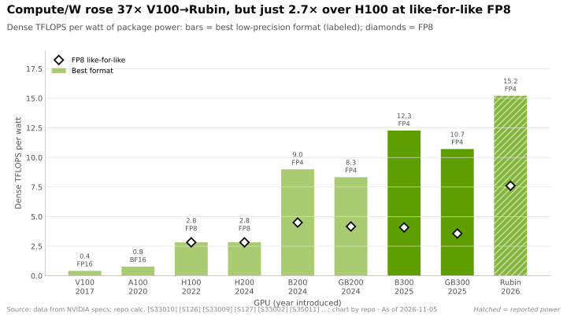
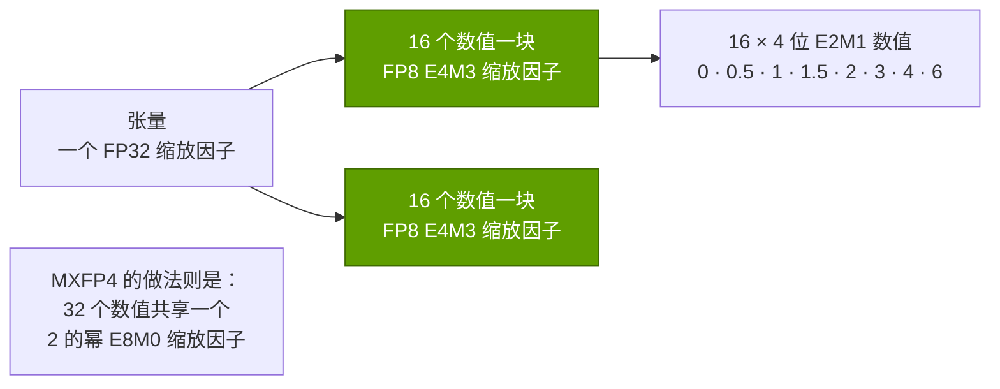

# 数值格式与精度

> [!NOTE]
> 本页为英文原文的简体中文参考译文，仅供参考；如有出入，以[英文原文](../../../layers/02-gpu-silicon/number-formats-and-precision.md "English original")为准。

第 02 层 · GPU 芯片 · 从 FP32 到 NVFP4、微缩放、稀疏性与每美元 token 数 · 约 9 分钟阅读 · 最后核实：2026-11-05

## ⚡ 要点速览

- **每个数值用更少的位数，是成本最低的性能提升。** 在 Rubin 上，稠密 FP8 的速度是 [BF16](../../glossary.md#bf16) 的 4.4 倍，FP4 是其 8.75 倍（17.5 和 35 对 4 [PFLOPS](../../glossary.md#flops)）[[S33005]](../../../sources/bibliography.md#s33005)[[S100]](../../../sources/bibliography.md#s100)；在 H100 上，[FP8](../../glossary.md#fp8) 是 BF16 的 2 倍 [[S33002]](../../../sources/bibliography.md#s33002)。
- **每一代都新增了一种更窄的格式：** [TF32](../../glossary.md#tf32) 和 BF16（Ampere，2020）[[S127]](../../../sources/bibliography.md#s127)，FP8（Hopper，2022）[[S2013]](../../../sources/bibliography.md#s2013)[[S33024]](../../../sources/bibliography.md#s33024)，带块缩放的 FP6 和 [FP4](../../glossary.md#fp4)（Blackwell，2024）[[S2007]](../../../sources/bibliography.md#s2007)[[S32017]](../../../sources/bibliography.md#s32017)。
- **[微缩放（microscaling）](../../glossary.md#microscaling)让 4 位格式变得可用：** OCP MX 标准为每 32 个数值配一个共享的 2 的幂缩放因子（每个数值 4.25 位）；英伟达（NVIDIA）的 [NVFP4](../../glossary.md#nvfp4) 采用 16 个数值一块、配一个 FP8 缩放因子，外加一个张量级 FP32 缩放因子（4.5 位）[[S2007]](../../../sources/bibliography.md#s2007)[[S2008]](../../../sources/bibliography.md#s2008)[[S32017]](../../../sources/bibliography.md#s32017)。
- **厂商引用的是“稀疏”峰值**，其前提是 2:4 [稀疏性](../../glossary.md#sparsity)，恰好是稠密值的 2 倍：H100 的 FP8 稀疏算力为 3,958 TFLOPS，稠密算力则为 1,979 [[S33002]](../../../sources/bibliography.md#s33002)[[S2012]](../../../sources/bibliography.md#s2012)。本资料库一律采用稠密数值。
- **更低的精度直接转化为每美元 token 数：** 按单块 B200 建模，70B 模型在 NVFP4 下的[解码（decode）](../../glossary.md#decode) tokens/s 约为 BF16 的 2.7 倍（约 4,700 对约 1,700，估计）[[S2021]](../../../sources/bibliography.md#s2021)。
- **精度保持得比预期好，但有前提：** 英伟达报告称，一个以 NVFP4 在 10T token 上预训练的 12B 模型，效果接近 FP8 基线 [[S2009]](../../../sources/bibliography.md#s2009)[[S2010]](../../../sources/bibliography.md#s2010)；MXFP4 若不辅以额外技术，精度损失更大 [[S2008]](../../../sources/bibliography.md#s2008)。

## 从 FP32 到 FP4：位数换来了什么

浮点数就是二进制的科学计数法：一个符号位、一个指数（决定范围）和一个
尾数（决定精度）。削减位数能同时压低三项成本：内存容量、内存带宽
以及乘法器面积——后者大致随尾数位宽的平方增长（经验法则）。
这就是为什么张量核心执行 FP8 运算的次数约为 BF16 的两倍。

| 格式 | 位数（指数 / 尾数） | 最大值 | 块缩放 | 含缩放因子的每数值位数 | 英伟达张量核心首次支持 |
|---|---|---|---|---|---|
| FP32 | 8 / 23 | 3.4 × 10³⁸ | 无 | 32 | 仅 CUDA 核心 [[S127]](../../../sources/bibliography.md#s127) |
| TF32 | 8 / 10 | 3.4 × 10³⁸ | 无 | 32（以 FP32 存储） | Ampere [[S127]](../../../sources/bibliography.md#s127) |
| BF16 | 8 / 7 | 3.4 × 10³⁸ | 无 | 16 | Ampere [[S127]](../../../sources/bibliography.md#s127) |
| FP8 E4M3 / E5M2 | 4 / 3 · 5 / 2 | 448 · 57,344 | 每个张量一个 | 8 | Hopper [[S2013]](../../../sources/bibliography.md#s2013)[[S33024]](../../../sources/bibliography.md#s33024) |
| MXFP8 / MXFP6 / MXFP4 | E4M3 / E2M3 / E2M1 | 448 / 7.5 / 6 | 每 32 个数值一个 2 的幂 | 8.25 / 6.25 / 4.25 | Blackwell [[S2007]](../../../sources/bibliography.md#s2007) |
| NVFP4 | 2 / 1 | 6 | 每 16 个数值一个 FP8 + 每个张量一个 FP32 | 4.5 | Blackwell [[S32017]](../../../sources/bibliography.md#s32017)[[S2008]](../../../sources/bibliography.md#s2008) |

> [!TIP]
> **算例 —— 70B 模型在单块 B200 上的权重字节数与解码速度。** 权重：70B × 2 字节 =
> BF16 下 **140 GB**，FP8 下 **70 GB**，NVFP4（4.5 位）下 **约 39 GB**。单个用户的解码每生成一个 token 就必须把
> 每个权重读取一遍，因此按 B200 8 TB/s 的 75% [[S33003]](../../../sources/bibliography.md#s33003) 计算，上限为 6 TB/s ÷ 140 GB ≈
> **43 tokens/s**（BF16）、≈ **86**（FP8）和 ≈ **152**（NVFP4）。若 64 个用户共享每次读取，同一块
> GPU 可达约 1,700、约 3,400 和约 4,700 tokens/s（本资料库模型，见下图）[[S2021]](../../../sources/bibliography.md#s2021)。同一块 GPU、同一小时、同样的
> 折旧：仅凭数值格式，每美元 token 数就多出约 2.7 倍。

**[Q2 · 关键指标]** 一定要问：“这是哪种格式下的 PFLOPS？稠密还是稀疏？”以及“我的
模型在该格式下能否保持精度？”对受限于 BF16 的客户而言，35 PFLOPS 的 FP4 算力价值不大。

## 微缩放：MX 格式与 NVFP4

4 位浮点数只能表示八个量级（0、0.5、1、1.5、2、3、4、6）[[S2007]](../../../sources/bibliography.md#s2007)，因此每个小
块都要除以一个缩放因子，使块内最大值接近 6。OCP MX 标准
（由 AMD、Arm、英特尔（Intel）、Meta、微软（Microsoft）、英伟达和高通（Qualcomm）于 2023 年共同制定）采用 32 个数值一块
和 2 的幂缩放因子 [[S2007]](../../../sources/bibliography.md#s2007)；NVFP4 采用 16 个数值一块和分数形式的 FP8 缩放因子，每个数值因此多占 0.25
位 [[S2008]](../../../sources/bibliography.md#s2008)[[S32017]](../../../sources/bibliography.md#s32017)。

> [!TIP]
> **算例 —— 对一个最大值为 3.6 的块进行编码。** MXFP4 必须选择一个 2 的幂
> 缩放因子：按标准规则取 0.5，于是 3.6 ÷ 0.5 = 7.2，饱和截断为 6，解码后为 **3.0，即最重要的数值上
> 有 17% 的误差** [[S2007]](../../../sources/bibliography.md#s2007)。NVFP4 可以使用分数缩放因子：3.6 ÷ 6 = 0.6，
> 以 FP8 存储为 0.625；3.6 ÷ 0.625 = 5.76，舍入为 6，解码后为 **3.75，误差 4%**。块更小
> 还意味着一个离群值只会扭曲 16 个数值而非 32 个（本资料库测算）。

> [!NOTE]
> **🐂 看多观点：** 微软报告称，与原生 FP8 相比，NVFP4 使 DeepSeek-V3.2 的内存占用降低 1.7 倍，且
> 结果几乎持平 [[S2011]](../../../sources/bibliography.md#s2011)；英伟达已展示了 NVFP4 预训练 [[S2009]](../../../sources/bibliography.md#s2009)；而且 NVFP4 在精度上
> 优于开放的 MX 格式 [[S2008]](../../../sources/bibliography.md#s2008)。

> [!WARNING]
> **🐻 看空观点：** 数值格式是一次性红利：低于 4 位后已无多少可削减的空间，此后的提升必须
> 来自芯片和内存。它也构不成护城河：AMD 的 MI355X 运行 FP4 的稠密算力约为 10 PFLOPS [[S143]](../../../sources/bibliography.md#s143)，
> 而更好的量化方法可把 MXFP4 的差距缩小至约 1–2% [[S2008]](../../../sources/bibliography.md#s2008)。

🔧 技术细节：2:4 稀疏性，以及英伟达为何引用稀疏数据

Ampere 引入了稀疏张量核心（Sparse Tensor Cores）：如果每组四个权重中有两个为零，硬件
就会跳过它们，使矩阵吞吐量翻倍 [[S2012]](../../../sources/bibliography.md#s2012)。这种模式需要剪枝并重新训练才能恢复
精度，因此大多数生产环境中的 LLM 都以稠密方式运行；但英伟达的数据手册仍以稀疏数值作为标题数字
（H100：“含稀疏性”的 FP8 为 3,958 TFLOPS）[[S33002]](../../../sources/bibliography.md#s33002)。Rubin 的 50 PFLOPS NVFP4“推理”数值则是
另一种机制（Transformer Engine 的自适应压缩），对应的稠密值为 35 PFLOPS [[S100]](../../../sources/bibliography.md#s100)[[S2000]](../../../sources/bibliography.md#s2000)。
AI 格式竞赛的代价是双精度：Blackwell Ultra 把 FP64 从
H100 的 67 TFLOPS 削减到约 1.25 TFLOPS [[S123]](../../../sources/bibliography.md#s123)[[S33002]](../../../sources/bibliography.md#s33002)，这对科学计算类买家是实实在在的损失。

## 🎯 企业发展视角

1. NVFP4 由英伟达定义；MX 则是高通参与制定的开放标准 [[S2007]](../../../sources/bibliography.md#s2007)。格式治理会否成为一种竞争杠杆？
2. 量化工具链决定了 FP4 芯片是否可用；它本身是否构成一个值得合作或收购的类别？
3. 如果格式红利止步于 FP4，2028 年之后哪些杠杆（内存、封装、稀疏性）将驱动每 token 成本，又由谁掌握？
4. FP64 买家（研究机构、主权 HPC）正被边缘化；这对挑战者而言是否是一个有利可图的利基市场？

## 📚 来源（Sources）

<!-- Auto-generated from the [S…] citations on this page by `make build`. Edit sources/registry/*.csv, not this list. -->

- [**S100**](../../../sources/bibliography.md#s100) NVIDIA Technical Blog, *Inside the NVIDIA Vera Rubin Platform: Six New Chips, One AI Supercomputer*, 2026-01-05. [Link](https://developer.nvidia.com/blog/inside-the-nvidia-rubin-platform-six-new-chips-one-ai-supercomputer/)
- [**S123**](../../../sources/bibliography.md#s123) Glenn K. Lockwood (blog) (Glenn K. Lockwood), *HGX B300 specifications compilation (B300 per-GPU figures)*, 2025. [Link](https://glennklockwood.com/garden/processors/B300)
- [**S127**](../../../sources/bibliography.md#s127) NVIDIA Technical Blog, *NVIDIA Ampere Architecture In-Depth*, 2020-05-14. [Link](https://developer.nvidia.com/blog/nvidia-ampere-architecture-in-depth/)
- [**S143**](../../../sources/bibliography.md#s143) AMD, *AMD Instinct MI350 Series (MI350X, MI355X)*, 2025-06-12. [Link](https://www.amd.com/en/products/accelerators/instinct/mi350.html)
- [**S2000**](../../../sources/bibliography.md#s2000) NVIDIA Technical Blog, *Inside NVIDIA Rubin GPU Architecture: Powering the Era of Agentic AI*, 2026-07-21. [Link](https://developer.nvidia.com/blog/inside-nvidia-rubin-gpu-architecture-powering-the-era-of-agentic-ai/)
- [**S2007**](../../../sources/bibliography.md#s2007) Open Compute Project (AMD, Arm, Intel, Meta, Microsoft, NVIDIA, Qualcomm), *OCP Microscaling Formats (MX) Specification v1.0*, 2023-09. [Link](https://www.opencompute.org/documents/ocp-microscaling-formats-mx-v1-0-spec-final-pdf)
- [**S2008**](../../../sources/bibliography.md#s2008) arXiv (2509.23202), *Bridging the Gap Between Promise and Performance for Microscaling FP4 Quantization*, 2025-09. [Link](https://arxiv.org/abs/2509.23202)
- [**S2009**](../../../sources/bibliography.md#s2009) arXiv (2509.25149) / NVIDIA, *Pretraining Large Language Models with NVFP4*, 2025-09. [Link](https://arxiv.org/abs/2509.25149)
- [**S2010**](../../../sources/bibliography.md#s2010) Tom's Hardware, *Nvidia details efficiency of the NVFP4 format for LLM training*, 2025. [Link](https://www.tomshardware.com/tech-industry/artificial-intelligence/nvidia-details-efficiency-of-the-nvfp4-format-for-llm-training-new-paper-reveals-how-nvfp4-offers-benefits-over-fp8-and-bf16)
- [**S2011**](../../../sources/bibliography.md#s2011) Microsoft Tech Community (Microsoft Foundry Blog), *Unlocking NVIDIA Blackwell for DeepSeek: a collaborative effort*, 2026. [Link](https://techcommunity.microsoft.com/t5/microsoft-foundry-blog/unlocking-nvidia-blackwell-for-deepseek-a-collaborative/ba-p/4497936)
- [**S2012**](../../../sources/bibliography.md#s2012) arXiv (2104.08378) / NVIDIA (Asit Mishra et al.), *Accelerating Sparse Deep Neural Networks*, 2021-04-16. [Link](https://arxiv.org/abs/2104.08378)
- [**S2013**](../../../sources/bibliography.md#s2013) arXiv (2209.05433) (Paulius Micikevicius et al. (NVIDIA, Arm, Intel)), *FP8 Formats for Deep Learning*, 2022-09. [Link](https://arxiv.org/abs/2209.05433)
- [**S2021**](../../../sources/bibliography.md#s2021) nvidia_deep_dive_claude repository, *Repo analysis: Layer 02 GPU silicon models (memory-hierarchy estimates; multi-die silicon cost; decode throughput by precision)*, 2026-11-05. [Link](https://github.com/FrankHuang94/nvidia_deep_dive_claude/blob/main/layers/02-gpu-silicon/index.md)
- [**S32017**](../../../sources/bibliography.md#s32017) NVIDIA Technical Blog, *Introducing NVFP4 for Efficient and Accurate Low-Precision Inference*, 2025-06. [Link](https://developer.nvidia.com/blog/introducing-nvfp4-for-efficient-and-accurate-low-precision-inference/)
- [**S33002**](../../../sources/bibliography.md#s33002) NVIDIA, *NVIDIA H100 Tensor Core GPU (product page and datasheet)*, 2022-03-22. [Link](https://www.nvidia.com/en-us/data-center/h100/)
- [**S33003**](../../../sources/bibliography.md#s33003) Lenovo Press, *ThinkSystem NVIDIA B200 180GB 1000W GPU product guide*, 2025. [Link](https://lenovopress.lenovo.com/lp2226-thinksystem-nvidia-b200-180gb-1000w-gpu)
- [**S33005**](../../../sources/bibliography.md#s33005) NVIDIA, *NVIDIA Vera Rubin NVL72 (product page and specifications)*, 2026. [Link](https://www.nvidia.com/en-us/data-center/vera-rubin-nvl72/)
- [**S33024**](../../../sources/bibliography.md#s33024) NVIDIA, *NVIDIA H100 Tensor Core GPU Architecture (whitepaper)*, 2022. [Link](https://resources.nvidia.com/en-us-tensor-core)
