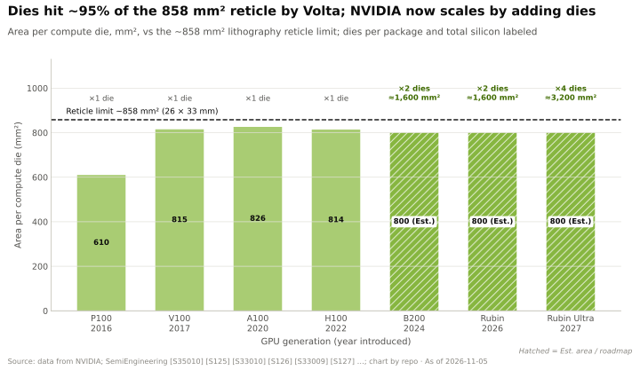
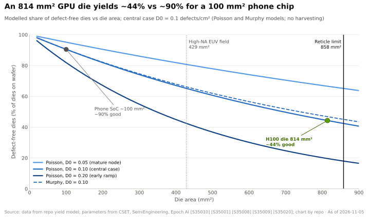

# 光罩尺寸极限与多裸片 GPU

> [!NOTE]
> 本页为英文原文的简体中文参考译文，仅供参考；如有出入，以[英文原文](../../../layers/02-gpu-silicon/reticle-limits-and-multi-die.md "English original")为准。

第 02 层 · GPU 芯片 · 858 mm² 之墙、良率经济学、NV-HBI 与 AMD 的芯粒替代方案 · 约 7 分钟阅读 · 最后核实：2026-11-05

## ⚡ 要点速览

- **芯片不能大于光刻机的曝光视场：** 26 × 33 mm = 858 mm²，即[光罩尺寸极限](../../glossary.md#reticle-limit)；High-NA EUV 会将其减半至 429 mm² [[S35010]](../../../sources/bibliography.md#s35010)。
- **英伟达（NVIDIA）在 2017 年就撞上了这堵墙：** V100（815 mm²）、A100（826 mm²）和 H100（814 mm²）都用掉了约 95% 的面积上限 [[S126]](../../../sources/bibliography.md#s126)[[S127]](../../../sources/bibliography.md#s127)[[S35013]](../../../sources/bibliography.md#s35013)。
- **大裸片之所以昂贵，是因为缺陷随机分布：** 在标准模型中，当缺陷密度为 0.1 个/cm² 时，814 mm² 的裸片无缺陷的概率（即其[裸片良率](../../glossary.md#die-yield)）仅约 44%，而 100 mm² 的裸片约为 90%（本资料库模型；输入参数来自 Epoch AI）[[S35020]](../../../sources/bibliography.md#s35020)。
- **Blackwell 的答案：两颗光罩尺寸的裸片，组成一块 GPU。** B200 用 10 TB/s 的 [NV-HBI](../../glossary.md#nv-hbi) 链路把两者连接起来，使软件看到的是一个拥有 208B 晶体管的单一设备 [[S35014]](../../../sources/bibliography.md#s35014)[[S208]](../../../sources/bibliography.md#s208)[[S2003]](../../../sources/bibliography.md#s2003)。
- **Rubin Ultra 发布时采用四颗计算裸片**和 1 TB [HBM4E](../../glossary.md#hbm4e)，定于 2027 年下半年推出 🟢 [[S35018]](../../../sources/bibliography.md#s35018)[[S110]](../../../sources/bibliography.md#s110)；2026 年，TrendForce 和 SemiAnalysis 报道称其已改为双裸片设计、性能约减半 🟡 [[S509]](../../../sources/bibliography.md#s509)[[S2018]](../../../sources/bibliography.md#s2018)，英伟达对此未予证实，并表示其路线图不变 [[S508]](../../../sources/bibliography.md#s508)。
- **AMD 走得更远、更早：** MI355X 在两颗 N6 I/O 裸片上堆叠了八颗小型 N3P 计算[芯粒（chiplet）](../../glossary.md#chiplet)（185B 晶体管）[[S2019]](../../../sources/bibliography.md#s2019)[[S2020]](../../../sources/bibliography.md#s2020)[[S143]](../../../sources/bibliography.md#s143)；代价是更多的封装工序和裸片间互连能耗。

## 光罩之墙与良率曲线

光刻机印制芯片，就像投影仪一次印一张照片；最大的那张照片就是
光罩视场，因此更大的 GPU 意味着要印制多颗裸片再将它们连接起来。在撞墙之前，尺寸同样要花钱：
一个缺陷就会让一颗裸片报废，而大裸片就是个大靶子（见
[P5 · 芯片经济学入门](../../primers/P5-chip-economics-101.md)）。

> [!TIP]
> **算例 —— 拆分 1,600 mm² 的逻辑电路能省多少钱。** 按 $17,000 一片晶圆、缺陷密度 0.1 个/cm² 计
> [[S35020]](../../../sources/bibliography.md#s35020)，一颗假想的 1,600 mm² 裸片无缺陷的概率为 20%：每块合格 GPU 的芯片成本约 $3,100——前提是它能被印制出来。
> 两颗 800 mm² 的裸片各自良率为 45%，而且由于裸片在
> 组装前就经过测试，**每对成本约 $1,180（−62%）**。八颗 200 mm² 的芯粒成本**约 $540（−83%）**，但
> 最后这一步只多省了约 $640，却额外增加了六颗裸片的接口、键合和组装
> 风险（本资料库模型）[[S2021]](../../../sources/bibliography.md#s2021)。这就是英伟达止步于两颗、而 AMD 走到八颗的原因。

## 两颗裸片，一块 GPU：NV-HBI 与 CoWoS-L

难点在于让软件感知不到这种拆分。裸片 A 上的内核读取挂在裸片 B 上的 [HBM](../../glossary.md#hbm) 时，
要穿过裸片间链路；如果链路太慢，程序员就得自己管理两块 GPU。英伟达把 NV-HBI 做得足够宽，
宽到拆分“消失”，并转向 [CoWoS-L](../../glossary.md#cowos-l)，由其嵌入式硅桥
承载连线；台积电（TSMC）的目标是 2026 年实现约 5.5 倍光罩尺寸的封装，2027 年约 9.5 倍 [[S380]](../../../sources/bibliography.md#s380)。

> [!TIP]
> **算例 —— 10 TB/s 够用吗？** 每颗 B200 裸片拥有四个 HBM 堆栈，约占
> 封装 8 TB/s 中的 4 TB/s [[S33003]](../../../sources/bibliography.md#s33003)。NV-HBI 的 10 TB/s [[S208]](../../../sources/bibliography.md#s208) 是另一侧 HBM 带宽的
> 2.5 倍，因此远端读取受限于内存，而非桥接链路。它还是这块 GPU 全部 [NVLink](../../glossary.md#nvlink) 5
> 带宽（1.8 TB/s）的 5.6 倍 [[S263]](../../../sources/bibliography.md#s263)。在 Rubin 上，每颗裸片拥有约 9.6 TB/s 的 [HBM4](../../glossary.md#hbm4) 带宽 [[S33007]](../../../sources/bibliography.md#s33007)；英伟达尚未公布
> Rubin 的裸片间带宽，因此该链路是否仍保有充裕余量尚不得而知 🔴。

| 产品 | 计算裸片 | 制程 | 晶体管 | 裸片间互连 | 内存 |
|---|---|---|---|---|---|
| 英伟达 B200（2024） | 2 × 约 800 mm²（估计） | 台积电 4NP | 208B | NV-HBI，10 TB/s | 8 个 HBM3E 堆栈 [[S35014]](../../../sources/bibliography.md#s35014)[[S358]](../../../sources/bibliography.md#s358) |
| 英伟达 Rubin（2026） | 2 颗光罩尺寸裸片 | 台积电 3 nm 级 | 336B | NV-HBI，未披露 | 8 个 HBM4，288 GB [[S100]](../../../sources/bibliography.md#s100)[[S106]](../../../sources/bibliography.md#s106) |
| 英伟达 Rubin Ultra（2027 年下半年） | 4 颗 🟢，有报道称改为双裸片版本 🟡 | 3 nm 级（据报道） | 未披露 | 未披露 | 16 个 HBM4E，约 1 TB [[S35018]](../../../sources/bibliography.md#s35018)[[S509]](../../../sources/bibliography.md#s509) |
| AMD MI355X（2025） | 8 颗 XCD 位于 2 颗 I/O 裸片之上 | N3P + N6 | 185B | 3D 堆叠 + Infinity Fabric | 288 GB HBM3E [[S2019]](../../../sources/bibliography.md#s2019)[[S143]](../../../sources/bibliography.md#s143) |
| AMD MI455X（2026） | 芯粒，计算部分采用 N2（据报道） | N2 + N3 | 320B（据报道） | 未披露 | 432 GB HBM4 [[S144]](../../../sources/bibliography.md#s144)[[S145]](../../../sources/bibliography.md#s145) |

> [!WARNING]
> **误区与事实：“芯粒总是更便宜。”** 芯片成本确实下降了，但封装成本没有：
> 每颗 B200 的 CoWoS-L 封装约增加 $1,100，而 H100 的 CoWoS-S 约为 $750（估计）[[S35040]](../../../sources/bibliography.md#s35040)；一次组装失败
> 就会报废价值数千美元的已知合格裸片（KGD）和 HBM [[S35020]](../../../sources/bibliography.md#s35020)。最优裸片数量取决于
> 封装良率，而台积电并不公布这一数据。

🔧 技术细节：四裸片 Rubin Ultra 在 2026 年经历了什么

英伟达在 GTC 2025 上展示了四颗光罩尺寸裸片、16 个 HBM4E 堆栈、约 100 [PFLOPS](../../glossary.md#flops) [FP4](../../glossary.md#fp4) 的设计，并在 GTC 2026 上展示了 1 TB 的 Rubin
Ultra 托盘，计划用于 2027 年下半年推出的、每机架 144 个 GPU 封装的 Kyber 机架 🟢 [[S35018]](../../../sources/bibliography.md#s35018)[[S110]](../../../sources/bibliography.md#s110)[[S90003]](../../../sources/bibliography.md#s90003)。
TrendForce 于 2026 年 4 月报道称，受先进封装产能限制，四裸片单封装设计未被
采用；SemiAnalysis（2026 年 6 月）则描述了一个性能约为原方案一半的
双裸片替代方案 🟡 [[S509]](../../../sources/bibliography.md#s509)[[S2018]](../../../sources/bibliography.md#s2018)。7 月，SemiAnalysis 还报道称，由于中板（midplane）
可制造性问题，Kyber 推迟至 2028 年 🟡 [[S507]](../../../sources/bibliography.md#s507)；英伟达回应称其路线图不变 [[S508]](../../../sources/bibliography.md#s508)。GTC DC（2026 年 12 月 1 日）晚于
本页的数据截止日期 [[S90047]](../../../sources/bibliography.md#s90047)。跟踪表见[路线图](roadmap.md)。

## 🎯 企业发展视角

1. 约束已从晶体管转移到封装；除台积电外，还有谁能新增 CoWoS-L 级产能，速度有多快？
2. 如果连英伟达都从四裸片方案退却，裸片间互连 IP 和已知合格裸片（KGD）测试就具有了战略意义；芯粒互连 IP 供应商是否可供收购？
3. 芯粒策略（像 AMD 那样按功能混用不同制程节点）能否把新加速器的进入成本降到足以改变“自建还是合作”测算的程度？
4. High-NA EUV 会把光罩尺寸减半（429 mm²）[[S35010]](../../../sources/bibliography.md#s35010)；当每款旗舰产品都采用多裸片时，谁将掌握互连标准？

## 📚 来源（Sources）

<!-- Auto-generated from the [S…] citations on this page by `make build`. Edit sources/registry/*.csv, not this list. -->

- [**S100**](../../../sources/bibliography.md#s100) NVIDIA Technical Blog, *Inside the NVIDIA Vera Rubin Platform: Six New Chips, One AI Supercomputer*, 2026-01-05. [Link](https://developer.nvidia.com/blog/inside-the-nvidia-rubin-platform-six-new-chips-one-ai-supercomputer/)
- [**S106**](../../../sources/bibliography.md#s106) SemiAnalysis, *Vera Rubin - Extreme Co-Design: An Evolution*, 2026. [Link](https://newsletter.semianalysis.com/p/vera-rubin-extreme-co-design-an-evolution)
- [**S110**](../../../sources/bibliography.md#s110) Tom's Hardware, *Nvidia demonstrates Rubin Ultra tray, the world's first AI GPU with 1TB of HBM4E memory*, 2026-03. [Link](https://www.tomshardware.com/pc-components/gpus/nvidia-demonstrates-rubin-ultra-tray-worlds-1st-ai-gpu-with-1tb-of-hbm4e)
- [**S126**](../../../sources/bibliography.md#s126) NVIDIA, *NVIDIA Tesla V100 GPU Architecture Whitepaper*, 2017-08. [Link](https://images.nvidia.com/content/volta-architecture/pdf/volta-architecture-whitepaper.pdf)
- [**S127**](../../../sources/bibliography.md#s127) NVIDIA Technical Blog, *NVIDIA Ampere Architecture In-Depth*, 2020-05-14. [Link](https://developer.nvidia.com/blog/nvidia-ampere-architecture-in-depth/)
- [**S143**](../../../sources/bibliography.md#s143) AMD, *AMD Instinct MI350 Series (MI350X, MI355X)*, 2025-06-12. [Link](https://www.amd.com/en/products/accelerators/instinct/mi350.html)
- [**S144**](../../../sources/bibliography.md#s144) AMD Newsroom, *AMD Unveils Vision for an Open AI Ecosystem, Detailing New Silicon, Software and Systems at Advancing AI 2025*, 2025-06-12. [Link](https://www.amd.com/en/newsroom/press-releases/2025-6-12-amd-unveils-vision-for-an-open-ai-ecosystem-detai.html)
- [**S145**](../../../sources/bibliography.md#s145) AMD (Lisa Su), *AMD at CES 2026 (keynote: Helios, MI455X, MI440X, MI500 preview)*, 2026-01-05. [Link](https://www.amd.com/en/corporate/events/ces.html)
- [**S208**](../../../sources/bibliography.md#s208) Wccftech, *NVIDIA deep dives into Blackwell infrastructure: NV-HBI used to fuse two AI GPUs together (Hot Chips 2024)*, 2024-08. [Link](https://wccftech.com/nvidia-blackwell-ai-deep-dive-nv-hbi-fuse-two-ai-gpus-together-5th-gen-tensor-cores-5th-gen-nvlink-spectrum-x/amp/)
- [**S263**](../../../sources/bibliography.md#s263) NVIDIA, *NVIDIA Blackwell Architecture Technical Brief*, 2024-03. [Link](https://resources.nvidia.com/en-us-blackwell-architecture)
- [**S358**](../../../sources/bibliography.md#s358) glennklockwood.com (Glenn K. Lockwood), *NVIDIA B200 processor notes*, 2025. [Link](https://glennklockwood.com/garden/processors/B200)
- [**S380**](../../../sources/bibliography.md#s380) TSMC, *TSMC 3DFabric: CoWoS-S, CoWoS-R and CoWoS-L technology overview and roadmap*, 2025. [Link](https://3dfabric.tsmc.com/english/dedicatedFoundry/technology/cowos.htm)
- [**S507**](../../../sources/bibliography.md#s507) Tom's Hardware, *Nvidia's Kyber rack for Rubin Ultra slips to 2028*, 2026-07-06. [Link](https://www.tomshardware.com/pc-components/gpus/nvidias-kyber-rack-for-rubin-ultra-slips-to-2028)
- [**S508**](../../../sources/bibliography.md#s508) Wccftech, *NVIDIA Quashes Rubin & Kyber Rack Delay Rumors, Says 'Chip Roadmap Is Intact'*, 2026-07. [Link](https://wccftech.com/nvidia-quashes-rubin-kyber-rack-delay-rumors-says-chip-roadmap-is-intact/)
- [**S509**](../../../sources/bibliography.md#s509) TrendForce, *NVIDIA Rubin Ultra four-die single-package design not adopted amid advanced-packaging constraints*, 2026-04-01. [Link](https://www.trendforce.com/news/?p=55442)
- [**S2003**](../../../sources/bibliography.md#s2003) NVIDIA Technical Blog, *Inside NVIDIA Blackwell Ultra: The Chip Powering the AI Factory Era*, 2025-08. [Link](https://developer.nvidia.com/blog/inside-nvidia-blackwell-ultra-the-chip-powering-the-ai-factory-era/)
- [**S2018**](../../../sources/bibliography.md#s2018) igor'sLAB, *Nvidia soll Vier-Die-Version von Rubin Ultra gestrichen haben*, 2026-07. [Link](https://www.igorslab.de/nvidia-soll-vier-die-version-von-rubin-ultra-gestrichen-haben-der-angeblich-neue-rueckzieher-ist-allerdings-nicht-ganz-neu/)
- [**S2019**](../../../sources/bibliography.md#s2019) ServeTheHome, *AMD dives deep on CDNA 4 architecture and MI350 accelerator at Hot Chips 2025*, 2025-08. [Link](https://www.servethehome.com/amd-dives-deep-on-cdna-4-architecture-and-mi350-accelerator-at-hot-chips-2025/)
- [**S2020**](../../../sources/bibliography.md#s2020) AMD ROCm documentation, *AMD Instinct MI350 Series microarchitecture*, 2025. [Link](https://rocm.docs.amd.com/en/develop/reference/gpu-arch/mi350.html)
- [**S2021**](../../../sources/bibliography.md#s2021) nvidia_deep_dive_claude repository, *Repo analysis: Layer 02 GPU silicon models (memory-hierarchy estimates; multi-die silicon cost; decode throughput by precision)*, 2026-11-05. [Link](https://github.com/FrankHuang94/nvidia_deep_dive_claude/blob/main/layers/02-gpu-silicon/index.md)
- [**S33003**](../../../sources/bibliography.md#s33003) Lenovo Press, *ThinkSystem NVIDIA B200 180GB 1000W GPU product guide*, 2025. [Link](https://lenovopress.lenovo.com/lp2226-thinksystem-nvidia-b200-180gb-1000w-gpu)
- [**S33007**](../../../sources/bibliography.md#s33007) Dataconomy, *Nvidia Quietly Cuts Vera Rubin HBM4 And NVLink Bandwidth Specs*, 2026-11-02. [Link](https://dataconomy.com/2026/11/02/nvidia-quietly-cuts-vera-rubin-hbm4-and-nvlink-bandwidth/)
- [**S35010**](../../../sources/bibliography.md#s35010) Semiconductor Engineering, *Are Larger Reticle Sizes On The Horizon?*, 2024. [Link](https://semiengineering.com/are-larger-reticle-sizes-on-the-horizon)
- [**S35013**](../../../sources/bibliography.md#s35013) ComputerBase, *Nvidia Hopper: So schnell ist die neue Architektur für Supercomputer*, 2022-05. [Link](https://www.computerbase.de/2022-05/nvidia-hoppher-gh100-whitepaper/)
- [**S35014**](../../../sources/bibliography.md#s35014) NVIDIA, *NVIDIA Blackwell Architecture*, 2024-03. [Link](https://www.nvidia.com/en-us/data-center/technologies/blackwell-architecture/)
- [**S35018**](../../../sources/bibliography.md#s35018) Tom's Hardware, *Nvidia announces Rubin GPUs in 2026, Rubin Ultra in 2027, Feynman also added to roadmap*, 2025-03-18. [Link](https://www.tomshardware.com/pc-components/gpus/nvidia-announces-rubin-gpus-in-2026-rubin-ultra-in-2027-feynam-after)
- [**S35020**](../../../sources/bibliography.md#s35020) Epoch AI, *NVIDIA's B200 costs around $6,400 to produce, with memory accounting for half*, 2025-12. [Link](https://epoch.ai/data-insights/b200-cost-breakdown)
- [**S35040**](../../../sources/bibliography.md#s35040) Silicon Analysts, *CoWoS packaging cost: chiplet vs monolithic (2026)*, 2026. [Link](https://siliconanalysts.com/analysis/cowos-packaging-cost-chiplet-vs-monolithic-2026)
- [**S90003**](../../../sources/bibliography.md#s90003) eWeek, *Everything Nvidia Just Announced at GTC 2026: 7 Chips, 5 Racks, 1 Giant Bet on Agentic AI*, 2026-03-17. [Link](https://www.eweek.com/news/nvidia-gtc-2026-ai-inference-vera-rubin-neuron/)
- [**S90047**](../../../sources/bibliography.md#s90047) NVIDIA, *NVIDIA GTC DC 2026 (November 30 – December 3, 2026)*, 2026. [Link](https://www.nvidia.com/en-us/gtc-dc/topics/ai-policy/)
