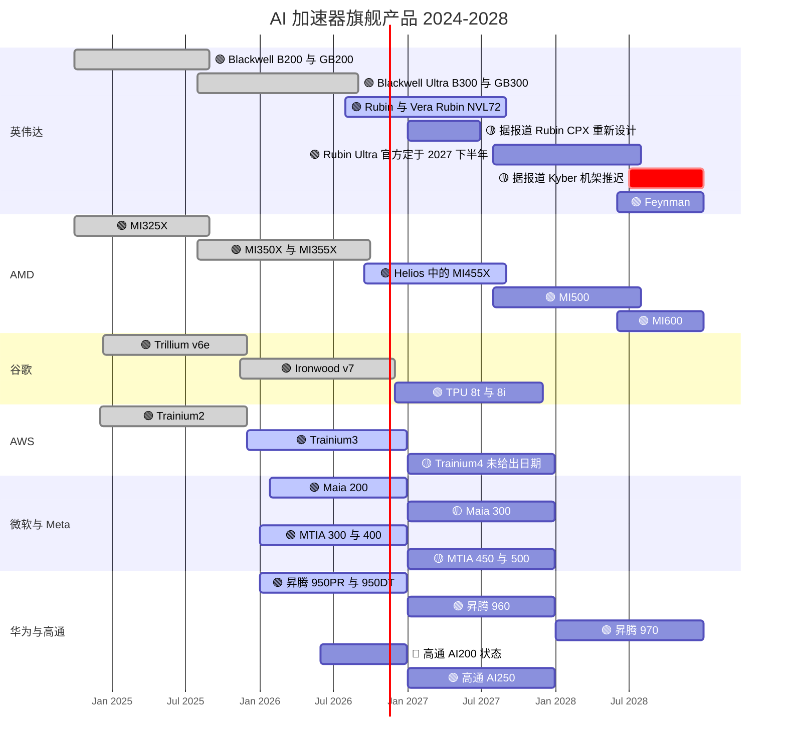
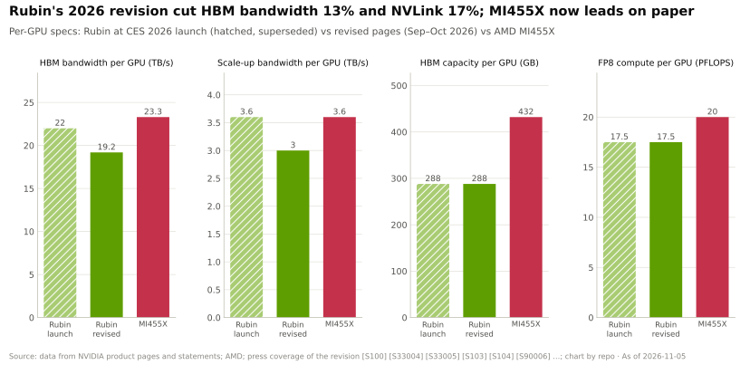
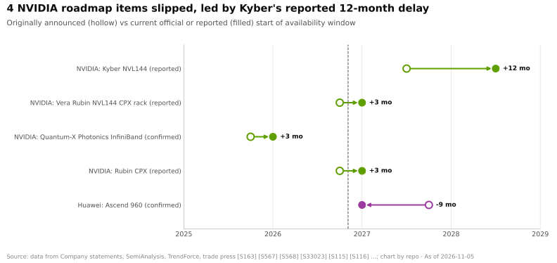

# GPU 芯片：路线图

> [!NOTE]
> 本页为英文原文的简体中文参考译文，仅供参考；如有出入，以[英文原文](../../../layers/02-gpu-silicon/roadmap.md "English original")为准。

第 02 层 · GPU 芯片 · 约 10 分钟阅读 · 最后核实：2026-11-05

## ⚡ 要点速览

- **Rubin 已在出货；接下来两步已定出时间。** 量产出货于 2026 年 8 月开始，批量放量在
  第四季度 [[S500]](../../../sources/bibliography.md#s500)[[S90009]](../../../sources/bibliography.md#s90009)；🟢 Rubin Ultra 官方定于 2027 年下半年推出，🟢 Feynman 定于 2028 年 [[S35018]](../../../sources/bibliography.md#s35018)[[S109]](../../../sources/bibliography.md#s109)。
- **Rubin 的规格在发布后遭下调：** 单 GPU [HBM4](../../glossary.md#hbm4) 带宽从 22 TB/s 降至 19.2 TB/s，[NVLink](../../glossary.md#nvlink) 6 从 3.6 TB/s 降至
  3.0 TB/s；容量（288 GB）和算力不变 [[S90006]](../../../sources/bibliography.md#s90006)[[S90007]](../../../sources/bibliography.md#s90007)。原因尚无定论（🔴）[[S104]](../../../sources/bibliography.md#s104)。
- **两个项目发生了变动。** 🟡 Rubin CPX 从 GTC 2026 路线图中消失，据报道将以采用 HBM4 的重新设计版本于 1Q27 回归
  [[S115]](../../../sources/bibliography.md#s115)[[S117]](../../../sources/bibliography.md#s117)；🟢 Groq 3 LPU 接替了推理加速器的位置 [[S113]](../../../sources/bibliography.md#s113)[[S506]](../../../sources/bibliography.md#s506)。
- **Rubin Ultra 是最大的悬而未决问题：** 🟡 有报道称其将改为双裸片封装、内存从 1 TB 降为 768 GB，且
  Kyber 机架推迟至 2028 年 [[S509]](../../../sources/bibliography.md#s509)[[S111]](../../../sources/bibliography.md#s111)[[S507]](../../../sources/bibliography.md#s507)；而英伟达（NVIDIA）称“路线图不变” [[S508]](../../../sources/bibliography.md#s508)。
- **所有厂商都进入一年一代的节奏：** 🟢 AMD MI500（2027）和 MI600（2028）[[S538]](../../../sources/bibliography.md#s538)，🟢 TPU 8t/8i（2026 年底）
  [[S550]](../../../sources/bibliography.md#s550)，🟢 Trainium4（AWS 宣称 FP8 提升 3 倍）[[S90034]](../../../sources/bibliography.md#s90034)，🟡 Maia 300（2027）[[S90046]](../../../sources/bibliography.md#s90046)，🟢 昇腾（Ascend）960/970 [[S90042]](../../../sources/bibliography.md#s90042)。
- **按单芯片计，英伟达和 AMD 正与 ASIC 拉开差距：** 估计 Rubin Ultra 的 [FP8](../../glossary.md#fp8) 算力约为 35 [PFLOPS](../../glossary.md#flops)，而
  Trainium4 约为 7.6，昇腾 960 为 2（本资料库根据厂商公布的倍数估算）[[S35018]](../../../sources/bibliography.md#s35018)[[S90034]](../../../sources/bibliography.md#s90034)[[S163]](../../../sources/bibliography.md#s163)。

## 2024–2028 年时间表

各条形从批量供货开始，延续至下一代旗舰产品推出。🟢 公司确认的时间 · 🟡 有报道 · 🔴 尚无定论。

> [!TIP]
> **算例 —— 各家对手落后多少年？** 把每款芯片的 FP8 算力与英伟达首次出货同等水平的年份相对照。
> Ironwood（4.6 PFLOPS，2025）≈ B200（4.5，2024）：约 1 年。Trainium3（2.5，2025）介于
> H100（2.0，2022）和 B200 之间：约 2–3 年。昇腾 950（1.0，2026）低于 H100：超过 4 年。MI455X（20，2026）
> 与 Rubin 持平：零 [[S151]](../../../sources/bibliography.md#s151)[[S155]](../../../sources/bibliography.md#s155)[[S163]](../../../sources/bibliography.md#s163)[[S144]](../../../sources/bibliography.md#s144)[[S33002]](../../../sources/bibliography.md#s33002)[[S33003]](../../../sources/bibliography.md#s33003)。

### 路线图跟踪表（`data/roadmap.csv` 中第 02 层的条目，已对照事实表复核）

| 项目 | 时间窗口 | 状态 | 置信度 | 来源 |
|---|---|---|---|---|
| 英伟达 Rubin GPU | 2026 年第三季度 → 第四季度放量 | 出货中；规格于 2026 年 9–10 月调整 | 🟢 | [[S500]](../../../sources/bibliography.md#s500)[[S90009]](../../../sources/bibliography.md#s90009)[[S90006]](../../../sources/bibliography.md#s90006) |
| 英伟达 Rubin CPX | 原定 2026 年底；据报道改为 1Q27 | 推迟 | 🟡 | [[S33023]](../../../sources/bibliography.md#s33023)[[S115]](../../../sources/bibliography.md#s115)[[S117]](../../../sources/bibliography.md#s117) |
| 英伟达 Groq 3 LPU（LP30） | 2026 年第三季度 | 量产中 | 🟢 | [[S113]](../../../sources/bibliography.md#s113)[[S506]](../../../sources/bibliography.md#s506) |
| 英伟达 Rubin Ultra | 2027 年下半年 | 路线图；有双裸片和 768 GB 的报道 | 🟢 时间 / 🟡 变更 | [[S35018]](../../../sources/bibliography.md#s35018)[[S509]](../../../sources/bibliography.md#s509)[[S111]](../../../sources/bibliography.md#s111) |
| 英伟达 Feynman、LP40、Rosa CPU | 2028 | 路线图 | 🟢 名称 / 🟡 细节 | [[S109]](../../../sources/bibliography.md#s109)[[S90004]](../../../sources/bibliography.md#s90004) |
| AMD MI455X（Helios） | 2026 年第三季度末，第四季度放量 | 出货中 | 🟢 | [[S538]](../../../sources/bibliography.md#s538)[[S90020]](../../../sources/bibliography.md#s90020)[[S90021]](../../../sources/bibliography.md#s90021) |
| AMD MI500 / MI600 | 2027 / 2028 | 路线图 | 🟢 | [[S538]](../../../sources/bibliography.md#s538)[[S90023]](../../../sources/bibliography.md#s90023) |
| 谷歌（Google）TPU 8t / 8i | “2026 年晚些时候” | 已发布 | 🟢 | [[S550]](../../../sources/bibliography.md#s550)[[S552]](../../../sources/bibliography.md#s552) |
| AWS Trainium4 | 无日期（估计 2027） | 路线图 | 🟡 | [[S90034]](../../../sources/bibliography.md#s90034)[[S518]](../../../sources/bibliography.md#s518) |
| 微软（Microsoft）Maia 200 / 300 | 2026 年 1 月 / 2027 | 出货中 / 路线图 | 🟢 / 🟡 | [[S90044]](../../../sources/bibliography.md#s90044)[[S90046]](../../../sources/bibliography.md#s90046) |
| Meta MTIA 400 / 450 / 500 | 2026 / 2027 年初 / 2027 年末 | 已发布 / 路线图 | 🟡 | [[S561]](../../../sources/bibliography.md#s561) |
| 英特尔（Intel）Crescent Island | 2026 年下半年送样 | 已发布 | 🟢 | [[S162]](../../../sources/bibliography.md#s162)[[S564]](../../../sources/bibliography.md#s564) |
| 华为昇腾 950DT / 960 / 970 | 2026 年第四季度 / 2027 / 2028 | 路线图；SuperPoD 出货未经证实 | 🟢 / 🔴 | [[S90042]](../../../sources/bibliography.md#s90042)[[S567]](../../../sources/bibliography.md#s567)[[S90043]](../../../sources/bibliography.md#s90043) |
| 高通（Qualcomm）AI200 / AI250 | 2026 / 2027 | 已发布；尚无确认的出货 | 🟢 / 🔴 | [[S173]](../../../sources/bibliography.md#s173)[[S90028]](../../../sources/bibliography.md#s90028) |

## 2026 年 Rubin 规格调整：改了什么、为何重要

英伟达的产品页如今列出的带宽低于发布时：[NVL72](../../glossary.md#nvl72) 机架的 [HBM](../../glossary.md#hbm) 带宽从 1,580 TB/s 降至 1,400 TB/s，
[HGX](../../glossary.md#hgx) NVL8 主板从 176 TB/s 降至 130 TB/s [[S90007]](../../../sources/bibliography.md#s90007)[[S105]](../../../sources/bibliography.md#s105)。产品页未给出原因；媒体报道
援引英伟达的声明，将这些数字与保证质量的批量生产联系起来 [[S104]](../../../sources/bibliography.md#s104)[[S2523]](../../../sources/bibliography.md#s2523)，而一位分析师则将其归咎于
HBM4 引脚速率仅约 9.4 Gb/s 而非约 10.7 Gb/s（🔴 尚无定论）[[S90006]](../../../sources/bibliography.md#s90006)。英伟达此前曾推动供应商把 HBM4 速率提升到
10–11 Gb/s 以上 [[S90040]](../../../sources/bibliography.md#s90040)。

> [!TIP]
> **算例 —— 13% 的带宽下调对解码有何影响。** 对一个 70B 参数的 FP8 模型而言，为一个用户生成一个 token
> 需要读取约 70 GB 的权重。在 22 TB/s 下，上限 ≈ 314 tokens/s；在 19.2 TB/s 下 ≈ 274，同样
> 损失约 13%。[解码（decode）](../../glossary.md#decode)属于[内存受限](../../glossary.md#memory-bound)型负载，因此下调冲击的是交互式
> 推理服务，而训练和[预填充（prefill）](../../glossary.md#prefill)不受影响。MI455X 的 23.3 TB/s 可达 ≈ 333 [[S90093]](../../../sources/bibliography.md#s90093)，
> 甚至高于 Rubin 发布时的规格。

## 哪些因素会改变格局

**[Q7 · 路线图与变数]** 英伟达计划到 2028 年每年推出一款旗舰产品（Rubin → Rubin Ultra →
Feynman），外加用于解码的 LPU [[S109]](../../../sources/bibliography.md#s109)[[S113]](../../../sources/bibliography.md#s113)；AMD 跟上了这一节奏，[超大规模云厂商](../../glossary.md#hyperscaler)也每年迭代。观察信号：

- 🟡 **Rubin Ultra 降级或延期。** 双裸片、768 GB 的产品或推迟至 2028 年的 Kyber 机架 [[S509]](../../../sources/bibliography.md#s509)[[S111]](../../../sources/bibliography.md#s111)[[S507]](../../../sources/bibliography.md#s507)，将使
  MI500（2027）[[S538]](../../../sources/bibliography.md#s538) 连续第二年在内存上领先。
- 🟡 **AMD 放量受阻。** 2026 年 2 月有报道称 MI455X 机架延期，AMD 予以否认 [[S2521]](../../../sources/bibliography.md#s2521)[[S2524]](../../../sources/bibliography.md#s2524)；Helios
  到 2027 年上半年的出货量将是检验 [[S90020]](../../../sources/bibliography.md#s90020)。
- 🟡 **HBM4/HBM4E 不达预期。** SK 海力士供应英伟达 2026 年一半以上的 HBM [[S90039]](../../../sources/bibliography.md#s90039)；以带宽为主导的
  路线图首先暴露于引脚速率和良率问题。
- 🟢 **TPU 成为商用芯片。** Meta 的租用与采购谈判，加上自 2027 年起进入甲骨文（Oracle）云的 TPU，将为
  买家提供第二个全栈供应商 [[S90025]](../../../sources/bibliography.md#s90025)[[S552]](../../../sources/bibliography.md#s552)。
- 🟢 **对手芯片内置 [NVLink Fusion](../../glossary.md#nvlink-fusion)。** Trainium4 在设计上即支持它 [[S90034]](../../../sources/bibliography.md#s90034)：英伟达将能从
  定制芯片中获利，而不只是与之竞争。
- 🟡 **OpenAI 的自研加速器。** 自 2026 年下半年起部署 10 GW 的 OpenAI–博通（Broadcom）机架 [[S174]](../../../sources/bibliography.md#s174)；SemiAnalysis 认为
  首款芯片单裸片可实现 13.4 PFLOPS MXFP4，而 Rubin 每颗裸片为 17.5 [[S628]](../../../sources/bibliography.md#s628)。
- 🔴 **中国市场重新开放或关闭。** H200 的销售已获许可，但需将 25% 的收入上缴美国政府 [[S90032]](../../../sources/bibliography.md#s90032)；
  华为已将昇腾 960 提前至 2027 年第一季度 [[S567]](../../../sources/bibliography.md#s567)。
- 🟢 **需求超过供给。** 黄仁勋估计到 2027 年 Blackwell 加 Rubin 的需求规模达 $1T [[S90001]](../../../sources/bibliography.md#s90001)[[S90002]](../../../sources/bibliography.md#s90002)；
  CFO 称 FY2028 将受供应约束 [[S90012]](../../../sources/bibliography.md#s90012)。只要这一状况持续，规格下滑就不会造成多少份额损失。

> [!TIP]
> **算例 —— 据报道的 Rubin Ultra 内存削减的代价。** 一个 144 个封装的 Kyber 机架，若每个
> 封装 1 TB，共有约 147 TB 的 [HBM4E](../../glossary.md#hbm4e)；若为 768 GB，则约 111 TB：**少 25%** [[S35018]](../../../sources/bibliography.md#s35018)[[S111]](../../../sources/bibliography.md#s111)。在长上下文推理中，
> [KV 缓存](../../glossary.md#kv-cache)会在算力耗尽之前先占满内存，因此每个机架的并发会话数将减少约 25%，
> 这为重内存的 MI500 打开了机会。

🔧 技术细节：如何解读加速器路线图幻灯片

- **裸片与封装。** “Vera Rubin NVL144”（按裸片计）在 CES 2026 上改为 NVL72（按封装计）；Kyber “NVL576”按同样的逻辑改为
  NVL144 [[S90009]](../../../sources/bibliography.md#s90009)[[S90003]](../../../sources/bibliography.md#s90003)。
- **“推理”数字。** Rubin 50 PFLOPS 的 [NVFP4](../../glossary.md#nvfp4) 依赖自适应压缩；35 PFLOPS 才是稠密训练
  数值 [[S100]](../../../sources/bibliography.md#s100)。AMD 未说明 MI455X 40 PFLOPS 的 [FP4](../../glossary.md#fp4) 是否为稠密值 [[S144]](../../../sources/bibliography.md#s144)。
- **发布 ≠ 批量出货。** 华为 SuperPoD 和高通 AI200 的出货均未经证实 [[S90042]](../../../sources/bibliography.md#s90042)[[S90028]](../../../sources/bibliography.md#s90028)。

## 🎯 企业发展视角

1. 英伟达在 Rubin 上以带宽换取了产量。如果 HBM 仍是最紧的投入要素，轻内存架构
   （[LPDDR](../../glossary.md#lpddr)、[SRAM](../../glossary.md#sram)、[近存计算](../../glossary.md#near-memory-compute)）是否会在 2027–28 年获得窗口期？
2. Rubin Ultra 的最终内存配置将在 2027 年下半年之前揭晓。如果是 768 GB，哪些合作伙伴或客户会重新规划？
3. Trainium4 对 NVLink Fusion 的支持模糊了“对手”与“伙伴”的界限。接入英伟达的互连架构对第三方加速器而言
   是一个可持续的选择，还是一种依赖？
4. 在所有主要厂商都一年一代的情况下，新进入者是否需要每年[流片](../../glossary.md#tape-out)一次？这对
   融资意味着什么？

## 📚 来源（Sources）

<!-- Auto-generated from the [S…] citations on this page by `make build`. Edit sources/registry/*.csv, not this list. -->

- [**S100**](../../../sources/bibliography.md#s100) NVIDIA Technical Blog, *Inside the NVIDIA Vera Rubin Platform: Six New Chips, One AI Supercomputer*, 2026-01-05. [Link](https://developer.nvidia.com/blog/inside-the-nvidia-rubin-platform-six-new-chips-one-ai-supercomputer/)
- [**S104**](../../../sources/bibliography.md#s104) Wccftech, *NVIDIA's Official Statement on Vera Rubin Spec Change*, 2026-10-29. [Link](https://wccftech.com/nvidia-official-statement-on-vera-rubin-spec-change/)
- [**S105**](../../../sources/bibliography.md#s105) Hardware Busters, *Nvidia Quietly Lowers Vera Rubin HBM4 Bandwidth, and the HGX NVL8 Loses a Quarter of It*, 2026-10. [Link](https://hwbusters.com/news/nvidia-quietly-lowers-vera-rubin-hbm4-bandwidth-and-the-hgx-nvl8-loses-a-quarter-of-it/)
- [**S109**](../../../sources/bibliography.md#s109) NVIDIA Blog, *NVIDIA GTC 2026: Live Updates on What's Next in AI*, 2026-03-16. [Link](https://blogs.nvidia.com/blog/gtc-2026-news/)
- [**S111**](../../../sources/bibliography.md#s111) Crypto Briefing, *Nvidia's Rubin Ultra targets 768GB of HBM4E as Kyber platform stays on schedule*, 2026. [Link](https://cryptobriefing.com/nvidia-rubin-ultra-hbm4e-kyber-2027/)
- [**S113**](../../../sources/bibliography.md#s113) Tom's Hardware, *How Nvidia's $20 billion Groq 3 LPU deal reshapes the Nvidia Vera Rubin Platform*, 2026-03. [Link](https://www.tomshardware.com/tech-industry/semiconductors/nvidias-20-billion-groq-deal-produces-its-first-chip)
- [**S115**](../../../sources/bibliography.md#s115) Tom's Hardware, *Nvidia removes Rubin CPX accelerators from its roadmap - Groq 3 LPUs take center stage*, 2026-03. [Link](https://www.tomshardware.com/pc-components/gpus/nvidia-removes-rubin-cpx-accelerators-from-its-roadmap-groq-3-lpus-take-center-stage-as-cpx-is-removed)
- [**S117**](../../../sources/bibliography.md#s117) TechNews (Taiwan), *Nvidia Rubin CPX re-enters roadmap with HBM4 for AI prefill*, 2026-09-02. [Link](https://technews.tw/2026/09/02/nvidia-rubin-cpx-reenters-roadmap-hbm4-ai-prefill/)
- [**S144**](../../../sources/bibliography.md#s144) AMD Newsroom, *AMD Unveils Vision for an Open AI Ecosystem, Detailing New Silicon, Software and Systems at Advancing AI 2025*, 2025-06-12. [Link](https://www.amd.com/en/newsroom/press-releases/2025-6-12-amd-unveils-vision-for-an-open-ai-ecosystem-detai.html)
- [**S151**](../../../sources/bibliography.md#s151) Google Blog (Amin Vahdat), *Ironwood: The first Google TPU for the age of inference*, 2025-04-09. [Link](https://blog.google/products/google-cloud/ironwood-tpu-age-of-inference/)
- [**S155**](../../../sources/bibliography.md#s155) Amazon Web Services, *AWS Trainium (product page: Trn2, Trn3)*, 2025-12. [Link](https://aws.amazon.com/ai/machine-learning/trainium/)
- [**S162**](../../../sources/bibliography.md#s162) Intel Newsroom, *Intel to Expand AI Accelerator Portfolio with New GPU (Crescent Island)*, 2025-10-14. [Link](https://newsroom.intel.com/artificial-intelligence/intel-to-expand-ai-accelerator-portfolio-with-new-gpu)
- [**S163**](../../../sources/bibliography.md#s163) Huawei (Eric Xu), *Huawei Connect 2025 keynote: Ascend roadmap and SuperPoD interconnect (Eric Xu)*, 2025-09-18. [Link](https://www.huawei.com/en/news/2025/9/hc-xu-keynote-speech)
- [**S173**](../../../sources/bibliography.md#s173) Qualcomm, *Qualcomm Unveils AI200 and AI250 - Redefining Rack-Scale Data Center Inference*, 2025-10-27. [Link](https://www.qualcomm.com/news/releases/2025/10/qualcomm-unveils-ai200-and-ai250-redefining-rack-scale-data-cent)
- [**S174**](../../../sources/bibliography.md#s174) OpenAI, *OpenAI and Broadcom announce strategic collaboration to deploy 10 gigawatts of OpenAI-designed AI accelerators*, 2025-10-13. [Link](https://openai.com/index/openai-and-broadcom-announce-strategic-collaboration/)
- [**S500**](../../../sources/bibliography.md#s500) NVIDIA Corporation, *NVIDIA Q2 Fiscal 2027 Quarterly Presentation (CFO commentary deck)*, 2026-08-26. [Link](https://s201.q4cdn.com/141608511/files/doc_financials/2027/Q227/NVDA-F2Q27-Quarterly-Presentation-final-1.pdf)
- [**S506**](../../../sources/bibliography.md#s506) SamMobile, *Samsung Foundry begins mass production of NVIDIA Groq 3 LPX chip*, 2026-08-25. [Link](https://www.sammobile.com/news/samsung-foundry-mass-production-nvidia-groq-3-lpx-chip/)
- [**S507**](../../../sources/bibliography.md#s507) Tom's Hardware, *Nvidia's Kyber rack for Rubin Ultra slips to 2028*, 2026-07-06. [Link](https://www.tomshardware.com/pc-components/gpus/nvidias-kyber-rack-for-rubin-ultra-slips-to-2028)
- [**S508**](../../../sources/bibliography.md#s508) Wccftech, *NVIDIA Quashes Rubin & Kyber Rack Delay Rumors, Says 'Chip Roadmap Is Intact'*, 2026-07. [Link](https://wccftech.com/nvidia-quashes-rubin-kyber-rack-delay-rumors-says-chip-roadmap-is-intact/)
- [**S509**](../../../sources/bibliography.md#s509) TrendForce, *NVIDIA Rubin Ultra four-die single-package design not adopted amid advanced-packaging constraints*, 2026-04-01. [Link](https://www.trendforce.com/news/?p=55442)
- [**S518**](../../../sources/bibliography.md#s518) ServeTheHome, *NVIDIA NVLink Fusion tapped for future AWS Trainium4 deployments*, 2025-12-02. [Link](https://www.servethehome.com/nvidia-nvlink-fusion-tapped-for-future-aws-trainium4-deployments/)
- [**S538**](../../../sources/bibliography.md#s538) AMD Investor Relations, *AAI 2026: AMD Delivers Full-Stack Compute for the Agentic AI Era*, 2026-07-23. [Link](https://ir.amd.com/news-events/press-releases/detail/1294/aai-2026-amd-delivers-full-stack-compute-for-the-agentic-ai-era)
- [**S550**](../../../sources/bibliography.md#s550) SiliconANGLE, *Google Cloud unveils eighth-generation TPUs (TPU 8t and TPU 8i)*, 2026-04-22. [Link](https://siliconangle.com/?p=740999)
- [**S552**](../../../sources/bibliography.md#s552) Google Cloud Blog (Karan Batta), *Bringing Google TPUs to Oracle Cloud Infrastructure*, 2026-10-27. [Link](https://cloud.google.com/blog/products/infrastructure/bringing-google-tpus-to-oracle-cloud-infrastructure)
- [**S561**](../../../sources/bibliography.md#s561) DatacenterDynamics, *Meta unveils next four generations of its MTIA chip*, 2026-03-11. [Link](https://www.datacenterdynamics.com/en/news/meta-unveils-next-four-generations-of-its-mtia-chip/)
- [**S564**](../../../sources/bibliography.md#s564) Tom's Hardware, *Intel's roadmaps examined — 14A, Nova Lake, Diamond Rapids & AI accelerator push*, 2026. [Link](https://www.tomshardware.com/tech-industry/semiconductors/intel-chip-roadmap-2026-2028)
- [**S567**](../../../sources/bibliography.md#s567) Huawei, *Huawei Connect 2026: Ascend 960 SuperNode*, 2026-09. [Link](https://www.huawei.com/br/news/2026/9/hc-ascend960-supernode)
- [**S628**](../../../sources/bibliography.md#s628) SemiAnalysis, *OpenAI Jalapeño: Better Than Nvidia Blackwell*, 2026-08-25. [Link](https://github.com/SemiAnalysisAI/InferenceX-app/blob/main/packages/app/content/blog/openai-jalapeno-better-than-nvidia.mdx)
- [**S2521**](../../../sources/bibliography.md#s2521) Tom's Hardware, *AMD denies report of MI455X delays as Nvidia VR200 systems are rumored to arrive early*, 2026-02. [Link](https://www.tomshardware.com/tech-industry/artificial-intelligence/amd-denies-report-of-mi455x-delays-as-nvidia-vr200-systems-are-rumored-to-arrive-early-company-says-helios-systems-on-target-for-2h-2026)
- [**S2523**](../../../sources/bibliography.md#s2523) PC Games Hardware, *Nvidia erklärt die Rubin-Kürzungen: Weniger HBM4-Bandbreite als angekündigt*, 2026-11. [Link](https://www.pcgameshardware.de/Kuenstliche-Intelligenz-Hardware-279517/News/Nvidia-Vera-Rubin-Spezifikationen-HBM4-NVLink-Stellungnahme-1558248/)
- [**S2524**](../../../sources/bibliography.md#s2524) The Next Platform, *AMD says Helios racks and MI400 series GPUs on track for 2H 2026*, 2026-02-23. [Link](https://www.nextplatform.com/2026/02/23/amd-says-helios-racks-and-mi400-series-gpus-on-track-for-2h-2026/)
- [**S33002**](../../../sources/bibliography.md#s33002) NVIDIA, *NVIDIA H100 Tensor Core GPU (product page and datasheet)*, 2022-03-22. [Link](https://www.nvidia.com/en-us/data-center/h100/)
- [**S33003**](../../../sources/bibliography.md#s33003) Lenovo Press, *ThinkSystem NVIDIA B200 180GB 1000W GPU product guide*, 2025. [Link](https://lenovopress.lenovo.com/lp2226-thinksystem-nvidia-b200-180gb-1000w-gpu)
- [**S33023**](../../../sources/bibliography.md#s33023) NVIDIA Newsroom, *NVIDIA Unveils Rubin CPX: A New Class of GPU Designed for Massive-Context Inference*, 2025-09-09. [Link](https://nvidianews.nvidia.com/news/nvidia-unveils-rubin-cpx-a-new-class-of-gpu-designed-for-massive-context-inference)
- [**S35018**](../../../sources/bibliography.md#s35018) Tom's Hardware, *Nvidia announces Rubin GPUs in 2026, Rubin Ultra in 2027, Feynman also added to roadmap*, 2025-03-18. [Link](https://www.tomshardware.com/pc-components/gpus/nvidia-announces-rubin-gpus-in-2026-rubin-ultra-in-2027-feynam-after)
- [**S90001**](../../../sources/bibliography.md#s90001) The Star (Reuters), *Nvidia bets on AI inference as chip revenue opportunity hits $1 trillion (Reuters)*, 2026-03-17. [Link](https://www.thestar.com.my/tech/tech-news/2026/03/17/nvidia-bets-on-ai-inference-as-chip-revenue-opportunity-hits-1-trillion)
- [**S90002**](../../../sources/bibliography.md#s90002) MarketScreener, *Nvidia forecasts $1 trillion in orders for its AI systems by 2027*, 2026-03-16. [Link](https://www.marketscreener.com/news/nvidia-forecasts-1-trillion-in-orders-for-its-ai-systems-by-2027-ce7e5edad08eff27)
- [**S90003**](../../../sources/bibliography.md#s90003) eWeek, *Everything Nvidia Just Announced at GTC 2026: 7 Chips, 5 Racks, 1 Giant Bet on Agentic AI*, 2026-03-17. [Link](https://www.eweek.com/news/nvidia-gtc-2026-ai-inference-vera-rubin-neuron/)
- [**S90004**](../../../sources/bibliography.md#s90004) TrendForce, *Key GTC takeaways: how Samsung, Micron, Intel and more power NVIDIA's Vera Rubin and Feynman*, 2026-03-17. [Link](https://www.trendforce.com/news/2026/03/17/news-key-gtc-takeaways-how-samsung-micron-intel-more-power-nvidias-vera-rubin-and-feynman/)
- [**S90006**](../../../sources/bibliography.md#s90006) TweakTown, *Nvidia cuts Vera Rubin's memory bandwidth by up to 26% and AMD's Helios now leads in memory bandwidth*, 2026-10. [Link](https://www.tweaktown.com/news/114304/nvidia-cuts-vera-rubins-memory-bandwidth-by-up-to-26-percent-and-amds-helios-now-leads-in-memory-bandwidth/index.html)
- [**S90007**](../../../sources/bibliography.md#s90007) TechRadar Pro, *Nvidia forced to dial back key bandwidth targets on Vera Rubin*, 2026-10. [Link](https://techradar.com/pro/nvidia-forced-to-dial-back-key-bandwidth-targets-on-vera-rubin-hardware-tweaks-will-affect-target-specifications-for-memory-and-interconnect-fabric)
- [**S90009**](../../../sources/bibliography.md#s90009) GamesBeat, *Nvidia Vera Rubin ramps into full production for fall launch*, 2026. [Link](https://gamesbeat.com/nvidia-vera-rubin-ramps-into-full-production-for-fall-launch-again/)
- [**S90012**](../../../sources/bibliography.md#s90012) Tomasz Tunguz (Tomasz Tunguz), *Nvidia Q2 FY27 earnings*, 2026-08. [Link](https://www.tomtunguz.com/nvidia-q2-fy27-earnings/index.md)
- [**S90020**](../../../sources/bibliography.md#s90020) Shacknews, *AMD Helios AI rack system on track for initial shipments in Q3 2026*, 2026. [Link](https://www.shacknews.com/article/150249/amd-helios-ai-system-shipping-q3-2026)
- [**S90021**](../../../sources/bibliography.md#s90021) Igor's Lab, *AMD Helios in production: MI455X, EPYC Venice and OpenAI challenge Nvidia AI racks*, 2026. [Link](https://www.igorslab.de/en/amd-helios-in-production-mi455x-epyc-venice-openai-challenge-nvidia-ai-racks/)
- [**S90023**](../../../sources/bibliography.md#s90023) Wccftech, *AMD has begun sampling MI450 GPUs and engaged with customers on MI500*, 2026. [Link](https://wccftech.com/amd-sampling-mi450-gpus-engaged-with-customers-on-mi500-largest-ai-deployments-are-for-inference/)
- [**S90025**](../../../sources/bibliography.md#s90025) SiliconANGLE, *Google and Meta reportedly strike new multibillion-dollar AI chip deal*, 2026-02-26. [Link](https://siliconangle.com/2026/02/26/google-meta-reportedly-strike-new-multibillion-dollar-ai-chip-deal/)
- [**S90028**](../../../sources/bibliography.md#s90028) TechRepublic, *Qualcomm unveils AI chips to rival Nvidia, AMD*, 2025-10-27. [Link](https://techrepublic.com/article/news-qualcomm-unveils-ai-chips-to-rival-nvidia-amd)
- [**S90032**](../../../sources/bibliography.md#s90032) Bloomberg Government, *Nvidia gets US license for small amount of H200 exports to China*, 2026-02. [Link](https://news.bgov.com/international-trade/nvidia-gets-us-license-for-small-amount-of-h200-exports-to-china)
- [**S90034**](../../../sources/bibliography.md#s90034) NAND Research, *AWS releases Trainium3, teases Trainium4*, 2025-12. [Link](https://nand-research.com/research-note-aws-releases-trainium3-teases-trainium4/4/)
- [**S90039**](../../../sources/bibliography.md#s90039) TrendForce, *Samsung, SK hynix reportedly tapped as NVIDIA Rubin HBM4 suppliers; shipments could start in March*, 2026-03-09. [Link](https://www.trendforce.com/news/2026/03/09/news-samsung-sk%E2%80%AFhynix-reportedly-tapped-as-nvidia-rubin-hbm4-suppliers-shipments-could-start-in-march/)
- [**S90040**](../../../sources/bibliography.md#s90040) Tom's Hardware, *HBM4 mass production delayed as Nvidia pushes memory specs higher*, 2025. [Link](https://www.tomshardware.com/tech-industry/hbm4-mass-production-delayed-as-nvidia-pushes-memory-specs-higher)
- [**S90042**](../../../sources/bibliography.md#s90042) TrendForce, *Huawei unveils Ascend 950 with in-house HBM in 2026, touts SuperPoD to rival NVIDIA*, 2025-09-18. [Link](https://www.trendforce.com/news/2025/09/18/news-huawei-unveils-ascend-950-with-in-house-hbm-in-2026-touts-superpod-to-rival-nvidia/)
- [**S90043**](../../../sources/bibliography.md#s90043) Tom's Hardware, *Huawei Ascend NPU roadmap examined: targets 4 zettaflops FP4 by 2028 amid manufacturing constraints*, 2025-09. [Link](https://www.tomshardware.com/tech-industry/artificial-intelligence/huawei-ascend-npu-roadmap-examined-company-targets-4-zettaflops-fp4-performance-by-2028-amid-manufacturing-constraints)
- [**S90044**](../../../sources/bibliography.md#s90044) eWeek, *Microsoft introduces Maia 200, its most powerful AI chip yet*, 2026-01-27. [Link](https://www.eweek.com/news/microsoft-maia-200-ai-chip/)
- [**S90046**](../../../sources/bibliography.md#s90046) IT Brief UK, *Microsoft unveils Maia 300 for 2027 AI deployments*, 2026-10. [Link](https://itbrief.co.uk/story/microsoft-unveils-maia-300-for-2027-ai-deployments)
- [**S90093**](../../../sources/bibliography.md#s90093) Tom's Hardware, *AMD takes the wraps off its Instinct MI455X AI accelerator: CDNA 5 and Helios rack-scale architecture*, 2026. [Link](https://www.tomshardware.com/pc-components/gpus/amd-takes-the-wraps-off-its-instinct-mi455x-ai-accelerator-cdna-5-and-helios-rack-scale-architecture-combine-to-take-the-fight-to-nvidia-in-the-data-center)
