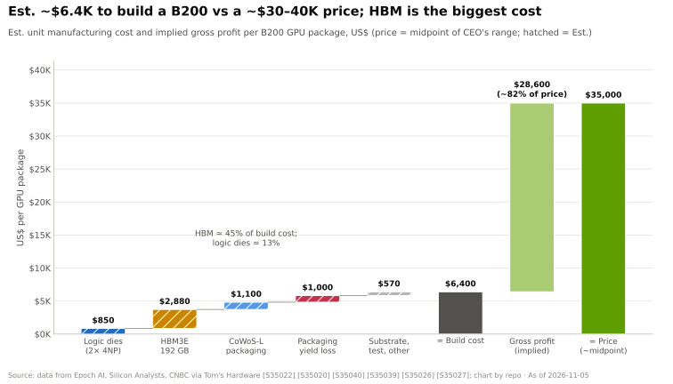
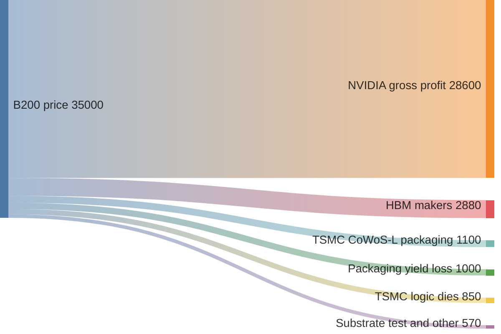
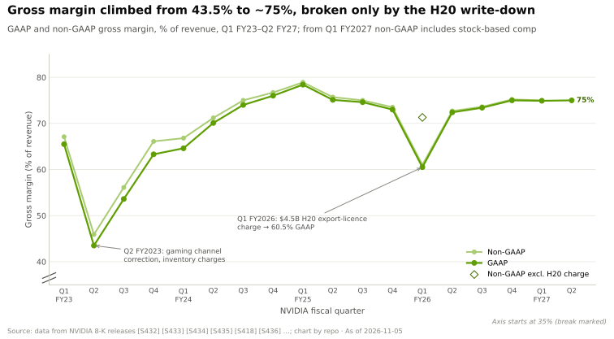
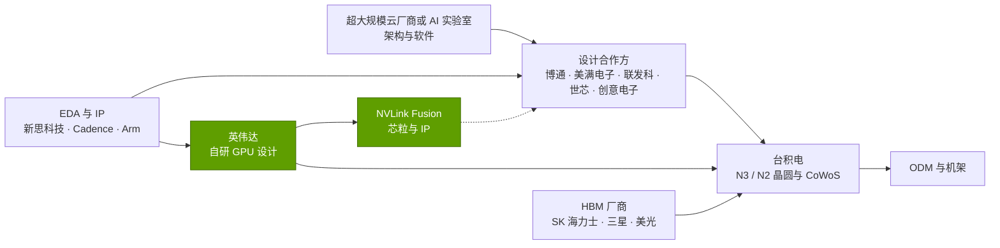
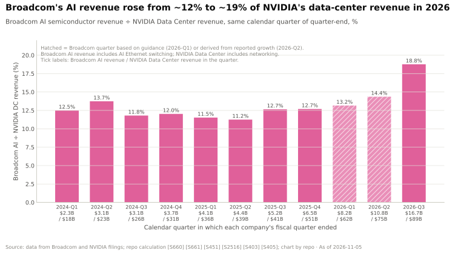

# GPU 芯片：价值链与企业发展视角

> [!NOTE]
> 本页为英文原文的简体中文参考译文，仅供参考；如有出入，以[英文原文](../../../layers/02-gpu-silicon/value-chain-and-corp-dev.md "English original")为准。

第 02 层 · GPU 芯片 · 约 11 分钟阅读 · 最后核实：2026-11-05

## ⚡ 要点速览

- **每一美元 GPU 收入，英伟达（NVIDIA）留下了大部分。** Epoch AI 估计，一颗 B200 的制造成本约为 $6.4K，售价为 $30–40K：
  芯片级[毛利率](../../glossary.md#gross-margin)接近 80%（估计）[[S35020]](../../../sources/bibliography.md#s35020)[[S35026]](../../../sources/bibliography.md#s35026)。公司层面 GAAP
  毛利率在 Q2 FY2027 为 75.0% [[S405]](../../../sources/bibliography.md#s405)。
- **内存是最大的供应商份额，且仍在扩大：** [HBM](../../glossary.md#hbm) 约占 B200 制造成本的 45%（估计）[[S35020]](../../../sources/bibliography.md#s35020)；
  Bernstein 预计 2027 年 [HBM4](../../glossary.md#hbm4) 价格约为 $53/GB，约为 B200 所假设的约 $15/GB 的 3.5 倍 [[S333]](../../../sources/bibliography.md#s333)[[S35020]](../../../sources/bibliography.md#s35020)。
- **台积电（TSMC）从每块 GPU 上拿到的钱不多，却掌握着最稀缺的产能：** 每颗 B200 的逻辑裸片和 CoWoS-L 约 $1.95K，
  另有约 $1K 的部件在封装中报废（估计）[[S35022]](../../../sources/bibliography.md#s35022)[[S35039]](../../../sources/bibliography.md#s35039)；英伟达预订了 2026 年约 60% 的 CoWoS 产能（估计）[[S379]](../../../sources/bibliography.md#s379)。
- **增长最快的价值池是定制芯片：** 截至 2026 年 8 月的季度，博通（Broadcom）AI 收入达 $16.7B（同比 +221%）
  [[S2516]](../../../sources/bibliography.md#s2516)；据报道，联发科 2026 年 AI ASIC 收入目标为 $2B（🟡）[[S2518]](../../../sources/bibliography.md#s2518)。
- **英伟达通过授权和参股、而非大型并购来获取能力：** Groq（约 $20B 的授权及团队交易，价格为 🟡）
  [[S90019]](../../../sources/bibliography.md#s90019)，入股英特尔（Intel）$5B [[S468]](../../../sources/bibliography.md#s468)、新思科技（Synopsys）$2B [[S471]](../../../sources/bibliography.md#s471)，据报道入股美满电子（Marvell）$2B [[S90037]](../../../sources/bibliography.md#s90037)；$40B 收购 Arm 的交易
  则被否决 [[S466]](../../../sources/bibliography.md#s466)。
- **初创公司估值两极分化：** Cerebras 于 2026 年 5 月 IPO 募资 $5.55B [[S2504]](../../../sources/bibliography.md#s2504)，据报道 Etched 估值达
  $10.3B（🟡）[[S2507]](../../../sources/bibliography.md#s2507)；而 SambaNova 洽谈的估值约为 $1.6B（含债务），2021 年则为 $5B [[S2512]](../../../sources/bibliography.md#s2512)。

## 谁拿走了利润

具体机制见[入门 P5 —— 芯片经济学](../../primers/P5-chip-economics-101.md)：台积电制造逻辑裸片，
并将其与 HBM 一起封装在 [CoWoS](../../glossary.md#cowos) 中介层上；内存厂商销售 HBM；英伟达销售
最终产品。下图依据 Epoch AI 和 Silicon Analysts 的估计，拆分一颗约 $35K 的 B200（单 GPU 美元，估计）
[[S35020]](../../../sources/bibliography.md#s35020)[[S35022]](../../../sources/bibliography.md#s35022)[[S35039]](../../../sources/bibliography.md#s35039)。

> [!TIP]
> **算例 —— 为什么芯片毛利率（约 80%）高于报告毛利率（约 75%）。** 一颗售价 $35K 的 B200，约 $6.4K 的
> 成本后剩余约 82% [[S35020]](../../../sources/bibliography.md#s35020)。英伟达报告的毛利率更低，因为它还销售含较低毛利成分的主板和机架，
> 并计提存货减值：$4.5B 的 H20 减值使 Q1 FY2026 的 GAAP 毛利率降至 60.5% [[S444]](../../../sources/bibliography.md#s444)[[S414]](../../../sources/bibliography.md#s414)。

> [!TIP]
> **算例 —— 内存厂商分得的份额不断上升。** B200：192 GB × 约 $15/GB ≈ $2.9K 的 HBM [[S35020]](../../../sources/bibliography.md#s35020)。Rubin：288 GB
> × Bernstein 估计的约 $53/GB ≈ **每块 GPU $15.3K**（估计）[[S333]](../../../sources/bibliography.md#s333)，约为前者的 5 倍。除非售价随之上调，否则利润将转移至
> SK 海力士、三星和美光（Micron）；从 GB300 到 Vera Rubin，内存在一个 [NVL72](../../glossary.md#nvl72) 机架估计成本中的占比将从约 9% 升至约 26%
> [[S332]](../../../sources/bibliography.md#s332)[[S331]](../../../sources/bibliography.md#s331)（见[第 03 层](../03-memory-packaging-supply-chain/index.md)）。

## 供应商、赋能者与定制芯片产业链

| 环节 | 参与者 | 获取的价值或提供的服务 | 为何重要 | 来源 |
|---|---|---|---|---|
| 晶圆代工 | 台积电 | 每颗 B200 约 $850 的逻辑裸片（估计） | 占全球前十大晶圆代工厂收入的 72.5% | [[S35022]](../../../sources/bibliography.md#s35022)[[S35035]](../../../sources/bibliography.md#s35035) |
| 封装 | 台积电 CoWoS-L | 约 $1.1K，另加约 $1K 良率损失（估计） | 英伟达约占 2026 年预订量的 60%（估计） | [[S35040]](../../../sources/bibliography.md#s35040)[[S35039]](../../../sources/bibliography.md#s35039)[[S379]](../../../sources/bibliography.md#s379) |
| 内存 | SK 海力士、三星、美光 | 每颗 B200 约 $2.9K 的 HBM3E（估计） | SK 海力士供应英伟达 2026 年 HBM 的 50% 以上 | [[S35020]](../../../sources/bibliography.md#s35020)[[S90039]](../../../sources/bibliography.md#s90039) |
| [EDA](../../glossary.md#eda) 与 IP | 新思科技、Cadence、Arm | 设计工具、接口 IP、CPU 核心 | 英伟达持有新思科技 $2B 股份；三家均支持 NVLink Fusion | [[S471]](../../../sources/bibliography.md#s471)[[S90031]](../../../sources/bibliography.md#s90031)[[S90036]](../../../sources/bibliography.md#s90036) |
| 设计服务 | 博通、美满电子、联发科、世芯（Alchip）、创意电子（GUC） | 把超大规模云厂商的设计转化为定制 [XPU](../../glossary.md#xpu) | 对手的赋能者；据报道英伟达向美满电子投资 $2B | [[S2516]](../../../sources/bibliography.md#s2516)[[S2517]](../../../sources/bibliography.md#s2517)[[S90037]](../../../sources/bibliography.md#s90037) |

[ASIC 设计合作方](../../glossary.md#asic-design-partner)提供物理设计、[SerDes](../../glossary.md#serdes) 和封装服务（世芯
拿下了 Trainium3 订单）[[S2517]](../../../sources/bibliography.md#s2517)；[NVLink Fusion](../../glossary.md#nvlink-fusion) 则把英伟达的互连架构植入了 Trainium4 [[S90034]](../../../sources/bibliography.md#s90034)。

> [!TIP]
> **算例 —— 设计服务价值池的增速快于英伟达。** 截至 2026 年 8 月的季度，
> 博通 AI 收入同比增长 221% 至 $16.7B，而英伟达数据中心收入增长 117% 至 $89.0B
> [[S2516]](../../../sources/bibliography.md#s2516)[[S405]](../../../sources/bibliography.md#s405)。博通 $21.7B 的指引约为一年前 $6.5B 的 3.3 倍 [[S661]](../../../sources/bibliography.md#s661)：定制芯片价值池从较小的基数
> 开始复利增长——份额转移正是这样开始的。

## 值得关注的私营公司

仅基于公开信息；各项估值口径不尽相同。

| 公司 | 业务 | 阶段 / 最近一次公开融资 | 为何重要 | 来源 |
|---|---|---|---|---|
| Cerebras | [晶圆级](../../glossary.md#wafer-scale)引擎，44 GB SRAM | 2026 年 5 月 IPO，募资 $5.55B；据报道估值约 $40–56B | 一种成功上市的非 GPU 架构 | [[S2504]](../../../sources/bibliography.md#s2504)[[S2505]](../../../sources/bibliography.md#s2505)[[S166]](../../../sources/bibliography.md#s166) |
| Groq | 基于 SRAM 的 [LPU](../../glossary.md#lpu) | 英伟达授权及团队交易，约 $20B（2025 年 12 月）；上一轮估值约 $6.9B | 在位者付出约 3 倍溢价将其吸纳 | [[S90018]](../../../sources/bibliography.md#s90018)[[S90019]](../../../sources/bibliography.md#s90019) |
| Etched | 仅支持 Transformer 的 ASIC（Sohu） | $300M C 轮，估值 $10.3B（2026 年 7 月，🟡） | 极致专用化 | [[S2507]](../../../sources/bibliography.md#s2507)[[S171]](../../../sources/bibliography.md#s171) |
| MatX | 专注 LLM 的加速器 | $500M B 轮（2026 年 2 月，🟡）；2027 年出货 | 在台积电投片、资金充裕的新进入者 | [[S2508]](../../../sources/bibliography.md#s2508) |
| Tenstorrent | RISC-V AI 芯片及可授权 IP | $693M D 轮，投前估值 $2B（2024 年 12 月） | 开放 IP 模式，而不只是卖芯片 | [[S2509]](../../../sources/bibliography.md#s2509)[[S169]](../../../sources/bibliography.md#s169) |
| d-Matrix | 数字存内计算 | $275M C 轮，估值 $2B（2025 年 11 月） | 攻克内存墙 | [[S2511]](../../../sources/bibliography.md#s2511)[[S170]](../../../sources/bibliography.md#s170) |
| Lightmatter | 光子互连 | $400M D 轮，估值 $4.4B（2024 年 10 月） | 光学纵向扩展链路 | [[S2510]](../../../sources/bibliography.md#s2510) |
| SambaNova | 可重构数据流芯片 | $5B（2021）；与英特尔洽谈约 $1.6B（含债务），已停滞 | 估值下调（down-round）的参照 | [[S2512]](../../../sources/bibliography.md#s2512) |

> [!TIP]
> **算例 —— 如何解读一轮融资。** Tenstorrent 以 $2B 的*投前*估值融资约 $693M [[S2509]](../../../sources/bibliography.md#s2509)，因此
> 投后估值约为 $2.7B，新投资者持股约 26%（0.693 ÷ 2.693）。据报道，Etched 的估值从 >$5B（2026 年 1 月）
> 升至 $10.3B（2026 年 7 月），六个月内翻倍，依据的是预订单而非实际出货量 [[S2506]](../../../sources/bibliography.md#s2506)[[S2507]](../../../sources/bibliography.md#s2507)。

## 本层的并购历史

| 年份 | 交易 | 金额 | 结果 | 来源 |
|---|---|---|---|---|
| 2000 | 英伟达收购 3dfx 图形资产 | $70M | 整合了 PC 图形市场 | [[S400]](../../../sources/bibliography.md#s400)[[S484]](../../../sources/bibliography.md#s484) |
| 2006 | 英伟达收购 PortalPlayer | $357M | 为 Tegra SoC 产品线奠定基础 | [[S400]](../../../sources/bibliography.md#s400)[[S484]](../../../sources/bibliography.md#s484) |
| 2011 | 英伟达收购 Icera（调制解调器） | $367M | 2015 年关停 | [[S400]](../../../sources/bibliography.md#s400)[[S484]](../../../sources/bibliography.md#s484) |
| 2019 | 英特尔收购 Habana Labs | 约 $2B | Gaudi 未达成 2024 年目标 | [[S2514]](../../../sources/bibliography.md#s2514)[[S668]](../../../sources/bibliography.md#s668) |
| 2020–22 | 英伟达竞购 Arm | $40B | 遭否决；交易终止 | [[S465]](../../../sources/bibliography.md#s465)[[S466]](../../../sources/bibliography.md#s466) |
| 2025 | 英伟达授权 Groq 技术并招揽其团队 | 约 $20B（据报道） | Groq 3 LPU 进入 Vera Rubin 平台 | [[S90019]](../../../sources/bibliography.md#s90019)[[S113]](../../../sources/bibliography.md#s113) |
| 2025 | 英伟达入股英特尔和新思科技 | $5B 和 $2B | x86 + NVLink CPU；加速 EDA | [[S468]](../../../sources/bibliography.md#s468)[[S471]](../../../sources/bibliography.md#s471) |
| 2026 | 美满电子收购 Celestial AI | 预付 $3.25B，另加[或有对价（earn-out）](../../glossary.md#earn-out) | 光子内存互连架构 | [[S2513]](../../../sources/bibliography.md#s2513) |

> [!TIP]
> **算例 —— 以英伟达自己的“货币”衡量它为 Groq 付出的代价。** 约 $20B（🟡 据报道）约为 Groq 上一轮私募
> 估值（约 $6.9B）的 2.9 倍 [[S90019]](../../../sources/bibliography.md#s90019)，约相当于英伟达 Q2 FY2027 数据中心收入的 **3 周**（$89.0B ÷ 13 周
> ≈ 每周 $6.8B）[[S405]](../../../sources/bibliography.md#s405)。“授权 + [收购式招聘（acquihire）](../../glossary.md#acquihire)”的结构规避了并购审查，但
> Groq 前员工已起诉其董事会 [[S118]](../../../sources/bibliography.md#s118)。

**[Q8 · 价值池与并购机会]** 最大的价值池仍是英伟达约 75–80% 的芯片毛利
[[S405]](../../../sources/bibliography.md#s405)[[S35020]](../../../sources/bibliography.md#s35020)。有两个价值池增长更快：一是**内存**，因为 HBM 正朝着占芯片成本过半的方向发展；二是**定制
芯片设计服务**，博通 AI 收入相当于英伟达数据中心收入的比例已从约 12% 升至约 19%
[[S333]](../../../sources/bibliography.md#s333)[[S2516]](../../../sources/bibliography.md#s2516)。英伟达的模式是通过授权、收购式招聘和少数股权投资，把合作伙伴拉入其
生态；而大型芯片收购要么被否决（Arm），要么令人失望（英特尔收购的 Habana）。

🔧 技术细节：为什么对在位者而言授权优于收购

- **监管路径。** 非独家授权加人员招聘，使 Groq 仍作为持续经营的实体存在（GroqCloud 继续运营）[[S90018]](../../../sources/bibliography.md#s90018)。
- **速度。** 交易完成约八个月后，Groq 3 LPU 即在三星 4 nm 上投产 [[S506]](../../../sources/bibliography.md#s506)。
- **杠杆。** 入股英特尔、新思科技和美满电子，无需收购即可把 CPU、EDA 和定制 XPU 与 [NVLink](../../glossary.md#nvlink) 绑定
  [[S468]](../../../sources/bibliography.md#s468)[[S471]](../../../sources/bibliography.md#s471)[[S90037]](../../../sources/bibliography.md#s90037)。

## 🎯 企业发展视角

1. 高通（Qualcomm）是服务器 CPU 领域的 NVLink Fusion 合作伙伴 [[S90031]](../../../sources/bibliography.md#s90031)，同时销售 AI200/AI250 推理产品线
   [[S173]](../../../sources/bibliography.md#s173)。这两项押注各自瞄准哪个价值池：英伟达的生态，还是定制与推理价值池？
2. 博通 AI 收入约为英伟达数据中心收入的 19%，据报道联发科 2026 年目标为 $2B
   [[S2516]](../../../sources/bibliography.md#s2516)[[S2518]](../../../sources/bibliography.md#s2518)。一家移动 SoC 公司的 SerDes、封装和能效能力能否迁移到设计
   服务上？哪些锚定客户仍未敲定合作方？
3. Groq 以约为上一轮估值 3 倍的价格出售，而 SambaNova 洽谈的估值仅为其 2021 年估值的零头。哪些尽调
   信号（量产客户、软件、团队留存）把两者区分开来？
4. HBM 是最稀缺、涨价最快的投入要素。在 Celestial AI 已归入美满电子之后，还有哪些独立的“内存墙”
   解决方案（存内计算、光子技术、重 LPDDR 设计）可作为合作对象？
5. “授权 + 收购式招聘”的结构推进迅速，但容易招致诉讼 [[S118]](../../../sources/bibliography.md#s118)。如果买方与标的公司的客户存在竞争，监管机构、员工和
   客户将如何看待这样的交易？

## 📚 来源（Sources）

<!-- Auto-generated from the [S…] citations on this page by `make build`. Edit sources/registry/*.csv, not this list. -->

- [**S113**](../../../sources/bibliography.md#s113) Tom's Hardware, *How Nvidia's $20 billion Groq 3 LPU deal reshapes the Nvidia Vera Rubin Platform*, 2026-03. [Link](https://www.tomshardware.com/tech-industry/semiconductors/nvidias-20-billion-groq-deal-produces-its-first-chip)
- [**S118**](../../../sources/bibliography.md#s118) Tom's Hardware, *Former Groq engineers sue board over $20 billion Nvidia deal*, 2026. [Link](https://www.tomshardware.com/tech-industry/semiconductors/former-groq-engineers-sue-board-over-usd20-billion-nvidia-deal-saying-it-handed-nvidia-the-lpu-and-the-team-that-built-it-plaintiffs-allege-the-board-kept-billions-from-other-shareholders)
- [**S166**](../../../sources/bibliography.md#s166) Cerebras, *Cerebras Systems Unveils World's Fastest AI Chip with 4 Trillion Transistors (WSE-3)*, 2024-03-13. [Link](https://www.cerebras.ai/press-release/cerebras-announces-third-generation-wafer-scale-engine)
- [**S169**](../../../sources/bibliography.md#s169) Tenstorrent, *Tenstorrent Blackhole*, 2025. [Link](https://tenstorrent.com/hardware/blackhole)
- [**S170**](../../../sources/bibliography.md#s170) d-Matrix, *d-Matrix Corsair inference platform*, 2024-11-19. [Link](https://www.d-matrix.ai/product/)
- [**S171**](../../../sources/bibliography.md#s171) Etched, *Etched is Making the Biggest Bet in AI (Sohu announcement)*, 2024-06-25. [Link](https://www.etched.com/announcing-etched)
- [**S173**](../../../sources/bibliography.md#s173) Qualcomm, *Qualcomm Unveils AI200 and AI250 - Redefining Rack-Scale Data Center Inference*, 2025-10-27. [Link](https://www.qualcomm.com/news/releases/2025/10/qualcomm-unveils-ai200-and-ai250-redefining-rack-scale-data-cent)
- [**S331**](../../../sources/bibliography.md#s331) Wccftech, *NVIDIA's Vera Rubin rack hit with 435% memory price surge, pushing HBM4 & LPDDR5X bill to $2M of $7.8M total*, 2026-05. [Link](https://wccftech.com/nvidia-vera-rubin-rack-hit-with-memory-price-surge-pushing-hbm4-lpddr5x-bill-to-2m-of-7-8m-total/)
- [**S332**](../../../sources/bibliography.md#s332) Tiger Brokers (iTiger), *Morgan Stanley's BOM analysis of NVIDIA's Rubin: GPU share declines; PCB, MLCC and ABF substrate values soar*, 2026-05-20. [Link](https://www.itiger.com/news/1188068712)
- [**S333**](../../../sources/bibliography.md#s333) Wccftech, *Bernstein warns NVIDIA's Vera Rubin racks will hit $9.1 million as HBM4 prices triple to $53 per gigabyte*, 2026-07. [Link](https://wccftech.com/bernstein-warns-nvidias-vera-rubin-racks-will-hit-9-1-million-as-hbm4-prices-triple-to-53-per-gigabyte/)
- [**S379**](../../../sources/bibliography.md#s379) TrendForce News, *TSMC CoWoS capacity and customer allocation estimates (TrendForce / Morgan Stanley, as reported)*, 2025. [Link](https://www.trendforce.com/news/)
- [**S400**](../../../sources/bibliography.md#s400) U.S. Securities and Exchange Commission (EDGAR), *NVIDIA Corporation Form 10-K annual reports FY2001–FY2019 (EDGAR filing index)*, 2019-02-21. [Link](https://www.sec.gov/cgi-bin/browse-edgar?action=getcompany&CIK=0001045810&type=10-K&dateb=&owner=include&count=40)
- [**S405**](../../../sources/bibliography.md#s405) NVIDIA Corporation via SEC EDGAR, *NVIDIA Announces Financial Results for Second Quarter Fiscal 2027 (Form 8-K exhibit 99.1)*, 2026-08-26. [Link](https://www.sec.gov/Archives/edgar/data/0001045810/000104581026000073/q2fy27pr.htm)
- [**S414**](../../../sources/bibliography.md#s414) NVIDIA Corporation via SEC EDGAR, *NVIDIA Corporation Form 10-Q for quarter ended April 27, 2025*, 2025-05-28. [Link](https://www.sec.gov/Archives/edgar/data/1045810/000104581025000116/nvda-20250427.htm)
- [**S444**](../../../sources/bibliography.md#s444) NVIDIA Corporation, *NVIDIA Announces Financial Results for First Quarter Fiscal 2026 (press release with CFO commentary)*, 2025-05-28. [Link](https://nvidianews.nvidia.com/news/nvidia-announces-financial-results-for-first-quarter-fiscal-2026)
- [**S465**](../../../sources/bibliography.md#s465) NVIDIA Newsroom, *NVIDIA to Acquire Arm for $40 Billion, Creating World's Premier Computing Company for the Age of AI*, 2020-09-13. [Link](https://nvidianews.nvidia.com/news/nvidia-to-acquire-arm-for-40-billion-creating-worlds-premier-computing-company-for-the-age-of-ai)
- [**S466**](../../../sources/bibliography.md#s466) NVIDIA Newsroom, *NVIDIA and SoftBank Group Announce Termination of NVIDIA's Acquisition of Arm Limited*, 2022-02-08. [Link](https://nvidianews.nvidia.com/news/nvidia-and-softbank-group-announce-termination-of-nvidias-acquisition-of-arm-limited)
- [**S468**](../../../sources/bibliography.md#s468) NVIDIA Newsroom, *NVIDIA and Intel to Develop AI Infrastructure and Personal Computing Products*, 2025-09-18. [Link](https://nvidianews.nvidia.com/news/nvidia-and-intel-to-develop-ai-infrastructure-and-personal-computing-products)
- [**S471**](../../../sources/bibliography.md#s471) NVIDIA Newsroom, *NVIDIA and Synopsys strategic partnership; NVIDIA $2B investment in Synopsys common stock*, 2025-12-01. [Link](https://nvidianews.nvidia.com/)
- [**S484**](../../../sources/bibliography.md#s484) NVIDIA press releases as summarised in NVIDIA 10-K filings and contemporaneous press, *History of NVIDIA acquisitions 2000–2013 (3dfx assets, MediaQ, ULi, Hybrid Graphics, PortalPlayer, mental images, Ageia, Icera, The Portland Group)*, 2013-07. [Link](https://en.wikipedia.org/wiki/Nvidia)
- [**S506**](../../../sources/bibliography.md#s506) SamMobile, *Samsung Foundry begins mass production of NVIDIA Groq 3 LPX chip*, 2026-08-25. [Link](https://www.sammobile.com/news/samsung-foundry-mass-production-nvidia-groq-3-lpx-chip/)
- [**S661**](../../../sources/bibliography.md#s661) Broadcom Inc., *Broadcom Inc. Announces Fourth Quarter and Fiscal Year 2025 Financial Results*, 2025-12-11. [Link](https://investors.broadcom.com/financial-information/quarterly-results)
- [**S668**](../../../sources/bibliography.md#s668) Reuters (as reported), *Intel says it will not hit $500 million Gaudi 3 revenue target for 2024*, 2024-10-31. [Link](https://www.reuters.com/technology/)
- [**S2504**](../../../sources/bibliography.md#s2504) TechCrunch, *Cerebras raises $5.5B kicking off 2026's IPO season with a bang*, 2026-05-14. [Link](https://techcrunch.com/2026/05/14/cerebras-raises-5-5b-kicking-off-2026s-ipo-season-with-a-bang)
- [**S2505**](../../../sources/bibliography.md#s2505) Dealroom, *Cerebras raises $5.55B in biggest US IPO of 2026*, 2026-05. [Link](https://dealroom.co/news/128936-cerebras-raises-5-55b-in-biggest-us-ipo-of-2026/)
- [**S2506**](../../../sources/bibliography.md#s2506) DatacenterDynamics, *Etched raises $500m for a $5bn valuation - report*, 2026-01. [Link](https://www.datacenterdynamics.com/en/news/etchedai-raises-500m-for-a-5bn-valuation-report/)
- [**S2507**](../../../sources/bibliography.md#s2507) AI Weekly, *Etched closes $300M Series C at $10.3B led by Sequoia, books ~$1B in pre-orders for Sohu*, 2026-07. [Link](https://aiweekly.co/alerts/etched-closes-300m-series-c-at-103b-led-by-sequoia-books-1b-in-pre-orders-for)
- [**S2508**](../../../sources/bibliography.md#s2508) AI2.Work, *MatX raises $500M to build AI chips*, 2026-02-24. [Link](https://ai2.work/blog/matx-raises-500m-to-build-ai-chips-that-beat-nvidia-by-10x)
- [**S2509**](../../../sources/bibliography.md#s2509) TechPowerUp, *Tenstorrent closes $693M+ of Series D funding led by Samsung Securities and AFW Partners*, 2024-12-02. [Link](https://techpowerup.com/329396/tenstorrent-closes-usd-693m-of-series-d-funding-led-by-samsung-securities-and-afw-partners)
- [**S2510**](../../../sources/bibliography.md#s2510) Bloomberg, *Photonic Computing Startup Lightmatter Reaches $4.4 Billion Valuation*, 2024-10-16. [Link](https://www.bloomberg.com/news/articles/2024-10-16/photonic-computing-startup-lightmatter-reaches-4-4-billion-valuation)
- [**S2511**](../../../sources/bibliography.md#s2511) Converge Digest, *d-Matrix raises $275 million to accelerate the age of AI inference*, 2025-11-12. [Link](https://convergedigest.com/d-matrix-raises-275-million-to-accelerate-the-age-of-ai-inference/)
- [**S2512**](../../../sources/bibliography.md#s2512) Verdict, *Intel pursues SambaNova acquisition amid AI expansion plans*, 2025-12. [Link](https://www.verdict.co.uk/intel-sambanova-acquisition/)
- [**S2513**](../../../sources/bibliography.md#s2513) Business Wire (Marvell), *Marvell Completes Acquisition of Celestial AI*, 2026-02-02. [Link](https://www.businesswire.com/news/home/20260201331090/en/marvell-completes-acquisition-of-celestial-ai)
- [**S2514**](../../../sources/bibliography.md#s2514) bit-tech, *Intel acquires AI chipmaker, Habana Labs*, 2019-12-16. [Link](https://www.bit-tech.net/news/tech/cpus/intel-acquires-ai-chipmaker-habana-labs/1/)
- [**S2516**](../../../sources/bibliography.md#s2516) Broadcom Inc. via SEC EDGAR, *Broadcom Inc. Announces Third Quarter Fiscal Year 2026 Financial Results (Form 8-K exhibit 99.1)*, 2026-09. [Link](https://www.sec.gov/Archives/edgar/data/0001730168/000173016826000076/avgo-08022026x8kxex99.htm)
- [**S2517**](../../../sources/bibliography.md#s2517) TrendForce, *CSPs accelerate ASIC push in 2H26, challenging NVIDIA as MediaTek, GUC, Alchip benefit*, 2026-03-20. [Link](https://www.trendforce.com/news/2026/03/20/news-csps-accelerate-asic-push-in-2h26-challenging-nvidia-as-mediatek-guc-alchip-benefit/)
- [**S2518**](../../../sources/bibliography.md#s2518) TrendForce, *MediaTek reportedly doubles 2026 AI ASIC revenue target to $2B*, 2026-04-30. [Link](https://www.trendforce.com/news/2026/04/30/news-MediaTek-reportedly-doubles-2026-ai-asic-revenue-target-to-2b-aims-10-15-market-share)
- [**S35020**](../../../sources/bibliography.md#s35020) Epoch AI, *NVIDIA's B200 costs around $6,400 to produce, with memory accounting for half*, 2025-12. [Link](https://epoch.ai/data-insights/b200-cost-breakdown)
- [**S35022**](../../../sources/bibliography.md#s35022) Silicon Analysts, *NVIDIA B200 (Blackwell) cost breakdown*, 2026. [Link](https://siliconanalysts.com/analysis/nvidia-b200-blackwell-cost-breakdown)
- [**S35026**](../../../sources/bibliography.md#s35026) Tom's Hardware, *Nvidia's Jensen Huang says Blackwell GPU to cost $30,000-$40,000, later clarifies that pricing will vary as they won't sell just the chip*, 2024-03-19. [Link](https://www.tomshardware.com/pc-components/gpus/nvidias-jensen-huang-says-blackwell-gpu-to-cost-dollar30000-dollar40000-later-clarifies-that-pricing-will-vary-as-they-wont-sell-just-the-chip)
- [**S35035**](../../../sources/bibliography.md#s35035) TrendForce, *TrendForce: global top-10 foundry revenue and ranking 2Q26*, 2026-09-09. [Link](https://www.trendforce.com/presscenter/news/20260909-13225.html)
- [**S35039**](../../../sources/bibliography.md#s35039) FourWeekMBA, *The 14% Paradox: Why Nvidia's GPU Silicon Costs Less Than Its Packaging*, 2026. [Link](https://fourweekmba.com/the-14-paradox-why-nvidias-gpu-silicon-costs-less-than-its-packaging)
- [**S35040**](../../../sources/bibliography.md#s35040) Silicon Analysts, *CoWoS packaging cost: chiplet vs monolithic (2026)*, 2026. [Link](https://siliconanalysts.com/analysis/cowos-packaging-cost-chiplet-vs-monolithic-2026)
- [**S90018**](../../../sources/bibliography.md#s90018) Constellation Research, *Nvidia's Groq deal: acquisition, acquihire or creative licensing deal?*, 2025-12. [Link](https://www.constellationr.com/insights/news/nvidias-groq-deal-acquisition-acquihire-or-creative-licensing-deal)
- [**S90019**](../../../sources/bibliography.md#s90019) TechSpot, *Nvidia's $20 billion Groq deal looks a lot like an acquisition*, 2025-12. [Link](https://www.techspot.com/news/110723-nvidia-20-billion-groq-deal-looks-lot-like.html)
- [**S90031**](../../../sources/bibliography.md#s90031) ServeTheHome, *NVIDIA announces NVLink Fusion bringing NVLink to third-party CPUs and accelerators*, 2025-05-19. [Link](https://www.servethehome.com/nvidia-announces-nvlink-fusion-bringing-nvlink-to-third-party-cpus-and-accelerators/nvlink-fusion-partners/)
- [**S90034**](../../../sources/bibliography.md#s90034) NAND Research, *AWS releases Trainium3, teases Trainium4*, 2025-12. [Link](https://nand-research.com/research-note-aws-releases-trainium3-teases-trainium4/4/)
- [**S90036**](../../../sources/bibliography.md#s90036) Converge Digest, *Arm extends Neoverse with NVIDIA NVLink Fusion*, 2025-11. [Link](https://convergedigest.com/arm-extends-neoverse-with-nvidia-nvlink-fusion/)
- [**S90037**](../../../sources/bibliography.md#s90037) Converge Digest, *NVIDIA invests $2B in Marvell to extend NVLink Fusion AI ecosystem*, 2026-03. [Link](https://convergedigest.com/nvidia-invests-2b-in-marvell-to-extend-nvlink-fusion-ai-ecosystem/)
- [**S90039**](../../../sources/bibliography.md#s90039) TrendForce, *Samsung, SK hynix reportedly tapped as NVIDIA Rubin HBM4 suppliers; shipments could start in March*, 2026-03-09. [Link](https://www.trendforce.com/news/2026/03/09/news-samsung-sk%E2%80%AFhynix-reportedly-tapped-as-nvidia-rubin-hbm4-suppliers-shipments-could-start-in-march/)
