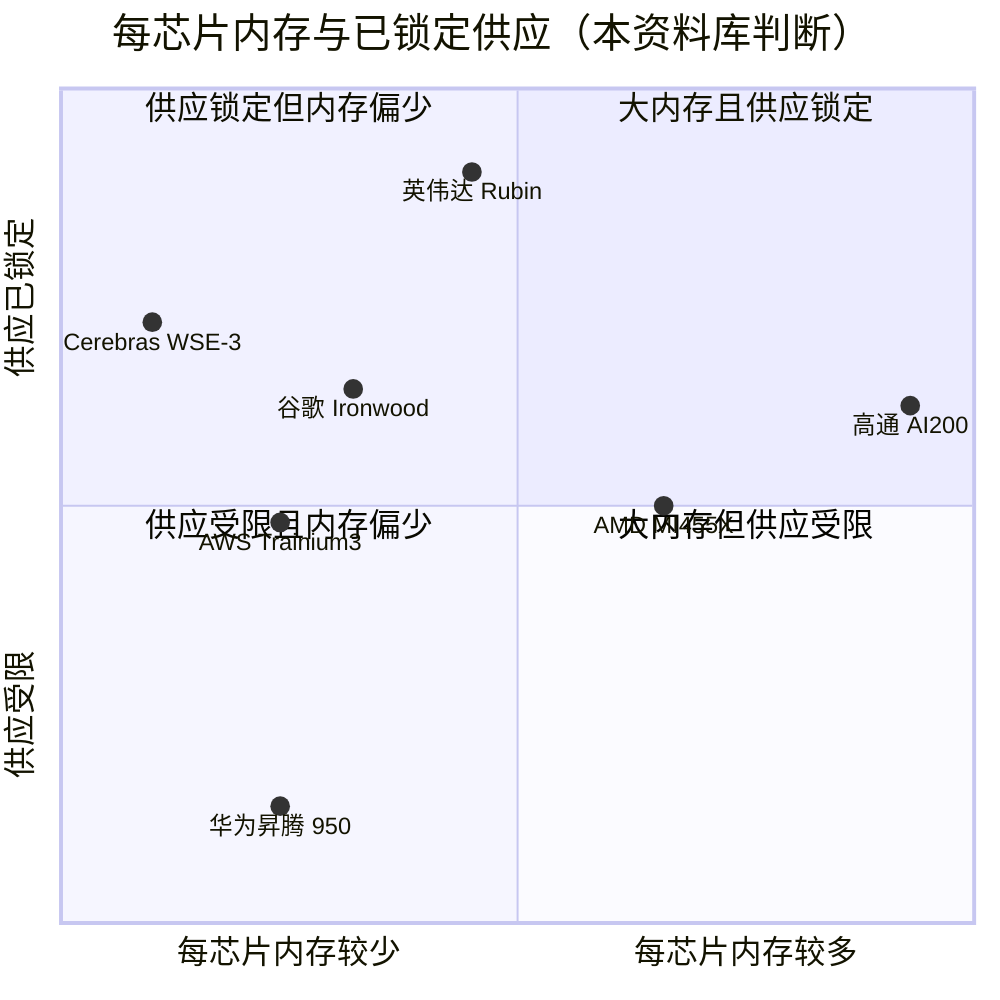
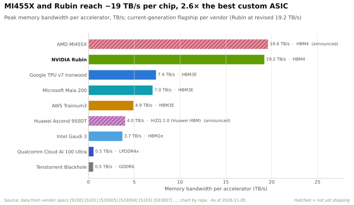

# 内存、封装与供应链：竞争格局

> [!NOTE]
> 本页为英文原文的简体中文参考译文，仅供参考；如有出入，以[英文原文](../../../layers/03-memory-packaging-supply-chain/competition.md "English original")为准。

第 03 层 · 内存、封装与供应链 · 约 12 分钟阅读 · 最近核实：2026-11-05

## ⚡ 要点速览

- **竞争对手争夺稀缺供应的力度不亚于比拼设计。** 每一款基于[高带宽内存（HBM）](../../glossary.md#hbm)的加速器都需要同样的台积电（TSMC）[CoWoS](../../glossary.md#cowos) 产线和同样的三家内存厂商，因此[产能配额（capacity allocation）](../../glossary.md#capacity-allocation)与内存规格同等重要。
- **在单芯片内存上，差距已经反转。** AMD 的 MI455X 搭载 432 GB [HBM4](../../glossary.md#hbm4)、23.3 TB/s [[S144]](../../../sources/bibliography.md#s144)[[S90093]](../../../sources/bibliography.md#s90093)，而 Rubin 为 288 GB、19.2 TB/s —— 英伟达（NVIDIA）于 2026 年 9–10 月将其从 22 TB/s 下调 [[S103]](../../../sources/bibliography.md#s103)[[S104]](../../../sources/bibliography.md#s104)：每颗 GPU 带宽高出约 21%，容量为 1.5 倍。🟢
- **在机架层面，AMD 如今同样领先。** Helios 搭载 31 TB HBM4 [[S344]](../../../sources/bibliography.md#s344)，带宽约 1,678 TB/s（72 × 23.3 TB/s，本资料库测算；约 1.7 PB/s）[[S90093]](../../../sources/bibliography.md#s90093)；而 Vera Rubin [NVL72](../../glossary.md#nvl72) 为 20.7 TB、1,400 TB/s（原为 1,580）[[S102]](../../../sources/bibliography.md#s102)[[S90006]](../../../sources/bibliography.md#s90006)，AMD 带宽高出约 20%。
- **在供应上，英伟达仍大幅领先。** 据估计，英伟达拿下了 2026 年 CoWoS 预订量的约 60%（约 595k 片晶圆），而 AMD 约 105k 片，博通（Broadcom）的定制芯片客户约 150k 片（估计，摩根士丹利数据，经媒体转述）[[S379]](../../../sources/bibliography.md#s379)；另有报道称英伟达为 800–850k 片 [[S3003]](../../../sources/bibliography.md#s3003)。🟡
- **定制 ASIC 的单芯片内存落后。** 谷歌（Google）Ironwood（192 GB、7.37 TB/s）[[S151]](../../../sources/bibliography.md#s151) 与 AWS Trainium3（144 GB、4.9 TB/s）[[S353]](../../../sources/bibliography.md#s353) 的带宽比 Rubin 低 2.6–3.9 倍，但其 pod 级设计以不同方式汇聚内存。
- **路线不同的玩家绕开了瓶颈。** 高通（Qualcomm）的 AI200 每卡搭载 768 GB [LPDDR](../../glossary.md#lpddr)，既不需要 CoWoS 也不需要 HBM [[S173]](../../../sources/bibliography.md#s173)；SRAM 优先的设计（Cerebras、d-Matrix）则以容量换取片上带宽 [[S166]](../../../sources/bibliography.md#s166)[[S170]](../../../sources/bibliography.md#s170)。
- **[Q5 · 最强挑战者]** AMD：纸面上容量领先 1.5 倍、带宽领先约 1.2 倍，并获得 OpenAI（最高 6 GW）、甲骨文（Oracle）（50,000 颗 MI450）与 Anthropic（最高 2 GW）的承诺支持 [[S546]](../../../sources/bibliography.md#s546)[[S90022]](../../../sources/bibliography.md#s90022)[[S538]](../../../sources/bibliography.md#s538)。其短板在于供应：CoWoS 晶圆仅约为英伟达估计值的 1/6。

## 评估矩阵：规格与供应

不妨把竞争看作两场比赛：一场是*规格之争*（每个处理器旁边有多少内存、读取速度多快；机制详见 [HBM 详解](hbm-explained.md)），另一场是*供应之争*（谁能买到足够的晶圆、HBM 堆栈与封装产能，出货数以百万计的产品）。英伟达已不再稳赢第一场，但仍赢得第二场。算力层面的竞争见[第 02 层](../02-gpu-silicon/competition.md)。

下表评估的是**挑战者相对英伟达 2026 年旗舰产品的位置**（🟩 领先 · 🟨 持平 · 🟥 落后 · 🟦 路线不同）。

| 挑战者 | 每颗加速器的内存 | 每颗加速器的带宽 | CoWoS / HBM 配额 | 供应商关系 | 封装替代方案 |
|---|---|---|---|---|---|
| AMD MI455X / Helios | 🟩 432 对 288 GB [[S144]](../../../sources/bibliography.md#s144) | 🟩 23.3 对 19.2 TB/s [[S90093]](../../../sources/bibliography.md#s90093)[[S103]](../../../sources/bibliography.md#s103) | 🟥 约 105k 对约 595k 片晶圆（估计）[[S379]](../../../sources/bibliography.md#s379) | 🟨 三星被列为主要 HBM4 供应商 [[S3511]](../../../sources/bibliography.md#s3511) | 🟨 同样依赖 CoWoS |
| 谷歌 TPU（+博通） | 🟥 192 GB [[S151]](../../../sources/bibliography.md#s151) | 🟥 7.37 TB/s [[S151]](../../../sources/bibliography.md#s151) | 🟥 约 150k 片晶圆，与其他 ASIC 共享（估计）[[S379]](../../../sources/bibliography.md#s379) | 🟦 博通 + 联发科，四方合作链条 [[S90027]](../../../sources/bibliography.md#s90027) | 🟦 据报与英特尔洽谈 EMIB [[S3532]](../../../sources/bibliography.md#s3532) |
| AWS Trainium | 🟥 144 GB（Trn3）[[S353]](../../../sources/bibliography.md#s353) | 🟥 4.9 TB/s；Trn4 宣称提升 4 倍 [[S156]](../../../sources/bibliography.md#s156) | 🟥 经由世芯（Alchip）/ 美满电子（Marvell）[[S2517]](../../../sources/bibliography.md#s2517) | 🟦 自研 + 设计合作伙伴 | 🟦 据报与英特尔洽谈 EMIB [[S3532]](../../../sources/bibliography.md#s3532) |
| 华为昇腾（Ascend） | 🟥 144 GB（950DT）[[S163]](../../../sources/bibliography.md#s163) | 🟥 4.0 TB/s [[S163]](../../../sources/bibliography.md#s163) | 🟥 受出口管制 [[S90042]](../../../sources/bibliography.md#s90042) | 🟦 自研 HBM；长鑫存储（CXMT）[[S3516]](../../../sources/bibliography.md#s3516) | 🟦 被迫国产化 |
| 高通 AI200 / AI250 | 🟩 768 GB LPDDR [[S173]](../../../sources/bibliography.md#s173) | 🟥 LPDDR，未公布数值 | 🟦 无需 | 🟦 移动 DRAM 供应链 | 🟩 无需 CoWoS 或 HBM |
| SRAM 初创公司 | 🟥 44 GB SRAM（WSE-3）[[S166]](../../../sources/bibliography.md#s166) | 🟩 晶圆上 21 PB/s [[S166]](../../../sources/bibliography.md#s166) | 🟦 无需 | 🟦 仅需逻辑晶圆 | 🟩 无需 CoWoS 或 HBM |

> [!TIP]
> **算例 —— AMD 的规格领先与英伟达的供应领先。** 假设两家公司每片 CoWoS 晶圆可容纳的封装数相近（🔴 简化假设）。AMD 约 105k 片晶圆 × 每封装 432 GB，对比英伟达约 595k 片 × 288 GB，可得 AMD 2026 年可部署的 HBM 约为英伟达的 (105 × 432) ÷ (595 × 288) ≈ **26%** [[S379]](../../../sources/bibliography.md#s379)[[S144]](../../../sources/bibliography.md#s144)。单芯片 1.5 倍的领先无法抵消晶圆数少 5.7 倍的劣势。单芯片容量赢得基准测试，产能配额赢得市场份额。

## 逐一审视挑战者

### AMD —— 容量优先

自 MI300X（2023 年 192 GB）以来，AMD 在每颗 GPU 内存上一直领先 [[S141]](../../../sources/bibliography.md#s141)，并以 MI355X 追平了 B300 的 288 GB [[S143]](../../../sources/bibliography.md#s143)。它目前最有力的论据是：Helios 每机架的 HBM 容量约为对手的 1.5 倍、HBM 带宽约为 1.2 倍 [[S90093]](../../../sources/bibliography.md#s90093)，而且三星已将其列为 HBM4 优先客户 [[S3512]](../../../sources/bibliography.md#s3512)。剩下的差距在于量产规模，而非设计。

### 谷歌 TPU 与博通 —— pod 级的内存

单颗 Ironwood 芯片落后于 Rubin，但一个 9,216 芯片的超级 pod 可通过谷歌的互连共享 1.77 PB HBM [[S151]](../../../sources/bibliography.md#s151)，TPU 8t pod 更可达约 2 PB [[S239]](../../../sources/bibliography.md#s239)。Anthropic 最多 1M 颗 TPU 的承诺 [[S90026]](../../../sources/bibliography.md#s90026) 使博通在争取 CoWoS 产能时拥有强有力的筹码。

### AWS Trainium —— 在带宽上追赶

AWS 表示，Trainium4 的内存带宽将是 Trainium3 的 4 倍、容量为 2 倍 [[S156]](../../../sources/bibliography.md#s156)，按本资料库估计约为 19.6 TB/s 与 288 GB。🟡

### 华为 —— 出口管制下的自给自足

在无法获得最先进 HBM 的情况下，华为发布了自研 HBM：950PR 为 128 GB、1.6 TB/s，950DT 为 144 GB、4 TB/s [[S163]](../../../sources/bibliography.md#s163)。中国的长鑫存储（CXMT）于 2026 年开始小规模生产 [HBM3E](../../glossary.md#hbm3e) [[S3516]](../../../sources/bibliography.md#s3516)。华为以规模弥补不足：CloudMatrix 384 在 16 个机架上分布了 49 TB 内存 [[S340]](../../../sources/bibliography.md#s340)。

### 高通（仅基于公开信息）—— 押注 LPDDR

AI200 面向推理，每卡 768 GB，为 Rubin 容量的 2.7 倍，采用手机类内存，完全避开了 CoWoS 与 HBM [[S173]](../../../sources/bibliography.md#s173)。代价是带宽；AI250 宣称通过[近存计算（near-memory computing）](../../glossary.md#near-memory-compute)实现 10 倍以上的有效带宽 [[S173]](../../../sources/bibliography.md#s173)。尚未找到 2026 年出货的确认信息（🔴）[[S90030]](../../../sources/bibliography.md#s90030)。

### SRAM 优先的初创公司

Cerebras 在一片晶圆上集成 44 GB [SRAM](../../glossary.md#sram)，带宽 21 PB/s [[S166]](../../../sources/bibliography.md#s166)，并在 2026 年 5 月的 IPO 中募资约 $5.5B [[S2504]](../../../sources/bibliography.md#s2504)；d-Matrix 将 2 GB SRAM 与 256 GB LPDDR5 搭配使用 [[S170]](../../../sources/bibliography.md#s170)。英伟达通过授权 Groq 的技术（据报道约 $20B）把这条路线收编旗下 [[S90019]](../../../sources/bibliography.md#s90019)；一台 Groq 3 LPX 机架搭载 128 GB SRAM [[S114]](../../../sources/bibliography.md#s114)。

### 综合评估

> [!TIP]
> **算例 —— Rubin 规格修订在[解码（decode）](../../glossary.md#decode)速度上的代价。** 在内存受限的解码中，每生成一个新 token 都需要从 HBM 读取模型权重与缓存，因此每秒 token 数与带宽成正比（见 [P3](../../primers/P3-the-four-bottlenecks.md)）。从 22 降至 19.2 TB/s，即每颗 GPU 下降 12.7% [[S103]](../../../sources/bibliography.md#s103)。MI455X 的 23.3 TB/s 比 Rubin 高约 21%（也高于 Rubin 22 TB/s 的发布目标）[[S90093]](../../../sources/bibliography.md#s90093)，因此纸面上每颗 GPU 的内存受限解码速度快约 21%；其 432 GB 还可多容纳 50% 的 [KV 缓存](../../glossary.md#kv-cache)：每颗 GPU 可服务更多并发的长上下文用户。

🔧 技术细节：为什么机架带宽比较容易失真

英伟达标称 Vera Rubin NVL72 为 1,400 TB/s，但 72 × 19.2 TB/s 为 1,382 TB/s；而 [HGX](../../glossary.md#hgx) Rubin NVL8 页面显示为 130 TB/s，低于 8 × 19.2 [[S105]](../../../sources/bibliography.md#s105)。此处 AMD 的数字是单 GPU 数值的倍乘，而非实测机架数据。比较设计时应看单加速器规格，比较服务能力时应看[纵向扩展（scale-up）](../../glossary.md#scale-up)域；±2% 以内的差异应视为持平。

> [!NOTE]
> **🐂 看多观点。** 内存规格只是入场门槛，任何 HBM 买家都能追平；短期内无法追平的是约 60% 的 CoWoS 份额、对三家 HBM 厂商的优先认领权（仅 SK 海力士预计就将供应英伟达 2026 年 HBM 的 50% 以上）[[S90039]](../../../sources/bibliography.md#s90039)，以及 $279B 的承诺 [[S407]](../../../sources/bibliography.md#s407)。Rubin Ultra 的 1 TB [HBM4E](../../glossary.md#hbm4e) 将在 2027 年夺回容量领先地位 [[S110]](../../../sources/bibliography.md#s110)。

> [!WARNING]
> **🐻 看空观点。** 英伟达不得不下调已发布的规格，而 AMD 没有 [[S90006]](../../../sources/bibliography.md#s90006)；增长最快的 HBM 供应商三星正优先供应 AMD [[S3512]](../../../sources/bibliography.md#s3512)；CoWoS 产能到 2028 年可能翻倍 [[S3002]](../../../sources/bibliography.md#s3002)，这将削弱配额作为护城河的作用，而恰在此时，据报道 Rubin Ultra 将缩减为双裸片 [[S509]](../../../sources/bibliography.md#s509)。

## 🎯 企业发展视角

1. 如果配额就是护城河，挑战者必须在产品发布前签下哪些供应合同（HBM [长期协议（LTA）](../../glossary.md#long-term-agreement)、CoWoS 产能），才能让[超大规模云厂商](../../glossary.md#hyperscaler)信服？
2. LPDDR 路线（AI200 的 768 GB）能否覆盖足够多的容量受限型推理需求，从而在 HBM 排队体系之外支撑起一项业务？
3. AMD 的容量领先源于每个封装选用 12 个堆栈：这会带来哪些封装尺寸与成本上的代价？合作伙伴是否愿意接受？
4. 如果英伟达在 2027 年提供更大的 HBM4E 采购量，三星对 AMD 的优先供应还能维持吗？
5. 在英伟达已授权采用 Groq 方案的情况下，SRAM 优先的设计还能保持独立吗？

## 📚 来源（Sources）

<!-- Auto-generated from the [S…] citations on this page by `make build`. Edit sources/registry/*.csv, not this list. -->

- [**S102**](../../../sources/bibliography.md#s102) NVIDIA, *NVIDIA DGX Vera Rubin NVL72*, 2026. [Link](https://www.nvidia.com/en-us/data-center/dgx-vera-rubin-nvl72/)
- [**S103**](../../../sources/bibliography.md#s103) VideoCardz, *NVIDIA quietly cuts Vera Rubin specs, HBM4 bandwidth and NVLink 6 speeds now lower*, 2026-10. [Link](https://videocardz.com/newz/nvidia-quietly-cuts-vera-rubin-specs-hbm4-bandwidth-and-nvlink-6-speeds-now-lower)
- [**S104**](../../../sources/bibliography.md#s104) Wccftech, *NVIDIA's Official Statement on Vera Rubin Spec Change*, 2026-10-29. [Link](https://wccftech.com/nvidia-official-statement-on-vera-rubin-spec-change/)
- [**S105**](../../../sources/bibliography.md#s105) Hardware Busters, *Nvidia Quietly Lowers Vera Rubin HBM4 Bandwidth, and the HGX NVL8 Loses a Quarter of It*, 2026-10. [Link](https://hwbusters.com/news/nvidia-quietly-lowers-vera-rubin-hbm4-bandwidth-and-the-hgx-nvl8-loses-a-quarter-of-it/)
- [**S110**](../../../sources/bibliography.md#s110) Tom's Hardware, *Nvidia demonstrates Rubin Ultra tray, the world's first AI GPU with 1TB of HBM4E memory*, 2026-03. [Link](https://www.tomshardware.com/pc-components/gpus/nvidia-demonstrates-rubin-ultra-tray-worlds-1st-ai-gpu-with-1tb-of-hbm4e)
- [**S114**](../../../sources/bibliography.md#s114) StorageReview, *NVIDIA Groq 3 LPX: Everything we know*, 2026-03. [Link](https://www.storagereview.com/news/nvidia-groq-3-lpx-everything-we-know)
- [**S141**](../../../sources/bibliography.md#s141) AMD, *AMD Instinct MI300X Accelerator*, 2023-12-06. [Link](https://www.amd.com/en/products/accelerators/instinct/mi300/mi300x.html)
- [**S143**](../../../sources/bibliography.md#s143) AMD, *AMD Instinct MI350 Series (MI350X, MI355X)*, 2025-06-12. [Link](https://www.amd.com/en/products/accelerators/instinct/mi350.html)
- [**S144**](../../../sources/bibliography.md#s144) AMD Newsroom, *AMD Unveils Vision for an Open AI Ecosystem, Detailing New Silicon, Software and Systems at Advancing AI 2025*, 2025-06-12. [Link](https://www.amd.com/en/newsroom/press-releases/2025-6-12-amd-unveils-vision-for-an-open-ai-ecosystem-detai.html)
- [**S151**](../../../sources/bibliography.md#s151) Google Blog (Amin Vahdat), *Ironwood: The first Google TPU for the age of inference*, 2025-04-09. [Link](https://blog.google/products/google-cloud/ironwood-tpu-age-of-inference/)
- [**S156**](../../../sources/bibliography.md#s156) About Amazon, *AWS re:Invent 2025: top announcements (Trainium3 GA, Trainium4 preview, Graviton5)*, 2025-12-02. [Link](https://www.aboutamazon.com/news/aws/aws-re-invent-2025-ai-news-updates)
- [**S163**](../../../sources/bibliography.md#s163) Huawei (Eric Xu), *Huawei Connect 2025 keynote: Ascend roadmap and SuperPoD interconnect (Eric Xu)*, 2025-09-18. [Link](https://www.huawei.com/en/news/2025/9/hc-xu-keynote-speech)
- [**S166**](../../../sources/bibliography.md#s166) Cerebras, *Cerebras Systems Unveils World's Fastest AI Chip with 4 Trillion Transistors (WSE-3)*, 2024-03-13. [Link](https://www.cerebras.ai/press-release/cerebras-announces-third-generation-wafer-scale-engine)
- [**S170**](../../../sources/bibliography.md#s170) d-Matrix, *d-Matrix Corsair inference platform*, 2024-11-19. [Link](https://www.d-matrix.ai/product/)
- [**S173**](../../../sources/bibliography.md#s173) Qualcomm, *Qualcomm Unveils AI200 and AI250 - Redefining Rack-Scale Data Center Inference*, 2025-10-27. [Link](https://www.qualcomm.com/news/releases/2025/10/qualcomm-unveils-ai200-and-ai250-redefining-rack-scale-data-cent)
- [**S239**](../../../sources/bibliography.md#s239) DatacenterDynamics, *Google unveils eighth-generation TPUs, two dedicated training and inference chips*, 2026-04-22. [Link](https://www.datacenterdynamics.com/en/news/google-unveils-eighth-generation-tpus-two-dedicated-training-and-inference-chips/)
- [**S340**](../../../sources/bibliography.md#s340) SemiAnalysis (Dylan Patel et al.), *Huawei AI CloudMatrix 384 - China's answer to Nvidia GB200 NVL72*, 2025-04-16. [Link](https://newsletter.semianalysis.com/p/huawei-ai-cloudmatrix-384-chinas-answer-to-nvidia-gb200-nvl72)
- [**S344**](../../../sources/bibliography.md#s344) AMD, *AMD Helios rack-scale AI infrastructure (product page)*, 2026. [Link](https://www.amd.com/ja/products/rackscale-solutions/helios.html)
- [**S353**](../../../sources/bibliography.md#s353) AWS, *Announcing Amazon EC2 Trn3 UltraServers for faster, lower-cost generative AI training*, 2025-12-02. [Link](https://aws.amazon.com/about-aws/whats-new/2025/12/amazon-ec2-trn3-ultraservers/)
- [**S379**](../../../sources/bibliography.md#s379) TrendForce News, *TSMC CoWoS capacity and customer allocation estimates (TrendForce / Morgan Stanley, as reported)*, 2025. [Link](https://www.trendforce.com/news/)
- [**S407**](../../../sources/bibliography.md#s407) NVIDIA Corporation via SEC EDGAR, *NVIDIA Corporation Form 10-Q for quarter ended July 26, 2026*, 2026-08-28. [Link](https://www.sec.gov/Archives/edgar/data/1045810/000104581026000075/nvda-20260726.htm)
- [**S509**](../../../sources/bibliography.md#s509) TrendForce, *NVIDIA Rubin Ultra four-die single-package design not adopted amid advanced-packaging constraints*, 2026-04-01. [Link](https://www.trendforce.com/news/?p=55442)
- [**S538**](../../../sources/bibliography.md#s538) AMD Investor Relations, *AAI 2026: AMD Delivers Full-Stack Compute for the Agentic AI Era*, 2026-07-23. [Link](https://ir.amd.com/news-events/press-releases/detail/1294/aai-2026-amd-delivers-full-stack-compute-for-the-agentic-ai-era)
- [**S546**](../../../sources/bibliography.md#s546) TechWire Asia, *AMD Advancing AI 2026: Helios, OpenAI, Meta, Anthropic*, 2026-07. [Link](https://techwireasia.com/2026/07/amd-advancing-ai-2026-helios-openai-meta-anthropic/)
- [**S2504**](../../../sources/bibliography.md#s2504) TechCrunch, *Cerebras raises $5.5B kicking off 2026's IPO season with a bang*, 2026-05-14. [Link](https://techcrunch.com/2026/05/14/cerebras-raises-5-5b-kicking-off-2026s-ipo-season-with-a-bang)
- [**S2517**](../../../sources/bibliography.md#s2517) TrendForce, *CSPs accelerate ASIC push in 2H26, challenging NVIDIA as MediaTek, GUC, Alchip benefit*, 2026-03-20. [Link](https://www.trendforce.com/news/2026/03/20/news-csps-accelerate-asic-push-in-2h26-challenging-nvidia-as-mediatek-guc-alchip-benefit/)
- [**S3002**](../../../sources/bibliography.md#s3002) TrendForce, *TSMC reportedly targets 22% 2nm, 16% 3nm capacity boost by mid-2027; CoWoS to double by 2028*, 2026-09-14. [Link](https://www.trendforce.com/news/2026/09/14/news-tsmc-reportedly-targets-22-2nm-16-3nm-capacity-boost-by-mid-2027-cowos-to-double-by-2028/)
- [**S3003**](../../../sources/bibliography.md#s3003) TrendForce, *TSMC reportedly expands outsourcing of key CoWoS front-end step to OSATs amid rising NVIDIA and ASIC demand*, 2026-08-05. [Link](https://www.trendforce.com/news/2026/08/05/news-tsmc-reportedly-expands-outsourcing-of-key-cowos-front-end-step-to-osats-amid-rising-nvidia-asic-demand/)
- [**S3511**](../../../sources/bibliography.md#s3511) ITPro, *AMD and Samsung forge closer ties on AI memory, potential foundry deal*, 2026-03. [Link](https://itpro.com/hardware/amd-and-samsung-forge-closer-ties-on-ai-memory-potential-foundry-deal)
- [**S3512**](../../../sources/bibliography.md#s3512) Asia Economy (Asiae), *Samsung Electronics to prioritize HBM4 supply for AMD AI accelerators*, 2026-03-18. [Link](https://view.asiae.co.kr/en/article/2026031817142143855)
- [**S3516**](../../../sources/bibliography.md#s3516) Korea JoongAng Daily, *China's CXMT begins HBM3E production as chip battle with Korean powerhouses widens*, 2026-08. [Link](https://www.koreajoongangdaily.com/business/chinas-cxmt-begins-hbm3e-production-as-chip-battle-with-korean-powerhouses-widens/12854260)
- [**S3532**](../../../sources/bibliography.md#s3532) Tom's Hardware, *Intel reportedly in talks with Google and Amazon over advanced packaging*, 2026. [Link](https://www.tomshardware.com/tech-industry/semiconductors/intel-reportedly-in-talks-with-google-and-amazon-over-advanced-packaging)
- [**S90006**](../../../sources/bibliography.md#s90006) TweakTown, *Nvidia cuts Vera Rubin's memory bandwidth by up to 26% and AMD's Helios now leads in memory bandwidth*, 2026-10. [Link](https://www.tweaktown.com/news/114304/nvidia-cuts-vera-rubins-memory-bandwidth-by-up-to-26-percent-and-amds-helios-now-leads-in-memory-bandwidth/index.html)
- [**S90019**](../../../sources/bibliography.md#s90019) TechSpot, *Nvidia's $20 billion Groq deal looks a lot like an acquisition*, 2025-12. [Link](https://www.techspot.com/news/110723-nvidia-20-billion-groq-deal-looks-lot-like.html)
- [**S90022**](../../../sources/bibliography.md#s90022) Tom's Hardware, *AMD and Oracle partner to deploy 50,000 MI450 Instinct GPUs*, 2025-10. [Link](https://www.tomshardware.com/tech-industry/artificial-intelligence/amd-and-oracle-partner-to-deploy-50-000-mi450-instinct-gpus-in-new-ai-superclusters-deployment-of-expansion-set-for-2026-powered-by-amds-helios-rack)
- [**S90026**](../../../sources/bibliography.md#s90026) Maginative, *Anthropic secures 1M Google TPUs while keeping Amazon as primary training partner*, 2025-10. [Link](https://www.maginative.com/anthropic-secures-1m-google-tpus-while-keeping-amazon-as-primary-training-partner)
- [**S90027**](../../../sources/bibliography.md#s90027) The Next Web, *Google is building a four-partner chip supply chain to challenge Nvidia in AI inference*, 2026. [Link](https://thenextweb.com/news/google-inference-chips-nvidia-challenge-supply-chain)
- [**S90030**](../../../sources/bibliography.md#s90030) Morningstar, *Qualcomm: Humain deal provides some AI upside*, 2025-10. [Link](https://www.morningstar.com/stocks/qualcomm-humain-deal-provides-some-ai-upside)
- [**S90039**](../../../sources/bibliography.md#s90039) TrendForce, *Samsung, SK hynix reportedly tapped as NVIDIA Rubin HBM4 suppliers; shipments could start in March*, 2026-03-09. [Link](https://www.trendforce.com/news/2026/03/09/news-samsung-sk%E2%80%AFhynix-reportedly-tapped-as-nvidia-rubin-hbm4-suppliers-shipments-could-start-in-march/)
- [**S90042**](../../../sources/bibliography.md#s90042) TrendForce, *Huawei unveils Ascend 950 with in-house HBM in 2026, touts SuperPoD to rival NVIDIA*, 2025-09-18. [Link](https://www.trendforce.com/news/2025/09/18/news-huawei-unveils-ascend-950-with-in-house-hbm-in-2026-touts-superpod-to-rival-nvidia/)
- [**S90093**](../../../sources/bibliography.md#s90093) Tom's Hardware, *AMD takes the wraps off its Instinct MI455X AI accelerator: CDNA 5 and Helios rack-scale architecture*, 2026. [Link](https://www.tomshardware.com/pc-components/gpus/amd-takes-the-wraps-off-its-instinct-mi455x-ai-accelerator-cdna-5-and-helios-rack-scale-architecture-combine-to-take-the-fight-to-nvidia-in-the-data-center)
