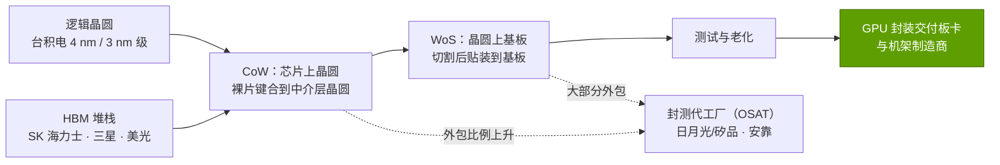

# CoWoS 与先进封装

> [!NOTE]
> 本页为英文原文的简体中文参考译文，仅供参考；如有出入，以[英文原文](../../../layers/03-memory-packaging-supply-chain/cowos-and-advanced-packaging.md "English original")为准。

第 03 层 · 内存、封装与供应链 · 约 9 分钟阅读 · 最近核实：2026-11-05

## ⚡ 要点速览

- **AI GPU 是一个封装，而不是一颗芯片。** 任何裸片（die）都无法超过约 858 mm² 的[光罩尺寸极限（reticle limit）](../../../glossary.md#reticle-limit)，而[高带宽内存（HBM）](../../../glossary.md#hbm)必须放置在距 GPU 仅数毫米之处 [[S380]](../../../sources/bibliography.md#s380)。台积电（TSMC）的 [CoWoS](../../../glossary.md#cowos) 将裸片与 HBM 并排放置在硅[中介层（interposer）](../../../glossary.md#interposer)或桥接之上，即 [2.5D 封装](../../../glossary.md#advanced-packaging)。
- **三种类型。** [CoWoS-S](../../../glossary.md#cowos-s) 采用单片硅中介层，最大约为光罩尺寸的 3.3 倍（H100）。[CoWoS-L](../../../glossary.md#cowos-l) 在有机层中嵌入小型硅桥，目标为 2026 年约 5.5 倍、2027 年约 9.5 倍（B200 起采用）。[CoWoS-R](../../../glossary.md#cowos-r) 不用硅，以更便宜的布线替代 [[S380]](../../../sources/bibliography.md#s380)[[S358]](../../../sources/bibliography.md#s358)。
- **封装尺寸的增长快于产能。** 一片 300 mm 晶圆在 2 倍光罩尺寸时可容纳约 28 个中介层，而在 9.5 倍时仅约 4 个（估计）[[S3000]](../../../sources/bibliography.md#s3000)。从 H100 级到 Rubin 级，每片晶圆的 GPU 数大致减半。
- 🟡 **产能在增长，但仍然短缺。** 各方估计从每月约 15k 片（2023 年底）增至约 115–130k 片（2026 年底）、约 260k 片（2028 年底）[[S379]](../../../sources/bibliography.md#s379)[[S3002]](../../../sources/bibliography.md#s3002)，另有报道称 2026 年缺口约 20% [[S3003]](../../../sources/bibliography.md#s3003)。
- 🟡 **英伟达（NVIDIA）拥有最大份额的产能配额：** 约占 2026 年预订量的 60%（约 1.0M 片晶圆中的约 595k 片，摩根士丹利数据，经媒体转述）[[S379]](../../../sources/bibliography.md#s379)，后续报道则称约 800–850k 片 [[S3003]](../../../sources/bibliography.md#s3003)。

## 为什么 AI 加速器需要 2.5D 封装

**类比。** 主板就像城市街道网格；中介层则是一块布线精细约 100 倍的硅电路板，因此数万根短导线可以容纳在几平方厘米之内。有两股力量把每一款旗舰加速器推向这种封装：一是光罩尺寸极限 —— 英伟达如今以 10 TB/s 链路连接两颗光罩尺寸的裸片来突破它 [[S35014]](../../../sources/bibliography.md#s35014)（见[第 02 层](../../../layers/02-gpu-silicon/index.md)）；二是 HBM 的宽总线（见 [HBM 详解](hbm-explained.md)）。

> [!TIP]
> **算例 —— 数一数 Rubin 封装上的导线。** 8 个 [HBM4](../../../glossary.md#hbm4) 堆栈 × 2,048 根数据线 = 16,384 根内存数据线，这还不包括时钟、供电与裸片间互连 [[S369]](../../../sources/bibliography.md#s369)[[S360]](../../../sources/bibliography.md#s360)。一个 12 通道 DDR5 服务器插槽只有 768 根 [[S179]](../../../sources/bibliography.md#s179)。**商业解读：** 限制 GPU 产量的不只是晶圆产能，还有封装产能；英伟达、AMD、谷歌（Google）与 AWS 的旗舰产品都在同样的 CoWoS 产线前排队。

## CoWoS-S、CoWoS-L 与 CoWoS-R 对比

| 类型 | 承载布线的介质 | 最大尺寸（台积电） | 取舍 | 英伟达采用情况 |
|---|---|---|---|---|
| **CoWoS-S** | 单片式硅中介层 | 约 3.3 倍光罩尺寸 [[S380]](../../../sources/bibliography.md#s380) | 布线最精细，但尺寸受限且成本高 | A100、H100、H200 [[S380]](../../../sources/bibliography.md#s380) |
| **CoWoS-L** | 嵌入[局部硅互连桥（local silicon bridge）](../../../glossary.md#local-silicon-interconnect)的有机层 | 约 5.5 倍（2026 年）、约 9.5 倍（2027 年）[[S380]](../../../sources/bibliography.md#s380) | 可做得更大；组装难度与翘曲问题更突出 | B200、B300、Rubin [[S358]](../../../sources/bibliography.md#s358)[[S35014]](../../../sources/bibliography.md#s35014) |
| **CoWoS-R** | 仅有机[重布线层（RDL）](../../../glossary.md#redistribution-layer) | — | 更便宜；布线更粗 | 未用于英伟达旗舰产品 |

🟡 分析师估计 CoWoS-S 封装成本约为每颗 H100 $750，CoWoS-L 约为每颗 B200 $1,100–1,500（估计）[[S35040]](../../../sources/bibliography.md#s35040)[[S35020]](../../../sources/bibliography.md#s35020)，与约 $2,900 的 HBM 成本相比很小 [[S35020]](../../../sources/bibliography.md#s35020)。约束在于能否拿到产能，而非价格。

🔧 技术细节：为什么用 CoWoS-L，以及为什么翘曲很关键

要用硅中介层突破单个光罩尺寸，就必须把多次曝光拼接成一块大而易碎的硅板，因此 CoWoS-L 只在裸片边缘下方保留硅 [[S380]](../../../sources/bibliography.md#s380)。代价是机械层面的：不同材料受热膨胀程度不同，因此 5–10 倍光罩尺寸的封装会发生翘曲，这也是台积电在面板级封装上指出的主要风险 [[S3004]](../../../sources/bibliography.md#s3004)。有报道称 Rubin Ultra 需要返工重新设计，说明这一极限真实存在 [[S509]](../../../sources/bibliography.md#s509)。

## 封装尺寸增长与每片晶圆 GPU 数

每个 GPU 封装使用一个中介层，因此中介层越大，**每片晶圆的封装数**越少。

> [!TIP]
> **算例 —— 从每月晶圆数到每年 GPU 数。** 每年 GPU 数 ≈ 每月晶圆数 × 12 × 每片晶圆封装数 × 良率。🔴 假设每片约 16 个封装（B300 级）或约 12 个（Rubin 级），良率 90% [[S3000]](../../../sources/bibliography.md#s3000)：
>
> - **每月 10k 片**B300 级晶圆 ≈ 10,000 × 12 × 16 × 0.9 ≈ **每年 1.7M 颗 GPU**。
> - **英伟达 2026 年约 595k 片晶圆** [[S379]](../../../sources/bibliography.md#s379) ≈ 6.4–8.6M 个封装；若按约 800–850k 片 [[S3003]](../../../sources/bibliography.md#s3003)，则 ≈ 8.6–12.2M 个。
> - **交叉验证：** Q2 FY2027 约 $71.5B 的数据中心计算营收（估计）[[S405]](../../../sources/bibliography.md#s405)[[S408]](../../../sources/bibliography.md#s408)，按每颗 GPU $30–40k 计 [[S35026]](../../../sources/bibliography.md#s35026)，相当于每年约 7–10M 颗 GPU。
>
> **商业解读：** 一片晶圆决定了约 $0.5–0.6M 的 GPU 营收，而其 CoWoS-L 封装成本仅约 $18–24k [[S35040]](../../../sources/bibliography.md#s35040)[[S35020]](../../../sources/bibliography.md#s35020)，约 3–4%。台积电对其掌控的瓶颈收费甚低，因此真正的“硬通货”是产能配额，而非价格。

## 台积电产能与英伟达的配额份额

此处的 **[Q2 · 关键指标]**：每月 CoWoS 晶圆数、各厂商份额以及每片晶圆封装数，均为估计值。

| 年末 | CoWoS 产能，k 片晶圆/月（估计） | 来源 |
|---|---|---|
| 2023 | ~13–15 | [[S379]](../../../sources/bibliography.md#s379) |
| 2024 | ~32–40；台积电称产能翻倍以上 | [[S379]](../../../sources/bibliography.md#s379)[[S378]](../../../sources/bibliography.md#s378) |
| 2025 | ~65–80 | [[S90039]](../../../sources/bibliography.md#s90039) |
| 2026 | ~105–130 | [[S90039]](../../../sources/bibliography.md#s90039)[[S3002]](../../../sources/bibliography.md#s3002) |
| 2027 | 🟡 ~170（凯基证券） | [[S3001]](../../../sources/bibliography.md#s3001) |
| 2028 | 🟡 ~260（《经济日报》） | [[S3002]](../../../sources/bibliography.md#s3002) |

🟡 摩根士丹利（经媒体转述）将 2026 年约 1.0M 片晶圆拆分为：英伟达约 595k、博通（Broadcom）约 150k、AMD 约 105k、其他约 150k [[S379]](../../../sources/bibliography.md#s379)；后续报道称英伟达预订了约 800–850k 片 [[S3003]](../../../sources/bibliography.md#s3003)，凯基证券（KGI）则预计 2027 年英伟达与博通各增加约 100k 片 [[S3001]](../../../sources/bibliography.md#s3001)。

> [!WARNING]
> **误区与事实：** “CoWoS 产能翻倍，GPU 供应就翻倍。”但封装也在变大：每片晶圆从约 16 个（B300 级）降至约 12 个（Rubin），再到约 4–6 个（四裸片 Rubin Ultra）（估计）[[S3000]](../../../sources/bibliography.md#s3000)。

## 替代方案：EMIB、封测代工厂与面板级封装

| 方案 | 是什么 | 规模与时间 | 带来的改变 |
|---|---|---|---|
| **英特尔（Intel）[EMIB](../../../glossary.md#emib)-T、[Foveros](../../../glossary.md#foveros)** | 在基板中嵌入桥接；Foveros 进行 3D 裸片堆叠 | 🟡 2027 年约每月 15–20k 片 CoWoS 等效晶圆，2028 年约 40–45k（估计）[[S3002]](../../../sources/bibliography.md#s3002) | 一条非台积电的路线，包括在美国本土 |
| **[封测代工厂（OSAT）](../../../glossary.md#osat)**（日月光/矽品（ASE/SPIL）、安靠（Amkor）） | 承接更多 CoWoS 工序；建设类 CoWoS 产线 | 🟡 台积电正外包更多芯片上晶圆（CoW）工序 [[S3003]](../../../sources/bibliography.md#s3003)；到 2028 年底约每月 110k 片等效晶圆 [[S3002]](../../../sources/bibliography.md#s3002) | 增加产能；最先进的工艺流程仍需经台积电认证 |
| **[面板级封装](../../../glossary.md#panel-level-packaging) / [CoPoS](../../../glossary.md#copos)** | 以方形面板取代圆形晶圆 | 🟡 2026 年中试产；约 2028 年下半年至 2029 年量产 [[S3004]](../../../sources/bibliography.md#s3004)[[S3005]](../../../sources/bibliography.md#s3005) | 对超大封装而言边缘浪费更少；存在翘曲风险 |

> [!TIP]
> **算例 —— 为什么要用面板。** 🔴 在 9.5 倍光罩尺寸下，4 个约 8,150 mm² 的中介层占用约 32,600 mm²，而晶圆可用面积约 67,900 mm²，利用率不到一半 [[S3000]](../../../sources/bibliography.md#s3000)[[S380]](../../../sources/bibliography.md#s380)。矩形在方形面板上拼排时浪费要少得多。**商业解读：** CoPoS 对 2027–28 年的超大封装最为关键，而这恰好是它预计投产的时间。

## 🎯 企业发展视角

1. **这个瓶颈拥有成本低，掌控价值高。** CoWoS 仅约占其所决定营收的 3–4%（估计）[[S3000]](../../../sources/bibliography.md#s3000)，这正是英伟达提前数年锁定配额的原因。
2. **第二供应来源对在台积电排队中位于英伟达之后的 [ASIC](../../../glossary.md#asic) 项目最为重要。** 哪些[超大规模云厂商](../../../glossary.md#hyperscaler)或商用芯片项目会率先承诺采用 EMIB-T、OSAT 产线或 CoPoS [[S3002]](../../../sources/bibliography.md#s3002)[[S3003]](../../../sources/bibliography.md#s3003)[[S3004]](../../../sources/bibliography.md#s3004)？
3. **封装尺寸是路线图风险。** 有报道称 Rubin Ultra 需要返工重新设计 [[S509]](../../../sources/bibliography.md#s509)，表明封装可能迫使产品重新规划。那些假定 2027 年采用 5–9 倍光罩尺寸封装的竞争对手路线图，风险敞口有多大？乘上这轮建设浪潮的供应商见[价值链](value-chain-and-corp-dev.md)。

## 📚 来源（Sources）

<!-- Auto-generated from the [S…] citations on this page by `make build`. Edit sources/registry/*.csv, not this list. -->

- [**S179**](../../../sources/bibliography.md#s179) Intel, *Intel Xeon 6 processors with P-cores (Granite Rapids, 6900P/6700P)*, 2024-09-24. [Link](https://www.intel.com/content/www/us/en/products/details/processors/xeon/xeon6-p-cores.html)
- [**S358**](../../../sources/bibliography.md#s358) glennklockwood.com (Glenn K. Lockwood), *NVIDIA B200 processor notes*, 2025. [Link](https://glennklockwood.com/garden/processors/B200)
- [**S360**](../../../sources/bibliography.md#s360) glennklockwood.com (Glenn K. Lockwood), *NVIDIA Rubin (R200) processor notes*, 2026. [Link](https://glennklockwood.com/garden/processors/r200)
- [**S369**](../../../sources/bibliography.md#s369) JEDEC, *JESD270-4: High Bandwidth Memory (HBM4) standard*, 2025-04-16. [Link](https://www.jedec.org/standards-documents/docs/jesd270-4)
- [**S378**](../../../sources/bibliography.md#s378) TSMC Investor Relations, *TSMC quarterly earnings conference calls (CoWoS capacity commentary)*, 2025. [Link](https://investor.tsmc.com/english/quarterly-results)
- [**S379**](../../../sources/bibliography.md#s379) TrendForce News, *TSMC CoWoS capacity and customer allocation estimates (TrendForce / Morgan Stanley, as reported)*, 2025. [Link](https://www.trendforce.com/news/)
- [**S380**](../../../sources/bibliography.md#s380) TSMC, *TSMC 3DFabric: CoWoS-S, CoWoS-R and CoWoS-L technology overview and roadmap*, 2025. [Link](https://3dfabric.tsmc.com/english/dedicatedFoundry/technology/cowos.htm)
- [**S405**](../../../sources/bibliography.md#s405) NVIDIA Corporation via SEC EDGAR, *NVIDIA Announces Financial Results for Second Quarter Fiscal 2027 (Form 8-K exhibit 99.1)*, 2026-08-26. [Link](https://www.sec.gov/Archives/edgar/data/0001045810/000104581026000073/q2fy27pr.htm)
- [**S408**](../../../sources/bibliography.md#s408) NVIDIA Corporation, *NVIDIA Corp. (NVDA) Q2 Fiscal 2027 earnings call transcript (26 August 2026)*, 2026-08-26. [Link](https://s201.q4cdn.com/141608511/files/content_files/TRANSCRIPT_-NVIDIA-Corp-NVDA-US-Q2-2027-Earnings-Call-26-August-2026-5_00-PM-ET.pdf)
- [**S509**](../../../sources/bibliography.md#s509) TrendForce, *NVIDIA Rubin Ultra four-die single-package design not adopted amid advanced-packaging constraints*, 2026-04-01. [Link](https://www.trendforce.com/news/?p=55442)
- [**S3000**](../../../sources/bibliography.md#s3000) nvidia_deep_dive_claude repository, *Repo analysis: layer 03 memory, packaging and supply-chain models (decode ceilings, HBM sizing, CoWoS packages per wafer)*, 2026-11-05. [Link](https://github.com/FrankHuang94/nvidia_deep_dive_claude/blob/main/layers/03-memory-packaging-supply-chain/index.md)
- [**S3001**](../../../sources/bibliography.md#s3001) KGI Securities, *TSMC (2330 TT) research note: CoWoS expansion forecast raised*, 2026-03-09. [Link](https://www.kgi.com.hk/en/-/media/files/kgishk/research-reports/tw-reports/tsmc_2330-tt_09032026e.pdf)
- [**S3002**](../../../sources/bibliography.md#s3002) TrendForce, *TSMC reportedly targets 22% 2nm, 16% 3nm capacity boost by mid-2027; CoWoS to double by 2028*, 2026-09-14. [Link](https://www.trendforce.com/news/2026/09/14/news-tsmc-reportedly-targets-22-2nm-16-3nm-capacity-boost-by-mid-2027-cowos-to-double-by-2028/)
- [**S3003**](../../../sources/bibliography.md#s3003) TrendForce, *TSMC reportedly expands outsourcing of key CoWoS front-end step to OSATs amid rising NVIDIA and ASIC demand*, 2026-08-05. [Link](https://www.trendforce.com/news/2026/08/05/news-tsmc-reportedly-expands-outsourcing-of-key-cowos-front-end-step-to-osats-amid-rising-nvidia-asic-demand/)
- [**S3004**](../../../sources/bibliography.md#s3004) TrendForce, *TSMC advances panel-level packaging: CoPoS pilot line reportedly set for June completion; 2028-29 ramp eyed*, 2026-04-13. [Link](https://www.trendforce.com/news/2026/04/13/news-tsmc-advances-panel-level-packaging-copos-pilot-line-reportedly-set-for-june-completion-2028-29-ramp-eyed/)
- [**S3005**](../../../sources/bibliography.md#s3005) TrendForce, *TSMC reportedly eyes two AUO fabs worth TWD 30B for FOPLP and CoPoS*, 2026-08-10. [Link](https://www.trendforce.com/news/2026/08/10/news-tsmc-reportedly-eyes-two-auo-fabs-worth-twd-30b-for-foplp-and-copos-longtan-could-add-1-4nm/)
- [**S35014**](../../../sources/bibliography.md#s35014) NVIDIA, *NVIDIA Blackwell Architecture*, 2024-03. [Link](https://www.nvidia.com/en-us/data-center/technologies/blackwell-architecture/)
- [**S35020**](../../../sources/bibliography.md#s35020) Epoch AI, *NVIDIA's B200 costs around $6,400 to produce, with memory accounting for half*, 2025-12. [Link](https://epoch.ai/data-insights/b200-cost-breakdown)
- [**S35026**](../../../sources/bibliography.md#s35026) Tom's Hardware, *Nvidia's Jensen Huang says Blackwell GPU to cost $30,000-$40,000, later clarifies that pricing will vary as they won't sell just the chip*, 2024-03-19. [Link](https://www.tomshardware.com/pc-components/gpus/nvidias-jensen-huang-says-blackwell-gpu-to-cost-dollar30000-dollar40000-later-clarifies-that-pricing-will-vary-as-they-wont-sell-just-the-chip)
- [**S35040**](../../../sources/bibliography.md#s35040) Silicon Analysts, *CoWoS packaging cost: chiplet vs monolithic (2026)*, 2026. [Link](https://siliconanalysts.com/analysis/cowos-packaging-cost-chiplet-vs-monolithic-2026)
- [**S90039**](../../../sources/bibliography.md#s90039) TrendForce, *Samsung, SK hynix reportedly tapped as NVIDIA Rubin HBM4 suppliers; shipments could start in March*, 2026-03-09. [Link](https://www.trendforce.com/news/2026/03/09/news-samsung-sk%E2%80%AFhynix-reportedly-tapped-as-nvidia-rubin-hbm4-suppliers-shipments-could-start-in-march/)
