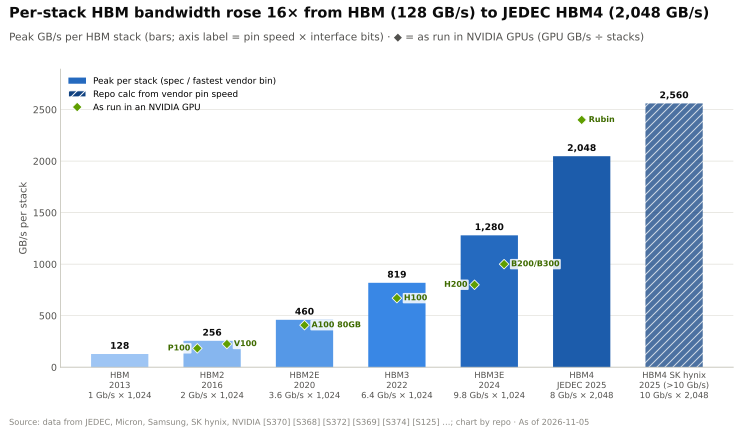
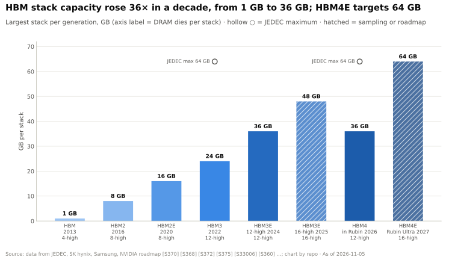
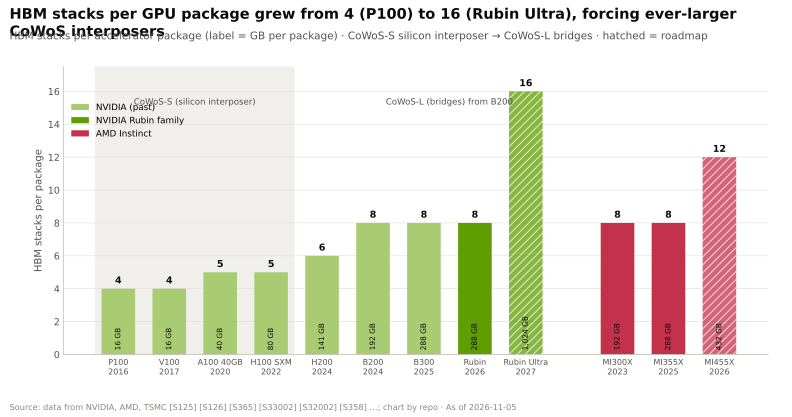

# HBM 详解

> [!NOTE]
> 本页为英文原文的简体中文参考译文，仅供参考；如有出入，以[英文原文](../../../layers/03-memory-packaging-supply-chain/hbm-explained.md "English original")为准。

第 03 层 · 内存、封装与供应链 · 约 9 分钟阅读 · 最近核实：2026-11-05

## ⚡ 要点速览

- **[高带宽内存（HBM）](../../../glossary.md#hbm)是在 GPU 旁边盖起的一座 DRAM 摩天楼。** 8–16 片减薄的 DRAM 裸片叠放在一片基础裸片（base die）之上，通过[硅通孔（TSV）](../../../glossary.md#through-silicon-via)垂直互连，并经由 1,024 根（[HBM3E](../../../glossary.md#hbm3e)）或 2,048 根（[HBM4](../../../glossary.md#hbm4)）数据线与 GPU 通信 [[S368]](../../../sources/bibliography.md#s368)[[S369]](../../../sources/bibliography.md#s369)。
- **[Q3 · 代际进步]** 单堆栈峰值带宽提升 16 倍，从 128 GB/s（2013 年）增至 2,048 GB/s（JEDEC HBM4）[[S370]](../../../sources/bibliography.md#s370)[[S369]](../../../sources/bibliography.md#s369)。就单颗 GPU 而言，从 P100 到 Rubin，带宽由 0.73 增至 19.2 TB/s（26 倍），容量由 16 增至 288 GB（18 倍），Rubin Ultra 规划搭载 16 个堆栈 [[S125]](../../../sources/bibliography.md#s125)[[S33007]](../../../sources/bibliography.md#s33007)[[S35041]](../../../sources/bibliography.md#s35041)。
- **HBM 之所以昂贵，是因为其制造过程损耗大。** 每 GB 的 HBM3E 需要约 3 倍于 DDR5 的晶圆面积（美光数据）[[S3006]](../../../sources/bibliography.md#s3006)，且一片坏裸片就会让整个堆栈报废。HBM 约占 B200 制造成本的 45%（估计）[[S35020]](../../../sources/bibliography.md#s35020)。
- 🟡 **HBM4 将基础裸片转向逻辑工艺，且常由台积电（TSMC）制造** [[S3011]](../../../sources/bibliography.md#s3011)[[S3007]](../../../sources/bibliography.md#s3007)，使部分价值池转移至晶圆代工厂和 GPU 设计方。
- 🟡 **三家供应商，一家领先。** 预计 SK 海力士将供应英伟达（NVIDIA）2026 年一半以上的 HBM；三星也已进入 Rubin HBM4 供应商名单 [[S90039]](../../../sources/bibliography.md#s90039)[[S90041]](../../../sources/bibliography.md#s90041)。

## HBM 在物理上是什么

**类比。** 服务器 DDR5 像郊区：芯片分散在各条 DIMM 上，每个通道通过一条 64 位的“道路”连到 CPU。HBM 则像隔壁的一座摩天楼：裸片叠起十几层，每层都贯穿着“电梯井”（TSV），并通过一座 1,024 或 2,048 车道的“桥”连到仅一两毫米之外的 GPU。

- **核心裸片（core die）** 存储比特。一片 24 Gb 裸片可存 3 GB，因此 12 层堆栈容量为 36 GB；JEDEC HBM4 允许由 32 Gb 裸片组成的 16 层堆栈，即 64 GB [[S369]](../../../sources/bibliography.md#s369)。[堆叠层数（stack height）](../../../glossary.md#stack-height)决定容量。
- **TSV 与[微凸块（micro-bump）](../../../glossary.md#microbump)** 在各层之间传输数据与电力。[混合键合（hybrid bonding）](../../../glossary.md#hybrid-bonding)是一种无凸块的铜对铜连接方式，正被探索用于 16 层堆栈。
- **[基础裸片（base die）](../../../glossary.md#hbm-base-die)** 承载接口与测试逻辑。[中介层（interposer）](../../../glossary.md#interposer)把它的数千根导线连到 GPU，这也是 HBM 必须与 GPU 共同封装的原因（见 [CoWoS](cowos-and-advanced-packaging.md)）。

单堆栈带宽 = [引脚速率（pin speed）](../../../glossary.md#pin-speed) × 总线位宽 ÷ 8。

> [!TIP]
> **算例 —— 一个 HBM4 堆栈对比 DDR5 通道。** 一条 DDR5-6400 通道的传输速率为 6.4 Gb/s × 64 ÷ 8 = 51.2 GB/s [[S179]](../../../sources/bibliography.md#s179)。每个 Rubin 堆栈的速率为 19.2 TB/s ÷ 8 = 2,400 GB/s，约相当于 47 条 DDR5 通道，意味着 2,048 根数据线上每引脚约 9.4 Gb/s（发布时 22 TB/s 的规格对应约 10.7）[[S33006]](../../../sources/bibliography.md#s33006)[[S33007]](../../../sources/bibliography.md#s33007)[[S90006]](../../../sources/bibliography.md#s90006)。**商业解读：** HBM4 的提升来自更宽的总线，而非更快的引脚；🔴 据一位分析师称，英伟达对 10–11 Gb/s 速度档位的追求 [[S90040]](../../../sources/bibliography.md#s90040) 受制于供应商的量产能力 [[S90006]](../../../sources/bibliography.md#s90006)。

## 代际演进：HBM2E → HBM4E

| 代际 | 量产 | 引脚速率 | 总线位宽 | 单堆栈峰值 | 最大堆栈容量 | 英伟达产品 |
|---|---|---|---|---|---|---|
| HBM2E | 2020 | ~3.6 Gb/s | 1,024 | ~460 GB/s | 16 GB | A100 80GB [[S370]](../../../sources/bibliography.md#s370)[[S365]](../../../sources/bibliography.md#s365) |
| HBM3 | 2022 | 6.4 Gb/s | 1,024 | ~819 GB/s | 24 GB | H100 [[S368]](../../../sources/bibliography.md#s368) |
| HBM3E | 2024 | 9.2–9.8 Gb/s | 1,024 | ~1.2–1.28 TB/s | 36 GB（48 GB 已送样） | H200、B200、B300 [[S371]](../../../sources/bibliography.md#s371)[[S372]](../../../sources/bibliography.md#s372)[[S375]](../../../sources/bibliography.md#s375) |
| HBM4 | 2026 | 8（JEDEC）至 >10；Rubin 中约 9.4 | 2,048 | 2.0–2.56 TB/s | Rubin 中为 36 GB；最大 64 GB | Rubin [[S369]](../../../sources/bibliography.md#s369)[[S374]](../../../sources/bibliography.md#s374)[[S33007]](../../../sources/bibliography.md#s33007) |
| HBM4E | 🟡 2027 | 目标最高约 12.8 GT/s | 2,048 | 未公布 | 规划约 64 GB | Rubin Ultra [[S3009]](../../../sources/bibliography.md#s3009)[[S35041]](../../../sources/bibliography.md#s35041) |

GPU 层面的提升是引脚速率、总线位宽与堆栈数量三者相乘的结果：P100 为 4 个堆栈，B200 与 Rubin 为 8 个，规划中为 16 个；AMD 的 MI455X 使用 12 个 [[S35041]](../../../sources/bibliography.md#s35041)[[S144]](../../../sources/bibliography.md#s144)[[S361]](../../../sources/bibliography.md#s361)。

## 为什么 HBM 每 GB 成本是 DDR 的数倍，以及为什么良率难以提升

1. **每比特耗用硅片：** 每 GB 约 3 倍于 DDR5 的晶圆面积，美光称这一差距并未缩小 [[S3006]](../../../sources/bibliography.md#s3006)。
2. **良率连乘效应：** 一片坏裸片或一处坏键合就会让整个堆栈报废；[已知良好裸片（known-good-die）](../../../glossary.md#known-good-die)测试能以一定成本限制损失。
3. **封装：** 每个堆栈随后还需要稀缺的 [CoWoS](../../../glossary.md#cowos) 产能。

> [!TIP]
> **算例 —— 堆栈良率与 HBM 成本。** 🔴 若每道“裸片 + 键合”工序良率为 99%，12 层堆栈良率约为 89%，16 层约为 85%。按 HBM3E 约 $15/GB 计算，B200 的 192 GB 约值 $2,900，约占其约 $6,400 制造成本的 45%（估计，Epoch AI）[[S35020]](../../../sources/bibliography.md#s35020)；🟡 若按伯恩斯坦（Bernstein）对 2027 年 HBM4 约 $53/GB 的预测 [[S333]](../../../sources/bibliography.md#s333)，Rubin 的 288 GB 将超过 $15,000。**商业解读：** 如今决定 GPU 最大一项成本的是内存厂商。

> [!WARNING]
> **误区与事实：** “HBM 每年都会变便宜。”2025–26 年，DDR5 的盈利能力与 HBM 争夺晶圆 [[S3016]](../../../sources/bibliography.md#s3016)，内存在 Rubin 机架成本中的占比大约增至原来的三倍（估计）[[S330]](../../../sources/bibliography.md#s330)[[S332]](../../../sources/bibliography.md#s332)；🟡 美光的目标是到 2026 年底 HBM 晶圆产能达到每月约 100k 片 [[S3017]](../../../sources/bibliography.md#s3017)。

## HBM4 的定制基础裸片：逻辑电路进入内存堆栈

为驱动 2,048 根数据线，HBM4 的基础裸片从 DRAM 工艺转向逻辑工艺 [[S3009]](../../../sources/bibliography.md#s3009)。🟡 据报道，SK 海力士采用台积电 12 nm；三星则采用自家 4 nm [[S3011]](../../../sources/bibliography.md#s3011)。美光表示，自 2027 年起将由台积电制造其 [HBM4E](../../../glossary.md#hbm4e) 基础裸片，并为愿意支付溢价的客户提供定制设计 [[S3007]](../../../sources/bibliography.md#s3007)。台积电在 N3P 上提供定制 HBM4E 基础裸片 [[S3008]](../../../sources/bibliography.md#s3008)。

> [!TIP]
> **算例 —— 宽而慢胜过窄而快。** 即使只有 8 Gb/s，JEDEC HBM4 也能提供 8 × 2,048 ÷ 8 = 2,048 GB/s；最快的 HBM3E 为 9.8 Gb/s、1,024 根数据线，约 1,280 GB/s [[S369]](../../../sources/bibliography.md#s369)[[S372]](../../../sources/bibliography.md#s372)。即以低 18% 的引脚速率换来 +60% 的带宽，同时缓解了功耗与信号完整性压力。**商业解读：** 如今决定速度的是基础裸片，谁来设计它，谁就获得议价筹码。

**对内存厂商意味着什么：** 由台积电制造基础裸片，会把每个堆栈的一部分价值转移给晶圆代工厂（三星以自有代工厂作为反向卖点）[[S3011]](../../../sources/bibliography.md#s3011)；定制基础裸片会把堆栈绑定到某一买家的 GPU 上，拉长验证周期并利好在位者；GPU 厂商则获得了把控制器逻辑移入堆栈的杠杆。

🔧 技术细节：通道、键合与高度限制

- **通道。** HBM3 将 1,024 位划分为 16 个独立通道；HBM4 为 32 个 [[S368]](../../../sources/bibliography.md#s368)[[S369]](../../../sources/bibliography.md#s369)。通道越多，同时在途的请求越多，有利于分散的 KV 缓存读取。
- **高度。** 堆栈必须符合固定的封装高度，因此层数更多的堆栈需要更薄、更脆弱的裸片，这也是 16 层落后于 12 层的原因之一 [[S375]](../../../sources/bibliography.md#s375)[[S369]](../../../sources/bibliography.md#s369)。

## 🎯 企业发展视角

1. **基础裸片是一个新的价值池。** 在台积电制造的定制 HBM4E 逻辑 [[S3007]](../../../sources/bibliography.md#s3007)[[S3008]](../../../sources/bibliography.md#s3008) 需要 PHY、控制器与接口 IP。哪些 IP 与设计服务公司会受益？
2. **供应商集中是一把双刃剑。** 🟡 SK 海力士供应英伟达 2026 年 HBM 的 50% 以上 [[S90041]](../../../sources/bibliography.md#s90041)，这既意味着深度合作伙伴关系，也意味着单一的定价权来源。依赖第二、第三家供应商的竞争对手暴露程度如何？
3. **晶圆分配的经济账决定所有人的成本。** 如果 DDR5 利润率保持高位 [[S3016]](../../../sources/bibliography.md#s3016)，HBM 供应将增长缓慢，有利于每 token 所需 HBM 更少的设计（见[内存分层](memory-tiering-and-rubin-cpx.md)）。

## 📚 来源（Sources）

<!-- Auto-generated from the [S…] citations on this page by `make build`. Edit sources/registry/*.csv, not this list. -->

- [**S125**](../../../sources/bibliography.md#s125) NVIDIA, *NVIDIA Tesla P100 (Pascal GP100) Architecture Whitepaper*, 2016-04. [Link](https://images.nvidia.com/content/pdf/tesla/whitepaper/pascal-architecture-whitepaper.pdf)
- [**S144**](../../../sources/bibliography.md#s144) AMD Newsroom, *AMD Unveils Vision for an Open AI Ecosystem, Detailing New Silicon, Software and Systems at Advancing AI 2025*, 2025-06-12. [Link](https://www.amd.com/en/newsroom/press-releases/2025-6-12-amd-unveils-vision-for-an-open-ai-ecosystem-detai.html)
- [**S179**](../../../sources/bibliography.md#s179) Intel, *Intel Xeon 6 processors with P-cores (Granite Rapids, 6900P/6700P)*, 2024-09-24. [Link](https://www.intel.com/content/www/us/en/products/details/processors/xeon/xeon6-p-cores.html)
- [**S330**](../../../sources/bibliography.md#s330) PC Gamer, *A single Nvidia Vera Rubin rack is estimated to cost $7,803,148 with over $2 million of that figure spent on memory alone*, 2026-05. [Link](https://pcgamer.com/hardware/a-single-nvidia-vera-rubin-rack-is-estimated-to-cost-usd7-803-148-with-over-usd2-million-of-that-figure-spent-on-memory-alone)
- [**S332**](../../../sources/bibliography.md#s332) Tiger Brokers (iTiger), *Morgan Stanley's BOM analysis of NVIDIA's Rubin: GPU share declines; PCB, MLCC and ABF substrate values soar*, 2026-05-20. [Link](https://www.itiger.com/news/1188068712)
- [**S333**](../../../sources/bibliography.md#s333) Wccftech, *Bernstein warns NVIDIA's Vera Rubin racks will hit $9.1 million as HBM4 prices triple to $53 per gigabyte*, 2026-07. [Link](https://wccftech.com/bernstein-warns-nvidias-vera-rubin-racks-will-hit-9-1-million-as-hbm4-prices-triple-to-53-per-gigabyte/)
- [**S361**](../../../sources/bibliography.md#s361) Digital Citizen, *AMD Instinct MI455X brings 432GB of HBM4 and 40 PFLOPs of AI compute to Helios*, 2026-01. [Link](https://www.digitalcitizen.life/amd-instinct-mi455x-brings-432gb-of-hbm4-and-40-pflops-of-ai-compute-to-helios/)
- [**S365**](../../../sources/bibliography.md#s365) NVIDIA, *NVIDIA A100 Tensor Core GPU architecture whitepaper*, 2020. [Link](https://images.nvidia.com/aem-dam/en-zz/Solutions/data-center/nvidia-ampere-architecture-whitepaper.pdf)
- [**S368**](../../../sources/bibliography.md#s368) JEDEC, *JEDEC publishes HBM3 update to High Bandwidth Memory (HBM) standard (JESD238)*, 2022-01-27. [Link](https://www.jedec.org/news/pressreleases/jedec-publishes-hbm3-update-high-bandwidth-memory-hbm-standard)
- [**S369**](../../../sources/bibliography.md#s369) JEDEC, *JESD270-4: High Bandwidth Memory (HBM4) standard*, 2025-04-16. [Link](https://www.jedec.org/standards-documents/docs/jesd270-4)
- [**S370**](../../../sources/bibliography.md#s370) JEDEC, *JESD235 High Bandwidth Memory (HBM / HBM2 / HBM2E) DRAM standard family*, 2013-10. [Link](https://www.jedec.org/standards-documents/docs/jesd235a)
- [**S371**](../../../sources/bibliography.md#s371) Micron Technology, *Micron commences volume production of industry-leading HBM3E solution*, 2024-02-26. [Link](https://investors.micron.com/news-releases/news-release-details/micron-commences-volume-production-industry-leading-hbm3e-solution)
- [**S372**](../../../sources/bibliography.md#s372) Samsung Electronics, *Samsung develops industry-first 36GB HBM3E 12H DRAM*, 2024-02-27. [Link](https://news.samsung.com/global/samsung-develops-industry-first-36gb-hbm3e-12h-dram)
- [**S374**](../../../sources/bibliography.md#s374) SK hynix Newsroom, *SK hynix completes world-first HBM4 development and readies mass production*, 2025-09-12. [Link](https://news.skhynix.com/sk-hynix-completes-worlds-first-hbm4-development-and-readies-mass-production/)
- [**S375**](../../../sources/bibliography.md#s375) SK hynix Newsroom, *SK hynix newsroom: 16-high 48GB HBM3E unveiled at SK AI Summit 2024*, 2024-11-04. [Link](https://news.skhynix.com/)
- [**S3006**](../../../sources/bibliography.md#s3006) Tom's Hardware, *Micron says the silicon gap between HBM and DDR5 is widening with every generation*, 2026-08. [Link](https://www.tomshardware.com/tech-industry/semiconductors/micron-says-the-silicon-gap-between-hbm-and-ddr5-is-widening-with-every-generation)
- [**S3007**](../../../sources/bibliography.md#s3007) Tom's Hardware, *Micron teams up with TSMC to deliver HBM4E, targeted for 2027*, 2025-09. [Link](https://www.tomshardware.com/micron-hands-tsmc-the-keys-to-hbm4e)
- [**S3008**](../../../sources/bibliography.md#s3008) TrendForce, *TSMC unveils custom C-HBM4E details: N3P logic dies reportedly target 2x efficiency gain*, 2025-12-01. [Link](https://www.trendforce.com/news/2025/12/01/news-tsmc-unveils-custom-c-hbm4e-details-n3p-logic-dies-reportedly-target-2x-efficiency-gain/)
- [**S3009**](../../../sources/bibliography.md#s3009) Tom's Hardware, *HBM undergoes major architectural shakeup as TSMC and GUC detail HBM4, HBM4E and C-HBM4E 3nm base dies, up to 12.8 GT/s by 2027*, 2025. [Link](https://www.tomshardware.com/pc-components/dram/hbm-undergoes-major-architectural-shakeup-as-tsmc-and-guc-detail-hbm4-hbm4e-and-c-hbm4e-3nm-base-dies-to-enable-2-5x-performance-boost-with-speeds-of-up-to-12-8gt-s-by-2027)
- [**S3011**](../../../sources/bibliography.md#s3011) TrendForce, *Samsung's custom HBM4E design reportedly aimed for mid-2026, parallels SK hynix and Micron*, 2026-01-23. [Link](https://www.trendforce.com/news/2026/01/23/news-samsungs-custom-hbm4e-design-reportedly-aimed-for-mid-2026-parallels-sk-hynix-and-micron/)
- [**S3016**](../../../sources/bibliography.md#s3016) I-Connect007 (TrendForce), *Higher DDR5 profitability intensifies capacity crowding, strengthening HBM3e pricing momentum in 2026*, 2025-12. [Link](https://iconnect007.com/article/148160/higher-ddr5-profitability-intensifies-capacity-crowding-strengthening-hbm3e-pricing-momentum-in-2026/148157/ein)
- [**S3017**](../../../sources/bibliography.md#s3017) TrendForce, *Micron reportedly to add 60K HBM wafers/month, reaching 100K by year-end to narrow gap with Samsung, SK hynix*, 2026-09-04. [Link](https://www.trendforce.com/news/2026/09/04/news-micron-reportedly-to-add-60k-hbm-wafersm-reaching-100k-by-year-end-to-narrow-gap-with-samsung-sk-hynix/)
- [**S33006**](../../../sources/bibliography.md#s33006) Tom's Hardware, *Nvidia launches Vera Rubin NVL72 AI supercomputer at CES*, 2026-01-05. [Link](https://www.tomshardware.com/pc-components/gpus/nvidia-launches-vera-rubin-nvl72-ai-supercomputer-at-ces-promises-up-to-5x-greater-inference-performance-and-10x-lower-cost-per-token-than-blackwell-coming-2h-2026)
- [**S33007**](../../../sources/bibliography.md#s33007) Dataconomy, *Nvidia Quietly Cuts Vera Rubin HBM4 And NVLink Bandwidth Specs*, 2026-11-02. [Link](https://dataconomy.com/2026/11/02/nvidia-quietly-cuts-vera-rubin-hbm4-and-nvlink-bandwidth/)
- [**S35020**](../../../sources/bibliography.md#s35020) Epoch AI, *NVIDIA's B200 costs around $6,400 to produce, with memory accounting for half*, 2025-12. [Link](https://epoch.ai/data-insights/b200-cost-breakdown)
- [**S35041**](../../../sources/bibliography.md#s35041) Glenn K. Lockwood (Glenn K. Lockwood), *Rubin Ultra (R300) notes*, 2026. [Link](https://glennklockwood.com/garden/processors/R300)
- [**S90006**](../../../sources/bibliography.md#s90006) TweakTown, *Nvidia cuts Vera Rubin's memory bandwidth by up to 26% and AMD's Helios now leads in memory bandwidth*, 2026-10. [Link](https://www.tweaktown.com/news/114304/nvidia-cuts-vera-rubins-memory-bandwidth-by-up-to-26-percent-and-amds-helios-now-leads-in-memory-bandwidth/index.html)
- [**S90039**](../../../sources/bibliography.md#s90039) TrendForce, *Samsung, SK hynix reportedly tapped as NVIDIA Rubin HBM4 suppliers; shipments could start in March*, 2026-03-09. [Link](https://www.trendforce.com/news/2026/03/09/news-samsung-sk%E2%80%AFhynix-reportedly-tapped-as-nvidia-rubin-hbm4-suppliers-shipments-could-start-in-march/)
- [**S90040**](../../../sources/bibliography.md#s90040) Tom's Hardware, *HBM4 mass production delayed as Nvidia pushes memory specs higher*, 2025. [Link](https://www.tomshardware.com/tech-industry/hbm4-mass-production-delayed-as-nvidia-pushes-memory-specs-higher)
- [**S90041**](../../../sources/bibliography.md#s90041) I-Connect007 (TrendForce), *NVIDIA seeks to raise HBM4 specs in response to AMD competition; SK hynix expected to remain largest supplier in 2026*, 2025-09. [Link](https://iconnect007.com/article/146969/nvidia-seeks-to-raise-hbm4-specs-in-response-to-amd-competition-sk-hynix-expected-to-remain-largest-supplier-in-2026/146966/aep)
