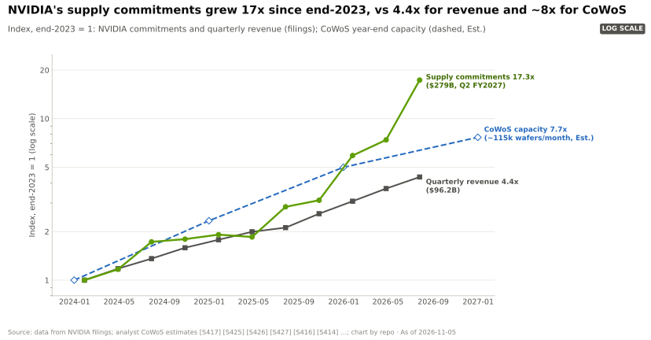
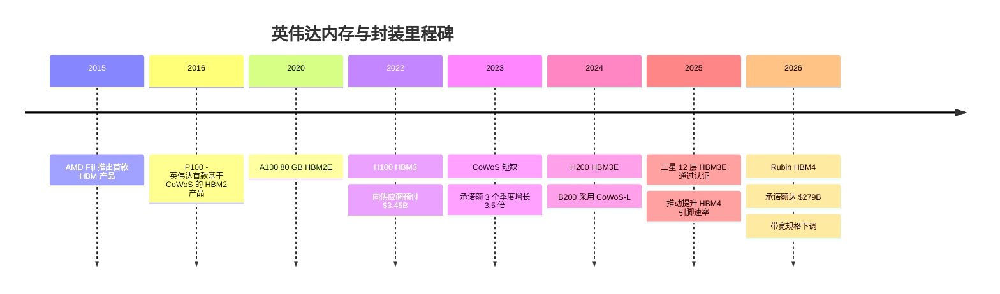
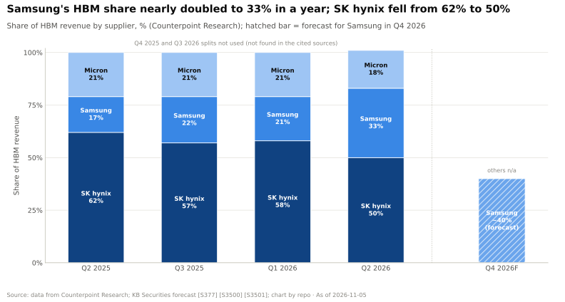
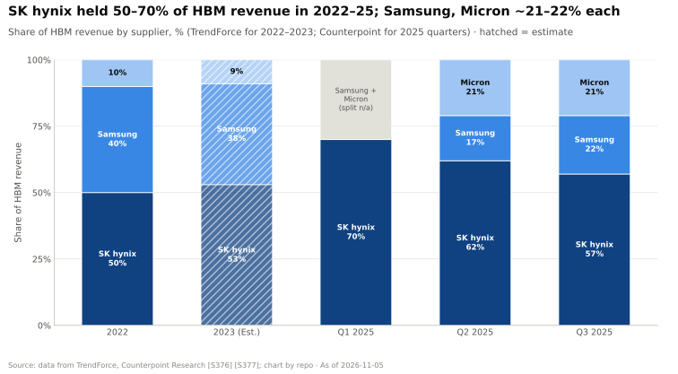

# 内存、封装与供应链：发展历程与英伟达的构建之道

> [!NOTE]
> 本页为英文原文的简体中文参考译文，仅供参考；如有出入，以[英文原文](../../../layers/03-memory-packaging-supply-chain/history-and-how-built.md "English original")为准。

第 03 层 · 内存、封装与供应链 · 约 12 分钟阅读 · 最近核实：2026-11-05

## ⚡ 要点速览

- **堆叠内存并非英伟达（NVIDIA）发明；首款[高带宽内存（HBM）](../../glossary.md#hbm)产品由 AMD 于 2015 年推出** [[S370]](../../../sources/bibliography.md#s370)。英伟达的第一款是 2016 年的 P100：基于台积电（TSMC）[CoWoS](../../glossary.md#cowos) 的四个 HBM2 堆栈，16 GB、732 GB/s [[S125]](../../../sources/bibliography.md#s125)。
- **这一优势是靠资产负债表建立的。** 英伟达的[采购义务](../../glossary.md#purchase-obligations)从 2023 年 1 月的 $4.9B 增至 2026 年 7 月的 $279B，主要为内存与制造产能 [[S419]](../../../sources/bibliography.md#s419)[[S407]](../../../sources/bibliography.md#s407)；该披露科目在 2026 年扩大了口径，因此倍数仅供参考 [[S90092]](../../../sources/bibliography.md#s90092)。
- **这并非没有代价。** FY2023 的下行周期带来约 $2.17B 的存货减值准备 [[S418]](../../../sources/bibliography.md#s418)，以及约 $348M 因承诺超出需求而计提的费用 [[S421]](../../../sources/bibliography.md#s421)，此前英伟达已向供应商支付了 $3.45B 的[预付款](../../glossary.md#prepayment) [[S419]](../../../sources/bibliography.md#s419)。
- **承诺额如今已超过实际产能的增长。** 自 2023 年底以来，承诺额增长了 17 倍，而季度营收增长 4.4 倍，估计的 CoWoS 产能增长约 8 倍 [[S407]](../../../sources/bibliography.md#s407)[[S379]](../../../sources/bibliography.md#s379)，原因在于承诺额现已包含按超级周期价格签订的多年期内存合同。
- **供应商认证既是武器也是风险。** 三星花了约 19 个月才通过英伟达的 [HBM3E](../../glossary.md#hbm3e) 测试（2025 年 9 月）[[S3514]](../../../sources/bibliography.md#s3514)；一旦通过，其 HBM 份额在一年内从 17% 升至 33% [[S3500]](../../../sources/bibliography.md#s3500)。
- **[Q4 · 优势来源]** 主要是规模、采购能力与时机，而非内存工程能力：AMD 在容量和带宽规格上都超过 Rubin [[S144]](../../../sources/bibliography.md#s144)[[S90093]](../../../sources/bibliography.md#s90093)，而英伟达估计拿下了约 60% 的 CoWoS 产能 [[S379]](../../../sources/bibliography.md#s379)。
- **[Q6 · 复制成本]** 估计需要 3–5 年和 $100–300B 的多年期承诺才能追平英伟达的供应地位，但只需几百名专业工程师（🔴 本资料库估计）。

## 从 GDDR 板卡到供应链武器

在 P100 之前，英伟达的数据中心板卡使用的是 [GDDR](../../glossary.md#gddr)，即焊接在芯片周围的显存 [[S125]](../../../sources/bibliography.md#s125)。HBM 改变了物理形态：DRAM 裸片堆栈通过硅[中介层](../../glossary.md#interposer)放置在距 GPU 仅数毫米之处，带宽因此大幅跃升，但 GPU、内存与封装必须一并组装。这使内存从板级采购变成了对台积电和 HBM 厂商的三方制造依赖。

| 时间 | 决策 | 意义 | 来源 |
|---|---|---|---|
| 2016 | P100 采用基于 CoWoS 的 HBM2 | 旗舰产品转向堆叠内存；开始与台积电进行 CoWoS 量产合作 | [[S125]](../../../sources/bibliography.md#s125) |
| FY2023 | 向供应商预付款（$3.06–3.45B） | 锁定了产能，但在需求下滑时使英伟达面临减值 | [[S420]](../../../sources/bibliography.md#s420)[[S419]](../../../sources/bibliography.md#s419) |
| 2023 | 承诺额三个季度内增长 3.5 倍 | 在短缺期间先于竞争对手锁定 CoWoS 与 HBM | [[S419]](../../../sources/bibliography.md#s419)[[S424]](../../../sources/bibliography.md#s424) |
| 2024 | B200 采用 CoWoS-L（双裸片） | 英伟达首款采用台积电桥接式 [CoWoS-L](../../glossary.md#cowos-l) 的封装；两颗光罩尺寸的裸片 | [[S358]](../../../sources/bibliography.md#s358) |
| 2024–25 | HBM 多元化采购（H200 引入美光；随后引入三星） | 扩大供应并增强议价能力 | [[S371]](../../../sources/bibliography.md#s371)[[S3514]](../../../sources/bibliography.md#s3514) |
| 2025 | 推动 HBM4 超越 JEDEC 速率 | 意在带宽上击败 AMD；2026 年被下调，Rubin 如今落后于 MI455X（19.2 对 23.3 TB/s） | [[S90041]](../../../sources/bibliography.md#s90041)[[S103]](../../../sources/bibliography.md#s103)[[S90093]](../../../sources/bibliography.md#s90093) |
| 2026 | 承诺额增至 $279B | 以高内存价格锁定 2027 年及以后的供应 | [[S407]](../../../sources/bibliography.md#s407) |

> [!TIP]
> **算例 —— 下行风险有多大？** 在 FY2023 的峰值时，承诺额为 $9.6B，约为季度营收的 1.2–1.4 倍 [[S420]](../../../sources/bibliography.md#s420)；周期下行导致约 $2.17B 的减值准备 [[S418]](../../../sources/bibliography.md#s418)，约为该峰值的 23%。如今的 $279B 是 $96.2B 季度营收的 2.9 倍 [[S407]](../../../sources/bibliography.md#s407)[[S405]](../../../sources/bibliography.md#s405)。同样 23% 的冲击将约为 $63B（🔴 仅作示意）。在短缺环境下，内存与产能可以找到其他买家，因此实际敞口可能更低，但已不再无足轻重。

## 认证之战：为什么供应商数量很重要

HBM 厂商无法直接向英伟达供货。每一代堆栈都要经过 [HBM 认证（HBM qualification）](../../glossary.md#hbm-qualification)：在英伟达的封装内对速度、发热、功耗与良率进行长达数月的测试。据报道，三星的 HBM3E 经历了约 18 个月的挫折，并否认了 2024 年 7 月已获批准的传闻 [[S3515]](../../../sources/bibliography.md#s3515)；其 12 层产品于 2025 年 9 月通过英伟达认证，距首批送样约 19 个月 [[S3514]](../../../sources/bibliography.md#s3514)[[S3513]](../../../sources/bibliography.md#s3513)。这一延误使 SK 海力士在整个 2025 年保持了 57–70% 的 HBM 营收份额 [[S377]](../../../sources/bibliography.md#s377)。

> [!TIP]
> **算例 —— 一次认证值多少钱。** 2025 年 Q2 至 2026 年 Q2 期间，三星的份额上升了 16 个百分点 [[S377]](../../../sources/bibliography.md#s377)[[S3500]](../../../sources/bibliography.md#s3500)。按美光对 2025 年 HBM 市场约 $35B 的估计 [[S399]](../../../sources/bibliography.md#s399)，16 个百分点约相当于每年 $5.6B 的营收（本资料库测算）。这就是供应商愿意接受英伟达在引脚速率与散热方面要求的原因，也是英伟达希望拥有三家合格供应商的原因。

**[Q4 · 优势来源]** 证据表明，优势来自**凭借风险承受力强的资产负债表提前买下的供应**，而非更胜一筹的内存工程能力。AMD 每颗 GPU 容纳的 HBM 更多、带宽更高 [[S144]](../../../sources/bibliography.md#s144)[[S90093]](../../../sources/bibliography.md#s90093)；英伟达自身的 [HBM4](../../glossary.md#hbm4) 速率目标也不得不修订 [[S104]](../../../sources/bibliography.md#s104)。竞争对手所缺乏的，是英伟达估计约 60% 的 CoWoS 份额 [[S379]](../../../sources/bibliography.md#s379)，以及对三家 HBM 厂商的优先认领权 [[S90039]](../../../sources/bibliography.md#s90039)。工程协同设计固然重要（B200 是英伟达首款 CoWoS-L 封装 [[S358]](../../../sources/bibliography.md#s358)），但台积电向所有客户出售的是同样的工艺。🔴 本资料库分析；机制详见[供应链即武器](supply-chain-as-a-weapon.md)。

## 复制需要付出什么？

**[Q6 · 复制成本]** 本资料库估计（🔴），每行附推理依据：

| 要素 | 估计 | 推理依据 |
|---|---|---|
| 时间 | 3–5 年 | 据报道 CoWoS 产能已售罄至 2027 年 [[S3507]](../../../sources/bibliography.md#s3507)；SK 海力士称已签订 14 份[长期协议（LTA）](../../glossary.md#long-term-agreement)，供应已预订至 2029 年 [[S3503]](../../../sources/bibliography.md#s3503)；美光 2027 年的大部分 HBM 已签约 [[S3534]](../../../sources/bibliography.md#s3534)；新供应商的认证可能需要约 19 个月 [[S3514]](../../../sources/bibliography.md#s3514) |
| 资金 | $100–300B 的多年期承诺 | 英伟达背负 $279B [[S407]](../../../sources/bibliography.md#s407)，约为 AMD 季度数据中心营收 $6.7B 的 42 倍 [[S543]](../../../sources/bibliography.md#s543)；挑战者还需要足够的股权资本来承受约 20% 的减值 |
| 人才 | 几百名专业人才 | 封装、信号与电源完整性、散热以及供应商质量工程师；稀缺但可以招到，并非关键约束 |
| 需求证明 | 锚定客户 | AMD 借助了 OpenAI、甲骨文（Oracle）与 Anthropic 的承诺 [[S546]](../../../sources/bibliography.md#s546)[[S90022]](../../../sources/bibliography.md#s90022)[[S538]](../../../sources/bibliography.md#s538)；OpenAI 签署了最高约每月 900k 片 DRAM 晶圆的意向书（报道中的单位口径不一）[[S3535]](../../../sources/bibliography.md#s3535)[[S3536]](../../../sources/bibliography.md#s3536)，接近三星与 SK 海力士合计约 1.1M 片的产能 [[S3537]](../../../sources/bibliography.md#s3537) |

> [!TIP]
> **算例 —— 拿下 2028 年 10 个百分点的 CoWoS 产能，在内存上要花多少钱。** 按 2028 年每月约 260k 片晶圆计 [[S3002]](../../../sources/bibliography.md#s3002)，10% 约为每年 312k 片。按本资料库估计的每片晶圆 11–16 个 Rubin 级封装计 [[S3000]](../../../sources/bibliography.md#s3000)，即约 3.4–5.0M 颗 GPU，每颗需要 288 GB HBM，按伯恩斯坦（Bernstein）约 $53/GB 计（约 $15K）[[S333]](../../../sources/bibliography.md#s333)：**每年约 $52–76B 的 HBM**，需要在芯片问世之前就签约（🔴 本资料库测算）。

🔧 技术细节：为什么承诺额的增速快于 CoWoS 产能

CoWoS 晶圆数衡量的是封装产能，承诺额衡量的则是金额。2023 年底至 2026 年中，每个产能单位对应的金额上升，原因在于：每个 Rubin 封装搭载更昂贵的 HBM4，内存价格大涨（2026 年 Q1 DRAM 行业营收环比增长 81%）[[S3518]](../../../sources/bibliography.md#s3518)，且合同期限延长为多年期。

## 反事实推演：假如英伟达没有……

- 🔴 **……在 2023 年预订 CoWoS？** 2023 年底产能约为每月 15k 片晶圆 [[S379]](../../../sources/bibliography.md#s379)。如果英伟达将承诺额维持在约 $5B 而非 $17B [[S424]](../../../sources/bibliography.md#s424)，AMD 的 MI300X（192 GB，2023 年 12 月）[[S141]](../../../sources/bibliography.md#s141) 与博通（Broadcom）的 ASIC 将在 2024 年拿到更多产能，Blackwell 的爬坡规模也会更小。
- 🔴 **……遇到三星较早通过认证？** 假如三星在 2024 年年中就通过认证，SK 海力士 62% 的份额 [[S377]](../../../sources/bibliography.md#s377) 很可能提前一年下滑，从而降低英伟达的 HBM3E 成本，而三星可向 AMD 承诺的富余 HBM4 也会更少 [[S3512]](../../../sources/bibliography.md#s3512)。

> [!TIP]
> **算例 —— 以 JEDEC 为基准的反事实推演（🔴）。** 假如英伟达只要求 JEDEC 的 8 Gb/s，八个 2,048 位 HBM4 堆栈将提供 8 × 2,048 × 8 ÷ 8 = 16.4 TB/s [[S369]](../../../sources/bibliography.md#s369)，低于 MI455X 的 23.3 TB/s —— AMD 以 12 个堆栈、约 7.6 Gb/s 实现了这一带宽（本资料库测算）[[S144]](../../../sources/bibliography.md#s144)[[S90093]](../../../sources/bibliography.md#s90093)[[S90094]](../../../sources/bibliography.md#s90094)。英伟达超过 10 Gb/s 的要求 [[S90041]](../../../sources/bibliography.md#s90041) 最终落在 19.2 TB/s：仍比 AMD 低约 18%，且代价是公开下调规格。

## 🎯 企业发展视角

1. 新进入者需要在产品发布前签下哪些供应合同？对内存厂商的股权投资或预付款能否替代英伟达级别的采购量？
2. 如果 2027 年需求放缓，$279B 的承诺中蕴含多少减值风险？披露信息对可撤销性是如何说明的？
3. 三星较晚通过认证，是否使其成为寻求优先供应的挑战者的天然合作伙伴？
4. 买家联合体（AI 实验室、[超大规模云厂商](../../glossary.md#hyperscaler)）能否像 OpenAI 的意向书所暗示的那样直接签约采购内存，从而绕开芯片厂商的配额权力？

## 📚 来源（Sources）

<!-- Auto-generated from the [S…] citations on this page by `make build`. Edit sources/registry/*.csv, not this list. -->

- [**S103**](../../../sources/bibliography.md#s103) VideoCardz, *NVIDIA quietly cuts Vera Rubin specs, HBM4 bandwidth and NVLink 6 speeds now lower*, 2026-10. [Link](https://videocardz.com/newz/nvidia-quietly-cuts-vera-rubin-specs-hbm4-bandwidth-and-nvlink-6-speeds-now-lower)
- [**S104**](../../../sources/bibliography.md#s104) Wccftech, *NVIDIA's Official Statement on Vera Rubin Spec Change*, 2026-10-29. [Link](https://wccftech.com/nvidia-official-statement-on-vera-rubin-spec-change/)
- [**S125**](../../../sources/bibliography.md#s125) NVIDIA, *NVIDIA Tesla P100 (Pascal GP100) Architecture Whitepaper*, 2016-04. [Link](https://images.nvidia.com/content/pdf/tesla/whitepaper/pascal-architecture-whitepaper.pdf)
- [**S141**](../../../sources/bibliography.md#s141) AMD, *AMD Instinct MI300X Accelerator*, 2023-12-06. [Link](https://www.amd.com/en/products/accelerators/instinct/mi300/mi300x.html)
- [**S144**](../../../sources/bibliography.md#s144) AMD Newsroom, *AMD Unveils Vision for an Open AI Ecosystem, Detailing New Silicon, Software and Systems at Advancing AI 2025*, 2025-06-12. [Link](https://www.amd.com/en/newsroom/press-releases/2025-6-12-amd-unveils-vision-for-an-open-ai-ecosystem-detai.html)
- [**S333**](../../../sources/bibliography.md#s333) Wccftech, *Bernstein warns NVIDIA's Vera Rubin racks will hit $9.1 million as HBM4 prices triple to $53 per gigabyte*, 2026-07. [Link](https://wccftech.com/bernstein-warns-nvidias-vera-rubin-racks-will-hit-9-1-million-as-hbm4-prices-triple-to-53-per-gigabyte/)
- [**S358**](../../../sources/bibliography.md#s358) glennklockwood.com (Glenn K. Lockwood), *NVIDIA B200 processor notes*, 2025. [Link](https://glennklockwood.com/garden/processors/B200)
- [**S369**](../../../sources/bibliography.md#s369) JEDEC, *JESD270-4: High Bandwidth Memory (HBM4) standard*, 2025-04-16. [Link](https://www.jedec.org/standards-documents/docs/jesd270-4)
- [**S370**](../../../sources/bibliography.md#s370) JEDEC, *JESD235 High Bandwidth Memory (HBM / HBM2 / HBM2E) DRAM standard family*, 2013-10. [Link](https://www.jedec.org/standards-documents/docs/jesd235a)
- [**S371**](../../../sources/bibliography.md#s371) Micron Technology, *Micron commences volume production of industry-leading HBM3E solution*, 2024-02-26. [Link](https://investors.micron.com/news-releases/news-release-details/micron-commences-volume-production-industry-leading-hbm3e-solution)
- [**S377**](../../../sources/bibliography.md#s377) Counterpoint Research, *Counterpoint Research DRAM/HBM market trackers (Q1-Q3 2025 HBM shares)*, 2025. [Link](https://www.counterpointresearch.com/insights)
- [**S379**](../../../sources/bibliography.md#s379) TrendForce News, *TSMC CoWoS capacity and customer allocation estimates (TrendForce / Morgan Stanley, as reported)*, 2025. [Link](https://www.trendforce.com/news/)
- [**S399**](../../../sources/bibliography.md#s399) Micron Technology, *Micron fiscal Q1 2026 earnings (HBM total addressable market outlook)*, 2025-12-17. [Link](https://investors.micron.com/)
- [**S405**](../../../sources/bibliography.md#s405) NVIDIA Corporation via SEC EDGAR, *NVIDIA Announces Financial Results for Second Quarter Fiscal 2027 (Form 8-K exhibit 99.1)*, 2026-08-26. [Link](https://www.sec.gov/Archives/edgar/data/0001045810/000104581026000073/q2fy27pr.htm)
- [**S407**](../../../sources/bibliography.md#s407) NVIDIA Corporation via SEC EDGAR, *NVIDIA Corporation Form 10-Q for quarter ended July 26, 2026*, 2026-08-28. [Link](https://www.sec.gov/Archives/edgar/data/1045810/000104581026000075/nvda-20260726.htm)
- [**S418**](../../../sources/bibliography.md#s418) NVIDIA Corporation via SEC EDGAR, *NVIDIA Corporation Form 10-K for fiscal year ended January 29, 2023*, 2023-02-24. [Link](https://www.sec.gov/Archives/edgar/data/1045810/000104581023000017/nvda-20230129.htm)
- [**S419**](../../../sources/bibliography.md#s419) NVIDIA Corporation via SEC EDGAR (Colette Kress), *CFO Commentary on Fourth Quarter and Fiscal 2023 Results (Form 8-K exhibit 99.2)*, 2023-02-22. [Link](https://sec.gov/Archives/edgar/data/1045810/000104581023000014/q4fy23cfocommentary.htm)
- [**S420**](../../../sources/bibliography.md#s420) NVIDIA Corporation (via CapEdge mirror of Form 8-K) (Colette Kress), *CFO Commentary on Second Quarter Fiscal 2023 Results*, 2022-08-24. [Link](https://capedge.com/filing/1045810/0001045810-22-000136/NVDA-8K/file/3)
- [**S421**](../../../sources/bibliography.md#s421) NVIDIA Corporation (via CapEdge mirror of Form 8-K) (Colette Kress), *CFO Commentary on Third Quarter Fiscal 2023 Results*, 2022-11-16. [Link](https://capedge.com/filing/1045810/0001045810-22-000163/NVDA-8K/file/3)
- [**S424**](../../../sources/bibliography.md#s424) NVIDIA Corporation via SEC EDGAR, *NVIDIA Corporation Form 10-Q for quarter ended October 29, 2023*, 2023-11-21. [Link](https://www.sec.gov/Archives/edgar/data/1045810/000104581023000227/nvda-20231029.htm)
- [**S538**](../../../sources/bibliography.md#s538) AMD Investor Relations, *AAI 2026: AMD Delivers Full-Stack Compute for the Agentic AI Era*, 2026-07-23. [Link](https://ir.amd.com/news-events/press-releases/detail/1294/aai-2026-amd-delivers-full-stack-compute-for-the-agentic-ai-era)
- [**S543**](../../../sources/bibliography.md#s543) AMD via SEC EDGAR, *AMD Q2 2026 earnings slides (Form 8-K)*, 2026-08-04. [Link](https://www.sec.gov/Archives/edgar/data/0000002488/000000248826000121/amdq22026earningsslidesf.htm)
- [**S546**](../../../sources/bibliography.md#s546) TechWire Asia, *AMD Advancing AI 2026: Helios, OpenAI, Meta, Anthropic*, 2026-07. [Link](https://techwireasia.com/2026/07/amd-advancing-ai-2026-helios-openai-meta-anthropic/)
- [**S3000**](../../../sources/bibliography.md#s3000) nvidia_deep_dive_claude repository, *Repo analysis: layer 03 memory, packaging and supply-chain models (decode ceilings, HBM sizing, CoWoS packages per wafer)*, 2026-11-05. [Link](https://github.com/FrankHuang94/nvidia_deep_dive_claude/blob/main/layers/03-memory-packaging-supply-chain/index.md)
- [**S3002**](../../../sources/bibliography.md#s3002) TrendForce, *TSMC reportedly targets 22% 2nm, 16% 3nm capacity boost by mid-2027; CoWoS to double by 2028*, 2026-09-14. [Link](https://www.trendforce.com/news/2026/09/14/news-tsmc-reportedly-targets-22-2nm-16-3nm-capacity-boost-by-mid-2027-cowos-to-double-by-2028/)
- [**S3500**](../../../sources/bibliography.md#s3500) Counterpoint Research (Korea), *Global HBM market share Q2 2026*, 2026-09. [Link](https://korea.counterpointresearch.com/global-hbm-market-share-q2-2026/)
- [**S3503**](../../../sources/bibliography.md#s3503) SammyFans, *SK hynix Q3 margin hits record 80%, secures 14 LTAs with memory supply booked to 2029*, 2026-10-28. [Link](https://www.sammyfans.com/2026/10/28/sk-hynix-q3-margin-hits-record-80-secures-14-ltas-with-memory-supply-booked-to-2029/amp/)
- [**S3507**](../../../sources/bibliography.md#s3507) AI Weekly, *TSMC pilots CoPoS panel packaging as CoWoS sells out to 2027*, 2026. [Link](https://aiweekly.co/alerts/tsmc-pilots-copos-panel-packaging-as-cowos-sells-out-to-2027)
- [**S3512**](../../../sources/bibliography.md#s3512) Asia Economy (Asiae), *Samsung Electronics to prioritize HBM4 supply for AMD AI accelerators*, 2026-03-18. [Link](https://view.asiae.co.kr/en/article/2026031817142143855)
- [**S3513**](../../../sources/bibliography.md#s3513) TrendForce, *Samsung 12H HBM3E reportedly clears NVIDIA tests after 18-month setback, HBM4 reaches final phase*, 2025-09-22. [Link](https://www.trendforce.com/news/2025/09/22/news-samsung-12h-hbm3e-reportedly-clears-nvidia-tests-after-18-month-setback-hbm4-reaches-final-phase/)
- [**S3514**](../../../sources/bibliography.md#s3514) Asia Economy (Asiae), *Samsung Electronics passes NVIDIA HBM3E quality certification; supply resumes after 19 months*, 2025-09-19. [Link](https://www.asiae.co.kr/en/article/2025091919025243075)
- [**S3515**](../../../sources/bibliography.md#s3515) TrendForce, *Samsung's HBM3E reportedly passed NVIDIA's certification, though it denies the rumor*, 2024-07-04. [Link](https://www.trendforce.com/news/2024/07/04/news-samsungs-hbm3e-reportedly-passed-nvidias-certification-though-it-denies-the-rumor/)
- [**S3518**](../../../sources/bibliography.md#s3518) Tiger Brokers (iTiger), *DRAM industry revenue soars 81% to $97 billion in Q1 amid accelerating price hikes (TrendForce)*, 2026-06. [Link](https://www.itiger.com/hans/news/1108307708)
- [**S3534**](../../../sources/bibliography.md#s3534) The Next Platform, *Micron's numbers show why HBM4 memory is worth 15x its weight in gold*, 2026-10-02. [Link](https://www.nextplatform.com/store/2026/10/02/microns-numbers-show-why-hbm4-memory-is-worth-15x-its-weight-in-gold/5300701)
- [**S3535**](../../../sources/bibliography.md#s3535) TechCrunch, *OpenAI ropes in Samsung and SK hynix to source memory chips for Stargate*, 2025-10-01. [Link](https://techcrunch.com/2025/10/01/openai-ropes-in-samsung-sk-hynix-to-source-memory-chips-for-stargate)
- [**S3536**](../../../sources/bibliography.md#s3536) The Register, *OpenAI ropes in Samsung and SK Hynix for Stargate memory*, 2025-10-02. [Link](https://www.theregister.com/2025/10/02/openai_ropes_in_samsung_and/)
- [**S3537**](../../../sources/bibliography.md#s3537) DIGITIMES Asia, *OpenAI, Samsung and SK hynix: supply-chain implications for NVIDIA*, 2025-10-03. [Link](https://www.digitimes.com/news/a20251003PD218/openai-samsung-sk-hynix-supply-chain-nvidia.html)
- [**S90022**](../../../sources/bibliography.md#s90022) Tom's Hardware, *AMD and Oracle partner to deploy 50,000 MI450 Instinct GPUs*, 2025-10. [Link](https://www.tomshardware.com/tech-industry/artificial-intelligence/amd-and-oracle-partner-to-deploy-50-000-mi450-instinct-gpus-in-new-ai-superclusters-deployment-of-expansion-set-for-2026-powered-by-amds-helios-rack)
- [**S90039**](../../../sources/bibliography.md#s90039) TrendForce, *Samsung, SK hynix reportedly tapped as NVIDIA Rubin HBM4 suppliers; shipments could start in March*, 2026-03-09. [Link](https://www.trendforce.com/news/2026/03/09/news-samsung-sk%E2%80%AFhynix-reportedly-tapped-as-nvidia-rubin-hbm4-suppliers-shipments-could-start-in-march/)
- [**S90041**](../../../sources/bibliography.md#s90041) I-Connect007 (TrendForce), *NVIDIA seeks to raise HBM4 specs in response to AMD competition; SK hynix expected to remain largest supplier in 2026*, 2025-09. [Link](https://iconnect007.com/article/146969/nvidia-seeks-to-raise-hbm4-specs-in-response-to-amd-competition-sk-hynix-expected-to-remain-largest-supplier-in-2026/146966/aep)
- [**S90092**](../../../sources/bibliography.md#s90092) Nasdaq (Motley Fool), *Nvidia's supply commitments more than doubled to $279 billion: here's what it does to the stock*, 2026-09. [Link](https://www.nasdaq.com/articles/nvidias-supply-commitments-more-doubled-279-billion-heres-what-it-does-stock)
- [**S90093**](../../../sources/bibliography.md#s90093) Tom's Hardware, *AMD takes the wraps off its Instinct MI455X AI accelerator: CDNA 5 and Helios rack-scale architecture*, 2026. [Link](https://www.tomshardware.com/pc-components/gpus/amd-takes-the-wraps-off-its-instinct-mi455x-ai-accelerator-cdna-5-and-helios-rack-scale-architecture-combine-to-take-the-fight-to-nvidia-in-the-data-center)
- [**S90094**](../../../sources/bibliography.md#s90094) ServeTheHome, *AMD Instinct MI455X deep dive: CDNA 5 marks the next era of Instinct*, 2026. [Link](https://www.servethehome.com/amd-instinct-mi455x-deep-dive-cdna-5-marks-the-next-era-of-instinct/5/)
