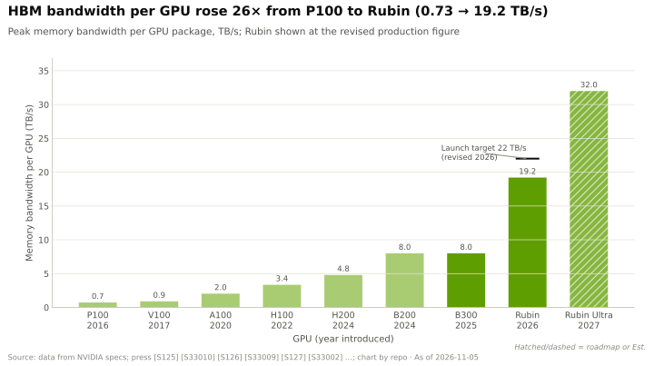
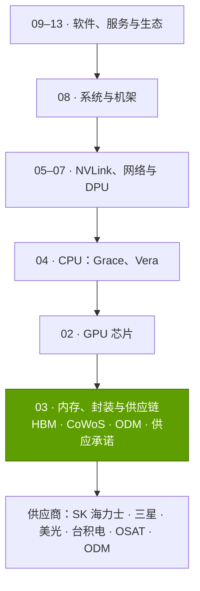
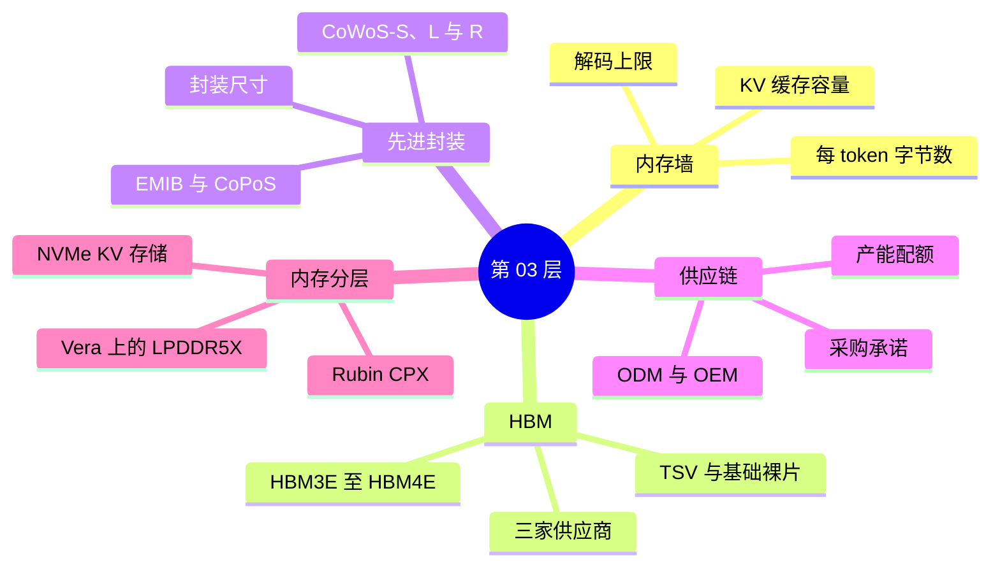

# 第 03 层 —— 内存、封装与供应链

> [!NOTE]
> 本页为英文原文的简体中文参考译文，仅供参考；如有出入，以[英文原文](../../../layers/03-memory-packaging-supply-chain/index.md "English original")为准。

共 12 层中的第 03 层 · 高带宽内存（HBM）、CoWoS 封装，以及把二者转化为可交付 GPU 的供应承诺 · 约 7 分钟阅读 · 最近核实：2026-11-05

## ⚡ 要点速览

- **对[大语言模型（LLM）](../../glossary.md#llm)推理而言，内存先于算力成为瓶颈。** 自 V100 以来，稠密低精度算力提升约 280 倍，而[高带宽内存（HBM）](../../glossary.md#hbm)带宽仅提升约 21 倍 [[S33010]](../../../sources/bibliography.md#s33010)[[S33005]](../../../sources/bibliography.md#s33005)[[S33007]](../../../sources/bibliography.md#s33007)；受带宽所限，一个 70B [FP8](../../glossary.md#fp8) 对话流在 H100 上的上限约为 48 tokens/s，在 Rubin 上约为 274 [[S33002]](../../../sources/bibliography.md#s33002)[[S32006]](../../../sources/bibliography.md#s32006)。
- **HBM 是 GPU 中最昂贵的部件：** 约占 B200 制造成本的 45%（估计，Epoch AI）[[S35020]](../../../sources/bibliography.md#s35020)；从 GB300 到 Vera Rubin，内存占 [NVL72](../../glossary.md#nvl72) 机架成本的比重由约 9% 升至约 26%（估计）[[S330]](../../../sources/bibliography.md#s330)[[S332]](../../../sources/bibliography.md#s332)。
- **[HBM4](../../glossary.md#hbm4) 改变了产品形态：** 2,048 位总线 [[S369]](../../../sources/bibliography.md#s369)，以及采用逻辑工艺、通常由台积电（TSMC）制造的基础裸片（base die）[[S3007]](../../../sources/bibliography.md#s3007)[[S3011]](../../../sources/bibliography.md#s3011)。🟢 Rubin 的 HBM4 标称带宽为 19.2 TB/s，低于此前的 22 [[S90006]](../../../sources/bibliography.md#s90006)[[S33007]](../../../sources/bibliography.md#s33007)。
- **封装是第二道关口。** 🟡 从 2023 年底到 2026 年底，台积电 [CoWoS](../../glossary.md#cowos) 产能由每月约 15k 片晶圆增至约 115k 片（估计），英伟达（NVIDIA）预订了 2026 年约 60% 的晶圆 [[S379]](../../../sources/bibliography.md#s379)。
- **英伟达把现金转化为配额。** 截至 Q2 FY2027，供应与产能承诺达到 $279B，较上一季度的 $119B 大幅上升，主要为内存与制造 [[S407]](../../../sources/bibliography.md#s407)[[S404]](../../../sources/bibliography.md#s404)。
- **最大弱点：** 英伟达与竞争对手向同样的三家厂商采购 HBM。AMD 的 MI455X 搭载 432 GB、23.3 TB/s，而 Rubin 为 288 GB、19.2 TB/s，容量约为其 1.5 倍、带宽约为其 1.2 倍 [[S144]](../../../sources/bibliography.md#s144)[[S90093]](../../../sources/bibliography.md#s90093)[[S33007]](../../../sources/bibliography.md#s33007)。固定承诺也使英伟达成为冲击的缓冲垫，$4.5B 的 H20 减值即为例证 [[S414]](../../../sources/bibliography.md#s414)。

## 本层在技术栈中的位置

> [!TIP]
> **算例 —— 从本层视角看一台 Vera Rubin NVL72 机架。** 72 颗 GPU × 8 个堆栈 = 576 个 HBM4 堆栈，容量 72 × 288 GB ≈ 20.7 TB，带宽 72 × 19.2 ≈ 1,400 TB/s [[S102]](../../../sources/bibliography.md#s102)[[S33007]](../../../sources/bibliography.md#s33007)。按每片 CoWoS 晶圆约 12 个 Rubin 级封装计算（估计）[[S3000]](../../../sources/bibliography.md#s3000)，每台机架消耗约 6 片 CoWoS 晶圆。在约 $7.8M 的机架成本中，内存约占 $2.0M（估计，摩根士丹利）[[S330]](../../../sources/bibliography.md#s330)。**商业解读：** 每台机架既是一笔 GPU 采购，同样也是一笔内存与封装采购。

🔧 技术细节：本层估算的构建方法

[解码（decode）](../../glossary.md#decode)上限 = HBM 带宽 ÷ 每个 token 所需字节数；HBM 容量测算 = FP8 权重 + 由各模型层数与注意力头数推算的 KV 缓存；每片晶圆封装数 = 在 300 mm 晶圆上可容纳的、具有给定光罩倍数的中介层数量。以上均为本资料库基于所引输入数据的测算 [[S3000]](../../../sources/bibliography.md#s3000)，假设见 `data/l03_memory_scenarios.csv` 与 `data/l03_cowos_geometry.csv`。

## 本层导图

## 八个问题一览

| # | 问题 | 简要回答 | 详见 |
|---|---|---|---|
| Q1 | 职能是什么，薄弱时会出什么问题？ | 以足够快的速度为张量核心供数，并容纳模型与 [KV 缓存](../../glossary.md#kv-cache)；进而生产足够的 HBM 与 CoWoS。薄弱时：算力闲置、GPU 无法出货。 | [内存墙](the-memory-wall.md) |
| Q2 | 关键指标？ | 每颗 GPU 的 HBM 带宽（TB/s）与容量（GB）、每 token 字节数、CoWoS 晶圆数 × 每片晶圆封装数、承诺额 ÷ 营收。 | [内存墙](the-memory-wall.md) |
| Q3 | 代际进步？ | P100 → Rubin：0.73 → 19.2 TB/s（26 倍），16 → 288 GB（18 倍），4 → 8 个堆栈 [[S125]](../../../sources/bibliography.md#s125)[[S33007]](../../../sources/bibliography.md#s33007)。 | [HBM 详解](hbm-explained.md) |
| Q4 | 优势来源？ | 供应与执行：最大的承诺型买家，且每一代 HBM 都率先导入。 | [发展历程与构建方式](history-and-how-built.md) |
| Q5 | 最强挑战者？ | AMD，凭借重容量的 HBM4 配置（432 GB 对 288 GB）[[S144]](../../../sources/bibliography.md#s144)。 | [竞争格局](competition.md) |
| Q6 | 复制成本？ | 内存可以买到；多年积累的配额买不到。 | [发展历程与构建方式](history-and-how-built.md) |
| Q7 | 路线图？ | 采用定制基础裸片的 HBM4E（2027 年）[[S3007]](../../../sources/bibliography.md#s3007)；🟡 CoWoS 产能到 2028 年约翻一番 [[S3002]](../../../sources/bibliography.md#s3002)。 | [路线图](roadmap.md) |
| Q8 | 价值池？ | HBM 厂商、台积电封装、封测代工厂（OSAT）、基板、ODM。 | [价值链与企业发展](value-chain-and-corp-dev.md) |

## 本层页面

| 页面 | 你将了解 |
|---|---|
| [内存墙](the-memory-wall.md) | 为什么带宽与容量制约解码；各 GPU 的解码上限 |
| [HBM 详解](hbm-explained.md) | 堆栈、TSV、基础裸片、HBM2E → HBM4E、成本与良率 |
| [CoWoS 与先进封装](cowos-and-advanced-packaging.md) | CoWoS-S/L/R、每片晶圆的 GPU 数、台积电产能、替代方案 |
| [供应链即武器](supply-chain-as-a-weapon.md) | $279B 的承诺、ODM/OEM 链条、产能配额 |
| [内存分层与 Rubin CPX](memory-tiering-and-rubin-cpx.md) | HBM、LPDDR、GDDR7 与 NVMe 对比；Rubin CPX；竞争对手的方案 |
| [竞争格局](competition.md) | 内存与封装领域的挑战者 |
| [发展历程与英伟达的构建之道](history-and-how-built.md) | 关键供应决策与复制成本 |
| [路线图](roadmap.md) | HBM4E、Rubin Ultra 内存、封装时间表 |
| [价值链与企业发展视角](value-chain-and-corp-dev.md) | 谁攫取了价值；相关私营公司 |

## 🎯 企业发展视角

1. **内存是新的利润率争夺战场。** HBM 约占 B200 成本的 45% [[S35020]](../../../sources/bibliography.md#s35020)。在 2027 年的 [HBM4E](../../glossary.md#hbm4e) 合约中，谁握有定价权？这又会对英伟达约 75% 的毛利率产生什么影响 [[S405]](../../../sources/bibliography.md#s405)？
2. **产能配额是一项永远不会出现在资产负债表上的资产。** 新进入者能否靠预付款买到优先权，还是只能靠多年的采购量换取？
3. **定制基础裸片打开了一道缝隙。** 在台积电制造、置于 HBM 堆栈内部的逻辑电路 [[S3007]](../../../sources/bibliography.md#s3007)[[S3008]](../../../sources/bibliography.md#s3008) 需要接口与控制器 IP。高通（Qualcomm）的 IP 可以在哪里切入？
4. **容量优先的推理是一条真实可行的替代路线。** AMD（432 GB，且无带宽损失）与高通 AI200（768 GB [LPDDR](../../glossary.md#lpddr)，以带宽换容量）都押注容量 [[S144]](../../../sources/bibliography.md#s144)[[S173]](../../../sources/bibliography.md#s173)。哪些工作负载会因此受益？

## 📚 来源（Sources）

<!-- Auto-generated from the [S…] citations on this page by `make build`. Edit sources/registry/*.csv, not this list. -->

- [**S102**](../../../sources/bibliography.md#s102) NVIDIA, *NVIDIA DGX Vera Rubin NVL72*, 2026. [Link](https://www.nvidia.com/en-us/data-center/dgx-vera-rubin-nvl72/)
- [**S125**](../../../sources/bibliography.md#s125) NVIDIA, *NVIDIA Tesla P100 (Pascal GP100) Architecture Whitepaper*, 2016-04. [Link](https://images.nvidia.com/content/pdf/tesla/whitepaper/pascal-architecture-whitepaper.pdf)
- [**S144**](../../../sources/bibliography.md#s144) AMD Newsroom, *AMD Unveils Vision for an Open AI Ecosystem, Detailing New Silicon, Software and Systems at Advancing AI 2025*, 2025-06-12. [Link](https://www.amd.com/en/newsroom/press-releases/2025-6-12-amd-unveils-vision-for-an-open-ai-ecosystem-detai.html)
- [**S173**](../../../sources/bibliography.md#s173) Qualcomm, *Qualcomm Unveils AI200 and AI250 - Redefining Rack-Scale Data Center Inference*, 2025-10-27. [Link](https://www.qualcomm.com/news/releases/2025/10/qualcomm-unveils-ai200-and-ai250-redefining-rack-scale-data-cent)
- [**S330**](../../../sources/bibliography.md#s330) PC Gamer, *A single Nvidia Vera Rubin rack is estimated to cost $7,803,148 with over $2 million of that figure spent on memory alone*, 2026-05. [Link](https://pcgamer.com/hardware/a-single-nvidia-vera-rubin-rack-is-estimated-to-cost-usd7-803-148-with-over-usd2-million-of-that-figure-spent-on-memory-alone)
- [**S332**](../../../sources/bibliography.md#s332) Tiger Brokers (iTiger), *Morgan Stanley's BOM analysis of NVIDIA's Rubin: GPU share declines; PCB, MLCC and ABF substrate values soar*, 2026-05-20. [Link](https://www.itiger.com/news/1188068712)
- [**S369**](../../../sources/bibliography.md#s369) JEDEC, *JESD270-4: High Bandwidth Memory (HBM4) standard*, 2025-04-16. [Link](https://www.jedec.org/standards-documents/docs/jesd270-4)
- [**S379**](../../../sources/bibliography.md#s379) TrendForce News, *TSMC CoWoS capacity and customer allocation estimates (TrendForce / Morgan Stanley, as reported)*, 2025. [Link](https://www.trendforce.com/news/)
- [**S404**](../../../sources/bibliography.md#s404) NVIDIA Corporation via SEC EDGAR, *NVIDIA Corporation Form 10-Q for quarter ended April 26, 2026*, 2026-05-27. [Link](https://www.sec.gov/Archives/edgar/data/1045810/000104581026000052/nvda-20260426.htm)
- [**S405**](../../../sources/bibliography.md#s405) NVIDIA Corporation via SEC EDGAR, *NVIDIA Announces Financial Results for Second Quarter Fiscal 2027 (Form 8-K exhibit 99.1)*, 2026-08-26. [Link](https://www.sec.gov/Archives/edgar/data/0001045810/000104581026000073/q2fy27pr.htm)
- [**S407**](../../../sources/bibliography.md#s407) NVIDIA Corporation via SEC EDGAR, *NVIDIA Corporation Form 10-Q for quarter ended July 26, 2026*, 2026-08-28. [Link](https://www.sec.gov/Archives/edgar/data/1045810/000104581026000075/nvda-20260726.htm)
- [**S414**](../../../sources/bibliography.md#s414) NVIDIA Corporation via SEC EDGAR, *NVIDIA Corporation Form 10-Q for quarter ended April 27, 2025*, 2025-05-28. [Link](https://www.sec.gov/Archives/edgar/data/1045810/000104581025000116/nvda-20250427.htm)
- [**S3000**](../../../sources/bibliography.md#s3000) nvidia_deep_dive_claude repository, *Repo analysis: layer 03 memory, packaging and supply-chain models (decode ceilings, HBM sizing, CoWoS packages per wafer)*, 2026-11-05. [Link](https://github.com/FrankHuang94/nvidia_deep_dive_claude/blob/main/layers/03-memory-packaging-supply-chain/index.md)
- [**S3002**](../../../sources/bibliography.md#s3002) TrendForce, *TSMC reportedly targets 22% 2nm, 16% 3nm capacity boost by mid-2027; CoWoS to double by 2028*, 2026-09-14. [Link](https://www.trendforce.com/news/2026/09/14/news-tsmc-reportedly-targets-22-2nm-16-3nm-capacity-boost-by-mid-2027-cowos-to-double-by-2028/)
- [**S3007**](../../../sources/bibliography.md#s3007) Tom's Hardware, *Micron teams up with TSMC to deliver HBM4E, targeted for 2027*, 2025-09. [Link](https://www.tomshardware.com/micron-hands-tsmc-the-keys-to-hbm4e)
- [**S3008**](../../../sources/bibliography.md#s3008) TrendForce, *TSMC unveils custom C-HBM4E details: N3P logic dies reportedly target 2x efficiency gain*, 2025-12-01. [Link](https://www.trendforce.com/news/2025/12/01/news-tsmc-unveils-custom-c-hbm4e-details-n3p-logic-dies-reportedly-target-2x-efficiency-gain/)
- [**S3011**](../../../sources/bibliography.md#s3011) TrendForce, *Samsung's custom HBM4E design reportedly aimed for mid-2026, parallels SK hynix and Micron*, 2026-01-23. [Link](https://www.trendforce.com/news/2026/01/23/news-samsungs-custom-hbm4e-design-reportedly-aimed-for-mid-2026-parallels-sk-hynix-and-micron/)
- [**S32006**](../../../sources/bibliography.md#s32006) Meta via Hugging Face, *Llama 3.1 70B configuration (config.json)*, 2024-07-23. [Link](https://huggingface.co/meta-llama/Llama-3.1-70B/blob/main/config.json)
- [**S33002**](../../../sources/bibliography.md#s33002) NVIDIA, *NVIDIA H100 Tensor Core GPU (product page and datasheet)*, 2022-03-22. [Link](https://www.nvidia.com/en-us/data-center/h100/)
- [**S33005**](../../../sources/bibliography.md#s33005) NVIDIA, *NVIDIA Vera Rubin NVL72 (product page and specifications)*, 2026. [Link](https://www.nvidia.com/en-us/data-center/vera-rubin-nvl72/)
- [**S33007**](../../../sources/bibliography.md#s33007) Dataconomy, *Nvidia Quietly Cuts Vera Rubin HBM4 And NVLink Bandwidth Specs*, 2026-11-02. [Link](https://dataconomy.com/2026/11/02/nvidia-quietly-cuts-vera-rubin-hbm4-and-nvlink-bandwidth/)
- [**S33010**](../../../sources/bibliography.md#s33010) NVIDIA, *NVIDIA V100 Tensor Core GPU datasheet*, 2018. [Link](https://images.nvidia.com/content/technologies/volta/pdf/volta-v100-datasheet-update-us-1165301-r5.pdf)
- [**S35020**](../../../sources/bibliography.md#s35020) Epoch AI, *NVIDIA's B200 costs around $6,400 to produce, with memory accounting for half*, 2025-12. [Link](https://epoch.ai/data-insights/b200-cost-breakdown)
- [**S90006**](../../../sources/bibliography.md#s90006) TweakTown, *Nvidia cuts Vera Rubin's memory bandwidth by up to 26% and AMD's Helios now leads in memory bandwidth*, 2026-10. [Link](https://www.tweaktown.com/news/114304/nvidia-cuts-vera-rubins-memory-bandwidth-by-up-to-26-percent-and-amds-helios-now-leads-in-memory-bandwidth/index.html)
- [**S90093**](../../../sources/bibliography.md#s90093) Tom's Hardware, *AMD takes the wraps off its Instinct MI455X AI accelerator: CDNA 5 and Helios rack-scale architecture*, 2026. [Link](https://www.tomshardware.com/pc-components/gpus/amd-takes-the-wraps-off-its-instinct-mi455x-ai-accelerator-cdna-5-and-helios-rack-scale-architecture-combine-to-take-the-fight-to-nvidia-in-the-data-center)
