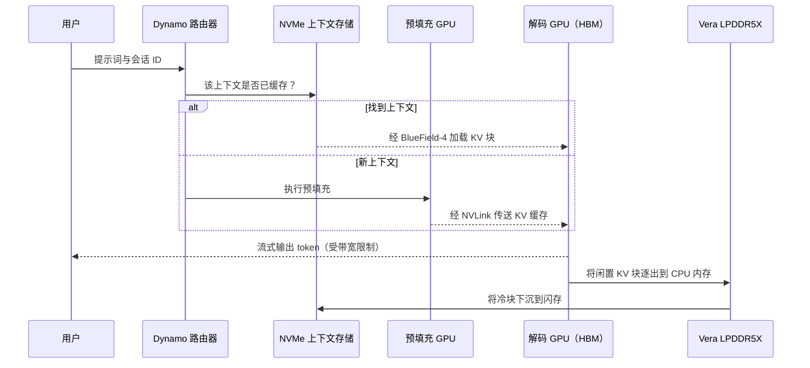

# 内存分层与 Rubin CPX

> [!NOTE]
> 本页为英文原文的简体中文参考译文，仅供参考；如有出入，以[英文原文](../../../layers/03-memory-packaging-supply-chain/memory-tiering-and-rubin-cpx.md "English original")为准。

第 03 层 · 内存、封装与供应链 · 约 9 分钟阅读 · 最近核实：2026-11-05

## ⚡ 要点速览

- **推理使用的是一架“内存阶梯”。** 每往下一级，都是以带宽换容量：片上 [SRAM](../../../glossary.md#sram)、[高带宽内存（HBM）](../../../glossary.md#hbm)、[GDDR7](../../../glossary.md#gddr)、[LPDDR5X](../../../glossary.md#lpddr5x)，然后是 NVMe 闪存。Rubin 的 [HBM4](../../../glossary.md#hbm4) 速度是 Vera 的 LPDDR5X 的 16 倍，但容量只有其五分之一（19.2 TB/s、288 GB 对 1.2 TB/s、1.5 TB）[[S33007]](../../../sources/bibliography.md#s33007)[[S100]](../../../sources/bibliography.md#s100)。
- **[预填充（prefill）](../../../glossary.md#prefill)与[解码（decode）](../../../glossary.md#decode)需要不同的内存。** 预填充受算力限制，解码受带宽限制 [[S33025]](../../../sources/bibliography.md#s33025)，因此[分离式服务（disaggregated serving）](../../../glossary.md#disaggregated-serving)将二者拆开 [[S32014]](../../../sources/bibliography.md#s32014)；英伟达（NVIDIA）的 [Dynamo](../../../glossary.md#dynamo) 自 2026 年 3 月起已在生产环境中进行这种调度 [[S520]](../../../sources/bibliography.md#s520)[[S90066]](../../../sources/bibliography.md#s90066)。
- **英伟达如今每一层级都在卖。** Vera 通过 1.8 TB/s 链路在两颗 GPU 之后增加最多 1.5 TB 的 LPDDR5X [[S100]](../../../sources/bibliography.md#s100)；🟢 BlueField-4 存储为 [KV 缓存卸载（KV-cache offload）](../../../glossary.md#kv-cache-offload)增加了一个 NVMe 层级 [[S3012]](../../../sources/bibliography.md#s3012)；源自 Groq 的 LPU 则增加了 SRAM 层级 [[S114]](../../../sources/bibliography.md#s114)。
- 🟡 **[Rubin CPX](../../../glossary.md#rubin-cpx) 前途未卜。** 它于 2025 年作为采用 GDDR7 的预填充 GPU 发布（30 [PFLOPS](../../../glossary.md#flops) [NVFP4](../../../glossary.md#nvfp4)、128 GB）[[S33023]](../../../sources/bibliography.md#s33023)，却未出现在 GTC 2026 路线图上 [[S115]](../../../sources/bibliography.md#s115)；🔴 有分析师报道其将以 HBM4 版本于 2027 年 Q1 复活 [[S117]](../../../sources/bibliography.md#s117)。
- **竞争对手从容量端发起进攻。** AMD 的 MI455X 搭载 432 GB HBM4 [[S144]](../../../sources/bibliography.md#s144)；高通（Qualcomm）的 AI200 每卡搭载 768 GB [LPDDR](../../../glossary.md#lpddr)，其 2028 年的 AI300 宣称内存带宽为 AI200 的 54 倍（公开信息）[[S173]](../../../sources/bibliography.md#s173)[[S90060]](../../../sources/bibliography.md#s90060)。

## 预填充与解码：内存需求截然相反的两项工作

**机制。** 预填充一次性读取整个提示词，每个权重在数千个 token 间复用：一个 2,048 token 的提示词运算强度约为 1,365 FLOPs/字节，因此瓶颈在 FLOPS [[S33025]](../../../sources/bibliography.md#s33025)。随后的解码每生成一个 token 都要重读权重与 [KV 缓存](../../../glossary.md#kv-cache)，因此瓶颈在带宽（见[内存墙](the-memory-wall.md)）。**类比：** 首次印刷用大型印刷机，后续每一页则靠快递员快速送达。

> [!TIP]
> **算例 —— 70B 模型上的 128k token 提示词。** 预填充 ≈ 2 × 70B × 131,072 ≈ 1.8 × 10¹⁶ FLOPs，再加上注意力计算：按 Rubin 17.5 PFLOPS [FP8](../../../glossary.md#fp8) 的 50% 计约需 2.1 s，按 CPX 公布的 30 PFLOPS NVFP4 的 50% 计约需 1.2 s，且无需 HBM [[S33005]](../../../sources/bibliography.md#s33005)[[S33023]](../../../sources/bibliography.md#s33023)[[S32025]](../../../sources/bibliography.md#s32025)。由此产生的约 21.5 GB FP8 KV 缓存，经 3.0 TB/s 的 [NVLink](../../../glossary.md#nvlink) 6 传给解码 GPU 约需 7 ms，而经 800 Gb/s 链路约需 0.2 s [[S33007]](../../../sources/bibliography.md#s33007)[[S272]](../../../sources/bibliography.md#s272)。**商业解读：** 只有交接足够快，分离式架构才划算，这利好 NVLink 机架。

## 各个层级：HBM、LPDDR、GDDR7 与 NVMe

| 层级 | 英伟达示例 | 容量 | 带宽 | 用途 |
|---|---|---|---|---|
| 片上 SRAM | Groq 3 LPU | 每芯片约 0.5 GB；每机架 128 GB | 每芯片约 150 TB/s | 超低延迟解码 [[S114]](../../../sources/bibliography.md#s114) |
| HBM4 | Rubin | 288 GB | 19.2 TB/s | 权重、热 KV 缓存 [[S33007]](../../../sources/bibliography.md#s33007) |
| GDDR7 | Rubin CPX（已发布） | 128 GB | 本资料库无数据 | 预填充 [[S33023]](../../../sources/bibliography.md#s33023) |
| LPDDR5X（[SOCAMM](../../../glossary.md#socamm)） | Vera，由两颗 GPU 共享 | 最多 1.5 TB | 约 1.2 TB/s；到 GPU 为 1.8 TB/s | 温 KV 缓存 [[S100]](../../../sources/bibliography.md#s100) |
| NVMe 闪存 | BlueField-4 存储 | pod 级规模 | 每个 800 Gb/s BlueField-4 约 0.1 TB/s | 冷的、共享的 KV 缓存 [[S3012]](../../../sources/bibliography.md#s3012)[[S272]](../../../sources/bibliography.md#s272) |

🟢 英伟达的[推理上下文内存存储（inference context memory storage）](../../../glossary.md#context-memory-storage)平台（CES 2026）通过 BlueField-4 与 Dynamo 在节点之间共享 KV 缓存块，宣称每秒 token 数可达传统存储的 5 倍（厂商宣称）[[S3012]](../../../sources/bibliography.md#s3012)[[S3013]](../../../sources/bibliography.md#s3013)。

> [!TIP]
> **算例 —— 重新加载胜过重新计算。** 🔴 在 70B FP8 模型上，一段 60k token 的智能体对话占用约 9.8 GB KV 缓存 [[S32006]](../../../sources/bibliography.md#s32006)。经 Vera 的 1.8 TB/s 链路重新加载约需 5.5 ms [[S100]](../../../sources/bibliography.md#s100)，从 800 Gb/s 的闪存加载约需 0.1 s [[S272]](../../../sources/bibliography.md#s272)；而重新计算（8.4 × 10¹⁵ FLOPs）按 Rubin FP8 峰值的 50% 计约需 1 s [[S33005]](../../../sources/bibliography.md#s33005)。**商业解读：** 廉价层级使重复上下文的成本比重新计算低 10–175 倍，无需更多 HBM 即可提高每颗 GPU 的 token 产出。

🔧 技术细节：为什么 LPDDR5X 与 GDDR7 不只是“慢一点的 HBM”

三者都是 DRAM，区别在于封装与信号传输。HBM 通过中介层使用数千根低速导线。GDDR7 则在普通电路板上使用几百根极高速导线，因此不需要 [CoWoS](../../../glossary.md#cowos)，但每比特能耗更高。LPDDR5X 为手机而生，以速度换取低功耗与高密度；在 Vera 上，它安装在 CPU 旁可更换的 SOCAMM 模组上 [[S100]](../../../sources/bibliography.md#s100)。GPU 通过 NVLink-C2C 访问它，因此在 GPU 看来，这是一个更慢但大得多的内存池。

## Rubin CPX：发布、撤下、据报复活

| 日期 | 事件 | 状态 |
|---|---|---|
| 2025-09-09 | 发布：30 PFLOPS NVFP4、128 GB GDDR7；NVL144 CPX 机架 8 EF NVFP4，计划 2026 年底推出 [[S33023]](../../../sources/bibliography.md#s33023)[[S304]](../../../sources/bibliography.md#s304) | 🟢 |
| 2026-03-16 | 未出现在 GTC 2026 路线图上；其位置由 Groq 3 LPX 取代 [[S115]](../../../sources/bibliography.md#s115)[[S308]](../../../sources/bibliography.md#s308) | 🟢 |
| 2026-03 | Ian Buck：是推迟，而非取消 [[S116]](../../../sources/bibliography.md#s116) | 🟡 |
| 2026-05-27 | 供应链中未见 CPX 的内存或基板订单 [[S3015]](../../../sources/bibliography.md#s3015) | 🟡 |
| 2026-09-02 | 郭明錤：以 168 GB HBM4 复活，2027 年 Q1 起量产 [[S117]](../../../sources/bibliography.md#s117) | 🔴 |

**为什么用 GDDR7。** 预填充需要的是 FLOPS 而非 HBM 带宽，而 GDDR7 无需 CoWoS，可以把 HBM 与封装产能留给解码 GPU。🔴 HBM4 版 CPX 将与 Rubin 争夺同样的 HBM4 与 CoWoS 产能，而 Groq 的 SRAM 方案如今已覆盖对延迟最敏感的一端 [[S114]](../../../sources/bibliography.md#s114)[[S90018]](../../../sources/bibliography.md#s90018)。

## 竞争方案

| 产品 | 内存方案 | 关键数据 | 相对 Rubin 的评估（仅内存） |
|---|---|---|---|
| AMD MI455X | 12 个 HBM4 堆栈 | 432 GB、23.3 TB/s [[S144]](../../../sources/bibliography.md#s144)[[S361]](../../../sources/bibliography.md#s361)[[S90093]](../../../sources/bibliography.md#s90093) | 🟩 容量（1.5 倍）与带宽（约 1.2 倍）均领先 |
| 高通 AI200 | 每卡 LPDDR | 768 GB；带宽未披露 [[S173]](../../../sources/bibliography.md#s173) | 🟦 重每美元 GB 数，轻速度 |
| 高通 AI250 / AI300 | 近存计算 | 有效带宽为 AI200 的 10 倍以上（2027 年）；54 倍（2028 年），均为厂商宣称 [[S173]](../../../sources/bibliography.md#s173)[[S90060]](../../../sources/bibliography.md#s90060) | 🟦 尚未验证 |
| Cerebras WSE-3 | 晶圆级 SRAM | 44 GB、21 PB/s [[S166]](../../../sources/bibliography.md#s166) | 🟦 带宽极高，容量很小 |

> [!TIP]
> **算例 —— 面向大型[混合专家模型（MoE）](../../../glossary.md#mixture-of-experts)：容量优先对比带宽优先。** DeepSeek-V3 在 FP8 下服务 64 位用户、32k 上下文约需 745 GB（估计）[[S3000]](../../../sources/bibliography.md#s3000)：一张 768 GB 的 AI200 卡或三颗 Rubin [[S173]](../../../sources/bibliography.md#s173)。解码时每个 token 读取约 37 GB 的激活参数 [[S34007]](../../../sources/bibliography.md#s34007)；🔴 假设带宽约为 1.2 TB/s（Vera 级 LPDDR5X；高通未披露带宽），单个流的上限约为 30 tokens/s，而在 19.2 TB/s 下约为 500。**商业解读：** 容量优先更适合批处理与后台智能体，而非交互式对话。

> [!NOTE]
> **🐂 看多观点：** 英伟达把每一个层级（HBM、Vera LPDDR5X、BlueField-4 闪存、Groq SRAM）整合成一个由 Dynamo 统一调度的系统 [[S3012]](../../../sources/bibliography.md#s3012)[[S520]](../../../sources/bibliography.md#s520)；大多数竞争对手只能提供其中一层。

> [!WARNING]
> **🐻 看空观点：** Dynamo 是开源的 [[S90066]](../../../sources/bibliography.md#s90066)，而智能分层加上紧凑型注意力机制会降低每位用户所需的 HBM，削弱重 HBM GPU 的溢价。CPX 的反复变化表明，英伟达的推理路线图仍在变动之中 [[S115]](../../../sources/bibliography.md#s115)[[S117]](../../../sources/bibliography.md#s117)。

## 🎯 企业发展视角

1. **KV 缓存层级是一个新市场。** 戴尔（Dell）、IBM、VAST 与 WEKA 支持英伟达的上下文存储 [[S3012]](../../../sources/bibliography.md#s3012)。哪些私营存储、CXL 内存或 KV 软件公司契合这一方向（见[价值链](value-chain-and-corp-dev.md)）？
2. **高通公开下注的方向位于容量端与近存计算端** [[S173]](../../../sources/bibliography.md#s173)[[S90060]](../../../sources/bibliography.md#s90060)，恰是 HBM 最昂贵之处。什么样的证据（例如给定延迟下的每美元 token 数）能够验证这一押注？
3. **把 CPX 作为信号来观察。** GDDR7 版 CPX 表明英伟达正在把工作负载从 HBM 上移走；HBM4 版 CPX 则意味着 HBM 供应趋于宽松 [[S117]](../../../sources/bibliography.md#s117)。

## 📚 来源（Sources）

<!-- Auto-generated from the [S…] citations on this page by `make build`. Edit sources/registry/*.csv, not this list. -->

- [**S100**](../../../sources/bibliography.md#s100) NVIDIA Technical Blog, *Inside the NVIDIA Vera Rubin Platform: Six New Chips, One AI Supercomputer*, 2026-01-05. [Link](https://developer.nvidia.com/blog/inside-the-nvidia-rubin-platform-six-new-chips-one-ai-supercomputer/)
- [**S114**](../../../sources/bibliography.md#s114) StorageReview, *NVIDIA Groq 3 LPX: Everything we know*, 2026-03. [Link](https://www.storagereview.com/news/nvidia-groq-3-lpx-everything-we-know)
- [**S115**](../../../sources/bibliography.md#s115) Tom's Hardware, *Nvidia removes Rubin CPX accelerators from its roadmap - Groq 3 LPUs take center stage*, 2026-03. [Link](https://www.tomshardware.com/pc-components/gpus/nvidia-removes-rubin-cpx-accelerators-from-its-roadmap-groq-3-lpus-take-center-stage-as-cpx-is-removed)
- [**S116**](../../../sources/bibliography.md#s116) Wccftech, *NVIDIA's Rubin CPX Is Off the Roadmap, Replaced by Groq LPUs for Inference, But May Return With Feynman in 2028*, 2026-03. [Link](https://wccftech.com/nvidia-rubin-cpx-is-off-the-roadmap-but-may-return-with-feynman-in-2028/)
- [**S117**](../../../sources/bibliography.md#s117) TechNews (Taiwan), *Nvidia Rubin CPX re-enters roadmap with HBM4 for AI prefill*, 2026-09-02. [Link](https://technews.tw/2026/09/02/nvidia-rubin-cpx-reenters-roadmap-hbm4-ai-prefill/)
- [**S144**](../../../sources/bibliography.md#s144) AMD Newsroom, *AMD Unveils Vision for an Open AI Ecosystem, Detailing New Silicon, Software and Systems at Advancing AI 2025*, 2025-06-12. [Link](https://www.amd.com/en/newsroom/press-releases/2025-6-12-amd-unveils-vision-for-an-open-ai-ecosystem-detai.html)
- [**S166**](../../../sources/bibliography.md#s166) Cerebras, *Cerebras Systems Unveils World's Fastest AI Chip with 4 Trillion Transistors (WSE-3)*, 2024-03-13. [Link](https://www.cerebras.ai/press-release/cerebras-announces-third-generation-wafer-scale-engine)
- [**S173**](../../../sources/bibliography.md#s173) Qualcomm, *Qualcomm Unveils AI200 and AI250 - Redefining Rack-Scale Data Center Inference*, 2025-10-27. [Link](https://www.qualcomm.com/news/releases/2025/10/qualcomm-unveils-ai200-and-ai250-redefining-rack-scale-data-cent)
- [**S272**](../../../sources/bibliography.md#s272) NVIDIA, *NVIDIA BlueField Networking Platform / DPU product page (BlueField-4)*, 2025-10. [Link](https://www.nvidia.com/en-us/networking/products/data-processing-unit/)
- [**S304**](../../../sources/bibliography.md#s304) Hackster.io, *NVIDIA unveils the 30-PetaFLOP Rubin CPX for million-token-scale context windows*, 2025-09-09. [Link](https://www.hackster.io/news/nvidia-unveils-the-30-petaflop-rubin-cpx-for-million-token-scale-context-windows-89c894104872)
- [**S308**](../../../sources/bibliography.md#s308) The Decoder, *GTC 2026: with Groq 3 LPX Nvidia adds dedicated inference hardware to its platform for the first time*, 2026-03. [Link](https://the-decoder.com/gtc-2026-with-groq-3-lpx-nvidia-adds-dedicated-inference-hardware-to-its-platform-for-the-first-time/)
- [**S361**](../../../sources/bibliography.md#s361) Digital Citizen, *AMD Instinct MI455X brings 432GB of HBM4 and 40 PFLOPs of AI compute to Helios*, 2026-01. [Link](https://www.digitalcitizen.life/amd-instinct-mi455x-brings-432gb-of-hbm4-and-40-pflops-of-ai-compute-to-helios/)
- [**S520**](../../../sources/bibliography.md#s520) NVIDIA via ResearchPool, *NVIDIA Enters Production With Dynamo, the Broadly Adopted Inference Operating System for AI Factories (press release mirror)*, 2026-03-16. [Link](https://app.researchpool.com/company/nvda-us67066g1040-nvidia-corp-e9VqYYGjs8/press/nvidia-corporation-nvda-nvidia-enters-production-with-dynamo-the-broadly-adopted-inference-ope-DxMC1Gq48d)
- [**S3000**](../../../sources/bibliography.md#s3000) nvidia_deep_dive_claude repository, *Repo analysis: layer 03 memory, packaging and supply-chain models (decode ceilings, HBM sizing, CoWoS packages per wafer)*, 2026-11-05. [Link](https://github.com/FrankHuang94/nvidia_deep_dive_claude/blob/main/layers/03-memory-packaging-supply-chain/index.md)
- [**S3012**](../../../sources/bibliography.md#s3012) NVIDIA Newsroom, *NVIDIA BlueField-4 Powers New Class of AI-Native Storage Infrastructure for the Next Frontier of AI*, 2026-01-05. [Link](https://nvidianews.nvidia.com/news/nvidia-bluefield-4-powers-new-class-of-ai-native-storage-infrastructure-for-the-next-frontier-of-ai)
- [**S3013**](../../../sources/bibliography.md#s3013) Blocks and Files, *Nvidia standardizes GPU cluster KV cache offload to NVMe SSDs*, 2026-01-06. [Link](https://blocksandfiles.com/2026/01/06/nvidia-standardizes-gpu-cluster-kv-cache-offload-to-nvme-ssds/)
- [**S3015**](../../../sources/bibliography.md#s3015) TechNews (Taiwan), *Rubin CPX progress unclear; no memory or substrate orders seen in supply chain*, 2026-05-27. [Link](https://technews.tw/?p=1562676)
- [**S32006**](../../../sources/bibliography.md#s32006) Meta via Hugging Face, *Llama 3.1 70B configuration (config.json)*, 2024-07-23. [Link](https://huggingface.co/meta-llama/Llama-3.1-70B/blob/main/config.json)
- [**S32014**](../../../sources/bibliography.md#s32014) USENIX OSDI 2024 (arXiv 2401.09670) (Zhong et al.), *DistServe: Disaggregating Prefill and Decoding for Goodput-optimized LLM Serving*, 2024-01. [Link](https://arxiv.org/abs/2401.09670)
- [**S32025**](../../../sources/bibliography.md#s32025) nvidia_deep_dive_claude repository, *Repo analysis: inference token-budget scenarios and roofline serving model (Primer P2)*, 2026-11-05. [Link](https://github.com/FrankHuang94/nvidia_deep_dive_claude/blob/main/primers/P2-how-ai-inference-works.md)
- [**S33005**](../../../sources/bibliography.md#s33005) NVIDIA, *NVIDIA Vera Rubin NVL72 (product page and specifications)*, 2026. [Link](https://www.nvidia.com/en-us/data-center/vera-rubin-nvl72/)
- [**S33007**](../../../sources/bibliography.md#s33007) Dataconomy, *Nvidia Quietly Cuts Vera Rubin HBM4 And NVLink Bandwidth Specs*, 2026-11-02. [Link](https://dataconomy.com/2026/11/02/nvidia-quietly-cuts-vera-rubin-hbm4-and-nvlink-bandwidth/)
- [**S33023**](../../../sources/bibliography.md#s33023) NVIDIA Newsroom, *NVIDIA Unveils Rubin CPX: A New Class of GPU Designed for Massive-Context Inference*, 2025-09-09. [Link](https://nvidianews.nvidia.com/news/nvidia-unveils-rubin-cpx-a-new-class-of-gpu-designed-for-massive-context-inference)
- [**S33025**](../../../sources/bibliography.md#s33025) arXiv:2402.16363 (Zhihang Yuan, Yuzhang Shang, Yang Zhou et al.), *LLM Inference Unveiled: Survey and Roofline Model Insights*, 2024-02-26. [Link](https://arxiv.org/abs/2402.16363)
- [**S34007**](../../../sources/bibliography.md#s34007) arXiv:2412.19437 (DeepSeek-AI), *DeepSeek-V3 Technical Report*, 2024-12-27. [Link](https://arxiv.org/abs/2412.19437)
- [**S90018**](../../../sources/bibliography.md#s90018) Constellation Research, *Nvidia's Groq deal: acquisition, acquihire or creative licensing deal?*, 2025-12. [Link](https://www.constellationr.com/insights/news/nvidias-groq-deal-acquisition-acquihire-or-creative-licensing-deal)
- [**S90060**](../../../sources/bibliography.md#s90060) Qualcomm, *Qualcomm Dragonfly AI300 (product page)*, 2026-06. [Link](https://www.qualcomm.com/data-center/products/qualcomm-dragonfly-ai300)
- [**S90066**](../../../sources/bibliography.md#s90066) HPCwire (NVIDIA press release), *NVIDIA enters production with Dynamo, the broadly adopted inference operating system for AI factories*, 2026-03-17. [Link](https://www.hpcwire.com/aiwire/tag/dynamo-1-0/)
- [**S90093**](../../../sources/bibliography.md#s90093) Tom's Hardware, *AMD takes the wraps off its Instinct MI455X AI accelerator: CDNA 5 and Helios rack-scale architecture*, 2026. [Link](https://www.tomshardware.com/pc-components/gpus/amd-takes-the-wraps-off-its-instinct-mi455x-ai-accelerator-cdna-5-and-helios-rack-scale-architecture-combine-to-take-the-fight-to-nvidia-in-the-data-center)
