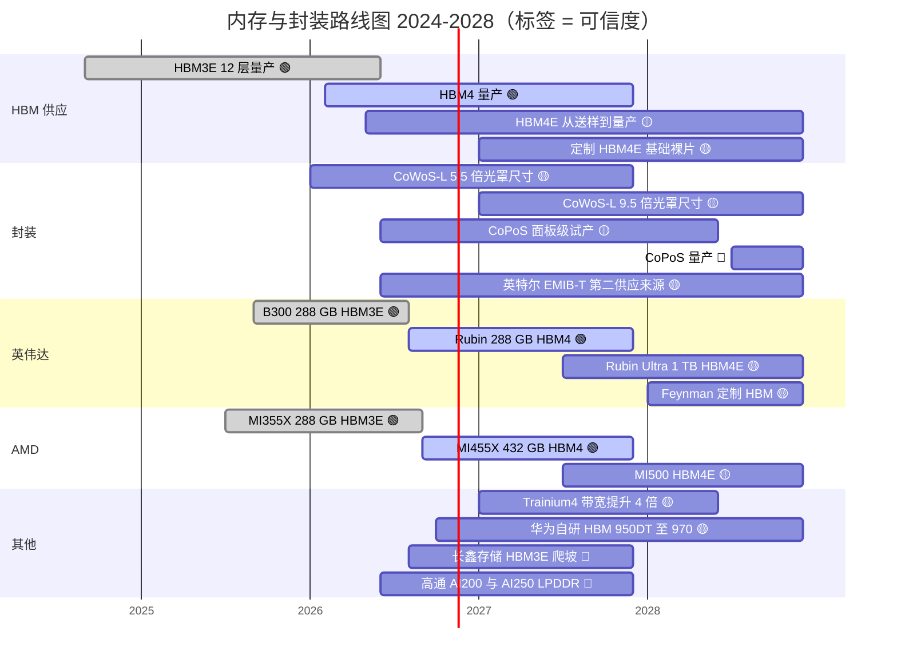
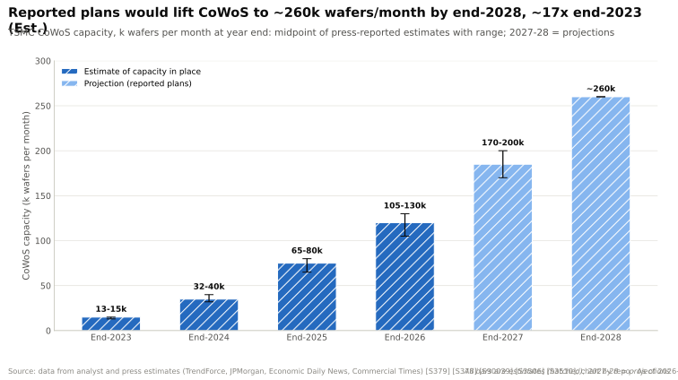

# 内存、封装与供应链：路线图

> [!NOTE]
> 本页为英文原文的简体中文参考译文，仅供参考；如有出入，以[英文原文](../../../layers/03-memory-packaging-supply-chain/roadmap.md "English original")为准。

第 03 层 · 内存、封装与供应链 · 约 11 分钟阅读 · 最近核实：2026-11-05

## ⚡ 要点速览

- **2026 年是 [HBM4](../../glossary.md#hbm) 之年，但开局并不顺利。** Rubin 出货时搭载 288 GB [HBM4](../../glossary.md#hbm4)，但其标称带宽由 22 TB/s 降至 19.2 TB/s [[S103]](../../../sources/bibliography.md#s103)[[S104]](../../../sources/bibliography.md#s104)；有分析师将此归因于约 9.4 Gb/s（而非约 10.7 Gb/s）的[引脚速率](../../glossary.md#pin-speed)（🔴 原因）[[S90006]](../../../sources/bibliography.md#s90006)。
- **2027 年将迎来 [HBM4E](../../glossary.md#hbm4e) 与定制基础裸片。** 三星与 SK 海力士已于 2026 年 5–6 月送样 HBM4E [[S3528]](../../../sources/bibliography.md#s3528)；TrendForce 预计 HBM4E 将占 2027 年市场的约 40% [[S3531]](../../../sources/bibliography.md#s3531)，[HBM 基础裸片](../../glossary.md#hbm-base-die)将转向台积电 N3P 等逻辑工艺 [[S3008]](../../../sources/bibliography.md#s3008)[[S3011]](../../../sources/bibliography.md#s3011)。
- **英伟达（NVIDIA）已公布的 2027 年跃升是 Rubin Ultra：16 个堆栈、1 TB HBM4E** [[S35018]](../../../sources/bibliography.md#s35018)[[S110]](../../../sources/bibliography.md#s110)。🟡 有报道称其可能以 768 GB 或双裸片封装形式出货 [[S111]](../../../sources/bibliography.md#s111)[[S509]](../../../sources/bibliography.md#s509)；英伟达则表示其路线图保持不变 [[S508]](../../../sources/bibliography.md#s508)。
- **AMD 继续坚持容量优先。** MI455X（432 GB、23.3 TB/s）于 2026 年出货，MI500 将于 2027 年跟进 [[S144]](../../../sources/bibliography.md#s144)[[S90093]](../../../sources/bibliography.md#s90093)[[S538]](../../../sources/bibliography.md#s538)；AWS 宣称 Trainium4 的内存带宽将是 Trainium3 的四倍 [[S156]](../../../sources/bibliography.md#s156)。
- **封装产能持续复合增长。** 据估计，[CoWoS](../../glossary.md#cowos) 产能在 2026 年底约为每月 105–130k 片晶圆，2027 年为 170–200k 片，到 2028 年约为 260k 片 [[S90039]](../../../sources/bibliography.md#s90039)[[S3510]](../../../sources/bibliography.md#s3510)[[S3002]](../../../sources/bibliography.md#s3002)。🟡 面板级 [CoPoS](../../glossary.md#copos) 预计在 2028 年下半年之前不会量产 [[S3004]](../../../sources/bibliography.md#s3004)。
- > [!TIP]
> **算例 —— 内存价格敏感性。** 在约 $7.8M 的 Vera Rubin 机架中，内存约占 $2.0M（估计）[[S330]](../../../sources/bibliography.md#s330)。内存价格每上涨 10%，每台机架成本增加约 $200K（+2.6%）；若价格翻倍，则增加约 $2.0M（+26%），英伟达必须将其转嫁或自行消化（🔴 本资料库测算）。

**[Q7 · 路线图与变数]** HBM4E 的引脚速率与良率、三星的份额、CoWoS 供应是否超过需求、内存价格以及中国本土 HBM，将决定英伟达的供应护城河是拓宽还是被侵蚀。

## 路线图一览

下表未列出的条目来源：HBM3E 12 层 [[S372]](../../../sources/bibliography.md#s372)[[S123]](../../../sources/bibliography.md#s123)；CoWoS-L 5.5 倍（2026 年）与 9.5 倍（2027 年）光罩尺寸目标 [[S380]](../../../sources/bibliography.md#s380)；英特尔 EMIB-T [[S15548]](../../../sources/bibliography.md#s15548)[[S15549]](../../../sources/bibliography.md#s15549)；搭载 HBM4E 的 MI500 [[S145]](../../../sources/bibliography.md#s145)[[S538]](../../../sources/bibliography.md#s538)；长鑫存储 HBM3E [[S3516]](../../../sources/bibliography.md#s3516)。

| 项目 | 时间窗口 | 状态 | 可信度 | 来源 |
|---|---|---|---|---|
| Rubin：288 GB HBM4，19.2 TB/s（发布时 22） | 2026 年 Q3 起 | 已出货 | 🟢 | [[S102]](../../../sources/bibliography.md#s102)[[S104]](../../../sources/bibliography.md#s104) |
| Rubin Ultra：1 TB HBM4E，16 个堆栈，约 32 TB/s | 2027 年下半年 | 路线图 | 🟢 已公布 / 🟡 有 768 GB 或双裸片的报道 | [[S35018]](../../../sources/bibliography.md#s35018)[[S110]](../../../sources/bibliography.md#s110)[[S111]](../../../sources/bibliography.md#s111)[[S509]](../../../sources/bibliography.md#s509) |
| 面向 Rubin Ultra 的 Kyber NVL144 机架 | 2027 年下半年（有报道称推迟至 2028 年） | 路线图 | 🟡 | [[S507]](../../../sources/bibliography.md#s507)[[S508]](../../../sources/bibliography.md#s508) |
| Feynman：定制 HBM、堆叠裸片 | 2028 | 路线图 | 🟡 | [[S502]](../../../sources/bibliography.md#s502)[[S119]](../../../sources/bibliography.md#s119) |
| Rubin CPX 以 HBM4 替代 GDDR7 复活 | 2027 年 Q1 | 有报道 | 🔴 | [[S117]](../../../sources/bibliography.md#s117) |
| AMD MI455X 432 GB HBM4；MI500 | 2026；2027 | 已出货；路线图 | 🟢 | [[S144]](../../../sources/bibliography.md#s144)[[S538]](../../../sources/bibliography.md#s538) |
| 三星 + SK 海力士 HBM4E 送样 | 2026 年 5–6 月 | 送样中 | 🟡 | [[S3528]](../../../sources/bibliography.md#s3528) |
| 美光 HBM4E，基础裸片由台积电制造 | 2027 | 路线图 | 🟡 | [[S3007]](../../../sources/bibliography.md#s3007) |
| CoWoS 约每月 170–200k 片晶圆 | 2027 年底 | 预测 | 🟡 | [[S3510]](../../../sources/bibliography.md#s3510)[[S3001]](../../../sources/bibliography.md#s3001) |
| CoPoS 面板级封装量产 | 2028 年下半年至 2029 年（或更晚） | 试产 | 🔴 | [[S3004]](../../../sources/bibliography.md#s3004)[[S3508]](../../../sources/bibliography.md#s3508) |
| 华为昇腾 960 / 970 自研 HBM（960：288 GB；9.6 / 14.4 TB/s） | 2027 / 2028 | 路线图 | 🟡 | [[S163]](../../../sources/bibliography.md#s163) |

> [!TIP]
> **算例 —— 晶圆数不等于封装数。** CoWoS 产能可能大致翻倍，从约 120–130k 片（2026 年底）增至每月约 260k 片晶圆（2028 年）[[S3002]](../../../sources/bibliography.md#s3002)。但一片 300 mm 晶圆可容纳约 11–16 个 Rubin 封装，而四裸片 Rubin Ultra 级封装仅约 4–6 个（本资料库估计）[[S3000]](../../../sources/bibliography.md#s3000)。如果产出转向 Ultra 级封装，两倍的晶圆产出的 GPU 数量大致持平甚至更少（🔴），这就是为什么即便产能增长，更大的封装仍会让封装产能保持紧张。

## HBM4 到 HBM4E：带宽从何而来

单堆栈带宽就是 *总线位宽 × 引脚速率*。HBM4 将总线从 1,024 根线翻倍至 2,048 根（机制详见 [HBM 详解](hbm-explained.md)）[[S369]](../../../sources/bibliography.md#s369)；在同一代内，唯一的杠杆就是每根线的翻转速度，而这恰恰是 Rubin 未达预期之处。

| 单堆栈 | HBM3E 12 层 | HBM4（JEDEC） | Rubin 中的 HBM4 | HBM4E（2027 年） |
|---|---|---|---|---|
| 接口 | 1,024 位 | 2,048 位 [[S369]](../../../sources/bibliography.md#s369) | 2,048 位 | 2,048 位（假设） |
| 引脚速率 | 9.6–9.8 Gb/s [[S373]](../../../sources/bibliography.md#s373)[[S372]](../../../sources/bibliography.md#s372) | 8 Gb/s [[S369]](../../../sources/bibliography.md#s369) | 推算约 9.4 Gb/s [[S90006]](../../../sources/bibliography.md#s90006) | 目标最高 12.8 Gb/s [[S3009]](../../../sources/bibliography.md#s3009) |
| 带宽 | ~1.2–1.3 TB/s | 2.0 TB/s | ~2.4 TB/s | ~3.3 TB/s（本资料库测算） |
| 容量 | 36 GB | 最高 64 GB [[S369]](../../../sources/bibliography.md#s369) | 36 GB | 48–64 GB [[S111]](../../../sources/bibliography.md#s111)[[S35041]](../../../sources/bibliography.md#s35041) |
| 基础裸片 | DRAM 工艺 | 可选逻辑工艺 | — | 定制逻辑，台积电 N3P / N12 或三星 4 nm [[S3008]](../../../sources/bibliography.md#s3008)[[S3011]](../../../sources/bibliography.md#s3011) |

> [!TIP]
> **算例 —— 引脚速率解释了 Rubin 的规格修订。** Rubin 搭载八个 2,048 位的 HBM4 堆栈 [[S360]](../../../sources/bibliography.md#s360)。按 8 Gb/s（JEDEC）计：8 × 2,048 × 8 ÷ 8 = 16.4 TB/s。按约 9.4 Gb/s 计：19.2 TB/s，即修订后的数字。按约 10.7 Gb/s 计：约 21.9 TB/s，即 22 TB/s 的发布目标 [[S103]](../../../sources/bibliography.md#s103)[[S90006]](../../../sources/bibliography.md#s90006)。英伟达曾要求供应商提供 >10–11 Gb/s [[S90041]](../../../sources/bibliography.md#s90041)；据报道量产器件的速率更低。Rubin Ultra 以 16 个堆栈实现约 32 TB/s，每引脚只需约 7.8 Gb/s（本资料库测算），这是依靠堆栈数量而非速率的更稳妥押注。

> [!TIP]
> **算例 —— 1 TB 的内存账单。** 按伯恩斯坦（Bernstein）对 2027 年 HBM4 约 $53/GB 的预测 [[S333]](../../../sources/bibliography.md#s333)，Rubin Ultra 的 1 TB 每颗 GPU 约需 $54K 的 HBM，而同价格下 Rubin 的 288 GB 约为 $15K（🔴 本资料库测算）。768 GB 方案每颗 GPU 可节省约 $14K，这可能是相关报道背后的一个合理原因。TrendForce 预计 2027 年 HBM 综合价格将上涨 121% [[S3520]](../../../sources/bibliography.md#s3520)。

🔧 技术细节：为什么面板级封装与定制基础裸片很重要

随着封装尺寸逼近 9.5 倍光罩尺寸，一片 300 mm 圆形晶圆能容纳的大型矩形中介层越来越少；方形面板的面积浪费更少，这正是台积电试产 CoPoS 的原因（见 [CoWoS 与先进封装](cowos-and-advanced-packaging.md)）[[S3004]](../../../sources/bibliography.md#s3004)。另一方面，采用逻辑工艺的 HBM 基础裸片使买家可以在 DRAM 堆栈下方放置自己的控制器或简单计算单元：这是一种超越“购买英伟达同款堆栈”的设计杠杆。

## 哪些因素会改变格局

- **HBM4E 的速率与良率。** 若再像 Rubin 那样未达预期，AMD 将再获得一个带宽卖点；若爬坡顺利，英伟达将凭借 Rubin Ultra 恢复领先。
- **三星的份额。** 预测称到 2026 年 Q4 其份额将接近 40% [[S3501]](../../../sources/bibliography.md#s3501)；如果这部分产能向 AMD 倾斜 [[S3512]](../../../sources/bibliography.md#s3512)，英伟达的多源采购优势将缩小。
- **CoWoS 供应超过需求。** 预计到 2026 年底缺口将从约 20% 收窄至约 10% [[S3505]](../../../sources/bibliography.md#s3505)；凯基证券（KGI）预计 2027 年英伟达与博通各增加约 100k 片晶圆 [[S3001]](../../../sources/bibliography.md#s3001)。封装产能充裕将削弱配额作为护城河的作用。
- **内存价格。** 内存已约占 Vera Rubin 机架成本的 26%（估计）[[S330]](../../../sources/bibliography.md#s330)；HBM 价格进一步上涨，挤压的要么是英伟达的利润率，要么是客户的预算。
- **中国。** 长鑫存储（CXMT）计划于 2027 年扩产 [HBM3E](../../glossary.md#hbm3e) [[S3516]](../../../sources/bibliography.md#s3516)；华为的目标是到 2028 年达到 14.4 TB/s [[S163]](../../../sources/bibliography.md#s163)。

**[Q7 · 路线图与变数]** 只有当 1 TB 的 Rubin Ultra 如期按公布规格出货时，英伟达的路线图才能在 2027 年夺回容量领先；更大的变数在于封装与 HBM 供应是否不再稀缺。

## 🎯 企业发展视角

1. 定制 HBM 基础裸片开辟了新的设计空间：挑战者能否凭借内存侧逻辑而非堆栈数量实现差异化？
2. 如果 CoWoS 产能到 2028 年大致翻倍 [[S3002]](../../../sources/bibliography.md#s3002)，今天的供应优势有多少只是暂时的？
3. HBM4E 的延迟是否有利于依靠更多堆栈、更低引脚速率的设计（AMD 的 12 个堆栈、Rubin Ultra 的 16 个堆栈）？
4. 二线买家现在需要为 2028 年预留哪些封装替代方案（英特尔 [EMIB-T](../../glossary.md#emib)、CoPoS、[封测代工厂（OSAT）](../../glossary.md#osat)产能）？

## 📚 来源（Sources）

<!-- Auto-generated from the [S…] citations on this page by `make build`. Edit sources/registry/*.csv, not this list. -->

- [**S102**](../../../sources/bibliography.md#s102) NVIDIA, *NVIDIA DGX Vera Rubin NVL72*, 2026. [Link](https://www.nvidia.com/en-us/data-center/dgx-vera-rubin-nvl72/)
- [**S103**](../../../sources/bibliography.md#s103) VideoCardz, *NVIDIA quietly cuts Vera Rubin specs, HBM4 bandwidth and NVLink 6 speeds now lower*, 2026-10. [Link](https://videocardz.com/newz/nvidia-quietly-cuts-vera-rubin-specs-hbm4-bandwidth-and-nvlink-6-speeds-now-lower)
- [**S104**](../../../sources/bibliography.md#s104) Wccftech, *NVIDIA's Official Statement on Vera Rubin Spec Change*, 2026-10-29. [Link](https://wccftech.com/nvidia-official-statement-on-vera-rubin-spec-change/)
- [**S110**](../../../sources/bibliography.md#s110) Tom's Hardware, *Nvidia demonstrates Rubin Ultra tray, the world's first AI GPU with 1TB of HBM4E memory*, 2026-03. [Link](https://www.tomshardware.com/pc-components/gpus/nvidia-demonstrates-rubin-ultra-tray-worlds-1st-ai-gpu-with-1tb-of-hbm4e)
- [**S111**](../../../sources/bibliography.md#s111) Crypto Briefing, *Nvidia's Rubin Ultra targets 768GB of HBM4E as Kyber platform stays on schedule*, 2026. [Link](https://cryptobriefing.com/nvidia-rubin-ultra-hbm4e-kyber-2027/)
- [**S117**](../../../sources/bibliography.md#s117) TechNews (Taiwan), *Nvidia Rubin CPX re-enters roadmap with HBM4 for AI prefill*, 2026-09-02. [Link](https://technews.tw/2026/09/02/nvidia-rubin-cpx-reenters-roadmap-hbm4-ai-prefill/)
- [**S119**](../../../sources/bibliography.md#s119) XenoSpectrum, *NVIDIA's Feynman May Combine TSMC A16 and N3P, Reports Say*, 2026. [Link](https://xenospectrum.com/en/nvidia-feynman-tsmc-a16-report/)
- [**S123**](../../../sources/bibliography.md#s123) Glenn K. Lockwood (blog) (Glenn K. Lockwood), *HGX B300 specifications compilation (B300 per-GPU figures)*, 2025. [Link](https://glennklockwood.com/garden/processors/B300)
- [**S144**](../../../sources/bibliography.md#s144) AMD Newsroom, *AMD Unveils Vision for an Open AI Ecosystem, Detailing New Silicon, Software and Systems at Advancing AI 2025*, 2025-06-12. [Link](https://www.amd.com/en/newsroom/press-releases/2025-6-12-amd-unveils-vision-for-an-open-ai-ecosystem-detai.html)
- [**S145**](../../../sources/bibliography.md#s145) AMD (Lisa Su), *AMD at CES 2026 (keynote: Helios, MI455X, MI440X, MI500 preview)*, 2026-01-05. [Link](https://www.amd.com/en/corporate/events/ces.html)
- [**S156**](../../../sources/bibliography.md#s156) About Amazon, *AWS re:Invent 2025: top announcements (Trainium3 GA, Trainium4 preview, Graviton5)*, 2025-12-02. [Link](https://www.aboutamazon.com/news/aws/aws-re-invent-2025-ai-news-updates)
- [**S163**](../../../sources/bibliography.md#s163) Huawei (Eric Xu), *Huawei Connect 2025 keynote: Ascend roadmap and SuperPoD interconnect (Eric Xu)*, 2025-09-18. [Link](https://www.huawei.com/en/news/2025/9/hc-xu-keynote-speech)
- [**S330**](../../../sources/bibliography.md#s330) PC Gamer, *A single Nvidia Vera Rubin rack is estimated to cost $7,803,148 with over $2 million of that figure spent on memory alone*, 2026-05. [Link](https://pcgamer.com/hardware/a-single-nvidia-vera-rubin-rack-is-estimated-to-cost-usd7-803-148-with-over-usd2-million-of-that-figure-spent-on-memory-alone)
- [**S333**](../../../sources/bibliography.md#s333) Wccftech, *Bernstein warns NVIDIA's Vera Rubin racks will hit $9.1 million as HBM4 prices triple to $53 per gigabyte*, 2026-07. [Link](https://wccftech.com/bernstein-warns-nvidias-vera-rubin-racks-will-hit-9-1-million-as-hbm4-prices-triple-to-53-per-gigabyte/)
- [**S360**](../../../sources/bibliography.md#s360) glennklockwood.com (Glenn K. Lockwood), *NVIDIA Rubin (R200) processor notes*, 2026. [Link](https://glennklockwood.com/garden/processors/r200)
- [**S369**](../../../sources/bibliography.md#s369) JEDEC, *JESD270-4: High Bandwidth Memory (HBM4) standard*, 2025-04-16. [Link](https://www.jedec.org/standards-documents/docs/jesd270-4)
- [**S372**](../../../sources/bibliography.md#s372) Samsung Electronics, *Samsung develops industry-first 36GB HBM3E 12H DRAM*, 2024-02-27. [Link](https://news.samsung.com/global/samsung-develops-industry-first-36gb-hbm3e-12h-dram)
- [**S373**](../../../sources/bibliography.md#s373) SK hynix Newsroom, *SK hynix begins industry's first mass production of 12-layer HBM3E*, 2024-09-26. [Link](https://news.skhynix.com/sk-hynix-begins-industrys-first-mass-production-of-12-layer-hbm3e/)
- [**S380**](../../../sources/bibliography.md#s380) TSMC, *TSMC 3DFabric: CoWoS-S, CoWoS-R and CoWoS-L technology overview and roadmap*, 2025. [Link](https://3dfabric.tsmc.com/english/dedicatedFoundry/technology/cowos.htm)
- [**S502**](../../../sources/bibliography.md#s502) Tom's Hardware, *Nvidia updates data center roadmap with Rosa CPU and stacked Feynman GPUs; optical NVLink; Groq LPUs with NVFP4 and NVLink also on deck*, 2026-03-17. [Link](https://www.tomshardware.com/pc-components/gpus/nvidia-updates-data-center-roadmap-with-rosa-cpu-and-stacked-feynman-gpus-optical-nvlink-groq-lpus-with-nvfp4-and-nvlink-also-on-deck)
- [**S507**](../../../sources/bibliography.md#s507) Tom's Hardware, *Nvidia's Kyber rack for Rubin Ultra slips to 2028*, 2026-07-06. [Link](https://www.tomshardware.com/pc-components/gpus/nvidias-kyber-rack-for-rubin-ultra-slips-to-2028)
- [**S508**](../../../sources/bibliography.md#s508) Wccftech, *NVIDIA Quashes Rubin & Kyber Rack Delay Rumors, Says 'Chip Roadmap Is Intact'*, 2026-07. [Link](https://wccftech.com/nvidia-quashes-rubin-kyber-rack-delay-rumors-says-chip-roadmap-is-intact/)
- [**S509**](../../../sources/bibliography.md#s509) TrendForce, *NVIDIA Rubin Ultra four-die single-package design not adopted amid advanced-packaging constraints*, 2026-04-01. [Link](https://www.trendforce.com/news/?p=55442)
- [**S538**](../../../sources/bibliography.md#s538) AMD Investor Relations, *AAI 2026: AMD Delivers Full-Stack Compute for the Agentic AI Era*, 2026-07-23. [Link](https://ir.amd.com/news-events/press-releases/detail/1294/aai-2026-amd-delivers-full-stack-compute-for-the-agentic-ai-era)
- [**S3000**](../../../sources/bibliography.md#s3000) nvidia_deep_dive_claude repository, *Repo analysis: layer 03 memory, packaging and supply-chain models (decode ceilings, HBM sizing, CoWoS packages per wafer)*, 2026-11-05. [Link](https://github.com/FrankHuang94/nvidia_deep_dive_claude/blob/main/layers/03-memory-packaging-supply-chain/index.md)
- [**S3001**](../../../sources/bibliography.md#s3001) KGI Securities, *TSMC (2330 TT) research note: CoWoS expansion forecast raised*, 2026-03-09. [Link](https://www.kgi.com.hk/en/-/media/files/kgishk/research-reports/tw-reports/tsmc_2330-tt_09032026e.pdf)
- [**S3002**](../../../sources/bibliography.md#s3002) TrendForce, *TSMC reportedly targets 22% 2nm, 16% 3nm capacity boost by mid-2027; CoWoS to double by 2028*, 2026-09-14. [Link](https://www.trendforce.com/news/2026/09/14/news-tsmc-reportedly-targets-22-2nm-16-3nm-capacity-boost-by-mid-2027-cowos-to-double-by-2028/)
- [**S3004**](../../../sources/bibliography.md#s3004) TrendForce, *TSMC advances panel-level packaging: CoPoS pilot line reportedly set for June completion; 2028-29 ramp eyed*, 2026-04-13. [Link](https://www.trendforce.com/news/2026/04/13/news-tsmc-advances-panel-level-packaging-copos-pilot-line-reportedly-set-for-june-completion-2028-29-ramp-eyed/)
- [**S3007**](../../../sources/bibliography.md#s3007) Tom's Hardware, *Micron teams up with TSMC to deliver HBM4E, targeted for 2027*, 2025-09. [Link](https://www.tomshardware.com/micron-hands-tsmc-the-keys-to-hbm4e)
- [**S3008**](../../../sources/bibliography.md#s3008) TrendForce, *TSMC unveils custom C-HBM4E details: N3P logic dies reportedly target 2x efficiency gain*, 2025-12-01. [Link](https://www.trendforce.com/news/2025/12/01/news-tsmc-unveils-custom-c-hbm4e-details-n3p-logic-dies-reportedly-target-2x-efficiency-gain/)
- [**S3009**](../../../sources/bibliography.md#s3009) Tom's Hardware, *HBM undergoes major architectural shakeup as TSMC and GUC detail HBM4, HBM4E and C-HBM4E 3nm base dies, up to 12.8 GT/s by 2027*, 2025. [Link](https://www.tomshardware.com/pc-components/dram/hbm-undergoes-major-architectural-shakeup-as-tsmc-and-guc-detail-hbm4-hbm4e-and-c-hbm4e-3nm-base-dies-to-enable-2-5x-performance-boost-with-speeds-of-up-to-12-8gt-s-by-2027)
- [**S3011**](../../../sources/bibliography.md#s3011) TrendForce, *Samsung's custom HBM4E design reportedly aimed for mid-2026, parallels SK hynix and Micron*, 2026-01-23. [Link](https://www.trendforce.com/news/2026/01/23/news-samsungs-custom-hbm4e-design-reportedly-aimed-for-mid-2026-parallels-sk-hynix-and-micron/)
- [**S3501**](../../../sources/bibliography.md#s3501) Edaily, *SK hynix keeps HBM lead at 50% in Q2 as Samsung jumps to 33% (Counterpoint)*, 2026-09-03. [Link](https://en.edaily.co.kr/news/eda202609035608/)
- [**S3505**](../../../sources/bibliography.md#s3505) TrendForce, *TSMC CoWoS supply-demand gap reportedly seen narrowing from 20% to 10% by end-2026 as capacity expands*, 2026-06-15. [Link](https://www.trendforce.com/news/2026/06/15/news-tsmc-cowos-supply-demand-gap-reportedly-seen-narrowing-from-20-to-10-by-end-2026-as-capacity-expands)
- [**S3508**](../../../sources/bibliography.md#s3508) Tiger Brokers (iTiger), *TSMC's advanced packaging timeline shifts: CoWoS gains extended lifespan, next-gen CoPoS delayed until late 2030*, 2026. [Link](https://www.itiger.com/news/1179706576)
- [**S3510**](../../../sources/bibliography.md#s3510) AI Weekly, *TSMC mulls up to 20% CoWoS hike and 2027 wafer price rise*, 2026. [Link](https://aiweekly.co/alerts/tsmc-mulls-up-to-20-cowos-hike-and-2027-wafer-price-rise)
- [**S3512**](../../../sources/bibliography.md#s3512) Asia Economy (Asiae), *Samsung Electronics to prioritize HBM4 supply for AMD AI accelerators*, 2026-03-18. [Link](https://view.asiae.co.kr/en/article/2026031817142143855)
- [**S3516**](../../../sources/bibliography.md#s3516) Korea JoongAng Daily, *China's CXMT begins HBM3E production as chip battle with Korean powerhouses widens*, 2026-08. [Link](https://www.koreajoongangdaily.com/business/chinas-cxmt-begins-hbm3e-production-as-chip-battle-with-korean-powerhouses-widens/12854260)
- [**S3520**](../../../sources/bibliography.md#s3520) Silicon Analysts, *TrendForce: 2027 HBM blended ASP to jump 121% as HBM4/HBM4E mix shifts*, 2026-10-06. [Link](https://siliconanalysts.com/market/trendforce-2027-hbm-blended-asp-to-jump-121-as-hbm4-hbm4e-mix-shifts-2026-10-06)
- [**S3528**](../../../sources/bibliography.md#s3528) TrendForce, *SK hynix reportedly pulls forward HBM4E sample timeline, eyeing June-July shipments to key customers*, 2026-06-15. [Link](https://www.trendforce.com/news/2026/06/15/news-sk-hynix-reportedly-pulls-forward-hbm4e-sample-timeline-eyeing-june-july-shipments-to-key-customers/)
- [**S3531**](../../../sources/bibliography.md#s3531) TrendForce, *HBM4E seen hitting 40% of 2027 market; Samsung, SK hynix reportedly aim for 1H26 completion*, 2025-11-13. [Link](https://www.trendforce.com/news/2025/11/13/news-hbm4e-seen-hitting-40-of-2027-market-samsung-sk-hynix-reportedly-aim-for-1h26-completion/)
- [**S15548**](../../../sources/bibliography.md#s15548) Tom's Hardware, *Intel's EMIB-T heads for fab rollout this year*, 2026. [Link](https://www.tomshardware.com/tech-industry/semiconductors/intels-emib-t-heads-for-fab-rollout-this-year)
- [**S15549**](../../../sources/bibliography.md#s15549) DIGITIMES Asia, *Intel EMIB packaging customers and revenue timing*, 2026-05-05. [Link](https://apps.digitimes.com/news/a20260505PD217.html)
- [**S35018**](../../../sources/bibliography.md#s35018) Tom's Hardware, *Nvidia announces Rubin GPUs in 2026, Rubin Ultra in 2027, Feynman also added to roadmap*, 2025-03-18. [Link](https://www.tomshardware.com/pc-components/gpus/nvidia-announces-rubin-gpus-in-2026-rubin-ultra-in-2027-feynam-after)
- [**S35041**](../../../sources/bibliography.md#s35041) Glenn K. Lockwood (Glenn K. Lockwood), *Rubin Ultra (R300) notes*, 2026. [Link](https://glennklockwood.com/garden/processors/R300)
- [**S90006**](../../../sources/bibliography.md#s90006) TweakTown, *Nvidia cuts Vera Rubin's memory bandwidth by up to 26% and AMD's Helios now leads in memory bandwidth*, 2026-10. [Link](https://www.tweaktown.com/news/114304/nvidia-cuts-vera-rubins-memory-bandwidth-by-up-to-26-percent-and-amds-helios-now-leads-in-memory-bandwidth/index.html)
- [**S90039**](../../../sources/bibliography.md#s90039) TrendForce, *Samsung, SK hynix reportedly tapped as NVIDIA Rubin HBM4 suppliers; shipments could start in March*, 2026-03-09. [Link](https://www.trendforce.com/news/2026/03/09/news-samsung-sk%E2%80%AFhynix-reportedly-tapped-as-nvidia-rubin-hbm4-suppliers-shipments-could-start-in-march/)
- [**S90041**](../../../sources/bibliography.md#s90041) I-Connect007 (TrendForce), *NVIDIA seeks to raise HBM4 specs in response to AMD competition; SK hynix expected to remain largest supplier in 2026*, 2025-09. [Link](https://iconnect007.com/article/146969/nvidia-seeks-to-raise-hbm4-specs-in-response-to-amd-competition-sk-hynix-expected-to-remain-largest-supplier-in-2026/146966/aep)
- [**S90093**](../../../sources/bibliography.md#s90093) Tom's Hardware, *AMD takes the wraps off its Instinct MI455X AI accelerator: CDNA 5 and Helios rack-scale architecture*, 2026. [Link](https://www.tomshardware.com/pc-components/gpus/amd-takes-the-wraps-off-its-instinct-mi455x-ai-accelerator-cdna-5-and-helios-rack-scale-architecture-combine-to-take-the-fight-to-nvidia-in-the-data-center)
