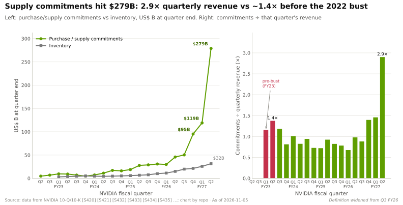
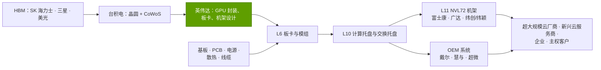
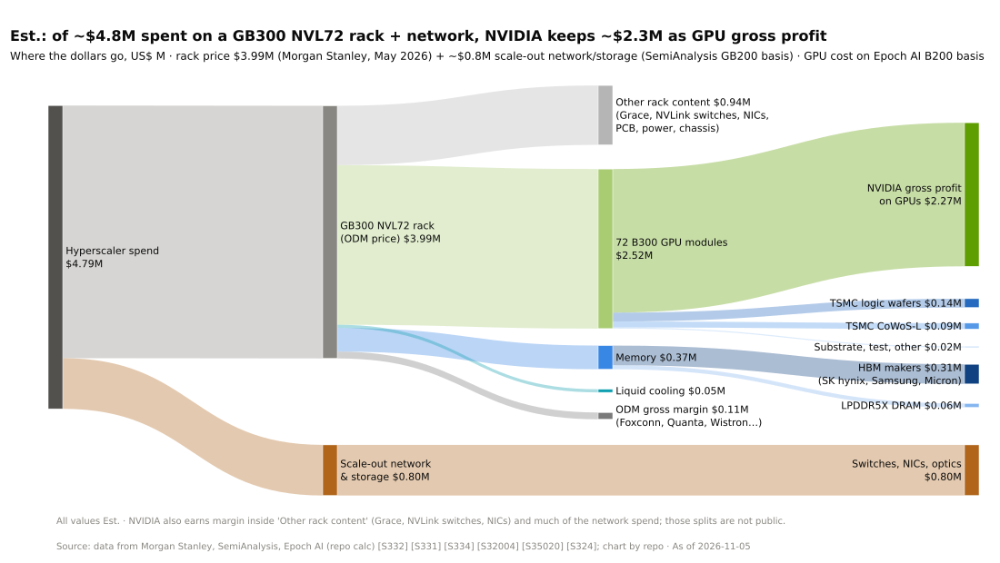

# 供应链即武器

> [!NOTE]
> 本页为英文原文的简体中文参考译文，仅供参考；如有出入，以[英文原文](../../../layers/03-memory-packaging-supply-chain/supply-chain-as-a-weapon.md "English original")为准。

第 03 层 · 内存、封装与供应链 · 约 8 分钟阅读 · 最近核实：2026-11-05

## ⚡ 要点速览

- **英伟达（NVIDIA）提前买下瓶颈。** 截至 Q2 FY2027，供应与产能承诺（[采购义务](../../glossary.md#purchase-obligations)）达 $279B，较上一季度的 $119B 大幅上升，主要为内存与制造产能 [[S407]](../../../sources/bibliography.md#s407)[[S404]](../../../sources/bibliography.md#s404)。
- **这一规模前所未有。** 该数字在 FY2023 末为 $4.9B，在 FY2026 末为 $95.2B [[S419]](../../../sources/bibliography.md#s419)[[S401]](../../../sources/bibliography.md#s401)，但 10-K 中的“采购义务”科目与 10-Q 中口径更宽的“供应与产能承诺”（$119B → $279B）并不严格可比 [[S90092]](../../../sources/bibliography.md#s90092)；目前约为 $96.2B 季度营收的 2.9 倍 [[S405]](../../../sources/bibliography.md#s405)。10-Q 还列示了 $29B 的云服务协议，以及 $36B 的 AI 云产能兜底承诺 [[S407]](../../../sources/bibliography.md#s407)。
- **一条长链把芯片变成机架。** [ODM](../../glossary.md#odm)（富士康、广达、纬创）制造板卡、托盘与机架（[L6/L10/L11](../../glossary.md#l6-l10-l11)）；[OEM](../../glossary.md#oem)（戴尔、慧与、超微）销售自有品牌系统。🟡 富士康称其占据约 40% 的 AI 服务器市场 [[S3014]](../../../sources/bibliography.md#s3014)。
- **短缺时期，配额优势会自我强化。** 🟡 据报道，英伟达拿下了台积电（TSMC）2026 年一半以上的 [CoWoS](../../glossary.md#cowos) 产能 [[S379]](../../../sources/bibliography.md#s379)[[S3003]](../../../sources/bibliography.md#s3003)，以及 SK 海力士最大份额的[高带宽内存（HBM）](../../glossary.md#hbm)配额 [[S90041]](../../../sources/bibliography.md#s90041)；首席财务官称 FY2028 将“受供应限制” [[S90012]](../../../sources/bibliography.md#s90012)。
- **🐻 这一杠杆是双刃剑。** 2022 年，英伟达在一个季度内计提了约 $1.34B 的存货减值 [[S433]](../../../sources/bibliography.md#s433)；2025 年的 H20 禁令则带来了 $4.5B 的存货与采购义务相关费用 [[S414]](../../../sources/bibliography.md#s414)。

## 承诺与预付款：在产能存在之前就买下它

**机制。** HBM 产线、CoWoS 设备与基板工厂需要一到两年才能建成，而供应商只会针对确定的需求扩产。英伟达以不可撤销承诺的形式提供这种确定性，有时还预先支付现金（[预付款](../../glossary.md#prepayment)）。供应商获得有保障的回报；英伟达获得产出的优先认领权。**类比：** 为两年后的一场活动，交定金订下城里所有好酒店。

> [!TIP]
> **算例 —— $279B 有多大？** $96.2B 的季度营收、约 75% 的毛利率意味着季度营业成本约 $24B [[S405]](../../../sources/bibliography.md#s405)，因此 $279B 约相当于 11.6 个季度、约 2.9 年的当前销货成本（🔴 本资料库测算）[[S407]](../../../sources/bibliography.md#s407)。2022 年年中，$9.2B 的采购义务约为 $6.7B 季度营收的 1.4 倍 [[S420]](../../../sources/bibliography.md#s420)[[S433]](../../../sources/bibliography.md#s433)。**商业解读：** 英伟达大约锁定了三年的投入品，需求坚挺时这是护城河，否则就是一项固定负债。

FY2023 期间预付供应协议余额为 $3.1–3.5B [[S420]](../../../sources/bibliography.md#s420)[[S419]](../../../sources/bibliography.md#s419)；当前余额不在本资料库的数据中。内存厂商也与其他客户签订长期协议（🟡 据报道美光 2026 年约 $22B）[[S3018]](../../../sources/bibliography.md#s3018)；英伟达只是其中规模最大的一家。

🔧 技术细节：“承诺”里有什么，以及损失如何体现

该科目涵盖存货采购义务与产能预留（自 Q3 FY2026 起表述为“制造、供应与产能承诺”）[[S412]](../../../sources/bibliography.md#s412)。需求不足时就会形成费用：Q3 FY2023 约 $348M [[S421]](../../../sources/bibliography.md#s421)，Q1 FY2026 因 H20 计提 $4.5B [[S414]](../../../sources/bibliography.md#s414)。看空者把 10-K 的 $95B 到 10-Q 的 $279B 解读为六个月内接近增至三倍 [[S431]](../../../sources/bibliography.md#s431)；但二者是不同的科目，同口径的 10-Q 变化是一个季度内从 $119B 增至 $279B [[S90092]](../../../sources/bibliography.md#s90092)[[S404]](../../../sources/bibliography.md#s404)。

## 谁来造整机：ODM 与 OEM 链条

集成深度按层级标注：**L6** 为已贴装元件的板卡，**L10** 为经过测试的服务器或托盘，**L11** 为网络、供电与散热作为一个整体完成验证的整机架。

| 公司 | 主要角色 | 要点 |
|---|---|---|
| 富士康（鸿海） | L6 至 L11：模组、托盘、NVL72 机架 | 🟡 AI 服务器份额约 40%；2026 年机架出货量可能翻倍 [[S3014]](../../../sources/bibliography.md#s3014) |
| 广达 | 面向超大规模云厂商的 L10–L11 机架 | 🟡 2026 年 8 月前开始首批 Rubin 交付 [[S90010]](../../../sources/bibliography.md#s90010) |
| 纬创 / 纬颖（Wiwynn） | 板卡与托盘；超大规模云厂商机架，含定制 ASIC 项目 | 业务敞口横跨英伟达与云厂商自研芯片 |
| 超微（Supermicro）、戴尔（Dell）、慧与（HPE） | OEM 系统、服务、融资 | 新兴云服务商、企业与主权客户渠道 |
| 天弘（Celestica） | 超大规模云厂商机架与交换机 | 🟡 2026 年第一季度 AI 后端交换机销售额位居第一 [[S90054]](../../../sources/bibliography.md#s90054) |

> [!TIP]
> **算例 —— 一台机架上谁赚多少。** 一台 GB300 [NVL72](../../glossary.md#nvl72) 加网络约 $4.8M，其中英伟达 GPU 毛利约 $2.27M（约 47%），HBM 厂商约 $0.31M，台积电约 $0.23M，ODM 约 $0.11M（约 2%）（估计）[[S332]](../../../sources/bibliography.md#s332)[[S331]](../../../sources/bibliography.md#s331)[[S35020]](../../../sources/bibliography.md#s35020)。**商业解读：** ODM 是低利润的集成商，但能制造约 100 kW 以上液冷机架的产能本身就是稀缺资源。

**交付周期。** 🟡 台积电 2026 年的 CoWoS 产能已被订满 [[S90039]](../../../sources/bibliography.md#s90039)，缺口约 20% [[S3003]](../../../sources/bibliography.md#s3003)；Rubin 的量产爬坡将持续到 2027 年上半年 [[S90009]](../../../sources/bibliography.md#s90009)[[S500]](../../../sources/bibliography.md#s500)。下单晚的买家只能等待，或接受上一代产品。

## 为什么短缺时期的配额会巩固英伟达的地位

处于短缺中的供应商会优先服务规模最大、确定性最高、且已预付款的买家；每一轮循环都让英伟达的交付日期更可信，从而吸引下一轮的订单与现金。

> [!TIP]
> **算例 —— 20% 的缺口由谁承担？** 🔴 简化情景：2026 年需求约 1.0M 片晶圆，其中英伟达约 595k [[S379]](../../../sources/bibliography.md#s379)，缺口约 20% [[S3003]](../../../sources/bibliography.md#s3003)，即可供应约 800k 片。若英伟达的需求被全额满足，其余所有厂商只能分享约 205k 片，而其需求约为 405k 片：满足率约 51%，而英伟达为 100%。**商业解读：** 短缺拉大的不只是交付周期，还有份额差距。

> [!NOTE]
> **🐂 看多观点：** 很少有竞争对手能承诺约 $279B 或进行如此规模的预付款，而一年一代的节奏也把供应商的路线图与英伟达绑在一起。

> [!WARNING]
> **🐻 看空观点：** 承诺是固定的，需求却不是。一旦资本开支暂停、出口管制冲击或向 ASIC 的迁移加速，英伟达就会背负这些义务；而内存约占 Vera Rubin 机架成本的 26%（估计）[[S330]](../../../sources/bibliography.md#s330)[[S332]](../../../sources/bibliography.md#s332)。到 2028 年 CoWoS 产能翻倍 [[S3002]](../../../sources/bibliography.md#s3002)，配额作为武器的威力将会减弱。

## 🎯 企业发展视角

1. **配额无法速成。** 挑战者需要预付款、多年采购量与联合工程开发。联合体或锚定客户的结构能否作为替代？
2. **ODM 是可调配的弹性产能。** 富士康约 40% 的份额 [[S3014]](../../../sources/bibliography.md#s3014) 使其成为任何新加速器上市时间的守门人；与二线 ODM 合作可能是更现实的路径。
3. **要读 10-Q，而不是新闻稿。** 承诺、预付款、云产能兜底（$36B）[[S407]](../../../sources/bibliography.md#s407)以及存货，同时是供应实力与下行风险的领先指标。当 CoWoS 与 HBM 产能追上需求时 [[S3002]](../../../sources/bibliography.md#s3002)[[S3017]](../../../sources/bibliography.md#s3017)，配额将不再是护城河，承诺则会变成成本。

## 📚 来源（Sources）

<!-- Auto-generated from the [S…] citations on this page by `make build`. Edit sources/registry/*.csv, not this list. -->

- [**S330**](../../../sources/bibliography.md#s330) PC Gamer, *A single Nvidia Vera Rubin rack is estimated to cost $7,803,148 with over $2 million of that figure spent on memory alone*, 2026-05. [Link](https://pcgamer.com/hardware/a-single-nvidia-vera-rubin-rack-is-estimated-to-cost-usd7-803-148-with-over-usd2-million-of-that-figure-spent-on-memory-alone)
- [**S331**](../../../sources/bibliography.md#s331) Wccftech, *NVIDIA's Vera Rubin rack hit with 435% memory price surge, pushing HBM4 & LPDDR5X bill to $2M of $7.8M total*, 2026-05. [Link](https://wccftech.com/nvidia-vera-rubin-rack-hit-with-memory-price-surge-pushing-hbm4-lpddr5x-bill-to-2m-of-7-8m-total/)
- [**S332**](../../../sources/bibliography.md#s332) Tiger Brokers (iTiger), *Morgan Stanley's BOM analysis of NVIDIA's Rubin: GPU share declines; PCB, MLCC and ABF substrate values soar*, 2026-05-20. [Link](https://www.itiger.com/news/1188068712)
- [**S379**](../../../sources/bibliography.md#s379) TrendForce News, *TSMC CoWoS capacity and customer allocation estimates (TrendForce / Morgan Stanley, as reported)*, 2025. [Link](https://www.trendforce.com/news/)
- [**S401**](../../../sources/bibliography.md#s401) NVIDIA Corporation via SEC EDGAR, *NVIDIA Corporation Form 10-K for fiscal year ended January 25, 2026*, 2026-02-25. [Link](https://www.sec.gov/Archives/edgar/data/1045810/000104581026000021/nvda-20260125.htm)
- [**S404**](../../../sources/bibliography.md#s404) NVIDIA Corporation via SEC EDGAR, *NVIDIA Corporation Form 10-Q for quarter ended April 26, 2026*, 2026-05-27. [Link](https://www.sec.gov/Archives/edgar/data/1045810/000104581026000052/nvda-20260426.htm)
- [**S405**](../../../sources/bibliography.md#s405) NVIDIA Corporation via SEC EDGAR, *NVIDIA Announces Financial Results for Second Quarter Fiscal 2027 (Form 8-K exhibit 99.1)*, 2026-08-26. [Link](https://www.sec.gov/Archives/edgar/data/0001045810/000104581026000073/q2fy27pr.htm)
- [**S407**](../../../sources/bibliography.md#s407) NVIDIA Corporation via SEC EDGAR, *NVIDIA Corporation Form 10-Q for quarter ended July 26, 2026*, 2026-08-28. [Link](https://www.sec.gov/Archives/edgar/data/1045810/000104581026000075/nvda-20260726.htm)
- [**S412**](../../../sources/bibliography.md#s412) NVIDIA Corporation via SEC EDGAR, *NVIDIA Corporation Form 10-Q for quarter ended October 26, 2025*, 2025-11-19. [Link](https://www.sec.gov/Archives/edgar/data/1045810/000104581025000230/nvda-20251026.htm)
- [**S414**](../../../sources/bibliography.md#s414) NVIDIA Corporation via SEC EDGAR, *NVIDIA Corporation Form 10-Q for quarter ended April 27, 2025*, 2025-05-28. [Link](https://www.sec.gov/Archives/edgar/data/1045810/000104581025000116/nvda-20250427.htm)
- [**S419**](../../../sources/bibliography.md#s419) NVIDIA Corporation via SEC EDGAR (Colette Kress), *CFO Commentary on Fourth Quarter and Fiscal 2023 Results (Form 8-K exhibit 99.2)*, 2023-02-22. [Link](https://sec.gov/Archives/edgar/data/1045810/000104581023000014/q4fy23cfocommentary.htm)
- [**S420**](../../../sources/bibliography.md#s420) NVIDIA Corporation (via CapEdge mirror of Form 8-K) (Colette Kress), *CFO Commentary on Second Quarter Fiscal 2023 Results*, 2022-08-24. [Link](https://capedge.com/filing/1045810/0001045810-22-000136/NVDA-8K/file/3)
- [**S421**](../../../sources/bibliography.md#s421) NVIDIA Corporation (via CapEdge mirror of Form 8-K) (Colette Kress), *CFO Commentary on Third Quarter Fiscal 2023 Results*, 2022-11-16. [Link](https://capedge.com/filing/1045810/0001045810-22-000163/NVDA-8K/file/3)
- [**S431**](../../../sources/bibliography.md#s431) Barchart, *Michael Burry called Nvidia's $95 billion in purchase obligations 'troubling' in February; six months later the filings show $279 billion*, 2026-09. [Link](https://www.barchart.com/story/news/4406785/michael-burry-called-nvidias-95-billion-in-purchase-obligations-troubling-in-february-six-months-later-the-filings-show-that-number-ballooned-to-279-billion)
- [**S433**](../../../sources/bibliography.md#s433) NVIDIA Corporation, *NVIDIA Announces Financial Results for Second Quarter Fiscal 2023 (press release with CFO commentary)*, 2022-08-24. [Link](https://nvidianews.nvidia.com/news/nvidia-announces-financial-results-for-second-quarter-fiscal-2023)
- [**S500**](../../../sources/bibliography.md#s500) NVIDIA Corporation, *NVIDIA Q2 Fiscal 2027 Quarterly Presentation (CFO commentary deck)*, 2026-08-26. [Link](https://s201.q4cdn.com/141608511/files/doc_financials/2027/Q227/NVDA-F2Q27-Quarterly-Presentation-final-1.pdf)
- [**S3002**](../../../sources/bibliography.md#s3002) TrendForce, *TSMC reportedly targets 22% 2nm, 16% 3nm capacity boost by mid-2027; CoWoS to double by 2028*, 2026-09-14. [Link](https://www.trendforce.com/news/2026/09/14/news-tsmc-reportedly-targets-22-2nm-16-3nm-capacity-boost-by-mid-2027-cowos-to-double-by-2028/)
- [**S3003**](../../../sources/bibliography.md#s3003) TrendForce, *TSMC reportedly expands outsourcing of key CoWoS front-end step to OSATs amid rising NVIDIA and ASIC demand*, 2026-08-05. [Link](https://www.trendforce.com/news/2026/08/05/news-tsmc-reportedly-expands-outsourcing-of-key-cowos-front-end-step-to-osats-amid-rising-nvidia-asic-demand/)
- [**S3014**](../../../sources/bibliography.md#s3014) Focus Taiwan (CNA), *Foxconn expects AI server rack shipments to double in 2026*, 2026-03-16. [Link](https://focustaiwan.tw/business/202603160022)
- [**S3017**](../../../sources/bibliography.md#s3017) TrendForce, *Micron reportedly to add 60K HBM wafers/month, reaching 100K by year-end to narrow gap with Samsung, SK hynix*, 2026-09-04. [Link](https://www.trendforce.com/news/2026/09/04/news-micron-reportedly-to-add-60k-hbm-wafersm-reaching-100k-by-year-end-to-narrow-gap-with-samsung-sk-hynix/)
- [**S3018**](../../../sources/bibliography.md#s3018) The Express Tribune, *Micron secures $22B in long-term chip deals*, 2026-08-06. [Link](https://tribune.com.pk/story/2615188/micron-secures-22b-in-long-term-chip-deals)
- [**S35020**](../../../sources/bibliography.md#s35020) Epoch AI, *NVIDIA's B200 costs around $6,400 to produce, with memory accounting for half*, 2025-12. [Link](https://epoch.ai/data-insights/b200-cost-breakdown)
- [**S90009**](../../../sources/bibliography.md#s90009) GamesBeat, *Nvidia Vera Rubin ramps into full production for fall launch*, 2026. [Link](https://gamesbeat.com/nvidia-vera-rubin-ramps-into-full-production-for-fall-launch-again/)
- [**S90010**](../../../sources/bibliography.md#s90010) Wccftech, *Nvidia Rubin AI servers to ship to customers by August this year*, 2026. [Link](https://wccftech.com/nvidia-rubin-ai-servers-to-ship-to-customers-by-august-this-year)
- [**S90012**](../../../sources/bibliography.md#s90012) Tomasz Tunguz (Tomasz Tunguz), *Nvidia Q2 FY27 earnings*, 2026-08. [Link](https://www.tomtunguz.com/nvidia-q2-fy27-earnings/index.md)
- [**S90039**](../../../sources/bibliography.md#s90039) TrendForce, *Samsung, SK hynix reportedly tapped as NVIDIA Rubin HBM4 suppliers; shipments could start in March*, 2026-03-09. [Link](https://www.trendforce.com/news/2026/03/09/news-samsung-sk%E2%80%AFhynix-reportedly-tapped-as-nvidia-rubin-hbm4-suppliers-shipments-could-start-in-march/)
- [**S90041**](../../../sources/bibliography.md#s90041) I-Connect007 (TrendForce), *NVIDIA seeks to raise HBM4 specs in response to AMD competition; SK hynix expected to remain largest supplier in 2026*, 2025-09. [Link](https://iconnect007.com/article/146969/nvidia-seeks-to-raise-hbm4-specs-in-response-to-amd-competition-sk-hynix-expected-to-remain-largest-supplier-in-2026/146966/aep)
- [**S90054**](../../../sources/bibliography.md#s90054) Dell'Oro Group, *Ethernet extends lead in AI scale-out networks despite strong InfiniBand rebound*, 2026. [Link](https://www.delloro.com/news/ethernet-extends-lead-in-ai-scale-out-networks-despite-strong-infiniband-rebound/)
- [**S90092**](../../../sources/bibliography.md#s90092) Nasdaq (Motley Fool), *Nvidia's supply commitments more than doubled to $279 billion: here's what it does to the stock*, 2026-09. [Link](https://www.nasdaq.com/articles/nvidias-supply-commitments-more-doubled-279-billion-heres-what-it-does-stock)
