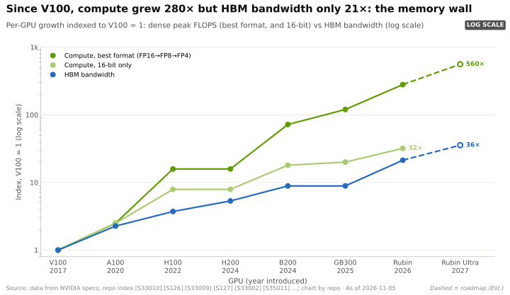
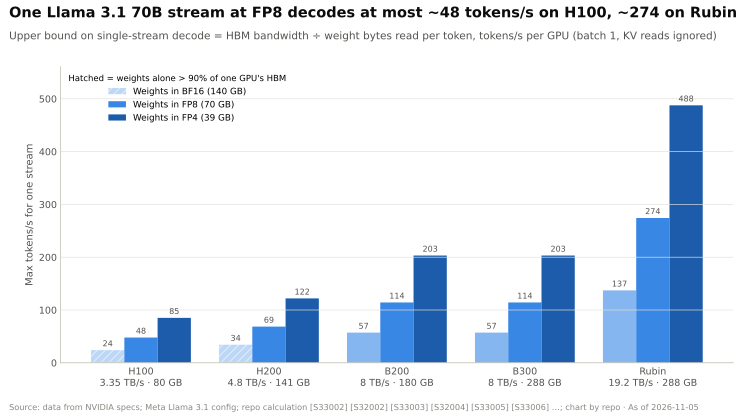
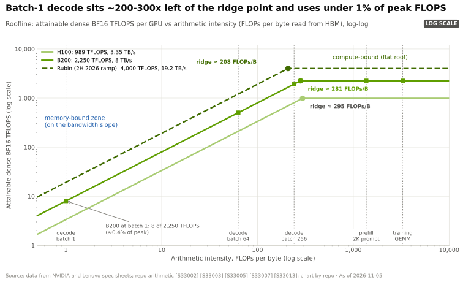
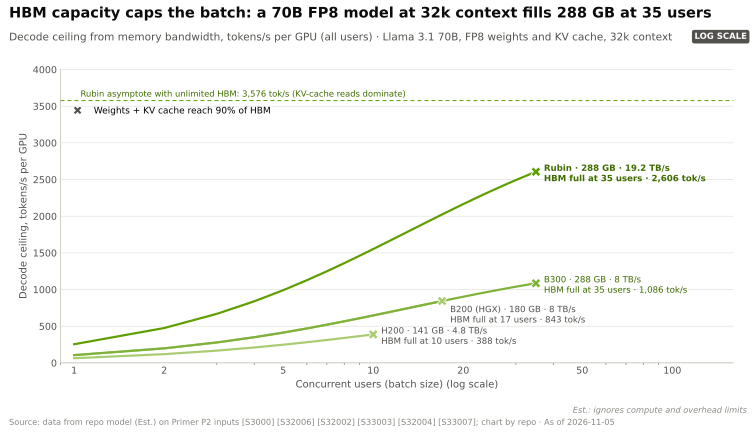
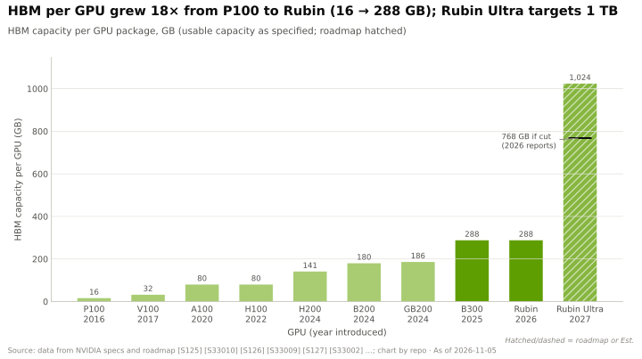

# 内存墙

> [!NOTE]
> 本页为英文原文的简体中文参考译文，仅供参考；如有出入，以[英文原文](../../../layers/03-memory-packaging-supply-chain/the-memory-wall.md "English original")为准。

第 03 层 · 内存、封装与供应链 · 约 9 分钟阅读 · 最近核实：2026-11-05

## ⚡ 要点速览

- **生成文本本质上是一项内存工作。** 在[解码（decode）](../../../glossary.md#decode)阶段，每生成一个新 [token（词元）](../../../glossary.md#token)都要把全部权重重新读取一遍。一个 70B [FP8](../../../glossary.md#fp8) 模型在批大小为 1 时每个 token 需搬运约 70 GB 数据，单个流在 H100（3.35 TB/s）上的上限约为 48 tokens/s，在 Rubin（19.2 TB/s）上约为 274 [[S33002]](../../../sources/bibliography.md#s33002)[[S33007]](../../../sources/bibliography.md#s33007)[[S32006]](../../../sources/bibliography.md#s32006)。
- **算力跑在了带宽前面。** 自 V100 以来，稠密低精度算力增长约 280 倍，而[高带宽内存（HBM）](../../../glossary.md#hbm)带宽仅增长约 21 倍 [[S33010]](../../../sources/bibliography.md#s33010)[[S33005]](../../../sources/bibliography.md#s33005)[[S33007]](../../../sources/bibliography.md#s33007)。美光（Micron）在 Hot Chips 2026 上表示，这一差距并未收窄 [[S3006]](../../../sources/bibliography.md#s3006)。
- **越来越多的工作负载受限于内存。** FP8 [屋脊点（ridge point）](../../../glossary.md#ridge-point)从约 591 FLOPs/字节（H100）升至约 911（Rubin）[[S33002]](../../../sources/bibliography.md#s33002)[[S33005]](../../../sources/bibliography.md#s33005)[[S33007]](../../../sources/bibliography.md#s33007)。
- **容量是第二道墙。** 在 32k 上下文下，一个 70B FP8 模型每位用户需要约 5.4 GB 的 [KV 缓存](../../../glossary.md#kv-cache)，因此一颗 288 GB 的 GPU 约在 35 位用户时即被填满（估计）[[S3000]](../../../sources/bibliography.md#s3000)。四种服务场景分别需要 1–3 颗 Rubin GPU 或 4–11 颗 H100（估计）[[S3000]](../../../sources/bibliography.md#s3000)。
- 🟢 **瓶颈资源靠外购。** Rubin 的 [HBM4](../../../glossary.md#hbm4) 标称带宽由 22 TB/s 降至 19.2 TB/s，使批大小为 1 时的上限下降约 13% [[S90006]](../../../sources/bibliography.md#s90006)[[S33007]](../../../sources/bibliography.md#s33007)。AMD 的 MI455X 则以 23.3 TB/s（较 Rubin 高约 21%）搭配 432 GB [[S144]](../../../sources/bibliography.md#s144)[[S361]](../../../sources/bibliography.md#s361)[[S90093]](../../../sources/bibliography.md#s90093)。

## 为什么决定解码速度的是字节而非 FLOPS

**类比。** 想象一位厨师，每写下一个字之前都必须把整本菜谱重读一遍。换一支更快的笔没有用，读得更快才有用。菜谱就是 HBM 中的权重，阅读速度就是带宽。

**机制。** 每个 FP8 权重（一个字节）在每个 token 上大约只参与 2 次运算。Rubin 可提供约 17,500 TFLOPS 的稠密 FP8 算力，但读取速度只有 19.2 TB/s [[S33005]](../../../sources/bibliography.md#s33005)[[S33007]](../../../sources/bibliography.md#s33007)，因此每字节需要约 900 次运算才能保持满载。批大小为 1 的解码每字节只提供约 2 次运算，因此属于[内存受限（memory-bound）](../../../glossary.md#memory-bound)（参见 [入门 P3](../../../primers/P3-the-four-bottlenecks.md) 中的[屋脊线模型（roofline model）](../../../glossary.md#roofline-model)）。真正有用的指标是 **[每 token 字节数（bytes per token）](../../../glossary.md#bytes-per-token)**；带宽除以该值即为 **[解码上限（decode ceiling）](../../../glossary.md#decode-ceiling)**。

> [!TIP]
> **算例 —— 70B FP8 模型的解码上限。** 上限 = 带宽 ÷ 70 GB。
>
> | GPU | HBM | 带宽 | Tokens/s | 可用于 KV 缓存的空间（按 90% 利用率） |
> |---|---|---|---|---|
> | H100 | 80 GB | 3.35 TB/s | ~48 | ~2 GB |
> | H200 | 141 GB | 4.8 TB/s | ~69 | ~57 GB |
> | B200（[HGX](../../../glossary.md#hgx)） | 180 GB | 8 TB/s | ~114 | ~92 GB |
> | Rubin，发布时 | 288 GB | 22 TB/s | ~314 | ~189 GB |
> | Rubin，修订后 | 288 GB | 19.2 TB/s | ~274 | ~189 GB |
>
> 输入数据 [[S33002]](../../../sources/bibliography.md#s33002)[[S32002]](../../../sources/bibliography.md#s32002)[[S33003]](../../../sources/bibliography.md#s33003)[[S33006]](../../../sources/bibliography.md#s33006)[[S33007]](../../../sources/bibliography.md#s33007)；测算 [[S3000]](../../../sources/bibliography.md#s3000)。**商业解读：** Rubin 相对 H100 约 5.7 倍的单流提升与带宽增幅（5.7 倍）一致，而非 FP8 算力增幅（8.8 倍）。

**[Q1 · 职能与失效后果]** 本层负责为张量核心供数：字节必须足够快地送达，模型与每位用户的上下文必须装得下，而且必须有足够的 HBM 与封装产能才能把 GPU 造出来。本层薄弱时，算力闲置、批次缩小、每 token 成本上升、订单只能排队。

**[Q2 · 关键指标]**

| 指标 | 重要性 | H100 → Rubin | 纸面最强对手 |
|---|---|---|---|
| 每颗 GPU 的 HBM 带宽（TB/s） | 决定解码上限 | 3.35 → 19.2 [[S33002]](../../../sources/bibliography.md#s33002)[[S33007]](../../../sources/bibliography.md#s33007) | MI455X 23.3 [[S144]](../../../sources/bibliography.md#s144)[[S90093]](../../../sources/bibliography.md#s90093) |
| 每颗 GPU 的 HBM 容量（GB） | 决定每颗 GPU 的用户数、每个模型所需 GPU 数 | 80 → 288 [[S33005]](../../../sources/bibliography.md#s33005) | MI455X 432；AI200 768 LPDDR [[S173]](../../../sources/bibliography.md#s173) |
| 每 token 字节数 | 分母 | 70B FP8：约 70 GB + 每个上下文 token 约 0.16 MB [[S32006]](../../../sources/bibliography.md#s32006) | 潜在注意力将 KV 缓存削减约 93% [[S32026]](../../../sources/bibliography.md#s32026) |
| CoWoS 晶圆数 × 每片晶圆封装数 | 把设计转化为出货 | [CoWoS](cowos-and-advanced-packaging.md) | — |
| 承诺额 ÷ 季度营收 | 已锁定的供应 | Q2 FY2027 为 2.9 倍 [[S407]](../../../sources/bibliography.md#s407)[[S405]](../../../sources/bibliography.md#s405) | — |

🔧 技术细节：批处理摊薄的是权重读取，而非 KV 缓存

对 B 位用户进行[批处理（batching）](../../../glossary.md#batching)时，每一步只需读取一次权重 W，但每位用户的 KV 缓存 K 需要分别读取：tokens/s ≈ B × 带宽 ÷ (W + B × K)。随着 B 增大，上限趋近于 带宽 ÷ K。以 FP8 下的 Llama 3.1 70B 为例，K ≈ 2 × 80 层 × 8 个 KV 头 × 128 × 1 字节 ≈ 每个上下文 token 0.16 MB [[S32006]](../../../sources/bibliography.md#s32006)，32k 上下文下约 5.4 GB，因此无论增加多少内存，Rubin 的上限都在约 3,600 tokens/s 附近 [[S3000]](../../../sources/bibliography.md#s3000)。这正是[分组查询注意力（grouped-query attention）](../../../glossary.md#grouped-query-attention)与[多头潜在注意力（multi-head latent attention）](../../../glossary.md#multi-head-latent-attention)具有商业意义的原因：它们缩小了 K。

## 算力跑在了带宽前面

[内存墙（memory wall）](../../../glossary.md#memory-wall)是增速上的差距：在全行业范围内，峰值 FLOPS 每两年增长约 3.0 倍，而 DRAM 带宽仅增长约 1.6 倍 [[S33011]](../../../sources/bibliography.md#s33011)。

> [!TIP]
> **算例 —— H100 到 Rubin 的同口径对比。** 稠密 FP8 算力提升 8.8 倍（1,979 → 17,500 TFLOPS），带宽提升 5.7 倍（3.35 → 19.2 TB/s）[[S33002]](../../../sources/bibliography.md#s33002)[[S33005]](../../../sources/bibliography.md#s33005)[[S33007]](../../../sources/bibliography.md#s33007)。运算强度为 600 FLOPs/字节的工作负载能让 H100 满载，却会让 Rubin 三分之一的 FP8 单元闲置。**商业解读：** 应询问给定延迟下的每秒 token 数，而不是峰值 FLOPS。

> [!WARNING]
> **误区与事实：** “Rubin 的 50 [PFLOPS](../../../glossary.md#flops) [NVFP4](../../../glossary.md#nvfp4) 能让对话速度提升约 10 倍。”解码受带宽限制，而 Rubin 的带宽是 B300 的 2.4 倍（19.2 对 8 TB/s）[[S33007]](../../../sources/bibliography.md#s33007)[[S32004]](../../../sources/bibliography.md#s32004)；[FP4](../../../glossary.md#fp4) 的主要作用在于把每 token 字节数减半。

## 容量：第二道墙

带宽决定速度。容量决定**每一次权重读取能由多少用户共享**，进而决定每 token 成本。

> [!TIP]
> **算例 —— 为什么容量值钱。** 在 32k 上下文下，一颗 Rubin 可容纳 (259 − 70) ÷ 5.4 ≈ 35 位用户，上限约 2,600 tokens/s。一颗 MI455X（432 GB、23.3 TB/s）可容纳约 59 位用户，上限约 3,500 tokens/s，高出约 36%（估计）：其中约 12% 仅来自容量，其余来自其约 21% 的带宽领先 [[S3000]](../../../sources/bibliography.md#s3000)[[S144]](../../../sources/bibliography.md#s144)[[S361]](../../../sources/bibliography.md#s361)[[S90093]](../../../sources/bibliography.md#s90093)。🔴 这些上限未考虑软件与网络，而英伟达在这两方面的实测结果领先（见[竞争格局](competition.md)）。**商业解读：** 在长上下文场景下，额外的 GB 与额外的 TB/s 一样能提升每颗 GPU 的收入。

英伟达的应对是提升每颗 GPU 的容量（Rubin Ultra 规划 1 TB；有报道称为 768 GB）[[S35041]](../../../sources/bibliography.md#s35041)[[S111]](../../../sources/bibliography.md#s111)，并在 HBM 之后增加更便宜的存储层级（见[内存分层](memory-tiering-and-rubin-cpx.md)）。

> [!NOTE]
> **🐂 看多观点：** 英伟达每一代 HBM 都率先导入，并推动供应商提供更快的 HBM4 速度档位 [[S90040]](../../../sources/bibliography.md#s90040)；其软件能把每 TB/s 转化为更多 token。

> [!WARNING]
> **🐻 看空观点：** 瓶颈资源是一种从三家供应商采购的大宗商品 [[S90039]](../../../sources/bibliography.md#s90039)。MI455X 在带宽（约 1.2 倍）和容量（1.5 倍）上均已超越 Rubin [[S144]](../../../sources/bibliography.md#s144)[[S90093]](../../../sources/bibliography.md#s90093)；而规格下调 —— 有分析师将其归因于 HBM4 引脚速率不及预期（🔴 原因未经证实）—— 表明英伟达对内存速度的掌控力十分有限 [[S90006]](../../../sources/bibliography.md#s90006)。

## 🎯 企业发展视角

1. **以字节而非 FLOPS 为推理硬件定价。** 尽调比率：每美元、每瓦的 TB/s 与 GB，然后看给定延迟下的每秒 token 数。
2. **模型架构会转移硬件价值。** 潜在注意力将 DeepSeek 的 KV 缓存削减约 93% [[S32026]](../../../sources/bibliography.md#s32026)。谁拥有能减少每 token 字节数的 IP？
3. **重容量设计有其细分市场。** 长上下文智能体与大型[混合专家模型（MoE）](../../../glossary.md#mixture-of-experts)看重每美元 GB 数，这正是 AMD 与高通 AI200 的卖点 [[S144]](../../../sources/bibliography.md#s144)[[S173]](../../../sources/bibliography.md#s173)。哪些客户愿意为此牺牲单流速度？

## 📚 来源（Sources）

<!-- Auto-generated from the [S…] citations on this page by `make build`. Edit sources/registry/*.csv, not this list. -->

- [**S111**](../../../sources/bibliography.md#s111) Crypto Briefing, *Nvidia's Rubin Ultra targets 768GB of HBM4E as Kyber platform stays on schedule*, 2026. [Link](https://cryptobriefing.com/nvidia-rubin-ultra-hbm4e-kyber-2027/)
- [**S144**](../../../sources/bibliography.md#s144) AMD Newsroom, *AMD Unveils Vision for an Open AI Ecosystem, Detailing New Silicon, Software and Systems at Advancing AI 2025*, 2025-06-12. [Link](https://www.amd.com/en/newsroom/press-releases/2025-6-12-amd-unveils-vision-for-an-open-ai-ecosystem-detai.html)
- [**S173**](../../../sources/bibliography.md#s173) Qualcomm, *Qualcomm Unveils AI200 and AI250 - Redefining Rack-Scale Data Center Inference*, 2025-10-27. [Link](https://www.qualcomm.com/news/releases/2025/10/qualcomm-unveils-ai200-and-ai250-redefining-rack-scale-data-cent)
- [**S361**](../../../sources/bibliography.md#s361) Digital Citizen, *AMD Instinct MI455X brings 432GB of HBM4 and 40 PFLOPs of AI compute to Helios*, 2026-01. [Link](https://www.digitalcitizen.life/amd-instinct-mi455x-brings-432gb-of-hbm4-and-40-pflops-of-ai-compute-to-helios/)
- [**S405**](../../../sources/bibliography.md#s405) NVIDIA Corporation via SEC EDGAR, *NVIDIA Announces Financial Results for Second Quarter Fiscal 2027 (Form 8-K exhibit 99.1)*, 2026-08-26. [Link](https://www.sec.gov/Archives/edgar/data/0001045810/000104581026000073/q2fy27pr.htm)
- [**S407**](../../../sources/bibliography.md#s407) NVIDIA Corporation via SEC EDGAR, *NVIDIA Corporation Form 10-Q for quarter ended July 26, 2026*, 2026-08-28. [Link](https://www.sec.gov/Archives/edgar/data/1045810/000104581026000075/nvda-20260726.htm)
- [**S3000**](../../../sources/bibliography.md#s3000) nvidia_deep_dive_claude repository, *Repo analysis: layer 03 memory, packaging and supply-chain models (decode ceilings, HBM sizing, CoWoS packages per wafer)*, 2026-11-05. [Link](https://github.com/FrankHuang94/nvidia_deep_dive_claude/blob/main/layers/03-memory-packaging-supply-chain/index.md)
- [**S3006**](../../../sources/bibliography.md#s3006) Tom's Hardware, *Micron says the silicon gap between HBM and DDR5 is widening with every generation*, 2026-08. [Link](https://www.tomshardware.com/tech-industry/semiconductors/micron-says-the-silicon-gap-between-hbm-and-ddr5-is-widening-with-every-generation)
- [**S32002**](../../../sources/bibliography.md#s32002) NVIDIA, *NVIDIA H200 Tensor Core GPU (product page)*, 2023-11. [Link](https://www.nvidia.com/en-us/data-center/h200/)
- [**S32004**](../../../sources/bibliography.md#s32004) NVIDIA, *NVIDIA GB300 NVL72 / Blackwell Ultra (product page)*, 2025-03. [Link](https://www.nvidia.com/en-us/data-center/gb300-nvl72/)
- [**S32006**](../../../sources/bibliography.md#s32006) Meta via Hugging Face, *Llama 3.1 70B configuration (config.json)*, 2024-07-23. [Link](https://huggingface.co/meta-llama/Llama-3.1-70B/blob/main/config.json)
- [**S32026**](../../../sources/bibliography.md#s32026) DeepSeek-AI (arXiv 2405.04434) (DeepSeek-AI), *DeepSeek-V2: A Strong, Economical, and Efficient Mixture-of-Experts Language Model*, 2024-05. [Link](https://arxiv.org/abs/2405.04434)
- [**S33002**](../../../sources/bibliography.md#s33002) NVIDIA, *NVIDIA H100 Tensor Core GPU (product page and datasheet)*, 2022-03-22. [Link](https://www.nvidia.com/en-us/data-center/h100/)
- [**S33003**](../../../sources/bibliography.md#s33003) Lenovo Press, *ThinkSystem NVIDIA B200 180GB 1000W GPU product guide*, 2025. [Link](https://lenovopress.lenovo.com/lp2226-thinksystem-nvidia-b200-180gb-1000w-gpu)
- [**S33005**](../../../sources/bibliography.md#s33005) NVIDIA, *NVIDIA Vera Rubin NVL72 (product page and specifications)*, 2026. [Link](https://www.nvidia.com/en-us/data-center/vera-rubin-nvl72/)
- [**S33006**](../../../sources/bibliography.md#s33006) Tom's Hardware, *Nvidia launches Vera Rubin NVL72 AI supercomputer at CES*, 2026-01-05. [Link](https://www.tomshardware.com/pc-components/gpus/nvidia-launches-vera-rubin-nvl72-ai-supercomputer-at-ces-promises-up-to-5x-greater-inference-performance-and-10x-lower-cost-per-token-than-blackwell-coming-2h-2026)
- [**S33007**](../../../sources/bibliography.md#s33007) Dataconomy, *Nvidia Quietly Cuts Vera Rubin HBM4 And NVLink Bandwidth Specs*, 2026-11-02. [Link](https://dataconomy.com/2026/11/02/nvidia-quietly-cuts-vera-rubin-hbm4-and-nvlink-bandwidth/)
- [**S33010**](../../../sources/bibliography.md#s33010) NVIDIA, *NVIDIA V100 Tensor Core GPU datasheet*, 2018. [Link](https://images.nvidia.com/content/technologies/volta/pdf/volta-v100-datasheet-update-us-1165301-r5.pdf)
- [**S33011**](../../../sources/bibliography.md#s33011) IEEE Micro (arXiv:2403.14123) (Amir Gholami, Zhewei Yao, Sehoon Kim, Coleman Hooper, Michael W. Mahoney, Kurt Keutzer), *AI and Memory Wall*, 2024-03-21. [Link](https://arxiv.org/abs/2403.14123)
- [**S35041**](../../../sources/bibliography.md#s35041) Glenn K. Lockwood (Glenn K. Lockwood), *Rubin Ultra (R300) notes*, 2026. [Link](https://glennklockwood.com/garden/processors/R300)
- [**S90006**](../../../sources/bibliography.md#s90006) TweakTown, *Nvidia cuts Vera Rubin's memory bandwidth by up to 26% and AMD's Helios now leads in memory bandwidth*, 2026-10. [Link](https://www.tweaktown.com/news/114304/nvidia-cuts-vera-rubins-memory-bandwidth-by-up-to-26-percent-and-amds-helios-now-leads-in-memory-bandwidth/index.html)
- [**S90039**](../../../sources/bibliography.md#s90039) TrendForce, *Samsung, SK hynix reportedly tapped as NVIDIA Rubin HBM4 suppliers; shipments could start in March*, 2026-03-09. [Link](https://www.trendforce.com/news/2026/03/09/news-samsung-sk%E2%80%AFhynix-reportedly-tapped-as-nvidia-rubin-hbm4-suppliers-shipments-could-start-in-march/)
- [**S90040**](../../../sources/bibliography.md#s90040) Tom's Hardware, *HBM4 mass production delayed as Nvidia pushes memory specs higher*, 2025. [Link](https://www.tomshardware.com/tech-industry/hbm4-mass-production-delayed-as-nvidia-pushes-memory-specs-higher)
- [**S90093**](../../../sources/bibliography.md#s90093) Tom's Hardware, *AMD takes the wraps off its Instinct MI455X AI accelerator: CDNA 5 and Helios rack-scale architecture*, 2026. [Link](https://www.tomshardware.com/pc-components/gpus/amd-takes-the-wraps-off-its-instinct-mi455x-ai-accelerator-cdna-5-and-helios-rack-scale-architecture-combine-to-take-the-fight-to-nvidia-in-the-data-center)
