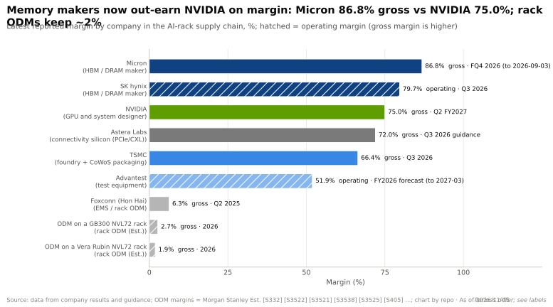
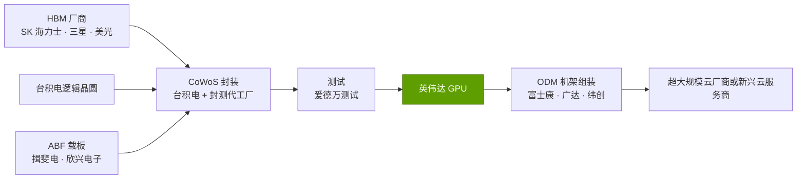
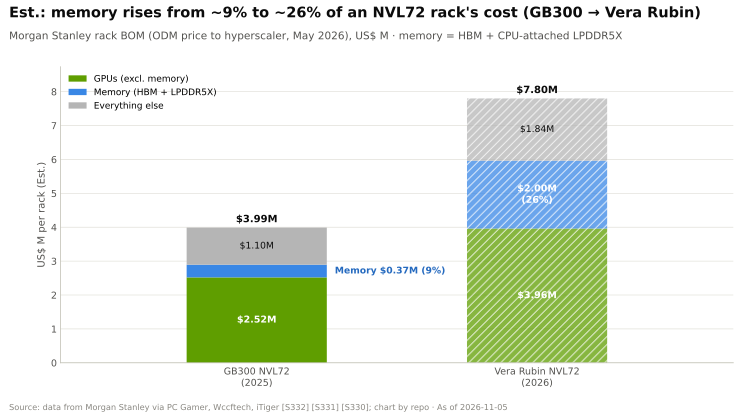
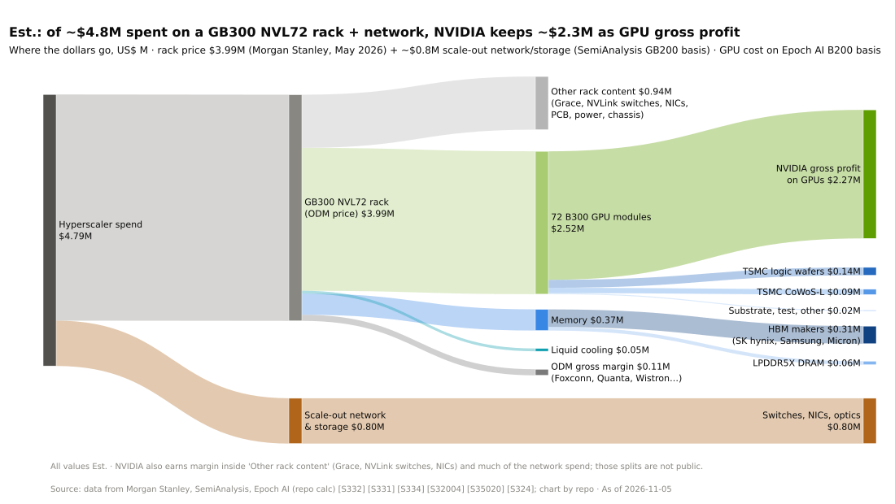

# 内存、封装与供应链：价值链与企业发展视角

> [!NOTE]
> 本页为英文原文的简体中文参考译文，仅供参考；如有出入，以[英文原文](../../../layers/03-memory-packaging-supply-chain/value-chain-and-corp-dev.md "English original")为准。

第 03 层 · 内存、封装与供应链 · 约 12 分钟阅读 · 最近核实：2026-11-05

## ⚡ 要点速览

- **内存已成为 AI 机架中最大的新增价值池。** 摩根士丹利估计，在约 $7.8M 的 Vera Rubin [NVL72](../../../glossary.md#nvl72) 中，内存约占 $2.0M（约 26%），而在约 $4.0M 的 GB300 NVL72 中仅约 $0.37M（约 9%）（估计）[[S330]](../../../sources/bibliography.md#s330)[[S331]](../../../sources/bibliography.md#s331)[[S332]](../../../sources/bibliography.md#s332)。
- **内存厂商的利润率如今已超过英伟达（NVIDIA）。** 美光（Micron）截至 2026 年 9 月的季度 GAAP 毛利率为 86.8% [[S3533]](../../../sources/bibliography.md#s3533)，SK 海力士 2026 年 Q3 营业利润率约为 80% [[S3502]](../../../sources/bibliography.md#s3502)，而英伟达的毛利率为 75.0% [[S405]](../../../sources/bibliography.md#s405)。
- **台积电（TSMC）从封装中稳定获利，但不那么惊人。** 其 2026 年 Q3 毛利率为 66.4% [[S3538]](../../../sources/bibliography.md#s3538)；先进封装约占 2025 年营收的 10% [[S3509]](../../../sources/bibliography.md#s3509)，另据报道 CoWoS 价格将上涨 10–20%（🟡）[[S3510]](../../../sources/bibliography.md#s3510)。
- **测试与互连专业厂商赚取堪比芯片公司的利润率。** 爱德万测试（Advantest）预计 FY2026 营业利润率为 51.9% [[S3521]](../../../sources/bibliography.md#s3521)；Astera Labs 指引毛利率约为 72% [[S3525]](../../../sources/bibliography.md#s3525)。
- **机架组装商只分到残羹。** [ODM](../../../glossary.md#odm) 在一台 Vera Rubin 机架上的毛利率估计为 1.9%（估计）[[S332]](../../../sources/bibliography.md#s332)；占据约 40% AI 服务器份额的富士康 [[S3014]](../../../sources/bibliography.md#s3014)，公司整体毛利率约为 6.3% [[S3522]](../../../sources/bibliography.md#s3522)。
- **英伟达在本层的“并购”是合同，而非收购。** 它持有 $279B 的供应承诺 [[S407]](../../../sources/bibliography.md#s407)；相关交易包括对 Enfabrica 的收购式招聘（acquihire）（>$900M）[[S475]](../../../sources/bibliography.md#s475)、Groq 技术授权（据报道约 $20B）[[S90019]](../../../sources/bibliography.md#s90019)，以及对英特尔（Intel）$5B 的股权投资 [[S468]](../../../sources/bibliography.md#s468)。
- **[Q8 · 价值池与并购机会]** 增长最快的价值池是 HBM 与封装；可投资的私营公司机会位于 HBM 之外的内存层级（[CXL](../../../glossary.md#cxl)、[SRAM](../../../glossary.md#sram)、光子互连架构），美满电子（Marvell）为收购 Celestial AI 预付了约 $3.25B [[S2513]](../../../sources/bibliography.md#s2513)。

## 一台机架上的钱被谁赚走

机架上的大部分收入流向英伟达，但在英伟达的销货成本中，最大一项已不再是硅片：Epoch AI 估计[高带宽内存（HBM）](../../../glossary.md#hbm)约占 B200 制造成本的 45% [[S35020]](../../../sources/bibliography.md#s35020)，到 2025 年 Q4 内存约占 AI 芯片元器件支出的 63% [[S35021]](../../../sources/bibliography.md#s35021)。2026 年的[内存超级周期](../../../glossary.md#memory-supercycle)（2026 年 Q1 DRAM 行业营收环比增长 81%，达 $97B）[[S3518]](../../../sources/bibliography.md#s3518)进一步推高了这一比重（成本机制见 [P5](../../../primers/P5-chip-economics-101.md)；机架经济学见[第 08 层](../08-systems-racks-ai-factories/index.md)）。

> [!TIP]
> **算例 —— 一台 Vera Rubin 机架上各环节的毛利（🔴 仅作示意）。** 将各公司最新的利润率应用到摩根士丹利估算的 $7.8M 机架中其各自对应的部分 [[S332]](../../../sources/bibliography.md#s332)：GPU $3.96M × 75% ≈ **$3.0M** 归英伟达 [[S405]](../../../sources/bibliography.md#s405)；内存 $2.0M × ~80% ≈ **$1.6M** 归内存厂商 [[S3502]](../../../sources/bibliography.md#s3502)；ODM 1.9% × $7.8M ≈ **$0.15M** [[S332]](../../../sources/bibliography.md#s332)。公司层面的利润率只是近似替代，但内存厂商如今在每台机架上获取的毛利已约为英伟达的一半。摩根士丹利还估计，若买家直接采购 [SOCAMM](../../../glossary.md#socamm) 内存，机架价格约为 $6.7M [[S332]](../../../sources/bibliography.md#s332)，即约 $1.1M 属于转手部分，只抬高了发票金额而不增加利润。

| 环节 | 主要参与者 | 利润率信号 | 2026 年定价权 |
|---|---|---|---|
| HBM / DRAM | SK 海力士、三星、美光 | 80–87% [[S3502]](../../../sources/bibliography.md#s3502)[[S3533]](../../../sources/bibliography.md#s3533) | 高：2027 年 HBM 大部分已按更高价格签约 [[S3534]](../../../sources/bibliography.md#s3534)；SK 海力士签有 14 份[长期协议（LTA）](../../../glossary.md#long-term-agreement) [[S3503]](../../../sources/bibliography.md#s3503) |
| 晶圆代工 + [CoWoS](../../../glossary.md#cowos) | 台积电 | 毛利率 66.4% [[S3538]](../../../sources/bibliography.md#s3538) | 上升：CoWoS 晶圆价格已接近 7 nm 逻辑晶圆水平 [[S3509]](../../../sources/bibliography.md#s3509) |
| 封测代工（OSAT） | 日月光/矽品（ASE/SPIL）、安靠（Amkor） | 来源中无数据 | 增长：台积电正外包更多 CoW 工序 [[S3003]](../../../sources/bibliography.md#s3003) |
| [ABF 载板](../../../glossary.md#abf-substrate)、PCB | 揖斐电（Ibiden）、欣兴电子（Unimicron）等 | 来源中无数据 | 每台 Rubin 机架的用量上升 [[S332]](../../../sources/bibliography.md#s332)；买家提供[预付款](../../../glossary.md#prepayment) [[S3532]](../../../sources/bibliography.md#s3532) |
| 测试 | 爱德万测试 | 营业利润率 51.9%（FY2026 预测）[[S3521]](../../../sources/bibliography.md#s3521) | 在 SoC 测试机领域较高 |
| 机架集成 | 富士康、广达、纬创 | 机架上约 2%（估计）[[S332]](../../../sources/bibliography.md#s332) | 低 |

🔧 技术细节：为什么内存厂商的利润率能超过英伟达

DRAM 通常是利润率大起大落的大宗商品。2026 年，常规 DRAM 合约价格在一个季度内上涨 93–98% [[S3518]](../../../sources/bibliography.md#s3518)，原因在于 HBM 每比特消耗的晶圆面积要大得多 —— 美光称 [HBM3E](../../../glossary.md#hbm3e) 约为 DDR5 的 3 倍 [[S3006]](../../../sources/bibliography.md#s3006)。每投片一片 HBM 晶圆，常规内存供应就减少一片，因此整个产品线的价格都会上涨。内存利润率具有周期性，这对任何承接长期供应合同的一方都至关重要。

## 值得关注的私营公司（仅基于公开信息）

| 公司 | 业务 | 阶段 / 最近一次公开融资 | 重要性 |
|---|---|---|---|
| Panmnesia | 用于[内存池化（memory pooling）](../../../glossary.md#memory-pooling)的 CXL 3.x 交换芯片与 IP | A 轮融资超过 $60M（2024 年 11 月）；估值超过 $250M [[S3523]](../../../sources/bibliography.md#s3523) | 为 KV 缓存与大模型提供 HBM 之外的容量层级 |
| d-Matrix | SRAM 加 LPDDR 的存内计算推理卡 | C 轮 $275M，估值 $2B（2025 年 11 月）[[S2511]](../../../sources/bibliography.md#s2511) | 不依赖 HBM 的以内存为中心的推理 [[S170]](../../../sources/bibliography.md#s170) |
| SambaNova | 三级内存：SRAM、64 GB HBM、最多 1.5 TB DDR [[S168]](../../../sources/bibliography.md#s168) | 与英特尔以约 $1.6B（含债务）进行的洽谈已停滞 [[S2512]](../../../sources/bibliography.md#s2512) | 内存分层的验证案例；可能成为困境资产 |
| Lightmatter | 光子互连 | D 轮 $400M，估值 $4.4B（2024 年 10 月）[[S2510]](../../../sources/bibliography.md#s2510) | 光链路可能将内存与计算分离 |
| Groq（GroqCloud） | 向英伟达授权后的基于 SRAM 的 LPU 云服务 | 英伟达授权费约 $20B（据报道）[[S90019]](../../../sources/bibliography.md#s90019) | 表明英伟达为吸收一种替代内存架构所愿付出的价格 |

> [!TIP]
> **算例 —— 一个内存层级能带来什么。** Enfabrica 的 EMFASYS 宣称，单台以太网连接设备后方可挂载最多 18 TB DDR5 [[S3526]](../../../sources/bibliography.md#s3526)，相当于约 62 颗 Rubin GPU 的 HBM 容量（18,000 ÷ 288 GB）[[S100]](../../../sources/bibliography.md#s100)，只是带宽为 DDR5 级别而非 HBM 级别。对于很少被读取的 [KV 缓存](../../../glossary.md#kv-cache)，这样的层级可能比为获取内存而购买 GPU 更划算；厂商宣称每 token 成本最多可降低 50% [[S3526]](../../../sources/bibliography.md#s3526)。另见[内存分层与 Rubin CPX](memory-tiering-and-rubin-cpx.md)。

值得关注的上市可比公司：Astera Labs（[PCIe](../../../glossary.md#pcie)/CXL 互连；2026 年 Q2 营收 $392M，同比增长 104%）[[S3524]](../../../sources/bibliography.md#s3524)，以及 Cerebras（2026 年 5 月上市）[[S2504]](../../../sources/bibliography.md#s2504)。

## 本层的并购历史

| 时间 | 交易 | 金额 | 相关性 | 来源 |
|---|---|---|---|---|
| 2025-09 | 英伟达收购式招聘与授权：Enfabrica | >$900M（据报道） | SuperNIC 加 EMFASYS：通过以太网提供最多 18 TB CXL 内存 | [[S475]](../../../sources/bibliography.md#s475)[[S3526]](../../../sources/bibliography.md#s3526) |
| 2025-09 | 英伟达股权投资：英特尔 | $5B | 获得美国本土晶圆代工厂与 EMIB 封装合作伙伴的选择权 | [[S468]](../../../sources/bibliography.md#s468) |
| 2025-10 | OpenAI 与三星、SK 海力士签署意向书 | 无约束力 | 买家直接签约采购内存 | [[S3535]](../../../sources/bibliography.md#s3535) |
| 2025-12 | 英伟达技术授权与团队招募：Groq | 约 $20B（据报道） | 不依赖 HBM 的 SRAM 推理 | [[S90019]](../../../sources/bibliography.md#s90019) |
| 2026-02 | 美满电子收购 Celestial AI | 约 $3.25B 预付 + 业绩对赌付款 | 光子内存互连架构 | [[S2513]](../../../sources/bibliography.md#s2513) |
| 2026-03 | AMD–三星 HBM4 谅解备忘录 | 不适用 | 以供应优先权作为交易筹码 | [[S3511]](../../../sources/bibliography.md#s3511) |

> [!TIP]
> **算例 —— 预付还是收购？** Celestial AI 约 $3.25B 的预付对价 [[S2513]](../../../sources/bibliography.md#s2513)，约相当于英伟达 $279B 承诺额的 1.2% [[S407]](../../../sources/bibliography.md#s407)。对挑战者而言，同样约 $3.25B 也可以用于预付约 210,000 套 Rubin 级 HBM（288 GB，按伯恩斯坦（Bernstein）对 2027 年约 $53/GB 的预测，每套约 $15K）[[S333]](../../../sources/bibliography.md#s333)（🔴 本资料库测算）。以当前的内存利润率，锁定供应带来的竞争力提升可能大于收购一家内存架构初创公司。

**[Q8 · 价值池与并购机会]** 最大的增量价值池在内存厂商与台积电手中；它们无法被收购，因此机会在于合同（预付款、LTA、联合设计的定制 HBM 基础裸片）以及对内存层级初创公司的少数股权投资。

## 🎯 企业发展视角

1. 对于重 LPDDR 的推理方案（如 AI200 每卡 768 GB）[[S173]](../../../sources/bibliography.md#s173)，每 GB 带宽达到多少时，[LPDDR](../../../glossary.md#lpddr) 在每 token 成本上会胜过 HBM？
2. 入股一家 CXL 交换芯片或内存互连架构公司（Panmnesia，或与 Astera Labs 合作），能否为挑战者提供英伟达纯 HBM 封装所不具备的容量层级？
3. 在约 $2–3B 的入场估值下（d-Matrix、Celestial AI），SRAM 与光子内存架构应归为收购、合作还是观望？
4. 资本是更应投向与利润率 80% 以上的内存厂商签订的供应预付款与 LTA，还是投向这些厂商的股权？
5. 与 SK 海力士、三星或台积电联合设计定制 HBM 基础裸片 [[S3011]](../../../sources/bibliography.md#s3011)[[S3008]](../../../sources/bibliography.md#s3008)，能否带来类似 AI250 所宣称的近存计算收益 [[S173]](../../../sources/bibliography.md#s173)？

## 📚 来源（Sources）

<!-- Auto-generated from the [S…] citations on this page by `make build`. Edit sources/registry/*.csv, not this list. -->

- [**S100**](../../../sources/bibliography.md#s100) NVIDIA Technical Blog, *Inside the NVIDIA Vera Rubin Platform: Six New Chips, One AI Supercomputer*, 2026-01-05. [Link](https://developer.nvidia.com/blog/inside-the-nvidia-rubin-platform-six-new-chips-one-ai-supercomputer/)
- [**S168**](../../../sources/bibliography.md#s168) arXiv 2405.07518 (Raghu Prabhakar et al.), *SambaNova SN40L: Scaling the AI Memory Wall with Dataflow and Composition of Experts*, 2024-05-13. [Link](https://arxiv.org/abs/2405.07518)
- [**S170**](../../../sources/bibliography.md#s170) d-Matrix, *d-Matrix Corsair inference platform*, 2024-11-19. [Link](https://www.d-matrix.ai/product/)
- [**S173**](../../../sources/bibliography.md#s173) Qualcomm, *Qualcomm Unveils AI200 and AI250 - Redefining Rack-Scale Data Center Inference*, 2025-10-27. [Link](https://www.qualcomm.com/news/releases/2025/10/qualcomm-unveils-ai200-and-ai250-redefining-rack-scale-data-cent)
- [**S330**](../../../sources/bibliography.md#s330) PC Gamer, *A single Nvidia Vera Rubin rack is estimated to cost $7,803,148 with over $2 million of that figure spent on memory alone*, 2026-05. [Link](https://pcgamer.com/hardware/a-single-nvidia-vera-rubin-rack-is-estimated-to-cost-usd7-803-148-with-over-usd2-million-of-that-figure-spent-on-memory-alone)
- [**S331**](../../../sources/bibliography.md#s331) Wccftech, *NVIDIA's Vera Rubin rack hit with 435% memory price surge, pushing HBM4 & LPDDR5X bill to $2M of $7.8M total*, 2026-05. [Link](https://wccftech.com/nvidia-vera-rubin-rack-hit-with-memory-price-surge-pushing-hbm4-lpddr5x-bill-to-2m-of-7-8m-total/)
- [**S332**](../../../sources/bibliography.md#s332) Tiger Brokers (iTiger), *Morgan Stanley's BOM analysis of NVIDIA's Rubin: GPU share declines; PCB, MLCC and ABF substrate values soar*, 2026-05-20. [Link](https://www.itiger.com/news/1188068712)
- [**S333**](../../../sources/bibliography.md#s333) Wccftech, *Bernstein warns NVIDIA's Vera Rubin racks will hit $9.1 million as HBM4 prices triple to $53 per gigabyte*, 2026-07. [Link](https://wccftech.com/bernstein-warns-nvidias-vera-rubin-racks-will-hit-9-1-million-as-hbm4-prices-triple-to-53-per-gigabyte/)
- [**S405**](../../../sources/bibliography.md#s405) NVIDIA Corporation via SEC EDGAR, *NVIDIA Announces Financial Results for Second Quarter Fiscal 2027 (Form 8-K exhibit 99.1)*, 2026-08-26. [Link](https://www.sec.gov/Archives/edgar/data/0001045810/000104581026000073/q2fy27pr.htm)
- [**S407**](../../../sources/bibliography.md#s407) NVIDIA Corporation via SEC EDGAR, *NVIDIA Corporation Form 10-Q for quarter ended July 26, 2026*, 2026-08-28. [Link](https://www.sec.gov/Archives/edgar/data/1045810/000104581026000075/nvda-20260726.htm)
- [**S468**](../../../sources/bibliography.md#s468) NVIDIA Newsroom, *NVIDIA and Intel to Develop AI Infrastructure and Personal Computing Products*, 2025-09-18. [Link](https://nvidianews.nvidia.com/news/nvidia-and-intel-to-develop-ai-infrastructure-and-personal-computing-products)
- [**S475**](../../../sources/bibliography.md#s475) CNBC, *Nvidia spends over $900 million on Enfabrica CEO, AI startup technology*, 2025-09-18. [Link](https://www.cnbc.com/technology/)
- [**S2504**](../../../sources/bibliography.md#s2504) TechCrunch, *Cerebras raises $5.5B kicking off 2026's IPO season with a bang*, 2026-05-14. [Link](https://techcrunch.com/2026/05/14/cerebras-raises-5-5b-kicking-off-2026s-ipo-season-with-a-bang)
- [**S2510**](../../../sources/bibliography.md#s2510) Bloomberg, *Photonic Computing Startup Lightmatter Reaches $4.4 Billion Valuation*, 2024-10-16. [Link](https://www.bloomberg.com/news/articles/2024-10-16/photonic-computing-startup-lightmatter-reaches-4-4-billion-valuation)
- [**S2511**](../../../sources/bibliography.md#s2511) Converge Digest, *d-Matrix raises $275 million to accelerate the age of AI inference*, 2025-11-12. [Link](https://convergedigest.com/d-matrix-raises-275-million-to-accelerate-the-age-of-ai-inference/)
- [**S2512**](../../../sources/bibliography.md#s2512) Verdict, *Intel pursues SambaNova acquisition amid AI expansion plans*, 2025-12. [Link](https://www.verdict.co.uk/intel-sambanova-acquisition/)
- [**S2513**](../../../sources/bibliography.md#s2513) Business Wire (Marvell), *Marvell Completes Acquisition of Celestial AI*, 2026-02-02. [Link](https://www.businesswire.com/news/home/20260201331090/en/marvell-completes-acquisition-of-celestial-ai)
- [**S3003**](../../../sources/bibliography.md#s3003) TrendForce, *TSMC reportedly expands outsourcing of key CoWoS front-end step to OSATs amid rising NVIDIA and ASIC demand*, 2026-08-05. [Link](https://www.trendforce.com/news/2026/08/05/news-tsmc-reportedly-expands-outsourcing-of-key-cowos-front-end-step-to-osats-amid-rising-nvidia-asic-demand/)
- [**S3006**](../../../sources/bibliography.md#s3006) Tom's Hardware, *Micron says the silicon gap between HBM and DDR5 is widening with every generation*, 2026-08. [Link](https://www.tomshardware.com/tech-industry/semiconductors/micron-says-the-silicon-gap-between-hbm-and-ddr5-is-widening-with-every-generation)
- [**S3008**](../../../sources/bibliography.md#s3008) TrendForce, *TSMC unveils custom C-HBM4E details: N3P logic dies reportedly target 2x efficiency gain*, 2025-12-01. [Link](https://www.trendforce.com/news/2025/12/01/news-tsmc-unveils-custom-c-hbm4e-details-n3p-logic-dies-reportedly-target-2x-efficiency-gain/)
- [**S3011**](../../../sources/bibliography.md#s3011) TrendForce, *Samsung's custom HBM4E design reportedly aimed for mid-2026, parallels SK hynix and Micron*, 2026-01-23. [Link](https://www.trendforce.com/news/2026/01/23/news-samsungs-custom-hbm4e-design-reportedly-aimed-for-mid-2026-parallels-sk-hynix-and-micron/)
- [**S3014**](../../../sources/bibliography.md#s3014) Focus Taiwan (CNA), *Foxconn expects AI server rack shipments to double in 2026*, 2026-03-16. [Link](https://focustaiwan.tw/business/202603160022)
- [**S3502**](../../../sources/bibliography.md#s3502) The Korea Times, *SK hynix logs record Q3 operating profit*, 2026-10-28. [Link](https://www.koreatimes.co.kr/business/companies/20261028/sk-hynix-logs-record-q3-operating-profit-of-628-bil)
- [**S3503**](../../../sources/bibliography.md#s3503) SammyFans, *SK hynix Q3 margin hits record 80%, secures 14 LTAs with memory supply booked to 2029*, 2026-10-28. [Link](https://www.sammyfans.com/2026/10/28/sk-hynix-q3-margin-hits-record-80-secures-14-ltas-with-memory-supply-booked-to-2029/amp/)
- [**S3509**](../../../sources/bibliography.md#s3509) TrendForce, *TSMC CoWoS wafer ASP reportedly nears 7nm levels, advanced packaging poised to become a key profit driver*, 2026-04-28. [Link](https://www.trendforce.com/news/2026/04/28/news-tsmc-cowos-wafer-asp-reportedly-nears-7nm-levels-advanced-packaging-poised-to-become-a-key-profit-driver/)
- [**S3510**](../../../sources/bibliography.md#s3510) AI Weekly, *TSMC mulls up to 20% CoWoS hike and 2027 wafer price rise*, 2026. [Link](https://aiweekly.co/alerts/tsmc-mulls-up-to-20-cowos-hike-and-2027-wafer-price-rise)
- [**S3511**](../../../sources/bibliography.md#s3511) ITPro, *AMD and Samsung forge closer ties on AI memory, potential foundry deal*, 2026-03. [Link](https://itpro.com/hardware/amd-and-samsung-forge-closer-ties-on-ai-memory-potential-foundry-deal)
- [**S3518**](../../../sources/bibliography.md#s3518) Tiger Brokers (iTiger), *DRAM industry revenue soars 81% to $97 billion in Q1 amid accelerating price hikes (TrendForce)*, 2026-06. [Link](https://www.itiger.com/hans/news/1108307708)
- [**S3521**](../../../sources/bibliography.md#s3521) Advantest Corporation, *Advantest Q2 FY2026 financial results briefing (notes)*, 2026-10-28. [Link](https://www.advantest.com/document/ja/investors/ir-library/result/JE_BIZ_261028_note.pdf)
- [**S3522**](../../../sources/bibliography.md#s3522) AI CERTS News, *Foxconn results and AI server margin pressure*, 2026. [Link](https://www.aicerts.ai/news/?p=29781)
- [**S3523**](../../../sources/bibliography.md#s3523) Blocks and Files, *Panmnesia scores $60M to push CXL switch chip designs*, 2024-11-25. [Link](https://www.blocksandfiles.com/ai-ml/2024/11/25/panmnesia-scores-60m-to-push-cxl-switch-chip-designs/1611800)
- [**S3524**](../../../sources/bibliography.md#s3524) Dealroom, *Astera Labs revenue doubles to $392M as new investors pile in*, 2026-08. [Link](https://dealroom.co/news/147670-astera-labs-revenue-doubles-to-392m-as-new-investors-pile-in/)
- [**S3525**](../../../sources/bibliography.md#s3525) TS2 Tech, *Astera Labs climbs after hours as Q3 revenue forecast beats consensus*, 2026-08. [Link](https://ts2.tech/en/astera-labs-nasdaqalab-climbs-in-after-hours-as-q3-revenue-forecast-beats-consensus-by-32/)
- [**S3526**](../../../sources/bibliography.md#s3526) Tom's Hardware, *NVIDIA-backed startup invents Ethernet memory pool to help power AI (Enfabrica EMFASYS)*, 2025-07-29. [Link](https://www.tomshardware.com/tech-industry/nvidia-backed-startup-invents-ethernet-memory-pool-to-help-power-ai-claims-it-can-add-up-to-18tb-of-ddr5-capacity-for-large-scale-inference-workloads-and-reduce-per-token-generation-costs-by-up-to-50-percent)
- [**S3532**](../../../sources/bibliography.md#s3532) Tom's Hardware, *Intel reportedly in talks with Google and Amazon over advanced packaging*, 2026. [Link](https://www.tomshardware.com/tech-industry/semiconductors/intel-reportedly-in-talks-with-google-and-amazon-over-advanced-packaging)
- [**S3533**](../../../sources/bibliography.md#s3533) Micron Technology via SEC EDGAR, *Micron Technology fiscal Q4 2026 results (Form 8-K exhibit 99.1)*, 2026-09. [Link](https://www.sec.gov/Archives/edgar/data/0000723125/000072312526000018/a2026q4ex991-pressrelease.htm)
- [**S3534**](../../../sources/bibliography.md#s3534) The Next Platform, *Micron's numbers show why HBM4 memory is worth 15x its weight in gold*, 2026-10-02. [Link](https://www.nextplatform.com/store/2026/10/02/microns-numbers-show-why-hbm4-memory-is-worth-15x-its-weight-in-gold/5300701)
- [**S3535**](../../../sources/bibliography.md#s3535) TechCrunch, *OpenAI ropes in Samsung and SK hynix to source memory chips for Stargate*, 2025-10-01. [Link](https://techcrunch.com/2025/10/01/openai-ropes-in-samsung-sk-hynix-to-source-memory-chips-for-stargate)
- [**S3538**](../../../sources/bibliography.md#s3538) TSMC, *TSMC reports third quarter 2026 results*, 2026-10. [Link](https://pr.tsmc.com/english/news/3346)
- [**S35020**](../../../sources/bibliography.md#s35020) Epoch AI, *NVIDIA's B200 costs around $6,400 to produce, with memory accounting for half*, 2025-12. [Link](https://epoch.ai/data-insights/b200-cost-breakdown)
- [**S35021**](../../../sources/bibliography.md#s35021) Epoch AI, *Memory has grown to nearly two-thirds of AI chip component costs*, 2026-05-21. [Link](https://epoch.ai/data-insights/ai-chip-component-cost-shares)
- [**S90019**](../../../sources/bibliography.md#s90019) TechSpot, *Nvidia's $20 billion Groq deal looks a lot like an acquisition*, 2025-12. [Link](https://www.techspot.com/news/110723-nvidia-20-billion-groq-deal-looks-lot-like.html)
