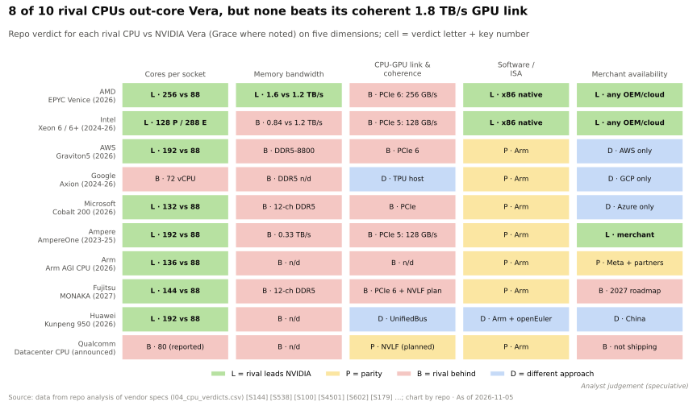
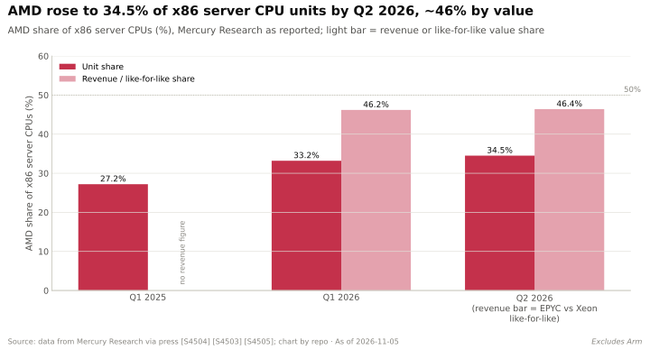
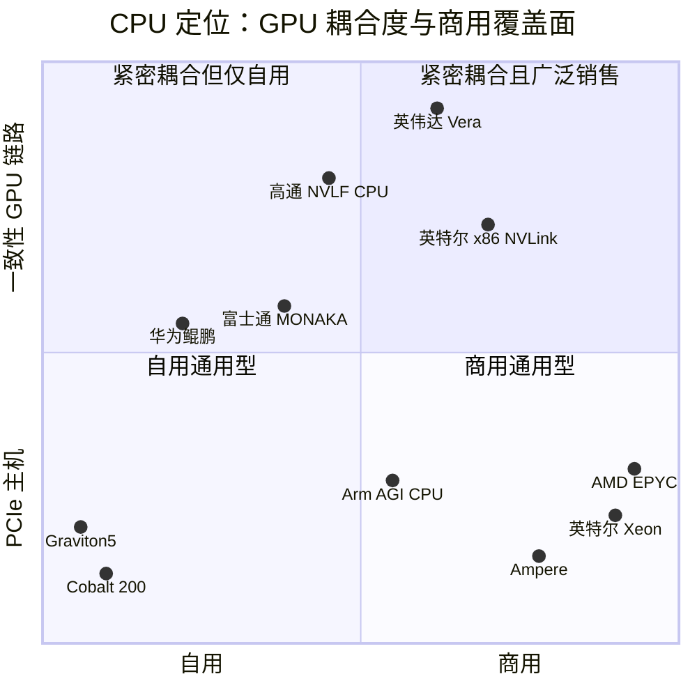

# CPU（Grace、Vera）：竞争格局

> [!NOTE]
> 本页为英文原文的简体中文参考译文，仅供参考；如有出入，以[英文原文](../../../layers/04-cpu-grace-vera/competition.md "English original")为准。

第 04 层 · CPU（Grace、Vera）· 阅读约 12 分钟 · 最近核实：2026-11-05

## ⚡ 要点速览

- **是两场竞赛，而不是一场。** 在自家 GPU 机架内部，英伟达（NVIDIA）几乎理所当然地赢得[主机 CPU](../../glossary.md#host-cpu) 插槽；但在规模大得多的通用服务器 CPU 市场上，它只是新入局者——2025 年 x86 仍占约 90% 的出货量 [[S4500]](../../../sources/bibliography.md#s4500)。
- **[Arm](../../glossary.md#arm-isa) 的份额取决于统计口径：**2026 年第一季度占服务器 CPU 出货量的 13.2%（Mercury）至 17.7%（UBS），但非 x86 系统占服务器*收入*的 47.9%，因为 Grace 是装在价格极高的 GPU 机架里出货的 [[S4502]](../../../sources/bibliography.md#s4502)[[S4503]](../../../sources/bibliography.md#s4503)[[S4501]](../../../sources/bibliography.md#s4501)。
- **英伟达不拼核心数。** Vera 有 88 核；EPYC Venice 最多 256 核，Graviton5 192 核，Xeon 6+ 有 288 个能效核（E-core）[[S100]](../../../sources/bibliography.md#s100)[[S144]](../../../sources/bibliography.md#s144)[[S4526]](../../../sources/bibliography.md#s4526)[[S4525]](../../../sources/bibliography.md#s4525)。
- **Vera 的领先之处在于 GPU 链路：**1.8 TB/s 的缓存一致 [NVLink-C2C](../../glossary.md#nvlink-c2c)，对比 [PCIe](../../glossary.md#pcie) Gen6 x16 主机链路的约 256 GB/s，约为 7 倍 [[S100]](../../../sources/bibliography.md#s100)[[S144]](../../../sources/bibliography.md#s144)。其内存带宽优势（1.2 TB/s）已被 Venice 宣称的 1.6 TB/s 追平 [[S144]](../../../sources/bibliography.md#s144)。
- **[Q5 · 最强挑战者]** 以 AMD 为首的 x86 在位者：2026 年 AMD 占 x86 服务器出货量的 34.5%、按金额计约 46%，且是 AMD Helios 机架的主机 CPU [[S4505]](../../../sources/bibliography.md#s4505)[[S4503]](../../../sources/bibliography.md#s4503)[[S538]](../../../sources/bibliography.md#s538)。
- **[超大规模云厂商](../../glossary.md#hyperscaler)的自研 Arm**（Graviton、Axion、Cobalt）限制了英伟达在最大买家通用集群中所能赢得的份额：AWS 表示其新增 CPU 容量中超过一半是 Graviton [[S4527]](../../../sources/bibliography.md#s4527)。
- **英伟达机架内部的插槽正在变得可争夺：**经 [NVLink Fusion](../../glossary.md#nvlink-fusion) 接入的高通（Qualcomm）与富士通 CPU、带 [NVLink](../../glossary.md#nvlink) 的英特尔（Intel）x86，以及 Arm 自己的 AGI CPU 🟡 [[S90031]](../../../sources/bibliography.md#s90031)[[S468]](../../../sources/bibliography.md#s468)[[S4510]](../../../sources/bibliography.md#s4510)。

## CPU 竞赛如何计分

服务器 CPU 扮演两种角色。在 AI 机架中，它是**空中交通管制员**：调度工作、供给数据，并为 GPU 保存溢出内存。在通用服务器中，它是**飞机本身**。第一种角色看重与 GPU 之间快速、[缓存一致（cache-coherent）](../../glossary.md#cache-coherence)的链路，以及大量就近内存。第二种角色看重核心数、每瓦性能、价格、作为[商用芯片（merchant silicon）](../../glossary.md#merchant-silicon)的可得性，以及与数十年 [x86](../../glossary.md#x86) 软件的兼容性。英伟达的 [Grace 和 Vera](index.md) 是为第一种角色设计的。自 GTC 2026 以来对独立 Vera 的推广（英伟达称之为“数十亿美元级别的业务”）是英伟达首次真正进军第二种角色 [[S90003]](../../../sources/bibliography.md#s90003)。

| 竞争对手（产品依据） | 每插槽核心数 | 内存带宽 | CPU–GPU 链路与一致性 | 软件 / 指令集 | 商用可得性 |
|---|---|---|---|---|---|
| AMD EPYC Venice（2026） | 🟩 256 对 88 | 🟩 1.6 对 1.2 TB/s（AMD 宣称） | 🟥 PCIe Gen6，约 256 GB/s，非缓存一致 | 🟩 原生 x86 | 🟩 所有 OEM 和云厂商 |
| 英特尔 Xeon 6 / 6+（2024–26） | 🟩 128 个性能核 / 288 个能效核 | 🟥 845 GB/s；2027 年约翻倍 | 🟥 PCIe Gen5；NVLink x86 时间未定 | 🟩 原生 x86 | 🟩 DGX B300 的主机 |
| AWS Graviton5（2026） | 🟩 192 | 🟥 DDR5-8800，未披露 | 🟥 PCIe Gen6 | 🟨 相同的 Arm 指令集 | 🟦 只租不卖 |
| 微软 Cobalt 200（2026） | 🟩 132 | 🟥 12 通道 DDR5 | 🟥 无缓存一致 GPU 链路 | 🟨 Arm | 🟦 仅限 Azure |
| Ampere AmpereOne（2023–25） | 🟩 192 | 🟥 333 GB/s | 🟥 PCIe Gen5 | 🟨 Arm | 🟩 商用 |
| 高通数据中心 CPU（已官宣） | 🟥 据报道 80 核 🔴 | 🟥 未披露 | 🟨 计划采用 NVLink Fusion | 🟨 Arm | 🟥 尚未出货 |

评级 = 竞争对手对比 Vera。规格来源：[[S144]](../../../sources/bibliography.md#s144)[[S179]](../../../sources/bibliography.md#s179)[[S4525]](../../../sources/bibliography.md#s4525)[[S4526]](../../../sources/bibliography.md#s4526)[[S184]](../../../sources/bibliography.md#s184)[[S185]](../../../sources/bibliography.md#s185)[[S4515]](../../../sources/bibliography.md#s4515)[[S131]](../../../sources/bibliography.md#s131)；全部十家竞争对手见下方热力图。

> [!TIP]
> **算例 —— 为什么在 AI 机架中链路比核心更重要。** 一台 Vera Rubin [NVL72](../../glossary.md#nvl72) 为 72 块 GPU 配有 36 颗 Vera × 88 = 3,168 个核心（每 GPU 44 个）[[S102]](../../../sources/bibliography.md#s102)[[S100]](../../../sources/bibliography.md#s100)；AMD 的 Helios 为 72 块 MI455X 配有 18 颗 Venice × 256 = 4,608 个核心（每 GPU 64 个）[[S538]](../../../sources/bibliography.md#s538)[[S144]](../../../sources/bibliography.md#s144)。两者都足以完成调度。现在把 100 GB 的 [KV 缓存](../../glossary.md#kv-cache)溢出到 CPU 内存再取回：按约 256 GB/s（PCIe Gen6 x16）需约 0.39 s；按 1.8 TB/s（NVLink-C2C）约 0.06 s。对于亚秒级的对话响应，这一差距决定了 CPU 内存能否成为可用的第二层级。

🔧 技术细节：“缓存一致”为 GPU 带来了什么

在 PCIe 下，CPU 和 GPU 内存是相互独立的地址空间：软件必须显式地来回拷贝数据，并跟踪哪份副本是最新的。有了缓存一致链路，GPU 可以用普通指针对 CPU 内存进行读写，由硬件保持各缓存副本的一致。正因如此，英伟达可以把一颗 Grace 上的 480 GB LPDDR5X（Vera 上为 1.5 TB）呈现为 GPU 内存的延伸 [[S129]](../../../sources/bibliography.md#s129)[[S100]](../../../sources/bibliography.md#s100)。CXL 也能为 x86 主机提供一致性，但带宽只有 PCIe 级别。

## 逐一分析挑战者

### AMD EPYC：最强挑战者

AMD 在 x86 服务器 CPU 出货量中的份额从 2025 年第一季度的 27.2% 升至 2026 年第二季度的 34.5%，按金额计约为 46% [[S4504]](../../../sources/bibliography.md#s4504)[[S4505]](../../../sources/bibliography.md#s4505)[[S4503]](../../../sources/bibliography.md#s4503)。Venice（2 nm，最多 256 核，1.6 TB/s）随 Helios 一同发布，在 Helios 中 18 颗 Venice CPU 为 72 块 MI455X 担任主机 [[S144]](../../../sources/bibliography.md#s144)[[S538]](../../../sources/bibliography.md#s538)。AMD 2026 年第三季度数据中心收入同比增长 97% [[S542]](../../../sources/bibliography.md#s542)。

**最有力的论点：**大多数与 AI 相关的 CPU 工作（数据准备、智能体工具调用、数据库）都是普通的 x86 软件，需要的是核心数和兼容性，而不是 1.8 TB/s 的 GPU 链路。**差距是否缩小：**内存带宽上已追平；GPU 链路上没有（落后约 7 倍）。

### 英特尔 Xeon：在位者、供应商兼合作伙伴

英特尔仍占服务器出货量的大头（据 UBS，2026 年第一季度为 54.9%）[[S4503]](../../../sources/bibliography.md#s4503)。Clearwater Forest（288 个能效核，Intel 18A 工艺）在 Computex 2026 上发布；据报道，Diamond Rapids（核心数增加 50%，内存带宽约翻倍，PCIe Gen6）在推迟后定于 2027 年年中推出 🟡 [[S4525]](../../../sources/bibliography.md#s4525)[[S4524]](../../../sources/bibliography.md#s4524)。英伟达对英特尔的 $5B 入股（2025 年 9 月）换来了通过 NVLink 挂接的定制 x86 CPU；目前尚无公开的产品时间表 🔴 [[S468]](../../../sources/bibliography.md#s468)。

### 超大规模云厂商自研 Arm

Graviton5（192 核，DDR5-8800，PCIe Gen6）于 2026-06-10 全面上市 [[S4526]](../../../sources/bibliography.md#s4526)。微软的 132 核 Cobalt 200 在 2026 年年中仍处于预览阶段，谷歌（Google）的 Axion 则用于 C4A 及更新的虚拟机 [[S184]](../../../sources/bibliography.md#s184)[[S4526]](../../../sources/bibliography.md#s4526)[[S547]](../../../sources/bibliography.md#s547)。它们与 Grace 使用相同的 Arm 指令集：这验证了英伟达的软件生态，但也把英伟达挡在了最大的通用集群之外。

### 商用、国家队与新晋 Arm 玩家

软银于 2025 年 11 月完成对 Ampere 的 $6.5B 收购 [[S4530]](../../../sources/bibliography.md#s4530)。Arm 推出了首款自研芯片——136 核的 AGI CPU，Meta 为首个客户（2026-03-24）[[S4510]](../../../sources/bibliography.md#s4510)。富士通的 144 核 MONAKA（2027 年）计划推出 NVLink Fusion 版本；华为的鲲鹏 950（192 核）和 960（256 核以上）分别瞄准 2026 年第四季度和 2028 年第一季度 [[S187]](../../../sources/bibliography.md#s187)[[S4529]](../../../sources/bibliography.md#s4529)[[S4528]](../../../sources/bibliography.md#s4528)。

### 高通（仅基于公开信息）

高通于 2017 年 11 月推出 48 核的 Centriq 2400，随后在 2018 年将该部门从约 1,000 人裁减至约 50 人 [[S4542]](../../../sources/bibliography.md#s4542)[[S4543]](../../../sources/bibliography.md#s4543)[[S4544]](../../../sources/bibliography.md#s4544)。2021 年以 $1.4B 收购 NUVIA，在 Computex 2025 上宣布推出基于 Oryon、支持 NVLink Fusion 的数据中心 CPU [[S4517]](../../../sources/bibliography.md#s4517)，并于 2025 年 12 月收购 Ventana（[RISC-V](../../glossary.md#risc-v)）和 Alphawave（互连）[[S4538]](../../../sources/bibliography.md#s4538)[[S4516]](../../../sources/bibliography.md#s4516)[[S4512]](../../../sources/bibliography.md#s4512)[[S4513]](../../../sources/bibliography.md#s4513)。目前没有 2026 年出货的确认信息 🔴 [[S90028]](../../../sources/bibliography.md#s90028)。待解问题：它瞄准哪种插槽（挂接英伟达的主机还是独立 CPU），以及其 RISC-V 与 Arm 路线图如何分工。

> [!TIP]
> **算例 —— 为什么收入份额夸大了 Arm。** IDC 统计的 2026 年第一季度 $58.7B 非 x86 服务器收入 [[S4501]](../../../sources/bibliography.md#s4501)，按摩根士丹利对 GB300 NVL72 约 $3.99M 的估计 [[S332]](../../../sources/bibliography.md#s332)，相当于约 14,700 个机架。这些机架包含约 530,000 颗 Grace CPU（每架 36 颗）[[S396]](../../../sources/bibliography.md#s396)，其价值仅约占机架成本的 2%（[价值链](value-chain-and-corp-dev.md)）。是 GPU 带着 CPU 一起走。

> [!NOTE]
> **🐂 看多观点。** 每个 NVL72 机架都搭载 36 颗英伟达 CPU，据报道独立 Vera 已有约 $20B 的 FY2027 收入可见度 🟡 [[S4502]](../../../sources/bibliography.md#s4502)[[S4522]](../../../sources/bibliography.md#s4522)。Meta 正在大规模部署独立 Grace，英伟达称已出货数十万台纯 Grace 服务器 [[S4519]](../../../sources/bibliography.md#s4519)[[S4521]](../../../sources/bibliography.md#s4521)。

> [!WARNING]
> **🐻 看空观点。** 在机架之外，英伟达在核心数、价格和 x86 兼容性上都没有优势；Venice 的内存带宽超过 Vera；NVLink Fusion 则把高通、富士通和英特尔请进了英伟达原本独占的那个插槽 [[S144]](../../../sources/bibliography.md#s144)[[S90031]](../../../sources/bibliography.md#s90031)。

## 🎯 企业发展视角

1. 如果 NVLink Fusion 使主机插槽变得可争夺，第三方 CPU 能在挂接英伟达的机架中赢得多少份额？依靠什么（价格、功耗、客户掌控力）？
2. 鉴于英伟达并不单独披露 CPU 收入 [[S4523]](../../../sources/bibliography.md#s4523)，独立的“[智能体（agentic）](../../glossary.md#agentic-ai) CPU”市场究竟是一个新的价值池，还是从 x86 转移而来的份额？
3. 超大规模云厂商已拥有自己的 Arm CPU 团队；留给商用 Arm CPU 的买家还有哪些（[新兴云服务商（neocloud）](../../glossary.md#neocloud)、主权 AI、企业）？
4. 在 AMD 已接近占据 x86 服务器价值一半的情况下，x86 双寡头会在价格、一致性链路（CXL、[UALink](../../glossary.md#ualink)）还是合作上作出回应？

## 📚 来源（Sources）

<!-- Auto-generated from the [S…] citations on this page by `make build`. Edit sources/registry/*.csv, not this list. -->

- [**S100**](../../../sources/bibliography.md#s100) NVIDIA Technical Blog, *Inside the NVIDIA Vera Rubin Platform: Six New Chips, One AI Supercomputer*, 2026-01-05. [Link](https://developer.nvidia.com/blog/inside-the-nvidia-rubin-platform-six-new-chips-one-ai-supercomputer/)
- [**S102**](../../../sources/bibliography.md#s102) NVIDIA, *NVIDIA DGX Vera Rubin NVL72*, 2026. [Link](https://www.nvidia.com/en-us/data-center/dgx-vera-rubin-nvl72/)
- [**S129**](../../../sources/bibliography.md#s129) NVIDIA, *NVIDIA Grace CPU*, 2023. [Link](https://www.nvidia.com/en-us/data-center/grace-cpu/)
- [**S131**](../../../sources/bibliography.md#s131) NVIDIA Newsroom, *NVIDIA NVLink Fusion: semi-custom AI infrastructure partner ecosystem (Computex 2025)*, 2025-05-19. [Link](https://nvidianews.nvidia.com/news/nvidia-nvlink-fusion-semi-custom-ai-infrastructure-partner-ecosystem)
- [**S144**](../../../sources/bibliography.md#s144) AMD Newsroom, *AMD Unveils Vision for an Open AI Ecosystem, Detailing New Silicon, Software and Systems at Advancing AI 2025*, 2025-06-12. [Link](https://www.amd.com/en/newsroom/press-releases/2025-6-12-amd-unveils-vision-for-an-open-ai-ecosystem-detai.html)
- [**S179**](../../../sources/bibliography.md#s179) Intel, *Intel Xeon 6 processors with P-cores (Granite Rapids, 6900P/6700P)*, 2024-09-24. [Link](https://www.intel.com/content/www/us/en/products/details/processors/xeon/xeon6-p-cores.html)
- [**S184**](../../../sources/bibliography.md#s184) Microsoft Tech Community, *Announcing Cobalt 200: Azure's next cloud-native CPU*, 2025-11-18. [Link](https://techcommunity.microsoft.com/blog/azurecompute/announcing-cobalt-200-azures-next-cloud-native-cpu/4469807)
- [**S185**](../../../sources/bibliography.md#s185) Ampere Computing, *AmpereOne processors*, 2023-05. [Link](https://amperecomputing.com/products/processors/ampereone)
- [**S187**](../../../sources/bibliography.md#s187) Fujitsu, *FUJITSU-MONAKA: next-generation Arm-based processor*, 2025. [Link](https://www.fujitsu.com/global/about/research/technology/monaka/)
- [**S332**](../../../sources/bibliography.md#s332) Tiger Brokers (iTiger), *Morgan Stanley's BOM analysis of NVIDIA's Rubin: GPU share declines; PCB, MLCC and ABF substrate values soar*, 2026-05-20. [Link](https://www.itiger.com/news/1188068712)
- [**S396**](../../../sources/bibliography.md#s396) NVIDIA Newsroom, *NVIDIA Blackwell platform arrives to power a new era of computing*, 2024-03-18. [Link](https://nvidianews.nvidia.com/news/nvidia-blackwell-platform-arrives-to-power-a-new-era-of-computing)
- [**S468**](../../../sources/bibliography.md#s468) NVIDIA Newsroom, *NVIDIA and Intel to Develop AI Infrastructure and Personal Computing Products*, 2025-09-18. [Link](https://nvidianews.nvidia.com/news/nvidia-and-intel-to-develop-ai-infrastructure-and-personal-computing-products)
- [**S538**](../../../sources/bibliography.md#s538) AMD Investor Relations, *AAI 2026: AMD Delivers Full-Stack Compute for the Agentic AI Era*, 2026-07-23. [Link](https://ir.amd.com/news-events/press-releases/detail/1294/aai-2026-amd-delivers-full-stack-compute-for-the-agentic-ai-era)
- [**S542**](../../../sources/bibliography.md#s542) AMD via SEC EDGAR, *AMD Reports Third Quarter 2026 Financial Results (Form 8-K Exhibit 99.1)*, 2026-11-03. [Link](https://www.sec.gov/Archives/edgar/data/0000002488/000000248826000188/q32026991.htm)
- [**S547**](../../../sources/bibliography.md#s547) Google Cloud Blog, *Ironwood TPUs and new Axion-based VMs for your AI workloads*, 2025-11-06. [Link](https://cloud.google.com/blog/products/compute/ironwood-tpus-and-new-axion-based-vms-for-your-ai-workloads)
- [**S4500**](../../../sources/bibliography.md#s4500) TrendForce, *Server CPU shipments to grow over 40% in 2027 as Arm gains share (press release)*, 2026-10-22. [Link](https://www.trendforce.com/presscenter/news/20261022-13279.html)
- [**S4501**](../../../sources/bibliography.md#s4501) Tom's Hardware, *Arm servers capture over 45 percent of data center market revenue (IDC Q1 2026 server tracker)*, 2026-06. [Link](https://www.tomshardware.com/desktops/servers/arm-servers-capture-over-45-percent-of-data-center-market-revenue-gpu-clusters-and-high-end-ai-infrastructure-fuel-a-tectonic-shift-away-from-x86)
- [**S4502**](../../../sources/bibliography.md#s4502) Techzine, *AMD gains ground in servers thanks to AI boom; Intel remains market leader (Mercury Research Q1 2026)*, 2026-05. [Link](https://www.techzine.eu/news/infrastructure/141872/amd-gains-ground-in-servers-thanks-to-ai-boom-intel-remains-market-leader/)
- [**S4503**](../../../sources/bibliography.md#s4503) Analytics Insight, *AMD server CPU revenue share hits record 46.2% as Intel faces pressure*, 2026-05. [Link](https://www.analyticsinsight.net/news/amd-server-cpu-revenue-share-hits-record-462-as-intel-faces-pressure)
- [**S4504**](../../../sources/bibliography.md#s4504) CIO.com (Korea), *AMD server CPU share expands to 27.2%, narrowing gap with Intel (Mercury Research)*, 2025-05. [Link](https://www.cio.com/article/3991730)
- [**S4505**](../../../sources/bibliography.md#s4505) CloudNews.tech, *AMD pushes Intel to its lowest x86 share in 31 years and closes in on servers*, 2026-08. [Link](https://cloudnews.tech/amd-leads-intel-to-its-lowest-x86-market-share-in-31-years-and-closes-in-on-servers/)
- [**S4510**](../../../sources/bibliography.md#s4510) TechCrunch, *Arm is releasing its first in-house chip in its 35-year history*, 2026-03-24. [Link](https://techcrunch.com/2026/03/24/arm-is-releasing-its-first-in-house-chip-in-its-35-year-history/)
- [**S4512**](../../../sources/bibliography.md#s4512) DatacenterDynamics, *Qualcomm buys RISC-V server chip maker Ventana Micro Systems*, 2025-12-10. [Link](https://www.datacenterdynamics.com/en/news/qualcomm-buys-risc-v-server-chip-maker-ventana-microsystems/)
- [**S4513**](../../../sources/bibliography.md#s4513) I-Connect007, *Qualcomm completes acquisition of Alphawave Semi*, 2025-12-18. [Link](https://iconnect007.com/article/148161/qualcomm-completes-acquisition-of-alphawave-semi/148158/ein)
- [**S4515**](../../../sources/bibliography.md#s4515) 3DNews, *Qualcomm server processor to get 80 Oryon cores, NVLink Fusion, PCIe 5.0 and HBM support (DigiTimes report)*, 2025. [Link](https://3dnews.ru/1123267/serverniy-protsessor-qualcomm-poluchit-80-yader-oryon-poddergku-nvlink-fusionpcie-50-i-pamyatihbm/amp)
- [**S4516**](../../../sources/bibliography.md#s4516) DatacenterDynamics, *Qualcomm to return to data center market with AI CPUs*, 2025-05. [Link](https://www.datacenterdynamics.com/en/news/qualcomm-to-return-to-data-center-market-with-ai-cpus/)
- [**S4517**](../../../sources/bibliography.md#s4517) Futurum Group, *Qualcomm's Arm-based data center CPUs to smoothly integrate with NVIDIA*, 2025-05. [Link](https://futurumgroup.com/insights/qualcomms-arm-based-data-center-cpus-to-smoothly-integrate-with-nvidia)
- [**S4519**](../../../sources/bibliography.md#s4519) The Register, *GPU who? Meta to deploy Nvidia CPUs at large scale*, 2026-02-17. [Link](https://www.theregister.com/2026/02/17/meta_nvidia_cpu/)
- [**S4521**](../../../sources/bibliography.md#s4521) Tom's Hardware, *Nvidia has shipped hundreds of thousands of Grace standalone servers as CPUs take center stage in agentic data centers*, 2026. [Link](https://www.tomshardware.com/pc-components/cpus/nvidia-has-shipped-hundreds-of-thousands-of-grace-standalone-servers-gpu-firm-pivots-messaging-as-cpus-take-center-stage-in-agentic-data-centers)
- [**S4522**](../../../sources/bibliography.md#s4522) The Stack, *Nvidia: Vera CPU opportunity sits on top of $1 trillion GPU forecast*, 2026-05. [Link](https://www.thestack.technology/nvidia-vera-cpu-gpu-1-trillion/)
- [**S4523**](../../../sources/bibliography.md#s4523) TIKR, *Nvidia says its CPU revenue sits outside the $1 trillion forecast*, 2026-05. [Link](https://www.tikr.com/es/blog/nvidia-says-its-cpu-revenue-sits-outside-the-1-trillion-forecast-heres-where-the-stock-could-go)
- [**S4524**](../../../sources/bibliography.md#s4524) TweakTown, *Intel Xeon 7 Diamond Rapids reportedly delayed to mid-2027, followed by Coral Rapids in 2028*, 2026-08. [Link](https://www.tweaktown.com/news/111284/intel-xeon-7-diamond-rapids-reportedly-delayed-to-mid-2027-followed-by-coral-in-2028/index.html)
- [**S4525**](../../../sources/bibliography.md#s4525) TechSpot, *Intel launches Xeon 6+ Clearwater Forest with 288 E-cores on 18A, teases Diamond Rapids for 2027*, 2026-06. [Link](https://www.techspot.com/community/topics/intel-launches-xeon-6-clearwater-forest-with-288-e-cores-on-18a-node-teases-diamond-rapids-for-2027.297679/)
- [**S4526**](../../../sources/bibliography.md#s4526) Amazon Web Services, *Amazon EC2 M9g and M9gd instances powered by AWS Graviton5 are now available*, 2026-06-10. [Link](https://aws.amazon.com/about-aws/whats-new/2026/06/ec2-m9g-m9gd-instances-graviton5-processors-available)
- [**S4527**](../../../sources/bibliography.md#s4527) Converge Digest, *AWS debuts Graviton5: 192 cores, bigger caches and new Nitro security*, 2025-12. [Link](https://convergedigest.com/aws-debuts-graviton5-192-cores-bigger-caches-and-new-nitro-security/?amp=1)
- [**S4528**](../../../sources/bibliography.md#s4528) Wccftech, *Huawei next-gen Kunpeng chips: 950 series up to 192 cores in Q4 2026, 960 series over 256 cores in Q1 2028*, 2025-09. [Link](https://wccftech.com/huawei-next-gen-kungpeng-chips-950-series-up-to-192-cores-q4-2026-960-series-over-256-cores-q1-2028/)
- [**S4529**](../../../sources/bibliography.md#s4529) Converge Digest, *Fujitsu taps NVLink Fusion for MONAKA CPUs + NVIDIA GPUs for industrial AI*, 2025-10. [Link](https://convergedigest.com/fujitsu-taps-nvlink-fusion-for-monaka-cpus-nvidia-gpus-for-industrial-ai/)
- [**S4530**](../../../sources/bibliography.md#s4530) SoftBank Group, *Completion of acquisition of Ampere Computing Holdings LLC*, 2025-11-26. [Link](https://group.softbank/en/news/press/20251126)
- [**S4538**](../../../sources/bibliography.md#s4538) Qualcomm Investor Relations, *Qualcomm completes acquisition of NUVIA*, 2021-03-16. [Link](https://investor.qualcomm.com/news-events/press-releases/news-details/2021/Qualcomm-Completes-Acquisition-of-NUVIA-03-16-2021/default.aspx)
- [**S4542**](../../../sources/bibliography.md#s4542) AnandTech, *Qualcomm launches 48-core Centriq for $1,995: Arm servers for cloud native applications*, 2017-11-08. [Link](https://www.anandtech.com/show/12025)
- [**S4543**](../../../sources/bibliography.md#s4543) The Next Platform, *What Qualcomm's exit from Arm server chips means*, 2018-05-10. [Link](https://www.nextplatform.com/2018/05/10/what-qualcomms-exit-from-arm-server-chips-means)
- [**S4544**](../../../sources/bibliography.md#s4544) Network World, *Qualcomm makes it official: no more data center chip*, 2018-12. [Link](https://www.networkworld.com/article/3327214/qualcomm-makes-it-official-no-more-data-center-chip.html)
- [**S90003**](../../../sources/bibliography.md#s90003) eWeek, *Everything Nvidia Just Announced at GTC 2026: 7 Chips, 5 Racks, 1 Giant Bet on Agentic AI*, 2026-03-17. [Link](https://www.eweek.com/news/nvidia-gtc-2026-ai-inference-vera-rubin-neuron/)
- [**S90028**](../../../sources/bibliography.md#s90028) TechRepublic, *Qualcomm unveils AI chips to rival Nvidia, AMD*, 2025-10-27. [Link](https://techrepublic.com/article/news-qualcomm-unveils-ai-chips-to-rival-nvidia-amd)
- [**S90031**](../../../sources/bibliography.md#s90031) ServeTheHome, *NVIDIA announces NVLink Fusion bringing NVLink to third-party CPUs and accelerators*, 2025-05-19. [Link](https://www.servethehome.com/nvidia-announces-nvlink-fusion-bringing-nvlink-to-third-party-cpus-and-accelerators/nvlink-fusion-partners/)
