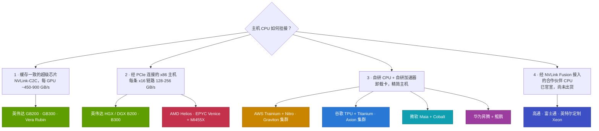

# 全行业的 CPU 挂接策略

> [!NOTE]
> 本页为英文原文的简体中文参考译文，仅供参考；如有出入，以[英文原文](../../../layers/04-cpu-grace-vera/cpu-attach-strategies.md "English original")为准。

第 04 层 · CPU（Grace、Vera）· 阅读约 10 分钟 · 最近核实：2026-11-05

## ⚡ 要点速览

- **主机 CPU 与加速器的搭配有四种模式：**缓存一致的超级芯片（英伟达（NVIDIA）Grace 与 Vera）；经 [PCIe](../../glossary.md#pcie) 连接的 [x86](../../glossary.md#x86) 主机（英伟达 [HGX](../../glossary.md#hgx)、AMD Helios）；自研 CPU 加自研加速器（AWS、谷歌（Google）、微软（Microsoft）、华为）；以及经 [NVLink Fusion](../../glossary.md#nvlink-fusion) 接入的合作伙伴 CPU（已官宣：高通（Qualcomm）、富士通，以及英特尔（Intel）的一款定制 Xeon——尽管英特尔同时也支持与之竞争的 [UALink](../../glossary.md#ualink)）[[S90031]](../../../sources/bibliography.md#s90031)[[S130]](../../../sources/bibliography.md#s130)。
- **只有英伟达在机架规模上出货缓存一致的 CPU–GPU 链路：**NVLink-C2C 为每 GPU 约 450–900 GB/s，而 PCIe Gen5–Gen6 x16 链路为 128–256 GB/s [[S4019]](../../../sources/bibliography.md#s4019)[[S100]](../../../sources/bibliography.md#s100)[[S222]](../../../sources/bibliography.md#s222)。
- **AMD 拼的是核心数，而非缓存一致性。** Helios 以 18 颗 EPYC Venice CPU（每颗最多 256 个 Zen 6 核心）搭配 72 块 MI455X GPU，配比 1:4 [[S538]](../../../sources/bibliography.md#s538)[[S4028]](../../../sources/bibliography.md#s4028)；据报道首批出货在 2026 年第三季度末前后 🟡 [[S90020]](../../../sources/bibliography.md#s90020)。
- **[超大规模云厂商](../../glossary.md#hyperscaler)让主机保持精简，CPU 集群则单独部署。** AWS 为每颗 Trainium3 仅配 16 个主机 vCPU [[S354]](../../../sources/bibliography.md#s354)，同时销售 192 核的 Graviton5 实例 [[S4022]](../../../sources/bibliography.md#s4022)[[S4023]](../../../sources/bibliography.md#s4023)；谷歌将 TPU 与 Axion 虚拟机及 Titanium 卸载搭配 [[S4026]](../../../sources/bibliography.md#s4026)[[S4027]](../../../sources/bibliography.md#s4027)；微软在 Maia 200 旁部署 132 核的 Cobalt 200 [[S4024]](../../../sources/bibliography.md#s4024)[[S90044]](../../../sources/bibliography.md#s90044)。
- **挂接正在变成一种授权。** 高通与富士通于 2025 年 5 月签约成为 Fusion CPU 合作伙伴，Arm 在 Neoverse 中加入了 Fusion 支持，AWS 表示 Trainium4 将支持 Fusion [[S90031]](../../../sources/bibliography.md#s90031)[[S90036]](../../../sources/bibliography.md#s90036)[[S90034]](../../../sources/bibliography.md#s90034)。
- **高通（仅基于公开信息）：**其已发布的、基于 Oryon 的 Dragonfly C1000（约 250 核、PCIe Gen7、CXL）瞄准 2028 年下半年的 AI 头节点 🟡 [[S4029]](../../../sources/bibliography.md#s4029)[[S4030]](../../../sources/bibliography.md#s4030)；在本资料库查阅的材料中，高通尚未公布 AI200 机架所用的主机 CPU [[S173]](../../../sources/bibliography.md#s173)。

## 1. 四种挂接模式

挂接方式决定了加速器访问 CPU 内存的速度，以及由谁来供应 CPU 插槽。

缓存一致的超级芯片提供最高的主机带宽和统一的内存空间（[Grace 与超级芯片](grace-and-the-superchip.md)）。x86 主机保留了用户熟悉的软件环境；英伟达自家的 HGX 和 DGX 整机至今仍在使用 [[S319]](../../../sources/bibliography.md#s319)[[S179]](../../../sources/bibliography.md#s179)。自研组合让主机保持精简，把 I/O 和安全功能转移到卸载卡上（AWS Nitro、谷歌 Titanium [[S4027]](../../../sources/bibliography.md#s4027)、微软 Azure Boost [[S4024]](../../../sources/bibliography.md#s4024)）。Fusion 则把英伟达的互连架构授权给合作伙伴的 CPU 和加速器 [[S90031]](../../../sources/bibliography.md#s90031)（[第 05 层](../05-scale-up-nvlink-nvswitch/index.md)）。

> [!TIP]
> **算例 —— Helios 与 Vera Rubin 的主机侧对比。** Vera Rubin [NVL72](../../glossary.md#nvl72)：36 颗 Vera × 88 核 = **3,168 个核心**，每 GPU 约 44 个，每块 GPU 以约 900 GB/s 访问 CPU 内存 [[S102]](../../../sources/bibliography.md#s102)[[S4000]](../../../sources/bibliography.md#s4000)[[S100]](../../../sources/bibliography.md#s100)。AMD Helios：18 颗 Venice CPU [[S538]](../../../sources/bibliography.md#s538)；AMD 尚未公布具体型号。*假如*采用的是 256 核旗舰型号 [[S4028]](../../../sources/bibliography.md#s4028)，整机架将拥有 **4,608 个核心**，每 GPU 约 64 个，经 PCIe Gen6 x16 以约 **256 GB/s** 访问主机内存 [[S222]](../../../sources/bibliography.md#s222)（🔴 本资料库情景假设）。**结论：**AMD 在每 GPU 主机算力上可以追平英伟达，但在缓存一致带宽上做不到；胜负取决于工作负载是否需要一个快速的第二内存层级。

🔧 技术细节：为什么 PCIe 主机不能简单地变成缓存一致

- **PCIe 搬运的是数据块，而非缓存行。** PCIe 上的 GPU 可以读取主机内存，但没有一致性协议时，CPU 的缓存中可能保存着更新的数据，因此软件必须显式地拷贝和同步。
- **[CXL](../../glossary.md#cxl) 在 PCIe 物理链路上增加了一致性，**但速率仍是 PCIe 链路速率（Gen6 x16 约 256 GB/s），且目前加速器对它的支持有限。
- **目前的一致性链路都是专有的：**NVLink-C2C（英伟达）、AMD 自家封装内部的 Infinity Fabric，以及面向授权合作伙伴的 [NVLink](../../glossary.md#nvlink) Fusion。

## 2. 逐家厂商分析

| 厂商 | 主机 CPU | 加速器 | CPU↔加速器链路 | 配比或每芯片主机资源 | 状态（2026-11） |
|---|---|---|---|---|---|
| 英伟达机架 | Grace → Vera | Blackwell → Rubin | NVLink-C2C，缓存一致 | 1:2 | Vera 2026 年下半年 [[S396]](../../../sources/bibliography.md#s396)[[S4000]](../../../sources/bibliography.md#s4000)[[S90009]](../../../sources/bibliography.md#s90009) |
| 英伟达 HGX | Xeon 6 或 EPYC | B200 / B300 | PCIe Gen5 | 1:4 | 已出货 [[S319]](../../../sources/bibliography.md#s319)[[S179]](../../../sources/bibliography.md#s179) |
| AMD | EPYC Venice，≤256 核 | MI455X | PCIe（宣称 Gen6） | 1:4 | 约 2026 年第三季度末 🟡 [[S538]](../../../sources/bibliography.md#s538)[[S4028]](../../../sources/bibliography.md#s4028)[[S90020]](../../../sources/bibliography.md#s90020) |
| AWS | Graviton5 集群，192 核 | Trainium2/3 | 未披露 | 12–16 个 vCPU | Graviton5 于 2026 年 6 月全面上市 [[S4022]](../../../sources/bibliography.md#s4022)[[S4023]](../../../sources/bibliography.md#s4023)[[S354]](../../../sources/bibliography.md#s354) |
| 谷歌 | Axion C4A / N4A | TPU Ironwood | 未披露 | 未披露 | N4A 于 2026 年 1 月全面上市 [[S182]](../../../sources/bibliography.md#s182)[[S4026]](../../../sources/bibliography.md#s4026)[[S547]](../../../sources/bibliography.md#s547) |
| 微软 | Cobalt 200，132 核 | Maia 200 | 未披露 | 未披露 | 2026 年全面上市 [[S4024]](../../../sources/bibliography.md#s4024)[[S4025]](../../../sources/bibliography.md#s4025)[[S90044]](../../../sources/bibliography.md#s90044) |
| Meta | x86；独立 Grace，2027 年起 Vera | MTIA、英伟达 | — | — | 🟡 [[S4006]](../../../sources/bibliography.md#s4006)[[S4008]](../../../sources/bibliography.md#s4008) |
| 华为 | 鲲鹏 → 950（≤192 核） | 昇腾 910C → 950 | 自有互连 | 1:2（CM384） | 950 预计 2026 年推出 🟡 [[S340]](../../../sources/bibliography.md#s340)[[S4031]](../../../sources/bibliography.md#s4031) |
| 高通 | Dragonfly C1000，约 250 核 | AI200 / AI250 | 计划经 Fusion 接入英伟达 GPU | — | 2028 年下半年 🟡 [[S4029]](../../../sources/bibliography.md#s4029)[[S4030]](../../../sources/bibliography.md#s4030)[[S131]](../../../sources/bibliography.md#s131) |
| 富士通 | MONAKA，144 核 | 英伟达 GPU | 计划采用 Fusion | — | FY2027 [[S187]](../../../sources/bibliography.md#s187)[[S131]](../../../sources/bibliography.md#s131) |

**竞争对手最有力的论点。** AMD 提供了唯一能替代整套英伟达机架的商用方案，每个 Venice 插槽内存带宽达 1.6 TB/s [[S4028]](../../../sources/bibliography.md#s4028)，并计划在其 2027 年机架中采用低功耗的 Verano CPU [[S538]](../../../sources/bibliography.md#s538)[[S540]](../../../sources/bibliography.md#s540)。超大规模云厂商则主张主机 CPU 应单独配置：Graviton5 配有 192 MB L3 缓存和 DDR5-8800 [[S4022]](../../../sources/bibliography.md#s4022)，因此智能体沙箱可以在加速器机架之外运行。华为的路线图在 2026 年加入 192 核的鲲鹏 950，2028 年推出超过 256 核的鲲鹏 960 [[S4031]](../../../sources/bibliography.md#s4031)[[S163]](../../../sources/bibliography.md#s163)。

> [!TIP]
> **算例 —— 每加速器主机内存：英伟达对比 AWS。** 一台 Trn3 Gen2 UltraServer 为 144 颗 Trainium3 配备 27,648 GiB 主机内存：**每颗芯片 192 GiB**，另有 144 GiB [高带宽内存（HBM）](../../glossary.md#hbm) [[S354]](../../../sources/bibliography.md#s354)。一台 Vera Rubin NVL72 为 72 块 GPU 配备 54 TB LPDDR5X：**每块 GPU 约 750 GB**，另有 288 GB [HBM4](../../glossary.md#hbm4) [[S102]](../../../sources/bibliography.md#s102)。**结论：**英伟达在每个加速器旁配置的主机内存约多 4 倍，且具备缓存一致性；AWS 则押注耗内存的主机工作应放在别处。长时间的智能体会话需要把“温”的 [KV 缓存](../../glossary.md#kv-cache)放在靠近加速器的位置，它将决定哪一方的押注胜出。

### 高通：仅基于公开信息

- **2025 年 5 月：**与富士通一同被列为 NVLink Fusion CPU 合作伙伴，开发定制数据中心 CPU [[S131]](../../../sources/bibliography.md#s131)[[S90031]](../../../sources/bibliography.md#s90031)。
- **2025 年 10 月：**发布 AI200（2026 年）和 AI250（2027 年）机架级推理系统，每卡配 768 GB [LPDDR](../../glossary.md#lpddr) [[S173]](../../../sources/bibliography.md#s173)[[S90028]](../../../sources/bibliography.md#s90028)。Counterpoint 报道称 AI200 正在送样，首批部署在 2026 年下半年 🟡 [[S4030]](../../../sources/bibliography.md#s4030)；未找到 2026 年出货的确认信息 🔴 [[S90028]](../../../sources/bibliography.md#s90028)。
- **2026 年 6 月：**发布 Dragonfly C1000，约 250 个主频超过 5 GHz 的 Oryon 核心，支持 PCIe Gen7 和 CXL，面向[智能体（agentic）](../../glossary.md#agentic-ai)编排和 AI 头节点，预计 2028 年下半年推出；另有报道称其与 Meta 签订了多年期协议 🟡 [[S4029]](../../../sources/bibliography.md#s4029)[[S4030]](../../../sources/bibliography.md#s4030)。

| 挂接维度（对比英伟达 Vera Rubin） | AMD Helios | AWS Trainium | 谷歌 TPU | 华为 CloudMatrix |
|---|---|---|---|---|
| CPU↔加速器带宽 | 🟥 PCIe ~256 对 ~900 GB/s | 🟦 精简主机，未披露 | 🟦 未披露 | 🟦 自有互连 |
| 每加速器主机核心数 | 🟨 相近或更高（型号未披露） | 🟥 16 个 vCPU 对 88 个线程 | 🟦 未披露 | 🟨 同为 1:2 插槽配比 |
| 缓存一致的共享内存 | 🟥 无 | 🟥 无 | 🟥 无公开证据 | 🟦 未披露 |
| 面向智能体的独立 CPU 集群 | 🟨 EPYC | 🟩 Graviton5 | 🟩 Axion | 🟨 鲲鹏 |

以上评级为本资料库依据上文所引公开规格作出的判断（🔴）。

> [!NOTE]
> **🐂 看多观点：**缓存一致挂接是一条随上下文长度增长而加宽的护城河；只有英伟达能为每块 GPU 提供数百 GB、带宽 450–900 GB/s 的缓存一致 CPU 内存 [[S102]](../../../sources/bibliography.md#s102)[[S4019]](../../../sources/bibliography.md#s4019)。

> [!WARNING]
> **🐻 看空观点：**超大规模云厂商已经拥有出色的 Arm CPU 和卸载卡。如果 KV 缓存层级转移到网络后端的池化内存或存储中（[第 07 层](../07-dpu-supernic-storage-security/index.md)），超级芯片就会从护城河变成成本负担。

## 🎯 企业发展视角

1. **2028 年谁将掌握主机插槽？** 英伟达（Vera、Rosa）、英特尔（NVLink Xeon）、AMD（Venice、Verano）、超大规模云厂商的 Arm，还是 Fusion 合作伙伴；挂接方式决定了谁离加速器的内存最近。
2. **Fusion 的经济条款并不透明。** 合作伙伴为实现缓存一致挂接要付出什么——特许权使用费、芯粒，还是对路线图的依赖？英伟达又能否在同一插槽上用 Vera 与之竞争？
3. **卸载芯片是一个并行的价值池。** Nitro、Titanium、Azure Boost 和 [BlueField](../../glossary.md#bluefield) 都在为主机分担工作；还有哪些独立的[数据处理器（DPU）](../../glossary.md#dpu)或 SmartNIC 厂商可供合作？
4. **高通问题（仅基于公开信息）：**高通同时是 Fusion CPU 合作伙伴 [[S131]](../../../sources/bibliography.md#s131)、加速器机架供应商 [[S173]](../../../sources/bibliography.md#s173)，以及据报道的 Meta CPU 供应商 🟡 [[S4030]](../../../sources/bibliography.md#s4030)。如果英伟达持续扩张 Vera，哪个定位最具防御力？

## 📚 来源（Sources）

<!-- Auto-generated from the [S…] citations on this page by `make build`. Edit sources/registry/*.csv, not this list. -->

- [**S100**](../../../sources/bibliography.md#s100) NVIDIA Technical Blog, *Inside the NVIDIA Vera Rubin Platform: Six New Chips, One AI Supercomputer*, 2026-01-05. [Link](https://developer.nvidia.com/blog/inside-the-nvidia-rubin-platform-six-new-chips-one-ai-supercomputer/)
- [**S102**](../../../sources/bibliography.md#s102) NVIDIA, *NVIDIA DGX Vera Rubin NVL72*, 2026. [Link](https://www.nvidia.com/en-us/data-center/dgx-vera-rubin-nvl72/)
- [**S130**](../../../sources/bibliography.md#s130) NVIDIA Newsroom, *NVIDIA and Intel to Develop AI Infrastructure and Personal Computing Products*, 2025-09-18. [Link](https://nvidianews.nvidia.com/news/nvidia-and-intel-to-develop-ai-infrastructure-and-personal-computing-products)
- [**S131**](../../../sources/bibliography.md#s131) NVIDIA Newsroom, *NVIDIA NVLink Fusion: semi-custom AI infrastructure partner ecosystem (Computex 2025)*, 2025-05-19. [Link](https://nvidianews.nvidia.com/news/nvidia-nvlink-fusion-semi-custom-ai-infrastructure-partner-ecosystem)
- [**S163**](../../../sources/bibliography.md#s163) Huawei (Eric Xu), *Huawei Connect 2025 keynote: Ascend roadmap and SuperPoD interconnect (Eric Xu)*, 2025-09-18. [Link](https://www.huawei.com/en/news/2025/9/hc-xu-keynote-speech)
- [**S173**](../../../sources/bibliography.md#s173) Qualcomm, *Qualcomm Unveils AI200 and AI250 - Redefining Rack-Scale Data Center Inference*, 2025-10-27. [Link](https://www.qualcomm.com/news/releases/2025/10/qualcomm-unveils-ai200-and-ai250-redefining-rack-scale-data-cent)
- [**S179**](../../../sources/bibliography.md#s179) Intel, *Intel Xeon 6 processors with P-cores (Granite Rapids, 6900P/6700P)*, 2024-09-24. [Link](https://www.intel.com/content/www/us/en/products/details/processors/xeon/xeon6-p-cores.html)
- [**S182**](../../../sources/bibliography.md#s182) Google Cloud Blog, *Introducing Google Axion Processors, our new Arm-based CPUs*, 2024-04-09. [Link](https://cloud.google.com/blog/products/compute/introducing-googles-new-arm-based-cpu)
- [**S187**](../../../sources/bibliography.md#s187) Fujitsu, *FUJITSU-MONAKA: next-generation Arm-based processor*, 2025. [Link](https://www.fujitsu.com/global/about/research/technology/monaka/)
- [**S222**](../../../sources/bibliography.md#s222) Tom's Hardware, *PCI Express roadmap: the path to 1TB/s with PCIe 8.0, the challenges of integration, and beyond*, 2025. [Link](https://www.tomshardware.com/pc-components/motherboards/pci-express-roadmap-the-path-to-1tb-s-with-pci-8-0-the-challenges-of-integration-and-beyond)
- [**S319**](../../../sources/bibliography.md#s319) NVIDIA (mirror hosted by OpenZeka), *NVIDIA DGX B200 datasheet*, 2024. [Link](https://openzeka.com/wp-content/uploads/2024/11/dgx-scale-ai-infrastructure-dgx-b200-datasheet-nvidia-web-1-1.pdf)
- [**S340**](../../../sources/bibliography.md#s340) SemiAnalysis (Dylan Patel et al.), *Huawei AI CloudMatrix 384 - China's answer to Nvidia GB200 NVL72*, 2025-04-16. [Link](https://newsletter.semianalysis.com/p/huawei-ai-cloudmatrix-384-chinas-answer-to-nvidia-gb200-nvl72)
- [**S354**](../../../sources/bibliography.md#s354) AWS, *Trn3 architecture (AWS Neuron documentation)*, 2026. [Link](https://awsdocs-neuron.readthedocs-hosted.com/en/v2.28.0/_sources/about-neuron/arch/neuron-hardware/trn3-arch.rst)
- [**S396**](../../../sources/bibliography.md#s396) NVIDIA Newsroom, *NVIDIA Blackwell platform arrives to power a new era of computing*, 2024-03-18. [Link](https://nvidianews.nvidia.com/news/nvidia-blackwell-platform-arrives-to-power-a-new-era-of-computing)
- [**S538**](../../../sources/bibliography.md#s538) AMD Investor Relations, *AAI 2026: AMD Delivers Full-Stack Compute for the Agentic AI Era*, 2026-07-23. [Link](https://ir.amd.com/news-events/press-releases/detail/1294/aai-2026-amd-delivers-full-stack-compute-for-the-agentic-ai-era)
- [**S540**](../../../sources/bibliography.md#s540) Tom's Hardware, *AMD unwraps 2027 AI plans: Verano CPU, Instinct MI500X GPU, next-gen AI rack*, 2026-07. [Link](https://www.tomshardware.com/pc-components/cpus/amd-unwraps-2027-ai-plans-verano-cpu-instinct-mi500x-gpu-next-gen-ai-rack)
- [**S547**](../../../sources/bibliography.md#s547) Google Cloud Blog, *Ironwood TPUs and new Axion-based VMs for your AI workloads*, 2025-11-06. [Link](https://cloud.google.com/blog/products/compute/ironwood-tpus-and-new-axion-based-vms-for-your-ai-workloads)
- [**S4000**](../../../sources/bibliography.md#s4000) NVIDIA Newsroom, *NVIDIA Launches Vera CPU, Purpose-Built for Agentic AI*, 2026-03-16. [Link](https://nvidianews.nvidia.com/news/nvidia-launches-vera-cpu-purpose-built-for-agentic-ai)
- [**S4006**](../../../sources/bibliography.md#s4006) SiliconANGLE, *Meta agrees to buy millions of AI chips from Nvidia, raising doubts about its in-house hardware*, 2026-02-17. [Link](https://siliconangle.com/2026/02/17/meta-agrees-buy-millions-ai-chips-nvidia-raising-doubts-house-hardware/)
- [**S4008**](../../../sources/bibliography.md#s4008) Futurum Group, *Will NVIDIA's Meta Deal Ignite a CPU Supercycle?*, 2026-02. [Link](https://futurumgroup.com/insights/will-nvidias-meta-deal-ignite-a-cpu-supercycle/)
- [**S4019**](../../../sources/bibliography.md#s4019) heise online, *Blackwell: Nvidia unveils its next generation of AI accelerators*, 2024-03-19. [Link](https://heise.de/en/news/Blackwell-Nvidia-unveils-its-next-generation-of-AI-accelerators-9782399.html)
- [**S4022**](../../../sources/bibliography.md#s4022) Amazon Science, *Graviton5's improved design increases speed and energy efficiency beyond Moore's law*, 2025-12. [Link](https://www.amazon.science/blog/graviton5s-improved-design-increases-speed-and-energy-efficiency-beyond-moores-law)
- [**S4023**](../../../sources/bibliography.md#s4023) The Next Platform, *AWS Tunes Up Graviton5 For Agentic AI*, 2026-06-11. [Link](https://nextplatform.com/compute/2026/06/11/aws-tunes-up-graviton5-for-agentic-ai-boosts-bang-for-the-buck-bigtime/5254538)
- [**S4024**](../../../sources/bibliography.md#s4024) DatacenterDynamics, *Microsoft reveals next-generation Cobalt CPU and Azure Boost*, 2025-11-18. [Link](https://www.datacenterdynamics.com/en/news/microsoft-reveals-next-generation-cobalt-cpu-and-azure-boost/)
- [**S4025**](../../../sources/bibliography.md#s4025) ServeTheHome, *Microsoft Azure Cobalt 200 launched with 132 Arm Neoverse V3 cores*, 2025-11. [Link](https://www.servethehome.com/microsoft-azure-cobalt-200-launched-with-132-arm-neoverse-v3-cores/)
- [**S4026**](../../../sources/bibliography.md#s4026) Phoronix, *Google Axion CPU performance with the new Google Cloud N4A instances*, 2026-01. [Link](https://www.phoronix.com/review/google-cloud-n4a-axion)
- [**S4027**](../../../sources/bibliography.md#s4027) Tom's Hardware, *Google deploys new Axion CPUs and seventh-gen Ironwood TPU training and inferencing pods*, 2025-11. [Link](https://www.tomshardware.com/tech-industry/artificial-intelligence/google-deploys-new-axion-cpus-and-seventh-gen-ironwood-tpu-training-and-inferencing-pods-beat-nvidia-gb300-and-shape-ai-hypercomputer-model)
- [**S4028**](../../../sources/bibliography.md#s4028) Digital Citizen, *AMD EPYC Venice launches with up to 256 Zen 6 cores and strong agentic AI performance claims*, 2026-07-22. [Link](https://www.digitalcitizen.life/amd-epyc-venice-launches-with-up-to-256-zen-6-cores-and-strong-agentic-ai-performance-claims/)
- [**S4029**](../../../sources/bibliography.md#s4029) StorageReview, *Qualcomm unveils Dragonfly data center roadmap: C1000 CPU, AI300 accelerator*, 2026-06-24. [Link](https://www.storagereview.com/news/qualcomm-unveils-dragonfly-data-center-roadmap-c1000-cpu-ai300-accelerator-and-modular-acquisition)
- [**S4030**](../../../sources/bibliography.md#s4030) Counterpoint Research, *Qualcomm unveils data center roadmap at Investor Day 2026*, 2026-06. [Link](https://counterpointresearch.com/cn/reports/qualcomm-unveils-data-center-roadmap-at-investor-day-2026)
- [**S4031**](../../../sources/bibliography.md#s4031) Wccftech, *Huawei next-gen Kunpeng chips: 950 series up to 192 cores, 960 series over 256 cores*, 2025-09. [Link](https://wccftech.com/huawei-next-gen-kungpeng-chips-950-series-up-to-192-cores-q4-2026-960-series-over-256-cores-q1-2028/)
- [**S90009**](../../../sources/bibliography.md#s90009) GamesBeat, *Nvidia Vera Rubin ramps into full production for fall launch*, 2026. [Link](https://gamesbeat.com/nvidia-vera-rubin-ramps-into-full-production-for-fall-launch-again/)
- [**S90020**](../../../sources/bibliography.md#s90020) Shacknews, *AMD Helios AI rack system on track for initial shipments in Q3 2026*, 2026. [Link](https://www.shacknews.com/article/150249/amd-helios-ai-system-shipping-q3-2026)
- [**S90028**](../../../sources/bibliography.md#s90028) TechRepublic, *Qualcomm unveils AI chips to rival Nvidia, AMD*, 2025-10-27. [Link](https://techrepublic.com/article/news-qualcomm-unveils-ai-chips-to-rival-nvidia-amd)
- [**S90031**](../../../sources/bibliography.md#s90031) ServeTheHome, *NVIDIA announces NVLink Fusion bringing NVLink to third-party CPUs and accelerators*, 2025-05-19. [Link](https://www.servethehome.com/nvidia-announces-nvlink-fusion-bringing-nvlink-to-third-party-cpus-and-accelerators/nvlink-fusion-partners/)
- [**S90034**](../../../sources/bibliography.md#s90034) NAND Research, *AWS releases Trainium3, teases Trainium4*, 2025-12. [Link](https://nand-research.com/research-note-aws-releases-trainium3-teases-trainium4/4/)
- [**S90036**](../../../sources/bibliography.md#s90036) Converge Digest, *Arm extends Neoverse with NVIDIA NVLink Fusion*, 2025-11. [Link](https://convergedigest.com/arm-extends-neoverse-with-nvidia-nvlink-fusion/)
- [**S90044**](../../../sources/bibliography.md#s90044) eWeek, *Microsoft introduces Maia 200, its most powerful AI chip yet*, 2026-01-27. [Link](https://www.eweek.com/news/microsoft-maia-200-ai-chip/)
