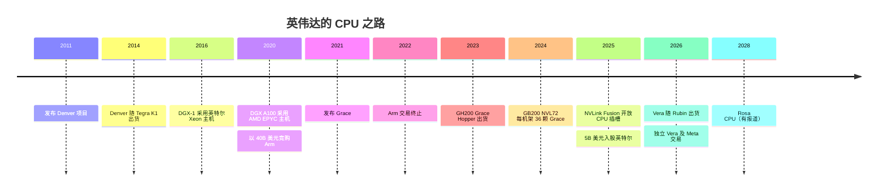
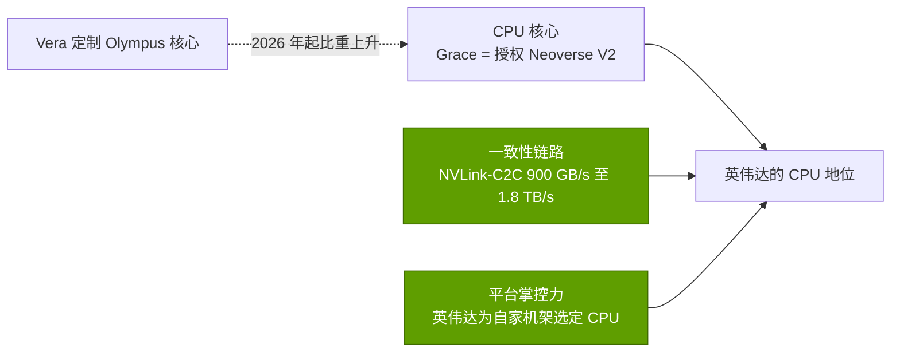
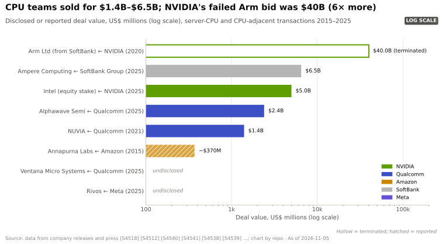

# CPU（Grace、Vera）：发展历程与英伟达的构建方式

> [!NOTE]
> 本页为英文原文的简体中文参考译文，仅供参考；如有出入，以[英文原文](../../../layers/04-cpu-grace-vera/history-and-how-built.md "English original")为准。

第 04 层 · CPU（Grace、Vera）· 阅读约 11 分钟 · 最近核实：2026-11-05

## ⚡ 要点速览

- **从首次尝试到一颗可信的服务器 CPU，用了十五年。** Denver 项目（CES 2011）从 2014 年起仅用于 Tegra 移动和车载芯片 [[S4536]](../../../sources/bibliography.md#s4536)[[S4537]](../../../sources/bibliography.md#s4537)。
- **失败的捷径：**英伟达（NVIDIA）以 $40B 竞购 Arm（2020 年 9 月），本可买下所有 Arm 竞争对手都要授权使用的[指令集（ISA）](../../glossary.md#isa)；该交易于 2022 年 2 月告吹（计提约 $1.36B 费用），但英伟达保留了一份 20 年期授权 [[S465]](../../../sources/bibliography.md#s465)[[S466]](../../../sources/bibliography.md#s466)。
- **Grace（2021 年 4 月发布）靠授权核心取胜**（Arm [Neoverse](../../glossary.md#neoverse) V2，与 Graviton4 同属一个系列），外加差异化的 900 GB/s [NVLink-C2C](../../glossary.md#nvlink-c2c) 链路 [[S537]](../../../sources/bibliography.md#s537)[[S129]](../../../sources/bibliography.md#s129)[[S181]](../../../sources/bibliography.md#s181)。
- **是机架成就了 CPU 业务：**GB200 [NVL72](../../glossary.md#nvl72) 每个机架装入 36 颗 Grace，Mercury 将 Arm 服务器出货量的增长归功于 Grace [[S396]](../../../sources/bibliography.md#s396)[[S4502]](../../../sources/bibliography.md#s4502)。
- **Vera（2026 年）带来了英伟达首批自研数据中心核心**（88 个 Olympus 核心）以及一项独立 CPU 业务；据报道，Feynman 时代的 Rosa CPU 将于 2028 年推出 🟡 [[S100]](../../../sources/bibliography.md#s100)[[S90003]](../../../sources/bibliography.md#s90003)[[S90004]](../../../sources/bibliography.md#s90004)。
- **英伟达也做了对冲：**[NVLink](../../glossary.md#nvlink) Fusion 向高通（Qualcomm）和富士通开放了主机插槽（2025 年 5 月），$5B 入股英特尔（Intel）则换来了经 NVLink 挂接的 [x86](../../glossary.md#x86)（2025 年 9 月）[[S90031]](../../../sources/bibliography.md#s90031)[[S468]](../../../sources/bibliography.md#s468)。
- **[Q4]** 优势更多来自缓存一致的挂接方式和平台掌控力，而非核心本身；**[Q6]** 打造一颗有竞争力的定制服务器 CPU 约需 5–7 年和约 $1.5–3B 🔴。

## 从 Denver 到 Vera：演进之路

分三个阶段。**第一阶段（2011–2018）：雄心勃勃的弯路。** Denver 采用类似[二进制翻译（binary translation）](../../glossary.md#binary-translation)的“动态代码优化”技术，据报道最初是 x86 设计；由于没有 x86 授权，它最终以 Arm 核心的形式出现在 Nexus 9 平板（2014 年）上，后来又用于汽车芯片 [[S4536]](../../../sources/bibliography.md#s4536)[[S4537]](../../../sources/bibliography.md#s4537)。**第二阶段（2016–2022）：从竞争对手那里购买主机。** DGX-1 采用英特尔 Xeon，DGX A100 采用 AMD EPYC，因此英伟达的旗舰系统依赖于竞争对手的 CPU 和 [PCIe](../../glossary.md#pcie) [[S189]](../../../sources/bibliography.md#s189)[[S188]](../../../sources/bibliography.md#s188)。**第三阶段（2020 年至今）：先掌控主机，再将其开放。**

| 日期 | 决策 | 意义 | 来源 |
|---|---|---|---|
| 2011-01 | Denver 项目：定制 Arm 核心 | 积累了 CPU 设计能力；最终仅用于移动和汽车领域 | [[S4536]](../../../sources/bibliography.md#s4536) |
| 2016 / 2020 | 先后从英特尔、AMD 采购主机 | GPU 系统受制于竞争对手的 CPU 和 PCIe | [[S189]](../../../sources/bibliography.md#s189)[[S188]](../../../sources/bibliography.md#s188) |
| 2020-09-13 | 以 $40B 竞购 Arm | 本可掌控所有 Arm 竞争对手背后的指令集 | [[S465]](../../../sources/bibliography.md#s465) |
| 2021-04-12 | 采用授权 Neoverse 核心的 Grace | 最快的路径；以链路和内存实现差异化 | [[S537]](../../../sources/bibliography.md#s537) |
| 2022-02-08 | Arm 交易终止，保留授权 | 计提约 $1.36B 费用；获得 20 年期授权 | [[S466]](../../../sources/bibliography.md#s466) |
| 2024-03-18 | GB200 NVL72：每机架 36 颗 Grace | 以每 2 块 GPU 配 1 颗 CPU 的比例锁定 CPU 挂接 | [[S396]](../../../sources/bibliography.md#s396) |
| 2025-05-19 | NVLink Fusion 支持第三方 CPU | 以插槽独占性换取 NVLink 的覆盖面 | [[S90031]](../../../sources/bibliography.md#s90031) |
| 2025-09-18 | $5B 入股英特尔，NVLink x86 | 覆盖坚持使用 x86 的客户 | [[S468]](../../../sources/bibliography.md#s468) |
| 2026 | Vera 定制核心；独立销售 | 首次进军通用 CPU 市场 | [[S100]](../../../sources/bibliography.md#s100)[[S90003]](../../../sources/bibliography.md#s90003) |

> [!TIP]
> **算例 —— 英伟达如何让 CPU 挂接率翻倍并把收入留在自己手里。** 一台 DGX H100 为 8 块 GPU 配两颗英特尔 Xeon 8480C：每 4 块 GPU 一颗 CPU，从英特尔采购 [[S33022]](../../../sources/bibliography.md#s33022)。一台 GB200 NVL72 为 72 块 GPU 配 36 颗 Grace：每 2 块一颗，由英伟达自己供应 [[S396]](../../../sources/bibliography.md#s396)。因此每 1,000 个 Vera Rubin 机架就意味着 36,000 颗英伟达 CPU；按摩根士丹利估计的每颗 Vera 约 $5,000 计算，约为 $180M 的 CPU 芯片收入 [[S331]](../../../sources/bibliography.md#s331)——这部分出货量原本会落入英特尔或 AMD 手中。

## [Q4 · 优势来源] 靠的是 CPU、链路还是平台？

**答案：**截至 2025 年，主要靠链路和平台。Grace 的核心与 AWS 在 Graviton4 中所用的属于同一系列，因此核心并非优势所在 [[S129]](../../../sources/bibliography.md#s129)[[S181]](../../../sources/bibliography.md#s181)。优势在于一条带宽约为 PCIe Gen5 x16 插槽 7 倍的缓存一致链路，以及英伟达能够为其销售的每一颗[超级芯片（superchip）](../../glossary.md#superchip)和每一个机架指定 CPU [[S129]](../../../sources/bibliography.md#s129)[[S396]](../../../sources/bibliography.md#s396)。Vera 把部分优势转移到了 CPU 本身（基于 Arm [架构授权（architecture licence）](../../glossary.md#architecture-licence)打造的定制核心、1.2 TB/s 内存带宽），Meta 也称在部分纯 CPU 工作负载上使用 Grace 可获得最高 2 倍的每瓦性能 [[S100]](../../../sources/bibliography.md#s100)[[S4520]](../../../sources/bibliography.md#s4520)。但出货量仍然跟随平台：Arm 服务器出货量的增长与 NVL72 的出货同步 [[S4502]](../../../sources/bibliography.md#s4502)。

> [!TIP]
> **算例 —— 链路在时间上值多少。** 以 512 GB/s 的内存带宽读取一颗 Grace 上全部 480 GB 的 LPDDR5X 内存池约需 0.9 s，以 900 GB/s 传输给 GPU 完全跟得上 [[S129]](../../../sources/bibliography.md#s129)；而经 128 GB/s 的 PCIe Gen5 x16 链路，同样的传输约需 3.8 s。CPU 是同一档次的芯片；“管道”却相差 7 倍。

## [Q6 · 复制成本] 时间、资金与人才

证据：其他公司付出了多少、花了多长时间。亚马逊于 2015 年以据报道约 $350–370M 收购 Annapurna Labs，2018 年推出首款 Graviton，2026 年推出 192 核的 Graviton5 [[S4540]](../../../sources/bibliography.md#s4540)[[S4541]](../../../sources/bibliography.md#s4541)[[S4526]](../../../sources/bibliography.md#s4526)。高通于 2021 年以 $1.4B 收购尚无产品的团队 NUVIA [[S4539]](../../../sources/bibliography.md#s4539)。软银以 $6.5B 收购 Ampere [[S4530]](../../../sources/bibliography.md#s4530)。高通的 Centriq 项目在 2018 年退出前人员峰值约为 1,000 人 [[S4544]](../../../sources/bibliography.md#s4544)。

| 路径 | 做出有竞争力产品所需时间 | 投入金额（估计，本资料库 🔴） | 人才 |
|---|---|---|---|
| 授权 Neoverse / CSS SoC，PCIe 主机 | 2–3 年（Grace：2021 → 2023）[[S537]](../../../sources/bibliography.md#s537)[[S128]](../../../sources/bibliography.md#s128) | 约 $0.3–0.7B | 200–400 名工程师 |
| 能与 x86 竞争的定制核心 | 5–7 年（Annapurna 2015 → Graviton 2018 及后续各代；NUVIA 2021 → 至今尚无服务器产品）[[S4540]](../../../sources/bibliography.md#s4540)[[S4541]](../../../sources/bibliography.md#s4541)[[S4539]](../../../sources/bibliography.md#s4539) | 约 $1.5–3B，含团队收购 | 300–600 人，其中约 100 名核心架构师 |
| 英伟达的地位（一致性链路 + GPU + 机架） | 仅靠 CPU 无法复制 | CPU 成本外加一个 GPU 平台 | 需要一项加速器业务作为支撑 |

> [!TIP]
> **算例 —— 收购还是自建。** 收购 NUVIA 的前期成本为 $1.4B [[S4539]](../../../sources/bibliography.md#s4539)；高通自己的 Centriq 部门在 2018 年退出前峰值约 1,000 人 [[S4544]](../../../sources/bibliography.md#s4544)，意味着在产生任何收入之前的自建成本与之相当（估计，本资料库，假设每人综合成本约 $0.3M、历时约 4 年：1,000 × $0.3M × 4 ≈ $1.2B 🔴）。无论哪种方式，入场门槛都在 $1–1.5B 左右，而稀缺的投入是 CPU 架构师人才，而非资金。

## 反事实推演 —— 假如英伟达没有……

- 🔴 **……错失 Arm 交易？** 英伟达将从 Graviton、Axion 和 Cobalt 收取特许权使用费，并能左右 Arm 的路线图——而这恰恰是导致交易失败的担忧所在 [[S466]](../../../sources/bibliography.md#s466)。
- 🔴 **……自研 CPU（始终只用 x86）？** 主机将是经 PCIe 或 CXL 连接的英特尔或 AMD，CPU–GPU 带宽上限约为 256 GB/s，而 AMD 还会把自家 GPU 卖进同样的机架。那样就不会有 GH200，不会有缓存一致的内存层级，也不会有独立 CPU 产品线。
- 🔴 **……向合作伙伴开放 NVLink？** 那就不会有合作伙伴 CPU，也不会有英特尔交易；更多忠于 x86 的买家可能会选择 AMD 的 Helios [[S538]](../../../sources/bibliography.md#s538)。

> [!TIP]
> **算例 —— 用金额衡量 Arm 反事实。** 将 Arm 每季度 $670M 的特许权使用费收入年化，约为每年 $2.7B [[S4506]](../../../sources/bibliography.md#s4506)；英伟达 FY2026 收入为 $215.9B [[S1]](../../../sources/bibliography.md#s1)。拥有 Arm 只会增加约 1% 的收入，却能掌控所有竞争对手的 CPU 路线图——这正是监管机构反对的原因。

🔧 技术细节：为什么定制核心很难做

一颗有竞争力的服务器核心需要宽发射的乱序执行引擎、优秀的分支预测、大容量缓存、连接 100 多个核心的片上网格，以及多年的验证。Denver 的翻译方案节省了[解码（decode）](../../glossary.md#decode)硬件，但在不可预测的代码上表现不佳 [[S4537]](../../../sources/bibliography.md#s4537)。Vera 的 Olympus 核心加入了“空间多线程”（88 核 176 线程）[[S100]](../../../sources/bibliography.md#s100)。每一代产品还需要固件、编译器和 Linux 内核方面的工作，这就是为什么授权厂商通常从 Arm 自己的核心起步。

## 🎯 企业发展视角

1. Grace 表明授权核心加上差异化链路就能赢得插槽：稀缺资产是核心设计团队，还是互连 IP？
2. Annapurna（约 $0.37B）和 NUVIA（$1.4B）买的是团队而非收入；剩下的 CPU 团队（Arm 或 RISC-V）中还有哪些属于这一类？
3. 英伟达选择向 CPU 合作伙伴开放 NVLink，而不是固守插槽：这是否说明它把 NVLink 的覆盖面看得比 CPU 收入更重？
4. 如果 Arm 的特许权使用费和自研芯片战略持续加码，RISC-V 选项会成为谈判筹码、产品路径，还是两者兼而有之？

## 📚 来源（Sources）

<!-- Auto-generated from the [S…] citations on this page by `make build`. Edit sources/registry/*.csv, not this list. -->

- [**S1**](../../../sources/bibliography.md#s1) NVIDIA Corporation via SEC EDGAR, *NVIDIA Announces Financial Results for Fourth Quarter and Fiscal 2026 (Form 8-K exhibit 99.1)*, 2026-02-25. [Link](https://www.sec.gov/Archives/edgar/data/1045810/000104581026000019/q4fy26pr.htm)
- [**S100**](../../../sources/bibliography.md#s100) NVIDIA Technical Blog, *Inside the NVIDIA Vera Rubin Platform: Six New Chips, One AI Supercomputer*, 2026-01-05. [Link](https://developer.nvidia.com/blog/inside-the-nvidia-rubin-platform-six-new-chips-one-ai-supercomputer/)
- [**S128**](../../../sources/bibliography.md#s128) NVIDIA, *NVIDIA GH200 Grace Hopper Superchip*, 2023-08. [Link](https://www.nvidia.com/en-us/data-center/grace-hopper-superchip/)
- [**S129**](../../../sources/bibliography.md#s129) NVIDIA, *NVIDIA Grace CPU*, 2023. [Link](https://www.nvidia.com/en-us/data-center/grace-cpu/)
- [**S181**](../../../sources/bibliography.md#s181) Amazon Web Services, *AWS Graviton Processor*, 2024. [Link](https://aws.amazon.com/ec2/graviton/)
- [**S188**](../../../sources/bibliography.md#s188) NVIDIA Docs, *NVIDIA DGX A100 User Guide - Introduction (system specifications)*, 2020. [Link](https://docs.nvidia.com/dgx/dgxa100-user-guide/introduction-to-dgxa100.html)
- [**S189**](../../../sources/bibliography.md#s189) NVIDIA Docs, *NVIDIA DGX-1 User Guide - Introduction (system specifications)*, 2017. [Link](https://docs.nvidia.com/dgx/dgx1-user-guide/introduction-to-dgx1.html)
- [**S331**](../../../sources/bibliography.md#s331) Wccftech, *NVIDIA's Vera Rubin rack hit with 435% memory price surge, pushing HBM4 & LPDDR5X bill to $2M of $7.8M total*, 2026-05. [Link](https://wccftech.com/nvidia-vera-rubin-rack-hit-with-memory-price-surge-pushing-hbm4-lpddr5x-bill-to-2m-of-7-8m-total/)
- [**S396**](../../../sources/bibliography.md#s396) NVIDIA Newsroom, *NVIDIA Blackwell platform arrives to power a new era of computing*, 2024-03-18. [Link](https://nvidianews.nvidia.com/news/nvidia-blackwell-platform-arrives-to-power-a-new-era-of-computing)
- [**S465**](../../../sources/bibliography.md#s465) NVIDIA Newsroom, *NVIDIA to Acquire Arm for $40 Billion, Creating World's Premier Computing Company for the Age of AI*, 2020-09-13. [Link](https://nvidianews.nvidia.com/news/nvidia-to-acquire-arm-for-40-billion-creating-worlds-premier-computing-company-for-the-age-of-ai)
- [**S466**](../../../sources/bibliography.md#s466) NVIDIA Newsroom, *NVIDIA and SoftBank Group Announce Termination of NVIDIA's Acquisition of Arm Limited*, 2022-02-08. [Link](https://nvidianews.nvidia.com/news/nvidia-and-softbank-group-announce-termination-of-nvidias-acquisition-of-arm-limited)
- [**S468**](../../../sources/bibliography.md#s468) NVIDIA Newsroom, *NVIDIA and Intel to Develop AI Infrastructure and Personal Computing Products*, 2025-09-18. [Link](https://nvidianews.nvidia.com/news/nvidia-and-intel-to-develop-ai-infrastructure-and-personal-computing-products)
- [**S537**](../../../sources/bibliography.md#s537) NVIDIA press release via Yahoo Finance, *NVIDIA Announces CPU for Giant AI and High Performance Computing Workloads*, 2021-04-12. [Link](https://sg.finance.yahoo.com/news/nvidia-announces-cpu-giant-ai-161900753.html)
- [**S538**](../../../sources/bibliography.md#s538) AMD Investor Relations, *AAI 2026: AMD Delivers Full-Stack Compute for the Agentic AI Era*, 2026-07-23. [Link](https://ir.amd.com/news-events/press-releases/detail/1294/aai-2026-amd-delivers-full-stack-compute-for-the-agentic-ai-era)
- [**S4502**](../../../sources/bibliography.md#s4502) Techzine, *AMD gains ground in servers thanks to AI boom; Intel remains market leader (Mercury Research Q1 2026)*, 2026-05. [Link](https://www.techzine.eu/news/infrastructure/141872/amd-gains-ground-in-servers-thanks-to-ai-boom-intel-remains-market-leader/)
- [**S4506**](../../../sources/bibliography.md#s4506) Arm Holdings plc via SEC EDGAR, *Arm Holdings plc Form 6-K, Exhibit 99.2: results for the quarter ended September 30, 2026 (Q2 FYE27)*, 2026-11. [Link](https://www.sec.gov/Archives/edgar/data/0001973239/000197323926000141/exhibit992fye27q230-sepx26.htm)
- [**S4520**](../../../sources/bibliography.md#s4520) Tom's Hardware, *Meta will deploy standalone Nvidia Grace CPUs in production, with Vera to follow*, 2026-02. [Link](https://www.tomshardware.com/pc-components/cpus/meta-will-deploy-standalone-nvidia-grace-cpus-in-production-with-vera-to-follow-company-sees-perf-per-watt-improvements-of-up-to-2x-in-some-cpu-workloads)
- [**S4526**](../../../sources/bibliography.md#s4526) Amazon Web Services, *Amazon EC2 M9g and M9gd instances powered by AWS Graviton5 are now available*, 2026-06-10. [Link](https://aws.amazon.com/about-aws/whats-new/2026/06/ec2-m9g-m9gd-instances-graviton5-processors-available)
- [**S4530**](../../../sources/bibliography.md#s4530) SoftBank Group, *Completion of acquisition of Ampere Computing Holdings LLC*, 2025-11-26. [Link](https://group.softbank/en/news/press/20251126)
- [**S4536**](../../../sources/bibliography.md#s4536) Wikipedia, *Project Denver*, 2026. [Link](https://en.wikipedia.org/wiki/Project_Denver)
- [**S4537**](../../../sources/bibliography.md#s4537) AnandTech, *The Google Nexus 9 review (Denver CPU architecture)*, 2015-02. [Link](https://www.anandtech.com/show/8701/the-google-nexus-9-review/2)
- [**S4539**](../../../sources/bibliography.md#s4539) PYMNTS, *Qualcomm inks $1.4 billion acquisition deal with chip startup NUVIA*, 2021-01-13. [Link](https://www.pymnts.com/partnerships/2021/qualcomm-inks-1-4-billion-acquisition-deal-with-chip-startup-nuvia/)
- [**S4540**](../../../sources/bibliography.md#s4540) Global Venturing, *Arm exits Annapurna Labs in $370m acquisition*, 2015-01-23. [Link](https://globalventuring.com/blog/2015/01/23/arm-exits-annapurna-labs-in-370m-acquisition/)
- [**S4541**](../../../sources/bibliography.md#s4541) The Register, *Amazon AWS puts custom Arm server chip (Graviton) into the cloud: A1 instances*, 2018-11-27. [Link](https://www.theregister.com/2018/11/27/amazon_aws_a1/)
- [**S4544**](../../../sources/bibliography.md#s4544) Network World, *Qualcomm makes it official: no more data center chip*, 2018-12. [Link](https://www.networkworld.com/article/3327214/qualcomm-makes-it-official-no-more-data-center-chip.html)
- [**S33022**](../../../sources/bibliography.md#s33022) NVIDIA Docs, *NVIDIA DGX H100 User Guide — Introduction (system specifications)*, 2023. [Link](https://docs.nvidia.com/dgx/dgxh100-user-guide/introduction-to-dgxh100.html)
- [**S90003**](../../../sources/bibliography.md#s90003) eWeek, *Everything Nvidia Just Announced at GTC 2026: 7 Chips, 5 Racks, 1 Giant Bet on Agentic AI*, 2026-03-17. [Link](https://www.eweek.com/news/nvidia-gtc-2026-ai-inference-vera-rubin-neuron/)
- [**S90004**](../../../sources/bibliography.md#s90004) TrendForce, *Key GTC takeaways: how Samsung, Micron, Intel and more power NVIDIA's Vera Rubin and Feynman*, 2026-03-17. [Link](https://www.trendforce.com/news/2026/03/17/news-key-gtc-takeaways-how-samsung-micron-intel-more-power-nvidias-vera-rubin-and-feynman/)
- [**S90031**](../../../sources/bibliography.md#s90031) ServeTheHome, *NVIDIA announces NVLink Fusion bringing NVLink to third-party CPUs and accelerators*, 2025-05-19. [Link](https://www.servethehome.com/nvidia-announces-nvlink-fusion-bringing-nvlink-to-third-party-cpus-and-accelerators/nvlink-fusion-partners/)
