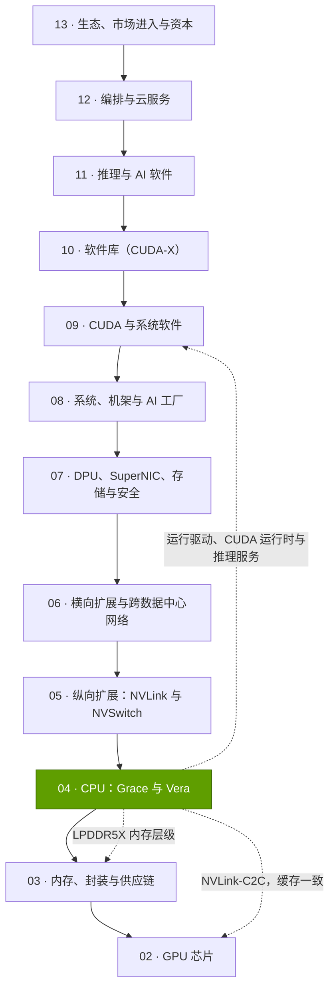
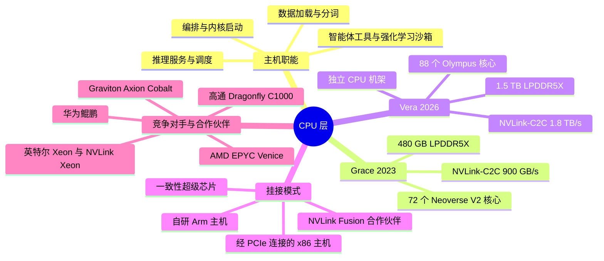

# 第 04 层 —— CPU（Grace、Vera）

> [!NOTE]
> 本页为英文原文的简体中文参考译文，仅供参考；如有出入，以[英文原文](../../../layers/04-cpu-grace-vera/index.md "English original")为准。

第 04 层（共 12 层）· AI 系统中的主机 CPU、CPU–GPU 互连与 CPU 内存 · 阅读约 7 分钟 · 最近核实：2026-11-05

## ⚡ 要点速览

- **每块 GPU 都需要一颗[主机 CPU](../../glossary.md#host-cpu)**，用来启动其任务、为其供给数据、运行推理服务逻辑，并越来越多地执行智能体调用的工具。主机性能不足会让 GPU“挨饿”：由 CPU 负责数据预处理时，一台 16-GPU 的 DGX-2 只发挥出其 ResNet-50 吞吐量的 56% [[S4017]](../../../sources/bibliography.md#s4017)。
- **英伟达（NVIDIA）的对策是把主机掌握在自己手里。** Grace（72 个 Arm 核心、最高 480 GB LPDDR5X）通过 900 GB/s 的 [NVLink-C2C](../../glossary.md#nvlink-c2c) 与 GPU 相连，带宽约为 [PCIe](../../glossary.md#pcie) Gen5 x16 链路的 7 倍；其[缓存一致性（cache coherence）](../../glossary.md#cache-coherence)使 CPU 内存成为 GPU 的第二个内存层级 [[S129]](../../../sources/bibliography.md#s129)[[S222]](../../../sources/bibliography.md#s222)。
- **每 GPU 主机带宽**从 128 GB/s（DGX H100）提升至 900 GB/s（GH200）；GB200 让每颗 Grace 搭配两块 GPU 后回落至约 450 GB/s；到 Vera Rubin 又回到约 900 GB/s，同时每块 GPU 可用约 750 GB 的 CPU 内存 [[S128]](../../../sources/bibliography.md#s128)[[S4019]](../../../sources/bibliography.md#s4019)[[S100]](../../../sources/bibliography.md#s100)[[S102]](../../../sources/bibliography.md#s102)。
- **Vera（2026 年）是英伟达首款采用自研定制核心的 CPU：**88 核、176 线程，最高 1.5 TB LPDDR5X、带宽约 1.2 TB/s，还以 256 颗 CPU 的整机架形态单独销售，用于智能体沙箱 [[S4000]](../../../sources/bibliography.md#s4000)[[S4002]](../../../sources/bibliography.md#s4002)；Meta 是首个大规模单独采购 Grace 的客户 [[S4006]](../../../sources/bibliography.md#s4006)。
- **[智能体（agentic）](../../glossary.md#agentic-ai) AI 正在拉动 CPU 需求：**🟡 英特尔（Intel）与 TrendForce 认为 AI 服务器的 CPU:GPU 配比正向 1:2–1:1 演进 [[S4012]](../../../sources/bibliography.md#s4012)[[S4013]](../../../sources/bibliography.md#s4013)，与此同时 2026 年服务器 CPU 供不应求 [[S4015]](../../../sources/bibliography.md#s4015)。
- **弱点与最强挑战者：**主机仅占机架成本约 2%（在估计约 $7.8M 的 Vera Rubin 机架中约为 $180k）[[S331]](../../../sources/bibliography.md#s331)；通用 CPU 工作负载已高度商品化，Vera 的基准测试领先幅度也有限 [[S4003]](../../../sources/bibliography.md#s4003)。AMD 的 256 核 EPYC Venice 是 Helios 机架的核心 [[S4028]](../../../sources/bibliography.md#s4028)[[S538]](../../../sources/bibliography.md#s538)；AWS、谷歌（Google）与微软（Microsoft）都运行自研 Arm CPU。
- **英伟达两头下注：**以 $5B 入股英特尔，合作开发带 [NVLink](../../glossary.md#nvlink) 的定制 [x86](../../glossary.md#x86) CPU [[S4009]](../../../sources/bibliography.md#s4009)；同时通过 [NVLink Fusion](../../glossary.md#nvlink-fusion) 接入高通（Qualcomm）与富士通的 CPU [[S90031]](../../../sources/bibliography.md#s90031)。

> [!TIP]
> **算例 —— 主机花多少钱、管多少事。** 摩根士丹利估计一台 Vera Rubin [NVL72](../../glossary.md#nvl72) 约 $7.8M，其中 36 颗 Vera CPU 约 $180k [[S331]](../../../sources/bibliography.md#s331)：占机架的 **~2.3%**，折合每块 GPU 约 $2,500 的 CPU 成本。这些 CPU 承载 54 TB 的 LPDDR5X，约为整机架 20.7 TB [HBM4](../../glossary.md#hbm4) 的 2.6 倍 [[S102]](../../../sources/bibliography.md#s102)[[S362]](../../../sources/bibliography.md#s362)，并掌控全部 72 块 GPU 的调度路径。**结论：**账单中的一小部分，决定了每块 GPU 能保持多少“热”上下文。

## 本层在技术栈中的位置

## 本层导图

## 八个问题一览

| # | 问题 | 简要回答 | 详见 |
|---|---|---|---|
| Q1 | 职能是什么？薄弱时会出什么问题？ | 为 GPU 供给数据并运行非矩阵类工作；主机薄弱会让 GPU“挨饿”（DGX-2 上 44% 时间空闲）[[S4017]](../../../sources/bibliography.md#s4017) | [AI 为什么需要 CPU](why-ai-needs-a-cpu.md) |
| Q2 | 哪些指标最关键？ | 每 GPU 主机带宽、每 GPU CPU 内存、每核带宽、每 GPU 主机线程数、能效（perf/W） | [Grace 与超级芯片](grace-and-the-superchip.md) |
| Q3 | 代际进步如何？ | 每 GPU 主机链路 128 → 900 GB/s；每 GPU CPU 内存 ~240 → ~750 GB；每 GPU 线程数 28 → 88 | [Vera 与定制核心](vera-and-custom-cores.md) |
| Q4 | 优势从何而来？ | 系统集成（一致性链路、机架级协同设计），而非更强的核心 | [发展历程与构建方式](history-and-how-built.md) |
| Q5 | 最强挑战者是谁？ | 机架内是 AMD（Helios 中的 Venice）；智能体集群中是超大规模云厂商的自研 Arm CPU | [竞争格局](competition.md) |
| Q6 | 复制成本多高？ | 做一颗 Arm CPU 不难；做一个缓存一致、机架级的 CPU–GPU 平台很难 | [发展历程与构建方式](history-and-how-built.md) |
| Q7 | 路线图？ | Vera 2026 年下半年；Rosa 随 Feynman 于 2028 年推出 🟡；英特尔 NVLink Xeon 未定时间；AMD Verano 2027 年；高通 C1000 2028 年下半年 🟡 | [路线图](roadmap.md) |
| Q8 | 价值池与并购机会？ | CPU 约占机架成本 2%（估计）[[S331]](../../../sources/bibliography.md#s331)；价值在于内存层级、Fusion 授权和独立的智能体 CPU | [价值链与企业发展视角](value-chain-and-corp-dev.md) |

## 本层页面

| 页面 | 你将了解 |
|---|---|
| [AI 系统为什么需要 CPU](why-ai-needs-a-cpu.md) | 主机职能、GPU 饥饿、CPU:GPU 配比、智能体带来的 CPU 需求 |
| [Grace 与超级芯片](grace-and-the-superchip.md) | 一致性 NVLink-C2C 与 PCIe 之比较、超级芯片产品家族、KV 缓存卸载、关键指标 |
| [Vera 与定制核心](vera-and-custom-cores.md) | Vera 的设计、为何采用定制核心、基准测试宣称、英特尔交易 |
| [CPU 挂接策略](cpu-attach-strategies.md) | 各厂商如何为加速器搭配 CPU |
| [竞争格局](competition.md) | 正面对比与能力热力图 |
| [发展历程与英伟达的构建方式](history-and-how-built.md) | 时间线、关键决策、复制成本、反事实推演 |
| [路线图](roadmap.md) | Vera、Rosa 及竞争对手 CPU 路线图（附置信度标注） |
| [价值链与企业发展视角](value-chain-and-corp-dev.md) | 谁在 CPU 层获取收入、非上市公司、并购 |

🔧 技术细节：如何阅读主机 CPU 规格表

- **带宽数字**通常是双向合计；单向为其一半（PCIe Gen5 x16 = 合计 128 GB/s，每个方向约 64）。
- **共享链路：**将 C2C 数字除以其上挂接的 GPU 数量（GB200：900 ÷ 2）。
- **内存带宽**是峰值；在 Grace 上，STREAM 实测持续带宽为峰值的 80–95% [[S4020]](../../../sources/bibliography.md#s4020)。
- **线程与核心：**云上的 vCPU 是硬件线程；Grace 每核一个线程，Vera 和大多数 x86 处理器每核两个。

## 🎯 企业发展视角

1. **是控制点，而非利润池。** 机架内每颗 Vera 约 $5,000（估计）[[S331]](../../../sources/bibliography.md#s331)，CPU 收入规模不大；掌握主机，等于锁定了内存层级、调度路径和机架设计。
2. **智能体 CPU 是一个新的插槽市场。** 如果沙箱集群与 GPU 的配比接近 1:1 [[S4012]](../../../sources/bibliography.md#s4012)[[S4013]](../../../sources/bibliography.md#s4013)，独立智能体 CPU 的赢家（Vera、AMD、英特尔或[超大规模云厂商](../../glossary.md#hyperscaler)的 Arm 芯片）将获得一块大业务；Meta 2027 年纯 Vera CPU 部署计划就是一次检验 [[S4006]](../../../sources/bibliography.md#s4006)。
3. **高通问题（仅基于公开信息）：**手握 Fusion CPU 合作 [[S131]](../../../sources/bibliography.md#s131)、AI200/AI250 机架 [[S173]](../../../sources/bibliography.md#s173)，以及计划于 2028 年下半年推出的约 250 核 Dragonfly C1000 🟡 [[S4030]](../../../sources/bibliography.md#s4030)，哪一种主机角色（挂接英伟达、自有机架，还是独立智能体集群）最有可能实现规模化？

## 📚 来源（Sources）

<!-- Auto-generated from the [S…] citations on this page by `make build`. Edit sources/registry/*.csv, not this list. -->

- [**S100**](../../../sources/bibliography.md#s100) NVIDIA Technical Blog, *Inside the NVIDIA Vera Rubin Platform: Six New Chips, One AI Supercomputer*, 2026-01-05. [Link](https://developer.nvidia.com/blog/inside-the-nvidia-rubin-platform-six-new-chips-one-ai-supercomputer/)
- [**S102**](../../../sources/bibliography.md#s102) NVIDIA, *NVIDIA DGX Vera Rubin NVL72*, 2026. [Link](https://www.nvidia.com/en-us/data-center/dgx-vera-rubin-nvl72/)
- [**S128**](../../../sources/bibliography.md#s128) NVIDIA, *NVIDIA GH200 Grace Hopper Superchip*, 2023-08. [Link](https://www.nvidia.com/en-us/data-center/grace-hopper-superchip/)
- [**S129**](../../../sources/bibliography.md#s129) NVIDIA, *NVIDIA Grace CPU*, 2023. [Link](https://www.nvidia.com/en-us/data-center/grace-cpu/)
- [**S131**](../../../sources/bibliography.md#s131) NVIDIA Newsroom, *NVIDIA NVLink Fusion: semi-custom AI infrastructure partner ecosystem (Computex 2025)*, 2025-05-19. [Link](https://nvidianews.nvidia.com/news/nvidia-nvlink-fusion-semi-custom-ai-infrastructure-partner-ecosystem)
- [**S173**](../../../sources/bibliography.md#s173) Qualcomm, *Qualcomm Unveils AI200 and AI250 - Redefining Rack-Scale Data Center Inference*, 2025-10-27. [Link](https://www.qualcomm.com/news/releases/2025/10/qualcomm-unveils-ai200-and-ai250-redefining-rack-scale-data-cent)
- [**S222**](../../../sources/bibliography.md#s222) Tom's Hardware, *PCI Express roadmap: the path to 1TB/s with PCIe 8.0, the challenges of integration, and beyond*, 2025. [Link](https://www.tomshardware.com/pc-components/motherboards/pci-express-roadmap-the-path-to-1tb-s-with-pci-8-0-the-challenges-of-integration-and-beyond)
- [**S331**](../../../sources/bibliography.md#s331) Wccftech, *NVIDIA's Vera Rubin rack hit with 435% memory price surge, pushing HBM4 & LPDDR5X bill to $2M of $7.8M total*, 2026-05. [Link](https://wccftech.com/nvidia-vera-rubin-rack-hit-with-memory-price-surge-pushing-hbm4-lpddr5x-bill-to-2m-of-7-8m-total/)
- [**S362**](../../../sources/bibliography.md#s362) Digital Citizen, *NVIDIA Vera Rubin pushes memory costs higher as NVL72 rack reaches 74.7 TB of DRAM*, 2026-05. [Link](https://www.digitalcitizen.life/nvidia-vera-rubin-pushes-memory-costs-higher-as-nvl72-rack-reaches-74-7-tb-of-dram/)
- [**S538**](../../../sources/bibliography.md#s538) AMD Investor Relations, *AAI 2026: AMD Delivers Full-Stack Compute for the Agentic AI Era*, 2026-07-23. [Link](https://ir.amd.com/news-events/press-releases/detail/1294/aai-2026-amd-delivers-full-stack-compute-for-the-agentic-ai-era)
- [**S4000**](../../../sources/bibliography.md#s4000) NVIDIA Newsroom, *NVIDIA Launches Vera CPU, Purpose-Built for Agentic AI*, 2026-03-16. [Link](https://nvidianews.nvidia.com/news/nvidia-launches-vera-cpu-purpose-built-for-agentic-ai)
- [**S4002**](../../../sources/bibliography.md#s4002) Tom's Hardware, *Nvidia spills the beans on Vera CPU: spec benchmarks revealed, Olympus architecture detailed and more*, 2026-07. [Link](https://www.tomshardware.com/pc-components/cpus/nvidia-spills-the-beans-on-vera-cpu-spec-benchmarks-revealed-olympus-architecture-detailed-and-more)
- [**S4003**](../../../sources/bibliography.md#s4003) PC Games Hardware, *Nvidia Vera: Whitepaper legt Olympus-Architektur und erste SPEC-Werte offen*, 2026-08. [Link](https://www.pcgameshardware.de/CPU-CPU-154106/News/Nvidia-Vera-Whitepaper-Olympus-Architektur-SPEC-Benchmarks-1549020/)
- [**S4006**](../../../sources/bibliography.md#s4006) SiliconANGLE, *Meta agrees to buy millions of AI chips from Nvidia, raising doubts about its in-house hardware*, 2026-02-17. [Link](https://siliconangle.com/2026/02/17/meta-agrees-buy-millions-ai-chips-nvidia-raising-doubts-house-hardware/)
- [**S4009**](../../../sources/bibliography.md#s4009) SDxCentral, *Intel gets hands on Nvidia's $5B investment*, 2025-12. [Link](https://www.sdxcentral.com/news/intel-gets-hands-on-nvidias-5b-investment/)
- [**S4012**](../../../sources/bibliography.md#s4012) Tom's Hardware, *CPUs are cool again: Intel and AMD reporting spikes in CPU demand due to agentic AI*, 2026-05. [Link](https://www.tomshardware.com/pc-components/cpus/cpus-are-cool-again-intel-and-amd-reporting-spikes-in-cpu-demand-due-to-agentic-ai-shortages-lisa-su-says-business-exceeded-expectations-while-intel-is-looking-at-long-term-agreements-with-potential-customers)
- [**S4013**](../../../sources/bibliography.md#s4013) TrendForce, *How agentic AI is reshaping the CPU-to-GPU ratio*, 2026-09-29. [Link](https://www.trendforce.com/insights/agentic-ai-cpu-gpu)
- [**S4015**](../../../sources/bibliography.md#s4015) Tom's Hardware, *Shifting need for CPUs in AI workloads drives intensifying shortages and price hikes*, 2026. [Link](https://www.tomshardware.com/pc-components/cpus/shifting-need-for-cpus-in-ai-workloads-drives-intensifying-shortages-price-hikes)
- [**S4017**](../../../sources/bibliography.md#s4017) NVIDIA Technical Blog, *Case Study: ResNet50 with DALI*, 2019. [Link](https://developer.nvidia.com/blog/case-study-resnet50-dali/)
- [**S4019**](../../../sources/bibliography.md#s4019) heise online, *Blackwell: Nvidia unveils its next generation of AI accelerators*, 2024-03-19. [Link](https://heise.de/en/news/Blackwell-Nvidia-unveils-its-next-generation-of-AI-accelerators-9782399.html)
- [**S4020**](../../../sources/bibliography.md#s4020) NVIDIA (GitHub), *NVIDIA Grace CPU Benchmarking Guide: STREAM*, 2024. [Link](https://github.com/NVIDIA/grace-cpu-benchmarking-guide/blob/main/src/foundations/STREAM/index.md)
- [**S4028**](../../../sources/bibliography.md#s4028) Digital Citizen, *AMD EPYC Venice launches with up to 256 Zen 6 cores and strong agentic AI performance claims*, 2026-07-22. [Link](https://www.digitalcitizen.life/amd-epyc-venice-launches-with-up-to-256-zen-6-cores-and-strong-agentic-ai-performance-claims/)
- [**S4030**](../../../sources/bibliography.md#s4030) Counterpoint Research, *Qualcomm unveils data center roadmap at Investor Day 2026*, 2026-06. [Link](https://counterpointresearch.com/cn/reports/qualcomm-unveils-data-center-roadmap-at-investor-day-2026)
- [**S90031**](../../../sources/bibliography.md#s90031) ServeTheHome, *NVIDIA announces NVLink Fusion bringing NVLink to third-party CPUs and accelerators*, 2025-05-19. [Link](https://www.servethehome.com/nvidia-announces-nvlink-fusion-bringing-nvlink-to-third-party-cpus-and-accelerators/nvlink-fusion-partners/)
