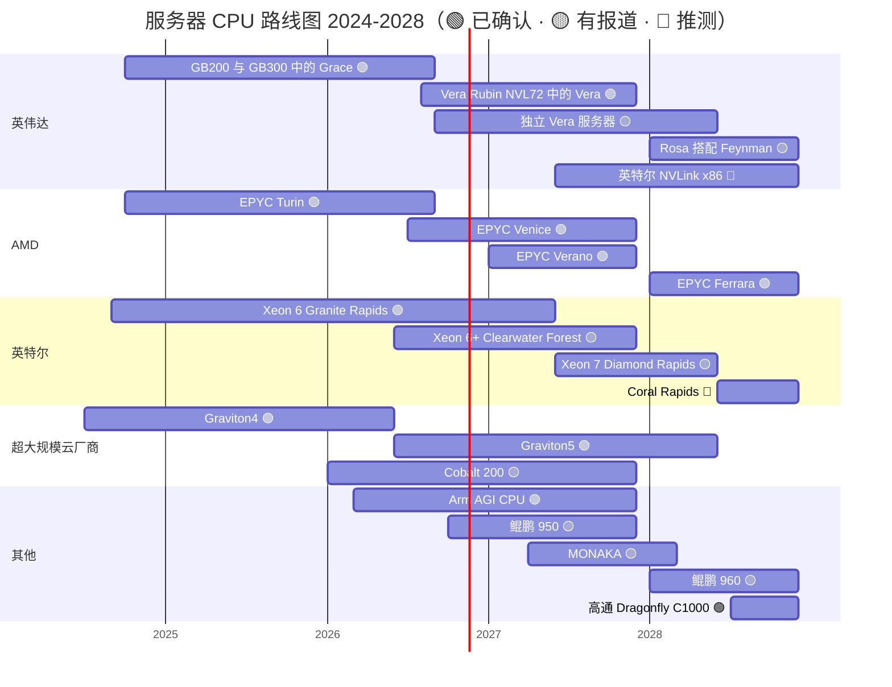

# CPU（Grace、Vera）：路线图

> [!NOTE]
> 本页为英文原文的简体中文参考译文，仅供参考；如有出入，以[英文原文](../../../layers/04-cpu-grace-vera/roadmap.md "English original")为准。

第 04 层 · CPU（Grace、Vera）· 阅读约 9 分钟 · 最近核实：2026-11-05

## ⚡ 要点速览

- **Vera 已在出货：**配备 1.8 TB/s [NVLink-C2C](../../glossary.md#nvlink-c2c) GPU 链路的 Vera Rubin 于 2026 年 8 月初开始量产出货，2026 年第四季度进入放量爬坡，并在 2027 年上半年持续增长 🟢 [[S500]](../../../sources/bibliography.md#s500)[[S90009]](../../../sources/bibliography.md#s90009)。
- **独立 Vera 是新的产品线：**英伟达（NVIDIA）在 GTC 2026 上称其为一项“数十亿美元级别的业务”，Meta 计划在部署 Grace 之后采用纯 Vera 服务器 🟢 [[S90003]](../../../sources/bibliography.md#s90003)[[S4519]](../../../sources/bibliography.md#s4519)。
- **英伟达的下一款 CPU：**Rosa，将于 2028 年与 Feynman 搭配，目前尚无公开规格 🟡 [[S90004]](../../../sources/bibliography.md#s90004)[[S109]](../../../sources/bibliography.md#s109)。
- **[x86](../../glossary.md#x86) 正在迅速缩小带宽差距：**EPYC Venice 宣称 2026 年达 1.6 TB/s；据报道，Diamond Rapids 将于 2027 年年中推出，带宽约为 Granite Rapids 的 2 倍 🟡 [[S144]](../../../sources/bibliography.md#s144)[[S4524]](../../../sources/bibliography.md#s4524)。
- **一个尚无时间表的新进入者：**英特尔（Intel）为英伟达打造的 [NVLink](../../glossary.md#nvlink) x86 尚无公开日期 🔴 [[S468]](../../../sources/bibliography.md#s468)。高通（Qualcomm）基于 Oryon 的 Dragonfly C1000（> 250 核）现已有明确时间：首批部署在 2028 年下半年，Meta 为首个公开客户 🟢 [[S90056]](../../../sources/bibliography.md#s90056)[[S90058]](../../../sources/bibliography.md#s90058)。
- **[Q7 · 路线图与变数]** 关注 NVLink Fusion CPU 的出货、[智能体（agentic）](../../glossary.md#agentic-ai)机架中每 GPU 配 CPU 的比例、Arm 的自研芯片，以及 x86 能否获得速度高于 [PCIe](../../glossary.md#pcie) 的缓存一致链路。

## 2024–2028 年路线图

条形表示供货时间窗口。英特尔 NVLink x86 的条形仅为占位：英特尔尚未给出日期 [[S468]](../../../sources/bibliography.md#s468)。高通 C1000 的时间窗口来自其 2026 年 6 月的投资者日 [[S90056]](../../../sources/bibliography.md#s90056)。各行来源见下表；表中未列出的 EPYC Turin 见 [[S176]](../../../sources/bibliography.md#s176)，Graviton4 见 [[S181]](../../../sources/bibliography.md#s181)。

| 项目 | 时间窗口 | 状态 | 置信度 | 来源 |
|---|---|---|---|---|
| 英伟达 Vera（88 个 Olympus 核心，1.8 TB/s C2C） | 2026-Q3 → | 已出货 | 🟢 | [[S100]](../../../sources/bibliography.md#s100)[[S500]](../../../sources/bibliography.md#s500) |
| 英伟达独立 Vera | 2026–2027 | 已发布；Meta 目前运行独立 Grace，下一步为 Vera | 🟢 产品 / 🟡 时间 | [[S90003]](../../../sources/bibliography.md#s90003)[[S4519]](../../../sources/bibliography.md#s4519) |
| 英伟达 Rosa（Feynman 时代） | 2028 | 路线图，无规格 | 🟡 | [[S90004]](../../../sources/bibliography.md#s90004)[[S109]](../../../sources/bibliography.md#s109) |
| 英特尔带 NVLink 的定制 x86 | 未披露（交易于 2025-09-18 宣布） | 已宣布 | 🔴 时间 | [[S468]](../../../sources/bibliography.md#s468) |
| AMD EPYC Venice（256 核，1.6 TB/s） | 2026-Q3 → | 已出货，2026 年第四季度放量 | 🟢 | [[S538]](../../../sources/bibliography.md#s538)[[S542]](../../../sources/bibliography.md#s542) |
| AMD EPYC Verano / Ferrara | 2027 / 2028 | 路线图 | 🟢 | [[S538]](../../../sources/bibliography.md#s538)[[S540]](../../../sources/bibliography.md#s540) |
| 英特尔 Xeon 6+ Clearwater Forest（288 个能效核） | 2026 | 已在 Computex 发布 | 🟡 | [[S4525]](../../../sources/bibliography.md#s4525) |
| 英特尔 Xeon 7 Diamond Rapids | 2027 年年中（已推迟） | 路线图 | 🟡 | [[S4524]](../../../sources/bibliography.md#s4524)[[S4525]](../../../sources/bibliography.md#s4525) |
| 英特尔 Coral Rapids | 2028 | 泄露信息 | 🔴 | [[S4524]](../../../sources/bibliography.md#s4524) |
| AWS Graviton5（192 核） | 2026-06-10 全面上市 | 已出货 | 🟢 | [[S4526]](../../../sources/bibliography.md#s4526) |
| 微软（Microsoft）Cobalt 200（132 核） | 2026 | 2026 年年中预览 | 🟡 | [[S184]](../../../sources/bibliography.md#s184)[[S4526]](../../../sources/bibliography.md#s4526) |
| Arm AGI CPU（136 核） | 2026 | 已发布，Meta 为首个客户 | 🟢 | [[S4510]](../../../sources/bibliography.md#s4510) |
| 华为鲲鹏 950 / 960 | 2026 年第四季度 / 2028 年第一季度 | 路线图 | 🟡 | [[S4528]](../../../sources/bibliography.md#s4528) |
| 富士通 MONAKA（144 核） | FY2027 | 路线图 | 🟡 | [[S187]](../../../sources/bibliography.md#s187) |
| 高通 Dragonfly C1000（Oryon，> 250 核；公开信息） | 2028 年下半年（首批部署，Meta） | 2026-06-24 发布 | 🟢 已发布 / 🟡 时间 | [[S90056]](../../../sources/bibliography.md#s90056)[[S90058]](../../../sources/bibliography.md#s90058)[[S4516]](../../../sources/bibliography.md#s4516) |

英伟达和 AMD 各行与 `data/roadmap.csv` 一致（按本资料库事实表将 Rosa 标为 🟡）；其他各行已为本页在 `data/l04_cpu_roadmap_specs.csv` 中核实。

> [!TIP]
> **算例 —— Vera 的内存带宽优势能维持多久。** Vera 的 1,200 GB/s 是 Granite Rapids 845 GB/s 的 1.42 倍 [[S100]](../../../sources/bibliography.md#s100)[[S179]](../../../sources/bibliography.md#s179)。Venice 宣称的 1,600 GB/s 自 2026 年第四季度起放量，是 Vera 的 1.33 倍 [[S144]](../../../sources/bibliography.md#s144)[[S542]](../../../sources/bibliography.md#s542)。据报道约为 Granite Rapids 2 倍（约 1,690 GB/s）的 Diamond Rapids 将于 2027 年年中到来 [[S4524]](../../../sources/bibliography.md#s4524)。对 AMD 而言，这一优势为零；对英特尔而言，大约能维持一年。

## 规格演进

竞争对手通过增加核心来提高每插槽和每美元的吞吐量；英伟达则提高每核的内存和链路带宽，因为其 CPU 的职责是持续为 GPU 和对延迟敏感的智能体代码供给数据。

> [!TIP]
> **算例 —— 每核带宽。** Vera：1,200 ÷ 88 = 每核 13.6 GB/s [[S100]](../../../sources/bibliography.md#s100)。Venice：1,600 ÷ 256 = 6.3 GB/s [[S144]](../../../sources/bibliography.md#s144)。Diamond Rapids（据报道）：约 1,690 ÷ 192 = 8.8 GB/s [[S4524]](../../../sources/bibliography.md#s4524)。对于智能体的工具调用或数据加载器这类吃内存的单线程任务，Vera 能提供大约两倍的带宽；而对于一大批小型 Web 服务，Venice 能完成更多并行工作。

🔧 技术细节：如何解读 CPU 路线图宣称

峰值内存带宽 = 通道数 × 传输速率 × 8 字节。12 通道 DDR5-6400 可提供 614 GB/s；在同样 12 个通道上，[MRDIMM](../../glossary.md#mrdimm)-8800（复用两个 rank 的内存模组）可提供 845 GB/s [[S179]](../../../sources/bibliography.md#s179)。厂商的峰值以最快的认证内存为前提；实际平台出货时往往采用更慢的 DIMM。Vera 使用 [SOCAMM](../../glossary.md#socamm) 模组上的 [LPDDR5X](../../glossary.md#lpddr5x)，紧贴 CPU 安装，以牺牲可升级性换取每瓦带宽 [[S100]](../../../sources/bibliography.md#s100)。在数据手册公布之前，推算得出的数字（如 Diamond Rapids 的约 1.7 TB/s）应被视为一个区间。

## [Q7 · 路线图与变数]

- **[NVLink Fusion](../../glossary.md#nvlink-fusion) CPU 出货。** 高通和富士通的 CPU 或英特尔的 NVLink x86 一旦进入英伟达机架，一个受控的插槽就会变成竞争性插槽 🔴 [[S90031]](../../../sources/bibliography.md#s90031)[[S468]](../../../sources/bibliography.md#s468)。Arm 已于 2025 年 11 月在 Neoverse 中加入 NVLink Fusion 支持 [[S90036]](../../../sources/bibliography.md#s90036)。
- **每 GPU 配 CPU 的比例上升。** TrendForce 预计，随着智能体 AI 增加 CPU 工作量，2027 年服务器 CPU 出货量将增长超过 40% 🟡 [[S4500]](../../../sources/bibliography.md#s4500)；Futurum 报道称英特尔和 AMD 的高核心数产品实际上已经售罄 🟡 [[S4546]](../../../sources/bibliography.md#s4546)。
- **x86 获得缓存一致的高速链路。** 一条远高于 PCIe Gen6 约 256 GB/s 的 CXL 或 [UALink](../../glossary.md#ualink) 通道，将抹去 Vera 的主要结构性优势；AMD、博通（Broadcom）和英特尔都支持 UALink [[S90031]](../../../sources/bibliography.md#s90031)。
- **Arm 成为芯片厂商。** Arm 曾定下到 2025 年占据[超大规模云厂商](../../glossary.md#hyperscaler) CPU 出货量一半的目标 [[S4547]](../../../sources/bibliography.md#s4547)，如今开始销售 AGI CPU，据报道目标是五年内实现约 $15B 收入 🟡，与其授权客户形成竞争 [[S4510]](../../../sources/bibliography.md#s4510)[[S4511]](../../../sources/bibliography.md#s4511)。
- **规格修订。** 英伟达在 2026 年末下调了 Rubin 公布的 [HBM4](../../glossary.md#hbm4) 和 NVLink 6 数字 [[S90006]](../../../sources/bibliography.md#s90006)；Vera 公布的 CPU 规格未变，但买家应以持续性能而非发布时的数字建模。

> [!TIP]
> **算例 —— 1 吉瓦对 CPU 出货量意味着什么。** 按每个 Vera Rubin [NVL72](../../glossary.md#nvl72) 机架约 230 kW（Max-P）计算 [[S302]](../../../sources/bibliography.md#s302)，1 GW 的 IT 功率约为 4,350 个机架、约 157,000 颗 Vera CPU（每架 36 颗）。按每颗约 $5,000（摩根士丹利）计算 [[S331]](../../../sources/bibliography.md#s331)，每 GW 约合 $0.8B 的 CPU 芯片。如果智能体工作负载为每块 GPU 额外增加一颗独立 CPU，每 GW 的 CPU 数量将大约增至三倍（从每 GPU 0.5 颗增至 1.5 颗）🔴。

## 🎯 企业发展视角

1. 哪一个路线图事件最能改变经 NVLink Fusion 挂接的 CPU 的价值：一款有明确日期的英特尔 NVLink x86 产品，还是一款开始出货的高通或富士通产品？
2. 如果 x86 在一年内追平 Vera 的内存带宽，那么建立在带宽而非链路之上的 CPU 战略能维持多久？
3. 据报道的 2027 年 CPU 出货激增是结构性的，还是一轮周期性补库存？
4. Arm 进军芯片业务，是否会改变新的数据中心 CPU 项目在 Arm 授权与 RISC-V 之间取舍的经济账？

## 📚 来源（Sources）

<!-- Auto-generated from the [S…] citations on this page by `make build`. Edit sources/registry/*.csv, not this list. -->

- [**S100**](../../../sources/bibliography.md#s100) NVIDIA Technical Blog, *Inside the NVIDIA Vera Rubin Platform: Six New Chips, One AI Supercomputer*, 2026-01-05. [Link](https://developer.nvidia.com/blog/inside-the-nvidia-rubin-platform-six-new-chips-one-ai-supercomputer/)
- [**S109**](../../../sources/bibliography.md#s109) NVIDIA Blog, *NVIDIA GTC 2026: Live Updates on What's Next in AI*, 2026-03-16. [Link](https://blogs.nvidia.com/blog/gtc-2026-news/)
- [**S144**](../../../sources/bibliography.md#s144) AMD Newsroom, *AMD Unveils Vision for an Open AI Ecosystem, Detailing New Silicon, Software and Systems at Advancing AI 2025*, 2025-06-12. [Link](https://www.amd.com/en/newsroom/press-releases/2025-6-12-amd-unveils-vision-for-an-open-ai-ecosystem-detai.html)
- [**S176**](../../../sources/bibliography.md#s176) AMD, *AMD EPYC 9005 Series (Turin)*, 2024-10-10. [Link](https://www.amd.com/en/products/processors/server/epyc/9005-series.html)
- [**S179**](../../../sources/bibliography.md#s179) Intel, *Intel Xeon 6 processors with P-cores (Granite Rapids, 6900P/6700P)*, 2024-09-24. [Link](https://www.intel.com/content/www/us/en/products/details/processors/xeon/xeon6-p-cores.html)
- [**S181**](../../../sources/bibliography.md#s181) Amazon Web Services, *AWS Graviton Processor*, 2024. [Link](https://aws.amazon.com/ec2/graviton/)
- [**S184**](../../../sources/bibliography.md#s184) Microsoft Tech Community, *Announcing Cobalt 200: Azure's next cloud-native CPU*, 2025-11-18. [Link](https://techcommunity.microsoft.com/blog/azurecompute/announcing-cobalt-200-azures-next-cloud-native-cpu/4469807)
- [**S187**](../../../sources/bibliography.md#s187) Fujitsu, *FUJITSU-MONAKA: next-generation Arm-based processor*, 2025. [Link](https://www.fujitsu.com/global/about/research/technology/monaka/)
- [**S302**](../../../sources/bibliography.md#s302) Hashrate Index, *NVIDIA Vera Rubin NVL72 specs breakdown*, 2026. [Link](https://hashrateindex.com/blog/nvidia-vera-rubin-nvl72-specs-breakdown/)
- [**S331**](../../../sources/bibliography.md#s331) Wccftech, *NVIDIA's Vera Rubin rack hit with 435% memory price surge, pushing HBM4 & LPDDR5X bill to $2M of $7.8M total*, 2026-05. [Link](https://wccftech.com/nvidia-vera-rubin-rack-hit-with-memory-price-surge-pushing-hbm4-lpddr5x-bill-to-2m-of-7-8m-total/)
- [**S468**](../../../sources/bibliography.md#s468) NVIDIA Newsroom, *NVIDIA and Intel to Develop AI Infrastructure and Personal Computing Products*, 2025-09-18. [Link](https://nvidianews.nvidia.com/news/nvidia-and-intel-to-develop-ai-infrastructure-and-personal-computing-products)
- [**S500**](../../../sources/bibliography.md#s500) NVIDIA Corporation, *NVIDIA Q2 Fiscal 2027 Quarterly Presentation (CFO commentary deck)*, 2026-08-26. [Link](https://s201.q4cdn.com/141608511/files/doc_financials/2027/Q227/NVDA-F2Q27-Quarterly-Presentation-final-1.pdf)
- [**S538**](../../../sources/bibliography.md#s538) AMD Investor Relations, *AAI 2026: AMD Delivers Full-Stack Compute for the Agentic AI Era*, 2026-07-23. [Link](https://ir.amd.com/news-events/press-releases/detail/1294/aai-2026-amd-delivers-full-stack-compute-for-the-agentic-ai-era)
- [**S540**](../../../sources/bibliography.md#s540) Tom's Hardware, *AMD unwraps 2027 AI plans: Verano CPU, Instinct MI500X GPU, next-gen AI rack*, 2026-07. [Link](https://www.tomshardware.com/pc-components/cpus/amd-unwraps-2027-ai-plans-verano-cpu-instinct-mi500x-gpu-next-gen-ai-rack)
- [**S542**](../../../sources/bibliography.md#s542) AMD via SEC EDGAR, *AMD Reports Third Quarter 2026 Financial Results (Form 8-K Exhibit 99.1)*, 2026-11-03. [Link](https://www.sec.gov/Archives/edgar/data/0000002488/000000248826000188/q32026991.htm)
- [**S4500**](../../../sources/bibliography.md#s4500) TrendForce, *Server CPU shipments to grow over 40% in 2027 as Arm gains share (press release)*, 2026-10-22. [Link](https://www.trendforce.com/presscenter/news/20261022-13279.html)
- [**S4510**](../../../sources/bibliography.md#s4510) TechCrunch, *Arm is releasing its first in-house chip in its 35-year history*, 2026-03-24. [Link](https://techcrunch.com/2026/03/24/arm-is-releasing-its-first-in-house-chip-in-its-35-year-history/)
- [**S4511**](../../../sources/bibliography.md#s4511) MarketScreener, *Arm launches its first chip and shifts strategy with Meta as key client*, 2026-03. [Link](https://www.marketscreener.com/news/arm-launches-its-first-chip-and-shifts-strategy-with-meta-as-key-client-ce7e5ed2da80ff2c)
- [**S4516**](../../../sources/bibliography.md#s4516) DatacenterDynamics, *Qualcomm to return to data center market with AI CPUs*, 2025-05. [Link](https://www.datacenterdynamics.com/en/news/qualcomm-to-return-to-data-center-market-with-ai-cpus/)
- [**S4519**](../../../sources/bibliography.md#s4519) The Register, *GPU who? Meta to deploy Nvidia CPUs at large scale*, 2026-02-17. [Link](https://www.theregister.com/2026/02/17/meta_nvidia_cpu/)
- [**S4524**](../../../sources/bibliography.md#s4524) TweakTown, *Intel Xeon 7 Diamond Rapids reportedly delayed to mid-2027, followed by Coral Rapids in 2028*, 2026-08. [Link](https://www.tweaktown.com/news/111284/intel-xeon-7-diamond-rapids-reportedly-delayed-to-mid-2027-followed-by-coral-in-2028/index.html)
- [**S4525**](../../../sources/bibliography.md#s4525) TechSpot, *Intel launches Xeon 6+ Clearwater Forest with 288 E-cores on 18A, teases Diamond Rapids for 2027*, 2026-06. [Link](https://www.techspot.com/community/topics/intel-launches-xeon-6-clearwater-forest-with-288-e-cores-on-18a-node-teases-diamond-rapids-for-2027.297679/)
- [**S4526**](../../../sources/bibliography.md#s4526) Amazon Web Services, *Amazon EC2 M9g and M9gd instances powered by AWS Graviton5 are now available*, 2026-06-10. [Link](https://aws.amazon.com/about-aws/whats-new/2026/06/ec2-m9g-m9gd-instances-graviton5-processors-available)
- [**S4528**](../../../sources/bibliography.md#s4528) Wccftech, *Huawei next-gen Kunpeng chips: 950 series up to 192 cores in Q4 2026, 960 series over 256 cores in Q1 2028*, 2025-09. [Link](https://wccftech.com/huawei-next-gen-kungpeng-chips-950-series-up-to-192-cores-q4-2026-960-series-over-256-cores-q1-2028/)
- [**S4546**](../../../sources/bibliography.md#s4546) Futurum Group, *Will NVIDIA's Meta deal ignite a CPU supercycle?*, 2026-02. [Link](https://futurumgroup.com/insights/will-nvidias-meta-deal-ignite-a-cpu-supercycle/)
- [**S4547**](../../../sources/bibliography.md#s4547) Tom's Hardware, *Arm aims to capture 50% of data center CPU market in 2025*, 2025-03. [Link](https://www.tomshardware.com/pc-components/cpus/arm-aims-to-capture-50-percent-of-data-center-cpu-market-in-2025)
- [**S90003**](../../../sources/bibliography.md#s90003) eWeek, *Everything Nvidia Just Announced at GTC 2026: 7 Chips, 5 Racks, 1 Giant Bet on Agentic AI*, 2026-03-17. [Link](https://www.eweek.com/news/nvidia-gtc-2026-ai-inference-vera-rubin-neuron/)
- [**S90004**](../../../sources/bibliography.md#s90004) TrendForce, *Key GTC takeaways: how Samsung, Micron, Intel and more power NVIDIA's Vera Rubin and Feynman*, 2026-03-17. [Link](https://www.trendforce.com/news/2026/03/17/news-key-gtc-takeaways-how-samsung-micron-intel-more-power-nvidias-vera-rubin-and-feynman/)
- [**S90006**](../../../sources/bibliography.md#s90006) TweakTown, *Nvidia cuts Vera Rubin's memory bandwidth by up to 26% and AMD's Helios now leads in memory bandwidth*, 2026-10. [Link](https://www.tweaktown.com/news/114304/nvidia-cuts-vera-rubins-memory-bandwidth-by-up-to-26-percent-and-amds-helios-now-leads-in-memory-bandwidth/index.html)
- [**S90009**](../../../sources/bibliography.md#s90009) GamesBeat, *Nvidia Vera Rubin ramps into full production for fall launch*, 2026. [Link](https://gamesbeat.com/nvidia-vera-rubin-ramps-into-full-production-for-fall-launch-again/)
- [**S90031**](../../../sources/bibliography.md#s90031) ServeTheHome, *NVIDIA announces NVLink Fusion bringing NVLink to third-party CPUs and accelerators*, 2025-05-19. [Link](https://www.servethehome.com/nvidia-announces-nvlink-fusion-bringing-nvlink-to-third-party-cpus-and-accelerators/nvlink-fusion-partners/)
- [**S90036**](../../../sources/bibliography.md#s90036) Converge Digest, *Arm extends Neoverse with NVIDIA NVLink Fusion*, 2025-11. [Link](https://convergedigest.com/arm-extends-neoverse-with-nvidia-nvlink-fusion/)
- [**S90056**](../../../sources/bibliography.md#s90056) HPCwire (Qualcomm press release), *Qualcomm unveils data center roadmap for the agentic AI era with new Dragonfly portfolio*, 2026-06-24. [Link](https://www.hpcwire.com/off-the-wire/qualcomm-unveils-data-center-roadmap-for-the-agentic-ai-era-with-new-dragonfly-portfolio/)
- [**S90058**](../../../sources/bibliography.md#s90058) Constellation Research, *Qualcomm outlines new CPU, AI accelerator roadmap, inks deal with Meta*, 2026-06-24. [Link](https://www.constellationr.com/insights/news/qualcomm-outlines-new-cpu-ai-accelerator-roadmap-inks-deal-meta)
