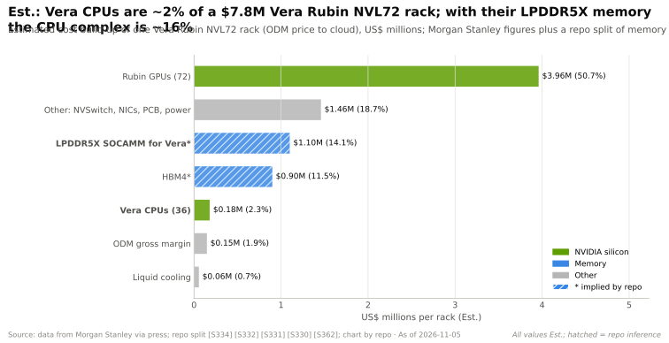
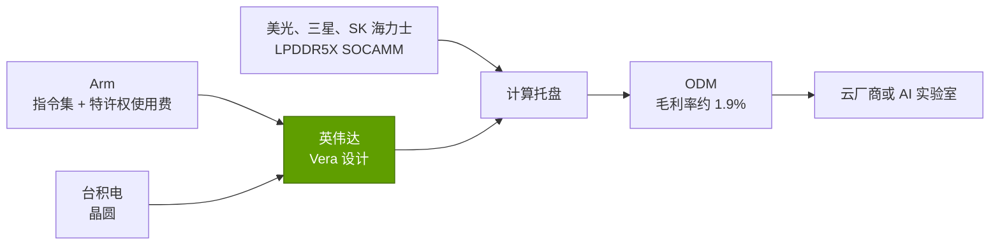
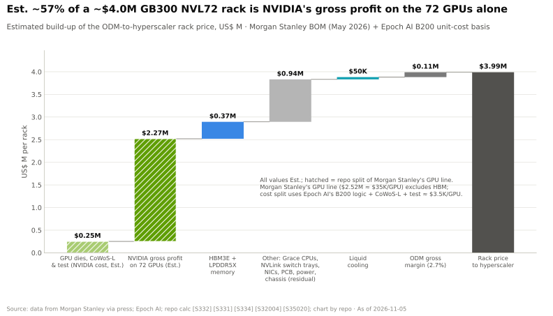
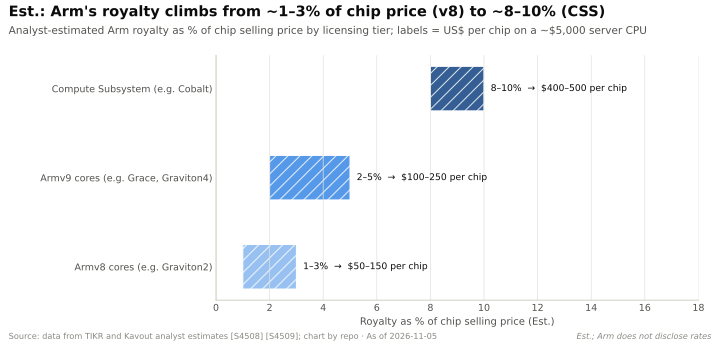

# CPU（Grace、Vera）：价值链与企业发展视角

> [!NOTE]
> 本页为英文原文的简体中文参考译文，仅供参考；如有出入，以[英文原文](../../../layers/04-cpu-grace-vera/value-chain-and-corp-dev.md "English original")为准。

第 04 层 · CPU（Grace、Vera）· 阅读约 10 分钟 · 最近核实：2026-11-05

## ⚡ 要点速览

- **在 AI 机架内部，CPU 只是一个小项目：**在一台约 $7.8M 的 Vera Rubin [NVL72](../../glossary.md#nvl72) 机架中，36 颗 Vera CPU 估计约占 $0.18M（约 2%），相当于每 1 美元 GPU 对应约 4.5 美分 CPU（估计，摩根士丹利）[[S331]](../../../sources/bibliography.md#s331)[[S330]](../../../sources/bibliography.md#s330)。
- **但它的内存并不小：**该机架有 54 TB [LPDDR5X](../../glossary.md#lpddr5x)，按摩根士丹利的数字推算，挂接在 CPU 上的 [SOCAMM](../../glossary.md#socamm) 模组约为 $1.1M（约 14%）🔴 [[S362]](../../../sources/bibliography.md#s362)[[S332]](../../../sources/bibliography.md#s332)。
- **在机架之外，CPU 是一个规模庞大、竞争激烈的价值池：**AMD 占 x86 服务器 CPU 价值的约 46%；据报道，英伟达（NVIDIA）在“$200B”的机会中，本财年已看到约 $20B 的独立 CPU 收入 🟡 [[S4503]](../../../sources/bibliography.md#s4503)[[S4522]](../../../sources/bibliography.md#s4522)。
- **Arm 的“过路费”在上涨：**分析师估计，Armv8 的特许权使用费约为芯片价格的 1–3%，Armv9 约为 2–5%，[计算子系统（Compute Subsystems）](../../glossary.md#compute-subsystem)约为 8–10%（估计）[[S4508]](../../../sources/bibliography.md#s4508)[[S4509]](../../../sources/bibliography.md#s4509)；Arm 在 2026 年 9 月季度的特许权使用费收入为 $670M [[S4506]](../../../sources/bibliography.md#s4506)。
- **Arm 如今也在卖芯片：**其 136 核 AGI CPU（2026 年 3 月，客户为 Meta）与自家授权客户形成竞争 [[S4510]](../../../sources/bibliography.md#s4510)。
- **CPU 团队的易手价格在 $0.4B–$6.5B 之间：**Annapurna、NUVIA、Ampere；Ventana 和 Rivos 于 2025 年被收购，金额未披露 [[S4540]](../../../sources/bibliography.md#s4540)[[S4539]](../../../sources/bibliography.md#s4539)[[S4530]](../../../sources/bibliography.md#s4530)[[S4512]](../../../sources/bibliography.md#s4512)[[S4518]](../../../sources/bibliography.md#s4518)。
- **[Q8 · 价值池与并购机会]** 三个价值池：机架挂接（金额小、控制力强）、通用及[智能体（agentic）](../../glossary.md#agentic-ai)集群（金额大、竞争激烈），以及 IP 层（Arm 特许权使用费、RISC-V 核心、互连 IP）。

## 谁拿走了 CPU 的钱

在 [x86](../../glossary.md#x86) 服务器中，英特尔（Intel）或 AMD 几乎拿走了 CPU 的全部价值：指令集、核心和芯片。在 Arm 服务器中，这笔钱被拆分：Arm 收取[特许权使用费（royalty）](../../glossary.md#ip-royalty)和授权费，设计方（英伟达、AWS、Ampere）拿走其余部分；[超大规模云厂商](../../glossary.md#hyperscaler)则以更低的云成本体现其“利润”。英伟达把 CPU 打包进超级芯片或托盘中，因此其价值包含在英伟达约 75% 的毛利率之中 [[S3]](../../../sources/bibliography.md#s3)[[S90011]](../../../sources/bibliography.md#s90011)。

| 参与者 | 角色 | 获取价值的方式 | 证据 |
|---|---|---|---|
| Arm | 指令集、核心、CSS | 按芯片收取特许权使用费，外加授权费 | 单季度特许权使用费收入 $670M [[S4506]](../../../sources/bibliography.md#s4506) |
| 英伟达 | CPU 设计方兼平台所有者 | 打包计入超级芯片和托盘价格 | 约 $7.8M 的机架中每颗 Vera 约 $5k（估计）[[S331]](../../../sources/bibliography.md#s331) |
| AMD、英特尔 | x86 双寡头 | 商用 CPU 利润 | AMD 占 x86 服务器价值约 46% [[S4503]](../../../sources/bibliography.md#s4503) |
| 台积电（TSMC） | 晶圆代工 | 晶圆价格 | N3 晶圆约 $19.5k，N2 约 $30k（估计）[[S35006]](../../../sources/bibliography.md#s35006)[[S35003]](../../../sources/bibliography.md#s35003) |
| 内存厂商 | LPDDR5X、HBM | 销售模组和堆栈 | 推算每个 VR 机架约 $1.1M 的 LPDDR5X 🔴 [[S332]](../../../sources/bibliography.md#s332) |
| ODM | 组装 | 微薄利润 | VR 机架毛利率约 1.9%（估计）[[S332]](../../../sources/bibliography.md#s332) |

> [!TIP]
> **算例 —— 每 1 美元加速器对应多少美分 CPU。** Vera Rubin NVL72（摩根士丹利，估计）：$0.18M 的 Vera ÷ $3.96M 的 Rubin GPU = 每 1 美元 GPU 对应 **4.5 美分** CPU [[S331]](../../../sources/bibliography.md#s331)[[S332]](../../../sources/bibliography.md#s332)。加上推算的 $1.1M LPDDR5X，CPU 整体（含内存）约为每 1 美元 GPU 对应 32 美分 🔴 [[S332]](../../../sources/bibliography.md#s332)。芯片本身便宜；内存以及选择内存的权力则不然。

## Arm 特许权使用费，以及 x86 与 Arm 的价值获取对比

Arm 通过推动授权客户从 Armv8 升级到 Armv9 再到计算子系统（预先验证的核心、片上网格和 I/O 模块组合），不断提高抽成。法庭证词显示，Arm 至少从 2019 年起就计划在十年内将智能手机年度特许权使用费提高约 $1B [[S4507]](../../../sources/bibliography.md#s4507)。在 FY2027 第一季度，数据中心特许权使用费同比增长超过一倍 [[S4506]](../../../sources/bibliography.md#s4506)。阻力也存在：高通（Qualcomm）就其源自 NUVIA 的核心在 2024 年赢得陪审团裁决、2025 年获得最终判决；Arm 表示将提起上诉 [[S4545]](../../../sources/bibliography.md#s4545)。

> [!TIP]
> **算例 —— Arm 从一个 AI 机架中能赚多少。** 36 颗 Vera × 约 $5,000 × 2–5%（Armv9 区间）= **每个机架 $3,600–9,000**，即约 $7.8M 机架的 0.05–0.12% [[S331]](../../../sources/bibliography.md#s331)[[S4508]](../../../sources/bibliography.md#s4508)[[S4509]](../../../sources/bibliography.md#s4509)。基于 CSS 的超大规模云厂商 CPU 支付约 8–10%；英伟达自研的 Olympus 核心很可能处于区间低端 🔴。Arm 真正的目标是通用集群，而非 GPU 机架。

🔧 技术细节：Arm 授权的三种方式

**[架构授权（architecture licence）](../../glossary.md#architecture-licence)**允许公司自行设计实现 Arm 指令集的核心（苹果、高通的 Oryon、英伟达的 Olympus）。**核心授权**是购买 Arm 设计好的核心，例如 [Neoverse](../../glossary.md#neoverse) V2（Grace、Graviton4）。**计算子系统**授权则购买一个更大的预集成模块（微软（Microsoft）的 Cobalt 100 采用 Neoverse N2 CSS）[[S183]](../../../sources/bibliography.md#s183)。特许权使用费通常按芯片售价的一定百分比或按件收取，随 Arm 提供的价值增加而上升；确切费率属于保密信息，因此此处数字均为分析师估计 [[S4508]](../../../sources/bibliography.md#s4508)[[S4509]](../../../sources/bibliography.md#s4509)。

## 非上市公司与并购历史

### 值得关注的非上市公司

| 公司 | 业务 | 阶段 / 最近一次公开融资 | 为何重要 |
|---|---|---|---|
| Ampere（软银） | [商用](../../glossary.md#merchant-silicon) Arm 服务器 CPU（AmpereOne，192 核） | 以 $6.5B 被收购；2025-11-25 完成交割 [[S4530]](../../../sources/bibliography.md#s4530) | 美国主要的商用 Arm 服务器 CPU 厂商；其所有者软银同时拥有 Arm [[S465]](../../../sources/bibliography.md#s465) |
| SiPearl | 欧洲主权 Arm HPC CPU（Rhea1，80 个 Neoverse V1 核心） | €130M A 轮（2025 年）；Rhea1 于 2026-05-13 首次上电 [[S4531]](../../../sources/bibliography.md#s4531)[[S4532]](../../../sources/bibliography.md#s4532) | 国家支持的 CPU 需求信号 |
| Tenstorrent | [RISC-V](../../glossary.md#risc-v) CPU 与 AI IP，以及芯片 | $693M D 轮，估值约 $2.6B（2024 年 12 月）[[S4534]](../../../sources/bibliography.md#s4534)；据报道以 $6.2B 估值融资 $1.5B 🟡 [[S4535]](../../../sources/bibliography.md#s4535) | 向三星、LG 等授权高性能 RISC-V 核心 |
| Akeana | 最高可达数据中心级的 RISC-V 核心 IP | 成立时融资 $100M+（2024 年）[[S4533]](../../../sources/bibliography.md#s4533) | 一个可授权的非 Arm 核心选项 |
| Ventana（现属高通） | RISC-V 服务器 CPU 芯粒 | 2025 年 12 月被收购，条款未披露 [[S4512]](../../../sources/bibliography.md#s4512) | RISC-V 服务器团队正被陆续吸收 |
| Rivos（现属 Meta） | RISC-V CPU 与加速器团队 | 2025 年被收购，金额未披露；此前曾寻求以约 $2B 估值融资 $500M [[S4518]](../../../sources/bibliography.md#s4518) | 超大规模云厂商直接收购 CPU 人才 |

> [!TIP]
> **算例 —— CPU 项目的成本与初创公司的融资额对比。** Tenstorrent 的 $693M D 轮加上据报道的 $1.5B 融资，合计约 $2.2B [[S4534]](../../../sources/bibliography.md#s4534)[[S4535]](../../../sources/bibliography.md#s4535)，处于本资料库估计的打造一颗有竞争力定制核心所需的约 $1.5–3B 区间之内（[发展历程页面](history-and-how-built.md)）。SiPearl 的 €130M A 轮小了一个数量级，这与其采用授权 Neoverse V1 核心、2026 年才首次上电的情况相符 [[S4531]](../../../sources/bibliography.md#s4531)[[S4532]](../../../sources/bibliography.md#s4532)。

### 本层的并购历史

| 日期 | 交易 | 金额 | 结果 | 来源 |
|---|---|---|---|---|
| 2015-01 | 亚马逊收购 Annapurna Labs | 据报道约 $350–370M | 发展为 Nitro 和 Graviton | [[S4540]](../../../sources/bibliography.md#s4540)[[S4541]](../../../sources/bibliography.md#s4541) |
| 2018 | 高通退出 Centriq | — | 部门缩减至约 50 人；IP 转入中国的合资企业华芯通（HXT） | [[S4544]](../../../sources/bibliography.md#s4544) |
| 2020-09 | 英伟达竞购 Arm | $40B | 2022-02 终止；计提约 $1.36B 费用 | [[S465]](../../../sources/bibliography.md#s465)[[S466]](../../../sources/bibliography.md#s466) |
| 2021-01 | 高通收购 NUVIA | $1.4B | 2021-03 完成交割；发展为 Oryon | [[S4539]](../../../sources/bibliography.md#s4539)[[S4538]](../../../sources/bibliography.md#s4538) |
| 2025-03 | 软银收购 Ampere | $6.5B | 2025-11 完成交割 | [[S186]](../../../sources/bibliography.md#s186)[[S4530]](../../../sources/bibliography.md#s4530) |
| 2025-06 | 高通收购 Alphawave | 约 $2.4B | 2025-12-18 完成交割 | [[S4514]](../../../sources/bibliography.md#s4514)[[S4513]](../../../sources/bibliography.md#s4513) |
| 2025-09 | 英伟达投资英特尔 | $5B 股权 | 为英伟达打造 NVLink x86 CPU | [[S468]](../../../sources/bibliography.md#s468) |
| 2025 | Meta 收购 Rivos；高通收购 Ventana | 未披露 | RISC-V 团队被吸收 | [[S4518]](../../../sources/bibliography.md#s4518)[[S4512]](../../../sources/bibliography.md#s4512) |

> [!TIP]
> **算例 —— 估算独立 CPU 价值池的规模。** 据报道，英伟达本财年约 $20B 的独立 CPU 收入可见度 🟡 [[S4522]](../../../sources/bibliography.md#s4522)，超过了 AMD 2026 年第三季度*全部* $13.4B 的收入 [[S542]](../../../sources/bibliography.md#s542)。按每颗 Vera 约 $5,000 [[S331]](../../../sources/bibliography.md#s331) 计算，这相当于约 400 万颗 CPU，因此该数字很可能统计的是服务器而不仅是芯片 🔴；在英伟达单独披露 CPU 收入之前，应仅将其视为数量级参考 [[S4523]](../../../sources/bibliography.md#s4523)。

另见[系统与机架](../08-systems-racks-ai-factories/index.md)、[纵向扩展](../05-scale-up-nvlink-nvswitch/index.md)、[生态与资本](../13-ecosystem-gtm-and-capital/index.md)以及[第 19 章](../../cross-cutting/19-implications-for-qualcomm.md)。

## 🎯 企业发展视角

1. 在挂接英伟达的机架中，CPU 芯片约占价值的 2%，而其内存约占 14%：更有吸引力的价值池是 CPU、内存模组，还是连接二者的缓存一致互连 IP？
2. 超大规模云厂商和 Meta 收购的是 CPU 团队（Annapurna、Rivos）而非 CPU；这对独立的 Arm 和 RISC-V CPU 初创公司的退出选择意味着什么？
3. 在 Arm 一边提高特许权使用费、一边销售自家 AGI CPU 的情况下，授权客户应如何权衡架构授权与 Ventana 这类 RISC-V 对冲的价值？
4. [NVLink](../../glossary.md#nvlink) Fusion 允许合作伙伴把 CPU 卖进英伟达机架；英伟达以何种经济条款（授权费、芯粒采购、认证）从该插槽中获取价值？
5. 如果智能体 CPU 价值池真如英伟达所称那么大，哪些资产（核心团队、[SerDes](../../glossary.md#serdes) 与芯粒 IP、内存模组设计）会最先变得稀缺？

## 📚 来源（Sources）

<!-- Auto-generated from the [S…] citations on this page by `make build`. Edit sources/registry/*.csv, not this list. -->

- [**S3**](../../../sources/bibliography.md#s3) StorageNewsletter, *NVIDIA Q2 Fiscal 2027 results coverage: revenue $96.2B*, 2026-08-27. [Link](https://www.storagenewsletter.com/2026/08/27/nvidia-fiscal-2q27-financial-results/)
- [**S183**](../../../sources/bibliography.md#s183) Microsoft Azure Blog, *Azure Cobalt 100-based virtual machines are now generally available*, 2024-10. [Link](https://azure.microsoft.com/en-us/blog/azure-cobalt-100-based-virtual-machines-are-now-generally-available/)
- [**S186**](../../../sources/bibliography.md#s186) SoftBank Group, *SoftBank Group to acquire Ampere Computing for US$6.5 billion*, 2025-03-19. [Link](https://group.softbank/en/news/press/20250320)
- [**S330**](../../../sources/bibliography.md#s330) PC Gamer, *A single Nvidia Vera Rubin rack is estimated to cost $7,803,148 with over $2 million of that figure spent on memory alone*, 2026-05. [Link](https://pcgamer.com/hardware/a-single-nvidia-vera-rubin-rack-is-estimated-to-cost-usd7-803-148-with-over-usd2-million-of-that-figure-spent-on-memory-alone)
- [**S331**](../../../sources/bibliography.md#s331) Wccftech, *NVIDIA's Vera Rubin rack hit with 435% memory price surge, pushing HBM4 & LPDDR5X bill to $2M of $7.8M total*, 2026-05. [Link](https://wccftech.com/nvidia-vera-rubin-rack-hit-with-memory-price-surge-pushing-hbm4-lpddr5x-bill-to-2m-of-7-8m-total/)
- [**S332**](../../../sources/bibliography.md#s332) Tiger Brokers (iTiger), *Morgan Stanley's BOM analysis of NVIDIA's Rubin: GPU share declines; PCB, MLCC and ABF substrate values soar*, 2026-05-20. [Link](https://www.itiger.com/news/1188068712)
- [**S362**](../../../sources/bibliography.md#s362) Digital Citizen, *NVIDIA Vera Rubin pushes memory costs higher as NVL72 rack reaches 74.7 TB of DRAM*, 2026-05. [Link](https://www.digitalcitizen.life/nvidia-vera-rubin-pushes-memory-costs-higher-as-nvl72-rack-reaches-74-7-tb-of-dram/)
- [**S465**](../../../sources/bibliography.md#s465) NVIDIA Newsroom, *NVIDIA to Acquire Arm for $40 Billion, Creating World's Premier Computing Company for the Age of AI*, 2020-09-13. [Link](https://nvidianews.nvidia.com/news/nvidia-to-acquire-arm-for-40-billion-creating-worlds-premier-computing-company-for-the-age-of-ai)
- [**S466**](../../../sources/bibliography.md#s466) NVIDIA Newsroom, *NVIDIA and SoftBank Group Announce Termination of NVIDIA's Acquisition of Arm Limited*, 2022-02-08. [Link](https://nvidianews.nvidia.com/news/nvidia-and-softbank-group-announce-termination-of-nvidias-acquisition-of-arm-limited)
- [**S468**](../../../sources/bibliography.md#s468) NVIDIA Newsroom, *NVIDIA and Intel to Develop AI Infrastructure and Personal Computing Products*, 2025-09-18. [Link](https://nvidianews.nvidia.com/news/nvidia-and-intel-to-develop-ai-infrastructure-and-personal-computing-products)
- [**S542**](../../../sources/bibliography.md#s542) AMD via SEC EDGAR, *AMD Reports Third Quarter 2026 Financial Results (Form 8-K Exhibit 99.1)*, 2026-11-03. [Link](https://www.sec.gov/Archives/edgar/data/0000002488/000000248826000188/q32026991.htm)
- [**S4503**](../../../sources/bibliography.md#s4503) Analytics Insight, *AMD server CPU revenue share hits record 46.2% as Intel faces pressure*, 2026-05. [Link](https://www.analyticsinsight.net/news/amd-server-cpu-revenue-share-hits-record-462-as-intel-faces-pressure)
- [**S4506**](../../../sources/bibliography.md#s4506) Arm Holdings plc via SEC EDGAR, *Arm Holdings plc Form 6-K, Exhibit 99.2: results for the quarter ended September 30, 2026 (Q2 FYE27)*, 2026-11. [Link](https://www.sec.gov/Archives/edgar/data/0001973239/000197323926000141/exhibit992fye27q230-sepx26.htm)
- [**S4507**](../../../sources/bibliography.md#s4507) The Star (Reuters), *Exclusive: Tech supplier Arm plans to hike prices, has considered developing its own chips (Reuters)*, 2025-01-13. [Link](https://thestar.com.my/tech/tech-news/2025/01/13/exclusive-tech-supplier-arm-plans-to-hike-prices-has-considered-developing-its-own-chips)
- [**S4508**](../../../sources/bibliography.md#s4508) TIKR, *How to value Arm: a royalty business trading like a growth stock*, 2025. [Link](https://www.tikr.com/blog/how-to-value-arm-a-royalty-business-trading-like-a-growth-stock)
- [**S4509**](../../../sources/bibliography.md#s4509) Kavout Market Lens, *Arm's royalty uplift is priced: a 49x sales multiple meets normalizing growth*, 2026. [Link](https://www.kavout.com/market-lens/arm-s-royalty-uplift-is-priced-a-49x-sales-multiple-meets-normalizing-growth)
- [**S4510**](../../../sources/bibliography.md#s4510) TechCrunch, *Arm is releasing its first in-house chip in its 35-year history*, 2026-03-24. [Link](https://techcrunch.com/2026/03/24/arm-is-releasing-its-first-in-house-chip-in-its-35-year-history/)
- [**S4512**](../../../sources/bibliography.md#s4512) DatacenterDynamics, *Qualcomm buys RISC-V server chip maker Ventana Micro Systems*, 2025-12-10. [Link](https://www.datacenterdynamics.com/en/news/qualcomm-buys-risc-v-server-chip-maker-ventana-microsystems/)
- [**S4513**](../../../sources/bibliography.md#s4513) I-Connect007, *Qualcomm completes acquisition of Alphawave Semi*, 2025-12-18. [Link](https://iconnect007.com/article/148161/qualcomm-completes-acquisition-of-alphawave-semi/148158/ein)
- [**S4514**](../../../sources/bibliography.md#s4514) CRN Asia, *Qualcomm: US$2.4 billion Alphawave Semi buy to boost data center push*, 2025-06. [Link](https://www.crnasia.com/news-network/2025/qualcomm-us-2)
- [**S4518**](../../../sources/bibliography.md#s4518) DatacenterDynamics, *Meta acquires RISC-V chip startup Rivos (report)*, 2025-10. [Link](https://www.datacenterdynamics.com/en/news/meta-acquires-risc-v-chip-startup-rivos-report/)
- [**S4522**](../../../sources/bibliography.md#s4522) The Stack, *Nvidia: Vera CPU opportunity sits on top of $1 trillion GPU forecast*, 2026-05. [Link](https://www.thestack.technology/nvidia-vera-cpu-gpu-1-trillion/)
- [**S4523**](../../../sources/bibliography.md#s4523) TIKR, *Nvidia says its CPU revenue sits outside the $1 trillion forecast*, 2026-05. [Link](https://www.tikr.com/es/blog/nvidia-says-its-cpu-revenue-sits-outside-the-1-trillion-forecast-heres-where-the-stock-could-go)
- [**S4530**](../../../sources/bibliography.md#s4530) SoftBank Group, *Completion of acquisition of Ampere Computing Holdings LLC*, 2025-11-26. [Link](https://group.softbank/en/news/press/20251126)
- [**S4531**](../../../sources/bibliography.md#s4531) HPCwire, *SiPearl closes €130M Series A to advance sovereign European supercomputing processors*, 2025-07. [Link](https://www.hpcwire.com/off-the-wire/sipearl-closes-e130m-series-a-to-advance-sovereign-european-supercomputing-processors/)
- [**S4532**](../../../sources/bibliography.md#s4532) SiPearl, *SiPearl press corner (Rhea1 power-on, 2026-05-13)*, 2026-05-13. [Link](https://sipearl.com/relations-presse-sipearl)
- [**S4533**](../../../sources/bibliography.md#s4533) SiliconANGLE, *RISC-V chip startup Akeana launches with $100M+ in funding*, 2024-08. [Link](https://siliconangle.com/?p=666984)
- [**S4534**](../../../sources/bibliography.md#s4534) The Register, *Tenstorrent raises $693M Series D (Samsung, Jeff Bezos among backers)*, 2024-12-04. [Link](https://www.theregister.com/2024/12/04/riscv_ai_champion_investment/)
- [**S4535**](../../../sources/bibliography.md#s4535) GCN, *Tenstorrent raises $1.5 billion to challenge Nvidia on AI chips*, 2026. [Link](https://gcn.com/?p=22745)
- [**S4538**](../../../sources/bibliography.md#s4538) Qualcomm Investor Relations, *Qualcomm completes acquisition of NUVIA*, 2021-03-16. [Link](https://investor.qualcomm.com/news-events/press-releases/news-details/2021/Qualcomm-Completes-Acquisition-of-NUVIA-03-16-2021/default.aspx)
- [**S4539**](../../../sources/bibliography.md#s4539) PYMNTS, *Qualcomm inks $1.4 billion acquisition deal with chip startup NUVIA*, 2021-01-13. [Link](https://www.pymnts.com/partnerships/2021/qualcomm-inks-1-4-billion-acquisition-deal-with-chip-startup-nuvia/)
- [**S4540**](../../../sources/bibliography.md#s4540) Global Venturing, *Arm exits Annapurna Labs in $370m acquisition*, 2015-01-23. [Link](https://globalventuring.com/blog/2015/01/23/arm-exits-annapurna-labs-in-370m-acquisition/)
- [**S4541**](../../../sources/bibliography.md#s4541) The Register, *Amazon AWS puts custom Arm server chip (Graviton) into the cloud: A1 instances*, 2018-11-27. [Link](https://www.theregister.com/2018/11/27/amazon_aws_a1/)
- [**S4544**](../../../sources/bibliography.md#s4544) Network World, *Qualcomm makes it official: no more data center chip*, 2018-12. [Link](https://www.networkworld.com/article/3327214/qualcomm-makes-it-official-no-more-data-center-chip.html)
- [**S4545**](../../../sources/bibliography.md#s4545) DatacenterDynamics, *Delaware judge rules in favor of Qualcomm and Nuvia in licensing dispute with Arm*, 2025-10. [Link](https://www.datacenterdynamics.com/en/news/delaware-judge-rules-in-favor-of-qualcomm-and-nuvia-in-licensing-dispute-with-arm/)
- [**S35003**](../../../sources/bibliography.md#s35003) TechNode, *TSMC sets 2nm wafer price at $30,000, far below earlier 50% increase speculation*, 2025-10-09. [Link](https://technode.com/2025/10/09/tsmc-sets-2nm-wafer-price-at-30000-far-below-earlier-50-increase-speculation/)
- [**S35006**](../../../sources/bibliography.md#s35006) Silicon Analysts, *Semiconductor Wafer Pricing by Process Node (2026)*, 2026. [Link](https://siliconanalysts.com/data/wafer-pricing)
- [**S90011**](../../../sources/bibliography.md#s90011) Nasdaq (Zacks), *NVIDIA Q2 earnings beat on Blackwell Ultra and Data Center strength*, 2026-08-27. [Link](https://www.nasdaq.com/articles/nvidia-q2-earnings-beat-blackwell-ultra-data-center-strength)
