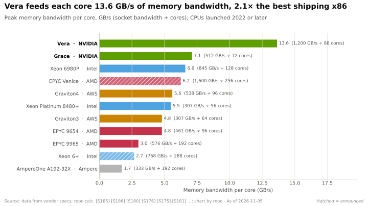
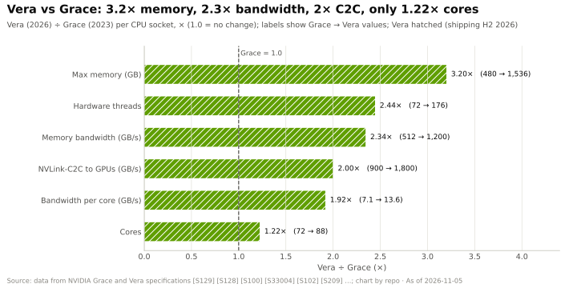
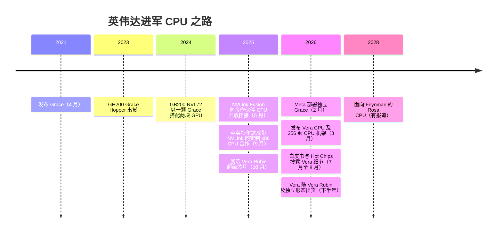

# Vera 与定制核心

> [!NOTE]
> 本页为英文原文的简体中文参考译文，仅供参考；如有出入，以[英文原文](../../../layers/04-cpu-grace-vera/vera-and-custom-cores.md "English original")为准。

第 04 层 · CPU（Grace、Vera）· 阅读约 10 分钟 · 最近核实：2026-11-05

## ⚡ 要点速览

- **Vera 是英伟达（NVIDIA）首款采用自研核心的 CPU：**88 个实现 [Armv9.2](../../glossary.md#arm-isa) 指令集的定制“Olympus”核心，借助[空间多线程（Spatial Multithreading）](../../glossary.md#spatial-multithreading)每核两个线程（共 176 线程），通过 [SOCAMM](../../glossary.md#socamm) 模组最高配 1.5 TB LPDDR5X、带宽约 1.2 TB/s，并以 1.8 TB/s 的 NVLink-C2C 连接两块 Rubin GPU [[S4000]](../../../sources/bibliography.md#s4000)[[S4002]](../../../sources/bibliography.md#s4002)[[S100]](../../../sources/bibliography.md#s100)。
- **英伟达把晶体管预算花在了数据供给上：**与 Grace 相比，内存容量提升至 3.2 倍、带宽 2.3 倍、GPU 链路 2 倍，而核心数仅 1.22 倍 [[S129]](../../../sources/bibliography.md#s129)[[S4000]](../../../sources/bibliography.md#s4000)[[S209]](../../../sources/bibliography.md#s209)。
- **早期测试结果不错，但谈不上碾压。** 英伟达对 Phoronix 测试的汇总显示，Vera 约为 Grace 的 1.63 倍，比 5 GHz 的 AMD EPYC 9575F 领先约 10% [[S4004]](../../../sources/bibliography.md#s4004)；英伟达自己的 SPECrate 估计值（925）低于一份经审核的双路 EPYC 9755 成绩（1,070）[[S4003]](../../../sources/bibliography.md#s4003)。
- **Vera 也是一款独立产品，**在 GTC 2026 上与 256 颗 CPU 的整机架一同发布，合作伙伴将于 2026 年下半年供货 [[S4000]](../../../sources/bibliography.md#s4000)；据报道，英伟达称之为一项数十亿美元级别的业务 🟡 [[S90003]](../../../sources/bibliography.md#s90003)。Meta 可能从 2027 年起大规模部署纯 Vera CPU 服务器 🟡 [[S4006]](../../../sources/bibliography.md#s4006)。
- **x86 通过合作覆盖：**英伟达对英特尔（Intel）的 $5B 入股已于 2025-12-26 完成交割 [[S4009]](../../../sources/bibliography.md#s4009)；英特尔正为 AI 主机节点打造一款带 [NVLink](../../glossary.md#nvlink) 的定制 [x86](../../glossary.md#x86) Xeon，截至 2026 年 5 月尚未披露产品名称或时间表 🟡 [[S4011]](../../../sources/bibliography.md#s4011)[[S4010]](../../../sources/bibliography.md#s4010)。
- **下一步：**据报道，Feynman 世代（2028 年）将搭配一款名为 Rosa 的 CPU 🟡 [[S90004]](../../../sources/bibliography.md#s90004)[[S109]](../../../sources/bibliography.md#s109)。

## 1. 通俗解读 Vera 的设计

AMD 的 EPYC Venice 核心数高达 256 [[S4028]](../../../sources/bibliography.md#s4028)。Vera 止步于 88 核，把预算花在了别处：

- **每核带宽。** 8 个 128 位 LPDDR5X 控制器 [[S4001]](../../../sources/bibliography.md#s4001) 提供约 1.2 TB/s 带宽，即每核约 13.6 GB/s，约为 Grace 的两倍 [[S4000]](../../../sources/bibliography.md#s4000)[[S129]](../../../sources/bibliography.md#s129)。
- **每核两个线程，但组织方式不同。** 传统的[同时多线程（SMT）](../../glossary.md#smt)让两个线程争用核心的全部执行单元，因此每个线程的速度取决于其“邻居”。英伟达称空间多线程是在线程之间划分核心资源，从而获得更可预测的性能 🟡 [[S4002]](../../../sources/bibliography.md#s4002)[[S100]](../../../sources/bibliography.md#s100)；评测人士则质疑二者究竟有多大区别 [[S4005]](../../../sources/bibliography.md#s4005)。
- **可维护的内存。** SOCAMM 模组把每颗 CPU 的容量提升至 1.5 TB，也终结了 Grace 焊接内存的限制 [[S4002]](../../../sources/bibliography.md#s4002)。

其芯片切分方式尚有争议：一份 Hot Chips 2026 报道称是中介层上的六颗裸片，其他报道则称是单颗计算裸片 🟡 [[S4001]](../../../sources/bibliography.md#s4001)。

| | Grace（2023） | Vera（2026） | 变化 |
|---|---|---|---|
| 核心 / 线程 | 72 个 Neoverse V2 / 72 | 88 个 Olympus / 176 | 1.22× / 2.4× [[S129]](../../../sources/bibliography.md#s129)[[S4000]](../../../sources/bibliography.md#s4000) |
| 内存 | ≤480 GB LPDDR5X，焊接 | ≤1.5 TB LPDDR5X，SOCAMM | 3.2× [[S129]](../../../sources/bibliography.md#s129)[[S4002]](../../../sources/bibliography.md#s4002) |
| 内存带宽 | ≤~512 GB/s | ~1.2 TB/s | 2.3× [[S129]](../../../sources/bibliography.md#s129)[[S4000]](../../../sources/bibliography.md#s4000) |
| 共享 L3 缓存 | — | 164 MB（有报道） | 🟡 [[S4002]](../../../sources/bibliography.md#s4002) |
| 与 GPU 的链路 | NVLink-C2C 900 GB/s | NVLink-C2C 1.8 TB/s | 2× [[S129]](../../../sources/bibliography.md#s129)[[S209]](../../../sources/bibliography.md#s209) |

> [!TIP]
> **算例 —— 1.2 TB/s 是否算得通？领先幅度有多大？** 1,024 位总线每次传输 128 字节；1.2 TB/s ÷ 128 B ≈ **每秒 94 亿次传输**，与最高速率的 LPDDR5X 相符（本资料库基于 [[S4001]](../../../sources/bibliography.md#s4001)[[S4000]](../../../sources/bibliography.md#s4000) 推算）。每核：**13.6 GB/s**，而 AMD 192 核 EPYC Turin 按其 576 GB/s 峰值计算每核为 3.0 [[S176]](../../../sources/bibliography.md#s176)。英伟达白皮书显示 Turin 的持续带宽约为 400 GB/s；据报道 Chips and Cheese 实测约为 570 GB/s，使 Vera 的持续带宽领先幅度从约 3 倍缩小至约 1.9 倍 🟡 [[S4005]](../../../sources/bibliography.md#s4005)。**结论：**带宽领先是真实的，但比英伟达所暗示的要小，而且这是按插槽而非按机架计算的。

**[Q3 · 代际进步]** 英伟达的主机在所有为 GPU 供给数据的维度上都有提升：每 GPU 主机链路从 128 GB/s（[PCIe](../../glossary.md#pcie) Gen5，DGX H100）升至 900 GB/s（GH200），GB200 上约 450 GB/s，Vera Rubin 上再次回到约 900 GB/s；每 GPU CPU 内存从约 240 GB（GB200）增至约 750 GB；每 GPU 主机线程数从 28 增至 88（图表见 [AI 为什么需要 CPU](why-ai-needs-a-cpu.md) 和 [Grace 与超级芯片](grace-and-the-superchip.md)）。按单颗 CPU 计：

## 2. 英伟达为何从授权 Neoverse 核心转向自研核心

Grace 的 Neoverse V2 核心 [[S129]](../../../sources/bibliography.md#s129) 与 AWS Graviton4 和谷歌（Google）Axion 所用的是同一款核心 [[S181]](../../../sources/bibliography.md#s181)[[S182]](../../../sources/bibliography.md#s182)：上市快，但并不比客户自研的芯片更好。定制的 Olympus 核心带来三点：（1）围绕 1.8 TB/s 的 GPU 流量对核心、缓存和内存进行协同设计；（2）掌控路线图，使新特性按英伟达一年一代而非 Arm 的节奏推出；（3）一颗能够独立与 EPYC 和 Xeon 竞争的 CPU。代价是：庞大的核心设计团队、更长的芯片启动周期以及第一代产品的风险；软件可移植性则不受影响。高通（Qualcomm，Oryon）、Ampere 和富士通也走了同样的定制核心路线 [[S4029]](../../../sources/bibliography.md#s4029)[[S185]](../../../sources/bibliography.md#s185)[[S187]](../../../sources/bibliography.md#s187)。

> [!TIP]
> **算例 —— 解读英伟达的基准测试宣称。** 英伟达估计双路 Vera 在 SPECrate 2026 整数测试中得分 **925**，而 AMD EPYC 9755 为 **898**，领先 3% [[S4003]](../../../sources/bibliography.md#s4003)。但一套经审核的戴尔双路 EPYC 9755 系统的公布成绩为 **1,070** [[S4003]](../../../sources/bibliography.md#s4003)，因此英伟达的估计值仅为已公布最佳 EPYC 成绩的约 **86%**。**结论：**Vera 在通用 CPU 工作负载上具备竞争力，但并非跨越式进步；它的卖点在于每核带宽、C2C 链路和机架级集成。

🔧 技术细节：“定制 Arm 核心”意味着什么

- **两种 Arm 授权。** 核心授权是直接采用 Arm 的成品设计（Grace）。[架构授权（architecture licence）](../../glossary.md#architecture-licence)则允许公司基于 Arm 指令集自行设计核心（Vera；苹果、高通、Ampere 亦然）。
- **哪些保持兼容：**编译器、操作系统和应用程序面向的是指令集，因此 Arm 服务器软件可以在 Vera 上运行。
- **哪些发生变化：**流水线宽度、分支预测、缓存、多线程和功耗管理，这些决定了单线程速度和功耗。
- **Arm 的反制：**Arm 在 Neoverse 中加入了对 [NVLink Fusion](../../glossary.md#nvlink-fusion) 的支持 [[S90036]](../../../sources/bibliography.md#s90036)，使采用 Arm 核心授权的厂商同样能接入英伟达 GPU。

## 3. 作为独立 CPU 的 Vera，以及 x86 对冲

时间线来源：[[S537]](../../../sources/bibliography.md#s537)[[S128]](../../../sources/bibliography.md#s128)[[S396]](../../../sources/bibliography.md#s396)[[S131]](../../../sources/bibliography.md#s131)[[S130]](../../../sources/bibliography.md#s130)[[S209]](../../../sources/bibliography.md#s209)[[S4006]](../../../sources/bibliography.md#s4006)[[S4000]](../../../sources/bibliography.md#s4000)[[S4002]](../../../sources/bibliography.md#s4002)[[S4001]](../../../sources/bibliography.md#s4001)[[S90004]](../../../sources/bibliography.md#s90004)。

英伟达将独立 Vera 定位于[智能体（agentic）](../../glossary.md#agentic-ai) AI 和强化学习，宣称其能效是传统机架级 CPU 的两倍（厂商宣称）[[S4000]](../../../sources/bibliography.md#s4000)；戴尔、HPE、联想和 Supermicro 均提供 Vera 服务器 [[S4032]](../../../sources/bibliography.md#s4032)[[S4033]](../../../sources/bibliography.md#s4033)。Meta 是标杆客户 [[S4006]](../../../sources/bibliography.md#s4006)[[S4008]](../../../sources/bibliography.md#s4008)。

> [!TIP]
> **算例 —— “数十亿美元”对应多少出货量。** 摩根士丹利估计 36 颗 Vera CPU 约 $180k，即机架内**每颗 CPU 约 $5,000**（估计）[[S331]](../../../sources/bibliography.md#s331)。按此价格，一项 $2B 的独立 CPU 业务**每年需要约 400,000 颗 CPU**，约合 1,560 个 256 颗 CPU 的机架 [[S4000]](../../../sources/bibliography.md#s4000)；独立销售价格很可能更高，因此所需数量更少（🔴 本资料库分析）。**结论：**这一说法依赖少数几家像 Meta 这样的超大规模买家，客户集中度很高。

**x86 对冲。** 2025-09-18，英伟达与英特尔达成协议，由英特尔打造通过 NVLink 接入英伟达平台的英伟达定制 x86 CPU [[S130]](../../../sources/bibliography.md#s130)；英伟达以每股 $23.28 买入 214,776,632 股、总计 $5.0B 的交易于 2025-12-26 完成交割（持股约 4–5%，各来源说法不一）[[S4009]](../../../sources/bibliography.md#s4009)。英特尔于 2026 年 1 月介绍了一款面向 AI 主机节点、集成 NVLink 的定制 Xeon [[S4011]](../../../sources/bibliography.md#s4011)，并于 2026 年 5 月确认相关工作仍在推进，但仍未公布名称或时间表 🟡 [[S4010]](../../../sources/bibliography.md#s4010)。这让重度依赖 x86 的企业客户留在 NVLink 机架之内，也为英特尔重返 AI 主机插槽提供了一条路径。

> [!WARNING]
> **🐻 看空观点：**定制核心是一项跨越多代的投入，而在这个市场上，AMD 已于 2026 年 7 月出货 256 核的 Venice [[S4028]](../../../sources/bibliography.md#s4028)，[超大规模云厂商](../../glossary.md#hyperscaler)也在自研 Arm CPU。英特尔的 NVLink Xeon 还可能蚕食 Vera 的份额。

## 🎯 企业发展视角

1. **核心设计人才稀缺。** 英伟达、高通（通过 Nuvia）、Ampere 和富士通都打造了定制 Arm 核心；还有哪些独立 CPU 团队或 IP 公司可供合作？
2. **是 CPU 业务，还是 GPU 挂接策略？** 关注英伟达在 Vera 出货后是否单独披露 CPU 收入；Meta 的 2027 年计划是第一次检验 [[S4006]](../../../sources/bibliography.md#s4006)。
3. **高通问题（仅基于公开信息）：**高通已发布的约 250 核 Dragonfly C1000 瞄准 2028 年下半年的 AI 头节点 🟡 [[S4030]](../../../sources/bibliography.md#s4030)，与 Rosa 同期。第三方 Arm CPU 需要满足什么条件，才能赢得英伟达本可自己填补的 Fusion 主机插槽？

## 📚 来源（Sources）

<!-- Auto-generated from the [S…] citations on this page by `make build`. Edit sources/registry/*.csv, not this list. -->

- [**S100**](../../../sources/bibliography.md#s100) NVIDIA Technical Blog, *Inside the NVIDIA Vera Rubin Platform: Six New Chips, One AI Supercomputer*, 2026-01-05. [Link](https://developer.nvidia.com/blog/inside-the-nvidia-rubin-platform-six-new-chips-one-ai-supercomputer/)
- [**S109**](../../../sources/bibliography.md#s109) NVIDIA Blog, *NVIDIA GTC 2026: Live Updates on What's Next in AI*, 2026-03-16. [Link](https://blogs.nvidia.com/blog/gtc-2026-news/)
- [**S128**](../../../sources/bibliography.md#s128) NVIDIA, *NVIDIA GH200 Grace Hopper Superchip*, 2023-08. [Link](https://www.nvidia.com/en-us/data-center/grace-hopper-superchip/)
- [**S129**](../../../sources/bibliography.md#s129) NVIDIA, *NVIDIA Grace CPU*, 2023. [Link](https://www.nvidia.com/en-us/data-center/grace-cpu/)
- [**S130**](../../../sources/bibliography.md#s130) NVIDIA Newsroom, *NVIDIA and Intel to Develop AI Infrastructure and Personal Computing Products*, 2025-09-18. [Link](https://nvidianews.nvidia.com/news/nvidia-and-intel-to-develop-ai-infrastructure-and-personal-computing-products)
- [**S131**](../../../sources/bibliography.md#s131) NVIDIA Newsroom, *NVIDIA NVLink Fusion: semi-custom AI infrastructure partner ecosystem (Computex 2025)*, 2025-05-19. [Link](https://nvidianews.nvidia.com/news/nvidia-nvlink-fusion-semi-custom-ai-infrastructure-partner-ecosystem)
- [**S176**](../../../sources/bibliography.md#s176) AMD, *AMD EPYC 9005 Series (Turin)*, 2024-10-10. [Link](https://www.amd.com/en/products/processors/server/epyc/9005-series.html)
- [**S181**](../../../sources/bibliography.md#s181) Amazon Web Services, *AWS Graviton Processor*, 2024. [Link](https://aws.amazon.com/ec2/graviton/)
- [**S182**](../../../sources/bibliography.md#s182) Google Cloud Blog, *Introducing Google Axion Processors, our new Arm-based CPUs*, 2024-04-09. [Link](https://cloud.google.com/blog/products/compute/introducing-googles-new-arm-based-cpu)
- [**S185**](../../../sources/bibliography.md#s185) Ampere Computing, *AmpereOne processors*, 2023-05. [Link](https://amperecomputing.com/products/processors/ampereone)
- [**S187**](../../../sources/bibliography.md#s187) Fujitsu, *FUJITSU-MONAKA: next-generation Arm-based processor*, 2025. [Link](https://www.fujitsu.com/global/about/research/technology/monaka/)
- [**S209**](../../../sources/bibliography.md#s209) DatacenterDynamics, *Nvidia announces Vera Rubin superchip for late 2026*, 2025-10-28. [Link](https://datacenterdynamics.com/en/news/nvidia-announces-vera-rubin-superchip-for-late-2026)
- [**S331**](../../../sources/bibliography.md#s331) Wccftech, *NVIDIA's Vera Rubin rack hit with 435% memory price surge, pushing HBM4 & LPDDR5X bill to $2M of $7.8M total*, 2026-05. [Link](https://wccftech.com/nvidia-vera-rubin-rack-hit-with-memory-price-surge-pushing-hbm4-lpddr5x-bill-to-2m-of-7-8m-total/)
- [**S396**](../../../sources/bibliography.md#s396) NVIDIA Newsroom, *NVIDIA Blackwell platform arrives to power a new era of computing*, 2024-03-18. [Link](https://nvidianews.nvidia.com/news/nvidia-blackwell-platform-arrives-to-power-a-new-era-of-computing)
- [**S537**](../../../sources/bibliography.md#s537) NVIDIA press release via Yahoo Finance, *NVIDIA Announces CPU for Giant AI and High Performance Computing Workloads*, 2021-04-12. [Link](https://sg.finance.yahoo.com/news/nvidia-announces-cpu-giant-ai-161900753.html)
- [**S4000**](../../../sources/bibliography.md#s4000) NVIDIA Newsroom, *NVIDIA Launches Vera CPU, Purpose-Built for Agentic AI*, 2026-03-16. [Link](https://nvidianews.nvidia.com/news/nvidia-launches-vera-cpu-purpose-built-for-agentic-ai)
- [**S4001**](../../../sources/bibliography.md#s4001) AI Weekly, *Nvidia details 88-core Vera CPU with six-chiplet Olympus design*, 2026-08. [Link](https://aiweekly.co/alerts/nvidia-details-88-core-vera-cpu-with-six-chiplet-olympus-design)
- [**S4002**](../../../sources/bibliography.md#s4002) Tom's Hardware, *Nvidia spills the beans on Vera CPU: spec benchmarks revealed, Olympus architecture detailed and more*, 2026-07. [Link](https://www.tomshardware.com/pc-components/cpus/nvidia-spills-the-beans-on-vera-cpu-spec-benchmarks-revealed-olympus-architecture-detailed-and-more)
- [**S4003**](../../../sources/bibliography.md#s4003) PC Games Hardware, *Nvidia Vera: Whitepaper legt Olympus-Architektur und erste SPEC-Werte offen*, 2026-08. [Link](https://www.pcgameshardware.de/CPU-CPU-154106/News/Nvidia-Vera-Whitepaper-Olympus-Architektur-SPEC-Benchmarks-1549020/)
- [**S4004**](../../../sources/bibliography.md#s4004) NVIDIA Blog, *NVIDIA Vera CPU Is 'Packing a Heavy-Hitting Punch' Against Competition*, 2026-08. [Link](https://blogs.nvidia.com/blog/vera-cpu-phoronix/)
- [**S4005**](../../../sources/bibliography.md#s4005) Ecosistema Startup, *NVIDIA Vera CPU: análisis crítico del whitepaper y qué significa para founders*, 2026-08. [Link](https://ecosistemastartup.com/nvidia-vera-cpu-analisis-critico-del-whitepaper-y-que-significa-para-founders/)
- [**S4006**](../../../sources/bibliography.md#s4006) SiliconANGLE, *Meta agrees to buy millions of AI chips from Nvidia, raising doubts about its in-house hardware*, 2026-02-17. [Link](https://siliconangle.com/2026/02/17/meta-agrees-buy-millions-ai-chips-nvidia-raising-doubts-house-hardware/)
- [**S4008**](../../../sources/bibliography.md#s4008) Futurum Group, *Will NVIDIA's Meta Deal Ignite a CPU Supercycle?*, 2026-02. [Link](https://futurumgroup.com/insights/will-nvidias-meta-deal-ignite-a-cpu-supercycle/)
- [**S4009**](../../../sources/bibliography.md#s4009) SDxCentral, *Intel gets hands on Nvidia's $5B investment*, 2025-12. [Link](https://www.sdxcentral.com/news/intel-gets-hands-on-nvidias-5b-investment/)
- [**S4010**](../../../sources/bibliography.md#s4010) TechSpot, *Intel CEO promises partnership with Nvidia will produce exciting new products*, 2026-05. [Link](https://www.techspot.com/news/112381-intel-ceo-promises-partnership-nvidia-produce-exciting-new.html)
- [**S4011**](../../../sources/bibliography.md#s4011) Wccftech, *Intel, NVIDIA are building a custom Xeon CPU with NVLink tech; reaffirms Diamond Rapids 16-channel, Coral Rapids with SMT*, 2026-01. [Link](https://wccftech.com/intel-nvidia-are-building-a-custom-xeon-cpu-with-nvlink-tech-reaffirms-diamond-rapids-16-channel-coral-rapids-with-smt-nova-lake-in-q4/)
- [**S4028**](../../../sources/bibliography.md#s4028) Digital Citizen, *AMD EPYC Venice launches with up to 256 Zen 6 cores and strong agentic AI performance claims*, 2026-07-22. [Link](https://www.digitalcitizen.life/amd-epyc-venice-launches-with-up-to-256-zen-6-cores-and-strong-agentic-ai-performance-claims/)
- [**S4029**](../../../sources/bibliography.md#s4029) StorageReview, *Qualcomm unveils Dragonfly data center roadmap: C1000 CPU, AI300 accelerator*, 2026-06-24. [Link](https://www.storagereview.com/news/qualcomm-unveils-dragonfly-data-center-roadmap-c1000-cpu-ai300-accelerator-and-modular-acquisition)
- [**S4030**](../../../sources/bibliography.md#s4030) Counterpoint Research, *Qualcomm unveils data center roadmap at Investor Day 2026*, 2026-06. [Link](https://counterpointresearch.com/cn/reports/qualcomm-unveils-data-center-roadmap-at-investor-day-2026)
- [**S4032**](../../../sources/bibliography.md#s4032) GamesBeat, *Nvidia touts adoption for Vera CPU from world's tech leaders*, 2026-03. [Link](https://gamesbeat.com/nvidia-touts-adoption-for-vera-cpu-from-worlds-tech-leaders/)
- [**S4033**](../../../sources/bibliography.md#s4033) TechSpot, *Nvidia Jensen Huang: standalone Vera CPU to challenge AMD*, 2026-01. [Link](https://www.techspot.com/news/111113-nvidia-jensen-huang-standalone-vera-cpu-challenge-amd.html)
- [**S90003**](../../../sources/bibliography.md#s90003) eWeek, *Everything Nvidia Just Announced at GTC 2026: 7 Chips, 5 Racks, 1 Giant Bet on Agentic AI*, 2026-03-17. [Link](https://www.eweek.com/news/nvidia-gtc-2026-ai-inference-vera-rubin-neuron/)
- [**S90004**](../../../sources/bibliography.md#s90004) TrendForce, *Key GTC takeaways: how Samsung, Micron, Intel and more power NVIDIA's Vera Rubin and Feynman*, 2026-03-17. [Link](https://www.trendforce.com/news/2026/03/17/news-key-gtc-takeaways-how-samsung-micron-intel-more-power-nvidias-vera-rubin-and-feynman/)
- [**S90036**](../../../sources/bibliography.md#s90036) Converge Digest, *Arm extends Neoverse with NVIDIA NVLink Fusion*, 2025-11. [Link](https://convergedigest.com/arm-extends-neoverse-with-nvidia-nvlink-fusion/)
