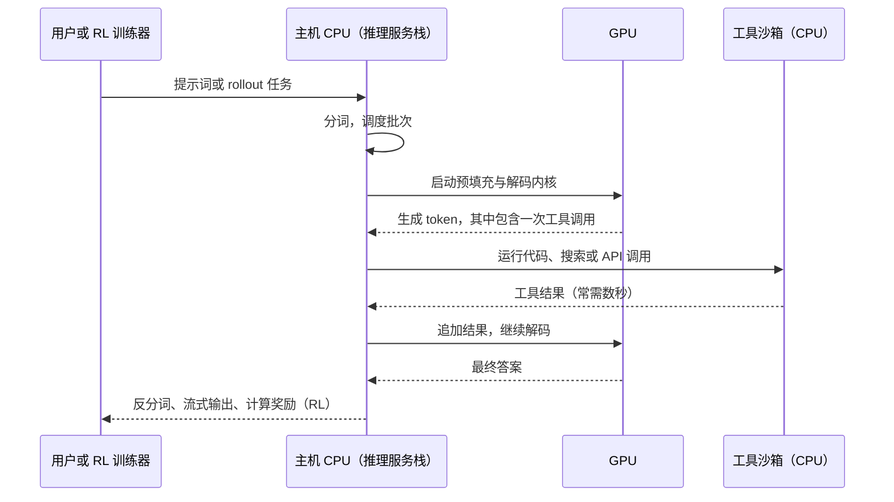
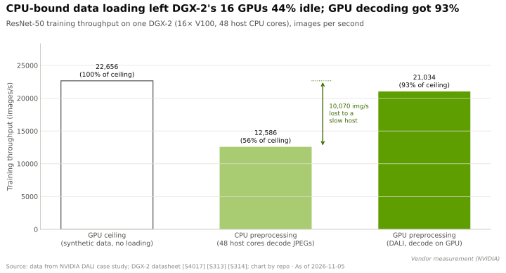

# AI 系统为什么需要 CPU

> [!NOTE]
> 本页为英文原文的简体中文参考译文，仅供参考；如有出入，以[英文原文](../../../layers/04-cpu-grace-vera/why-ai-needs-a-cpu.md "English original")为准。

第 04 层 · CPU（Grace、Vera）· 阅读约 9 分钟 · 最近核实：2026-11-05

## ⚡ 要点速览

- **GPU 负责算数，[主机 CPU](../../glossary.md#host-cpu) 负责其余一切：**调度并启动 GPU 任务、加载与解码数据、分词（tokenization）、网络与存储 I/O、溢出内存，以及越来越多的 AI 智能体所调用的工具。主机一慢，昂贵的 GPU 就只能干等。
- **GPU“饥饿”是可以量化的。** 在一台 16-GPU 的 DGX-2 上，ResNet-50 训练在 CPU 预处理下仅达 12,586 images/s，而使用合成数据时为 22,656 images/s，即 GPU 约 44% 的时间处于空闲；把解码挪到 GPU 上后恢复至 21,034 images/s [[S4017]](../../../sources/bibliography.md#s4017)。
- **英伟达（NVIDIA）不断提高每块 GPU 配备的主机算力：**DGX H100 上每 GPU 约 28 个主机线程 [[S33022]](../../../sources/bibliography.md#s33022)，GB200 [NVL72](../../glossary.md#nvl72) 上为 36 个（72 块 GPU 配 36 颗 Grace）[[S396]](../../../sources/bibliography.md#s396)，Vera Rubin NVL72 上约 88 个（本资料库基于 [[S4000]](../../../sources/bibliography.md#s4000)[[S102]](../../../sources/bibliography.md#s102) 推算）。
- **智能体 AI 与强化学习推高 CPU 需求。** 英特尔（Intel）2026 年表示，在智能体场景下 CPU:GPU 配比可能收紧至接近 1:1 [[S4012]](../../../sources/bibliography.md#s4012)；TrendForce 预计为 1:2 至 1:1 [[S4013]](../../../sources/bibliography.md#s4013)；2026 年初服务器 CPU 交货周期已达约 6 个月 [[S4015]](../../../sources/bibliography.md#s4015)。
- **英伟达如今直接面向这类需求销售 CPU：**一个由 256 颗 Vera 组成的机架可同时维持 >22,500 个 CPU 运行环境 [[S4000]](../../../sources/bibliography.md#s4000)，大约每核一个（256 × 88 = 22,528）。
- **看空论点：**主机是机架中便宜的部分（在估计约 $7.8M 的 Vera Rubin NVL72 中约占 $180k）[[S331]](../../../sources/bibliography.md#s331)，且[超大规模云厂商](../../glossary.md#hyperscaler)可以在自有 Arm 集群上运行智能体工具；AWS 为每颗 Trainium3 只配 16 个主机 vCPU [[S354]](../../../sources/bibliography.md#s354)。

## 1. 主机到底做什么

不妨把它想象成一家餐厅：GPU 是手速极快、但只会掌勺的厨师；主机 CPU 则是传菜调度和备菜间。调度一慢，厨师就只能干站着。主机承担六项职能：

1. **编排：**驱动程序、[CUDA](../../glossary.md#cuda) 运行时，以及每个训练步中成千上万次的内核启动（[第 09 层](../09-cuda-and-system-software/index.md)）。
2. **数据加载：**读取、解码、增强训练数据并进行分词。[数据加载器（data loader）](../../glossary.md#data-loader)过慢会导致 [GPU 饥饿（GPU starvation）](../../glossary.md#gpu-starvation)。
3. **I/O：**检查点、存储与网络配置，部分已卸载到 DPU（[第 07 层](../07-dpu-supernic-storage-security/index.md)）。
4. **推理服务：**请求处理、分词、批处理与流式输出。
5. **溢出内存：**放不进[高带宽内存（HBM）](../../glossary.md#hbm)的权重、[KV 缓存](../../glossary.md#kv-cache)和嵌入向量（[Grace 与超级芯片](grace-and-the-superchip.md)）。
6. **智能体工具与强化学习环境：**为[智能体 AI](../../glossary.md#agentic-ai) 执行代码、浏览网页与调用 API，以及为[强化学习](../../glossary.md#reinforcement-learning)打分。

在智能体的一轮交互中，只有下图中的 GPU 步骤是矩阵运算：

> [!TIP]
> **算例 —— 主机过慢让一台 DGX-2 损失了多少。** 英伟达在一台 DGX-2（16 块 V100 GPU，48 个主机核心）上测量了 ResNet-50 训练 [[S4017]](../../../sources/bibliography.md#s4017)[[S313]](../../../sources/bibliography.md#s313)：
> - 使用合成数据时的 GPU 上限：**22,656 images/s**；使用 CPU 数据加载器时：**12,586 images/s**（56%）。
> - CPU 每核每秒约解码 262 张图像（12,586 ÷ 48），若要喂满上限约需 86 个核心，是这台机器实际核心数的 1.8 倍。
> - 按 $399,000 的标价 [[S313]](../../../sources/bibliography.md#s313)[[S314]](../../../sources/bibliography.md#s314)，44% 的空闲时间意味着每台系统约有 $176,000 的硬件被闲置。
> - 解决办法是把工作挪到 GPU 上：[DALI](../../glossary.md#dali) 达到 **21,034 images/s**（93%）[[S4017]](../../../sources/bibliography.md#s4017)，A100 还增加了硬件 JPEG 解码器 [[S4018]](../../../sources/bibliography.md#s4018)。
>
> **结论：**主机瓶颈的解法要么是多买 CPU，要么是把工作挪到 GPU 上。智能体的工具调用无法挪到 GPU 上，这正是 CPU 需求再度上升的原因。

**[Q1 · 职能与失效后果]** 主机让 GPU 保持忙碌，并运行一切非稠密矩阵运算的工作。主机薄弱时系统并不会崩溃；只是 GPU 会“挨饿”（DGX-2 测试中 44% 时间空闲），当上下文需要重新计算而非重新加载时首 token 延迟上升，智能体或 RL 循环则因等待工具而停滞。薄弱的主机会悄无声息地拉低系统中最昂贵部分的回报。

🔧 技术细节：主机时间花在了哪里

- **内核启动**每次耗费数微秒的 CPU 时间；CUDA Graphs 可把一个训练步录制下来，再用一次调用重放。
- **锁页内存（pinned memory）：**数据必须先放在页锁定的主机内存中，GPU 的拷贝引擎才能搬运。
- **NUMA：**在双路 [x86](../../glossary.md#x86) 服务器中，每颗 CPU 各管一半 GPU；如果加载线程跑在错误的插槽上，就要跨越插槽间链路。单 CPU 的超级芯片可以避免这一问题。

## 2. 各代系统的 CPU:GPU 配比

英伟达基于 x86 的 DGX 服务器八年来一直保持每 8 块 GPU 配两颗 CPU（从 DGX-1 到 DGX B200）[[S189]](../../../sources/bibliography.md#s189)[[S188]](../../../sources/bibliography.md#s188)[[S33022]](../../../sources/bibliography.md#s33022)[[S319]](../../../sources/bibliography.md#s319)；16-GPU 的 DGX-2 为 1:8 [[S313]](../../../sources/bibliography.md#s313)。GH200 为每块 GPU 配一颗 72 核 Grace [[S128]](../../../sources/bibliography.md#s128)；GB200、GB300 和 Vera Rubin NVL72 则定格在 72 块 GPU 配 36 颗 CPU [[S396]](../../../sources/bibliography.md#s396)[[S32004]](../../../sources/bibliography.md#s32004)[[S102]](../../../sources/bibliography.md#s102)。竞争对手的选择不同：AMD 的 Helios 为 72 块 GPU 配 18 颗 EPYC Venice CPU（1:4）[[S538]](../../../sources/bibliography.md#s538)；AWS 则改为公布 vCPU 数：每颗 Trainium2 配 12 个，每颗 Trainium3 配 16 个 [[S4021]](../../../sources/bibliography.md#s4021)[[S354]](../../../sources/bibliography.md#s354)。

> [!TIP]
> **算例 —— 每 GPU 主机线程数。** DGX H100：2 × 56 核 × 2 线程 ÷ 8 块 GPU = **28** [[S33022]](../../../sources/bibliography.md#s33022)。GB200 NVL72：36 × 72 核 ÷ 72 = **36** [[S396]](../../../sources/bibliography.md#s396)[[S129]](../../../sources/bibliography.md#s129)。Vera Rubin NVL72：36 × 88 核 × 2 线程 ÷ 72 = **88** [[S4000]](../../../sources/bibliography.md#s4000)[[S102]](../../../sources/bibliography.md#s102)。AWS Trn3 Gen2：2,304 个 vCPU ÷ 144 颗芯片 = **16** [[S354]](../../../sources/bibliography.md#s354)。**解读：**英伟达在每个加速器上捆绑的主机算力是 AWS 的 3–5 倍；这既可以看作对智能体时代的远见，也可以看作部分买家更愿意单独配置的 CPU 成本。

## 3. 智能体 AI 与强化学习：CPU 需求为何再度上升

智能体在 GPU 上“思考”与在 CPU 上“行动”（运行代码、查询数据库、浏览网页）之间交替进行；一次两秒的工具调用会一直占用该请求的 GPU 槽位，除非调度器把它重新填满。RL 后训练每一步会生成数以千计的尝试，每次尝试都要在隔离的[沙箱](../../glossary.md#agent-sandbox)中执行和打分，通常每个沙箱占一个核心。

业界在 2026 年注意到了这一点：英特尔表示配比可能从当前的 1:4–1:8 向 1:1 靠拢 [[S4012]](../../../sources/bibliography.md#s4012)；AMD 表示 CPU 需求超出预期 [[S4012]](../../../sources/bibliography.md#s4012)；Counterpoint 将 AMD 在 2026 年第一季度的份额提升归功于智能体需求，而同期英特尔受供应限制 [[S4014]](../../../sources/bibliography.md#s4014)。英伟达的回应是推出独立销售的 Vera 和 Vera CPU 机架 [[S4000]](../../../sources/bibliography.md#s4000)；据报道，英伟达将其定位为一项数十亿美元级别的业务 🟡 [[S90003]](../../../sources/bibliography.md#s90003)。

> [!TIP]
> **算例 —— 为一次 RL 训练配置 CPU。** 设想以每沙箱一个核心的方式让 22,500 个沙箱保持满载，这正是英伟达给出的单个 Vera 机架的数字（256 × 88 = 22,528 个核心）[[S4000]](../../../sources/bibliography.md#s4000)。一个 GB200 NVL72 机架有 36 × 72 = 2,592 个 Grace 核心 [[S396]](../../../sources/bibliography.md#s396)[[S129]](../../../sources/bibliography.md#s129)，且这些核心已在为各自的 GPU 服务，因此同样的负载需要 **约 8.7 个 GB200 机架**的主机核心。**结论：**在智能体规模下，专用 CPU 资源池优于借用 GPU 机架的主机；谁提供这个资源池，谁就能抢占一个新的 CPU 插槽市场。

> [!WARNING]
> **🐻 看空观点：**智能体工具在任何 CPU 上都能运行。Graviton5（192 核）、Cobalt 200（132 核）和 AMD 的 256 核 Venice 都已上市 [[S4022]](../../../sources/bibliography.md#s4022)[[S4024]](../../../sources/bibliography.md#s4024)[[S4028]](../../../sources/bibliography.md#s4028)；沙箱集群是 AI 技术栈中商品化程度最高的部分。

## 🎯 企业发展视角

1. **智能体带来的 CPU 需求最终落在哪里？** 是落在 GPU 机架内部（由英伟达获取），还是落在通用集群上（AMD、英特尔、超大规模云厂商的 Arm）？应关注头部 AI 实验室的资本开支披露。
2. **是利润池还是控制点？** 机架内每颗 Vera 约 $5,000（估计，$180k ÷ 36）[[S331]](../../../sources/bibliography.md#s331)，CPU 收入规模不大；其价值在于掌控内存层级和调度路径。
3. **高通问题（仅基于公开信息）：**高通（Qualcomm）将其已发布的 Dragonfly C1000 定位于智能体编排和 AI 头节点 🟡 [[S4029]](../../../sources/bibliography.md#s4029)。智能体浪潮是否会让一颗高能效、高核心数的 Arm CPU 成为独立的切入点，而不论其是否挂接 GPU？

## 📚 来源（Sources）

<!-- Auto-generated from the [S…] citations on this page by `make build`. Edit sources/registry/*.csv, not this list. -->

- [**S102**](../../../sources/bibliography.md#s102) NVIDIA, *NVIDIA DGX Vera Rubin NVL72*, 2026. [Link](https://www.nvidia.com/en-us/data-center/dgx-vera-rubin-nvl72/)
- [**S128**](../../../sources/bibliography.md#s128) NVIDIA, *NVIDIA GH200 Grace Hopper Superchip*, 2023-08. [Link](https://www.nvidia.com/en-us/data-center/grace-hopper-superchip/)
- [**S129**](../../../sources/bibliography.md#s129) NVIDIA, *NVIDIA Grace CPU*, 2023. [Link](https://www.nvidia.com/en-us/data-center/grace-cpu/)
- [**S188**](../../../sources/bibliography.md#s188) NVIDIA Docs, *NVIDIA DGX A100 User Guide - Introduction (system specifications)*, 2020. [Link](https://docs.nvidia.com/dgx/dgxa100-user-guide/introduction-to-dgxa100.html)
- [**S189**](../../../sources/bibliography.md#s189) NVIDIA Docs, *NVIDIA DGX-1 User Guide - Introduction (system specifications)*, 2017. [Link](https://docs.nvidia.com/dgx/dgx1-user-guide/introduction-to-dgx1.html)
- [**S313**](../../../sources/bibliography.md#s313) NVIDIA (mirror hosted by M Computers), *NVIDIA DGX-2 datasheet*, 2018. [Link](https://mcomputers.cz/wp-content/uploads/2018/12/nvidia-dgx-2-datasheet-uk.pdf)
- [**S314**](../../../sources/bibliography.md#s314) TweakTown, *NVIDIA's DGX-2: 16 x Tesla V100s, total of 512GB HBM2, $399K*, 2018-03-27. [Link](https://www.tweaktown.com/news/61345/nvidias-dgx-2-16-tesla-v100s-total-512gb-hbm2-399k/index.html)
- [**S319**](../../../sources/bibliography.md#s319) NVIDIA (mirror hosted by OpenZeka), *NVIDIA DGX B200 datasheet*, 2024. [Link](https://openzeka.com/wp-content/uploads/2024/11/dgx-scale-ai-infrastructure-dgx-b200-datasheet-nvidia-web-1-1.pdf)
- [**S331**](../../../sources/bibliography.md#s331) Wccftech, *NVIDIA's Vera Rubin rack hit with 435% memory price surge, pushing HBM4 & LPDDR5X bill to $2M of $7.8M total*, 2026-05. [Link](https://wccftech.com/nvidia-vera-rubin-rack-hit-with-memory-price-surge-pushing-hbm4-lpddr5x-bill-to-2m-of-7-8m-total/)
- [**S354**](../../../sources/bibliography.md#s354) AWS, *Trn3 architecture (AWS Neuron documentation)*, 2026. [Link](https://awsdocs-neuron.readthedocs-hosted.com/en/v2.28.0/_sources/about-neuron/arch/neuron-hardware/trn3-arch.rst)
- [**S396**](../../../sources/bibliography.md#s396) NVIDIA Newsroom, *NVIDIA Blackwell platform arrives to power a new era of computing*, 2024-03-18. [Link](https://nvidianews.nvidia.com/news/nvidia-blackwell-platform-arrives-to-power-a-new-era-of-computing)
- [**S538**](../../../sources/bibliography.md#s538) AMD Investor Relations, *AAI 2026: AMD Delivers Full-Stack Compute for the Agentic AI Era*, 2026-07-23. [Link](https://ir.amd.com/news-events/press-releases/detail/1294/aai-2026-amd-delivers-full-stack-compute-for-the-agentic-ai-era)
- [**S4000**](../../../sources/bibliography.md#s4000) NVIDIA Newsroom, *NVIDIA Launches Vera CPU, Purpose-Built for Agentic AI*, 2026-03-16. [Link](https://nvidianews.nvidia.com/news/nvidia-launches-vera-cpu-purpose-built-for-agentic-ai)
- [**S4012**](../../../sources/bibliography.md#s4012) Tom's Hardware, *CPUs are cool again: Intel and AMD reporting spikes in CPU demand due to agentic AI*, 2026-05. [Link](https://www.tomshardware.com/pc-components/cpus/cpus-are-cool-again-intel-and-amd-reporting-spikes-in-cpu-demand-due-to-agentic-ai-shortages-lisa-su-says-business-exceeded-expectations-while-intel-is-looking-at-long-term-agreements-with-potential-customers)
- [**S4013**](../../../sources/bibliography.md#s4013) TrendForce, *How agentic AI is reshaping the CPU-to-GPU ratio*, 2026-09-29. [Link](https://www.trendforce.com/insights/agentic-ai-cpu-gpu)
- [**S4014**](../../../sources/bibliography.md#s4014) Counterpoint Research, *Agentic AI-driven CPU renaissance helps AMD outpace Intel in Q1 2026*, 2026-05. [Link](https://counterpointresearch.com/en/insights/agentic-ai-driven-cpu-renaissance-helps-amd-outpace-intel-in-q1-2026-cements-two-horse-race-with-nvidia)
- [**S4015**](../../../sources/bibliography.md#s4015) Tom's Hardware, *Shifting need for CPUs in AI workloads drives intensifying shortages and price hikes*, 2026. [Link](https://www.tomshardware.com/pc-components/cpus/shifting-need-for-cpus-in-ai-workloads-drives-intensifying-shortages-price-hikes)
- [**S4017**](../../../sources/bibliography.md#s4017) NVIDIA Technical Blog, *Case Study: ResNet50 with DALI*, 2019. [Link](https://developer.nvidia.com/blog/case-study-resnet50-dali/)
- [**S4018**](../../../sources/bibliography.md#s4018) NVIDIA Technical Blog, *Loading Data Fast with DALI and the New Hardware JPEG Decoder in NVIDIA A100 GPUs*, 2020. [Link](https://developer.nvidia.com/blog/loading-data-fast-with-dali-and-new-jpeg-decoder-in-a100/)
- [**S4021**](../../../sources/bibliography.md#s4021) Amazon Web Services (GitHub), *Trn2 architecture (AWS Neuron SDK documentation source)*, 2026. [Link](https://github.com/aws-neuron/aws-neuron-sdk/blob/master/about-neuron/arch/neuron-hardware/trn2-arch.rst)
- [**S4022**](../../../sources/bibliography.md#s4022) Amazon Science, *Graviton5's improved design increases speed and energy efficiency beyond Moore's law*, 2025-12. [Link](https://www.amazon.science/blog/graviton5s-improved-design-increases-speed-and-energy-efficiency-beyond-moores-law)
- [**S4024**](../../../sources/bibliography.md#s4024) DatacenterDynamics, *Microsoft reveals next-generation Cobalt CPU and Azure Boost*, 2025-11-18. [Link](https://www.datacenterdynamics.com/en/news/microsoft-reveals-next-generation-cobalt-cpu-and-azure-boost/)
- [**S4028**](../../../sources/bibliography.md#s4028) Digital Citizen, *AMD EPYC Venice launches with up to 256 Zen 6 cores and strong agentic AI performance claims*, 2026-07-22. [Link](https://www.digitalcitizen.life/amd-epyc-venice-launches-with-up-to-256-zen-6-cores-and-strong-agentic-ai-performance-claims/)
- [**S4029**](../../../sources/bibliography.md#s4029) StorageReview, *Qualcomm unveils Dragonfly data center roadmap: C1000 CPU, AI300 accelerator*, 2026-06-24. [Link](https://www.storagereview.com/news/qualcomm-unveils-dragonfly-data-center-roadmap-c1000-cpu-ai300-accelerator-and-modular-acquisition)
- [**S32004**](../../../sources/bibliography.md#s32004) NVIDIA, *NVIDIA GB300 NVL72 / Blackwell Ultra (product page)*, 2025-03. [Link](https://www.nvidia.com/en-us/data-center/gb300-nvl72/)
- [**S33022**](../../../sources/bibliography.md#s33022) NVIDIA Docs, *NVIDIA DGX H100 User Guide — Introduction (system specifications)*, 2023. [Link](https://docs.nvidia.com/dgx/dgxh100-user-guide/introduction-to-dgxh100.html)
- [**S90003**](../../../sources/bibliography.md#s90003) eWeek, *Everything Nvidia Just Announced at GTC 2026: 7 Chips, 5 Racks, 1 Giant Bet on Agentic AI*, 2026-03-17. [Link](https://www.eweek.com/news/nvidia-gtc-2026-ai-inference-vera-rubin-neuron/)
