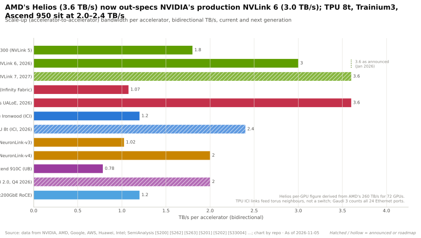
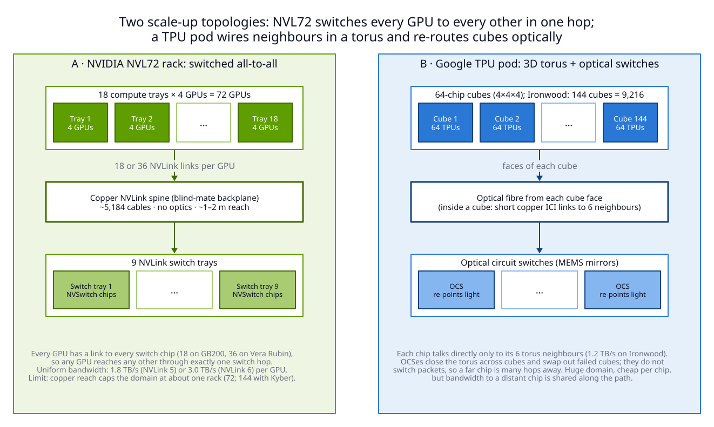
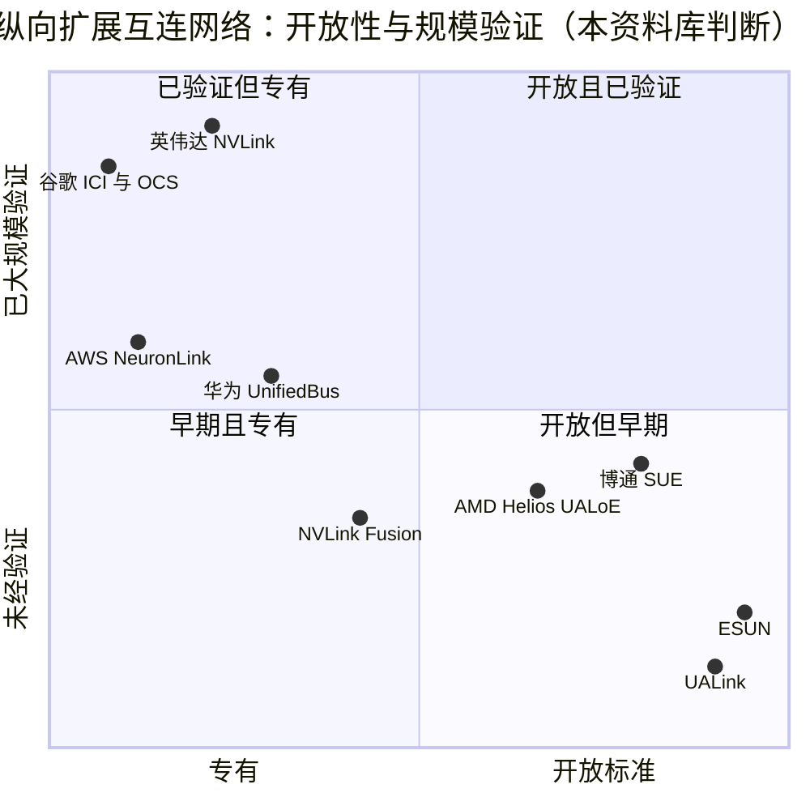

# 纵向扩展（NVLink、NVSwitch）：竞争格局

> [!NOTE]
> 本页为英文原文的简体中文参考译文，仅供参考；如有出入，以[英文原文](../../../layers/05-scale-up-nvlink-nvswitch/competition.md "English original")为准。

第 05 层 · 纵向扩展（NVLink、NVSwitch）· 约 13 分钟阅读 · 最后核实：2026-11-05

## ⚡ 要点速览

- **决定[纵向扩展（scale-up）](../../glossary.md#scale-up)竞争胜负的三要素：** 每个加速器的带宽、域规模，以及内存式的加载与存储。英伟达的 Vera Rubin [NVL72](../../glossary.md#nvl72) 提供 72 颗 GPU、每颗 3.0 TB/s，低于发布时宣布的 3.6 TB/s [[S200]](../../../sources/bibliography.md#s200)[[S201]](../../../sources/bibliography.md#s201)。
- **[Q5 · 最强挑战者]** AMD 的 Helios 借助博通（Broadcom）Tomahawk 6 以太网交换机承载 UALink，以 260 TB/s（每 GPU 3.6 TB/s）连接 72 颗 MI455X [[S226]](../../../sources/bibliography.md#s226)[[S5523]](../../../sources/bibliography.md#s5523)；首批机架约在 2026 年第三季度末出货，而 NVL72 早在 2024 年底即已出货 [[S90020]](../../../sources/bibliography.md#s90020)[[S121]](../../../sources/bibliography.md#s121)。
- **在域规模上英伟达落后：** 一个谷歌 Ironwood pod 容纳 9,216 颗 TPU（为 NVL72 的 128 倍），华为目标为 8,192 颗 NPU，二者均采用多跳环面或光互连网络，每芯片带宽为 1.2–2.4 TB/s 🟡 [[S232]](../../../sources/bibliography.md#s232)[[S249]](../../../sources/bibliography.md#s249)。
- **开放标准姗姗来迟：** [UALink](../../glossary.md#ualink) 1.0（2025 年 4 月）和 2.0（2026 年 4 月）仅停留在纸面上；产品将于 2027 年跟进 🟡 [[S573]](../../../sources/bibliography.md#s573)[[S574]](../../../sources/bibliography.md#s574)[[S90051]](../../../sources/bibliography.md#s90051)。以太网纵向扩展芯片则已出货：Tomahawk Ultra 自 2025 年 7 月起供货 [[S275]](../../../sources/bibliography.md#s275)。
- **客户在分散押注。** AWS Trainium4 将采用 [NVLink Fusion](../../glossary.md#nvlink-fusion)，而高通的 Dragonfly AI300（2028 年）选择了 UALink 与 [ESUN](../../glossary.md#esun)，尽管其服务器 CPU 采用 [NVLink](../../glossary.md#nvlink) Fusion 🟢 [[S518]](../../../sources/bibliography.md#s518)[[S90060]](../../../sources/bibliography.md#s90060)[[S90031]](../../../sources/bibliography.md#s90031)。
- **英伟达的弱点：** 铜缆域局限于单个机架。144 GPU 的 Kyber 机架计划于 2027 年下半年推出，但有报道称可能推迟至 2028 年，英伟达对此予以否认 🟡 [[S5517]](../../../sources/bibliography.md#s5517)[[S507]](../../../sources/bibliography.md#s507)[[S508]](../../../sources/bibliography.md#s508)。

## 纵向扩展竞争如何计分

纵向扩展域就像一间开放式办公室，任何人都可以翻看任何一张桌子上的文件；[横向扩展（scale-out）](../../glossary.md#scale-out)则像各个办公室之间靠快递互寄信件。在 NVLink 中，一颗 GPU 经一跳 [NVSwitch](../../glossary.md#nvswitch) 即可对另一颗 GPU 的内存执行加载或存储。这种**[加载/存储语义](../../glossary.md#load-store-semantics)**对[混合专家模型（MoE）](../../glossary.md#mixture-of-experts)最为关键，因为其[全交换（all-to-all）](../../glossary.md#all-to-all)流量会同时冲击每一颗 GPU（见 [P4](../../primers/P4-parallelism-explained.md)）。

| 竞争者（技术基础） | 每加速器带宽 | 域规模 | 延迟与语义 | 开放性 | 出货状态 |
|---|---|---|---|---|---|
| AMD Helios（基于以太网的 UALink） | 🟩 3.6 vs 3.0 TB/s | 🟨 72 vs 72 | 🟨 一跳交换 | 🟩 开放协议，商用交换芯片 | 🟥 首批机架 2026 年第三季度末 |
| 谷歌 TPU（ICI + 光交换机） | 🟥 1.2（Ironwood）/ 2.4（8t） | 🟩 9,216–9,600 | 🟦 3D 环面，多跳 | 🟦 自用 | 🟩 OCS pod 自 2021 年起运行 |
| AWS Trainium（NeuronLink-v4） | 🟥 2.0 TB/s | 🟩 144 | 🟨 交换式全互连 | 🟦 自用；Trn4 采用 Fusion | 🟨 2025 年 12 月正式商用 |
| 华为（UnifiedBus，灵衢） | 🟥 0.78 / 2.0 TB/s | 🟩 384 / 8,192 | 🟦 光互连，功耗约 4 倍 | 🟦 中国生态 | 🟥 950 正在爬坡 |
| UALink（联盟） | 🟨 200G 通道 | 🟩 1,024（规范） | 🟨 加载/存储，无监听 | 🟩 成员超过 65 家 | 🟥 尚无产品 |
| 以太网纵向扩展（SUE / ESUN） | 🟨 200G 通道 | 🟩 一跳 512 | 🟦 以太网帧，交换延迟约 250 ns | 🟩 OCP 标准 | 🟨 交换芯片已出货 |

评价 = 竞争者对比英伟达 Vera Rubin NVL72。每个单元格的来源与推理见 `data/l05_scale_up_verdicts.csv` [[S226]](../../../sources/bibliography.md#s226)[[S232]](../../../sources/bibliography.md#s232)[[S238]](../../../sources/bibliography.md#s238)[[S242]](../../../sources/bibliography.md#s242)[[S248]](../../../sources/bibliography.md#s248)[[S249]](../../../sources/bibliography.md#s249)[[S573]](../../../sources/bibliography.md#s573)[[S224]](../../../sources/bibliography.md#s224)[[S274]](../../../sources/bibliography.md#s274)[[S275]](../../../sources/bibliography.md#s275)[[S5521]](../../../sources/bibliography.md#s5521)。

> [!TIP]
> **算例 —— 为何交换式域对混合专家层至关重要。** 假设每颗 GPU 持有 4,096 个 token，并把每个 token 的 7,168 维 [FP8](../../glossary.md#fp8) 向量（约 7.2 KB）发送给其他 GPU 上的 8 个专家。每层需发出约 235 MB、再取回约 235 MB。NVLink 6 单向 1.5 TB/s，因此往返约需 0.31 ms [[S200]](../../../sources/bibliography.md#s200)。Vera Rubin 的 1.6 Tb/s 横向扩展[网卡（NIC）](../../glossary.md#nic)单向 200 GB/s，同样的交换约需 2.35 ms，慢 7.5 倍 [[S33004]](../../../sources/bibliography.md#s33004)。在 60 层中，NVLink 每次前向传播可节省 100 ms 以上，这正是域规模与每 GPU 带宽需一并定价的原因。

🔧 技术细节：为何环面成本低，但全交换流量更慢

在交换式域中，每颗 GPU 都把全部带宽注入一台交换机，经一跳即可到达其他任意 GPU。在[环面（torus）](../../glossary.md#torus-topology)中，每颗芯片只与相邻芯片相连，因此发往远端芯片的数据包会占用其经过的每一条链路的带宽。在 4×4×4 立方体中，平均路径约为 3 跳。一颗 Ironwood 芯片有 6 条链路 × 单向 100 GB/s [[S232]](../../../sources/bibliography.md#s232)，因此在均匀的全交换流量下，其可用注入带宽约为 600 ÷ 3 ≈ 单向 200 GB/s：这是横向扩展的速度，而非 NVLink 的速度（本资料库估算，假设理想路由）。当流量停留在相邻芯片之间时（张量并行与流水线并行），环面 pod 胜出；当流量均匀分布时（专家路由），环面 pod 落败。

## 逐一分析挑战者

### AMD：Helios 与基于以太网的 UALink（最强）

AMD 以 72 GPU 的交换式机架，取代了 MI355X 无交换芯片的 8 GPU [Infinity Fabric](../../glossary.md#infinity-fabric) 网格（每 GPU 约 1.1 TB/s）[[S229]](../../../sources/bibliography.md#s229)[[S226]](../../../sources/bibliography.md#s226)[[S5524]](../../../sources/bibliography.md#s5524)。Helios 通过 Tomahawk 6 交换托盘承载[基于以太网的 UALink（UALoE）](../../glossary.md#ualoe)：有报道称共六个托盘、每个两颗芯片，而 AMD 官方页面描述的是四个“纵向扩展线缆盒（scale-up cartridge）” 🟡 [[S5522]](../../../sources/bibliography.md#s5522)[[S226]](../../../sources/bibliography.md#s226)。**最有力的论据：** 与 NVL72 同样的形态、纸面上更高的每 GPU 带宽、无需缴纳英伟达交换芯片“税”，且已有 OpenAI、甲骨文（Oracle）和 Azure 排队采用 [[S546]](../../../sources/bibliography.md#s546)[[S90022]](../../../sources/bibliography.md#s90022)[[S90024]](../../../sources/bibliography.md#s90024)。**差距是否已缩小：** 纸面上是；在已部署机架和软件上，尚未。

### 谷歌：ICI 加光路交换机

谷歌 TPU 采用 [ICI](../../glossary.md#ici) 链路构成 3D 环面，立方体各面之间通过[光路交换机（OCS）](../../glossary.md#optical-circuit-switch)连接 [[S237]](../../../sources/bibliography.md#s237)。4,096 芯片的 TPU v4 pod 使用了 48 台 OCS [[S237]](../../../sources/bibliography.md#s237)。Ironwood 以 1.2 TB/s 达到 9,216 颗芯片，TPU 8t 以 2.4 TB/s 达到 9,600 颗 [[S232]](../../../sources/bibliography.md#s232)[[S238]](../../../sources/bibliography.md#s238)[[S240]](../../../sources/bibliography.md#s240)。**最有力的论据：** 经过验证的最大域规模、较低的单芯片成本，且如今已在谷歌云之外销售 [[S90027]](../../../sources/bibliography.md#s90027)。**差距：** 每芯片带宽与全交换效率（见上文）。深度分析：[CS3](../../case-studies/CS3-google-tpu-the-credible-alternative.md)。

### AWS：先 NeuronLink，后 NVLink Fusion

Trn3 UltraServer 通过 NeuronSwitch-v1 以每芯片 2 TB/s 连接 144 颗 Trainium3 芯片，而上一代是以环面连接的 64 颗 Trainium2 芯片 [[S242]](../../../sources/bibliography.md#s242)[[S244]](../../../sources/bibliography.md#s244)。**最有力的论据：** 自研的 144 芯片交换式域。**转折：** Trainium4 采用 NVLink Fusion 和英伟达 MGX 机架，选择购买英伟达的互连网络，而非继续扩展自家方案 [[S518]](../../../sources/bibliography.md#s518)[[S519]](../../../sources/bibliography.md#s519)。

### 华为：UnifiedBus（灵衢）

CloudMatrix 384 通过光学 [UnifiedBus](../../glossary.md#unifiedbus) 交换机连接 384 颗昇腾 910C NPU。其稠密 [BF16](../../glossary.md#bf16) 算力约为 300 [PFLOPS](../../glossary.md#flops)，而 GB200 NVL72 为 180，但功耗约 559 kW，而后者约 145 kW（估计，SemiAnalysis）[[S248]](../../../sources/bibliography.md#s248)[[S340]](../../../sources/bibliography.md#s340)。Atlas 950 SuperPoD 的目标是在 2026 年第四季度实现 8,192 颗 NPU、每颗 2 TB/s。WAIC 2026 上展示了一套 1,024 NPU 系统 🟡 [[S249]](../../../sources/bibliography.md#s249)[[S250]](../../../sources/bibliography.md#s250)。**最有力的论据：** 在出口管制下，靠堆规模的蛮力路线行得通。**差距：** 功耗、单芯片速度与供应。

### 开放标准：UALink 与以太网纵向扩展

UALink 1.0 定义了 200G 通道、内存语义传输以及最多 1,024 个加速器的 pod，不支持监听式缓存一致性 [[S573]](../../../sources/bibliography.md#s573)[[S224]](../../../sources/bibliography.md#s224)。首批 UALink 交换芯片之一——Upscale AI 的产品——目标于 2026 年第四季度推出 🟡 [[S5506]](../../../sources/bibliography.md#s5506)[[S5507]](../../../sources/bibliography.md#s5507)。以太网阵营包括博通的[纵向扩展以太网（SUE）](../../glossary.md#scale-up-ethernet)、OCP ESUN 1.0 规范和 UE 1.1，它们为以太网增加了[链路层重传](../../glossary.md#link-layer-retry)与基于信用的流量控制。Tomahawk Ultra 的交换延迟约 250 ns，Tomahawk 6 一跳可连接 512 个加速器 [[S275]](../../../sources/bibliography.md#s275)[[S274]](../../../sources/bibliography.md#s274)[[S576]](../../../sources/bibliography.md#s576)[[S575]](../../../sources/bibliography.md#s575)。**最有力的论据：** 多供应商供货与成熟的以太网工具链。**差距：** 尚无出货的 UALink 系统，且以太网成帧仍要额外耗费字节与纳秒。

“开放且已验证”象限空无一物：所有经过验证的互连网络都是专有的，而所有开放方案都还处于早期（本资料库判断）。谁获取收益：见[价值链](value-chain-and-corp-dev.md)。

> [!NOTE]
> **🐂 看多观点。** 竞争对手如今都在模仿 NVL72 的形态——72 GPU 交换式机架，这本身就验证了英伟达的设计。在 Helios 到来之前，英伟达已出货了两代此类产品 [[S121]](../../../sources/bibliography.md#s121)[[S90020]](../../../sources/bibliography.md#s90020)。NVLink Fusion 正在把客户芯片（Trainium4）和光学初创公司（Ayar Labs）拉入英伟达的互连网络，而非 UALink 🟡 [[S518]](../../../sources/bibliography.md#s518)[[S5513]](../../../sources/bibliography.md#s5513)。

> [!WARNING]
> **🐻 看空观点。** 英伟达下调 Rubin 规格，使 AMD 获得了每 GPU 带宽的领先 [[S201]](../../../sources/bibliography.md#s201)[[S226]](../../../sources/bibliography.md#s226)。一旦芯片于 2027 年出货，UALink 与以太网纵向扩展可能让交换芯片商品化 🔴 [[S90051]](../../../sources/bibliography.md#s90051)。谷歌和华为证明了大 100 倍的域是可行的 🟡 [[S232]](../../../sources/bibliography.md#s232)[[S249]](../../../sources/bibliography.md#s249)。

## 🎯 企业发展视角

1. 如果 UALink 产品如报道所言于 2027 年推出，商用交换芯片厂商（博通、美满电子、Upscale AI）能以多快的速度在价格上压低英伟达的交换托盘？[SerDes](../../glossary.md#serdes) 又由谁供应？
2. Helios 表明 UALink 如今就能在以太网交换机上运行。这会让原生 UALink 交换芯片沦为搁浅投资，还是成为日后的降本步骤？
3. 高通（仅基于公开信息）在 CPU 上采用 NVLink Fusion，在 2028 年的加速器上采用 UALink/ESUN [[S90031]](../../../sources/bibliography.md#s90031)[[S90060]](../../../sources/bibliography.md#s90060)。同时押注两种互连网络，在工程上要付出多少代价，又能换来哪些选择权？
4. 环面与光互连 pod 在域规模上胜出：与同时服务两大阵营的光学供应商之间，是否存在合作机会？

## 📚 来源（Sources）

<!-- Auto-generated from the [S…] citations on this page by `make build`. Edit sources/registry/*.csv, not this list. -->

- [**S121**](../../../sources/bibliography.md#s121) NVIDIA, *NVIDIA GB200 NVL72*, 2024-03. [Link](https://www.nvidia.com/en-us/data-center/gb200-nvl72/)
- [**S200**](../../../sources/bibliography.md#s200) NVIDIA, *NVIDIA NVLink and NVLink Switch (product page with NVLink and NVLink Switch specification tables)*, 2026-09. [Link](https://www.nvidia.com/en-us/data-center/nvlink/)
- [**S201**](../../../sources/bibliography.md#s201) VideoCardz, *NVIDIA quietly cuts Vera Rubin specs, HBM4 bandwidth and NVLink 6 speeds now lower*, 2026-10. [Link](https://videocardz.com/newz/nvidia-quietly-cuts-vera-rubin-specs-hbm4-bandwidth-and-nvlink-6-speeds-now-lower)
- [**S224**](../../../sources/bibliography.md#s224) UALink Consortium, *UALink 200G 1.0 Specification Overview*, 2025-04-10. [Link](https://ualinkconsortium.org/wp-content/uploads/2025/04/UALink-1.0-Specification-Overview_FINAL-1.pdf)
- [**S226**](../../../sources/bibliography.md#s226) AMD, *AMD Helios Rackscale Solution (product page)*, 2026. [Link](https://www.amd.com/en/products/rackscale-solutions/helios.html)
- [**S229**](../../../sources/bibliography.md#s229) AMD, *AMD Instinct MI355X (product page)*, 2025-06-12. [Link](https://www.amd.com/en/products/accelerators/instinct/mi350/mi355x.html)
- [**S232**](../../../sources/bibliography.md#s232) Google Cloud, *TPU7x (Ironwood) - Cloud TPU documentation*, 2025-11. [Link](https://docs.cloud.google.com/tpu/docs/tpu7x)
- [**S237**](../../../sources/bibliography.md#s237) arXiv (Norman P. Jouppi et al.), *TPU v4: An Optically Reconfigurable Supercomputer for Machine Learning with Hardware Support for Embeddings (ISCA 2023)*, 2023-04. [Link](https://arxiv.org/abs/2304.01433)
- [**S238**](../../../sources/bibliography.md#s238) Google, *Our eighth generation TPUs: two chips for the agentic era*, 2026-04-22. [Link](https://blog.google/innovation-and-ai/infrastructure-and-cloud/google-cloud/eighth-generation-tpu-agentic-era/)
- [**S240**](../../../sources/bibliography.md#s240) StorageReview, *Google Announces TPU 8t Sunfish and TPU 8i Zebrafish*, 2026-04. [Link](https://www.storagereview.com/news/google-announces-tpu-8t-sunfish-and-tpu-8i-zebrafish)
- [**S242**](../../../sources/bibliography.md#s242) Amazon Web Services, *Amazon EC2 Trn3 instances (product page)*, 2025-12-02. [Link](https://aws.amazon.com/ec2/instance-types/trn3/)
- [**S244**](../../../sources/bibliography.md#s244) Amazon Web Services, *Trainium2 architecture (AWS Neuron documentation)*, 2024-12. [Link](https://awsdocs-neuron.readthedocs-hosted.com/en/latest/general/arch/neuron-hardware/trn2-arch.html)
- [**S248**](../../../sources/bibliography.md#s248) arXiv (Huawei) (Huawei Cloud et al.), *Serving Large Language Models on Huawei CloudMatrix384*, 2025-06. [Link](https://arxiv.org/abs/2506.12708)
- [**S249**](../../../sources/bibliography.md#s249) Huawei (Eric Xu), *Groundbreaking SuperPoD Interconnect: Leading a New Paradigm for AI Infrastructure (Eric Xu keynote, Huawei Connect 2025)*, 2025-09-18. [Link](https://www.huawei.com/en/news/2025/9/hc-xu-keynote-speech)
- [**S250**](../../../sources/bibliography.md#s250) LightCounting, *July 2026 Atlas 950 SuperPoD: achieves all-optical interconnection with superior cost and power efficiency*, 2026-07. [Link](https://www.lightcounting.com/research-note/july-2026-atlas-950-superpod-achieves-all-optical-interconnection-with-superior-cost-and-power-efficiency-450)
- [**S274**](../../../sources/bibliography.md#s274) Broadcom, *Broadcom ships Tomahawk 6: world's first 102.4 Tbps switch*, 2025-06-03. [Link](https://investors.broadcom.com/news-releases/news-release-details/broadcom-ships-tomahawk-6-worlds-first-1024-tbps-switch)
- [**S275**](../../../sources/bibliography.md#s275) Broadcom, *Broadcom ships Tomahawk Ultra: reimagining the Ethernet switch for HPC and AI scale-up*, 2025-07-15. [Link](https://investors.broadcom.com/news-releases/news-release-details/broadcom-ships-tomahawk-ultra-reimagining-ethernet-switch-hpc-and-ai)
- [**S340**](../../../sources/bibliography.md#s340) SemiAnalysis (Dylan Patel et al.), *Huawei AI CloudMatrix 384 - China's answer to Nvidia GB200 NVL72*, 2025-04-16. [Link](https://newsletter.semianalysis.com/p/huawei-ai-cloudmatrix-384-chinas-answer-to-nvidia-gb200-nvl72)
- [**S507**](../../../sources/bibliography.md#s507) Tom's Hardware, *Nvidia's Kyber rack for Rubin Ultra slips to 2028*, 2026-07-06. [Link](https://www.tomshardware.com/pc-components/gpus/nvidias-kyber-rack-for-rubin-ultra-slips-to-2028)
- [**S508**](../../../sources/bibliography.md#s508) Wccftech, *NVIDIA Quashes Rubin & Kyber Rack Delay Rumors, Says 'Chip Roadmap Is Intact'*, 2026-07. [Link](https://wccftech.com/nvidia-quashes-rubin-kyber-rack-delay-rumors-says-chip-roadmap-is-intact/)
- [**S518**](../../../sources/bibliography.md#s518) ServeTheHome, *NVIDIA NVLink Fusion tapped for future AWS Trainium4 deployments*, 2025-12-02. [Link](https://www.servethehome.com/nvidia-nvlink-fusion-tapped-for-future-aws-trainium4-deployments/)
- [**S519**](../../../sources/bibliography.md#s519) South China Morning Post (Reuters) (Stephen Nellis; Greg Bensinger), *Amazon to use Nvidia tech in AI chips, roll out new servers (Reuters)*, 2025-12-02. [Link](https://www.scmp.com/tech/big-tech/article/3334985/amazon-use-nvidia-tech-ai-chips-roll-out-new-servers)
- [**S546**](../../../sources/bibliography.md#s546) TechWire Asia, *AMD Advancing AI 2026: Helios, OpenAI, Meta, Anthropic*, 2026-07. [Link](https://techwireasia.com/2026/07/amd-advancing-ai-2026-helios-openai-meta-anthropic/)
- [**S573**](../../../sources/bibliography.md#s573) Business Wire, *UALink Consortium Releases the Ultra Accelerator Link 200G 1.0 Specification*, 2025-04-08. [Link](https://www.businesswire.com/news/home/20250408050548/en/UALink-Consortium-Releases-the-Ultra-Accelerator-Link-200G-1.0-Specification)
- [**S574**](../../../sources/bibliography.md#s574) HPCwire, *UALink Consortium Publishes 4 Specifications Defining In-Network Compute, Chiplets, Manageability and 200G Performance*, 2026-04-07. [Link](https://www.hpcwire.com/off-the-wire/ualink-consortium-publishes-4-specifications-defining-in-network-compute-chiplets-manageability-and-200g-performance/)
- [**S575**](../../../sources/bibliography.md#s575) Network World, *Ultra Ethernet 1.1 extends the specification to scale-up networks and adds programmable congestion control*, 2026-10. [Link](https://www.networkworld.com/article/4235340/ultra-ethernet-1-1-extends-the-specification-to-scale-up-networks-and-adds-programmable-congestion-control.html)
- [**S576**](../../../sources/bibliography.md#s576) Converge Digest, *OCP releases ESUN 1.0 spec for Ethernet-based scale-up AI fabrics*, 2026-03. [Link](https://convergedigest.com/ocp-releases-esun-1-0-spec-for-ethernet-based-scale-up-ai-fabrics/)
- [**S5506**](../../../sources/bibliography.md#s5506) The Register, *AI networking startup Upscale AI scores $200M to challenge Nvidia's NVSwitch*, 2026-01-22. [Link](https://www.theregister.com/2026/01/22/upscale_skyhammer_nvidia/)
- [**S5507**](../../../sources/bibliography.md#s5507) HPCwire, *Upscale AI eyes late 2026 for scale-up UALink switch*, 2025-12-02. [Link](https://www.hpcwire.com/2025/12/02/upscale-ai-eyes-late-2026-for-scale-up-ualink-switch/)
- [**S5513**](../../../sources/bibliography.md#s5513) StockAnalysis, *Ayar Labs (private company profile and news)*, 2026-09. [Link](https://stockanalysis.com/private/ayar-labs/)
- [**S5517**](../../../sources/bibliography.md#s5517) The Next Platform, *Copper wires have already failed clustered AI systems*, 2024-09-13. [Link](https://www.nextplatform.com/2024/09/13/copper-wires-have-already-failed-clustered-ai-systems/)
- [**S5521**](../../../sources/bibliography.md#s5521) Converge Digest, *UALink Consortium expands board with Alibaba, Apple and Synopsys*, 2025-01-14. [Link](https://convergedigest.com/ualink-consortium-expands-board-with-alibaba-apple-and-synopsys/)
- [**S5522**](../../../sources/bibliography.md#s5522) Remio, *AMD Helios unites 72 GPUs but NVIDIA sets the test*, 2026. [Link](https://www.remio.ai/post/amd-helios-unites-72-gpus-but-nvidia-sets-the-test)
- [**S5523**](../../../sources/bibliography.md#s5523) The Register, *HPE backs AMD's Helios AI rack with Juniper's scale-up switch*, 2025-12-02. [Link](https://www.theregister.com/2025/12/02/hpe_amd_helios_racks/)
- [**S5524**](../../../sources/bibliography.md#s5524) Fierce Network, *AMD's Helios bets AI networking on open Ethernet*, 2026. [Link](https://www.fierce-network.com/cloud/amds-helios-bets-ai-networking-open-ethernet)
- [**S33004**](../../../sources/bibliography.md#s33004) NVIDIA Newsroom, *NVIDIA Kicks Off the Next Generation of AI With Rubin — Six New Chips; One Incredible AI Supercomputer*, 2026-01-05. [Link](https://nvidianews.nvidia.com/news/rubin-platform-ai-supercomputer)
- [**S90020**](../../../sources/bibliography.md#s90020) Shacknews, *AMD Helios AI rack system on track for initial shipments in Q3 2026*, 2026. [Link](https://www.shacknews.com/article/150249/amd-helios-ai-system-shipping-q3-2026)
- [**S90022**](../../../sources/bibliography.md#s90022) Tom's Hardware, *AMD and Oracle partner to deploy 50,000 MI450 Instinct GPUs*, 2025-10. [Link](https://www.tomshardware.com/tech-industry/artificial-intelligence/amd-and-oracle-partner-to-deploy-50-000-mi450-instinct-gpus-in-new-ai-superclusters-deployment-of-expansion-set-for-2026-powered-by-amds-helios-rack)
- [**S90024**](../../../sources/bibliography.md#s90024) Crypto Briefing, *AMD's Helios platform ships H2 2026 with Microsoft Azure as first major deployment*, 2026. [Link](https://cryptobriefing.com/amd-helios-platform-ships-h2-2026/)
- [**S90027**](../../../sources/bibliography.md#s90027) The Next Web, *Google is building a four-partner chip supply chain to challenge Nvidia in AI inference*, 2026. [Link](https://thenextweb.com/news/google-inference-chips-nvidia-challenge-supply-chain)
- [**S90031**](../../../sources/bibliography.md#s90031) ServeTheHome, *NVIDIA announces NVLink Fusion bringing NVLink to third-party CPUs and accelerators*, 2025-05-19. [Link](https://www.servethehome.com/nvidia-announces-nvlink-fusion-bringing-nvlink-to-third-party-cpus-and-accelerators/nvlink-fusion-partners/)
- [**S90051**](../../../sources/bibliography.md#s90051) SDxCentral, *UALink Consortium takes another swing at Nvidia's NVLink supremacy with specification 2.0*, 2026-04. [Link](https://www.sdxcentral.com/news/ualink-consortium-takes-another-swing-at-nvidias-nvlink-supremacy-with-specification-20/)
- [**S90060**](../../../sources/bibliography.md#s90060) Qualcomm, *Qualcomm Dragonfly AI300 (product page)*, 2026-06. [Link](https://www.qualcomm.com/data-center/products/qualcomm-dragonfly-ai300)
