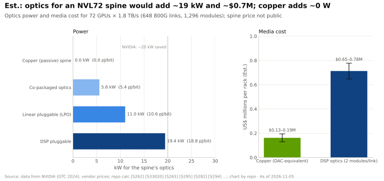
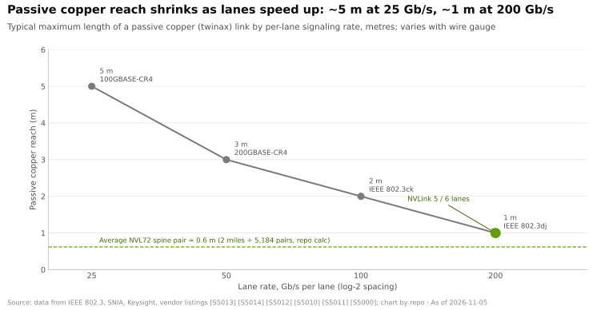
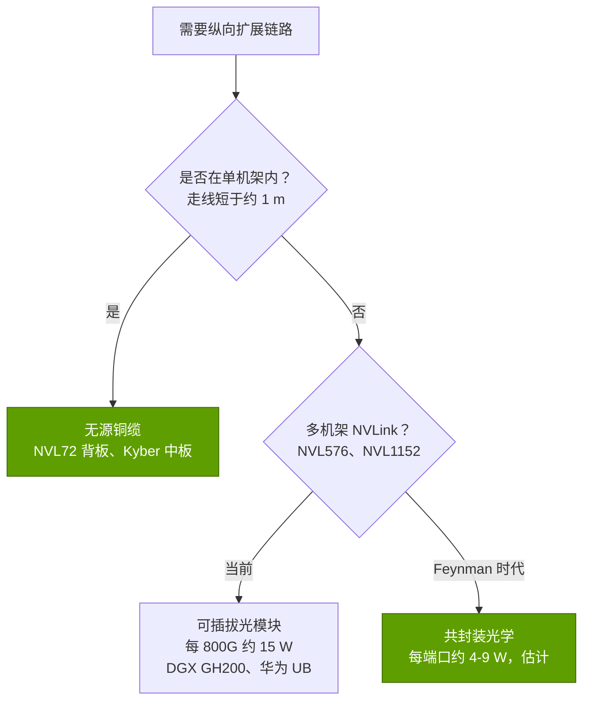

# 铜缆背板：为何铜缆在机架内胜出（就目前而言）

> [!NOTE]
> 本页为英文原文的简体中文参考译文，仅供参考；如有出入，以[英文原文](../../../layers/05-scale-up-nvlink-nvswitch/copper-spines-and-why-copper-wins.md "English original")为准。

第 05 层 · 纵向扩展（NVLink、NVSwitch）· 约 9 分钟阅读 · 最后核实：2026-11-05

## ⚡ 要点速览

- **[NVL72](../../../glossary.md#nvl72) 的骨干是铜缆：** 约 5,000 根 [NVLink](../../../glossary.md#nvlink) 线缆、总长约 2 英里，将 72 颗 GPU 连接到 18 颗交换芯片 [[S5000]](../../../sources/bibliography.md#s5000)[[S5001]](../../../sources/bibliography.md#s5001)；按链路算术推得 5,184 对线（本资料库计算）。
- **铜缆每机架节省约 19 kW 功耗和约 $0.5M 成本（估计）。** 若用 800G 光模块实现 130 TB/s，需约 1,300 个模块：功耗约 19 kW，与英伟达宣称的约 20 kW 相符，约占约 120 kW 机架功耗的 16% [[S5000]](../../../sources/bibliography.md#s5000)[[S295]](../../../sources/bibliography.md#s295)[[S336]](../../../sources/bibliography.md#s336)；成本约 $0.65–0.78M，而按 DAC 定价的铜缆约为 $0.13–0.19M [[S5016]](../../../sources/bibliography.md#s5016)[[S5015]](../../../sources/bibliography.md#s5015)。
- **可靠性：** 无源铜缆没有激光器或 DSP；英伟达自己在推销共封装光学时，也称其可靠性是可插拔光模块的 10 倍 [[S265]](../../../sources/bibliography.md#s265)。
- **问题在于传输距离。** 在每通道 200 Gb/s 下，无源铜缆传输距离约 1 m [[S5010]](../../../sources/bibliography.md#s5010)，因此铜缆[纵向扩展（scale-up）](../../../glossary.md#scale-up)域止于机架；Kyber 为 144 颗 GPU 改用印刷电路板[中板（midplane）](../../../glossary.md#midplane) [[S510]](../../../sources/bibliography.md#s510)。
- **下一步光学将进入机架：** 英伟达 Feynman 时代的 Kyber NVL1152 将铜缆与[共封装光学（CPO）](../../../glossary.md#co-packaged-optics)结合 🟢 [[S109]](../../../sources/bibliography.md#s109)[[S108]](../../../sources/bibliography.md#s108)；华为已运行全光互连的 384 NPU 域，功耗约为 NVL72 的 3.9 倍 [[S340]](../../../sources/bibliography.md#s340)。

## 1. 铜缆背板是什么

[NVLink 铜缆背板（spine）](../../../glossary.md#nvlink-spine)是机架后部由线缆盒组成的一整面双轴（twin-axial）铜缆墙。计算托盘与[交换托盘](../../../glossary.md#nvlink-switch-tray)通过[盲插连接器](../../../glossary.md#blind-mate-connector)插入其中，因此无需有人手动插接 5,000 根线缆 [[S5007]](../../../sources/bibliography.md#s5007)；英伟达已将该机架设计贡献给开放计算项目（OCP）[[S5001]](../../../sources/bibliography.md#s5001)。Vera Rubin NVL72 沿用这一 [Oberon](../../../glossary.md#oberon) 机架，并让每对线双向传输，在相同铜缆上实现带宽翻倍 [[S203]](../../../sources/bibliography.md#s203)。

> [!TIP]
> **算例 —— 核验“5,000 根线缆、2 英里”。** 18 条 NVLink 5 链路 × 2 条通道 × 2 个方向 = 每 GPU 72 对线；× 72 颗 GPU = **5,184 对** [[S263]](../../../sources/bibliography.md#s263)[[S262]](../../../sources/bibliography.md#s262)，与公布的约 5,000 根线缆接近 [[S5000]](../../../sources/bibliography.md#s5000)。2 英里 ≈ 3,219 m ÷ 5,184 ≈ **每对 0.62 m**。**结论：** 背板之所以可行，是因为几乎每段走线都短于 200 Gb/s 铜缆约 1 m 的传输距离 [[S5010]](../../../sources/bibliography.md#s5010)——这是单个机架的特性，而非一整排机架。

## 2. 铜缆为何胜出：功耗、成本与可靠性

光学器件需在每条链路的两端把电信号转换为光信号、再转换回来；基于 DSP 的 800G 模块为此消耗约 15 W，而无源铜缆由芯片的 [SerDes](../../../glossary.md#serdes) 直接驱动 [[S295]](../../../sources/bibliography.md#s295)[[S262]](../../../sources/bibliography.md#s262)。

| 介质 | 能耗（[pJ/bit](../../../glossary.md#picojoules-per-bit)） | 传输距离 | 每条 800G 链路价格（估计） | 故障点 | 机架内评价 |
|---|---|---|---|---|---|
| 无源铜缆（[DAC](../../../glossary.md#direct-attach-copper)） | 额外约 0 [[S262]](../../../sources/bibliography.md#s262) | 约 1 m [[S5010]](../../../sources/bibliography.md#s5010) | 约 $200–300 [[S5015]](../../../sources/bibliography.md#s5015) | 连接器 | 🟩 最便宜 |
| [线性可插拔光模块](../../../glossary.md#linear-pluggable-optics) | 约 10.6 [[S295]](../../../sources/bibliography.md#s295) | 数十米 | 不适用 | 激光器 | 🟨 折中 |
| DSP 可插拔光模块 | 约 18.8 [[S295]](../../../sources/bibliography.md#s295)[[S282]](../../../sources/bibliography.md#s282) | 公里级 | 约 $1,000–1,200 [[S5016]](../../../sources/bibliography.md#s5016) | 激光器、DSP | 🟥 功耗与成本 |
| 共封装光学 | 约 5.4 [[S265]](../../../sources/bibliography.md#s265) | 公里级 | 未公开 | 激光器 | 🟦 用于机架之外 |

> [!TIP]
> **算例 —— 为光学 NVL72 背板估价。** 72 颗 GPU × 单向 900 GB/s = 518 Tb/s = **648 条 800G 链路**，需要 **1,296 个模块** [[S200]](../../../sources/bibliography.md#s200)[[S262]](../../../sources/bibliography.md#s262)。功耗：1,296 × 15 W = **19.4 kW**，约占约 120 kW 机架的 16% [[S295]](../../../sources/bibliography.md#s295)[[S336]](../../../sources/bibliography.md#s336)。成本：1,296 × $500–600 = **$0.65–0.78M**，约占一台估计约 $3.0M 的 GB200 NVL72 的 22–26%，而按 DAC 定价的铜缆约为 $0.13–0.19M [[S5016]](../../../sources/bibliography.md#s5016)[[S5015]](../../../sources/bibliography.md#s5015)[[S326]](../../../sources/bibliography.md#s326)。**结论：** 铜缆约节省机架六分之一的功耗，以及或许五分之一的价格（估计；实际背板为定制设计）。

🔧 技术细节：是什么限制了铜缆

- **损耗随频率上升：** 通道越快，同一根线缆的衰减越大；而 [PAM4](../../../glossary.md#pam4) 的四个电平留给噪声的余量更小。
- **补救措施要耗电：** 重定时器（retimer）和有源电缆（AEC）可将传输距离延长到数米，但代价是额外的功耗与延迟。
- **双向信号传输**在不提高符号速率的情况下，使每对线的吞吐量翻倍 [[S203]](../../../sources/bibliography.md#s203)。

## 3. 传输距离：约一米处的墙

通道速率每翻一倍，无源铜缆的传输距离就随之缩短：25 Gb/s 约 5 m，50 约 3 m，100 约 2 m，200 约 1 m [[S5013]](../../../sources/bibliography.md#s5013)[[S5014]](../../../sources/bibliography.md#s5014)[[S5012]](../../../sources/bibliography.md#s5012)[[S5010]](../../../sources/bibliography.md#s5010)。一个机架高约两米，因此 200G 铜缆恰好够用。

> [!TIP]
> **算例 —— Rubin 为何没有改用 400G 通道。** 如果每通道 400 Gb/s 时传输距离再减半，将约为 0.5 m（🔴 外推），低于背板约 0.62 m 的平均走线长度（本资料库据 [[S5000]](../../../sources/bibliography.md#s5000) 计算）。Rubin 保持约 200 Gb/s 的信号速率，并在每对线上双向传输：发布时在同样的 5,184 对线上实现每 GPU 3.6 TB/s [[S203]](../../../sources/bibliography.md#s203)[[S33004]](../../../sources/bibliography.md#s33004)。Kyber 则以较短的中板走线取代线缆 [[S510]](../../../sources/bibliography.md#s510)[[S211]](../../../sources/bibliography.md#s211)。**结论：** 英伟达已两度通过工程手段绕开铜缆的距离限制；第三步则需要光学。

## 4. 光学何时进入机架

英伟达的 256 GPU DGX GH200 采用光学 NVLink，但部署有限 [[S205]](../../../sources/bibliography.md#s205)[[S200]](../../../sources/bibliography.md#s200)；其路线图在 Feynman 的多机架 Kyber NVL1152 上重新引入光学 🟢 [[S109]](../../../sources/bibliography.md#s109)[[S108]](../../../sources/bibliography.md#s108)。华为 CloudMatrix 384 以全光互连连接 384 颗 NPU，功耗约 559 kW，约为 NVL72（约 145 kW）的 3.9 倍，而稠密 [BF16](../../../glossary.md#bf16) 算力约为其 1.7 倍 [[S340]](../../../sources/bibliography.md#s340)[[S121]](../../../sources/bibliography.md#s121)。

> [!TIP]
> **算例 —— 576 GPU NVLink 域的光学开销。** 一颗 Rubin Ultra 级 GPU 单向传输 14.4 Tb/s [[S210]](../../../sources/bibliography.md#s210)，即每端需 18 个 800G 端口。DSP 可插拔光模块：36 × 15 W = **每 GPU 540 W**（576 颗约 311 kW）；CPO 按每 800G 当量约 4.3 W 计：**约 155 W**（约 89 kW）[[S295]](../../../sources/bibliography.md#s295)[[S265]](../../../sources/bibliography.md#s265)（估计）。相对于每个封装约 4.2 kW（600 kW ÷ 144）[[S305]](../../../sources/bibliography.md#s305)，开销分别约为 13% 与约 4%。**结论：** 共封装光学让多机架 NVLink 在经济上可行；在其大规模出货之前，域规模仍由铜缆决定。

## 🎯 企业发展视角

1. **铜缆同样是一条供应链。** 线缆盒、连接器和机架机构件随每台 NVL72 的出货而增长（见[价值链与企业发展](value-chain-and-corp-dev.md)）。
2. **CPO 转型是关键变量。** 英伟达的 CPO 合作伙伴包括台积电（TSMC）、Coherent、康宁（Corning）、富士康、Lumentum 和 SENKO [[S90049]](../../../sources/bibliography.md#s90049)；据报道，光 I/O 初创公司 Ayar Labs 与 Lightmatter 已加入 [NVLink Fusion](../../../glossary.md#nvlink-fusion) 🟡 [[S5022]](../../../sources/bibliography.md#s5022)。当纵向扩展转向光学时，英伟达未能留在其交换芯片中的价值，将由其中哪家获取？
3. **传输距离决定域规模。** 宣称可支持 1,024 设备 pod 的竞争方案（[UALink](../../../glossary.md#ualink) 1.0 [[S573]](../../../sources/bibliography.md#s573)），在单机架之外必须承担光学溢价（见[竞争格局](competition.md)）。
4. **高通问题（仅基于公开信息）：** 对于每卡配备 768 GB [LPDDR](../../../glossary.md#lpddr) 的推理机架 [[S90028]](../../../sources/bibliography.md#s90028)，纯铜缆的单机架域目前是否已经足够？

## 📚 来源（Sources）

<!-- Auto-generated from the [S…] citations on this page by `make build`. Edit sources/registry/*.csv, not this list. -->

- [**S108**](../../../sources/bibliography.md#s108) HPCwire / AIwire, *Huang Shares Nvidia Roadmap Showing More Chips, NVL1152, Scale-Up CPO*, 2026-03-18. [Link](https://www.hpcwire.com/aiwire/2026/03/18/huang-shares-nvidia-roadmap-showing-more-chips-nvl1152-scale-up-cpo/)
- [**S109**](../../../sources/bibliography.md#s109) NVIDIA Blog, *NVIDIA GTC 2026: Live Updates on What's Next in AI*, 2026-03-16. [Link](https://blogs.nvidia.com/blog/gtc-2026-news/)
- [**S121**](../../../sources/bibliography.md#s121) NVIDIA, *NVIDIA GB200 NVL72*, 2024-03. [Link](https://www.nvidia.com/en-us/data-center/gb200-nvl72/)
- [**S200**](../../../sources/bibliography.md#s200) NVIDIA, *NVIDIA NVLink and NVLink Switch (product page with NVLink and NVLink Switch specification tables)*, 2026-09. [Link](https://www.nvidia.com/en-us/data-center/nvlink/)
- [**S203**](../../../sources/bibliography.md#s203) SemiAnalysis, *Vera Rubin - Extreme Co-Design: An Evolution*, 2026-01. [Link](https://newsletter.semianalysis.com/p/vera-rubin-extreme-co-design-an-evolution)
- [**S205**](../../../sources/bibliography.md#s205) NVIDIA Technical Blog, *Upgrading Multi-GPU Interconnectivity with the Third-Generation NVIDIA NVSwitch*, 2022-08. [Link](https://developer.nvidia.com/blog/upgrading-multi-gpu-interconnectivity-with-the-third-generation-nvidia-nvswitch/)
- [**S210**](../../../sources/bibliography.md#s210) SemiAnalysis, *Nvidia - GTC 2026: The Inference Kingdom Expands*, 2026-03. [Link](https://newsletter.semianalysis.com/p/nvidia-the-inference-kingdom-expands)
- [**S211**](../../../sources/bibliography.md#s211) glennklockwood.com (Glenn K. Lockwood), *GTC 2026 recap*, 2026-03. [Link](https://blog.glennklockwood.com/2026/03/gtc-2026-recap.html)
- [**S262**](../../../sources/bibliography.md#s262) NVIDIA, *NVIDIA GB200 NVL72 (product page)*, 2024. [Link](https://www.nvidia.com/en-us/data-center/gb200-nvl72/)
- [**S263**](../../../sources/bibliography.md#s263) NVIDIA, *NVIDIA Blackwell Architecture Technical Brief*, 2024-03. [Link](https://resources.nvidia.com/en-us-blackwell-architecture)
- [**S265**](../../../sources/bibliography.md#s265) NVIDIA Newsroom, *NVIDIA Announces Spectrum-X Photonics, Co-Packaged Optics Networking Switches to Scale AI Factories to Millions of GPUs*, 2025-03-18. [Link](https://nvidianews.nvidia.com/news/nvidia-spectrum-x-co-packaged-optics-networking-switches-ai-factories)
- [**S282**](../../../sources/bibliography.md#s282) Broadcom, *Broadcom delivers industry's first 51.2-Tbps co-packaged optics Ethernet switch platform (Bailly)*, 2024-03. [Link](https://investors.broadcom.com/news-releases)
- [**S295**](../../../sources/bibliography.md#s295) LPO MSA, *Linear Pluggable Optics Multi-Source Agreement (LPO MSA)*, 2024. [Link](https://www.lpo-msa.org/)
- [**S305**](../../../sources/bibliography.md#s305) DatacenterDynamics, *Nvidia's Rubin Ultra NVL576 rack expected to be 600kW, coming second half of 2027*, 2025-03-19. [Link](https://datacenterdynamics.com/en/news/nvidias-rubin-ultra-nvl576-rack-expected-to-be-600kw-coming-second-half-of-2027)
- [**S326**](../../../sources/bibliography.md#s326) TweakTown, *NVIDIA's new GB200 Superchip costs up to $70,000: full B200 NVL72 AI server costs $3 million*, 2024-05. [Link](https://www.tweaktown.com/news/98292/nvidias-new-gb200-superchip-costs-up-to-70-000-full-b200-nvl72-ai-server-3-million/index.html)
- [**S336**](../../../sources/bibliography.md#s336) eeNews Europe, *Nvidia offers 120kW liquid-cooled Blackwell rack as industry standard*, 2024-10. [Link](https://www.eenewseurope.com/en/nvidia-offers-120kw-liquid-cooled-blackwell-rack-as-industry-standard)
- [**S340**](../../../sources/bibliography.md#s340) SemiAnalysis (Dylan Patel et al.), *Huawei AI CloudMatrix 384 - China's answer to Nvidia GB200 NVL72*, 2025-04-16. [Link](https://newsletter.semianalysis.com/p/huawei-ai-cloudmatrix-384-chinas-answer-to-nvidia-gb200-nvl72)
- [**S510**](../../../sources/bibliography.md#s510) KGI Securities, *NVIDIA GTC 2026 (research note)*, 2026-03-19. [Link](https://www.kgi.com.hk/zh-hk/-/media/files/kgishk/research-reports/tw-reports/nvidia-gtc-2026_19032026e.pdf)
- [**S573**](../../../sources/bibliography.md#s573) Business Wire, *UALink Consortium Releases the Ultra Accelerator Link 200G 1.0 Specification*, 2025-04-08. [Link](https://www.businesswire.com/news/home/20250408050548/en/UALink-Consortium-Releases-the-Ultra-Accelerator-Link-200G-1.0-Specification)
- [**S5000**](../../../sources/bibliography.md#s5000) SemiAnalysis, *Nvidia's Optical Boogeyman - NVL72, InfiniBand Scale Out, 800G & 1.6T Ramp*, 2024-03. [Link](https://newsletter.semianalysis.com/p/nvidias-optical-boogeyman-nvl72-infiniband)
- [**S5001**](../../../sources/bibliography.md#s5001) SiliconANGLE, *Nvidia aims to boost Blackwell by donating platform design to the Open Compute Project*, 2024-10-15. [Link](https://siliconangle.com/2024/10/15/nvidia-aims-boost-blackwell-donating-platform-design-open-compute-project)
- [**S5007**](../../../sources/bibliography.md#s5007) NVIDIA Docs, *DGX SuperPOD reference architecture (GB200): key components of the DGX SuperPOD*, 2025. [Link](https://docs.nvidia.com/dgx-superpod/reference-architecture-scalable-infrastructure-gb200/latest/dgx-superpod-components.html)
- [**S5010**](../../../sources/bibliography.md#s5010) IEEE 802.3, *IEEE P802.3dj adopted objectives (200 Gb/s per lane electrical and optical signaling)*, 2024-03-14. [Link](https://grouper.ieee.org/groups/802/3/dj/projdoc/objectives_P802d3dj_240314.pdf)
- [**S5012**](../../../sources/bibliography.md#s5012) SNIA, *Cabling, Connectors and Transceivers Questions Answered*, 2021. [Link](https://www.snia.org/blog/2021/cabling-connectors-and-transceivers-questions-answered)
- [**S5013**](../../../sources/bibliography.md#s5013) Edgeoptic, *DAC cables (product page: passive 100G QSFP28 0.5-5 m)*, 2026. [Link](https://edgeoptic.com/product/dac/)
- [**S5014**](../../../sources/bibliography.md#s5014) XSNet, *Cisco QSFP-200-CU3M 200G QSFP56 DAC (200GBASE-CR4 passive copper 3 m) listing*, 2026. [Link](https://www.xsnet.com.au/products/cisco-qsfp-200-cu3m-200g-qsfp56-dac-200gbase-cr4-passive-copper-3-m-qsfp56-to-qsfp56)
- [**S5015**](../../../sources/bibliography.md#s5015) FiberMall, *QSFP-DD price guide 2026*, 2026. [Link](https://www.fibermall.com/blog/qsfp-dd-price-guide-2026.htm)
- [**S5016**](../../../sources/bibliography.md#s5016) Fundamental Bottom (Substack), *Optical module industry (long AAOI note)*, 2025. [Link](https://fundamentalbottom.substack.com/p/longaaoi-optical-module-industry)
- [**S5022**](../../../sources/bibliography.md#s5022) Independent tracker (vercel.app), *Co-packaged optics joins NVLink Fusion: Ayar Labs and Lightmatter (June 2026)*, 2026-06-08. [Link](https://site-one-liart-13.vercel.app/en/infra-ip/co-packaged-optics-nvlink-fusion-ayar-labs-lightmatter-june-2026)
- [**S33004**](../../../sources/bibliography.md#s33004) NVIDIA Newsroom, *NVIDIA Kicks Off the Next Generation of AI With Rubin — Six New Chips; One Incredible AI Supercomputer*, 2026-01-05. [Link](https://nvidianews.nvidia.com/news/rubin-platform-ai-supercomputer)
- [**S90028**](../../../sources/bibliography.md#s90028) TechRepublic, *Qualcomm unveils AI chips to rival Nvidia, AMD*, 2025-10-27. [Link](https://techrepublic.com/article/news-qualcomm-unveils-ai-chips-to-rival-nvidia-amd)
- [**S90049**](../../../sources/bibliography.md#s90049) Tom's Hardware, *Nvidia outlines plans for using light for communication between AI GPUs by 2026*, 2025-03. [Link](https://www.tomshardware.com/networking/nvidia-outlines-plans-for-using-light-for-communication-between-ai-gpus-by-2026-silicon-photonics-and-co-packaged-optics-may-become-mandatory-for-next-gen-ai-data-centers)
