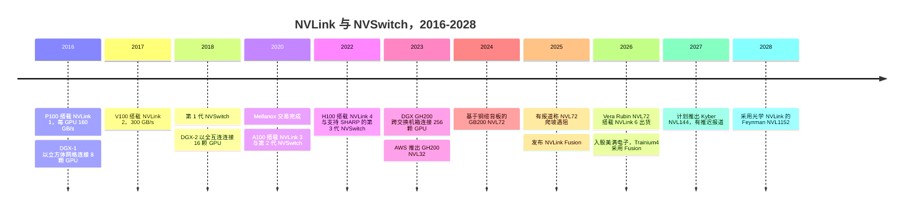
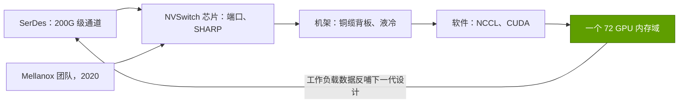

# 纵向扩展（NVLink、NVSwitch）：发展历程与英伟达的构建之道

> [!NOTE]
> 本页为英文原文的简体中文参考译文，仅供参考；如有出入，以[英文原文](../../../layers/05-scale-up-nvlink-nvswitch/history-and-how-built.md "English original")为准。

第 05 层 · 纵向扩展（NVLink、NVSwitch）· 约 11 分钟阅读 · 最后核实：2026-11-05

## ⚡ 要点速览

- **十年复利：** 2016 年，[NVLink](../../../glossary.md#nvlink) 1 为每颗 P100 提供 160 GB/s；2026 年，NVLink 6 为每颗 Rubin 提供 3.0 TB/s，约为前者的 19 倍 [[S259]](../../../sources/bibliography.md#s259)[[S200]](../../../sources/bibliography.md#s200)。
- **两个拐点：** NVSwitch 芯片（DGX-2，2018 年）创造了 16 GPU 的交换式域 [[S206]](../../../sources/bibliography.md#s206)。采用铜缆背板的 GB200 [NVL72](../../../glossary.md#nvl72)（2024 年）在不使用光学器件的情况下，把域扩展到 72 GPU 的整个机架 [[S396]](../../../sources/bibliography.md#s396)[[S5517]](../../../sources/bibliography.md#s5517)。
- **Mellanox（$6.9B，2020 年 4 月完成交割）提供了网络基因。** 网络业务在 FY2026 突破 $31B，NVLink 交换芯片是第四季度的主要增长驱动力 [[S464]](../../../sources/bibliography.md#s464)[[S5514]](../../../sources/bibliography.md#s5514)[[S402]](../../../sources/bibliography.md#s402)。
- **机架级押注先遭挫折、后获回报：** 据报道，早期 NVL72 机架出现过热和链路故障，[超大规模云厂商](../../../glossary.md#hyperscaler)曾削减订单（2025 年 1 月）🟡 [[S5500]](../../../sources/bibliography.md#s5500)[[S5501]](../../../sources/bibliography.md#s5501)。
- **[Q4 · 优势来源]** 优势来自协同设计，而非任何单一部件：[SerDes](../../../glossary.md#serdes)、交换芯片、机架机构设计与集合通信软件每年同步迭代 [[S203]](../../../sources/bibliography.md#s203)[[S332]](../../../sources/bibliography.md#s332)。
- **[Q6 · 复制成本]** 即便是一个拥有 65 家成员的联盟，从成立（2024 年 5 月）到推出产品（2027 年）也需约 3 年。本资料库估计，要追平 NVLink 需要 4–5 年、$3–6B 和约 1,000 名专业工程师 🔴 [[S5519]](../../../sources/bibliography.md#s5519)[[S90051]](../../../sources/bibliography.md#s90051)[[S5521]](../../../sources/bibliography.md#s5521)。

## 从更快的连线到机架大小的 GPU

NVLink 起初只是一条更快的连线：2016 年，[PCIe](../../../glossary.md#pcie) 3.0 只能为 GPU 提供约 32 GB/s，于是英伟达打造了 160 GB/s 的链路，并以立方体网格连接八颗 GPU [[S259]](../../../sources/bibliography.md#s259)[[S222]](../../../sources/bibliography.md#s222)。随后出现了交换芯片：第一代 [NVSwitch](../../../glossary.md#nvswitch) 有 18 个端口，十二颗芯片让 DGX-2 中的 16 颗 V100 一跳即可互访 [[S206]](../../../sources/bibliography.md#s206)。在随后五代中，通道速率从 20 Gb/s 提升至 200 Gb/s [[S259]](../../../sources/bibliography.md#s259)[[S200]](../../../sources/bibliography.md#s200)。2022 年的交换芯片加入了 [SHARP](../../../glossary.md#sharp)，在交换芯片内部而非 GPU 上完成梯度求和 [[S205]](../../../sources/bibliography.md#s205)。2023 年的 DGX GH200 跨多个交换机箱，把 NVLink 扩展到 256 颗 GPU [[S205]](../../../sources/bibliography.md#s205)；下一代则以单个铜缆机架取代了这一方案。AWS 是首家提供 32 GPU GH200 NVL32 的云厂商 [[S5525]](../../../sources/bibliography.md#s5525)[[S5526]](../../../sources/bibliography.md#s5526)。

决定性的一步是 GB200 NVL72（2024 年）：72 颗 GPU 置于一个机架内，由约 5,184 根铜缆连接，铜缆总长超过两英里 [[S5517]](../../../sources/bibliography.md#s5517)[[S5516]](../../../sources/bibliography.md#s5516)；英伟达称，不用光学器件使每个机架节省约 20 kW [[S5515]](../../../sources/bibliography.md#s5515)。代价是机械与散热风险：据报道，2025 年 1 月，在英伟达修改设计期间，微软（Microsoft）、AWS、谷歌（Google）和 Meta 削减了部分订单 🟡 [[S5500]](../../../sources/bibliography.md#s5500)[[S5501]](../../../sources/bibliography.md#s5501)。黄仁勋否认了过热的报道 [[S5501]](../../../sources/bibliography.md#s5501)。

> [!TIP]
> **算例 —— 第一个交换式域的代价。** DGX-1（8 × P100，立方体网格）标价 $129,000，约合每 GPU $16,100 [[S310]](../../../sources/bibliography.md#s310)。DGX-2（16 × V100，经 12 颗 NVSwitch 连接）标价 $399,000，约合每 GPU $24,900 [[S314]](../../../sources/bibliography.md#s314)[[S206]](../../../sources/bibliography.md#s206)。客户为更新一代的 GPU、两倍的域规模和一跳全互连，每 GPU 多付了约 55%：这是[纵向扩展（scale-up）](../../../glossary.md#scale-up)具有价格溢价的早期证据。

| 时间 | 决策 | 为何重要 | 来源 |
|---|---|---|---|
| 2016 | 自研 GPU 链路，而非等待 PCIe 4.0 | 每 GPU 160 GB/s vs 约 32 GB/s | [[S259]](../../../sources/bibliography.md#s259)[[S222]](../../../sources/bibliography.md#s222) |
| 2018 | 打造交换芯片 | 首个全互连域（16 颗 GPU） | [[S206]](../../../sources/bibliography.md#s206) |
| 2019–20 | 以 $6.9B 收购 Mellanox | 获得交换芯片、SerDes 与网内计算团队 | [[S464]](../../../sources/bibliography.md#s464) |
| 2024 | 单机架内采用铜缆背板 | 72 GPU 域，免去约 20 kW 的光学器件 | [[S5515]](../../../sources/bibliography.md#s5515)[[S5517]](../../../sources/bibliography.md#s5517) |
| 2025 | 通过 Fusion 开放 NVLink | 把定制芯片留在英伟达的互连网络内 | [[S217]](../../../sources/bibliography.md#s217)[[S518]](../../../sources/bibliography.md#s518) |
| 2026 | 每机架交换芯片翻倍（18 → 36） | 实现 NVLink 6 带宽；公布的规格后来下调至 3.0 TB/s | [[S332]](../../../sources/bibliography.md#s332)[[S201]](../../../sources/bibliography.md#s201) |

## 优势来源：协同设计

**[Q4 · 优势来源]** 领先地位无法归因于任何单一部件；由同一家公司掌控的四个层面每年同步迭代：

竞争对手必须同时在四个层面追平：如果 SerDes、线缆传输距离和集合通信库（[NCCL](../../../glossary.md#nccl)）是为别的方案调优的，那么一颗商用交换芯片也无济于事。英伟达甚至把 GB200 NVL72 机架设计贡献给了开放计算项目（OCP），让 ODM 按其蓝图生产 [[S336]](../../../sources/bibliography.md#s336)。

> [!TIP]
> **算例 —— 解读 Rubin 交换芯片的算术。** 每颗 NVLink 6 交换芯片单向传输 28.8 Tb/s [[S203]](../../../sources/bibliography.md#s203)。一个 Vera Rubin 机架有 36 颗，而 GB300 为 18 颗 [[S332]](../../../sources/bibliography.md#s332)：36 × 28.8 = 1,037 Tb/s ≈ 单向 130 TB/s ≈ 双向 259 TB/s。这等于 72 × 3.6 TB/s，即发布时的规格。量产规格为 216 TB/s（每 GPU 3.0 TB/s），约为交换芯片承载能力的 83% [[S200]](../../../sources/bibliography.md#s200)[[S201]](../../../sources/bibliography.md#s201)。英伟达未解释这一差距 🔴。

🔧 技术细节：NVLink 6 如何在不提高通道速率的情况下让带宽翻倍

NVLink 5 交换芯片有 72 个端口 [[S207]](../../../sources/bibliography.md#s207)。NVLink 6 交换芯片保持相同的单向 28.8 Tb/s，但端口数减半，每个端口的 SerDes 在单对线上同时双向传输约 200 Gb/s [[S203]](../../../sources/bibliography.md#s203)。GPU 的链路数翻倍（36 vs 18），连接到翻倍数量的交换芯片。单对线上的双向信号传输需要回波消除，这是高难度的模拟电路设计。这也是最稀缺的资产是 SerDes 团队、而非交换逻辑的原因之一。

## 复制成本

**[Q6 · 复制成本]** [UALink](../../../glossary.md#ualink) 是最好的自然实验：AMD、博通（Broadcom）、思科（Cisco）、谷歌、慧与（HPE）、英特尔（Intel）、Meta 和微软于 2024 年 5 月成立该联盟 [[S5519]](../../../sources/bibliography.md#s5519)，于 2025 年 4 月和 2026 年 4 月发布规范，预计 2027 年推出产品 🟡 [[S573]](../../../sources/bibliography.md#s573)[[S574]](../../../sources/bibliography.md#s574)[[S90051]](../../../sources/bibliography.md#s90051)，成员已超过 65 家 [[S5521]](../../../sources/bibliography.md#s5521)。交易为各个部件标出了价格：Upscale AI 为一颗 UALink 交换芯片融资 $200M [[S5506]](../../../sources/bibliography.md#s5506)；高通为 Alphawave 的 SerDes IP 支付约 $2.4B [[S4514]](../../../sources/bibliography.md#s4514)；AMD 以 $4.9B 收购 ZT Systems（2024 年 8 月），保留其机架设计团队，并以最高约 $3B 将制造业务转售给 Sanmina [[S5527]](../../../sources/bibliography.md#s5527)；Helios 大约两年后出货 [[S90020]](../../../sources/bibliography.md#s90020)。

| 构建模块 | 竞争对手的最快路径 | 时间 | 金额（依据） | 人才 |
|---|---|---|---|---|
| 200G 级 SerDes | 授权（新思科技、楷登电子）或收购 | 1–2 年 | 最高约 $2.4B（Alphawave）[[S4514]](../../../sources/bibliography.md#s4514) | 模拟 / 混合信号，最稀缺 |
| 交换 ASIC | 目前用商用以太网芯片；2027 年起可用 UALink | 2–3 年 | 每代约 $0.2–0.6B [[S5506]](../../../sources/bibliography.md#s5506)[[S2501]](../../../sources/bibliography.md#s2501) | 数字设计、验证 |
| 机架集成 | 收购团队，与 ODM 合作 | 约 2 年 + 爬坡期 | ZT Systems 总价 $4.9B，扣除出售给 Sanmina 的部分后净额约 $2–2.7B [[S5527]](../../../sources/bibliography.md#s5527) | 机构设计、信号完整性、散热 |
| 集合通信软件 | 开源库加自有软件栈 | 达到生产级水平需 3 年以上 | 持续性运营开支 | 系统软件 |

**估计 🔴（本资料库）：** 一家资金充裕的新进入者，需要 **4–5 年、$3–6B 和大约 1,000 名专业工程师**，才能推出一个具备成熟软件、有竞争力的 72 个以上加速器的交换式域：这是上表各区间之和，以 UALink 的约 3 年为下限，每个模块的团队规模在一两百人量级。购买商用交换芯片（AMD 的路线）可将时间缩短至约 2 年，但要让出交换芯片的利润。

> [!TIP]
> **算例 —— 时间差。** 英伟达从发布 GB200 NVL72（2024 年 3 月）到首批量产出货（2024 年底）约用 8 个月 [[S396]](../../../sources/bibliography.md#s396)[[S121]](../../../sources/bibliography.md#s121)。UALink 从成立到预期推出产品约需 37 个月 [[S5519]](../../../sources/bibliography.md#s5519)[[S90051]](../../../sources/bibliography.md#s90051)。即使 UALink 按时出货，届时英伟达也已出货 NVLink 5 和 6，并正在推出 NVLink 7。

## 反事实推演 —— 假如英伟达没有……

- **🔴 ……自研 NVLink，而是采用 PCIe/CXL 标准？** PCIe 6.0 x16 每 GPU 约 256 GB/s，而 NVLink 6 为 3,000 GB/s，差距约 12 倍 [[S222]](../../../sources/bibliography.md#s222)[[S200]](../../../sources/bibliography.md#s200)。混合专家模型推理将受限于网卡，GPU 会沦为一张商品化的板卡，英伟达的网络业务（Q4 FY2026 约 $11B）也会小得多 [[S402]](../../../sources/bibliography.md#s402)。
- **🔴 ……保持 NVLink 封闭（没有 Fusion）？** AWS 很可能会扩展 NeuronLink，或为 Trainium4 选择 UALink，超大规模云厂商也会更早地向 UALink 靠拢。Fusion 让英伟达的交换托盘得以留在围绕他人芯片构建的机架中 [[S518]](../../../sources/bibliography.md#s518)[[S217]](../../../sources/bibliography.md#s217)。
- **🔴 ……在 2024 年就在机架内采用光学？** 英伟达称，背板光模块每机架将耗电约 20 kW，还会增加成本与故障点 [[S5515]](../../../sources/bibliography.md#s5515)。铜缆让 NVL72 在成本上可承受，但也把域限制在单个机架内，这正是 Feynman 的 NVL1152 要加入光学的原因 [[S108]](../../../sources/bibliography.md#s108)。

## 🎯 企业发展视角

1. 最稀缺的资产是高速 SerDes 人才。在高通收购 Alphawave 之后，还剩下哪些独立的 SerDes 团队？还有谁在竞购 [[S4513]](../../../sources/bibliography.md#s4513)？
2. AMD 选择收购机架设计团队（ZT Systems），而非自建 [[S5527]](../../../sources/bibliography.md#s5527)。机架级集成如今是可以买到的能力，还是需要英伟达式的年度迭代节奏才能保持领先？
3. 当 Fusion 合作伙伴的加速器依赖英伟达的交换托盘时，它在路线图控制权和定价上要放弃什么 [[S518]](../../../sources/bibliography.md#s518)？
4. 如今的纵向扩展领先优势，有多少可以追溯到 $6.9B 的 Mellanox 交易（[CS1](../../../case-studies/CS1-mellanox-the-best-deal.md)）[[S464]](../../../sources/bibliography.md#s464)？

## 📚 来源（Sources）

<!-- Auto-generated from the [S…] citations on this page by `make build`. Edit sources/registry/*.csv, not this list. -->

- [**S108**](../../../sources/bibliography.md#s108) HPCwire / AIwire, *Huang Shares Nvidia Roadmap Showing More Chips, NVL1152, Scale-Up CPO*, 2026-03-18. [Link](https://www.hpcwire.com/aiwire/2026/03/18/huang-shares-nvidia-roadmap-showing-more-chips-nvl1152-scale-up-cpo/)
- [**S121**](../../../sources/bibliography.md#s121) NVIDIA, *NVIDIA GB200 NVL72*, 2024-03. [Link](https://www.nvidia.com/en-us/data-center/gb200-nvl72/)
- [**S200**](../../../sources/bibliography.md#s200) NVIDIA, *NVIDIA NVLink and NVLink Switch (product page with NVLink and NVLink Switch specification tables)*, 2026-09. [Link](https://www.nvidia.com/en-us/data-center/nvlink/)
- [**S201**](../../../sources/bibliography.md#s201) VideoCardz, *NVIDIA quietly cuts Vera Rubin specs, HBM4 bandwidth and NVLink 6 speeds now lower*, 2026-10. [Link](https://videocardz.com/newz/nvidia-quietly-cuts-vera-rubin-specs-hbm4-bandwidth-and-nvlink-6-speeds-now-lower)
- [**S203**](../../../sources/bibliography.md#s203) SemiAnalysis, *Vera Rubin - Extreme Co-Design: An Evolution*, 2026-01. [Link](https://newsletter.semianalysis.com/p/vera-rubin-extreme-co-design-an-evolution)
- [**S205**](../../../sources/bibliography.md#s205) NVIDIA Technical Blog, *Upgrading Multi-GPU Interconnectivity with the Third-Generation NVIDIA NVSwitch*, 2022-08. [Link](https://developer.nvidia.com/blog/upgrading-multi-gpu-interconnectivity-with-the-third-generation-nvidia-nvswitch/)
- [**S206**](../../../sources/bibliography.md#s206) Hot Chips / NVIDIA (Alex Ishii; Denis Foley; Eric Anderson; Bill Dally; Glenn Dearth), *NVSwitch and DGX-2 (Hot Chips 30 presentation)*, 2018-08. [Link](https://old.hotchips.org/hc30/2conf/2.01_Nvidia_NVswitch_HotChips2018_DGX2NVS_Final.pdf)
- [**S207**](../../../sources/bibliography.md#s207) glennklockwood.com (Glenn K. Lockwood), *NVLink (digital garden notes)*, 2025. [Link](https://glennklockwood.com/garden/nvlink)
- [**S217**](../../../sources/bibliography.md#s217) NVIDIA via Barchart, *NVIDIA Unveils NVLink Fusion for Industry to Build Semi-Custom AI Infrastructure With NVIDIA Partner Ecosystem (press release, syndicated)*, 2025-05-19. [Link](https://www.barchart.com/story/news/32460751/nvidia-unveils-nvlink-fusion-for-industry-to-build-semi-custom-ai-infrastructure-with-nvidia-partner-ecosystem)
- [**S222**](../../../sources/bibliography.md#s222) Tom's Hardware, *PCI Express roadmap: the path to 1TB/s with PCIe 8.0, the challenges of integration, and beyond*, 2025. [Link](https://www.tomshardware.com/pc-components/motherboards/pci-express-roadmap-the-path-to-1tb-s-with-pci-8-0-the-challenges-of-integration-and-beyond)
- [**S259**](../../../sources/bibliography.md#s259) NVIDIA, *NVIDIA Tesla P100 (Pascal architecture) whitepaper*, 2016. [Link](https://images.nvidia.com/content/pdf/tesla/whitepaper/pascal-architecture-whitepaper.pdf)
- [**S310**](../../../sources/bibliography.md#s310) AnandTech (Ryan Smith), *NVIDIA unveils the DGX-1 HPC server: 8 Teslas, 3U, Q2 2016*, 2016-04-05. [Link](https://www.anandtech.com/show/10229)
- [**S314**](../../../sources/bibliography.md#s314) TweakTown, *NVIDIA's DGX-2: 16 x Tesla V100s, total of 512GB HBM2, $399K*, 2018-03-27. [Link](https://www.tweaktown.com/news/61345/nvidias-dgx-2-16-tesla-v100s-total-512gb-hbm2-399k/index.html)
- [**S332**](../../../sources/bibliography.md#s332) Tiger Brokers (iTiger), *Morgan Stanley's BOM analysis of NVIDIA's Rubin: GPU share declines; PCB, MLCC and ABF substrate values soar*, 2026-05-20. [Link](https://www.itiger.com/news/1188068712)
- [**S336**](../../../sources/bibliography.md#s336) eeNews Europe, *Nvidia offers 120kW liquid-cooled Blackwell rack as industry standard*, 2024-10. [Link](https://www.eenewseurope.com/en/nvidia-offers-120kw-liquid-cooled-blackwell-rack-as-industry-standard)
- [**S396**](../../../sources/bibliography.md#s396) NVIDIA Newsroom, *NVIDIA Blackwell platform arrives to power a new era of computing*, 2024-03-18. [Link](https://nvidianews.nvidia.com/news/nvidia-blackwell-platform-arrives-to-power-a-new-era-of-computing)
- [**S402**](../../../sources/bibliography.md#s402) NVIDIA Corporation via SEC EDGAR (Colette Kress), *CFO Commentary on Fourth Quarter and Fiscal 2026 Results (Form 8-K exhibit 99.2)*, 2026-02-25. [Link](https://www.sec.gov/Archives/edgar/data/1045810/000104581026000019/q4fy26cfocommentary.htm)
- [**S464**](../../../sources/bibliography.md#s464) NVIDIA Newsroom, *NVIDIA to Acquire Mellanox for $6.9 Billion*, 2019-03-11. [Link](https://nvidianews.nvidia.com/news/nvidia-to-acquire-mellanox-for-6-9-billion)
- [**S518**](../../../sources/bibliography.md#s518) ServeTheHome, *NVIDIA NVLink Fusion tapped for future AWS Trainium4 deployments*, 2025-12-02. [Link](https://www.servethehome.com/nvidia-nvlink-fusion-tapped-for-future-aws-trainium4-deployments/)
- [**S573**](../../../sources/bibliography.md#s573) Business Wire, *UALink Consortium Releases the Ultra Accelerator Link 200G 1.0 Specification*, 2025-04-08. [Link](https://www.businesswire.com/news/home/20250408050548/en/UALink-Consortium-Releases-the-Ultra-Accelerator-Link-200G-1.0-Specification)
- [**S574**](../../../sources/bibliography.md#s574) HPCwire, *UALink Consortium Publishes 4 Specifications Defining In-Network Compute, Chiplets, Manageability and 200G Performance*, 2026-04-07. [Link](https://www.hpcwire.com/off-the-wire/ualink-consortium-publishes-4-specifications-defining-in-network-compute-chiplets-manageability-and-200g-performance/)
- [**S2501**](../../../sources/bibliography.md#s2501) Silicon Analysts, *Chip Design & NRE Cost by Node — Historical Time Series Data*, 2026. [Link](https://siliconanalysts.com/market-data/nre-design-cost)
- [**S4513**](../../../sources/bibliography.md#s4513) I-Connect007, *Qualcomm completes acquisition of Alphawave Semi*, 2025-12-18. [Link](https://iconnect007.com/article/148161/qualcomm-completes-acquisition-of-alphawave-semi/148158/ein)
- [**S4514**](../../../sources/bibliography.md#s4514) CRN Asia, *Qualcomm: US$2.4 billion Alphawave Semi buy to boost data center push*, 2025-06. [Link](https://www.crnasia.com/news-network/2025/qualcomm-us-2)
- [**S5500**](../../../sources/bibliography.md#s5500) TrendForce, *NVIDIA GB200 racks reportedly overheat, major clients cut orders*, 2025-01-14. [Link](https://www.trendforce.com/news/2025/01/14/news-nvidia-gb200-racks-reportedly-overheat-major-clients-cut-orders/)
- [**S5501**](../../../sources/bibliography.md#s5501) TechPowerUp, *NVIDIA's GB200 'Blackwell' racks face overheating issues*, 2025-01-14. [Link](https://techpowerup.com/331105/nvidias-gb200-blackwell-racks-face-overheating-issues)
- [**S5506**](../../../sources/bibliography.md#s5506) The Register, *AI networking startup Upscale AI scores $200M to challenge Nvidia's NVSwitch*, 2026-01-22. [Link](https://www.theregister.com/2026/01/22/upscale_skyhammer_nvidia/)
- [**S5514**](../../../sources/bibliography.md#s5514) SDxCentral, *Nvidia's networking arm hits $31B as new cornerstone of AI dominance*, 2026-02. [Link](https://www.sdxcentral.com/news/nvidias-networking-arm-hits-31b-as-new-cornerstone-of-ai-dominance/)
- [**S5515**](../../../sources/bibliography.md#s5515) ServeTheHome, *This is the NVIDIA DGX GB200 NVL72*, 2024-03-19. [Link](https://www.servethehome.com/this-is-the-nvidia-dgx-gb200-nvl72/)
- [**S5516**](../../../sources/bibliography.md#s5516) The Register, *Nvidia's DGX GB200 NVL72 rack (GTC 2024 coverage)*, 2024-03-21. [Link](https://www.theregister.com/2024/03/21/nvidia_dgx_gb200_nvk72)
- [**S5517**](../../../sources/bibliography.md#s5517) The Next Platform, *Copper wires have already failed clustered AI systems*, 2024-09-13. [Link](https://www.nextplatform.com/2024/09/13/copper-wires-have-already-failed-clustered-ai-systems/)
- [**S5519**](../../../sources/bibliography.md#s5519) Business Wire, *AMD, Broadcom, Cisco, Google, HPE, Intel, Meta and Microsoft form Ultra Accelerator Link (UALink) Promoter Group*, 2024-05-30. [Link](https://businesswire.com/news/home/20240530653602/en)
- [**S5521**](../../../sources/bibliography.md#s5521) Converge Digest, *UALink Consortium expands board with Alibaba, Apple and Synopsys*, 2025-01-14. [Link](https://convergedigest.com/ualink-consortium-expands-board-with-alibaba-apple-and-synopsys/)
- [**S5525**](../../../sources/bibliography.md#s5525) NVIDIA Blog, *Embracing transformation: AWS and NVIDIA forge ahead in generative AI and cloud innovation*, 2023-11-28. [Link](https://blogs.nvidia.com/blog/aws-nvidia)
- [**S5526**](../../../sources/bibliography.md#s5526) Business Wire, *AWS and NVIDIA announce strategic collaboration to offer new supercomputing infrastructure for generative AI*, 2023-11-28. [Link](https://www.businesswire.com/news/home/20231127986225/en)
- [**S5527**](../../../sources/bibliography.md#s5527) Evertiq, *AMD completes sale of ZT Systems manufacturing unit to Sanmina*, 2025-10-27. [Link](https://evertiq.com/design/2025-10-27-amd-completes-sale-of-zt-systems-manufacturing-unit-to-sanmina)
- [**S90020**](../../../sources/bibliography.md#s90020) Shacknews, *AMD Helios AI rack system on track for initial shipments in Q3 2026*, 2026. [Link](https://www.shacknews.com/article/150249/amd-helios-ai-system-shipping-q3-2026)
- [**S90051**](../../../sources/bibliography.md#s90051) SDxCentral, *UALink Consortium takes another swing at Nvidia's NVLink supremacy with specification 2.0*, 2026-04. [Link](https://www.sdxcentral.com/news/ualink-consortium-takes-another-swing-at-nvidias-nvlink-supremacy-with-specification-20/)
