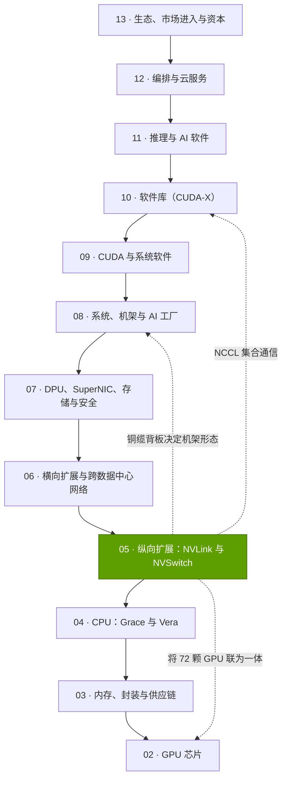
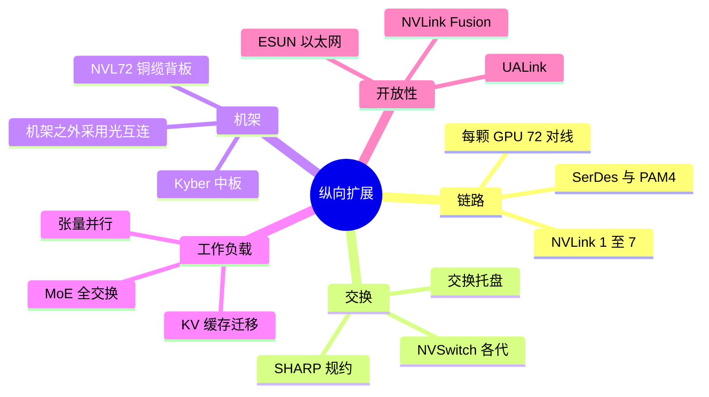

# 第 05 层 —— 纵向扩展（NVLink、NVSwitch）

> [!NOTE]
> 本页为英文原文的简体中文参考译文，仅供参考；如有出入，以[英文原文](../../../layers/05-scale-up-nvlink-nvswitch/index.md "English original")为准。

第 05 层（共 12 层）· NVLink 链路、NVSwitch 芯片及其构建的机架级域 · 约 6 分钟阅读 · 最后核实：2026-11-05

## ⚡ 要点速览

- **[纵向扩展（scale-up）](../../glossary.md#scale-up)让众多 GPU 如同一颗 GPU 般协同工作。** [NVLink](../../glossary.md#nvlink) 5 为每颗 Blackwell GPU 提供单向 900 GB/s 带宽，约为其 800G 网卡的 9 倍，并支持 GPU 之间的直接内存访问 [[S200]](../../../sources/bibliography.md#s200)[[S264]](../../../sources/bibliography.md#s264)。
- **NVL72 是标志性产品：** 72 颗 GPU、18 颗 NVLink 交换芯片和约 5,000 根铜缆，在单个机架内提供 130 TB/s 带宽 [[S262]](../../../sources/bibliography.md#s262)[[S5000]](../../../sources/bibliography.md#s5000)；[Vera Rubin NVL72](../../glossary.md#nvl72) 在 2026 年由 260 TB/s 下调后，达到 216 TB/s [[S200]](../../../sources/bibliography.md#s200)[[S201]](../../../sources/bibliography.md#s201)。
- **为何当下尤为重要：** [混合专家模型（MoE）](../../glossary.md#mixture-of-experts)与推理型模型让每一层都变成[全交换（all-to-all）](../../glossary.md#all-to-all)。英伟达称其 MoE 推理性能相较 [HGX](../../glossary.md#hgx) H200 提升约 10 倍 [[S5002]](../../../sources/bibliography.md#s5002)；基于相同芯片的数据显示，在偏重吞吐量的工作点上提升约 3 倍 [[S630]](../../../sources/bibliography.md#s630)。
- **铜缆是不显山露水的护城河：** 每个机架可省去约 19 kW 功耗和约 $0.7M 的光学器件（估计）[[S5000]](../../../sources/bibliography.md#s5000)[[S5016]](../../../sources/bibliography.md#s5016)；但 200G 铜缆传输距离仅约 1 m [[S5010]](../../../sources/bibliography.md#s5010)，因此在共封装光学随 Feynman 到来之前，域的边界止于机架 🟢 [[S109]](../../../sources/bibliography.md#s109)。
- **弱点与最强挑战者：** 72 颗 GPU 的规模落后于谷歌 9,216 芯片的 TPU pod [[S232]](../../../sources/bibliography.md#s232)；AMD 的 Helios 宣称 260 TB/s，高于 Rubin 下调后的 216 [[S226]](../../../sources/bibliography.md#s226)；[UALink](../../glossary.md#ualink) 与 [ESUN](../../glossary.md#esun) 旨在让这一层走向开放 [[S574]](../../../sources/bibliography.md#s574)[[S576]](../../../sources/bibliography.md#s576)。
- **[NVLink Fusion](../../glossary.md#nvlink-fusion) 开放了链路，但没有开放交换芯片：** 13 家合作伙伴，包括高通（Qualcomm）、富士通（Fujitsu）、英特尔（Intel）和 AWS Trainium4，且每套系统都必须包含英伟达芯片 🟡 [[S131]](../../../sources/bibliography.md#s131)[[S518]](../../../sources/bibliography.md#s518)[[S5018]](../../../sources/bibliography.md#s5018)。

> [!TIP]
> **算例 —— 每机架 216 TB/s 意味着什么。** 72 颗 GPU × 3.0 TB/s = **216 TB/s** [[S200]](../../../sources/bibliography.md#s200)。一个 Vera Rubin 机架的 72 块 ConnectX-9 网卡合计提供 72 × 200 GB/s = 14.4 TB/s 单向带宽，即双向 28.8 TB/s [[S33004]](../../../sources/bibliography.md#s33004)：NVLink 网络承载的带宽是整个机架[横向扩展（scale-out）](../../glossary.md#scale-out)容量的 **7.5 倍**。**结论：** AI 机架搬运的大部分字节从不离开机架，这正是英伟达把机架而非 GPU 作为销售单位的原因。

## 本层在技术栈中的位置

## 本层导图

## 八个问题一览

| # | 问题 | 简答 | 详见 |
|---|---|---|---|
| Q1 | 职能是什么？薄弱时会出什么问题？ | 让张量并行与专家并行变得廉价；若薄弱，GPU 会空等网络 | [纵向扩展与横向扩展](scale-up-vs-scale-out.md) |
| Q2 | 哪些指标重要？ | 每 GPU 带宽、域规模、域带宽、跳数与延迟、pJ/bit 以及每条链路成本 | [纵向扩展与横向扩展](scale-up-vs-scale-out.md) |
| Q3 | 代际进步如何？ | 每 GPU 160 GB/s → 3.0 TB/s（约 19 倍）；每域 16 → 72 颗 GPU；域带宽约提升 170 倍 | [各代产品](nvlink-and-nvswitch-generations.md) |
| Q4 | 优势从何而来？ | SerDes、交换芯片、机架与集合通信软件的协同设计，且每年同步迭代 | [发展历程与构建方式](history-and-how-built.md) |
| Q5 | 最强挑战者是谁？ | AMD Helios（72 颗 GPU，基于以太网的 UALink 提供 260 TB/s）；谷歌 TPU pod 在域规模上领先 | [竞争格局](competition.md) |
| Q6 | 复制成本多高？ | 本资料库估计：4–5 年、$3–6B 及约 1,000 名专业人才 🔴 | [发展历程与构建方式](history-and-how-built.md) |
| Q7 | 路线图如何？ | Kyber NVL144（2027 年，有推迟报道）、采用光互连的多机架 NVL576/NVL1152；UALink 产品于 2027 年推出 | [路线图](roadmap.md) |
| Q8 | 价值池与并购机会？ | 交换芯片、SerDes IP、铜缆互连与光 I/O | [价值链与企业发展](value-chain-and-corp-dev.md) |

## 本层页面

| 页面 | 你将了解 |
|---|---|
| [纵向扩展与横向扩展](scale-up-vs-scale-out.md) | 加载/存储（load/store）与 RDMA 的区别、约 9 倍的差距、关键指标 |
| [NVLink 与 NVSwitch 各代产品](nvlink-and-nvswitch-generations.md) | NVLink 1–7、交换托盘、NVL8 → Kyber |
| [铜缆背板与铜缆为何胜出](copper-spines-and-why-copper-wins.md) | NVL72 铜缆背板、铜缆与光学对比、传输距离 |
| [为何域规模至关重要](why-domain-size-matters.md) | MoE 全交换、英伟达的性能宣称、TPU 环面拓扑 |
| [NVLink Fusion](nvlink-fusion.md) | 合作伙伴、开放了什么、Fusion 与 UALink 对比 |
| [竞争格局](competition.md) | AMD、谷歌、AWS、华为、开放标准 |
| [发展历程与英伟达的构建方式](history-and-how-built.md) | 时间线、关键决策、复制成本 |
| [路线图](roadmap.md) | NVLink 6–8、Kyber、竞争对手路线图 |
| [价值链与企业发展视角](value-chain-and-corp-dev.md) | 价值池、私营公司、并购 |

🔧 技术细节：如何解读 NVLink 数字

英伟达给出的 NVLink 带宽为双向合计（1.8 TB/s = 单向 900 GB/s），而[网卡（NIC）](../../glossary.md#nic)速率按单向计（800 Gb/s = 100 GB/s）[[S200]](../../../sources/bibliography.md#s200)[[S264]](../../../sources/bibliography.md#s264)；机架级数字为 GPU 数量 × 每 GPU 带宽 [[S262]](../../../sources/bibliography.md#s262)。

## 🎯 企业发展视角

1. **机架就是产品。** 如果大部分流量留在 NVLink 域内，价值将流向掌控交换芯片、铜缆背板与软件的一方；英伟达在这里的领先能否比其 GPU 领先更持久？
2. **开放互连架构落后两年。** UALink 产品预计于 2027 年推出 [[S90051]](../../../sources/bibliography.md#s90051)，因此 NVLink Fusion 授权的窗口期就在当下。
3. **高通问题（仅基于公开信息）：** 高通是 Fusion 的 CPU 合作伙伴 [[S131]](../../../sources/bibliography.md#s131)，而其 Dragonfly AI300 加速器计划采用 UALink 与 ESUN [[S90060]](../../../sources/bibliography.md#s90060)。哪条纵向扩展路径最适合其推理机架？每条路径在上市时间上各需付出多大代价？

## 📚 来源（Sources）

<!-- Auto-generated from the [S…] citations on this page by `make build`. Edit sources/registry/*.csv, not this list. -->

- [**S109**](../../../sources/bibliography.md#s109) NVIDIA Blog, *NVIDIA GTC 2026: Live Updates on What's Next in AI*, 2026-03-16. [Link](https://blogs.nvidia.com/blog/gtc-2026-news/)
- [**S131**](../../../sources/bibliography.md#s131) NVIDIA Newsroom, *NVIDIA NVLink Fusion: semi-custom AI infrastructure partner ecosystem (Computex 2025)*, 2025-05-19. [Link](https://nvidianews.nvidia.com/news/nvidia-nvlink-fusion-semi-custom-ai-infrastructure-partner-ecosystem)
- [**S200**](../../../sources/bibliography.md#s200) NVIDIA, *NVIDIA NVLink and NVLink Switch (product page with NVLink and NVLink Switch specification tables)*, 2026-09. [Link](https://www.nvidia.com/en-us/data-center/nvlink/)
- [**S201**](../../../sources/bibliography.md#s201) VideoCardz, *NVIDIA quietly cuts Vera Rubin specs, HBM4 bandwidth and NVLink 6 speeds now lower*, 2026-10. [Link](https://videocardz.com/newz/nvidia-quietly-cuts-vera-rubin-specs-hbm4-bandwidth-and-nvlink-6-speeds-now-lower)
- [**S226**](../../../sources/bibliography.md#s226) AMD, *AMD Helios Rackscale Solution (product page)*, 2026. [Link](https://www.amd.com/en/products/rackscale-solutions/helios.html)
- [**S232**](../../../sources/bibliography.md#s232) Google Cloud, *TPU7x (Ironwood) - Cloud TPU documentation*, 2025-11. [Link](https://docs.cloud.google.com/tpu/docs/tpu7x)
- [**S262**](../../../sources/bibliography.md#s262) NVIDIA, *NVIDIA GB200 NVL72 (product page)*, 2024. [Link](https://www.nvidia.com/en-us/data-center/gb200-nvl72/)
- [**S264**](../../../sources/bibliography.md#s264) NVIDIA Newsroom, *NVIDIA Announces New Switches Optimized for Trillion-Parameter GPU Computing and AI Infrastructure (Quantum-X800, Spectrum-X800, ConnectX-8)*, 2024-03-18. [Link](https://nvidianews.nvidia.com/news/networking-switches-gpu-computing-ai)
- [**S518**](../../../sources/bibliography.md#s518) ServeTheHome, *NVIDIA NVLink Fusion tapped for future AWS Trainium4 deployments*, 2025-12-02. [Link](https://www.servethehome.com/nvidia-nvlink-fusion-tapped-for-future-aws-trainium4-deployments/)
- [**S574**](../../../sources/bibliography.md#s574) HPCwire, *UALink Consortium Publishes 4 Specifications Defining In-Network Compute, Chiplets, Manageability and 200G Performance*, 2026-04-07. [Link](https://www.hpcwire.com/off-the-wire/ualink-consortium-publishes-4-specifications-defining-in-network-compute-chiplets-manageability-and-200g-performance/)
- [**S576**](../../../sources/bibliography.md#s576) Converge Digest, *OCP releases ESUN 1.0 spec for Ethernet-based scale-up AI fabrics*, 2026-03. [Link](https://convergedigest.com/ocp-releases-esun-1-0-spec-for-ethernet-based-scale-up-ai-fabrics/)
- [**S630**](../../../sources/bibliography.md#s630) SemiAnalysis, *GB200 NVL72 vs B200 on Kimi K2.5: 3.1x from Wide EP vLLM*, 2026-04-23. [Link](https://github.com/SemiAnalysisAI/InferenceX-app/blob/main/packages/app/content/blog/gb200-nvl72-kimi-k2-5-vllm-wide-ep-3x-vs-b200.mdx)
- [**S5000**](../../../sources/bibliography.md#s5000) SemiAnalysis, *Nvidia's Optical Boogeyman - NVL72, InfiniBand Scale Out, 800G & 1.6T Ramp*, 2024-03. [Link](https://newsletter.semianalysis.com/p/nvidias-optical-boogeyman-nvl72-infiniband)
- [**S5002**](../../../sources/bibliography.md#s5002) NVIDIA Blog, *Mixture of Experts Powers the Most Intelligent Frontier AI Models, Runs 10x Faster on NVIDIA Blackwell NVL72*, 2025-12-03. [Link](https://blogs.nvidia.com/blog/mixture-of-experts-frontier-models/)
- [**S5010**](../../../sources/bibliography.md#s5010) IEEE 802.3, *IEEE P802.3dj adopted objectives (200 Gb/s per lane electrical and optical signaling)*, 2024-03-14. [Link](https://grouper.ieee.org/groups/802/3/dj/projdoc/objectives_P802d3dj_240314.pdf)
- [**S5016**](../../../sources/bibliography.md#s5016) Fundamental Bottom (Substack), *Optical module industry (long AAOI note)*, 2025. [Link](https://fundamentalbottom.substack.com/p/longaaoi-optical-module-industry)
- [**S5018**](../../../sources/bibliography.md#s5018) Tom's Hardware, *Alchip responds to report that Nvidia is reportedly keeping prized NVLink tech closely guarded (updated)*, 2025. [Link](https://www.tomshardware.com/tech-industry/nvidia-keeping-prized-nvlink-tech-closely-guarded-companies-warn-restrictions-could-hamper-deployment-of-some-solutions)
- [**S33004**](../../../sources/bibliography.md#s33004) NVIDIA Newsroom, *NVIDIA Kicks Off the Next Generation of AI With Rubin — Six New Chips; One Incredible AI Supercomputer*, 2026-01-05. [Link](https://nvidianews.nvidia.com/news/rubin-platform-ai-supercomputer)
- [**S90051**](../../../sources/bibliography.md#s90051) SDxCentral, *UALink Consortium takes another swing at Nvidia's NVLink supremacy with specification 2.0*, 2026-04. [Link](https://www.sdxcentral.com/news/ualink-consortium-takes-another-swing-at-nvidias-nvlink-supremacy-with-specification-20/)
- [**S90060**](../../../sources/bibliography.md#s90060) Qualcomm, *Qualcomm Dragonfly AI300 (product page)*, 2026-06. [Link](https://www.qualcomm.com/data-center/products/qualcomm-dragonfly-ai300)
