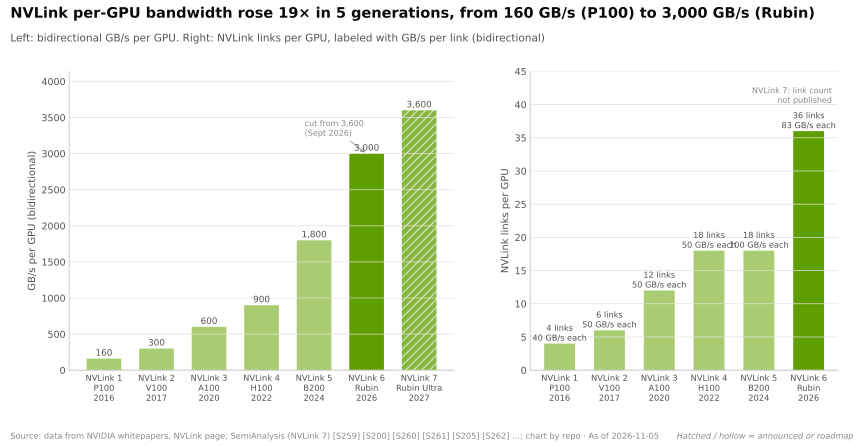
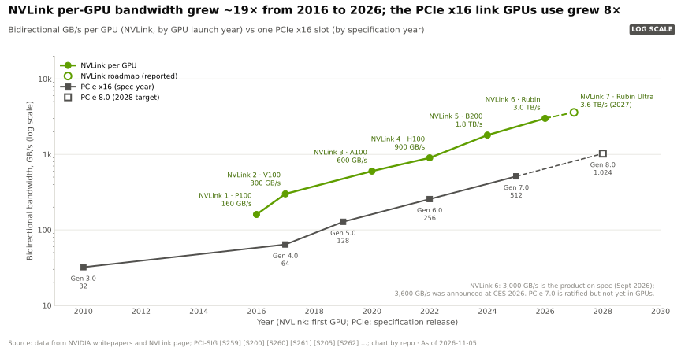
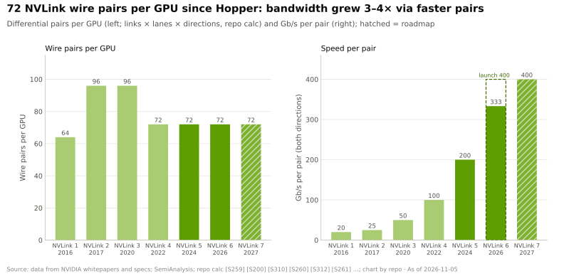
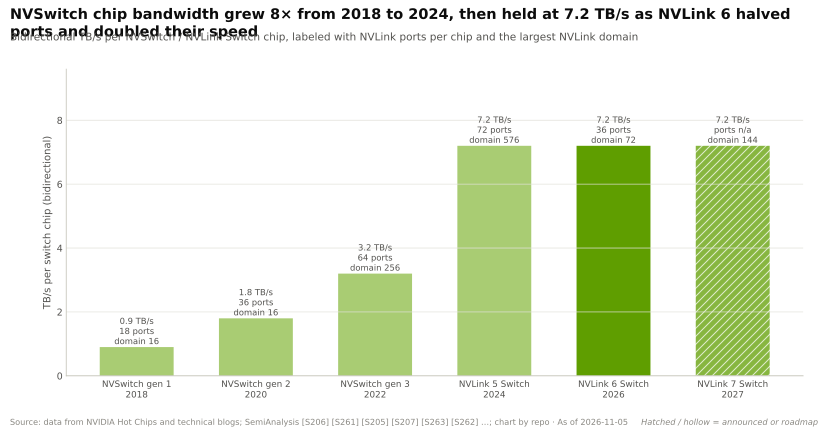
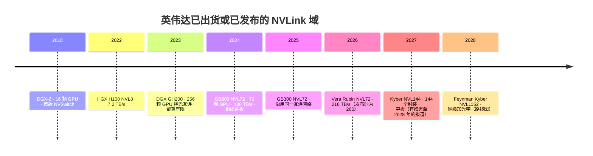

# NVLink 与 NVSwitch 各代产品：从 8 GPU 网格到 144 GPU 机架

> [!NOTE]
> 本页为英文原文的简体中文参考译文，仅供参考；如有出入，以[英文原文](../../../layers/05-scale-up-nvlink-nvswitch/nvlink-and-nvswitch-generations.md "English original")为准。

第 05 层 · 纵向扩展（NVLink、NVSwitch）· 约 10 分钟阅读 · 最后核实：2026-11-05

## ⚡ 要点速览

- **十年约 19 倍。** 每 GPU 的 [NVLink](../../glossary.md#nvlink) 带宽从 160 GB/s（P100，2016 年）升至 3.0 TB/s（Rubin，2026 年）[[S259]](../../../sources/bibliography.md#s259)[[S200]](../../../sources/bibliography.md#s200)，而 GPU 所用的 [PCIe](../../glossary.md#pcie) x16 链路仅提升 8 倍 [[S222]](../../../sources/bibliography.md#s222)。
- **靠更快的线，而非更多的线。** 自 Hopper 起，每颗 GPU 都使用 72 对线；每对线的速率从 100 提升至 200 Gb/s，而在 Rubin 上则实现了约 200 Gb/s 的同时双向传输（本资料库据 [[S205]](../../../sources/bibliography.md#s205)[[S263]](../../../sources/bibliography.md#s263)[[S203]](../../../sources/bibliography.md#s203) 计算）。
- **[NVSwitch](../../glossary.md#nvswitch) 把板级网格变成了机架级互连网络：** DGX-2（2018 年）用 12 颗芯片连接 16 颗 V100 [[S206]](../../../sources/bibliography.md#s206)；GB200 [NVL72](../../glossary.md#nvl72) 用 18 颗 NVLink 5 Switch 芯片连接 72 颗 GPU（130 TB/s）[[S262]](../../../sources/bibliography.md#s262)[[S207]](../../../sources/bibliography.md#s207)；Vera Rubin NVL72 使用 36 颗 [[S203]](../../../sources/bibliography.md#s203)。
- **2026 年的规格下调：** NVLink 6 每 GPU 带宽由 3.6 下调至 3.0 TB/s（每机架由 260 → 216 TB/s）；英伟达称发布时的数字为初步目标 [[S200]](../../../sources/bibliography.md#s200)[[S201]](../../../sources/bibliography.md#s201)[[S202]](../../../sources/bibliography.md#s202)。纸面上，AMD 的 Helios（260 TB/s）如今领先 [[S226]](../../../sources/bibliography.md#s226)。
- **命名两度变更：** Vera Rubin NVL72 最初以“NVL144”（按裸片计数）发布 [[S90009]](../../../sources/bibliography.md#s90009)；Kyber NVL144 指 144 个 Rubin Ultra *封装* 🟢 2027 年下半年，另有推迟至 2028 年的报道但存在争议 🟡 [[S510]](../../../sources/bibliography.md#s510)[[S507]](../../../sources/bibliography.md#s507)[[S508]](../../../sources/bibliography.md#s508)；“NVL576”如今常指八个 72 GPU 机架 🟡 [[S214]](../../../sources/bibliography.md#s214)[[S120]](../../../sources/bibliography.md#s120)。

## 1. NVLink 1 → 7：链路

一条 NVLink“链路”是每个方向上的一组串行通道（[SerDes](../../glossary.md#serdes)）。每一代要么增加链路，要么提高通道速率；Hopper 改用 [PAM4](../../glossary.md#pam4) 信号调制，每个符号承载两个比特。

| 代际 | 首款产品（年份） | 通道速率 | 每 GPU 链路数 | 每 GPU 双向合计 | 已出货的域规模 | 交换芯片 |
|---|---|---|---|---|---|---|
| NVLink 1 | P100、DGX-1（2016） | 20 Gb/s NRZ | 4 | 160 GB/s | 8，立方体网格 | 无 [[S259]](../../../sources/bibliography.md#s259) |
| NVLink 2 | V100（2017）、DGX-2（2018） | 25 Gb/s NRZ | 6 | 300 GB/s | 16 | NVSwitch 1 [[S260]](../../../sources/bibliography.md#s260)[[S206]](../../../sources/bibliography.md#s206) |
| NVLink 3 | A100（2020） | 50 Gb/s NRZ | 12 | 600 GB/s | 8 | NVSwitch 2 [[S261]](../../../sources/bibliography.md#s261) |
| NVLink 4 | H100（2022） | 100 Gb/s PAM4 | 18 | 900 GB/s | 8（DGX GH200 中为 256） | NVSwitch 3 [[S205]](../../../sources/bibliography.md#s205) |
| NVLink 5 | B200、GB200（2024） | 200 Gb/s PAM4 | 18 | 1.8 TB/s | 72 | NVLink 5 Switch [[S263]](../../../sources/bibliography.md#s263)[[S262]](../../../sources/bibliography.md#s262) |
| NVLink 6 | Rubin（2026） | 每对线单向约 200 Gb/s | 36 | 3.6 → 3.0 TB/s | 72 | NVLink 6 Switch [[S200]](../../../sources/bibliography.md#s200)[[S203]](../../../sources/bibliography.md#s203) |
| NVLink 7 🟡 | Rubin Ultra（2027） | 每对线单向约 200 Gb/s | 不适用 | 3.6 TB/s（有报道） | 144 | NVLink 7 Switch [[S210]](../../../sources/bibliography.md#s210) |

> [!TIP]
> **算例 —— 1.8 TB/s 与 3.6 TB/s 是如何构成的。** Blackwell：18 条链路 × 2 条通道 × 200 Gb/s = 7.2 Tb/s = **单向 900 GB/s** [[S263]](../../../sources/bibliography.md#s263)[[S200]](../../../sources/bibliography.md#s200)，使用 18 × 2 × 2 = **72 对线**。Rubin 将链路数翻倍至 36 条，但据 SemiAnalysis，其“400G”双向 SerDes 在一对线上每个方向承载约 200 Gb/s [[S203]](../../../sources/bibliography.md#s203)：36 × 2 = 同样的 **72 对线**，而单向带宽变为 14.4 Tb/s = 3.6 TB/s [[S33004]](../../../sources/bibliography.md#s33004)；下调后的 3.0 TB/s 意味着每对线约 333 Gb/s（本资料库计算）[[S200]](../../../sources/bibliography.md#s200)。**结论：** 英伟达在不增加铜缆的情况下将带宽翻倍，因此 Vera Rubin 得以沿用 NVL72 铜缆背板（见[铜缆页面](copper-spines-and-why-copper-wins.md)）。

**[Q3 · 代际进步]** 每 GPU 的 NVLink 带宽增长约 19 倍（160 GB/s → 3.0 TB/s）[[S259]](../../../sources/bibliography.md#s259)[[S200]](../../../sources/bibliography.md#s200)；交换域从 16 颗 GPU（DGX-2）扩大到 72 颗（NVL72），并计划扩至 144 颗 [[S206]](../../../sources/bibliography.md#s206)[[S262]](../../../sources/bibliography.md#s262)[[S510]](../../../sources/bibliography.md#s510)；域总带宽增长约 170 倍（1.3 → 216 TB/s，见[本层首页](index.md)）。唯一的倒退是 Rubin 由 3.6 下调至 3.0 TB/s 🟢（规格页面），原因未予说明 🔴 [[S200]](../../../sources/bibliography.md#s200)[[S202]](../../../sources/bibliography.md#s202)。

> [!WARNING]
> **误区与事实：**“每一代 NVLink 都让带宽翻倍。”NVLink 6 宣传时为 NVLink 5 的 2 倍，但实际出货仅为 1.67 倍 [[S200]](../../../sources/bibliography.md#s200)[[S201]](../../../sources/bibliography.md#s201)。

🔧 技术细节：SerDes、PAM4 与双向信号传输

- **SerDes** 把芯片内部的宽位数据转换为差分线对上的高速串行数据流；其速度与功耗决定了链路预算。
- **PAM4** 让每个符号承载的比特数翻倍，但电平之间的间隔更小，使信号更脆弱，并缩短铜缆传输距离 [[S5010]](../../../sources/bibliography.md#s5010)。
- **同时双向信号传输**在一对线上同时收发，接收端减去自身发送的信号（千兆以太网即采用此法）。SemiAnalysis 认为 NVLink 6 采用了这一方式 [[S203]](../../../sources/bibliography.md#s203)；英伟达尚未公布通道细节。

## 2. NVSwitch：从板级芯片到机架级互连网络

没有交换芯片时，每颗 GPU 只能访问与其直接连线的相邻 GPU（如 DGX-1 的立方体网格）；有了交换芯片，每颗 GPU 都能以全速访问其他任意 GPU。NVSwitch 历代不断提升端口数与速率，直至单颗芯片可为 72 颗 GPU 各提供一个端口。

在 GB200 NVL72 中，每个 1U [NVLink 交换托盘](../../glossary.md#nvlink-switch-tray)放置两颗芯片，每机架九个托盘；每个托盘由各自的[基板管理控制器（BMC）](../../glossary.md#bmc)管理，并通过后部的[盲插连接器](../../glossary.md#blind-mate-connector)接入 [NVLink 铜缆背板（spine）](../../glossary.md#nvlink-spine) [[S5007]](../../../sources/bibliography.md#s5007)[[S5008]](../../../sources/bibliography.md#s5008)。

> [!TIP]
> **算例 —— 为何 NVL72 恰好只需一跳。** 72 颗 GPU × 18 条链路 = **1,296** 条链路 = 18 颗芯片 × 72 个端口 [[S262]](../../../sources/bibliography.md#s262)[[S5008]](../../../sources/bibliography.md#s5008)：每颗 GPU 在每颗交换芯片上各连一条链路，因此任意 GPU 都可经 18 颗芯片中的任意一颗、一跳到达其他任意 GPU。18 × 7.2 TB/s = **130 TB/s**，即英伟达公布的机架数字 [[S207]](../../../sources/bibliography.md#s207)[[S262]](../../../sources/bibliography.md#s262)。**结论：** NVL72 是由 18 颗芯片构成的一台无阻塞交换机，因此每颗 GPU 到其他任意 GPU 都有 1.8 TB/s 带宽。

## 3. NVL8 → NVL72 → Vera Rubin NVL72 → Kyber

DGX GH200 于 2023 年尝试通过光学 NVLink 连接 256 颗 GPU，但部署有限；随后被铜缆 NVL72 取代 [[S205]](../../../sources/bibliography.md#s205)[[S200]](../../../sources/bibliography.md#s200)。[Kyber](../../glossary.md#kyber) 把机架改造为插在[中板（midplane）](../../glossary.md#midplane)上的竖直刀片：36 块计算刀片（每块含四个 Rubin Ultra 封装）和 12 块交换刀片 [[S510]](../../../sources/bibliography.md#s510)，功率约 600 kW [[S305]](../../../sources/bibliography.md#s305)。在单机架之外，GTC 2026 展示了 NVL576，以及面向 Feynman、基于铜缆与共封装光学的 NVL1152 🟢 [[S109]](../../../sources/bibliography.md#s109)[[S108]](../../../sources/bibliography.md#s108)。

> [!TIP]
> **算例 —— Kyber 的数字。** 144 个封装 × 3.6 TB/s（有报道）= 每机架 **约 518 TB/s**，为 GB200 NVL72 的 4 倍 [[S210]](../../../sources/bibliography.md#s210)。SemiAnalysis 统计为 72 颗 NVLink 7 Switch 芯片 × 7.2 TB/s = 518 TB/s，二者一致；Glenn Lockwood 估计为 36 颗，那将需要单芯片带宽翻倍 [[S210]](../../../sources/bibliography.md#s210)[[S211]](../../../sources/bibliography.md#s211)。按约 600 kW 计，每个封装约 4.2 kW [[S305]](../../../sources/bibliography.md#s305)。**结论：** 在英伟达公布规格之前，Kyber 的交换芯片数量与时间表都应视为 🟡。

## 🎯 企业发展视角

1. **规格的可信度。** 3.6 → 3.0 TB/s 的下调 [[S201]](../../../sources/bibliography.md#s201)[[S202]](../../../sources/bibliography.md#s202) 是 NVLink 首次规格倒退；SerDes 或信号完整性的极限，是否同样会限制采用 200G 级通道的竞争对手？
2. **交换芯片就是收费站。** 每一颗 NVLink 交换芯片都由英伟达自制（每个 Vera Rubin 机架 36 颗 [[S203]](../../../sources/bibliography.md#s203)）；Fusion 开放的是链路，而不是交换芯片（见 [NVLink Fusion](nvlink-fusion.md)）。
3. **关注 Kyber 的中板。** 有报道称 PCB 中板的可制造性问题导致推迟 [[S507]](../../../sources/bibliography.md#s507)，这将给 AMD 的 72 GPU Helios 和谷歌的 TPU 8t 留出缩小差距的时间（见[路线图](roadmap.md)）。

## 📚 来源（Sources）

<!-- Auto-generated from the [S…] citations on this page by `make build`. Edit sources/registry/*.csv, not this list. -->

- [**S108**](../../../sources/bibliography.md#s108) HPCwire / AIwire, *Huang Shares Nvidia Roadmap Showing More Chips, NVL1152, Scale-Up CPO*, 2026-03-18. [Link](https://www.hpcwire.com/aiwire/2026/03/18/huang-shares-nvidia-roadmap-showing-more-chips-nvl1152-scale-up-cpo/)
- [**S109**](../../../sources/bibliography.md#s109) NVIDIA Blog, *NVIDIA GTC 2026: Live Updates on What's Next in AI*, 2026-03-16. [Link](https://blogs.nvidia.com/blog/gtc-2026-news/)
- [**S120**](../../../sources/bibliography.md#s120) SemiAnalysis, *Nvidia - The Inference Kingdom Expands (GTC 2026)*, 2026-03. [Link](https://newsletter.semianalysis.com/p/nvidia-the-inference-kingdom-expands)
- [**S200**](../../../sources/bibliography.md#s200) NVIDIA, *NVIDIA NVLink and NVLink Switch (product page with NVLink and NVLink Switch specification tables)*, 2026-09. [Link](https://www.nvidia.com/en-us/data-center/nvlink/)
- [**S201**](../../../sources/bibliography.md#s201) VideoCardz, *NVIDIA quietly cuts Vera Rubin specs, HBM4 bandwidth and NVLink 6 speeds now lower*, 2026-10. [Link](https://videocardz.com/newz/nvidia-quietly-cuts-vera-rubin-specs-hbm4-bandwidth-and-nvlink-6-speeds-now-lower)
- [**S202**](../../../sources/bibliography.md#s202) Wccftech, *NVIDIA's official statement on Vera Rubin spec change*, 2026-11. [Link](https://wccftech.com/nvidia-official-statement-on-vera-rubin-spec-change/)
- [**S203**](../../../sources/bibliography.md#s203) SemiAnalysis, *Vera Rubin - Extreme Co-Design: An Evolution*, 2026-01. [Link](https://newsletter.semianalysis.com/p/vera-rubin-extreme-co-design-an-evolution)
- [**S205**](../../../sources/bibliography.md#s205) NVIDIA Technical Blog, *Upgrading Multi-GPU Interconnectivity with the Third-Generation NVIDIA NVSwitch*, 2022-08. [Link](https://developer.nvidia.com/blog/upgrading-multi-gpu-interconnectivity-with-the-third-generation-nvidia-nvswitch/)
- [**S206**](../../../sources/bibliography.md#s206) Hot Chips / NVIDIA (Alex Ishii; Denis Foley; Eric Anderson; Bill Dally; Glenn Dearth), *NVSwitch and DGX-2 (Hot Chips 30 presentation)*, 2018-08. [Link](https://old.hotchips.org/hc30/2conf/2.01_Nvidia_NVswitch_HotChips2018_DGX2NVS_Final.pdf)
- [**S207**](../../../sources/bibliography.md#s207) glennklockwood.com (Glenn K. Lockwood), *NVLink (digital garden notes)*, 2025. [Link](https://glennklockwood.com/garden/nvlink)
- [**S210**](../../../sources/bibliography.md#s210) SemiAnalysis, *Nvidia - GTC 2026: The Inference Kingdom Expands*, 2026-03. [Link](https://newsletter.semianalysis.com/p/nvidia-the-inference-kingdom-expands)
- [**S211**](../../../sources/bibliography.md#s211) glennklockwood.com (Glenn K. Lockwood), *GTC 2026 recap*, 2026-03. [Link](https://blog.glennklockwood.com/2026/03/gtc-2026-recap.html)
- [**S214**](../../../sources/bibliography.md#s214) Inside Deep Tech, *NVIDIA Rubin Ultra and Kyber: Full Guide to NVL144 and NVL576*, 2026. [Link](https://www.insidedeeptech.com/nvidia-rubin-ultra-kyber-nvl576-full-guide/)
- [**S222**](../../../sources/bibliography.md#s222) Tom's Hardware, *PCI Express roadmap: the path to 1TB/s with PCIe 8.0, the challenges of integration, and beyond*, 2025. [Link](https://www.tomshardware.com/pc-components/motherboards/pci-express-roadmap-the-path-to-1tb-s-with-pci-8-0-the-challenges-of-integration-and-beyond)
- [**S226**](../../../sources/bibliography.md#s226) AMD, *AMD Helios Rackscale Solution (product page)*, 2026. [Link](https://www.amd.com/en/products/rackscale-solutions/helios.html)
- [**S259**](../../../sources/bibliography.md#s259) NVIDIA, *NVIDIA Tesla P100 (Pascal architecture) whitepaper*, 2016. [Link](https://images.nvidia.com/content/pdf/tesla/whitepaper/pascal-architecture-whitepaper.pdf)
- [**S260**](../../../sources/bibliography.md#s260) NVIDIA, *NVIDIA Tesla V100 (Volta architecture) whitepaper*, 2017. [Link](https://images.nvidia.com/content/volta-architecture/pdf/volta-architecture-whitepaper.pdf)
- [**S261**](../../../sources/bibliography.md#s261) NVIDIA, *NVIDIA A100 Tensor Core GPU Architecture (whitepaper)*, 2020. [Link](https://images.nvidia.com/aem-dam/en-zz/Solutions/data-center/nvidia-ampere-architecture-whitepaper.pdf)
- [**S262**](../../../sources/bibliography.md#s262) NVIDIA, *NVIDIA GB200 NVL72 (product page)*, 2024. [Link](https://www.nvidia.com/en-us/data-center/gb200-nvl72/)
- [**S263**](../../../sources/bibliography.md#s263) NVIDIA, *NVIDIA Blackwell Architecture Technical Brief*, 2024-03. [Link](https://resources.nvidia.com/en-us-blackwell-architecture)
- [**S305**](../../../sources/bibliography.md#s305) DatacenterDynamics, *Nvidia's Rubin Ultra NVL576 rack expected to be 600kW, coming second half of 2027*, 2025-03-19. [Link](https://datacenterdynamics.com/en/news/nvidias-rubin-ultra-nvl576-rack-expected-to-be-600kw-coming-second-half-of-2027)
- [**S507**](../../../sources/bibliography.md#s507) Tom's Hardware, *Nvidia's Kyber rack for Rubin Ultra slips to 2028*, 2026-07-06. [Link](https://www.tomshardware.com/pc-components/gpus/nvidias-kyber-rack-for-rubin-ultra-slips-to-2028)
- [**S508**](../../../sources/bibliography.md#s508) Wccftech, *NVIDIA Quashes Rubin & Kyber Rack Delay Rumors, Says 'Chip Roadmap Is Intact'*, 2026-07. [Link](https://wccftech.com/nvidia-quashes-rubin-kyber-rack-delay-rumors-says-chip-roadmap-is-intact/)
- [**S510**](../../../sources/bibliography.md#s510) KGI Securities, *NVIDIA GTC 2026 (research note)*, 2026-03-19. [Link](https://www.kgi.com.hk/zh-hk/-/media/files/kgishk/research-reports/tw-reports/nvidia-gtc-2026_19032026e.pdf)
- [**S5007**](../../../sources/bibliography.md#s5007) NVIDIA Docs, *DGX SuperPOD reference architecture (GB200): key components of the DGX SuperPOD*, 2025. [Link](https://docs.nvidia.com/dgx-superpod/reference-architecture-scalable-infrastructure-gb200/latest/dgx-superpod-components.html)
- [**S5008**](../../../sources/bibliography.md#s5008) NVIDIA Docs, *NVIDIA Mission Control: NVLink information (nvlinkinfo)*, 2025. [Link](https://docs.nvidia.com/base-command-manager/product-manuals/nvidia-mission-control/nvlinkinfo)
- [**S5010**](../../../sources/bibliography.md#s5010) IEEE 802.3, *IEEE P802.3dj adopted objectives (200 Gb/s per lane electrical and optical signaling)*, 2024-03-14. [Link](https://grouper.ieee.org/groups/802/3/dj/projdoc/objectives_P802d3dj_240314.pdf)
- [**S33004**](../../../sources/bibliography.md#s33004) NVIDIA Newsroom, *NVIDIA Kicks Off the Next Generation of AI With Rubin — Six New Chips; One Incredible AI Supercomputer*, 2026-01-05. [Link](https://nvidianews.nvidia.com/news/rubin-platform-ai-supercomputer)
- [**S90009**](../../../sources/bibliography.md#s90009) GamesBeat, *Nvidia Vera Rubin ramps into full production for fall launch*, 2026. [Link](https://gamesbeat.com/nvidia-vera-rubin-ramps-into-full-production-for-fall-launch-again/)
