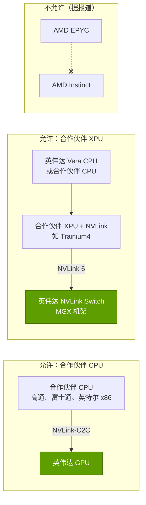

# NVLink Fusion：开放 NVLink，但按英伟达的条件

> [!NOTE]
> 本页为英文原文的简体中文参考译文，仅供参考；如有出入，以[英文原文](../../../layers/05-scale-up-nvlink-nvswitch/nvlink-fusion.md "English original")为准。

第 05 层 · 纵向扩展（NVLink、NVSwitch）· 约 9 分钟阅读 · 最后核实：2026-11-05

## ⚡ 要点速览

- **是什么：** [NVLink Fusion](../../../glossary.md#nvlink-fusion) 于 2025-05-19 发布，以 IP 或[芯粒（chiplet）](../../../glossary.md#chiplet)形式向第三方 CPU 与定制加速器授权 [NVLink](../../../glossary.md#nvlink)，使其接入英伟达的机架级互连网络 [[S131]](../../../sources/bibliography.md#s131)[[S215]](../../../sources/bibliography.md#s215)。
- **谁签了约：** 首发时包括联发科（MediaTek）、美满电子（Marvell）、世芯（Alchip）、Astera Labs、新思科技（Synopsys）、楷登电子（Cadence）、高通（Qualcomm）和富士通（Fujitsu）[[S131]](../../../sources/bibliography.md#s131)[[S90031]](../../../sources/bibliography.md#s90031)；随后加入的有英特尔 [x86](../../../glossary.md#x86) [[S130]](../../../sources/bibliography.md#s130)、Arm Neoverse [[S90036]](../../../sources/bibliography.md#s90036) 以及 AWS Trainium4 [[S518]](../../../sources/bibliography.md#s518)[[S519]](../../../sources/bibliography.md#s519)。
- **背后的资本：** 据报道，英伟达向美满电子投资 $2B（2026 年 3 月）以加深合作关系 🟡 [[S90037]](../../../sources/bibliography.md#s90037)；另据报道，光 I/O 初创公司 Ayar Labs 与 Lightmatter 于 2026 年 6 月加入 🟡 [[S5022]](../../../sources/bibliography.md#s5022)。
- **开放，但按英伟达的条件：** 英伟达保留 NVLink 交换芯片，且每个 Fusion 平台都必须包含至少一颗英伟达芯片，因此无法用它把 AMD CPU 连接到 AMD GPU 🟡 [[S5018]](../../../sources/bibliography.md#s5018)[[S5020]](../../../sources/bibliography.md#s5020)。
- **目标收益：** 让定制芯片留在英伟达的机架里。Trainium4 将采用 NVLink 6 和 [MGX](../../../glossary.md#mgx) 机架 [[S518]](../../../sources/bibliography.md#s518)，因此即使英伟达丢掉了加速器订单，仍能卖出交换芯片。
- **竞争路径：** [UALink](../../../glossary.md#ualink)（2.0 版于 2026 年 4 月获批，产品 2027 年推出）[[S574]](../../../sources/bibliography.md#s574)[[S90051]](../../../sources/bibliography.md#s90051) 与 [ESUN](../../../glossary.md#esun)（1.0 版于 2026 年 3 月发布）[[S576]](../../../sources/bibliography.md#s576)；英特尔与高通两边都有参与 [[S130]](../../../sources/bibliography.md#s130)[[S90060]](../../../sources/bibliography.md#s90060)。

## 1. 两种接入方式：合作伙伴 CPU 或合作伙伴加速器

**合作伙伴 CPU**（高通、富士通、英特尔 x86）以缓存一致的方式连接英伟达 GPU，正如 Grace 与 Vera 通过 [NVLink-C2C](../../../glossary.md#nvlink-c2c) 所做的那样 [[S131]](../../../sources/bibliography.md#s131)[[S130]](../../../sources/bibliography.md#s130)。**合作伙伴加速器**（如 Trainium4 这样的 [XPU](../../../glossary.md#xpu)）集成 NVLink，并接入英伟达的交换芯片与机架 [[S131]](../../../sources/bibliography.md#s131)[[S518]](../../../sources/bibliography.md#s518)。设计服务公司（联发科、美满电子、世芯）与 IP 供应商（新思科技、楷登电子）负责打造芯片 [[S216]](../../../sources/bibliography.md#s216)。

> [!TIP]
> **算例 —— Fusion CPU 合作伙伴买到了什么。** 通过 [PCIe](../../../glossary.md#pcie) Gen6 x16 连接的 CPU，到 GPU 的带宽为 256 GB/s [[S222]](../../../sources/bibliography.md#s222)；Vera 经 NVLink-C2C 连接 Rubin 的带宽为 1.8 TB/s，**约高 7 倍**且缓存一致 [[S209]](../../../sources/bibliography.md#s209)。具备 Vera 级 C2C 的合作伙伴 CPU（此为假设；合作伙伴配置未公开）可把 CPU 内存变成第二层 GPU 内存（见[第 04 层](../../../layers/04-cpu-grace-vera/index.md)）。**结论：** Fusion 是高通和富士通进入英伟达最高价值机架的门票，而这一插槽原本只留给 Grace 和 Vera。

🔧 技术细节：IP、芯粒还是 UCIe？

- **IP 路线：** 使用新思科技或楷登电子的工具，把 NVLink 控制器与 [SerDes](../../../glossary.md#serdes) IP 集成到合作伙伴的裸片中 [[S216]](../../../sources/bibliography.md#s216)。
- **芯粒路线：** 在合作伙伴的裸片旁放置一颗 NVLink 芯粒；有报道称 XPU 可通过 [UCIe](../../../glossary.md#ucie) 连接该芯粒，甚至两端都可以是定制芯片 🔴 [[S5021]](../../../sources/bibliography.md#s5021)，但英伟达未予证实。
- **机架路线：** Trainium4 在 MGX 机架中沿用英伟达的交换托盘、铜缆背板和管理系统 [[S518]](../../../sources/bibliography.md#s518)。

## 2. 哪些开放，哪些不开放

| 要素 | 是否向合作伙伴开放？ | 依据 |
|---|---|---|
| 合作伙伴芯片中的 NVLink 链路协议 | 🟢 是，通过 IP 或芯粒 | [[S131]](../../../sources/bibliography.md#s131)[[S216]](../../../sources/bibliography.md#s216) |
| 缓存一致的 CPU 到 GPU 连接（C2C） | 🟢 是，面向合作伙伴 CPU | [[S131]](../../../sources/bibliography.md#s131)[[S130]](../../../sources/bibliography.md#s130) |
| NVLink 交换芯片 | 🔴 否，仅限英伟达 | [[S5018]](../../../sources/bibliography.md#s5018) |
| 合作伙伴 CPU + 合作伙伴 XPU，不含英伟达芯片 | 🔴 否（据报道） | [[S5018]](../../../sources/bibliography.md#s5018)[[S5020]](../../../sources/bibliography.md#s5020)；相反报道 [[S5021]](../../../sources/bibliography.md#s5021) |
| 参考机架（MGX）、铜缆背板、管理系统 | 🟡 英伟达设计，合作伙伴制造 | [[S518]](../../../sources/bibliography.md#s518)[[S5001]](../../../sources/bibliography.md#s5001) |

> [!TIP]
> **算例 —— Fusion 机架中还剩多少英伟达芯片。** 一台 Vera Rubin [NVL72](../../../glossary.md#nvl72) 包含 72 个 Rubin 封装、36 颗 Vera CPU、36 颗 NVLink 6 交换芯片，以及每 GPU 一块 ConnectX-9 [网卡（NIC）](../../../glossary.md#nic)：约 216 颗英伟达芯片 [[S102]](../../../sources/bibliography.md#s102)[[S203]](../../../sources/bibliography.md#s203)[[S33004]](../../../sources/bibliography.md#s33004)。一台假设的 72 XPU Fusion 机架保留 **36 颗交换芯片**和每颗 XPU 中的 NVLink IP，Vera CPU 和网卡则可选（本资料库计算）。**结论：** 英伟达的芯片数量降至约六分之一，但它保住了最难替代的部分及其软件：这正是“开放，但按英伟达的条件”的交易本质。

> [!WARNING]
> **误区与事实：**“NVLink Fusion 让 NVLink 成为开放标准。”它只是一份授权：条款由英伟达制定，交换芯片由英伟达制造，并且要求使用英伟达自己的芯片 [[S5018]](../../../sources/bibliography.md#s5018)[[S5020]](../../../sources/bibliography.md#s5020)。

## 3. 战略逻辑：Fusion、UALink 与 ESUN 之争

[超大规模云厂商](../../../glossary.md#hyperscaler)希望使用定制加速器，同时不放弃机架级[纵向扩展（scale-up）](../../../glossary.md#scale-up)。英伟达让它们保留加速器，但租用其互连网络；业内其他厂商则希望拥有开放的互连网络。Counterpoint 将 Fusion 定性为英伟达对 UALink 的回应 [[S5019]](../../../sources/bibliography.md#s5019)。

| | NVLink Fusion | UALink | ESUN（以太网纵向扩展） |
|---|---|---|---|
| 治理方式 | 英伟达授权 | 联盟规范 [[S573]](../../../sources/bibliography.md#s573) | OCP 工作组 [[S576]](../../../sources/bibliography.md#s576) |
| 现状（2026 年 11 月） | IP 已出货；Trainium4 已承诺采用 [[S518]](../../../sources/bibliography.md#s518) | 2.0 已获批；产品 2027 年推出 🟡 [[S574]](../../../sources/bibliography.md#s574)[[S90051]](../../../sources/bibliography.md#s90051) | 1.0 规范，2026 年 3 月 [[S576]](../../../sources/bibliography.md#s576) |
| 最大域规模 | 已出货 72，计划 144 [[S262]](../../../sources/bibliography.md#s262)[[S510]](../../../sources/bibliography.md#s510) | 1,024 个加速器 [[S573]](../../../sources/bibliography.md#s573) | 未固定 |
| 交换芯片 | 仅限英伟达 [[S5018]](../../../sources/bibliography.md#s5018) | 任意 UALink 交换芯片厂商 | 商用以太网芯片（如博通）[[S90052]](../../../sources/bibliography.md#s90052) |
| 主要支持者 | AWS、英特尔、高通、美满电子 [[S519]](../../../sources/bibliography.md#s519)[[S90037]](../../../sources/bibliography.md#s90037) | AMD 等；高通 AI300 [[S90060]](../../../sources/bibliography.md#s90060) | 12 家创始成员，包括英伟达、AMD、博通、Meta [[S576]](../../../sources/bibliography.md#s576) |

> [!TIP]
> **算例 —— 上市时间差距。** Fusion IP 自 2025 年 5 月开始供应；AWS 于当年 12 月承诺 Trainium4 采用 [[S131]](../../../sources/bibliography.md#s131)[[S518]](../../../sources/bibliography.md#s518)。UALink 1.0 于 2025 年 4 月获批，但芯片要到 2026 年下半年才进入实验室，产品则要到 2027 年 🟡 [[S573]](../../../sources/bibliography.md#s573)[[S90051]](../../../sources/bibliography.md#s90051)。一个在 2026 年流片的团队，要在一个当下已出货的互连网络与一个距量产还有约 18–24 个月的方案之间做选择。**结论：** Fusion 的武器是时间；其风险在于 UALink 和 ESUN 在 2027–28 年缩小差距。

> [!NOTE]
> **🐂 看多观点：** Fusion 把定制 ASIC 的威胁转化为交换芯片、机架与软件收入：AWS 为 Trainium4 选择了 NVLink [[S518]](../../../sources/bibliography.md#s518)，而对美满电子 $2B 的入股则把一家 [ASIC](../../../glossary.md#asic) 设计公司绑定到英伟达的互连网络上 🟡 [[S90037]](../../../sources/bibliography.md#s90037)。

> [!WARNING]
> **🐻 看空观点：** 那些保护英伟达的条款（必须使用其芯片、交换芯片封闭）[[S5018]](../../../sources/bibliography.md#s5018) 会把 AMD 和博通推向开放互连网络，而高通等双线并行的合作伙伴 [[S131]](../../../sources/bibliography.md#s131)[[S90060]](../../../sources/bibliography.md#s90060) 一旦开放交换芯片出货，就可以转身离开。

## 🎯 企业发展视角

1. **谁拿走 Fusion 的收入？** 授权费、交换芯片与机架设计的收益归英伟达；设计合作伙伴（美满电子、联发科、世芯）赚取一次性工程费用（NRE）与 ASIC 利润 [[S216]](../../../sources/bibliography.md#s216)。如果 Trainium4 式的设计成倍增加，谁获益最多？
2. **CPU 厂商的选择权。** 高通和富士通买到了进入英伟达机架的通道 [[S131]](../../../sources/bibliography.md#s131)[[S4529]](../../../sources/bibliography.md#s4529)；而英伟达完全可以把这些插槽留给 Vera，这种准入能维持多久？
3. **高通问题（仅基于公开信息）：** 一边是 Fusion CPU 合作关系 [[S131]](../../../sources/bibliography.md#s131)，一边是基于 UALink 与 ESUN 的加速器路线图 [[S90060]](../../../sources/bibliography.md#s90060)，这种双线并行的互连策略是在最大化选择权，还是在面对英伟达单一互连网络时分散了工程精力？
4. **监管角度。** 要求每套系统都包含英伟达芯片的授权条款可能招致监管审查；条款一旦放宽，Fusion 的经济性也将随之改变（见[价值链与企业发展](value-chain-and-corp-dev.md)）。

## 📚 来源（Sources）

<!-- Auto-generated from the [S…] citations on this page by `make build`. Edit sources/registry/*.csv, not this list. -->

- [**S102**](../../../sources/bibliography.md#s102) NVIDIA, *NVIDIA DGX Vera Rubin NVL72*, 2026. [Link](https://www.nvidia.com/en-us/data-center/dgx-vera-rubin-nvl72/)
- [**S130**](../../../sources/bibliography.md#s130) NVIDIA Newsroom, *NVIDIA and Intel to Develop AI Infrastructure and Personal Computing Products*, 2025-09-18. [Link](https://nvidianews.nvidia.com/news/nvidia-and-intel-to-develop-ai-infrastructure-and-personal-computing-products)
- [**S131**](../../../sources/bibliography.md#s131) NVIDIA Newsroom, *NVIDIA NVLink Fusion: semi-custom AI infrastructure partner ecosystem (Computex 2025)*, 2025-05-19. [Link](https://nvidianews.nvidia.com/news/nvidia-nvlink-fusion-semi-custom-ai-infrastructure-partner-ecosystem)
- [**S203**](../../../sources/bibliography.md#s203) SemiAnalysis, *Vera Rubin - Extreme Co-Design: An Evolution*, 2026-01. [Link](https://newsletter.semianalysis.com/p/vera-rubin-extreme-co-design-an-evolution)
- [**S209**](../../../sources/bibliography.md#s209) DatacenterDynamics, *Nvidia announces Vera Rubin superchip for late 2026*, 2025-10-28. [Link](https://datacenterdynamics.com/en/news/nvidia-announces-vera-rubin-superchip-for-late-2026)
- [**S215**](../../../sources/bibliography.md#s215) Tom's Hardware, *Nvidia announces NVLink Fusion to allow custom CPUs and AI accelerators to work with its products*, 2025-05-19. [Link](https://www.tomshardware.com/pc-components/cpus/nvidia-announces-nvlink-fusion-to-allow-custom-cpus-and-ai-accelerators-to-work-with-its-products)
- [**S216**](../../../sources/bibliography.md#s216) ServeTheHome, *NVIDIA announces NVLink Fusion bringing NVLink to third-party CPUs and accelerators (partner slide)*, 2025-05-19. [Link](https://www.servethehome.com/nvidia-announces-nvlink-fusion-bringing-nvlink-to-third-party-cpus-and-accelerators/nvlink-fusion-partners/)
- [**S222**](../../../sources/bibliography.md#s222) Tom's Hardware, *PCI Express roadmap: the path to 1TB/s with PCIe 8.0, the challenges of integration, and beyond*, 2025. [Link](https://www.tomshardware.com/pc-components/motherboards/pci-express-roadmap-the-path-to-1tb-s-with-pci-8-0-the-challenges-of-integration-and-beyond)
- [**S262**](../../../sources/bibliography.md#s262) NVIDIA, *NVIDIA GB200 NVL72 (product page)*, 2024. [Link](https://www.nvidia.com/en-us/data-center/gb200-nvl72/)
- [**S510**](../../../sources/bibliography.md#s510) KGI Securities, *NVIDIA GTC 2026 (research note)*, 2026-03-19. [Link](https://www.kgi.com.hk/zh-hk/-/media/files/kgishk/research-reports/tw-reports/nvidia-gtc-2026_19032026e.pdf)
- [**S518**](../../../sources/bibliography.md#s518) ServeTheHome, *NVIDIA NVLink Fusion tapped for future AWS Trainium4 deployments*, 2025-12-02. [Link](https://www.servethehome.com/nvidia-nvlink-fusion-tapped-for-future-aws-trainium4-deployments/)
- [**S519**](../../../sources/bibliography.md#s519) South China Morning Post (Reuters) (Stephen Nellis; Greg Bensinger), *Amazon to use Nvidia tech in AI chips, roll out new servers (Reuters)*, 2025-12-02. [Link](https://www.scmp.com/tech/big-tech/article/3334985/amazon-use-nvidia-tech-ai-chips-roll-out-new-servers)
- [**S573**](../../../sources/bibliography.md#s573) Business Wire, *UALink Consortium Releases the Ultra Accelerator Link 200G 1.0 Specification*, 2025-04-08. [Link](https://www.businesswire.com/news/home/20250408050548/en/UALink-Consortium-Releases-the-Ultra-Accelerator-Link-200G-1.0-Specification)
- [**S574**](../../../sources/bibliography.md#s574) HPCwire, *UALink Consortium Publishes 4 Specifications Defining In-Network Compute, Chiplets, Manageability and 200G Performance*, 2026-04-07. [Link](https://www.hpcwire.com/off-the-wire/ualink-consortium-publishes-4-specifications-defining-in-network-compute-chiplets-manageability-and-200g-performance/)
- [**S576**](../../../sources/bibliography.md#s576) Converge Digest, *OCP releases ESUN 1.0 spec for Ethernet-based scale-up AI fabrics*, 2026-03. [Link](https://convergedigest.com/ocp-releases-esun-1-0-spec-for-ethernet-based-scale-up-ai-fabrics/)
- [**S4529**](../../../sources/bibliography.md#s4529) Converge Digest, *Fujitsu taps NVLink Fusion for MONAKA CPUs + NVIDIA GPUs for industrial AI*, 2025-10. [Link](https://convergedigest.com/fujitsu-taps-nvlink-fusion-for-monaka-cpus-nvidia-gpus-for-industrial-ai/)
- [**S5001**](../../../sources/bibliography.md#s5001) SiliconANGLE, *Nvidia aims to boost Blackwell by donating platform design to the Open Compute Project*, 2024-10-15. [Link](https://siliconangle.com/2024/10/15/nvidia-aims-boost-blackwell-donating-platform-design-open-compute-project)
- [**S5018**](../../../sources/bibliography.md#s5018) Tom's Hardware, *Alchip responds to report that Nvidia is reportedly keeping prized NVLink tech closely guarded (updated)*, 2025. [Link](https://www.tomshardware.com/tech-industry/nvidia-keeping-prized-nvlink-tech-closely-guarded-companies-warn-restrictions-could-hamper-deployment-of-some-solutions)
- [**S5019**](../../../sources/bibliography.md#s5019) Counterpoint Research, *NVLink Fusion - Nvidia's Response to UALink?*, 2025. [Link](https://www.counterpointresearch.com/insight/post-insight-research-notes-blogs-nvlink-fusion-nvidias-response-to-ualink)
- [**S5020**](../../../sources/bibliography.md#s5020) PC Watch (Impress), *Computex 2025: NVIDIA NVLink Fusion report*, 2025-05. [Link](https://pc.watch.impress.co.jp/docs/news/event/2015077.html)
- [**S5021**](../../../sources/bibliography.md#s5021) IT Home, *Report on NVIDIA NVLink Fusion guidance (third-party CPU and XPU on both ends via an NVLink chiplet over UCIe)*, 2025-08. [Link](https://www.ithome.com/0/877/853.htm)
- [**S5022**](../../../sources/bibliography.md#s5022) Independent tracker (vercel.app), *Co-packaged optics joins NVLink Fusion: Ayar Labs and Lightmatter (June 2026)*, 2026-06-08. [Link](https://site-one-liart-13.vercel.app/en/infra-ip/co-packaged-optics-nvlink-fusion-ayar-labs-lightmatter-june-2026)
- [**S33004**](../../../sources/bibliography.md#s33004) NVIDIA Newsroom, *NVIDIA Kicks Off the Next Generation of AI With Rubin — Six New Chips; One Incredible AI Supercomputer*, 2026-01-05. [Link](https://nvidianews.nvidia.com/news/rubin-platform-ai-supercomputer)
- [**S90031**](../../../sources/bibliography.md#s90031) ServeTheHome, *NVIDIA announces NVLink Fusion bringing NVLink to third-party CPUs and accelerators*, 2025-05-19. [Link](https://www.servethehome.com/nvidia-announces-nvlink-fusion-bringing-nvlink-to-third-party-cpus-and-accelerators/nvlink-fusion-partners/)
- [**S90036**](../../../sources/bibliography.md#s90036) Converge Digest, *Arm extends Neoverse with NVIDIA NVLink Fusion*, 2025-11. [Link](https://convergedigest.com/arm-extends-neoverse-with-nvidia-nvlink-fusion/)
- [**S90037**](../../../sources/bibliography.md#s90037) Converge Digest, *NVIDIA invests $2B in Marvell to extend NVLink Fusion AI ecosystem*, 2026-03. [Link](https://convergedigest.com/nvidia-invests-2b-in-marvell-to-extend-nvlink-fusion-ai-ecosystem/)
- [**S90051**](../../../sources/bibliography.md#s90051) SDxCentral, *UALink Consortium takes another swing at Nvidia's NVLink supremacy with specification 2.0*, 2026-04. [Link](https://www.sdxcentral.com/news/ualink-consortium-takes-another-swing-at-nvidias-nvlink-supremacy-with-specification-20/)
- [**S90052**](../../../sources/bibliography.md#s90052) Synopsys, *Ethernet standards for scale-up AI: an overview of ESUN, SUE, and UALink*, 2025-11. [Link](https://www.synopsys.com/articles/ethernet-standards-scale-up-ai.html)
- [**S90060**](../../../sources/bibliography.md#s90060) Qualcomm, *Qualcomm Dragonfly AI300 (product page)*, 2026-06. [Link](https://www.qualcomm.com/data-center/products/qualcomm-dragonfly-ai300)
