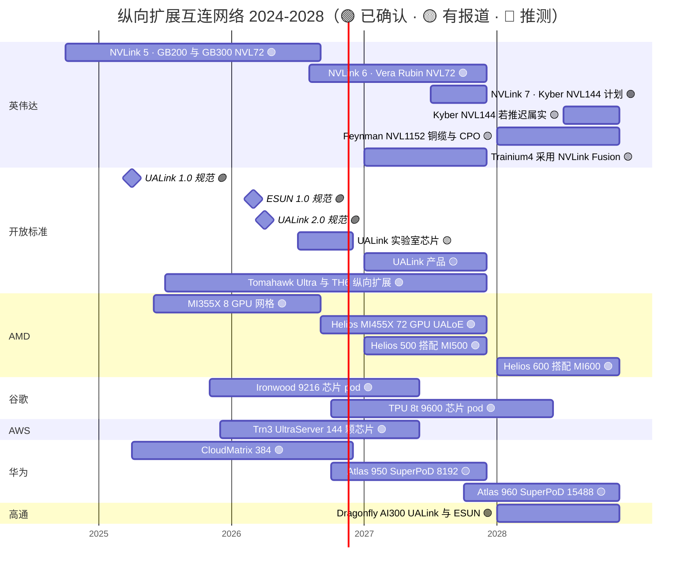

# 纵向扩展（NVLink、NVSwitch）：路线图

> [!NOTE]
> 本页为英文原文的简体中文参考译文，仅供参考；如有出入，以[英文原文](../../../layers/05-scale-up-nvlink-nvswitch/roadmap.md "English original")为准。

第 05 层 · 纵向扩展（NVLink、NVSwitch）· 约 10 分钟阅读 · 最后核实：2026-11-05

## ⚡ 要点速览

- **当前：** 自 2026 年 8 月起，[NVLink](../../glossary.md#nvlink) 6 已随 Vera Rubin [NVL72](../../glossary.md#nvl72) 出货：72 颗 GPU、36 颗交换芯片、每 GPU 3.0 TB/s——此前已从发布时的 3.6 TB/s 悄然下调 🟢 [[S500]](../../../sources/bibliography.md#s500)[[S332]](../../../sources/bibliography.md#s332)[[S200]](../../../sources/bibliography.md#s200)[[S201]](../../../sources/bibliography.md#s201)。
- **2027 年：** Rubin Ultra 转向 NVLink 7 和 144 GPU 的 Kyber 机架，据报道每 GPU 约 3.6 TB/s。SemiAnalysis 报道称将推迟 12 个月以上至 2028 年，英伟达予以否认 🟡 [[S108]](../../../sources/bibliography.md#s108)[[S210]](../../../sources/bibliography.md#s210)[[S507]](../../../sources/bibliography.md#s507)[[S508]](../../../sources/bibliography.md#s508)。
- **2028 年：** Feynman 的 Kyber NVL1152 采用铜缆加[共封装光学（CPO）](../../glossary.md#co-packaged-optics)，把八个机架连接成一个 NVLink 域；带宽尚未公布 🟡 [[S108]](../../../sources/bibliography.md#s108)[[S109]](../../../sources/bibliography.md#s109)。
- **开放标准：** [UALink](../../glossary.md#ualink) 2.0 于 2026-04-07 获批。芯片将于 2026 年下半年进入实验室，产品于 2027 年跟进 🟡 [[S574]](../../../sources/bibliography.md#s574)[[S90051]](../../../sources/bibliography.md#s90051)。[ESUN](../../glossary.md#esun) 1.0（2026 年 3 月）与 UE 1.1（2026 年 10 月）让以太网走上了[纵向扩展（scale-up）](../../glossary.md#scale-up)的轨道 🟢 [[S576]](../../../sources/bibliography.md#s576)[[S575]](../../../sources/bibliography.md#s575)。
- **竞争对手的时间表：** AMD 计划推出 Helios（2026 年）、Helios 500（2027 年）和 Helios 600（2028 年）🟢 [[S538]](../../../sources/bibliography.md#s538)。谷歌的 TPU 8t 将于 2026 年底带来 9,600 芯片的 pod 🟢 [[S238]](../../../sources/bibliography.md#s238)。华为 Atlas 960 的目标是在 2027 年第四季度实现 15,488 颗 NPU 🟡 [[S249]](../../../sources/bibliography.md#s249)。高通的 AI300（2028 年）采用 UALink 与 ESUN 🟢 [[S90060]](../../../sources/bibliography.md#s90060)。
- **[Q7 · 路线图与变数]** 关注 UALink 芯片的推出时间、共封装光学进入机架，以及 Kyber 的上市日期（见最后一节）。

![按厂商与年份划分的双面板折线图。每加速器带宽：英伟达 NVLink 为 0.16 TB/s（2016 年）、0.6（2020 年）、0.9（2022 年）、1.8（2024 年）、3.0（Vera Rubin，2026 年，由 3.6 下调），Rubin Ultra（2027 年）有报道为 3.6；AMD 为 0.9（MI300X，2023 年）、1.1（MI355X，2025 年），Helios（2026 年）升至 3.6；谷歌为 0.6（TPU v4）、1.2（v5p、Ironwood）和 2.4（TPU 8t，2026 年）；AWS 为 1.0（Trn2）和 2.0（Trn3）；华为为 0.78（CloudMatrix 384）和 2.0（Atlas 950）。域规模：英伟达在 2022 年之前为 8 至 16 颗 GPU，部署有限的 DGX GH200 为 256，NVL72（2024 年）为 72，Kyber（2027 年）为 144，推测的 1,152（2028 年）；谷歌为 4,096 至 9,600；华为为 384 至 8,192 和 15,488（2027 年）；AWS 为 64 至 144；AMD 为 8 至 72。](../../../assets/charts/05-scale-up-roadmap-progression.svg)

## 2024–2028 年路线图

横条表示供货窗口；里程碑表示规范发布。Kyber 推迟横条显示的是 SemiAnalysis 报道的窗口，对照英伟达官方的 2027 年下半年。Trainium4 与 UALink 产品窗口为分析师或行业媒体的估计。各行来源见下表；未列入下表的横条：MI355X 8 GPU 网格 [[S229]](../../../sources/bibliography.md#s229)，Ironwood 9,216 芯片 pod [[S151]](../../../sources/bibliography.md#s151)，CloudMatrix 384 [[S248]](../../../sources/bibliography.md#s248)[[S340]](../../../sources/bibliography.md#s340)。

| 项目 | 时间窗口 | 状态 | 置信度 | 来源 |
|---|---|---|---|---|
| NVLink 5 / NVLink Switch（1.8 TB/s，72 颗 GPU） | 2024-Q4 → | 已出货 | 🟢 | [[S121]](../../../sources/bibliography.md#s121)[[S34014]](../../../sources/bibliography.md#s34014) |
| NVLink 6 / NVLink 6 Switch（下调后 3.0 TB/s） | 2026-Q3 → | 已出货 | 🟢 | [[S100]](../../../sources/bibliography.md#s100)[[S33004]](../../../sources/bibliography.md#s33004)[[S103]](../../../sources/bibliography.md#s103)[[S104]](../../../sources/bibliography.md#s104) |
| NVLink 7、Kyber NVL144（144 个封装） | 官方 2027-Q3/Q4 | 路线图 | 🟢 计划 | [[S502]](../../../sources/bibliography.md#s502)[[S108]](../../../sources/bibliography.md#s108)[[S510]](../../../sources/bibliography.md#s510) |
| Kyber NVL144 报道中的推迟 | 2028-Q3/Q4 | 推迟（据报道） | 🟡 | [[S507]](../../../sources/bibliography.md#s507)[[S508]](../../../sources/bibliography.md#s508)[[S309]](../../../sources/bibliography.md#s309) |
| Feynman 时代 NVLink、NVL1152（铜缆 + CPO） | 2028 | 路线图 | 🟡 | [[S109]](../../../sources/bibliography.md#s109)[[S108]](../../../sources/bibliography.md#s108) |
| NVLink Fusion；英特尔 x86 接入 NVLink | 2025 →；未定 | 已出货 / 已发布 | 🟢 | [[S131]](../../../sources/bibliography.md#s131)[[S517]](../../../sources/bibliography.md#s517)[[S130]](../../../sources/bibliography.md#s130) |
| Trainium4 采用 NVLink Fusion | 2027（估计） | 路线图 | 🟡 | [[S518]](../../../sources/bibliography.md#s518)[[S519]](../../../sources/bibliography.md#s519)[[S156]](../../../sources/bibliography.md#s156) |
| UALink 1.0 / 2.0 规范 | 2025-04 / 2026-04 | 已发布 | 🟢 | [[S573]](../../../sources/bibliography.md#s573)[[S574]](../../../sources/bibliography.md#s574) |
| ESUN 1.0；Ultra Ethernet 1.1 纵向扩展 | 2026-03；2026-10 | 已发布 | 🟢 | [[S576]](../../../sources/bibliography.md#s576)[[S575]](../../../sources/bibliography.md#s575) |
| 博通 Tomahawk Ultra | 2025-Q3 → | 已出货 | 🟡 | [[S572]](../../../sources/bibliography.md#s572) |
| AWS NeuronSwitch-v1（144 颗芯片） | 2025-12 → | 已出货 | 🟢 | [[S556]](../../../sources/bibliography.md#s556) |
| AMD Helios / Helios 500 / Helios 600 | 2026 / 2027 / 2028 | 已出货 / 路线图 | 🟢 | [[S538]](../../../sources/bibliography.md#s538)[[S539]](../../../sources/bibliography.md#s539)[[S542]](../../../sources/bibliography.md#s542) |
| 谷歌 TPU 8t pod（9,600 颗芯片） | 2026-Q4 | 已发布 | 🟢 | [[S550]](../../../sources/bibliography.md#s550)[[S551]](../../../sources/bibliography.md#s551) |
| 华为 UB：Atlas 950 / Atlas 960 SuperPoD | 2026-Q4 / 2027-Q4 | 已出货（据报道）/ 路线图 | 🟡 | [[S163]](../../../sources/bibliography.md#s163)[[S567]](../../../sources/bibliography.md#s567)[[S568]](../../../sources/bibliography.md#s568) |

各行与 `data/roadmap.csv`（第 05 层与第 08 层）保持一致；本页不修改该文件。

> [!TIP]
> **算例 —— 英伟达的增长点正在转移。** 每 GPU 的 NVLink 带宽从 NVLink 5 到 NVLink 6 提升了 1.67 倍（1.8 → 3.0 TB/s），据报道到 NVLink 7（3.6 TB/s）仅提升 1.2 倍 [[S200]](../../../sources/bibliography.md#s200)[[S210]](../../../sources/bibliography.md#s210)。域规模则计划先翻倍（72 → 144），再扩大 8 倍（144 → 1,152）[[S108]](../../../sources/bibliography.md#s108)。单个域内的总带宽从 216 TB/s（Vera Rubin NVL72）增至约 518 TB/s（Kyber NVL144，按 3.6 TB/s 计）。大部分增益来自每个域容纳更多 GPU，而非更快的链路。这把风险从 [SerDes](../../glossary.md#serdes) 设计转移到了机架机构与光学。

🔧 技术细节：为何通道速率停滞在约 200 Gb/s

NVLink 5、NVLink 6、UALink 1.0/2.0 和 Tomahawk 6 都采用 200G 级通道 [[S200]](../../../sources/bibliography.md#s200)[[S223]](../../../sources/bibliography.md#s223)[[S225]](../../../sources/bibliography.md#s225)[[S274]](../../../sources/bibliography.md#s274)。IEEE 802.3dj 将于 2026 年完成 200G 通道的标准化；400G 通道尚无确定的时间表 [[S254]](../../../sources/bibliography.md#s254)[[S256]](../../../sources/bibliography.md#s256)。在 200G 下，无源铜缆传输距离仅约 1–2 m，因此英伟达把 72–144 颗 GPU 塞进一个机架，机架之外则需要光学 [[S262]](../../../sources/bibliography.md#s262)。在 400G 通道到来之前，厂商只能通过增加通道（NVLink 6 将每 GPU 链路数翻倍至 36）或在同一对线上双向传输来提升带宽 [[S203]](../../../sources/bibliography.md#s203)。

## 哪些因素会改变格局

**[Q7 · 路线图与变数]**

- **UALink 芯片按时推出。** 如果 Upscale AI 的交换芯片于 2026 年第四季度出货、UALink 产品于 2027 年落地，定制加速器将获得 [NVLink Fusion](../../glossary.md#nvlink-fusion) 之外的商用替代方案 🟡 [[S5506]](../../../sources/bibliography.md#s5506)[[S90051]](../../../sources/bibliography.md#s90051)。若推迟到 2028 年，基于以太网的 UALink（Helios 式）将成为唯一的开放路径 [[S5523]](../../../sources/bibliography.md#s5523)。
- **共封装光学进入机架。** Feynman 的光学 NVLink 是英伟达跨出单机架的第一步 [[S108]](../../../sources/bibliography.md#s108)。光 I/O 初创公司（Ayar Labs、Lightmatter）以及博通的 CPO 交换机，也为竞争对手提供了同样的工具 [[S5511]](../../../sources/bibliography.md#s5511)[[S2510]](../../../sources/bibliography.md#s2510)[[S571]](../../../sources/bibliography.md#s571)。
- **Kyber 的时间表。** 如果推迟至 2028 年属实，英伟达的域规模在 2027 年全年都将停留在 72 颗 GPU，而 AWS 已出货 144 颗、谷歌 9,600 颗 🟡 [[S507]](../../../sources/bibliography.md#s507)[[S508]](../../../sources/bibliography.md#s508)[[S242]](../../../sources/bibliography.md#s242)[[S238]](../../../sources/bibliography.md#s238)。
- **规格修订。** Rubin 的带宽下调（3.6 → 3.0 TB/s）说明发布时的数字可能变动。应将 2027–28 年的带宽数字视为目标值 🔴 [[S201]](../../../sources/bibliography.md#s201)[[S202]](../../../sources/bibliography.md#s202)。
- **[超大规模云厂商](../../glossary.md#hyperscaler)的采用。** 关注 Trainium4 基于 NVLink Fusion 出货，以及 Meta 或微软是否让其加速器转向 ESUN/UE 1.1 [[S518]](../../../sources/bibliography.md#s518)[[S576]](../../../sources/bibliography.md#s576)[[S575]](../../../sources/bibliography.md#s575)。

> [!TIP]
> **算例 —— 八机架 NVLink 域的光学成本。** 假设每颗 GPU 的全部 NVLink 7 带宽（单向约 14.4 Tb/s）都经 1.6 Tb/s 可插拔光模块离开机架：每颗 GPU 需要 9 个端口、18 个模块端，每个约 30 W，即每 GPU 约 540 W [[S210]](../../../sources/bibliography.md#s210)[[S33020]](../../../sources/bibliography.md#s33020)。576 颗 GPU 合计约 311 kW 的光学功耗，约为一个 Kyber 机架（约 600 kW）的一半。若如博通对其 CPO 交换机的宣称，共封装光学可降低 70% 以上，则可降至约 93 kW [[S305]](../../../sources/bibliography.md#s305)[[S571]](../../../sources/bibliography.md#s571)。实际设计中只有跨机架流量走光学（🔴 本资料库估算），但这一数量级说明了为何 CPO 是跨机架域的关键门槛。

## 🎯 企业发展视角

1. 谁将为 Feynman 的 NVL1152 供应光学器件？第三方（Ayar Labs 已加入 NVLink Fusion）是否还有空间，还是英伟达与台积电（TSMC）合作的自有 CPO 将通吃 🟡 [[S5513]](../../../sources/bibliography.md#s5513)[[S90048]](../../../sources/bibliography.md#s90048)？
2. 如果 Kyber 推迟到 2028 年，2027 年是否会为 144 个以上加速器的设计（AWS、华为、UALink pod）打开窗口，使其在混合专家模型推理中抢占份额？
3. 高通的 AI300（2028 年；仅基于公开信息）将在首批 UALink 产品预期推出约一年后面世 [[S90060]](../../../sources/bibliography.md#s90060)。届时 UALink 交换芯片的供应必须满足哪些条件？
4. 既然通道速率停留在 200G，哪些 IP 或模拟电路团队已为每通道 400G 的 SerDes 做好准备？它们目前归谁所有？

## 📚 来源（Sources）

<!-- Auto-generated from the [S…] citations on this page by `make build`. Edit sources/registry/*.csv, not this list. -->

- [**S100**](../../../sources/bibliography.md#s100) NVIDIA Technical Blog, *Inside the NVIDIA Vera Rubin Platform: Six New Chips, One AI Supercomputer*, 2026-01-05. [Link](https://developer.nvidia.com/blog/inside-the-nvidia-rubin-platform-six-new-chips-one-ai-supercomputer/)
- [**S103**](../../../sources/bibliography.md#s103) VideoCardz, *NVIDIA quietly cuts Vera Rubin specs, HBM4 bandwidth and NVLink 6 speeds now lower*, 2026-10. [Link](https://videocardz.com/newz/nvidia-quietly-cuts-vera-rubin-specs-hbm4-bandwidth-and-nvlink-6-speeds-now-lower)
- [**S104**](../../../sources/bibliography.md#s104) Wccftech, *NVIDIA's Official Statement on Vera Rubin Spec Change*, 2026-10-29. [Link](https://wccftech.com/nvidia-official-statement-on-vera-rubin-spec-change/)
- [**S108**](../../../sources/bibliography.md#s108) HPCwire / AIwire, *Huang Shares Nvidia Roadmap Showing More Chips, NVL1152, Scale-Up CPO*, 2026-03-18. [Link](https://www.hpcwire.com/aiwire/2026/03/18/huang-shares-nvidia-roadmap-showing-more-chips-nvl1152-scale-up-cpo/)
- [**S109**](../../../sources/bibliography.md#s109) NVIDIA Blog, *NVIDIA GTC 2026: Live Updates on What's Next in AI*, 2026-03-16. [Link](https://blogs.nvidia.com/blog/gtc-2026-news/)
- [**S121**](../../../sources/bibliography.md#s121) NVIDIA, *NVIDIA GB200 NVL72*, 2024-03. [Link](https://www.nvidia.com/en-us/data-center/gb200-nvl72/)
- [**S130**](../../../sources/bibliography.md#s130) NVIDIA Newsroom, *NVIDIA and Intel to Develop AI Infrastructure and Personal Computing Products*, 2025-09-18. [Link](https://nvidianews.nvidia.com/news/nvidia-and-intel-to-develop-ai-infrastructure-and-personal-computing-products)
- [**S131**](../../../sources/bibliography.md#s131) NVIDIA Newsroom, *NVIDIA NVLink Fusion: semi-custom AI infrastructure partner ecosystem (Computex 2025)*, 2025-05-19. [Link](https://nvidianews.nvidia.com/news/nvidia-nvlink-fusion-semi-custom-ai-infrastructure-partner-ecosystem)
- [**S151**](../../../sources/bibliography.md#s151) Google Blog (Amin Vahdat), *Ironwood: The first Google TPU for the age of inference*, 2025-04-09. [Link](https://blog.google/products/google-cloud/ironwood-tpu-age-of-inference/)
- [**S156**](../../../sources/bibliography.md#s156) About Amazon, *AWS re:Invent 2025: top announcements (Trainium3 GA, Trainium4 preview, Graviton5)*, 2025-12-02. [Link](https://www.aboutamazon.com/news/aws/aws-re-invent-2025-ai-news-updates)
- [**S163**](../../../sources/bibliography.md#s163) Huawei (Eric Xu), *Huawei Connect 2025 keynote: Ascend roadmap and SuperPoD interconnect (Eric Xu)*, 2025-09-18. [Link](https://www.huawei.com/en/news/2025/9/hc-xu-keynote-speech)
- [**S200**](../../../sources/bibliography.md#s200) NVIDIA, *NVIDIA NVLink and NVLink Switch (product page with NVLink and NVLink Switch specification tables)*, 2026-09. [Link](https://www.nvidia.com/en-us/data-center/nvlink/)
- [**S201**](../../../sources/bibliography.md#s201) VideoCardz, *NVIDIA quietly cuts Vera Rubin specs, HBM4 bandwidth and NVLink 6 speeds now lower*, 2026-10. [Link](https://videocardz.com/newz/nvidia-quietly-cuts-vera-rubin-specs-hbm4-bandwidth-and-nvlink-6-speeds-now-lower)
- [**S202**](../../../sources/bibliography.md#s202) Wccftech, *NVIDIA's official statement on Vera Rubin spec change*, 2026-11. [Link](https://wccftech.com/nvidia-official-statement-on-vera-rubin-spec-change/)
- [**S203**](../../../sources/bibliography.md#s203) SemiAnalysis, *Vera Rubin - Extreme Co-Design: An Evolution*, 2026-01. [Link](https://newsletter.semianalysis.com/p/vera-rubin-extreme-co-design-an-evolution)
- [**S210**](../../../sources/bibliography.md#s210) SemiAnalysis, *Nvidia - GTC 2026: The Inference Kingdom Expands*, 2026-03. [Link](https://newsletter.semianalysis.com/p/nvidia-the-inference-kingdom-expands)
- [**S223**](../../../sources/bibliography.md#s223) UALink Consortium, *UALink Consortium Releases the Ultra Accelerator Link 200G 1.0 Specification (news release)*, 2025-04-08. [Link](https://ualinkconsortium.org/wp-content/uploads/2025/04/UALink-1.0-Specification-PR_FINAL.pdf)
- [**S225**](../../../sources/bibliography.md#s225) SDxCentral, *UALink Consortium 2.0 spec takes another swing at Nvidia's NVLink supremacy*, 2026-04. [Link](https://www.sdxcentral.com/news/ualink-consortium-takes-another-swing-at-nvidias-nvlink-supremacy-with-specification-20/)
- [**S229**](../../../sources/bibliography.md#s229) AMD, *AMD Instinct MI355X (product page)*, 2025-06-12. [Link](https://www.amd.com/en/products/accelerators/instinct/mi350/mi355x.html)
- [**S238**](../../../sources/bibliography.md#s238) Google, *Our eighth generation TPUs: two chips for the agentic era*, 2026-04-22. [Link](https://blog.google/innovation-and-ai/infrastructure-and-cloud/google-cloud/eighth-generation-tpu-agentic-era/)
- [**S242**](../../../sources/bibliography.md#s242) Amazon Web Services, *Amazon EC2 Trn3 instances (product page)*, 2025-12-02. [Link](https://aws.amazon.com/ec2/instance-types/trn3/)
- [**S248**](../../../sources/bibliography.md#s248) arXiv (Huawei) (Huawei Cloud et al.), *Serving Large Language Models on Huawei CloudMatrix384*, 2025-06. [Link](https://arxiv.org/abs/2506.12708)
- [**S249**](../../../sources/bibliography.md#s249) Huawei (Eric Xu), *Groundbreaking SuperPoD Interconnect: Leading a New Paradigm for AI Infrastructure (Eric Xu keynote, Huawei Connect 2025)*, 2025-09-18. [Link](https://www.huawei.com/en/news/2025/9/hc-xu-keynote-speech)
- [**S254**](../../../sources/bibliography.md#s254) IEEE 802.3, *IEEE P802.3dj 200 Gb/s, 400 Gb/s, 800 Gb/s and 1.6 Tb/s Ethernet Task Force*, 2026. [Link](https://www.ieee802.org/3/dj/)
- [**S256**](../../../sources/bibliography.md#s256) Ethernet Alliance, *The Ethernet Roadmap*, 2025. [Link](https://ethernetalliance.org/technology/ethernet-roadmap/)
- [**S262**](../../../sources/bibliography.md#s262) NVIDIA, *NVIDIA GB200 NVL72 (product page)*, 2024. [Link](https://www.nvidia.com/en-us/data-center/gb200-nvl72/)
- [**S274**](../../../sources/bibliography.md#s274) Broadcom, *Broadcom ships Tomahawk 6: world's first 102.4 Tbps switch*, 2025-06-03. [Link](https://investors.broadcom.com/news-releases/news-release-details/broadcom-ships-tomahawk-6-worlds-first-1024-tbps-switch)
- [**S305**](../../../sources/bibliography.md#s305) DatacenterDynamics, *Nvidia's Rubin Ultra NVL576 rack expected to be 600kW, coming second half of 2027*, 2025-03-19. [Link](https://datacenterdynamics.com/en/news/nvidias-rubin-ultra-nvl576-rack-expected-to-be-600kw-coming-second-half-of-2027)
- [**S309**](../../../sources/bibliography.md#s309) Spheron, *NVIDIA Kyber rack delayed to 2028: what it means for Rubin Ultra*, 2026. [Link](https://www.spheron.network/blog/nvidia-kyber-rack-delayed-to-2028-what-it-means-for-rubin-ul/)
- [**S332**](../../../sources/bibliography.md#s332) Tiger Brokers (iTiger), *Morgan Stanley's BOM analysis of NVIDIA's Rubin: GPU share declines; PCB, MLCC and ABF substrate values soar*, 2026-05-20. [Link](https://www.itiger.com/news/1188068712)
- [**S340**](../../../sources/bibliography.md#s340) SemiAnalysis (Dylan Patel et al.), *Huawei AI CloudMatrix 384 - China's answer to Nvidia GB200 NVL72*, 2025-04-16. [Link](https://newsletter.semianalysis.com/p/huawei-ai-cloudmatrix-384-chinas-answer-to-nvidia-gb200-nvl72)
- [**S500**](../../../sources/bibliography.md#s500) NVIDIA Corporation, *NVIDIA Q2 Fiscal 2027 Quarterly Presentation (CFO commentary deck)*, 2026-08-26. [Link](https://s201.q4cdn.com/141608511/files/doc_financials/2027/Q227/NVDA-F2Q27-Quarterly-Presentation-final-1.pdf)
- [**S502**](../../../sources/bibliography.md#s502) Tom's Hardware, *Nvidia updates data center roadmap with Rosa CPU and stacked Feynman GPUs; optical NVLink; Groq LPUs with NVFP4 and NVLink also on deck*, 2026-03-17. [Link](https://www.tomshardware.com/pc-components/gpus/nvidia-updates-data-center-roadmap-with-rosa-cpu-and-stacked-feynman-gpus-optical-nvlink-groq-lpus-with-nvfp4-and-nvlink-also-on-deck)
- [**S507**](../../../sources/bibliography.md#s507) Tom's Hardware, *Nvidia's Kyber rack for Rubin Ultra slips to 2028*, 2026-07-06. [Link](https://www.tomshardware.com/pc-components/gpus/nvidias-kyber-rack-for-rubin-ultra-slips-to-2028)
- [**S508**](../../../sources/bibliography.md#s508) Wccftech, *NVIDIA Quashes Rubin & Kyber Rack Delay Rumors, Says 'Chip Roadmap Is Intact'*, 2026-07. [Link](https://wccftech.com/nvidia-quashes-rubin-kyber-rack-delay-rumors-says-chip-roadmap-is-intact/)
- [**S510**](../../../sources/bibliography.md#s510) KGI Securities, *NVIDIA GTC 2026 (research note)*, 2026-03-19. [Link](https://www.kgi.com.hk/zh-hk/-/media/files/kgishk/research-reports/tw-reports/nvidia-gtc-2026_19032026e.pdf)
- [**S517**](../../../sources/bibliography.md#s517) Tom's Hardware, *Nvidia announces NVLink Fusion to allow custom CPUs and AI accelerators to work with its products*, 2025-05-19. [Link](https://www.tomshardware.com/pc-components/cpus/nvidia-announces-nvlink-fusion-to-allow-custom-cpus-and-ai-accelerators-to-work-with-its-products)
- [**S518**](../../../sources/bibliography.md#s518) ServeTheHome, *NVIDIA NVLink Fusion tapped for future AWS Trainium4 deployments*, 2025-12-02. [Link](https://www.servethehome.com/nvidia-nvlink-fusion-tapped-for-future-aws-trainium4-deployments/)
- [**S519**](../../../sources/bibliography.md#s519) South China Morning Post (Reuters) (Stephen Nellis; Greg Bensinger), *Amazon to use Nvidia tech in AI chips, roll out new servers (Reuters)*, 2025-12-02. [Link](https://www.scmp.com/tech/big-tech/article/3334985/amazon-use-nvidia-tech-ai-chips-roll-out-new-servers)
- [**S538**](../../../sources/bibliography.md#s538) AMD Investor Relations, *AAI 2026: AMD Delivers Full-Stack Compute for the Agentic AI Era*, 2026-07-23. [Link](https://ir.amd.com/news-events/press-releases/detail/1294/aai-2026-amd-delivers-full-stack-compute-for-the-agentic-ai-era)
- [**S539**](../../../sources/bibliography.md#s539) Phoronix (Michael Larabel), *AMD Launches Instinct MI455X, Helios AI Rack*, 2026-07-23. [Link](https://www.phoronix.com/news/AMD-Instinct-MI455X-Helios)
- [**S542**](../../../sources/bibliography.md#s542) AMD via SEC EDGAR, *AMD Reports Third Quarter 2026 Financial Results (Form 8-K Exhibit 99.1)*, 2026-11-03. [Link](https://www.sec.gov/Archives/edgar/data/0000002488/000000248826000188/q32026991.htm)
- [**S550**](../../../sources/bibliography.md#s550) SiliconANGLE, *Google Cloud unveils eighth-generation TPUs (TPU 8t and TPU 8i)*, 2026-04-22. [Link](https://siliconangle.com/?p=740999)
- [**S551**](../../../sources/bibliography.md#s551) Techzine, *Google presents TPU 8t and TPU 8i chips; splits training and inference*, 2026-04-22. [Link](https://www.techzine.eu/blogs/infrastructure/140680/google-presents-tpu-8t-and-tpu-8i-chips-splits-training-and-inference/)
- [**S556**](../../../sources/bibliography.md#s556) HPCwire / AIwire, *AWS Trainium3 UltraServers now available*, 2025-12-02. [Link](https://www.hpcwire.com/aiwire/2025/12/02/aws-trainium3-ultraservers-now-available/)
- [**S567**](../../../sources/bibliography.md#s567) Huawei, *Huawei Connect 2026: Ascend 960 SuperNode*, 2026-09. [Link](https://www.huawei.com/br/news/2026/9/hc-ascend960-supernode)
- [**S568**](../../../sources/bibliography.md#s568) CRN Asia, *Huawei outlines Ascend 960 roadmap and million-processor AI systems*, 2026-09. [Link](https://www.crnasia.com/news/2026/artificial-intelligence/huawei-outlines-ascend-960-roadmap-and-million-processor-ai)
- [**S571**](../../../sources/bibliography.md#s571) Converge Digest, *Broadcom unveils 102.4 Tbps Davisson CPO switch for AI clusters*, 2025-10-08. [Link](https://convergedigest.com/broadcom-unveils-102-4-tbps-davisson-cpo-switch-for-ai-clusters/)
- [**S572**](../../../sources/bibliography.md#s572) Converge Digest, *Broadcom ships Jericho4, enabling distributed AI computing across data centers*, 2025-08. [Link](https://convergedigest.com/broadcom-ships-jericho4-enabling-distributed-ai-computing-across-data-centers/)
- [**S573**](../../../sources/bibliography.md#s573) Business Wire, *UALink Consortium Releases the Ultra Accelerator Link 200G 1.0 Specification*, 2025-04-08. [Link](https://www.businesswire.com/news/home/20250408050548/en/UALink-Consortium-Releases-the-Ultra-Accelerator-Link-200G-1.0-Specification)
- [**S574**](../../../sources/bibliography.md#s574) HPCwire, *UALink Consortium Publishes 4 Specifications Defining In-Network Compute, Chiplets, Manageability and 200G Performance*, 2026-04-07. [Link](https://www.hpcwire.com/off-the-wire/ualink-consortium-publishes-4-specifications-defining-in-network-compute-chiplets-manageability-and-200g-performance/)
- [**S575**](../../../sources/bibliography.md#s575) Network World, *Ultra Ethernet 1.1 extends the specification to scale-up networks and adds programmable congestion control*, 2026-10. [Link](https://www.networkworld.com/article/4235340/ultra-ethernet-1-1-extends-the-specification-to-scale-up-networks-and-adds-programmable-congestion-control.html)
- [**S576**](../../../sources/bibliography.md#s576) Converge Digest, *OCP releases ESUN 1.0 spec for Ethernet-based scale-up AI fabrics*, 2026-03. [Link](https://convergedigest.com/ocp-releases-esun-1-0-spec-for-ethernet-based-scale-up-ai-fabrics/)
- [**S2510**](../../../sources/bibliography.md#s2510) Bloomberg, *Photonic Computing Startup Lightmatter Reaches $4.4 Billion Valuation*, 2024-10-16. [Link](https://www.bloomberg.com/news/articles/2024-10-16/photonic-computing-startup-lightmatter-reaches-4-4-billion-valuation)
- [**S5506**](../../../sources/bibliography.md#s5506) The Register, *AI networking startup Upscale AI scores $200M to challenge Nvidia's NVSwitch*, 2026-01-22. [Link](https://www.theregister.com/2026/01/22/upscale_skyhammer_nvidia/)
- [**S5511**](../../../sources/bibliography.md#s5511) Berkeley Wireless Research Center (Ayar Labs announcement), *Ayar Labs closes $500M Series E, accelerates volume production of co-packaged optics*, 2026-03. [Link](https://bwrc.berkeley.edu/node/535)
- [**S5513**](../../../sources/bibliography.md#s5513) StockAnalysis, *Ayar Labs (private company profile and news)*, 2026-09. [Link](https://stockanalysis.com/private/ayar-labs/)
- [**S5523**](../../../sources/bibliography.md#s5523) The Register, *HPE backs AMD's Helios AI rack with Juniper's scale-up switch*, 2025-12-02. [Link](https://www.theregister.com/2025/12/02/hpe_amd_helios_racks/)
- [**S33004**](../../../sources/bibliography.md#s33004) NVIDIA Newsroom, *NVIDIA Kicks Off the Next Generation of AI With Rubin — Six New Chips; One Incredible AI Supercomputer*, 2026-01-05. [Link](https://nvidianews.nvidia.com/news/rubin-platform-ai-supercomputer)
- [**S33020**](../../../sources/bibliography.md#s33020) NVIDIA (Jensen Huang), *NVIDIA GTC 2025 keynote (Jensen Huang)*, 2025-03-18. [Link](https://www.nvidia.com/gtc/keynote/)
- [**S34014**](../../../sources/bibliography.md#s34014) NVIDIA, *NVIDIA NVLink and NVLink Switch*, 2025. [Link](https://www.nvidia.com/en-us/data-center/nvlink/)
- [**S90048**](../../../sources/bibliography.md#s90048) Converge Digest, *NVIDIA debuts Spectrum-X and Quantum-X Photonics switches*, 2025-03-18. [Link](https://convergedigest.com/nvidia-debuts-spectrum-x-and-quantum-x-photonics-switches/)
- [**S90051**](../../../sources/bibliography.md#s90051) SDxCentral, *UALink Consortium takes another swing at Nvidia's NVLink supremacy with specification 2.0*, 2026-04. [Link](https://www.sdxcentral.com/news/ualink-consortium-takes-another-swing-at-nvidias-nvlink-supremacy-with-specification-20/)
- [**S90060**](../../../sources/bibliography.md#s90060) Qualcomm, *Qualcomm Dragonfly AI300 (product page)*, 2026-06. [Link](https://www.qualcomm.com/data-center/products/qualcomm-dragonfly-ai300)
