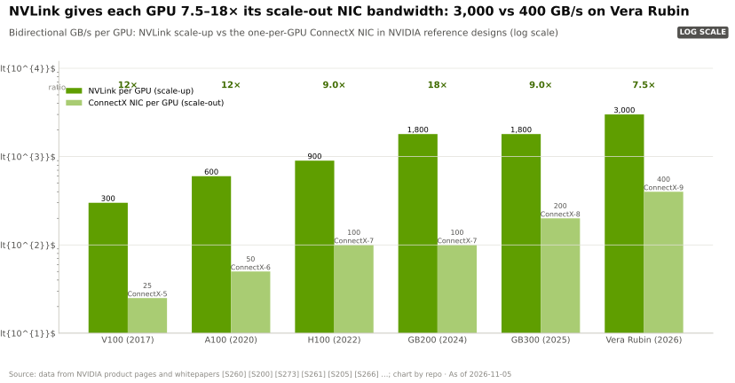
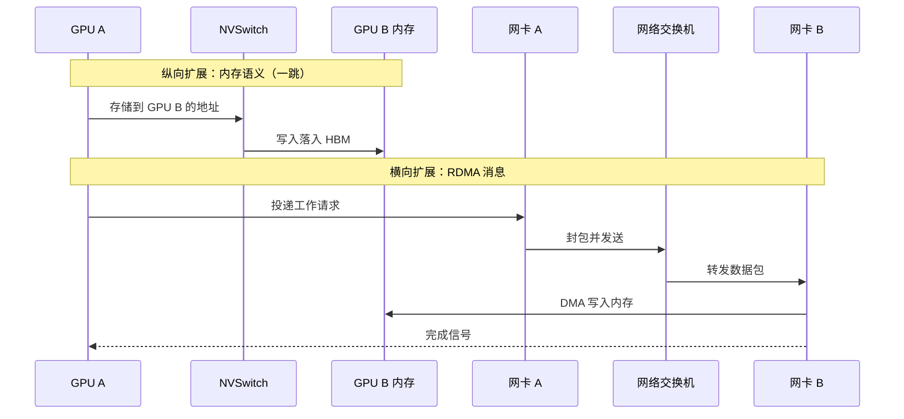
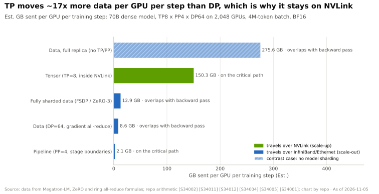

# 纵向扩展与横向扩展：一颗巨型 GPU，还是网络上的众多 GPU

> [!NOTE]
> 本页为英文原文的简体中文参考译文，仅供参考；如有出入，以[英文原文](../../../layers/05-scale-up-nvlink-nvswitch/scale-up-vs-scale-out.md "English original")为准。

第 05 层 · 纵向扩展（NVLink、NVSwitch）· 约 9 分钟阅读 · 最后核实：2026-11-05

## ⚡ 要点速览

- **两种互连网络，两种职能。** [纵向扩展（scale-up）](../../glossary.md#scale-up)把数十颗 GPU 紧密连接到如同一颗 GPU；[横向扩展（scale-out）](../../glossary.md#scale-out)则通过网络把成千上万个这样的 GPU 组连接起来。英伟达的纵向扩展网络是 [NVLink](../../glossary.md#nvlink) 加 [NVSwitch](../../glossary.md#nvswitch)。
- **每 GPU 的差距约为 9 倍。** 一颗 Blackwell GPU 经 NVLink 5 的单向带宽为 900 GB/s，而经其 800 Gb/s [网卡（NIC）](../../glossary.md#nic)仅为 100 GB/s [[S200]](../../../sources/bibliography.md#s200)[[S264]](../../../sources/bibliography.md#s264)；Vera Rubin 保持了相近的比例（1,500 vs 200 GB/s）[[S200]](../../../sources/bibliography.md#s200)[[S33004]](../../../sources/bibliography.md#s33004)。
- **区别在语义，而不只是带宽更多。** 在 [NVLink 域](../../glossary.md#nvlink-domain)内，一颗 GPU 用普通的加载和存储指令写入另一颗 GPU 的内存（[加载/存储语义](../../glossary.md#load-store-semantics)）；跨网络时，则需向网卡投递 [RDMA](../../glossary.md#rdma) 消息 [[S5017]](../../../sources/bibliography.md#s5017)。
- **是实测结果，而非仅为规格：** 即便在受出口管制限制的 H800 上，DeepSeek 的[混合专家模型（MoE）](../../glossary.md#mixture-of-experts)全交换在 NVLink 节点内达到 153 GB/s，而跨 [InfiniBand](../../glossary.md#infiniband) 仅为 43–58 GB/s [[S5005]](../../../sources/bibliography.md#s5005)；因此[张量并行](../../glossary.md#tensor-parallelism)与[专家并行](../../glossary.md#expert-parallelism)都留在 NVLink 域内。
- **弱点：** 由于 200 Gb/s 铜缆传输距离仅约 1 m [[S5010]](../../../sources/bibliography.md#s5010)，域的边界止于机架（72 颗 GPU）；谷歌可连接 9,216 颗 TPU [[S232]](../../../sources/bibliography.md#s232)，而 [UALink](../../glossary.md#ualink) 与 [ESUN](../../glossary.md#esun) 则意在让这一层商品化 [[S90050]](../../../sources/bibliography.md#s90050)[[S90052]](../../../sources/bibliography.md#s90052)。

## 1. 一颗巨型 GPU，还是通过网络对话的众多 GPU

不妨把它想象成开放式办公室与分散在多栋楼里的公司。在开放式办公室里（纵向扩展），你可以直接在同事的白板上写字；在楼与楼之间（横向扩展），你得把便条打包交给收发室（网卡），然后等待回执。在 NVLink 上，一颗 GPU 向属于另一颗 GPU 的地址执行存储操作；交换芯片负责路由，数据直接落入远端的[高带宽内存（HBM）](../../glossary.md#hbm)，全程无需网络协议栈参与。在网络上，工作请求先发给网卡，由网卡封装成数据包；远端网卡将其写入内存并发出完成信号 [[S5017]](../../../sources/bibliography.md#s5017)。

| | 纵向扩展（NVLink 域） | 横向扩展（集群网络） |
|---|---|---|
| 每 GPU 带宽（Blackwell） | 1.8 TB/s，单向 900 GB/s [[S200]](../../../sources/bibliography.md#s200) | 800 Gb/s = 单向 100 GB/s [[S264]](../../../sources/bibliography.md#s264) |
| 典型规模 | 8–72 颗 GPU，计划扩至 144 [[S262]](../../../sources/bibliography.md#s262)[[S510]](../../../sources/bibliography.md#s510) | 数千至 100,000+ 颗 GPU |
| 语义 | 对对端内存执行加载/存储 [[S5017]](../../../sources/bibliography.md#s5017) | 经网卡收发 RDMA 消息 [[S5017]](../../../sources/bibliography.md#s5017) |
| 拓扑 | 单跳交换，全互连 [[S262]](../../../sources/bibliography.md#s262) | 多层胖树（fat tree） |
| 介质 | 单机架内铜缆 [[S5000]](../../../sources/bibliography.md#s5000) | 以光纤为主 |
| 最适合 | 张量并行与专家并行 | 数据并行与流水线并行 |

> [!TIP]
> **算例 —— 同一次 MoE 数据交换在两种网络上的表现。** DeepSeek 实测：在 NVLink 上跨 8 颗 GPU 的专家并行分发（dispatch）带宽为 **153 GB/s**，在 400G InfiniBand 上跨 16–64 颗 GPU 为 **43–58 GB/s**：在 H800 上约为 3 倍，而 H800 因出口管制，NVLink 被削减至约 160 GB/s [[S5005]](../../../sources/bibliography.md#s5005)。Blackwell（单向 900 GB/s）对比 800G 网卡（100 GB/s）则为 **约 9 倍** [[S200]](../../../sources/bibliography.md#s200)[[S264]](../../../sources/bibliography.md#s264)。**结论：** 受出口管制限制的硬件低估了纵向扩展的优势。

🔧 技术细节：一颗 GPU 如何写入另一颗 GPU 的内存

- **统一地址空间。** NVSHMEM 把对端内存映射到每颗 GPU 中；NVLink 对端可直接接受普通的加载、存储与原子操作，节点外的对端则经网卡走 RDMA [[S5017]](../../../sources/bibliography.md#s5017)。
- **交换芯片兼作计算器。** 自第三代起，NVSwitch 可以在数据传输途中完成求和（[SHARP](../../glossary.md#sharp)），因此一次[全规约（all-reduce）](../../glossary.md#all-reduce)只需穿过交换芯片一次，而不必沿环形绕行 [[S205]](../../../sources/bibliography.md#s205)。
- **无需收发室。** NVLink 路径上没有数据包协议栈或完成队列，因此适合小而频繁的数据交换。DeepSeek 基于 RDMA 的[解码（decode）](../../glossary.md#decode)内核每次分发仍需 77–194 µs [[S5005]](../../../sources/bibliography.md#s5005)，且每一步都要在 58 个 MoE 层中重复 [[S5006]](../../../sources/bibliography.md#s5006)。

## 2. 带宽差距的量化

NVLink 5 的“1.8 TB/s”是双向合计（单向 900 GB/s）；“800 Gb/s”网卡则是单向 100 GB/s。

> [!TIP]
> **算例 —— 单向搬运一个 10 GB 的张量分片。** 两颗 GPU 互换 10 GB 分片（权重或较长的 [KV 缓存](../../glossary.md#kv-cache)）。NVLink 5：10 ÷ 900 GB/s = **11 ms**；800G 网卡：10 ÷ 100 = **100 ms** [[S200]](../../../sources/bibliography.md#s200)[[S264]](../../../sources/bibliography.md#s264)。Vera Rubin：NVLink 6（下调后规格）为 **6.7 ms**，而 1.6T ConnectX-9 为 **50 ms** [[S200]](../../../sources/bibliography.md#s200)[[S33004]](../../../sources/bibliography.md#s33004)；[PCIe](../../glossary.md#pcie) Gen5 x16 需 **156 ms** [[S222]](../../../sources/bibliography.md#s222)。**结论：** 每隔几毫秒交换一次状态，在 NVLink 域内可行，在域外则毫无可能。

**[Q2 · 关键指标]** 衡量纵向扩展网络优劣的五个数字：

1. **每 GPU 单向带宽：** 450（Hopper）、900（Blackwell）、1,500 GB/s（Rubin，下调后）[[S200]](../../../sources/bibliography.md#s200)。
2. **域规模：** [HGX](../../glossary.md#hgx) 为 8 颗 GPU，[NVL72](../../glossary.md#nvl72) 为 72 颗，Kyber 计划为 144 颗 [[S262]](../../../sources/bibliography.md#s262)[[S510]](../../../sources/bibliography.md#s510)。
3. **域带宽：** 130 TB/s（GB200 NVL72）、216 TB/s（Vera Rubin NVL72）[[S200]](../../../sources/bibliography.md#s200)。
4. **延迟与跳数：** NVL72 内仅一跳交换，环面（torus）或多层网络则需多跳。
5. **每比特能耗与成本：** 无源铜缆几乎不增加能耗（约 0 pJ/bit），而 DSP 光模块约为 19 pJ/bit [[S262]](../../../sources/bibliography.md#s262)[[S295]](../../../sources/bibliography.md#s295)。

## 3. 为何张量并行与专家并行留在 NVLink 域内

**[Q1 · 职能与失效后果]** 纵向扩展让通信最频繁的并行方式变得廉价。张量并行每层交换两次部分结果；专家并行则把每个 token 发送给其专家再取回（[分发与合并（dispatch and combine）](../../glossary.md#dispatch-and-combine)）。如果这些交换溢出到网络上，GPU 就会闲置：失效后果是利用率低、token 生成慢，而不是系统崩溃。入门篇 [P4](../../primers/P4-parallelism-explained.md) 估算，张量并行每颗 GPU 搬运的数据量约为数据并行的 17 倍。

> [!TIP]
> **算例 —— 部署 70B 模型时的张量并行。** 8 路张量并行、64 token 的解码批次、隐藏维度 8,192、[BF16](../../glossary.md#bf16) 精度：每次全规约传输 64 × 8,192 × 2 B ≈ 1.05 MB，环形算法下每颗 GPU 发送约 1.8 MB，每层 2 次 × 80 层 ≈ **每步 294 MB**（本资料库计算，方法同 P4）。NVLink 5：**0.33 ms**；800G 网卡：**2.9 ms**；400G：**5.9 ms** [[S200]](../../../sources/bibliography.md#s200)[[S264]](../../../sources/bibliography.md#s264)[[S266]](../../../sources/bibliography.md#s266)。在每用户 50 tokens/s 下，每步为 20 ms，因此网卡路径在计入 160 次网络往返之前就已耗去其中 15–30%。**结论：** 张量并行留在单个域内，如 Llama 3 405B（8 颗 GPU）[[S34006]](../../../sources/bibliography.md#s34006)；更大的域则用于专家并行。

> [!WARNING]
> **误区与事实：**“以太网将使 NVLink 变得多余。”真正的竞争在于纵向扩展*采用哪种协议*（NVLink、UALink 或 ESUN）[[S90050]](../../../sources/bibliography.md#s90050)[[S90052]](../../../sources/bibliography.md#s90052)，而非是否需要纵向扩展（见[竞争格局](competition.md)）。

## 🎯 企业发展视角

1. **价值追随最快的连线。** 无法离开 NVLink 域的并行方式，把模型架构与英伟达机架设计绑定在一起。哪些工作负载在更小或开放的域上也能运行得同样好？
2. **网卡是商品化的一侧。** 纵向扩展正是英伟达捆绑交换芯片、铜缆背板与软件的环节；一旦 UALink 产品于 2027 年出货，这一捆绑能维持多久 🟡 [[S90051]](../../../sources/bibliography.md#s90051)？
3. **受出口管制的数据具有误导性。** DeepSeek 在 H800 上测得的 3 倍差距，低估了当前产品上约 9 倍的差距 [[S5005]](../../../sources/bibliography.md#s5005)[[S200]](../../../sources/bibliography.md#s200)；对任何 MoE 效率宣称，都应追问其是在哪种互连上测得的。
4. **高通问题（仅基于公开信息）：** AI200/AI250 机架采用 PCIe 纵向扩展与以太网横向扩展 [[S90029]](../../../sources/bibliography.md#s90029)；模型规模达到多大时，内存语义域会变得必不可少？届时 Fusion、UALink 与 ESUN 哪个是更便宜的解决方案（见 [NVLink Fusion](nvlink-fusion.md)）？

## 📚 来源（Sources）

<!-- Auto-generated from the [S…] citations on this page by `make build`. Edit sources/registry/*.csv, not this list. -->

- [**S200**](../../../sources/bibliography.md#s200) NVIDIA, *NVIDIA NVLink and NVLink Switch (product page with NVLink and NVLink Switch specification tables)*, 2026-09. [Link](https://www.nvidia.com/en-us/data-center/nvlink/)
- [**S205**](../../../sources/bibliography.md#s205) NVIDIA Technical Blog, *Upgrading Multi-GPU Interconnectivity with the Third-Generation NVIDIA NVSwitch*, 2022-08. [Link](https://developer.nvidia.com/blog/upgrading-multi-gpu-interconnectivity-with-the-third-generation-nvidia-nvswitch/)
- [**S222**](../../../sources/bibliography.md#s222) Tom's Hardware, *PCI Express roadmap: the path to 1TB/s with PCIe 8.0, the challenges of integration, and beyond*, 2025. [Link](https://www.tomshardware.com/pc-components/motherboards/pci-express-roadmap-the-path-to-1tb-s-with-pci-8-0-the-challenges-of-integration-and-beyond)
- [**S232**](../../../sources/bibliography.md#s232) Google Cloud, *TPU7x (Ironwood) - Cloud TPU documentation*, 2025-11. [Link](https://docs.cloud.google.com/tpu/docs/tpu7x)
- [**S262**](../../../sources/bibliography.md#s262) NVIDIA, *NVIDIA GB200 NVL72 (product page)*, 2024. [Link](https://www.nvidia.com/en-us/data-center/gb200-nvl72/)
- [**S264**](../../../sources/bibliography.md#s264) NVIDIA Newsroom, *NVIDIA Announces New Switches Optimized for Trillion-Parameter GPU Computing and AI Infrastructure (Quantum-X800, Spectrum-X800, ConnectX-8)*, 2024-03-18. [Link](https://nvidianews.nvidia.com/news/networking-switches-gpu-computing-ai)
- [**S266**](../../../sources/bibliography.md#s266) NVIDIA Newsroom, *NVIDIA Quantum-2 Takes Supercomputing to New Heights, Into the Cloud*, 2021-11-09. [Link](https://nvidianews.nvidia.com/news/nvidia-quantum-2-takes-supercomputing-to-new-heights-into-the-cloud)
- [**S295**](../../../sources/bibliography.md#s295) LPO MSA, *Linear Pluggable Optics Multi-Source Agreement (LPO MSA)*, 2024. [Link](https://www.lpo-msa.org/)
- [**S510**](../../../sources/bibliography.md#s510) KGI Securities, *NVIDIA GTC 2026 (research note)*, 2026-03-19. [Link](https://www.kgi.com.hk/zh-hk/-/media/files/kgishk/research-reports/tw-reports/nvidia-gtc-2026_19032026e.pdf)
- [**S5000**](../../../sources/bibliography.md#s5000) SemiAnalysis, *Nvidia's Optical Boogeyman - NVL72, InfiniBand Scale Out, 800G & 1.6T Ramp*, 2024-03. [Link](https://newsletter.semianalysis.com/p/nvidias-optical-boogeyman-nvl72-infiniband)
- [**S5005**](../../../sources/bibliography.md#s5005) DeepSeek-AI (GitHub) (DeepSeek-AI), *DeepEP: an efficient expert-parallel communication library (README v1.2.1)*, 2025. [Link](https://github.com/deepseek-ai/DeepEP/blob/v1.2.1/README.md)
- [**S5006**](../../../sources/bibliography.md#s5006) DeepSeek-AI (GitHub) (DeepSeek-AI), *DeepSeek-V3 inference configuration (config_671B.json)*, 2024-12-26. [Link](https://github.com/deepseek-ai/DeepSeek-V3/blob/main/inference/configs/config_671B.json)
- [**S5010**](../../../sources/bibliography.md#s5010) IEEE 802.3, *IEEE P802.3dj adopted objectives (200 Gb/s per lane electrical and optical signaling)*, 2024-03-14. [Link](https://grouper.ieee.org/groups/802/3/dj/projdoc/objectives_P802d3dj_240314.pdf)
- [**S5017**](../../../sources/bibliography.md#s5017) NVIDIA Docs, *NVSHMEM API documentation: introduction*, 2025. [Link](https://docs.nvidia.com/nvshmem/api/introduction.html)
- [**S33004**](../../../sources/bibliography.md#s33004) NVIDIA Newsroom, *NVIDIA Kicks Off the Next Generation of AI With Rubin — Six New Chips; One Incredible AI Supercomputer*, 2026-01-05. [Link](https://nvidianews.nvidia.com/news/rubin-platform-ai-supercomputer)
- [**S34006**](../../../sources/bibliography.md#s34006) arXiv:2407.21783 (Llama Team (AI @ Meta)), *The Llama 3 Herd of Models*, 2024-07-31. [Link](https://arxiv.org/abs/2407.21783)
- [**S90029**](../../../sources/bibliography.md#s90029) Verdict, *Qualcomm AI200 and AI250 racks for AI inference*, 2025-10. [Link](https://www.verdict.co.uk/qualcomm-ai200-ai250-racks-ai-inference/)
- [**S90050**](../../../sources/bibliography.md#s90050) HPCwire, *UALink Consortium publishes 4 specifications defining in-network compute, chiplets, manageability and 200G performance*, 2026-04-07. [Link](https://www.hpcwire.com/off-the-wire/ualink-consortium-publishes-4-specifications-defining-in-network-compute-chiplets-manageability-and-200g-performance/)
- [**S90051**](../../../sources/bibliography.md#s90051) SDxCentral, *UALink Consortium takes another swing at Nvidia's NVLink supremacy with specification 2.0*, 2026-04. [Link](https://www.sdxcentral.com/news/ualink-consortium-takes-another-swing-at-nvidias-nvlink-supremacy-with-specification-20/)
- [**S90052**](../../../sources/bibliography.md#s90052) Synopsys, *Ethernet standards for scale-up AI: an overview of ESUN, SUE, and UALink*, 2025-11. [Link](https://www.synopsys.com/articles/ethernet-standards-scale-up-ai.html)
