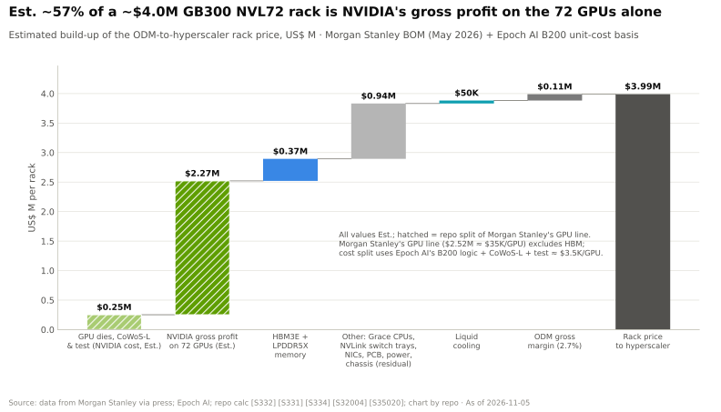
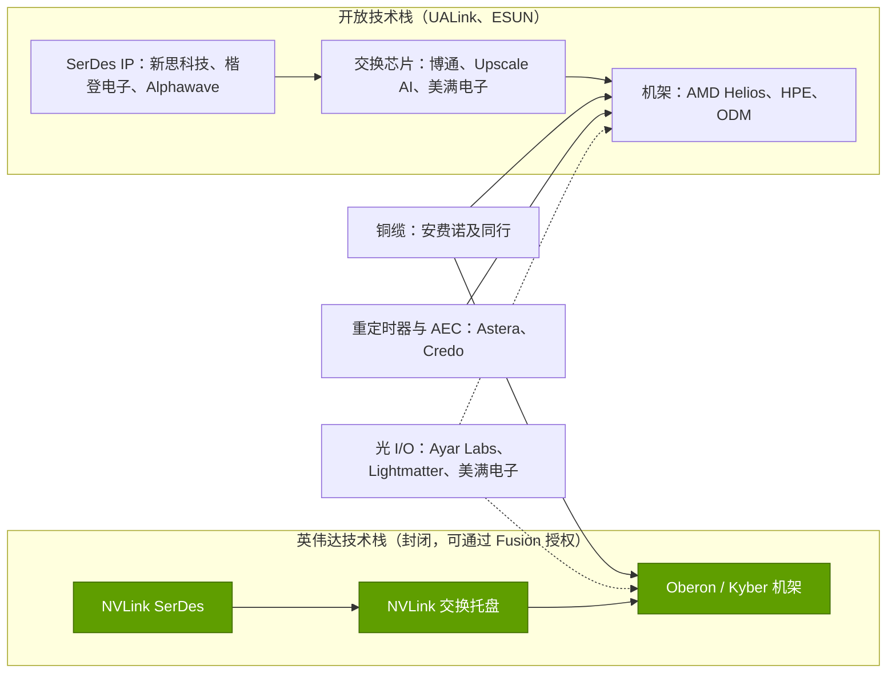

# 纵向扩展（NVLink、NVSwitch）：价值链与企业发展视角

> [!NOTE]
> 本页为英文原文的简体中文参考译文，仅供参考；如有出入，以[英文原文](../../../layers/05-scale-up-nvlink-nvswitch/value-chain-and-corp-dev.md "English original")为准。

第 05 层 · 纵向扩展（NVLink、NVSwitch）· 约 12 分钟阅读 · 最后核实：2026-11-05

## ⚡ 要点速览

- **英伟达保留了[纵向扩展（scale-up）](../../../glossary.md#scale-up)的大部分价值：** 网络业务在 Q4 FY2026 达到约 $11B，增长主要由 [NVLink](../../../glossary.md#nvlink) 交换芯片驱动；在 Q2 FY2027 约为 $17.5B（估计），占数据中心收入的五分之一 [[S402]](../../../sources/bibliography.md#s402)[[S5514]](../../../sources/bibliography.md#s5514)[[S408]](../../../sources/bibliography.md#s408)[[S90013]](../../../sources/bibliography.md#s90013)。
- **Rubin 让每机架的交换芯片含量翻倍：** 每台 [NVL72](../../../glossary.md#nvl72) 有 36 颗 NVLink 交换芯片，GB300 为 18 颗。在一台 $7.8M 的 Vera Rubin 机架中，除 GPU、内存、CPU、散热和 ODM 利润之外约 19% 的部分包含了这些芯片（估计，摩根士丹利（Morgan Stanley）；本资料库推算余项）[[S332]](../../../sources/bibliography.md#s332)[[S330]](../../../sources/bibliography.md#s330)。
- **铜缆供应商同样增长迅猛。** 安费诺（Amphenol）2026 年第三季度销售额增长 65% 至 $10.2B，AI 约占 IT 数据通信业务的四分之三 [[S5503]](../../../sources/bibliography.md#s5503)。Credo 凭借[有源电缆（AEC）](../../../glossary.md#active-electrical-cable)，FY2026 收入增长两倍至 $1.335B [[S5504]](../../../sources/bibliography.md#s5504)。Astera Labs 季度收入翻倍至 $392M [[S3524]](../../../sources/bibliography.md#s3524)。
- **[SerDes](../../../glossary.md#serdes) IP 正在整合：** 高通（Qualcomm）于 2025-12-18 完成对 Alphawave Semi 约 $2.4B 的收购。新思科技（Synopsys）与楷登电子（Cadence）向 [NVLink Fusion](../../../glossary.md#nvlink-fusion) 授权 IP [[S4514]](../../../sources/bibliography.md#s4514)[[S4513]](../../../sources/bibliography.md#s4513)[[S217]](../../../sources/bibliography.md#s217)。
- **光学与交换芯片初创公司正被收购：** 美满电子（Marvell）于 2026 年 2 月完成对 Celestial AI（首付 $3.25B）和 XConn 的收购，英伟达则以超过 $900M 招揽了 Enfabrica 的团队 [[S2513]](../../../sources/bibliography.md#s2513)[[S5508]](../../../sources/bibliography.md#s5508)[[S475]](../../../sources/bibliography.md#s475)。
- **[Q8 · 价值池与并购机会]** 共有四个价值池：交换芯片、SerDes IP、铜缆互连与[光 I/O](../../../glossary.md#optical-io)。英伟达在其机架中独占第一个；[UALink](../../../glossary.md#ualink) 与以太网纵向扩展将于 2027 年向商用芯片厂商开放这一价值池 🟡 [[S90051]](../../../sources/bibliography.md#s90051)[[S275]](../../../sources/bibliography.md#s275)。

## 纵向扩展域中的收益由谁获取

纵向扩展域包含四类内容：**交换芯片**（英伟达，或 Helios 中的博通（Broadcom））、每颗芯片上的 **SerDes**（自研或授权）、**铜缆**背板线缆盒、线缆与连接器，以及在链路过长、无源铜缆无法覆盖时使用的**[重定时器（retimer）](../../../glossary.md#retimer)与 AEC**。英伟达设计机架并销售交换托盘；其余部分由 ODM 组装。在一台 GB300 机架中，交换托盘归入约 $3.99M 总价中约 $0.94M 的“其他内容”类别（估计，摩根士丹利）[[S332]](../../../sources/bibliography.md#s332)。

| 价值池 | 由谁获取 | 经济性依据 | 来源 |
|---|---|---|---|
| 交换芯片与托盘 | 英伟达；博通（Helios）；2027 年起的 UALink 新进入者 | 英伟达 GAAP 毛利率 75%（全公司，Q2 FY2027）；每 GPU 交换芯片数 0.25 → 0.5 | [[S3]](../../../sources/bibliography.md#s3)[[S332]](../../../sources/bibliography.md#s332) |
| SerDes IP | 自研（英伟达、博通）；新思科技、楷登电子；Alphawave（高通） | Alphawave 约 $2.4B | [[S217]](../../../sources/bibliography.md#s217)[[S4514]](../../../sources/bibliography.md#s4514) |
| 铜缆背板、线缆、连接器 | 安费诺及其他连接器厂商 | 安费诺 2026 年第三季度销售额 $10.2B，同比 +65%；每台 GB200 NVL72 约 5,184 根线缆 | [[S5503]](../../../sources/bibliography.md#s5503)[[S5517]](../../../sources/bibliography.md#s5517) |
| 重定时器、AEC、互连交换芯片 | Astera Labs、Credo、美满电子 | Astera GAAP 毛利率约 72%（第三季度指引） | [[S3525]](../../../sources/bibliography.md#s3525)[[S5504]](../../../sources/bibliography.md#s5504) |
| 光 I/O 与 CPO | 英伟达携手台积电（TSMC）；Ayar Labs、Lightmatter；美满电子（Celestial AI） | Ayar 估值约 $3.75B，Lightmatter 估值 $4.4B | [[S90048]](../../../sources/bibliography.md#s90048)[[S5511]](../../../sources/bibliography.md#s5511)[[S2510]](../../../sources/bibliography.md#s2510)[[S2513]](../../../sources/bibliography.md#s2513) |

> [!TIP]
> **算例 —— 铜缆背板对买家价值几何。** 英伟达称，以铜缆替代光学可使每台 NVL72 节省约 20 kW [[S5515]](../../../sources/bibliography.md#s5515)，约为 GB200 机架峰值功耗（约 132 kW）的 15% [[S33021]](../../../sources/bibliography.md#s33021)。在电力受限的机房中，这意味着同样的电网接入可多部署约 15% 的机架。仅电费一项，按假设的 $0.08/kWh 计算，20 kW × 8,760 h × 5 年 ≈ 876 MWh ≈ 每机架 $70,000。每台 GB200 机架约 5,184 根铜缆对买家的价值，远超其在物料清单中所占的份额 [[S5517]](../../../sources/bibliography.md#s5517)，这正是安费诺等连接器厂商能够分享 NVLink 增长的原因。

🔧 技术细节：重定时器与 AEC 的适用与不适用场景

在每通道 200G 下，无源铜缆传输距离仅约 1–2 m [[S262]](../../../sources/bibliography.md#s262)。在单台 NVL72 内部，背板保持无源，这正是英伟达能够省去约 20 kW 光学器件的原因 [[S5515]](../../../sources/bibliography.md#s5515)。重定时器和 AEC 会重建信号，让铜缆再延长几米，目前主要用于网卡到交换机的[横向扩展（scale-out）](../../../glossary.md#scale-out)链路。多机架纵向扩展（NVL576、NVL1152）才是 AEC、光学与 [CPO](../../../glossary.md#co-packaged-optics) 的竞争战场 [[S108]](../../../sources/bibliography.md#s108)。Credo 在 FY2026 的增长来自[超大规模云厂商](../../../glossary.md#hyperscaler)的 AEC 出货量 [[S5505]](../../../sources/bibliography.md#s5505)。

## 供应商、合作伙伴与私营公司

**NVLink Fusion 首发合作伙伴**包括联发科（MediaTek）、美满电子、世芯（Alchip）和 Astera Labs（定制芯片与互连），新思科技和楷登电子（IP），以及高通和富士通（Fujitsu）（CPU）[[S217]](../../../sources/bibliography.md#s217)[[S90031]](../../../sources/bibliography.md#s90031)。随后又有 Arm Neoverse 支持（2025 年 11 月）、AWS Trainium4（2025 年 12 月）以及英伟达对美满电子 $2B 的入股（2026 年 3 月）[[S219]](../../../sources/bibliography.md#s219)[[S518]](../../../sources/bibliography.md#s518)[[S218]](../../../sources/bibliography.md#s218)。其中多家同时支持开放阵营：Astera Labs 是 UALink 董事会成员 [[S5520]](../../../sources/bibliography.md#s5520)，美满电子则收购了 XConn 的 [PCIe](../../../glossary.md#pcie)/CXL 交换芯片团队，为 UALink 时代的交换业务布局 [[S5508]](../../../sources/bibliography.md#s5508)[[S5510]](../../../sources/bibliography.md#s5510)。

| 私营公司 | 业务 | 最近一次公开融资 | 为何重要 |
|---|---|---|---|
| Ayar Labs | 光 I/O 芯粒，把光纤接到封装边缘 | 2026 年 3 月 $500M E 轮，估值约 $3.75B；英伟达与 AMD 参投 [[S5511]](../../../sources/bibliography.md#s5511) | 已加入 NVLink Fusion（约 2026 年 6 月）🟡 [[S5513]](../../../sources/bibliography.md#s5513)；多机架 NVLink 的候选方案 |
| Lightmatter | 光子中介层与光互连 | 2024 年 10 月 $400M D 轮，估值 $4.4B [[S2510]](../../../sources/bibliography.md#s2510) | 可为任意 XPU 提供光学纵向扩展 |
| Upscale AI | UALink 1.0 交换 ASIC（SkyHammer），最多支持 1,024 个设备 | 2026 年 1 月 $200M A 轮，估值超过 $1B [[S5506]](../../../sources/bibliography.md#s5506) | 早期商用 UALink 交换芯片，目标 2026 年第四季度推出 🟡 |

> [!TIP]
> **算例 —— 私营标的池萎缩得有多快。** Enfabrica 的团队归入英伟达（超过 $900M），Celestial AI 归入美满电子（首付 $3.25B 外加业绩对赌付款）[[S475]](../../../sources/bibliography.md#s475)[[S2513]](../../../sources/bibliography.md#s2513)。上市 SerDes 公司 Alphawave 归入高通（约 $2.4B）[[S4514]](../../../sources/bibliography.md#s4514)。2025 年 6 月至 2026 年 2 月间，约有 $6.5B 的已公布交易价值从独立公司流向平台型企业。2024 年 12 月获得英伟达、AMD 与英特尔投资的 Ayar Labs 仍保持独立，其估值在 15 个月内增长逾两倍，从超过 $1B 升至约 $3.75B [[S5512]](../../../sources/bibliography.md#s5512)[[S5511]](../../../sources/bibliography.md#s5511)。稀缺性正在被计入价格。

## 并购历史与价值池地图

英伟达买下了交换技术能力（Mellanox，$6.9B，2020-04-27 完成交割）[[S464]](../../../sources/bibliography.md#s464)，招揽了一支互连网络团队（Enfabrica）[[S475]](../../../sources/bibliography.md#s475)，并以股权投资绑定合作伙伴：英特尔（$5B，[x86](../../../glossary.md#x86) CPU 接入 NVLink）与美满电子（$2B，Fusion XPU）[[S468]](../../../sources/bibliography.md#s468)[[S218]](../../../sources/bibliography.md#s218)。竞争对手则收购了自己缺失的拼图：机架团队（AMD 收购 ZT Systems，$4.9B，制造业务转售给 Sanmina）[[S5527]](../../../sources/bibliography.md#s5527)[[S5528]](../../../sources/bibliography.md#s5528)、SerDes（高通收购 Alphawave）、光学（美满电子收购 Celestial AI）和交换芯片（美满电子收购 XConn）[[S4514]](../../../sources/bibliography.md#s4514)[[S2513]](../../../sources/bibliography.md#s2513)[[S5508]](../../../sources/bibliography.md#s5508)。

**[Q8 · 价值池与并购机会]** 各价值池的特性各不相同：

- **交换芯片：** 规模最大、争夺最激烈的价值池；随每 GPU 交换芯片数（Rubin 中由 0.25 → 0.5）增长，由 Fusion 与年度迭代节奏守护 [[S332]](../../../sources/bibliography.md#s332)。
- **SerDes IP：** 收入规模小，但能力具有决定性；Alphawave、Celestial AI 和 Enfabrica 均已被收编。
- **铜缆互连：** 在两大阵营中都随出货量增长。
- **光学：** 押注 2028 年多机架域的期权；Ayar Labs、Lightmatter 和美满电子正受到两大阵营的争相拉拢 🔴。

## 🎯 企业发展视角

1. 对 CPU 或加速器厂商而言，参与 NVLink Fusion 能换来什么（进入英伟达机架、接触其客户），又要付出什么（依赖英伟达的交换托盘、定价与路线图），与 UALink 或 [ESUN](../../../glossary.md#esun) 相比孰优孰劣 [[S217]](../../../sources/bibliography.md#s217)[[S518]](../../../sources/bibliography.md#s518)？
2. 高通（仅基于公开信息）是 Fusion CPU 合作伙伴，拥有 Alphawave 的 SerDes，并计划在 2028 年的 AI300 上采用 UALink/ESUN [[S90031]](../../../sources/bibliography.md#s90031)[[S4513]](../../../sources/bibliography.md#s4513)[[S90060]](../../../sources/bibliography.md#s90060)。哪些资产可同时服务两种互连网络？哪些需要自建或收购？
3. 在 Celestial AI、Enfabrica 与 Alphawave 已被收编之后，还剩下哪些独立的光 I/O 或交换芯片团队（Ayar Labs、Lightmatter、Upscale AI），估值几何 [[S5511]](../../../sources/bibliography.md#s5511)[[S2510]](../../../sources/bibliography.md#s2510)[[S5506]](../../../sources/bibliography.md#s5506)？
4. 从铜缆向光学的转型（Feynman NVL1152）会把价值从连接器厂商转移到光子器件供应商，还是两者都会随出货量增长 [[S108]](../../../sources/bibliography.md#s108)[[S5503]](../../../sources/bibliography.md#s5503)？
5. 如果商用 UALink 交换芯片于 2027 年到来，交换托盘的利润有多少面临风险？与商用交换芯片厂商合作，是否比自建更划算？

## 📚 来源（Sources）

<!-- Auto-generated from the [S…] citations on this page by `make build`. Edit sources/registry/*.csv, not this list. -->

- [**S3**](../../../sources/bibliography.md#s3) StorageNewsletter, *NVIDIA Q2 Fiscal 2027 results coverage: revenue $96.2B*, 2026-08-27. [Link](https://www.storagenewsletter.com/2026/08/27/nvidia-fiscal-2q27-financial-results/)
- [**S108**](../../../sources/bibliography.md#s108) HPCwire / AIwire, *Huang Shares Nvidia Roadmap Showing More Chips, NVL1152, Scale-Up CPO*, 2026-03-18. [Link](https://www.hpcwire.com/aiwire/2026/03/18/huang-shares-nvidia-roadmap-showing-more-chips-nvl1152-scale-up-cpo/)
- [**S217**](../../../sources/bibliography.md#s217) NVIDIA via Barchart, *NVIDIA Unveils NVLink Fusion for Industry to Build Semi-Custom AI Infrastructure With NVIDIA Partner Ecosystem (press release, syndicated)*, 2025-05-19. [Link](https://www.barchart.com/story/news/32460751/nvidia-unveils-nvlink-fusion-for-industry-to-build-semi-custom-ai-infrastructure-with-nvidia-partner-ecosystem)
- [**S218**](../../../sources/bibliography.md#s218) Converge Digest, *NVIDIA invests $2B in Marvell to extend NVLink Fusion AI ecosystem*, 2026-03-31. [Link](https://convergedigest.com/nvidia-invests-2b-in-marvell-to-extend-nvlink-fusion-ai-ecosystem/)
- [**S219**](../../../sources/bibliography.md#s219) Converge Digest, *Arm extends Neoverse with NVIDIA NVLink Fusion*, 2025-11. [Link](https://convergedigest.com/arm-extends-neoverse-with-nvidia-nvlink-fusion/)
- [**S262**](../../../sources/bibliography.md#s262) NVIDIA, *NVIDIA GB200 NVL72 (product page)*, 2024. [Link](https://www.nvidia.com/en-us/data-center/gb200-nvl72/)
- [**S275**](../../../sources/bibliography.md#s275) Broadcom, *Broadcom ships Tomahawk Ultra: reimagining the Ethernet switch for HPC and AI scale-up*, 2025-07-15. [Link](https://investors.broadcom.com/news-releases/news-release-details/broadcom-ships-tomahawk-ultra-reimagining-ethernet-switch-hpc-and-ai)
- [**S330**](../../../sources/bibliography.md#s330) PC Gamer, *A single Nvidia Vera Rubin rack is estimated to cost $7,803,148 with over $2 million of that figure spent on memory alone*, 2026-05. [Link](https://pcgamer.com/hardware/a-single-nvidia-vera-rubin-rack-is-estimated-to-cost-usd7-803-148-with-over-usd2-million-of-that-figure-spent-on-memory-alone)
- [**S332**](../../../sources/bibliography.md#s332) Tiger Brokers (iTiger), *Morgan Stanley's BOM analysis of NVIDIA's Rubin: GPU share declines; PCB, MLCC and ABF substrate values soar*, 2026-05-20. [Link](https://www.itiger.com/news/1188068712)
- [**S402**](../../../sources/bibliography.md#s402) NVIDIA Corporation via SEC EDGAR (Colette Kress), *CFO Commentary on Fourth Quarter and Fiscal 2026 Results (Form 8-K exhibit 99.2)*, 2026-02-25. [Link](https://www.sec.gov/Archives/edgar/data/1045810/000104581026000019/q4fy26cfocommentary.htm)
- [**S408**](../../../sources/bibliography.md#s408) NVIDIA Corporation, *NVIDIA Corp. (NVDA) Q2 Fiscal 2027 earnings call transcript (26 August 2026)*, 2026-08-26. [Link](https://s201.q4cdn.com/141608511/files/content_files/TRANSCRIPT_-NVIDIA-Corp-NVDA-US-Q2-2027-Earnings-Call-26-August-2026-5_00-PM-ET.pdf)
- [**S464**](../../../sources/bibliography.md#s464) NVIDIA Newsroom, *NVIDIA to Acquire Mellanox for $6.9 Billion*, 2019-03-11. [Link](https://nvidianews.nvidia.com/news/nvidia-to-acquire-mellanox-for-6-9-billion)
- [**S468**](../../../sources/bibliography.md#s468) NVIDIA Newsroom, *NVIDIA and Intel to Develop AI Infrastructure and Personal Computing Products*, 2025-09-18. [Link](https://nvidianews.nvidia.com/news/nvidia-and-intel-to-develop-ai-infrastructure-and-personal-computing-products)
- [**S475**](../../../sources/bibliography.md#s475) CNBC, *Nvidia spends over $900 million on Enfabrica CEO, AI startup technology*, 2025-09-18. [Link](https://www.cnbc.com/technology/)
- [**S518**](../../../sources/bibliography.md#s518) ServeTheHome, *NVIDIA NVLink Fusion tapped for future AWS Trainium4 deployments*, 2025-12-02. [Link](https://www.servethehome.com/nvidia-nvlink-fusion-tapped-for-future-aws-trainium4-deployments/)
- [**S2510**](../../../sources/bibliography.md#s2510) Bloomberg, *Photonic Computing Startup Lightmatter Reaches $4.4 Billion Valuation*, 2024-10-16. [Link](https://www.bloomberg.com/news/articles/2024-10-16/photonic-computing-startup-lightmatter-reaches-4-4-billion-valuation)
- [**S2513**](../../../sources/bibliography.md#s2513) Business Wire (Marvell), *Marvell Completes Acquisition of Celestial AI*, 2026-02-02. [Link](https://www.businesswire.com/news/home/20260201331090/en/marvell-completes-acquisition-of-celestial-ai)
- [**S3524**](../../../sources/bibliography.md#s3524) Dealroom, *Astera Labs revenue doubles to $392M as new investors pile in*, 2026-08. [Link](https://dealroom.co/news/147670-astera-labs-revenue-doubles-to-392m-as-new-investors-pile-in/)
- [**S3525**](../../../sources/bibliography.md#s3525) TS2 Tech, *Astera Labs climbs after hours as Q3 revenue forecast beats consensus*, 2026-08. [Link](https://ts2.tech/en/astera-labs-nasdaqalab-climbs-in-after-hours-as-q3-revenue-forecast-beats-consensus-by-32/)
- [**S4513**](../../../sources/bibliography.md#s4513) I-Connect007, *Qualcomm completes acquisition of Alphawave Semi*, 2025-12-18. [Link](https://iconnect007.com/article/148161/qualcomm-completes-acquisition-of-alphawave-semi/148158/ein)
- [**S4514**](../../../sources/bibliography.md#s4514) CRN Asia, *Qualcomm: US$2.4 billion Alphawave Semi buy to boost data center push*, 2025-06. [Link](https://www.crnasia.com/news-network/2025/qualcomm-us-2)
- [**S5503**](../../../sources/bibliography.md#s5503) MarketBeat, *Transcript: Amphenol Q3 2026 earnings call highlights*, 2026-10-28. [Link](https://www.marketbeat.com/instant-alerts/transcript-amphenol-q3-earnings-call-highlights-2026-10-28/)
- [**S5504**](../../../sources/bibliography.md#s5504) Credo Technology Group via SEC EDGAR, *Credo Technology Group Form 10-K for fiscal year ended 2026-05-02*, 2026-06. [Link](https://www.sec.gov/Archives/edgar/data/0001807794/000162828026043303/crdo-20260502.htm)
- [**S5505**](../../../sources/bibliography.md#s5505) Credo Technology Group via SEC EDGAR, *Credo Technology Group Form 10-Q for the quarter ended 2026-08-01*, 2026-09. [Link](https://www.sec.gov/Archives/edgar/data/0001807794/000162828026060111/crdo-20260801.htm)
- [**S5506**](../../../sources/bibliography.md#s5506) The Register, *AI networking startup Upscale AI scores $200M to challenge Nvidia's NVSwitch*, 2026-01-22. [Link](https://www.theregister.com/2026/01/22/upscale_skyhammer_nvidia/)
- [**S5508**](../../../sources/bibliography.md#s5508) Marvell Technology, *Marvell Completes Acquisition of XConn Technologies*, 2026-02-10. [Link](https://investor.marvell.com/news-events/press-releases/detail/1007/marvell-completes-acquisition-of-xconn-technologies)
- [**S5510**](../../../sources/bibliography.md#s5510) Futurum Group, *Marvell's XConn buy yields a two-pronged open fabric play against NVLink*, 2026-03. [Link](https://www.futurumgroup.com/insights/marvells-xconn-buy-yields-a-two-pronged-open-fabric-play-against-nvlink/)
- [**S5511**](../../../sources/bibliography.md#s5511) Berkeley Wireless Research Center (Ayar Labs announcement), *Ayar Labs closes $500M Series E, accelerates volume production of co-packaged optics*, 2026-03. [Link](https://bwrc.berkeley.edu/node/535)
- [**S5512**](../../../sources/bibliography.md#s5512) Business Wire (Ayar Labs), *Ayar Labs, with investments from AMD, Intel Capital and NVIDIA, secures $155 million*, 2024-12-11. [Link](https://www.businesswire.com/news/home/20241211964729/en/Ayar-Labs-with-Investments-from-AMD-Intel-Capital-and-NVIDIA-Secures-155-Million-to-Address-Urgent-Need-for-Scalable-Cost-Effective-AI-Infrastructure)
- [**S5513**](../../../sources/bibliography.md#s5513) StockAnalysis, *Ayar Labs (private company profile and news)*, 2026-09. [Link](https://stockanalysis.com/private/ayar-labs/)
- [**S5514**](../../../sources/bibliography.md#s5514) SDxCentral, *Nvidia's networking arm hits $31B as new cornerstone of AI dominance*, 2026-02. [Link](https://www.sdxcentral.com/news/nvidias-networking-arm-hits-31b-as-new-cornerstone-of-ai-dominance/)
- [**S5515**](../../../sources/bibliography.md#s5515) ServeTheHome, *This is the NVIDIA DGX GB200 NVL72*, 2024-03-19. [Link](https://www.servethehome.com/this-is-the-nvidia-dgx-gb200-nvl72/)
- [**S5517**](../../../sources/bibliography.md#s5517) The Next Platform, *Copper wires have already failed clustered AI systems*, 2024-09-13. [Link](https://www.nextplatform.com/2024/09/13/copper-wires-have-already-failed-clustered-ai-systems/)
- [**S5520**](../../../sources/bibliography.md#s5520) Business Wire, *Ultra Accelerator Link Consortium incorporates and opens membership*, 2024-10-29. [Link](https://www.businesswire.com/news/home/20241029998800/en)
- [**S5527**](../../../sources/bibliography.md#s5527) Evertiq, *AMD completes sale of ZT Systems manufacturing unit to Sanmina*, 2025-10-27. [Link](https://evertiq.com/design/2025-10-27-amd-completes-sale-of-zt-systems-manufacturing-unit-to-sanmina)
- [**S5528**](../../../sources/bibliography.md#s5528) Sanmina, *Sanmina completes acquisition of ZT Systems data center infrastructure manufacturing business from AMD*, 2025-10-27. [Link](https://s201.q4cdn.com/209924174/files/doc_news/SANMINA-COMPLETES-ACQUISITION-OF-ZT-SYSTEMS-DATA-CENTER-INFRASTRUCTURE-MANUFACTURING-BUSINESS-FROM-AMD-2025.pdf)
- [**S33021**](../../../sources/bibliography.md#s33021) SemiAnalysis (Dylan Patel, Wega Chu, Daniel Nishball et al.), *GB200 Hardware Architecture — Component Supply Chain and BOM*, 2024-07-17. [Link](https://semianalysis.com/2024/07/17/gb200-hardware-architecture-and-component/)
- [**S90013**](../../../sources/bibliography.md#s90013) Quartr, *NVIDIA (NVDA) Q2 2027 earnings summary*, 2026-08-26. [Link](https://quartr.com/events/nvidia-corporation-nvda-q2-2027_33dRoFp6)
- [**S90031**](../../../sources/bibliography.md#s90031) ServeTheHome, *NVIDIA announces NVLink Fusion bringing NVLink to third-party CPUs and accelerators*, 2025-05-19. [Link](https://www.servethehome.com/nvidia-announces-nvlink-fusion-bringing-nvlink-to-third-party-cpus-and-accelerators/nvlink-fusion-partners/)
- [**S90048**](../../../sources/bibliography.md#s90048) Converge Digest, *NVIDIA debuts Spectrum-X and Quantum-X Photonics switches*, 2025-03-18. [Link](https://convergedigest.com/nvidia-debuts-spectrum-x-and-quantum-x-photonics-switches/)
- [**S90051**](../../../sources/bibliography.md#s90051) SDxCentral, *UALink Consortium takes another swing at Nvidia's NVLink supremacy with specification 2.0*, 2026-04. [Link](https://www.sdxcentral.com/news/ualink-consortium-takes-another-swing-at-nvidias-nvlink-supremacy-with-specification-20/)
- [**S90060**](../../../sources/bibliography.md#s90060) Qualcomm, *Qualcomm Dragonfly AI300 (product page)*, 2026-06. [Link](https://www.qualcomm.com/data-center/products/qualcomm-dragonfly-ai300)
