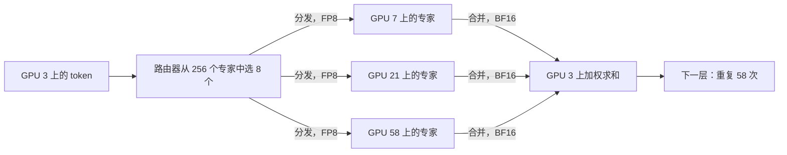
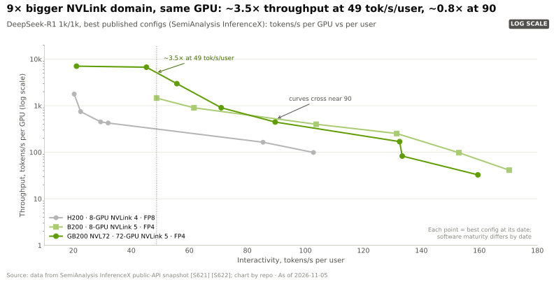

# 为何 NVLink 域规模对 MoE 与推理型模型至关重要

> [!NOTE]
> 本页为英文原文的简体中文参考译文，仅供参考；如有出入，以[英文原文](../../../layers/05-scale-up-nvlink-nvswitch/why-domain-size-matters.md "English original")为准。

第 05 层 · 纵向扩展（NVLink、NVSwitch）· 约 11 分钟阅读 · 最后核实：2026-11-05

## ⚡ 要点速览

- **[混合专家模型（MoE）](../../glossary.md#mixture-of-experts)让每一层都变成[全交换（all-to-all）](../../glossary.md#all-to-all)。** DeepSeek-V3 在 58 个 MoE 层中的每一层，都把每个 token 发送给 256 个专家中的 8 个 [[S5006]](../../../sources/bibliography.md#s5006)：每个 token 约产生 10 MB 流量（本资料库计算）。
- **域规模决定流量的去向。** 在 8 GPU 服务器上做 64 路[专家并行](../../glossary.md#expert-parallelism)时，87.5% 的流量需穿过网卡：在 [HGX](../../glossary.md#hgx) H200 上每个[解码（decode）](../../glossary.md#decode)步约需 22 ms，而在 GB300 [NVL72](../../glossary.md#nvl72) 中约为 1.4 ms（估计），对照的是约 50 ms 的单步时长 [[S5004]](../../../sources/bibliography.md#s5004)[[S5005]](../../../sources/bibliography.md#s5005)。
- **[宽专家并行（Wide EP）](../../glossary.md#wide-ep)节省内存：** 在 72 路 EP 下，每颗 GPU 只需保存约 9 GB 的 [FP8](../../glossary.md#fp8) 专家权重，而 8 路时约为 82 GB（本资料库据 [[S5006]](../../../sources/bibliography.md#s5006) 计算）；腾出的空间可被推理型模型用于 [KV 缓存](../../glossary.md#kv-cache)。
- **宣称与数据：** 英伟达称 GB200 NVL72 的 MoE 性能约为 HGX H200 的 10 倍 [[S5002]](../../../sources/bibliography.md#s5002)；基于相同芯片的数据显示，在偏重吞吐量的工作点约为 3 倍 [[S630]](../../../sources/bibliography.md#s630)，在高单用户速度下则没有优势（本资料库据 [[S621]](../../../sources/bibliography.md#s621) 计算）。
- **反方观点：** 谷歌通过 3D [环面（torus）](../../glossary.md#torus-topology)拓扑和[光路交换机（OCS）](../../glossary.md#optical-circuit-switch)把 9,216 颗 Ironwood TPU 连接成一个域 [[S232]](../../../sources/bibliography.md#s232)[[S237]](../../../sources/bibliography.md#s237)，规模大 128 倍；不过在 64 芯片立方体内，每颗芯片的全交换带宽约为 200 GB/s，而 NVL72 为 900（🔴 估计）。

## 1. MoE 让每一层都变成全交换

MoE 层的路由器为每个 token 挑选少数几个专门的子网络（专家）。专家分布在多颗 GPU 上，因此每一层都必须把每个 token [分发（dispatch）](../../glossary.md#dispatch-and-combine)到持有其专家的 GPU，再把结果合并（combine）回来：每颗 GPU 都要与许多其他 GPU 通信，每层两次。

> [!TIP]
> **算例 —— DeepSeek-V3 级模型搬运的字节数。** 隐藏维度 7,168，每 token 8 个专家，58 个 MoE 层 [[S5006]](../../../sources/bibliography.md#s5006)。FP8 分发：8 × 7,168 × 1 B = **57 KB**；[BF16](../../glossary.md#bf16) 合并：**115 KB**；整个模型合计**每 token 约 10 MB** [[S5004]](../../../sources/bibliography.md#s5004)。一颗每个解码步处理 128 个 token 的 GPU，**每层发送 22 MB**。在 8 GPU 服务器上做 64 路 EP 时，56/64 的流量离开服务器：19 MB ÷ 50 GB/s（400G [网卡](../../glossary.md#nic)）= **每层 385 µs，每步约 22 ms**；在 GB300 NVL72 中：22 MB ÷ 900 GB/s ≈ **每步 1.4 ms** [[S266]](../../../sources/bibliography.md#s266)[[S200]](../../../sources/bibliography.md#s200)。DeepSeek 实测内核每步约需 28 ms [[S5005]](../../../sources/bibliography.md#s5005)；按每用户约 20 tokens/s 计，每步约 50 ms [[S5004]](../../../sources/bibliography.md#s5004)。**结论：** 在 8 GPU 节点上，除非能被计算掩盖，全交换会吃掉每一步一半的时间；而在 NVL72 中几乎可以忽略。

🔧 技术细节：DeepSeek 如何围绕网络设计模型

- **节点受限路由。** DeepSeek-V3 让每个 token 至多从 8 个专家组中的 4 个里挑选专家 [[S5006]](../../../sources/bibliography.md#s5006)；训练时每个 token 至多访问 4 个节点 [[S34007]](../../../sources/bibliography.md#s34007)。
- **计算与通信重叠。** 两个微批次交替进行，一个计算时另一个通信 [[S5004]](../../../sources/bibliography.md#s5004)。更大的 [NVLink](../../glossary.md#nvlink) 域可减少对此类工程手段的依赖。

## 2. 宽专家并行与 KV 缓存共享

把专家分散到更多 GPU 上，每颗 GPU 需要存储和读取的专家就更少，从而腾出内存用于更大的批次和更长的上下文。DeepSeek 以 32 路 EP 运行[预填充（prefill）](../../glossary.md#prefill)（每 GPU 9 个路由专家），以 144 路 EP 运行解码（每 GPU 2 个）[[S5004]](../../../sources/bibliography.md#s5004)；72 GPU 的域能以 NVLink 速度运行这样的宽 EP。

> [!TIP]
> **算例 —— 腾出的内存与迁移的 KV。** DeepSeek-V3 的每个专家含三个 7,168 × 2,048 矩阵（约 44 M 参数）；256 个专家 × 58 层 ≈ FP8 下 **654 GB**（本资料库据 [[S5006]](../../../sources/bibliography.md#s5006) 计算）。8 路 EP 时每颗 GPU 需保存 **约 82 GB**；72 路时 **约 9 GB**，可在 288 GB 的 GB300 中腾出约 70 GB 用于 KV 缓存 [[S32004]](../../../sources/bibliography.md#s32004)。[MLA](../../glossary.md#multi-head-latent-attention) 每层每 token 存储 576 个值 [[S32009]](../../../sources/bibliography.md#s32009)，因此 32k token 的上下文在 BF16 下 ≈ **2.3 GB**：从预填充 GPU 交接到解码 GPU 时，经 NVLink 5 需 **2.6 ms**，经 800G 网卡需 **23 ms** [[S200]](../../../sources/bibliography.md#s200)[[S264]](../../../sources/bibliography.md#s264)。**结论：** 更大的域换来更大的批次和更廉价的 KV 交接，而这正是决定推理型模型每 token 成本的杠杆。

## 3. 英伟达的宣称与独立数据对比

| 对比项 | 来源 | 基准 | 倍数 | 注意事项 |
|---|---|---|---|---|
| GB200 NVL72，1.8T 参数 MoE | 英伟达，2024 年 3 月 [[S396]](../../../sources/bibliography.md#s396) | H100 | 最高 30 倍 | 厂商数据；FP4 对 FP8 |
| GB200 NVL72 运行 Kimi K2 Thinking、DeepSeek-R1、Mistral Large 3 | 英伟达，2025 年 12 月 [[S5002]](../../../sources/bibliography.md#s5002) | HGX H200 | 约 10 倍 | 厂商数据；配置未公开 [[S5003]](../../../sources/bibliography.md#s5003) |
| GB200 NVL72，Kimi K2.5，宽 EP | SemiAnalysis，2026 年 4 月 [[S630]](../../../sources/bibliography.md#s630) | B200（8 GPU） | 峰值 3.1 倍 | 相同 GPU 芯片 |
| GB200 NVL72，DeepSeek-R1 FP4 | 本资料库据 InferenceX 计算 [[S621]](../../../sources/bibliography.md#s621) | B200 | 每用户 49 tok/s 时约 3.5 倍，90 时约 0.85 倍 | 配置来自不同日期 |

> [!TIP]
> **算例 —— “10 倍”从何而来？** Blackwell 对比 Hopper：稠密 FP8 为 4.5 vs 1.98 [PFLOPS](../../glossary.md#flops)（2.3 倍），[HBM](../../glossary.md#hbm) 为 8 vs 4.8 TB/s（1.7 倍）[[S33003]](../../../sources/bibliography.md#s33003)[[S32002]](../../../sources/bibliography.md#s32002)；[FP4](../../glossary.md#fp4) 还能让算力再翻一倍：在计入任何 NVLink 效应之前即有约 2–4.5 倍，而基于相同芯片的数据则显示 NVLink 效应约为 2–3.5 倍 [[S630]](../../../sources/bibliography.md#s630)[[S621]](../../../sources/bibliography.md#s621)。**结论：** 10 倍是代际、数值格式、域规模与软件叠加的结果；应要求提供相同 GPU 下的对比数字。

## 4. 反方观点：TPU pod 与环面拓扑

谷歌让每颗 Ironwood TPU 以六条 [ICI](../../glossary.md#ici) 链路（1.2 TB/s）按 3D 环面与相邻芯片相连；光路交换机把 4×4×4 立方体拼接成 9,216 芯片的 pod，路径上没有分组交换机 [[S232]](../../../sources/bibliography.md#s232)[[S350]](../../../sources/bibliography.md#s350)[[S237]](../../../sources/bibliography.md#s237)。TPU 8t 把 ICI 翻倍至 2.4 TB/s，覆盖 9,600 颗芯片 [[S239]](../../../sources/bibliography.md#s239)。

| 维度 | 英伟达 NVL72（交换式） | 谷歌 TPU pod（环面 + OCS） | 对英伟达的评价 |
|---|---|---|---|
| 单个纵向扩展域的芯片数 | 72；计划 144 [[S262]](../../../sources/bibliography.md#s262)[[S510]](../../../sources/bibliography.md#s510) | 9,216（Ironwood）[[S232]](../../../sources/bibliography.md#s232) | 🟥 小得多 |
| 每芯片全交换带宽（估计） | 单向 900 GB/s，一跳 | 64 芯片立方体中约 200 GB/s（本资料库模型） | 🟩 利于 MoE |
| 相邻与环形流量 | 链路满速 | 链路满速 | 🟨 持平 |
| 交换芯片 | 每机架 18–36 颗 [[S262]](../../../sources/bibliography.md#s262)[[S203]](../../../sources/bibliography.md#s203) | 无；采用光学反射镜 [[S237]](../../../sources/bibliography.md#s237) | 🟦 成本与灵活性取舍 |
| 故障处理 | 更换托盘 [[S5007]](../../../sources/bibliography.md#s5007) | 绕开故障立方体重新路由 [[S237]](../../../sources/bibliography.md#s237) | 🟦 路线不同 |

> [!TIP]
> **算例 —— 环面算术。** 在 k × k × k 环面中，一条消息平均经过约 3k/4 跳，每一跳都占用链路容量；因此若有六条单向 b GB/s 的链路，每芯片的均匀全交换带宽约为 6b ÷ (3k/4) = **8b/k**（🔴 本资料库模型）。Ironwood：b = 1,200 ÷ 6 ÷ 2 = 100 GB/s [[S232]](../../../sources/bibliography.md#s232)；64 芯片立方体为 **约 200 GB/s**，4,096 颗芯片为 **约 50 GB/s**，而 NVL72 一跳即为 900 GB/s [[S200]](../../../sources/bibliography.md#s200)。**结论：** 环面在规模和成本上胜出，交换式在全交换上胜出；谷歌面向推理的 TPU 8i 采用跳数更少的“Boardfly”布局（1,152 颗芯片间 ≤ 7 跳）[[S239]](../../../sources/bibliography.md#s239)。

> [!NOTE]
> **🐂 看多观点：** 一跳可达的 72–144 GPU 域是运行 MoE 全交换最便宜的方式，AMD Helios 与 AWS Trn3（144 颗芯片）都在效仿交换式设计 [[S226]](../../../sources/bibliography.md#s226)[[S242]](../../../sources/bibliography.md#s242)。

> [!WARNING]
> **🐻 看空观点：** 软件正在缩小差距：DeepSeek 借助路由与重叠技术，在 8 GPU 的 H800 节点上实现了 EP144 推理服务 [[S5004]](../../../sources/bibliography.md#s5004)[[S5005]](../../../sources/bibliography.md#s5005)，而 B200 服务器在高交互速度下与 NVL72 持平 [[S621]](../../../sources/bibliography.md#s621)。如果模型主动适配网络，买家未必愿意为 NVL72 支付溢价。

## 🎯 企业发展视角

1. **模型架构追随互连网络。** DeepSeek 的节点受限路由 [[S5006]](../../../sources/bibliography.md#s5006) 表明，AI 实验室会围绕互连来设计模型；为 NVL72 调优的 MoE 层在其他平台上可能表现不佳，从而加深锁定效应。
2. **定价权建立在约 2–3.5 倍而非 10 倍之上。** 在[总拥有成本（TCO）](../../glossary.md#tco)模型中，相同芯片的数据 [[S630]](../../../sources/bibliography.md#s630)[[S621]](../../../sources/bibliography.md#s621) 才是衡量 NVL72 溢价的正确基准（见[第 08 层](../08-systems-racks-ai-factories/index.md)）。
3. **高通问题（仅基于公开信息）：** Dragonfly AI300 计划于 2028 年采用 [UALink](../../glossary.md#ualink) 与 [ESUN](../../glossary.md#esun) 实现[纵向扩展（scale-up）](../../glossary.md#scale-up) [[S90060]](../../../sources/bibliography.md#s90060)；要有竞争力地服务 2028 年时代的 MoE 模型，它需要多大的域规模和多少每芯片全交换带宽？

## 📚 来源（Sources）

<!-- Auto-generated from the [S…] citations on this page by `make build`. Edit sources/registry/*.csv, not this list. -->

- [**S200**](../../../sources/bibliography.md#s200) NVIDIA, *NVIDIA NVLink and NVLink Switch (product page with NVLink and NVLink Switch specification tables)*, 2026-09. [Link](https://www.nvidia.com/en-us/data-center/nvlink/)
- [**S203**](../../../sources/bibliography.md#s203) SemiAnalysis, *Vera Rubin - Extreme Co-Design: An Evolution*, 2026-01. [Link](https://newsletter.semianalysis.com/p/vera-rubin-extreme-co-design-an-evolution)
- [**S226**](../../../sources/bibliography.md#s226) AMD, *AMD Helios Rackscale Solution (product page)*, 2026. [Link](https://www.amd.com/en/products/rackscale-solutions/helios.html)
- [**S232**](../../../sources/bibliography.md#s232) Google Cloud, *TPU7x (Ironwood) - Cloud TPU documentation*, 2025-11. [Link](https://docs.cloud.google.com/tpu/docs/tpu7x)
- [**S237**](../../../sources/bibliography.md#s237) arXiv (Norman P. Jouppi et al.), *TPU v4: An Optically Reconfigurable Supercomputer for Machine Learning with Hardware Support for Embeddings (ISCA 2023)*, 2023-04. [Link](https://arxiv.org/abs/2304.01433)
- [**S239**](../../../sources/bibliography.md#s239) DatacenterDynamics, *Google unveils eighth-generation TPUs, two dedicated training and inference chips*, 2026-04-22. [Link](https://www.datacenterdynamics.com/en/news/google-unveils-eighth-generation-tpus-two-dedicated-training-and-inference-chips/)
- [**S242**](../../../sources/bibliography.md#s242) Amazon Web Services, *Amazon EC2 Trn3 instances (product page)*, 2025-12-02. [Link](https://aws.amazon.com/ec2/instance-types/trn3/)
- [**S262**](../../../sources/bibliography.md#s262) NVIDIA, *NVIDIA GB200 NVL72 (product page)*, 2024. [Link](https://www.nvidia.com/en-us/data-center/gb200-nvl72/)
- [**S264**](../../../sources/bibliography.md#s264) NVIDIA Newsroom, *NVIDIA Announces New Switches Optimized for Trillion-Parameter GPU Computing and AI Infrastructure (Quantum-X800, Spectrum-X800, ConnectX-8)*, 2024-03-18. [Link](https://nvidianews.nvidia.com/news/networking-switches-gpu-computing-ai)
- [**S266**](../../../sources/bibliography.md#s266) NVIDIA Newsroom, *NVIDIA Quantum-2 Takes Supercomputing to New Heights, Into the Cloud*, 2021-11-09. [Link](https://nvidianews.nvidia.com/news/nvidia-quantum-2-takes-supercomputing-to-new-heights-into-the-cloud)
- [**S350**](../../../sources/bibliography.md#s350) Google Cloud, *TPU7x (Ironwood) documentation*, 2025-11. [Link](https://docs.cloud.google.com/tpu/docs/tpu7x)
- [**S396**](../../../sources/bibliography.md#s396) NVIDIA Newsroom, *NVIDIA Blackwell platform arrives to power a new era of computing*, 2024-03-18. [Link](https://nvidianews.nvidia.com/news/nvidia-blackwell-platform-arrives-to-power-a-new-era-of-computing)
- [**S510**](../../../sources/bibliography.md#s510) KGI Securities, *NVIDIA GTC 2026 (research note)*, 2026-03-19. [Link](https://www.kgi.com.hk/zh-hk/-/media/files/kgishk/research-reports/tw-reports/nvidia-gtc-2026_19032026e.pdf)
- [**S621**](../../../sources/bibliography.md#s621) SemiAnalysis (InferenceX-app repository), *InferenceX public API snapshot (benchmarks.json and benchmarks-history.json fixtures)*, 2026-10-17. [Link](https://github.com/SemiAnalysisAI/InferenceX-app/tree/main/packages/app/cypress/fixtures/api)
- [**S630**](../../../sources/bibliography.md#s630) SemiAnalysis, *GB200 NVL72 vs B200 on Kimi K2.5: 3.1x from Wide EP vLLM*, 2026-04-23. [Link](https://github.com/SemiAnalysisAI/InferenceX-app/blob/main/packages/app/content/blog/gb200-nvl72-kimi-k2-5-vllm-wide-ep-3x-vs-b200.mdx)
- [**S5002**](../../../sources/bibliography.md#s5002) NVIDIA Blog, *Mixture of Experts Powers the Most Intelligent Frontier AI Models, Runs 10x Faster on NVIDIA Blackwell NVL72*, 2025-12-03. [Link](https://blogs.nvidia.com/blog/mixture-of-experts-frontier-models/)
- [**S5003**](../../../sources/bibliography.md#s5003) HotHardware, *NVIDIA Blackwell GPUs Supercharge MoE AI, Boosting Performance Up to 10X*, 2025-12. [Link](https://hothardware.com/news/nvidia-blackwell-moe-10x)
- [**S5004**](../../../sources/bibliography.md#s5004) DeepSeek-AI (GitHub open-infra-index) (DeepSeek-AI), *Day 6: One More Thing, DeepSeek-V3/R1 Inference System Overview*, 2025-03-01. [Link](https://github.com/deepseek-ai/open-infra-index/blob/main/202502OpenSourceWeek/day_6_one_more_thing_deepseekV3R1_inference_system_overview.md)
- [**S5005**](../../../sources/bibliography.md#s5005) DeepSeek-AI (GitHub) (DeepSeek-AI), *DeepEP: an efficient expert-parallel communication library (README v1.2.1)*, 2025. [Link](https://github.com/deepseek-ai/DeepEP/blob/v1.2.1/README.md)
- [**S5006**](../../../sources/bibliography.md#s5006) DeepSeek-AI (GitHub) (DeepSeek-AI), *DeepSeek-V3 inference configuration (config_671B.json)*, 2024-12-26. [Link](https://github.com/deepseek-ai/DeepSeek-V3/blob/main/inference/configs/config_671B.json)
- [**S5007**](../../../sources/bibliography.md#s5007) NVIDIA Docs, *DGX SuperPOD reference architecture (GB200): key components of the DGX SuperPOD*, 2025. [Link](https://docs.nvidia.com/dgx-superpod/reference-architecture-scalable-infrastructure-gb200/latest/dgx-superpod-components.html)
- [**S32002**](../../../sources/bibliography.md#s32002) NVIDIA, *NVIDIA H200 Tensor Core GPU (product page)*, 2023-11. [Link](https://www.nvidia.com/en-us/data-center/h200/)
- [**S32004**](../../../sources/bibliography.md#s32004) NVIDIA, *NVIDIA GB300 NVL72 / Blackwell Ultra (product page)*, 2025-03. [Link](https://www.nvidia.com/en-us/data-center/gb300-nvl72/)
- [**S32009**](../../../sources/bibliography.md#s32009) DeepSeek-AI via Hugging Face, *DeepSeek-V3 configuration (config.json)*, 2024-12-26. [Link](https://huggingface.co/deepseek-ai/DeepSeek-V3/blob/main/config.json)
- [**S33003**](../../../sources/bibliography.md#s33003) Lenovo Press, *ThinkSystem NVIDIA B200 180GB 1000W GPU product guide*, 2025. [Link](https://lenovopress.lenovo.com/lp2226-thinksystem-nvidia-b200-180gb-1000w-gpu)
- [**S34007**](../../../sources/bibliography.md#s34007) arXiv:2412.19437 (DeepSeek-AI), *DeepSeek-V3 Technical Report*, 2024-12-27. [Link](https://arxiv.org/abs/2412.19437)
- [**S90060**](../../../sources/bibliography.md#s90060) Qualcomm, *Qualcomm Dragonfly AI300 (product page)*, 2026-06. [Link](https://www.qualcomm.com/data-center/products/qualcomm-dragonfly-ai300)
