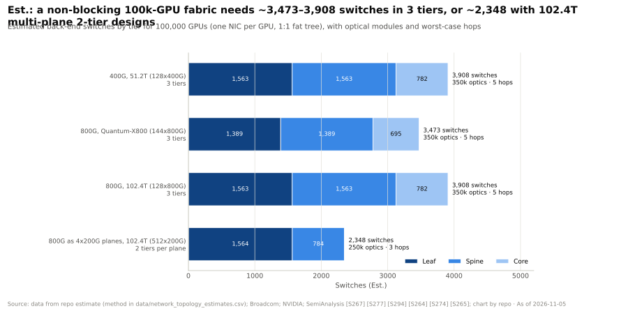
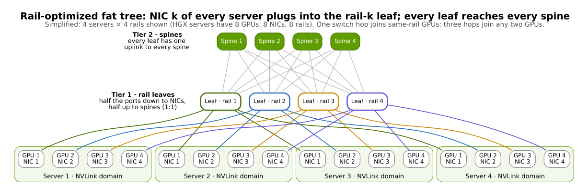
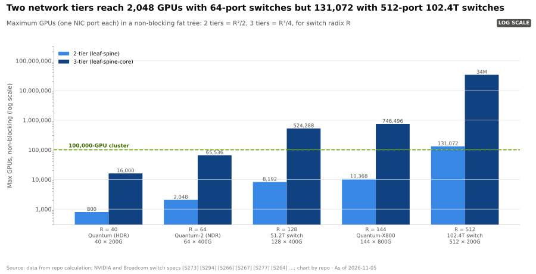
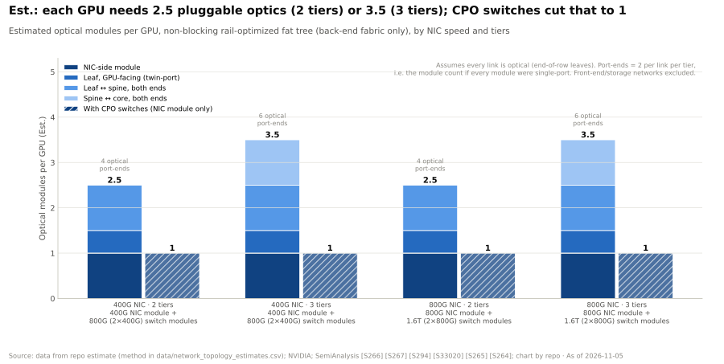

# 100,000 GPU 集群拓扑

> [!NOTE]
> 本页为英文原文的简体中文参考译文，仅供参考；如有出入，以[英文原文](../../../layers/06-scale-out-scale-across-networking/cluster-topologies-100k-gpus.md "English original")为准。

第 06 层 · 横向扩展与跨数据中心网络 · 约 8 分钟阅读 · 最后核实：2026-11-05

## ⚡ 要点速览

- **AI 集群以[轨道优化（rail-optimized）](../../glossary.md#rail-optimized)[胖树（fat tree）](../../glossary.md#fat-tree)方式构建：** 每台服务器的第 k 块[网卡（NIC）](../../glossary.md#nic)接入第 k 条轨道的叶交换机，而每台叶交换机都连到每台脊交换机 [[S34022]](../../../sources/bibliography.md#s34022)[[S294]](../../../sources/bibliography.md#s294)。
- **[交换机端口数（radix）](../../glossary.md#switch-radix)决定了规模上限。** 两层可容纳 R²/2 颗 GPU：144 端口的 Quantum-X800 为 10,368 颗，512 端口的 102.4 Tb/s 交换机为 131,072 颗；三层可容纳 R³/4 颗（估计）[[S264]](../../../sources/bibliography.md#s264)[[S274]](../../../sources/bibliography.md#s274)。
- **一张 100,000 GPU 的后端网络，若采用三层结构约需 3,500–3,900 台交换机和约 350,000 个光模块，** 若采用四平面两层设计则约需 2,350 台交换机和约 250,000 个光模块（估计）[[S294]](../../../sources/bibliography.md#s294)。
- **在多数估计中，网络约占 AI 集群硬件资本开支的 17–21%**（若计入建筑等整个站点则为 13%）[[S6025]](../../../sources/bibliography.md#s6025)[[S6026]](../../../sources/bibliography.md#s6026)[[S324]](../../../sources/bibliography.md#s324)；按英伟达自己的算法，仅光学器件就约为每颗 GPU $6,000 [[S6016]](../../../sources/bibliography.md#s6016)。
- **2024 年以来公开披露的最大网络均为以太网：** xAI 基于 [Spectrum-X](../../glossary.md#spectrum-x) 的 100,000 GPU 集群 Colossus [[S6000]](../../../sources/bibliography.md#s6000)、Meta 的 RoCE 集群 [[S6002]](../../../sources/bibliography.md#s6002)，以及甲骨文（Oracle）面向最多 800,000 颗 GPU 的多平面设计 [[S6008]](../../../sources/bibliography.md#s6008)。
- **对英伟达的不利之处：** 512 端口的商用芯片（博通（Broadcom）宣称 Tomahawk 6 用两层即可连接 100k+ 加速器 [[S274]](../../../sources/bibliography.md#s274)）使得不依赖英伟达交换机的扁平化、多供应商设计变得可行。

## 1. 轨道优化胖树

在胖树中，每台交换机一半端口向下、一半端口向上，因此越往上带宽也不会收窄（[全对分带宽](../../glossary.md#bisection-bandwidth)）。轨道优化在此基础上加了一层设计：每台 8 GPU 服务器的 1 号网卡接入“轨道 1”叶交换机，2 号网卡接入轨道 2，依此类推。集合通信库会先通过 [NVLink](../../glossary.md#nvlink) 把数据搬到位于正确轨道上的 GPU，因此大部分跨服务器流量只需经过一台交换机 [[S34022]](../../../sources/bibliography.md#s34022)。

> [!TIP]
> **算例 —— 轨道上的跳数。** 服务器 1 中的 GPU 3 向同一叶交换机下服务器 9 中的 GPU 3 发送数据：网卡 3 → 轨道 3 叶交换机 → 网卡 3，**一跳交换机**。若发往该服务器中的 GPU 5：要么走 3 跳（叶 → 脊 → 叶），要么先在本机通过 NVLink 一跳到 GPU 5，再在轨道 5 上走一跳交换机。
>
> **结论：** NVLink 域越大（[NVL72](../../glossary.md#nvl72) 中为 72 颗 GPU），触及上层网络的流量就越少。

## 2. 端口数计算：两层还是三层

| | 两层（叶–脊） | 三层（叶–脊–核心） | 多平面两层 |
|---|---|---|---|
| 端口数为 R 时的最大 GPU 数 | R²/2 | R³/4 | 每平面 R²/2；网卡带宽拆分到各平面 |
| 示例 | Quantum-X800 上 10,368 颗 | Quantum-X800 上 746,496 颗 | 512 × 200G 平面上 131,072 颗 |
| 100k GPU 所需交换机数（估计） | R = 144 时无法实现 | 3,473–3,908 | 2,348（4 个平面） |
| 每 GPU 光模块数（估计） | 2.5 | 3.5 | 2.5 |
| 最坏情况交换机跳数 | 3 | 5 | 3 |

本资料库在 `network_topology_estimates.csv` 中的计算，依据 [[S264]](../../../sources/bibliography.md#s264)[[S265]](../../../sources/bibliography.md#s265)[[S274]](../../../sources/bibliography.md#s274)[[S294]](../../../sources/bibliography.md#s294)。

> [!TIP]
> **算例 —— 100,000 颗 GPU 所需的交换机数量。** 在 Quantum-X800（R = 144，800G）上，每台叶交换机 72 个端口向下、72 个向上：
> - 叶交换机 100,000 ÷ 72 = **1,389** 台；脊交换机 **1,389** 台；核心交换机 100,000 ÷ 144 = **695** 台：合计 **3,473 台交换机**，最坏情况 5 跳。
> - 替代方案：把每块 800G 网卡拆成 4 × 200G，用 512 端口 102.4 Tb/s 交换机构建四个独立平面：每平面 391 台叶交换机 + 196 台脊交换机，总计 **2,348 台交换机**，3 跳，且单个平面故障只会损失四分之一的带宽（[多平面网络](../../glossary.md#multi-plane-network)）。
>
> **结论：** 高端口数可以省掉一层，节省约 1,100–1,600 台交换机和约 100,000 个光模块（估计）；甲骨文的 Acceleron 设计走的正是这条多平面路线 [[S6008]](../../../sources/bibliography.md#s6008)。

🔧 技术细节：为何是 R²/2 与 R³/4

在两层结构中，每台脊交换机与每台叶交换机各连一次，因此叶交换机最多 R 台，每台向 GPU 提供 R/2 个端口：R × R/2 = R²/2。第三层则由 R 个两层 pod 组成，每个 pod 含 R²/4 颗 GPU：R³/4。[超额订阅（oversubscription）](../../glossary.md#oversubscription)（向下端口多于向上端口）能让同样的交换机连接更多 GPU，代价是对分带宽下降；据报道，Meta 的 RoCE 设计在其汇聚层的超额订阅比约为 7:1（Lockwood 的解读）[[S6031]](../../../sources/bibliography.md#s6031)。

## 3. 需要多少光学器件，网络成本几何

按端口端点计算，三层网络每颗 GPU 需要六个，与黄仁勋所说的“六个光模块”一致 [[S6016]](../../../sources/bibliography.md#s6016)；共封装光学则去掉了交换机侧模块（见[共封装光学](co-packaged-optics.md)）。

> [!TIP]
> **算例 —— 100,000 颗 GB300 级 GPU 的网络账单。** 摩根士丹利估计一台 GB300 NVL72 约 $3.99M，即每颗 GPU 约 $55,400 [[S332]](../../../sources/bibliography.md#s332)：机架合计约 **$5.5B**。若网络占总额的 17–21% [[S6026]](../../../sources/bibliography.md#s6026)[[S324]](../../../sources/bibliography.md#s324)，则集群成本约 $6.6–7.0B，网络约 **$1.1–1.5B**，即每颗 GPU 约 $11,000–15,000，其中黄仁勋所说的约 $6,000 光学器件 [[S6016]](../../../sources/bibliography.md#s6016) 大约占一半（估计）。
>
> **结论：** 每 100k 颗 GPU 的网络是一笔超过约 $1B 的支出项。英伟达网络收入约占其数据中心收入的 20% [[S408]](../../../sources/bibliography.md#s408)[[S3]](../../../sources/bibliography.md#s3)，表明它获取了其中很大一部分，不过该数字包含 NVLink [纵向扩展（scale-up）](../../glossary.md#scale-up)交换机。

## 4. 真实集群的选择

| 集群 | GPU | 后端网络 | 说明了什么 |
|---|---|---|---|
| 微软 Azure Eagle（2023） | 14,400 颗 H100（TOP500 测试） | Quantum-2 NDR InfiniBand | 561 PFLOPS，TOP500 第 3 名 [[S6006]](../../../sources/bibliography.md#s6006) |
| Meta GenAI 集群（2024） | 2 × 24,576 颗 H100 | RoCE（Arista 7800）与 Quantum-2 InfiniBand；400G | Llama 3 在 RoCE 上训练 [[S6002]](../../../sources/bibliography.md#s6002)[[S34006]](../../../sources/bibliography.md#s34006) |
| xAI Colossus（2024） | 100,000 颗 H100；据报道达 200,000 颗 🟡 | Spectrum-X，三层，400G | 宣称吞吐量达 95% [[S6000]](../../../sources/bibliography.md#s6000)[[S6001]](../../../sources/bibliography.md#s6001) |
| 微软 Fairwater（2025） | GB200/GB300 NVL72；数量未披露 | 800G InfiniBand 与以太网；亚特兰大采用两层以太网（SONiC） | AI 广域网连接各站点 [[S6004]](../../../sources/bibliography.md#s6004)[[S6005]](../../../sources/bibliography.md#s6005) |
| 甲骨文 Zettascale10（目标 H2 2026） | 最多 800,000 颗 🟢 已宣布 | Acceleron RoCE，多平面 | 首个在 Stargate Abilene 建设 [[S6008]](../../../sources/bibliography.md#s6008) |

## 🎯 企业发展视角

1. **每 100k GPU 约 $1B 的网络价值池**（估计）由交换芯片、网卡、光学器件、线缆和集成商分享；层数、平面数和 [CPO](../../glossary.md#co-packaged-optics) 会让资金在它们之间转移。
2. **端口数具有战略意义。** 512 端口的商用交换机让[超大规模云厂商](../../glossary.md#hyperscaler)能够构建扁平化的多供应商网络 [[S274]](../../../sources/bibliography.md#s274)；英伟达的反制手段是交换机加 SuperNIC 的捆绑方案以及 CPO 的推出节奏。
3. **多平面设计有利于网卡掌控者。** 当网卡负责把流量拆分到各平面并绕开故障时 [[S6008]](../../../sources/bibliography.md#s6008)，智能就转移到了网卡中，从而提升网卡/DPU 业务的价值（[第 07 层](../07-dpu-supernic-storage-security/index.md)）。
4. **高通的问题（仅基于公开信息）：** 对于 2027–2028 年的推理机架 [[S90056]](../../../sources/bibliography.md#s90056)，采用商用以太网后端加第三方网卡是否足够？还是要赢得大规模部署，就必须拥有自己的网卡或网络合作伙伴？

## 📚 来源（Sources）

<!-- Auto-generated from the [S…] citations on this page by `make build`. Edit sources/registry/*.csv, not this list. -->

- [**S3**](../../../sources/bibliography.md#s3) StorageNewsletter, *NVIDIA Q2 Fiscal 2027 results coverage: revenue $96.2B*, 2026-08-27. [Link](https://www.storagenewsletter.com/2026/08/27/nvidia-fiscal-2q27-financial-results/)
- [**S264**](../../../sources/bibliography.md#s264) NVIDIA Newsroom, *NVIDIA Announces New Switches Optimized for Trillion-Parameter GPU Computing and AI Infrastructure (Quantum-X800, Spectrum-X800, ConnectX-8)*, 2024-03-18. [Link](https://nvidianews.nvidia.com/news/networking-switches-gpu-computing-ai)
- [**S265**](../../../sources/bibliography.md#s265) NVIDIA Newsroom, *NVIDIA Announces Spectrum-X Photonics, Co-Packaged Optics Networking Switches to Scale AI Factories to Millions of GPUs*, 2025-03-18. [Link](https://nvidianews.nvidia.com/news/nvidia-spectrum-x-co-packaged-optics-networking-switches-ai-factories)
- [**S274**](../../../sources/bibliography.md#s274) Broadcom, *Broadcom ships Tomahawk 6: world's first 102.4 Tbps switch*, 2025-06-03. [Link](https://investors.broadcom.com/news-releases/news-release-details/broadcom-ships-tomahawk-6-worlds-first-1024-tbps-switch)
- [**S294**](../../../sources/bibliography.md#s294) SemiAnalysis (Dylan Patel et al.), *100,000 H100 Clusters: Power, Network Topology, Ethernet vs InfiniBand, Reliability, Failures, Checkpointing*, 2024-06-17. [Link](https://semianalysis.com/2024/06/17/100000-h100-clusters-power-network/)
- [**S324**](../../../sources/bibliography.md#s324) fal.ai, *NVIDIA GB200 price in 2026: what a GPU, a tray and an NVL72 rack cost*, 2026. [Link](https://fal.ai/learn/serverless/nvidia-gb200-price)
- [**S332**](../../../sources/bibliography.md#s332) Tiger Brokers (iTiger), *Morgan Stanley's BOM analysis of NVIDIA's Rubin: GPU share declines; PCB, MLCC and ABF substrate values soar*, 2026-05-20. [Link](https://www.itiger.com/news/1188068712)
- [**S408**](../../../sources/bibliography.md#s408) NVIDIA Corporation, *NVIDIA Corp. (NVDA) Q2 Fiscal 2027 earnings call transcript (26 August 2026)*, 2026-08-26. [Link](https://s201.q4cdn.com/141608511/files/content_files/TRANSCRIPT_-NVIDIA-Corp-NVDA-US-Q2-2027-Earnings-Call-26-August-2026-5_00-PM-ET.pdf)
- [**S6000**](../../../sources/bibliography.md#s6000) TechPowerUp (NVIDIA press release), *NVIDIA Ethernet Networking Accelerates World's Largest AI Supercomputer, Built by xAI*, 2024-10-29. [Link](https://techpowerup.com/328227/nvidia-ethernet-networking-accelerates-worlds-largest-ai-supercomputer-built-by-xai)
- [**S6001**](../../../sources/bibliography.md#s6001) DatacenterDynamics, *xAI to double Colossus compute capacity, reveals cluster uses Nvidia Spectrum-X Ethernet*, 2024-10. [Link](https://datacenterdynamics.com/en/news/xai-to-double-colossus-compute-capacity-reveals-cluster-uses-nvidia-spectrum-x-ethernet)
- [**S6002**](../../../sources/bibliography.md#s6002) Engineering at Meta, *Building Meta's GenAI Infrastructure*, 2024-03-12. [Link](https://engineering.fb.com/2024/03/12/data-center-engineering/building-metas-genai-infrastructure/)
- [**S6004**](../../../sources/bibliography.md#s6004) Microsoft Official Blog, *Inside the world's most powerful AI datacenter (Fairwater)*, 2025-09-18. [Link](https://blogs.microsoft.com/blog/2025/09/18/inside-the-worlds-most-powerful-ai-datacenter/)
- [**S6005**](../../../sources/bibliography.md#s6005) Microsoft Official Blog, *Infinite scale: the architecture behind the Azure AI superfactory*, 2025-11-12. [Link](https://blogs.microsoft.com/blog/2025/11/12/infinite-scale-the-architecture-behind-the-azure-ai-superfactory/)
- [**S6006**](../../../sources/bibliography.md#s6006) The New Stack, *SC23: Microsoft now has the third-fastest computer in the world*, 2023-11. [Link](https://thenewstack.io/sc500-microsoft-now-has-the-third-fastest-computer-in-the-world/)
- [**S6008**](../../../sources/bibliography.md#s6008) Oracle, *Oracle Unveils Next-Generation Oracle Cloud Infrastructure Zettascale10 Cluster for AI*, 2025-10-14. [Link](https://www.oracle.com/news/announcement/ai-world-oracle-unveils-next-generation-oci-zettascale10-cluster-for-ai-2025-10-14/)
- [**S6016**](../../../sources/bibliography.md#s6016) optics.org, *NVIDIA reveals plan to scale AI factories with co-packaged optics*, 2025-03-19. [Link](https://www.optics.org/news/16/3/26)
- [**S6025**](../../../sources/bibliography.md#s6025) Reuters (via Investing.com), *How much does a GW of data center capacity actually cost?*, 2025-10. [Link](https://ng.investing.com/news/stock-market-news/how-much-does-a-gw-of-data-center-capacity-actually-cost-2169144)
- [**S6026**](../../../sources/bibliography.md#s6026) AMCompute (blog), *AI Cluster Cost Breakdown: CapEx (2026)*, 2026. [Link](https://www.amcompute.com/blog/ai-cluster-cost-breakdown-capex)
- [**S6031**](../../../sources/bibliography.md#s6031) glennklockwood.com (Glenn K. Lockwood), *Meta's H100 clusters (digital garden notes)*, 2024. [Link](https://glennklockwood.com/garden/systems/meta's-h100-clusters)
- [**S34006**](../../../sources/bibliography.md#s34006) arXiv:2407.21783 (Llama Team (AI @ Meta)), *The Llama 3 Herd of Models*, 2024-07-31. [Link](https://arxiv.org/abs/2407.21783)
- [**S34022**](../../../sources/bibliography.md#s34022) ACM SIGCOMM 2024 (Adithya Gangidi, Rui Miao, Shengbao Zheng et al. (Meta)), *RDMA over Ethernet for Distributed AI Training at Meta Scale*, 2024-08. [Link](https://doi.org/10.1145/3651890.3672233)
- [**S90056**](../../../sources/bibliography.md#s90056) HPCwire (Qualcomm press release), *Qualcomm unveils data center roadmap for the agentic AI era with new Dragonfly portfolio*, 2026-06-24. [Link](https://www.hpcwire.com/off-the-wire/qualcomm-unveils-data-center-roadmap-for-the-agentic-ai-era-with-new-dragonfly-portfolio/)
