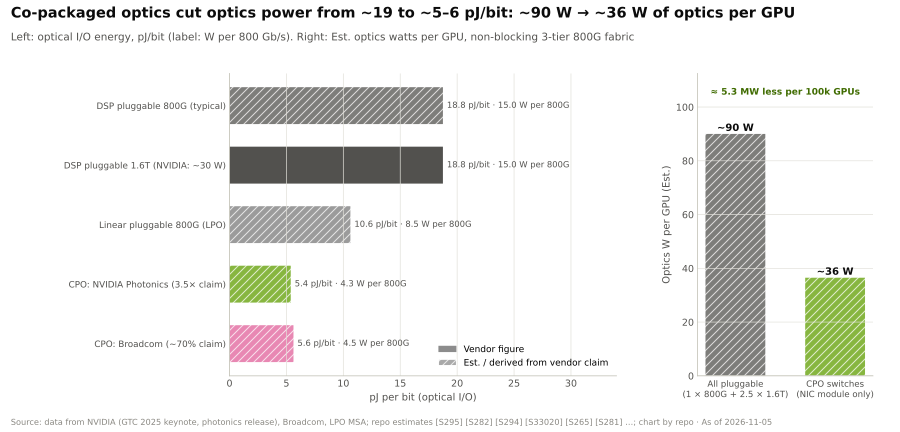
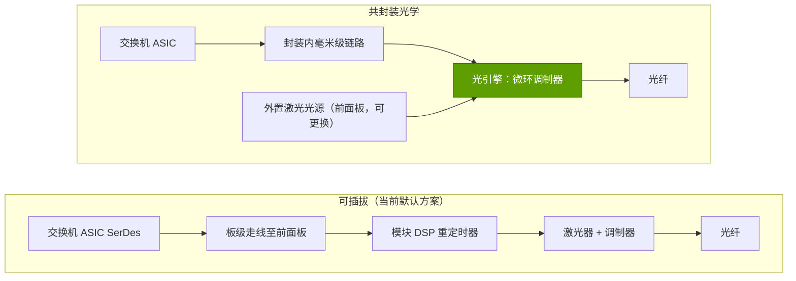
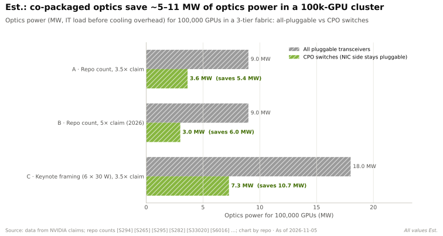

# 共封装光学

> [!NOTE]
> 本页为英文原文的简体中文参考译文，仅供参考；如有出入，以[英文原文](../../../layers/06-scale-out-scale-across-networking/co-packaged-optics.md "English original")为准。

第 06 层 · 横向扩展与跨数据中心网络 · 约 7 分钟阅读 · 最后核实：2026-11-05

## ⚡ 要点速览

- **光学器件正成为网络的功耗难题：** 每颗 GPU 约 6 个光模块，每个约 30 W、约 $1,000，即每颗 GPU 约 180 W、约 $6,000（黄仁勋）[[S6016]](../../../sources/bibliography.md#s6016)[[S6017]](../../../sources/bibliography.md#s6017)。
- **[共封装光学（CPO）](../../glossary.md#co-packaged-optics)** 把光引擎从前面板的[可插拔光模块](../../glossary.md#pluggable-transceiver)移到交换机封装上；按本资料库估计，每 100,000 颗 GPU 可节省约 5–11 MW 的光学器件功耗（估计）。
- **英伟达宣称功耗效率提升 3.5 倍、可靠性提升 10 倍（2025 年 3 月），** 并在 2026 年宣称 [Spectrum-X](../../glossary.md#spectrum-x) Photonics 功耗降低 5 倍、激光器数量减少 4 倍 [[S265]](../../../sources/bibliography.md#s265)[[S6020]](../../../sources/bibliography.md#s6020)。
- **产品：** Quantum-X Photonics（[InfiniBand](../../glossary.md#infiniband)，144 × 800G）和 Spectrum-X Photonics（以太网，最高约 400 Tb/s，2,048 × 200G 端口），基于台积电（TSMC）的 COUPE 工艺并采用[微环调制器](../../glossary.md#micro-ring-modulator) [[S90048]](../../../sources/bibliography.md#s90048)[[S90049]](../../../sources/bibliography.md#s90049)。
- **时间点：** 据报道，首批 InfiniBand CPO 部署在 2026 年初（CoreWeave、Lambda、TACC）🟡 [[S6022]](../../../sources/bibliography.md#s6022)；英伟达于 2026 年 6 月开始向部分合作伙伴交付 Spectrum-X CPO 交换机，并于 8 月宣布全面量产 🟡 [[S6019]](../../../sources/bibliography.md#s6019)[[S6020]](../../../sources/bibliography.md#s6020)。上量的证据仍然有限 🔴 [[S6021]](../../../sources/bibliography.md#s6021)。
- **症结在于可维护性：** 可插拔模块故障时可热插拔更换；共封装光引擎故障则可能意味着更换整台交换机；黄仁勋表示，对于 GPU 与 GPU 之间的链路，铜缆仍然更可靠 [[S6018]](../../../sources/bibliography.md#s6018)。

## 1. CPO 改变了什么

交换机 [ASIC](../../glossary.md#asic) 通过其电 [SerDes](../../glossary.md#serdes) 进行通信。在可插拔方案中，这些信号要穿过数英寸的电路板走线到达前面板，由模块中的 DSP 进行整形，再由激光器和调制器转换成光信号；在每通道 200 Gb/s 的速率下，驱动这段板级走线非常耗电。CPO 把光引擎放在同一封装上、距 ASIC 仅数毫米之处，因此电气跳接极短，DSP 也随之消失。激光器作为最易失效、对热最敏感的部件，则被置于前面板上可更换的[外置激光光源](../../glossary.md#external-laser-source)模块中。

一条折中路线是[线性可插拔光学（LPO）](../../glossary.md#linear-pluggable-optics)：去掉 DSP 但保留模块形态，功耗大约减半，代价是传输距离有所缩短 [[S295]](../../../sources/bibliography.md#s295)。

> [!TIP]
> **算例 —— 每个 1.6T 端口的功耗。** 英伟达给出 1.6T 可插拔模块约 30 W [[S33020]](../../../sources/bibliography.md#s33020)[[S6016]](../../../sources/bibliography.md#s6016)。其 3.5 倍的宣称意味着 CPO 下约 8.6 W；其 2026 年 5 倍的宣称意味着约 6 W [[S265]](../../../sources/bibliography.md#s265)[[S6020]](../../../sources/bibliography.md#s6020)。按每比特计：30 W ÷ 1,600 Gb/s ≈ 19 pJ/bit，对比约 5.4 pJ/bit。在一台 512 × 800G 的 Spectrum-X Photonics 系统上，256 个 1.6T 等效端口 × (30 − 8.6) W ≈ 每台交换机节省 **5.5 kW**（估计）。
>
> **结论：** 在超大规模下，节省量以兆瓦计；对受电力上限约束的站点而言，这些电力可以直接转化为更多 GPU。

## 2. 英伟达的光子交换机

| 交换机 | 网络类型 | 端口数 × 速率 | 容量 | 状态（2026-11） |
|---|---|---|---|---|
| Quantum-X Photonics Q3450 | InfiniBand XDR | 144 × 800G | 115.2 Tb/s，液冷 | 原定 2025 年底 [[S265]](../../../sources/bibliography.md#s265)；推迟至 2026 年初 [[S515]](../../../sources/bibliography.md#s515)；已有首批部署的报道 🟡 [[S6022]](../../../sources/bibliography.md#s6022) |
| Spectrum-X Photonics SN6810 | 以太网（Spectrum-6） | 128 × 800G 或 512 × 200G | 102.4 Tb/s | 自 2026 年 6 月起向部分合作伙伴交付 🟡 [[S6019]](../../../sources/bibliography.md#s6019) |
| Spectrum-X Photonics SN6800 | 以太网（4 × Spectrum-6，估计） | 512 × 800G 或 2,048 × 200G | 409.6 Tb/s | 2026 年 8 月宣布全面量产；自秋季起随 Vera Rubin 上量 🟡 [[S6020]](../../../sources/bibliography.md#s6020) |
| 博通 Bailly / Davisson | 以太网（商用） | 128 × 400G / 128 × 800G | 51.2 / 102.4 Tb/s | Bailly 自 2024 年起出货；Davisson 于 2025 年 10 月发布 [[S282]](../../../sources/bibliography.md#s282)[[S281]](../../../sources/bibliography.md#s281) |

规格：[[S265]](../../../sources/bibliography.md#s265)[[S90048]](../../../sources/bibliography.md#s90048)。合作伙伴包括台积电、Coherent、康宁（Corning）、富士康、Lumentum 和 SENKO [[S90049]](../../../sources/bibliography.md#s90049)。

> [!WARNING]
> **时间表相互矛盾：** Quantum-X Photonics 原定 2025 年底推出 [[S265]](../../../sources/bibliography.md#s265)[[S90048]](../../../sources/bibliography.md#s90048)，后又有报道称推迟至 2026 年初 [[S515]](../../../sources/bibliography.md#s515)；本资料库的事实核查未发现经确认的 2026 年客户出货，而 2026 年 6–8 月的报道描述了出货与“全面量产”[[S6019]](../../../sources/bibliography.md#s6019)[[S6020]](../../../sources/bibliography.md#s6020)，分析师则认为上量证据有限 [[S6021]](../../../sources/bibliography.md#s6021)。2026 年的出货量应视为 🟡 有报道。

## 3. 可靠性与可维护性之争

- **支持 CPO：** 没有 DSP、激光器减少 4 倍，意味着故障点更少；英伟达宣称可靠性提升 10 倍、平均事故间隔时间延长 10 倍 [[S265]](../../../sources/bibliography.md#s265)[[S6020]](../../../sources/bibliography.md#s6020)。
- **反对 CPO：** 故障的光引擎紧挨着昂贵的 ASIC，运营方失去了快速更换模块的能力，供应集中到交换机厂商手中，而且微环需要严格的温度控制。
- **率先落地之处：** 交换机——端口数和功耗最高的地方。[纵向扩展（scale-up）](../../glossary.md#scale-up)目前仍在机架内使用铜缆 [[S6018]](../../../sources/bibliography.md#s6018)（见[第 05 层](../05-scale-up-nvlink-nvswitch/index.md)）。

> [!TIP]
> **算例 —— 每个 100,000 GPU 集群节省的兆瓦数。** 在三层网络中，每颗 GPU 需要 1 个网卡侧模块（800G 约 15 W）加 2.5 个交换机侧 1.6T 模块（每个约 30 W）[[S294]](../../../sources/bibliography.md#s294)[[S33020]](../../../sources/bibliography.md#s33020)：
> - **可插拔：** 15 + 2.5 × 30 = 每颗 GPU 90 W → **9.0 MW**。
> - **CPO 交换机（3.5 倍）：** 15 + 2.5 × 8.6 = 36.4 W → **3.6 MW**，节省 **5.4 MW**（按 [PUE](../../glossary.md#pue) 1.2 计约 6.4 MW）。
> - **黄仁勋的口径**（每颗 GPU 六个 30 W 光模块 [[S6016]](../../../sources/bibliography.md#s6016)）：18 MW → 7.3 MW，节省 **10.7 MW**。
> - 按每颗 GB200 [NVL72](../../glossary.md#nvl72) GPU 全口径约 2 kW（每机架 145 kW）[[S340]](../../../sources/bibliography.md#s340) 计算，这些电力可再支撑 **约 2,700–5,300 颗 GPU**。
>
> **结论：** 对于受电力上限约束的 100k GPU 站点，CPO 带来约 3–5% 的容量增益，相当于价值数亿美元的算力（估计）。

🔧 技术细节：为何采用微环与外置激光器

微环调制器是直径仅数微米的环形结构，通过移动其谐振频率来开关光信号；它们远比大多数可插拔模块中的马赫-曾德尔（Mach-Zehnder）调制器更小、更省电，从而可以在交换机 ASIC 周围排布大量通道。谐振会随温度漂移，因此每个微环都需要主动调谐。让多个光引擎共享一个外置激光器，正是英伟达宣称激光器数量减少 4 倍的来由 [[S6020]](../../../sources/bibliography.md#s6020)。

## 🎯 企业发展视角

1. **价值从模块厂商转向交换机封装。** 如果 CPO 胜出，每颗 GPU 约 $6,000 的可插拔光学器件价值 [[S6016]](../../../sources/bibliography.md#s6016) 中有一部分将转移给交换机厂商及其光子供应商 [[S90049]](../../../sources/bibliography.md#s90049)；可插拔模块厂商面临产品结构风险。
2. **激光器是新的卡脖子环节：** 它是可更换、易失效且供应受限的部件；谁拥有磷化铟激光器产能？
3. **博通也在出货 CPO** [[S282]](../../../sources/bibliography.md#s282)[[S281]](../../../sources/bibliography.md#s281)，因此 CPO 本身并不构成英伟达的护城河；其优势在于与自家交换机加网卡平台的集成，以及与 Vera Rubin 的节奏配合。
4. **高通的问题（仅基于公开信息）：** 英伟达自己也在投资 Ayar Labs 等光 I/O 初创公司 [[S482]](../../../sources/bibliography.md#s482)；对于数据中心市场的新进入者而言，光子领域是否更适合以合作或少数股权投资这种更低成本的方式保持技术跟进？

## 📚 来源（Sources）

<!-- Auto-generated from the [S…] citations on this page by `make build`. Edit sources/registry/*.csv, not this list. -->

- [**S265**](../../../sources/bibliography.md#s265) NVIDIA Newsroom, *NVIDIA Announces Spectrum-X Photonics, Co-Packaged Optics Networking Switches to Scale AI Factories to Millions of GPUs*, 2025-03-18. [Link](https://nvidianews.nvidia.com/news/nvidia-spectrum-x-co-packaged-optics-networking-switches-ai-factories)
- [**S281**](../../../sources/bibliography.md#s281) Broadcom, *Broadcom Tomahawk 6-Davisson co-packaged optics Ethernet switch*, 2025-10. [Link](https://investors.broadcom.com/news-releases)
- [**S282**](../../../sources/bibliography.md#s282) Broadcom, *Broadcom delivers industry's first 51.2-Tbps co-packaged optics Ethernet switch platform (Bailly)*, 2024-03. [Link](https://investors.broadcom.com/news-releases)
- [**S294**](../../../sources/bibliography.md#s294) SemiAnalysis (Dylan Patel et al.), *100,000 H100 Clusters: Power, Network Topology, Ethernet vs InfiniBand, Reliability, Failures, Checkpointing*, 2024-06-17. [Link](https://semianalysis.com/2024/06/17/100000-h100-clusters-power-network/)
- [**S295**](../../../sources/bibliography.md#s295) LPO MSA, *Linear Pluggable Optics Multi-Source Agreement (LPO MSA)*, 2024. [Link](https://www.lpo-msa.org/)
- [**S340**](../../../sources/bibliography.md#s340) SemiAnalysis (Dylan Patel et al.), *Huawei AI CloudMatrix 384 - China's answer to Nvidia GB200 NVL72*, 2025-04-16. [Link](https://newsletter.semianalysis.com/p/huawei-ai-cloudmatrix-384-chinas-answer-to-nvidia-gb200-nvl72)
- [**S482**](../../../sources/bibliography.md#s482) Various (company announcements; Reuters, Bloomberg), *Reporting on NVIDIA participation in robotics, autonomy, photonics, storage and energy rounds (Figure AI, Wayve, Scale AI, Ayar Labs, Enfabrica, VAST Data, Sakana AI, TerraPower, Commonwealth Fusion Systems, Applied Digital, Recursion)*, 2025-09. [Link](https://www.reuters.com/technology/)
- [**S515**](../../../sources/bibliography.md#s515) Converge Digest, *NVIDIA debuts Spectrum-X and Quantum-X Photonics switches*, 2025-08. [Link](https://convergedigest.com/nvidia-debuts-spectrum-x-and-quantum-x-photonics-switches/)
- [**S6016**](../../../sources/bibliography.md#s6016) optics.org, *NVIDIA reveals plan to scale AI factories with co-packaged optics*, 2025-03-19. [Link](https://www.optics.org/news/16/3/26)
- [**S6017**](../../../sources/bibliography.md#s6017) Fierce Network, *Nvidia tries to balance data center power equation with co-packaged optics*, 2025-03. [Link](https://www.fierce-network.com/cloud/nvidia-tries-balance-data-center-power-equation-co-packaged-optics)
- [**S6018**](../../../sources/bibliography.md#s6018) The Star (Reuters), *Nvidia CEO says power-saving optical chip tech will need to wait for wider use*, 2025-03-19. [Link](https://www.thestar.com.my/tech/tech-news/2025/03/19/nvidia-ceo-says-power-saving-optical-chip-tech-will-need-to-wait-for-wider-use)
- [**S6019**](../../../sources/bibliography.md#s6019) Focus Taiwan (CNA), *Nvidia starts shipping TSMC-backed CPO switches (GTC Taipei / Computex 2026)*, 2026-06-03. [Link](https://focustaiwan.tw/business/202606030020)
- [**S6020**](../../../sources/bibliography.md#s6020) StorageReview, *NVIDIA Spectrum-X Ethernet Photonics enters full production with 4x fewer lasers and a five-vendor CPO supply chain*, 2026-08. [Link](https://storagereview.com/news/nvidia-spectrum-x-ethernet-photonics-enters-full-production-with-4x-fewer-lasers-and-a-five-vendor-cpo-supply-chain)
- [**S6021**](../../../sources/bibliography.md#s6021) remio, *NVIDIA put CPO switches into production, but the hard part starts now*, 2026-08. [Link](https://www.remio.ai/post/nvidia-put-cpo-switches-into-production-but-the-hard-part-starts-now)
- [**S6022**](../../../sources/bibliography.md#s6022) Fintool, *NVIDIA CPO webinar: co-packaged silicon photonics switches for gigawatt AI factories*, 2026-02. [Link](https://fintool.com/news/nvidia-cpo-webinar-ai-factories)
- [**S33020**](../../../sources/bibliography.md#s33020) NVIDIA (Jensen Huang), *NVIDIA GTC 2025 keynote (Jensen Huang)*, 2025-03-18. [Link](https://www.nvidia.com/gtc/keynote/)
- [**S90048**](../../../sources/bibliography.md#s90048) Converge Digest, *NVIDIA debuts Spectrum-X and Quantum-X Photonics switches*, 2025-03-18. [Link](https://convergedigest.com/nvidia-debuts-spectrum-x-and-quantum-x-photonics-switches/)
- [**S90049**](../../../sources/bibliography.md#s90049) Tom's Hardware, *Nvidia outlines plans for using light for communication between AI GPUs by 2026*, 2025-03. [Link](https://www.tomshardware.com/networking/nvidia-outlines-plans-for-using-light-for-communication-between-ai-gpus-by-2026-silicon-photonics-and-co-packaged-optics-may-become-mandatory-for-next-gen-ai-data-centers)
